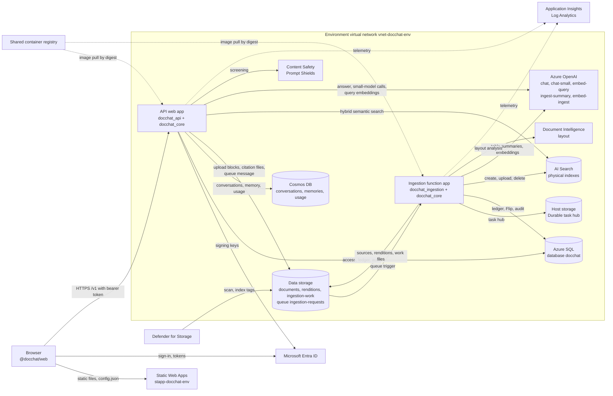

<div align="center">

# DocChat: a RAG app on Azure

A Retrieval-Augmented Generation (RAG) app built on Azure. Administrators upload documents, and the people of one organisation ask questions about them in natural language.


[](https://opensource.org/licenses/MIT)

</div>

> **Note:** This is a work in progress and under active development. If you spot a bug, please [open an issue](https://github.com/richie-rk/rag-app-azure/issues); report a vulnerability as [SECURITY.md](SECURITY.md) describes instead.

## Table of Contents

- [About the Project](#about-the-project)
  - [Why Azure OpenAI and Azure AI Search](#why-azure-openai-and-azure-ai-search)
  - [Tech Stack](#tech-stack)
  - [Features](#features)
- [Architecture](#architecture)
- [Repository Layout](#repository-layout)
- [Getting Started](#getting-started)
  - [Prerequisites](#prerequisites)
  - [Installation](#installation)
  - [Run Locally](#run-locally)
  - [Run the Tests](#run-the-tests)
- [Configuration](#configuration)
- [Usage](#usage)
- [Deployment](#deployment)
- [Roadmap](#roadmap)
- [Contributing](#contributing)
- [License](#license)

## About the Project

DocChat is a web application in which the people of one organisation ask questions in plain language and get streamed answers drawn only from documents that administrators have uploaded, with numbered citations that open the cited page. Retrieval combines keyword search, vector search and semantic ranking in a single Azure AI Search query, so answers stay grounded in your own content.

Documents live in indexes. A project maps one or more indexes and names a default one, and every chat turn in a project searches that project's default index, so different groups of users can work with separate document sets. Each deployment serves exactly one organisation, which is one Microsoft Entra ID tenant.

The design is written down in [docs/spec/](docs/spec/00-overview.md), its decisions in [docs/adr/](docs/adr/README.md), and its terms in [CONTEXT.md](CONTEXT.md).

### Why Azure OpenAI and Azure AI Search

If you're concerned about data privacy, you can use Azure OpenAI. It serves the same OpenAI models as the public API, but under your own Azure tenant and a contractual agreement with Microsoft: your prompts and documents stay in your chosen region and are not used to train the models. The result is data handling close to running your own model, without the cost and effort of actually hosting one.

Azure AI Search runs the hybrid query (keyword, vector and semantic ranking) in one call, and a single Search resource holds many independent indexes, so every DocChat index gets its own physical index under one service.

### Tech Stack

<details>
<summary>Frontend</summary>

- React 19 and TypeScript
- Fluent UI 9
- Vite
- MSAL for Microsoft Entra ID sign-in (redirect only)
- TanStack Query, with an API client generated from the committed OpenAPI contract

</details>

<details>
<summary>Backend</summary>

- Python 3.13, one uv workspace
- FastAPI on Gunicorn with Uvicorn workers (the API)
- Azure Functions with Durable Functions, in a custom container (ingestion)
- SQLAlchemy and Alembic migrations
- `docchat-ops`, the operator CLI

</details>

<details>
<summary>Data and AI</summary>

- Azure OpenAI (chat, small-model and embedding deployments)
- Azure AI Search (keyword, vector, semantic ranking)
- Azure AI Content Safety (Prompt Shields)
- Azure AI Document Intelligence (layout)
- Azure SQL Database (access, configuration, ingestion ledger, audit)
- Azure Cosmos DB (conversations, memory, usage)
- Azure Blob Storage and Queue Storage

</details>

<details>
<summary>Infrastructure</summary>

- Azure Static Web Apps, App Service and an Elastic Premium function app
- Private endpoints and user-assigned managed identities, with no keys
- Bicep templates, deployed with the Azure Developer CLI (azd) from GitHub Actions
- Application Insights and Log Analytics

</details>

### Features

- **Hybrid retrieval** that combines keyword search, vector search and semantic ranking in one Azure AI Search query, with one broadened search when confidence is low.
- **Streaming answers** built only from the retrieved sources.
- **Citations to the page**, where each numbered citation opens the cited page of a sanitised PDF rendition through the API.
- **Microsoft Entra ID sign-in** in a single tenant, with the `User` and `Admin` app roles granted in Entra ID.
- **Projects and indexes**, where each project maps one or more indexes and names its default, and access is denied by default.
- **Document ingestion** through an Azure Durable Functions pipeline for PDF, DOCX and PPTX files, with malware scanning and parsing in isolated child processes.
- **Two ingestion methods**, page-wise (one chunk per page or slide) and recursive (layout-aware sections packed to a target size with overlap), chosen per index.
- **Conversations** that reopen with their turns, with a rolling summary of older turns and follow-up suggestions after each answer.
- **User memory** that the user can see, edit, delete, clear and pause.
- **Feedback** on each answer.
- **Audited operations** through the `docchat-ops` command, with runbooks for each procedure.
- **Infrastructure as code** using Bicep templates, with no keys and private networking by default.

## Architecture

The app is made of three deployed components (the web client, the API and the ingestion app) plus a shared Python library. The chat and ingestion paths are independent: ingestion writes chunks and embeddings into an index, and chat reads from it. The browser calls only the API and Entra ID.



For the component map, trust boundaries and main flows, see [docs/spec/00-overview.md](docs/spec/00-overview.md). The API reference is the committed contract, [apps/api/openapi.json](apps/api/openapi.json).

## Repository Layout

```text
apps/
  api/          docchat_api: the FastAPI API and its committed OpenAPI contract
  ingestion/    docchat_ingestion: the Durable Functions ingestion app
  web/          @docchat/web: the React web client
packages/
  core/         docchat_core: the library shared by both apps and the operator CLI
db/             Alembic migrations for the SQL schema
infra/          Bicep templates, parameters and per-environment configuration
scripts/
  ops/          docchat-ops, the operator CLI
  ci/           CI checks
  bootstrap/    one-time tenant, subscription and repository set-up
  preflight/    region, quota and model preflight
  deploy/       azd hooks and deployment helpers
tests/
  support/      docchat-testing: the pytest plugin, fixtures and fakes
  model-stub/   the stubbed OpenAI-compatible model and Prompt Shields service
  integration/  integration tests that span packages
  deployed/     tests against a deployed environment
  infra/        tests of the compiled Bicep templates
  e2e/          the Playwright browser suites
  load/         k6 load scenarios
  fixtures/     fixture files shared by every test level
docs/
  adr/          the architecture decision records
  spec/         the design documents
  runbooks/     one file per operational runbook
```

Each app and package keeps its unit tests beside its source, under its own `tests/`. The full tree, what each directory owns and the import rules between packages are in [docs/spec/01-repository.md](docs/spec/01-repository.md#1-repository-tree).

## Getting Started

### Prerequisites

- An x86-64 machine: the local SQL Server image is published for `linux/amd64` only.
- Docker with Compose
- [uv](https://docs.astral.sh/uv/) 0.13.1 (the root `pyproject.toml` refuses any other version); it installs Python 3.13
- Node.js 24.21.0 (`.node-version`)
- For Azure work: [Azure CLI](https://learn.microsoft.com/cli/azure/) (`az`) 2.76.0 or later and the [Azure Developer CLI](https://learn.microsoft.com/azure/developer/azure-developer-cli/) (`azd`) 1.35.1 or later

### Installation

1. Clone the repository:

   ```bash
   git clone https://github.com/richie-rk/rag-app-azure.git
   cd rag-app-azure
   ```

2. Install the Python workspace from the lockfile, and the git hooks:

   ```bash
   uv sync --locked --all-packages --all-groups
   uv run --frozen pre-commit install
   ```

3. Install the web packages:

   ```bash
   npm ci --prefix apps/web
   npm ci --prefix tests/e2e
   ```

4. Write the git-ignored `.env` (see [Configuration](#configuration)):

   ```bash
   uv run docchat-ops --env local local init
   ```

### Run Locally

Start the local services from the repository root:

```bash
docker compose up -d --wait
```

This starts SQL Server, Azurite, the Cosmos DB emulator and the model stub, all on `127.0.0.1`. No Azure subscription is needed for them: the model stub stands in for Azure OpenAI and Prompt Shields.

To work on the web client, copy `apps/web/config.example.json` to `apps/web/config.local.json`, fill in your tenant, client and scope, and start the dev server on port 5173:

```bash
npm --prefix apps/web run dev
```

The dev server answers `/config.json` from `config.local.json` and proxies `/v1` and `/healthz` to the API named by `DOCCHAT_DEV_API_TARGET`, a local API process or the deployed `dev` API.

### Run the Tests

```bash
uv run pytest                    # the Python unit and integration suites (needs the compose services)
npm --prefix apps/web test       # the web unit and component suites
uv run --frozen pre-commit run --all-files   # Ruff, mypy, the web lint and type checks, gitleaks
```

The integration tests fail, never skip, when a compose service is down. The other levels (the browser suites, the compiled-template tests, the deployed tests and the load test) are described in [docs/spec/84-testing.md](docs/spec/84-testing.md); CI runs them through the workflows in [.github/workflows/](.github/workflows/).

## Configuration

Local settings live in a git-ignored `.env` file at the repository root. `docchat-ops --env local local init` writes it, with a generated password for the local SQL Server:

```bash
DOCCHAT_LOCAL_EMULATORS=
DOCCHAT_LOCAL_SQL_SA_PASSWORD=
```

The web client reads its settings at run time from `/config.json`. In development that is `apps/web/config.local.json` (git-ignored):

```json
{
  "tenantId": "<entra-tenant-id>",
  "clientId": "<web-app-client-id>",
  "apiBaseUrl": "http://localhost:5173",
  "apiScope": "api://<api-app-client-id>/docchat-api/access_as_user"
}
```

In Azure there are no keys or connection strings to set: the apps reach every service with managed identities. Deployment values are Bicep parameters (`infra/main.bicepparam` and `infra/env/<env>.json`), and runtime limits and switches are ops-config rows in SQL, changed with `docchat-ops`. Every setting is listed in [docs/spec/81-config.md](docs/spec/81-config.md).

## Usage

Sign in with a Microsoft Entra ID account that holds the `User` or `Admin` app role. An administrator creates a project and an index, uploads PDF, DOCX or PPTX files on the documents screen, and follows the ingestion run. Once it finishes, members of the project ask questions in chat and open the numbered citations to see the cited page.

The web client talks to one API, under `/v1`, described by [apps/api/openapi.json](apps/api/openapi.json); the only public route is `GET /healthz`. Operators use the `docchat-ops` command for audited procedures such as changing ops config, recovering ingestion and exporting or deleting a user's data, following the runbooks in [docs/runbooks/](docs/runbooks/).

## Deployment

Azure resources are defined by the Bicep templates in `infra/` and deployed with azd (`azure.yaml`) from GitHub Actions. Every merge to `main` is built once, scanned and deployed to `dev` by `deploy.yaml`; `prod` deploys the same images by digest after its reviewers approve.

A new environment is set up with two runbooks:

1. [R21: Bootstrap a tenant and subscription](docs/runbooks/R21-bootstrap-a-tenant-and-subscription.md), once.
2. [R22: First provision of an environment](docs/runbooks/R22-first-provision-of-an-environment.md), for each environment.

After that, [R01: Deploy](docs/runbooks/R01-deploy.md) and [R02: Rollback](docs/runbooks/R02-rollback.md) cover releases, and [R30](docs/runbooks/R30-decommission-an-environment.md) removes an environment. The delivery design is in [docs/spec/83-infrastructure.md](docs/spec/83-infrastructure.md).

## Roadmap

- [x] Page-wise chunking
- [x] Recursive chunking, with a target chunk size and overlap
- [ ] Retrieval-quality evaluation harness
- [ ] Chat restricted to one document
- [ ] More source types (audio, video, source code, multimodal content)

The open items are deferred, not designed; [docs/spec/00-overview.md](docs/spec/00-overview.md#32-deferred-and-kept-possible) lists them with what the current version keeps possible for each.

## Contributing

To suggest a feature or change, open an issue describing the proposal first, so the discussion happens before any code gets written. [CONTRIBUTING.md](CONTRIBUTING.md) covers setting up a machine, the pull request rules and when a change needs an architecture decision record; the [code of conduct](CODE_OF_CONDUCT.md) applies to every contributor.

## License

Released under the MIT License. See [LICENSE](LICENSE).
