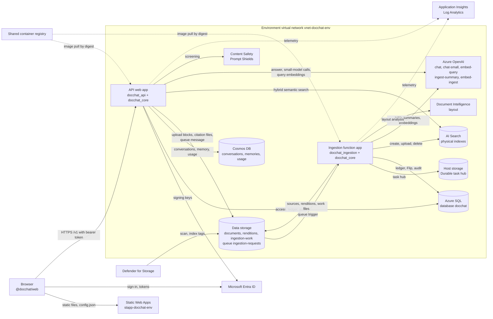
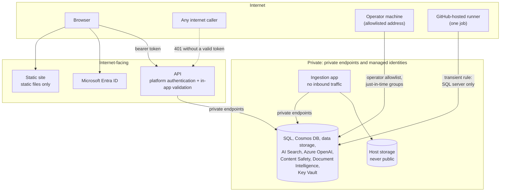
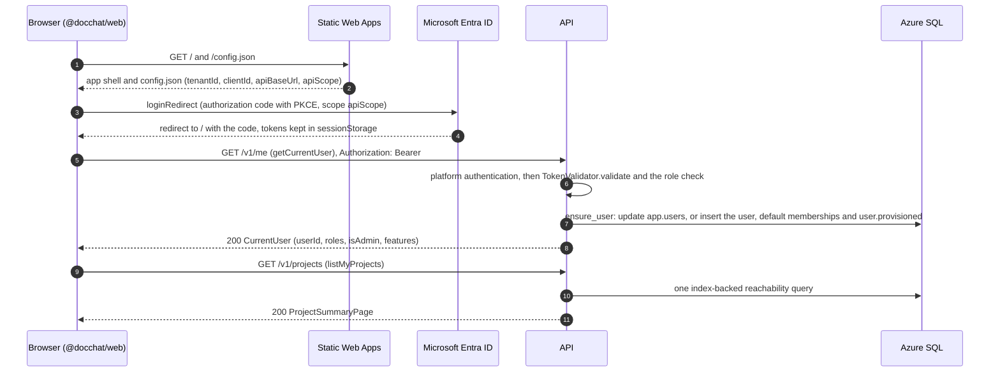
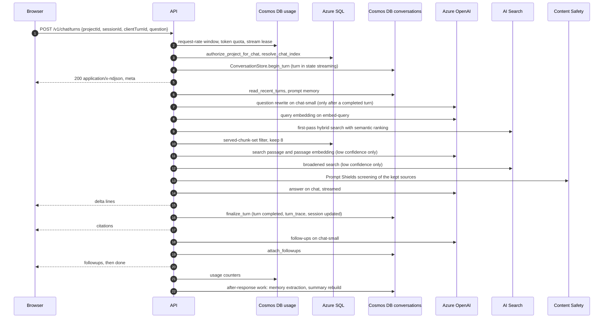
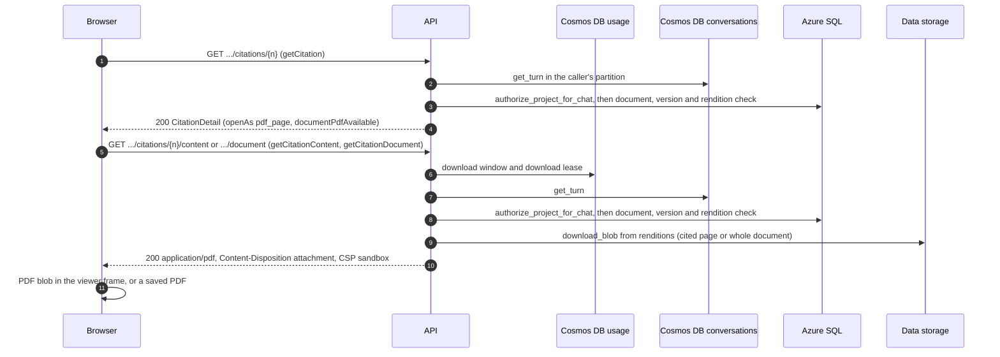
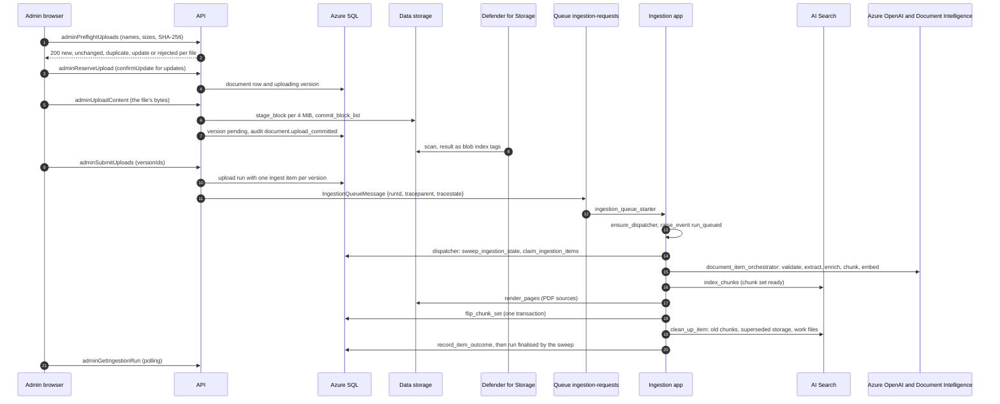
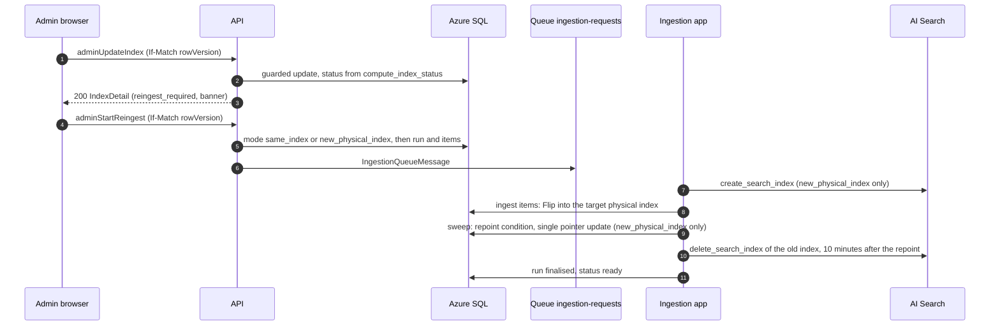
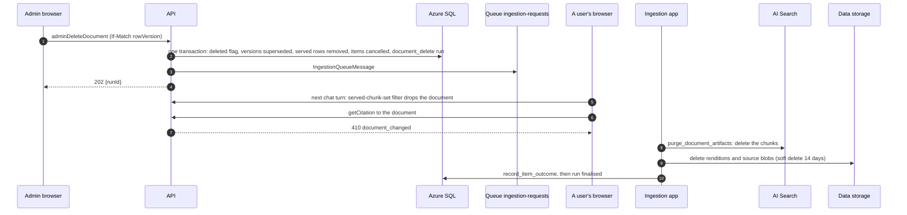
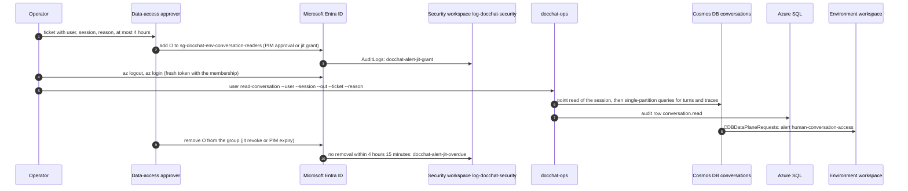

# 00 — Overview

This file is the entry point to the DocChat design. It says what the product is and who uses it, the goals of the first version with the scaling targets as numbers, what the first version leaves out and what it keeps possible, the components and the Azure services they call, the trust boundaries, the three environments, the main flows as sequence diagrams with a narrative for each step, how the rest of the design is organised, and the conventions every file follows. It defines no behaviour of its own: every step below names the file and section that specifies it, and where this overview and a component file differ, the component file decides. Its acceptance criteria are the definition of done for the first version as a whole.

## 1. The product and its users

### 1.1 What DocChat is

DocChat is a web application in which the people of one organisation ask questions in plain language and get streamed answers drawn only from documents that administrators have uploaded, with numbered citations that open the cited page. Documents live in indexes; a project maps one or more indexes and names one default index, and every chat turn in a project searches that project's default index (or an operator-set per-user override, `11-api.md` section 1.4). Each deployment serves exactly one organisation, which is one Microsoft Entra ID tenant; a second organisation is a second deployment with its own resources and its own app registrations (ADR 0002). Nothing in the code is specific to any client or industry: project instructions, example questions, documents and the method catalogue are data (`81-config.md` section 6.6).

The terms used across the design (project, logical and physical index, document, version, chunk set, served chunk set, session, turn, rolling summary, memory fact and the rest) are defined in `CONTEXT.md`.

### 1.2 Who uses it

| Actor | How they are identified | What they do | Specified in |
|---|---|---|---|
| User | Entra ID sign-in; app role `User` on the API registration | chats in, and opens citations from, the projects they belong to; reads and manages their own sessions, feedback and memory | `10-web-client.md` sections 7 and 8; `11-api.md` sections 3.2 to 3.6 |
| Administrator | Entra ID sign-in; app role `Admin` | everything a user does, in every project without a membership row; manages projects, members, index mappings, indexes and documents; watches ingestion runs; never reads another user's conversations or memory | `11-api.md` sections 1.4 and 3.7 to 3.12; `10-web-client.md` sections 7.5 to 7.10 |
| Operator | a named person in the standing group `sg-docchat-operators`, signed in to the Azure CLI | changes ops config and per-user index overrides, recovers ingestion, exports and deletes a user's data, reads conversation data, each through the operator command `docchat-ops` and only within a just-in-time group membership where data is involved | `86-operations.md`; `13-conversations-and-memory.md` section 10 |
| Data-access approver | an owner of the just-in-time groups, holding no data right | grants an operator a just-in-time membership of at most 4 hours, never to themselves | `13-conversations-and-memory.md` section 10.1 |
| Delivery pipeline | GitHub Actions jobs signed in through federated workload identities | builds, scans and deploys every release; runs migrations; holds no standing data access | `83-infrastructure.md` sections 6 and 10 |

Admin status is granted in Entra ID through app-role assignment and never inside DocChat. A tenant user with no app role is refused with `403 role_not_assigned` (`11-api.md` section 1.2). The first administrators and the test identities are set up by the runbook "First admins and test identities" (`86-operations.md`).

## 2. Goals

### 2.1 Functional goals

1. **One way in.** People sign in with Microsoft Entra ID in their own tenant only; the API checks every token twice, once in platform authentication and once in the application (`11-api.md` section 1.2, ADR 0017). On a user's first authenticated request the API creates their user row and a membership in every project flagged default at that moment (`11-api.md` section 3.2.1, ADR 0021).
2. **Grounded chat.** A question in a project gets a streamed answer built only from the sources retrieved from that project's index, with citation markers turned into numbered citations; the API alone decides the index, the prompt, the model deployments and the limits, and the browser sends only the project, the session, a client turn ID and the question (`12-chat-pipeline.md` section 1.1).
3. **Retrieval that degrades gracefully.** Every turn runs a hybrid keyword and vector search with semantic ranking over the active physical index, keeps only chunks of the chunk set served for each document, and runs one broadened search when confidence is low (`12-chat-pipeline.md` sections 6 and 7, ADR 0061).
4. **Citations to the page.** A citation opens through the API only, for every format as its single cited page of a sanitised PDF rendition, with a download of the whole document as one sanitised PDF; DOCX and PPTX sources are converted to PDF in the ingestion sandbox, and no uploaded file ever reaches a reader (`12-chat-pipeline.md` section 16, `10-web-client.md` section 8.14, ADR 0069, ADR 0152).
5. **Conversations that last.** Sessions are listed newest first and reopen with their turns; older turns fold into a rolling summary; up to three follow-up suggestions follow each answer; users rate any of their own answers (`13-conversations-and-memory.md` sections 4, 6 and 8, `12-chat-pipeline.md` section 13).
6. **User memory under the user's control.** Durable facts are extracted from the user's own questions only, shown on their own screen, and can be edited, deleted, cleared and paused (`13-conversations-and-memory.md` section 7).
7. **Document administration.** Administrators upload PDF, DOCX and PPTX files with a preflight that names new, unchanged, duplicate, updated and rejected files, confirm each update, delete documents, re-ingest one document or a whole index, and follow each run's progress (`14-ingestion.md` sections 2, 7 and 8, `10-web-client.md` sections 7.7 to 7.10).
8. **Two ingestion methods.** The page-wise method (one chunk per page or slide, tables as summaries plus sanitised HTML) and the recursive method (layout-aware sections packed to a target size with overlap) are rows of one method catalogue, chosen per index (`14-ingestion.md` sections 9 to 11).
9. **Changes readers never see half-done.** A new version, a re-ingest and a change of embedding model all become visible to readers in one SQL transaction (the Flip, or the repoint), so readers see either the old chunks or the new ones and never a gap (`14-ingestion.md` sections 6.9 and 8.9, ADRs 0040 and 0045).
10. **Operations through audited commands.** Ops-config changes, per-user index overrides, ingestion recovery, user data export and deletion, and reading conversation data go through `docchat-ops`, each writing an audit row (`86-operations.md`, `13-conversations-and-memory.md` section 10.5).

### 2.2 Quality goals

| Goal | What it means in the first version | Specified in |
|---|---|---|
| Deny by default | every route and data path authorises on the server from token claims and SQL; a resource the caller can't reach answers `404`, an admin route called by a non-admin answers `403`; the only public route is `GET /healthz` | `11-api.md` section 1.4; `82-security.md` section 3; ADR 0020 |
| No keys anywhere | every service-to-service call uses a user-assigned managed identity; key-based and shared-key access is disabled on every data and AI service; Key Vault is empty | `83-infrastructure.md` section 6; `82-security.md` section 8 |
| Private by default | data and AI services are reached through private endpoints; the API is the only internet-facing compute | `83-infrastructure.md` section 4; section 5 of this file |
| Untrusted document content | sources are screened with Prompt Shields before they reach the answer prompt; memory is extracted only from the user's question; answers render without images, and a link renders only when it appears verbatim in a source used for the answer | `12-chat-pipeline.md` sections 8 and 11.5; `10-web-client.md` section 9; `82-security.md` section 5 |
| Async and stateless | every I/O call on a request path is non-blocking; no instance holds state another request needs, so any instance serves any request | ADR 0006; `11-api.md` section 1.15; `84-testing.md` (the event-loop guard) |
| Configuration over code | runtime limits and switches live in SQL ops config, deployment values in Bicep parameters, and domain content in product tables | `81-config.md` section 1.1 |
| One trace per request | the browser's `traceparent` starts a trace that follows the request through the API, the queue, the dispatcher and every activity; the user sees its trace ID as the reference ID | `85-observability.md` section 2 |
| No content in telemetry | no question, answer, source, fact, file name or token reaches a span, metric, event or log record | `85-observability.md` sections 1.7 and 3; ADR 0014 |
| Accessible | the web client meets WCAG 2.2 level AA | `10-web-client.md` section 11 |
| Bounded cost | per-user request rates, concurrent streams and daily and monthly token quotas; budgets with alerts per environment | `12-chat-pipeline.md` section 3; `83-infrastructure.md` section 12.7 |
| No dormant code | no module, route, setting, dependency or resource that no shipped feature uses; the only feature switches are `followups.enabled`, `memory.enabled` and `feedback.comments_enabled`, each default `true` | ADR 0002 |
| Tested to a measured bar | line coverage at least 90% for `docchat_core` and 85% for `docchat_api` and `docchat_ingestion`; every module has its unit test file unless it is listed as exempt with a reason | `01-repository.md` section 5.5; `84-testing.md` |

### 2.3 Scaling targets

Each target is a number, and the load test in the `load` environment proves it with machine-checked pass criteria (`84-testing.md`, the load test; ADR 0134). The load test runs on production SKUs with the model stub in place of Azure OpenAI (ADR 0112), so it measures the platform's own capacity.

| Target | Number | How it is measured |
|---|---|---|
| Event loop | 100 concurrent chat streams on one API instance of the smallest production size (P1v3, 2 Gunicorn workers) with zero errors, while a cheap authenticated endpoint (`getCurrentUser`) keeps p95 latency at or under 200 ms | the event-loop scenario: autoscale held at one instance, 100 streaming users held for 9 minutes beside 20 cheap requests a second |
| Statelessness | any instance serves any request; stopping one instance fails only the streams that instance held | the statelessness scenario: autoscale lowered from 3 to 2 instances mid-run, and every failed request traced to the removed instance |
| Scale-out | autoscale adds an instance when the API plan's average CPU stays above 70% for 5 minutes, and the cheap endpoint's p95 stays at or under 200 ms | the scale-out scenario: the scale-up event in the Activity Log, tied to five minutes of CPU above 70% |
| Ingestion | a 200-document run at parallelism 1 finishes with no throttling failures; at parallelism 4 it takes at most half as long; throttled model calls are retried without failing a document | the ingestion scenario: two sets of 200 documents, with the model stub throttling every 20th ingestion model request |
| Data access | every chat-path Cosmos DB query is single-partition, and every request-path SQL query is index-backed | the chat-path Cosmos DB audit and the request-path SQL plan test, on the release commit |

The autoscale rules these targets rely on: out when `CpuPercentage` averages above 70 over 5 minutes (+1 instance, cooldown 5 minutes), in when it averages below 35 over 10 minutes (−1, cooldown 10 minutes); `prod` runs 2 to 6 instances (`83-infrastructure.md` section 2.3). All five targets pass at the acceptance of the hardening stage (`90-build-order.md`), and the first four pass once more before any `prod` deploy that changes the API or ingestion plan SKU, the Gunicorn worker settings, the Durable concurrency settings, the AI Search tier or replica count, or adds a model call to the chat path (runbook "Run the load test", `86-operations.md`).

## 3. Non-goals and deferred scope

### 3.1 Non-goals

These are outside the product by design, not postponed (ADR 0002):

1. **Any other way in.** No password, local account, social or second identity provider, guest tenant or Static Web Apps authentication; every registration is single tenant.
2. **More than one organisation per deployment.** No key, path or query carries an organisation or tenant identifier.
3. **An API gateway.** No Azure API Management, Front Door, application gateway or firewall; authentication, authorisation, rate limits, quotas and problem details live in the API.
4. **Direct browser access to Azure services.** The browser calls only the API and Entra ID; no storage URL, key or service endpoint reaches it, and the Content Security Policy allows connections only to the site, the API and Entra ID (`10-web-client.md` sections 3.4 and 10.9, `82-security.md` section 7).
5. **Other model providers or file types.** Model calls go only to the Azure OpenAI deployments declared in Bicep; uploads accept exactly PDF, DOCX and PPTX.
6. **Admin access to conversations.** No route lets an administrator read another user's sessions or memory; humans reach conversation data only through the just-in-time procedure of section 7.7.
7. **Dormant code.** No feature flag for an unbuilt feature, no stub for later work, and no code without a caller; CI enforces this with Ruff `ERA`, deptry and the test-layout check (`01-repository.md` section 5).

### 3.2 Deferred, and kept possible

None of these is designed, stubbed or flagged in the first version. Each keeps a hook that the first version builds for its own reasons (ADR 0002):

| Deferred item | What the first version keeps possible |
|---|---|
| Retrieval-quality evaluation harness | each finalised turn's write-once `turn_trace` holds the standalone query, the retrieved chunk IDs with their scores and the answer call as sent to the model (`13-conversations-and-memory.md` section 1.8, ADR 0071) |
| Retrieval over conversation history | turns are stored per session with stable UUIDv5 IDs, so embedding them later needs no data migration (ADRs 0056 and 0071) |
| Personas or a prompt library | project instructions are data, and the answer prompt is assembled in one step with one defined message order (`12-chat-pipeline.md` section 9, ADR 0063) |
| Audio and video transcription; source-code repositories; vision and multimodal content | an ingestion method is code plus one catalogue row, and index schemas are versioned (`14-ingestion.md` section 9, ADRs 0044 and 0046) |
| PII detection and anonymisation | the answer prompt is assembled in exactly one place, where a redaction step fits (ADR 0063) |
| Chat restricted to one document | every chunk carries a filterable `documentId` (`80-data-model.md` section 6.3, ADR 0044) |
| User-initiated deletion of chat sessions | sessions are kept indefinitely; retention is the default-TTL parameter `conversationRetentionDays`, 0 (off) by default (`13-conversations-and-memory.md` section 9, ADR 0032) |
| Other identity providers and multiple organisations | identity is resolved in one module, `docchat_core.auth`, from validated token claims (ADR 0017) |
| A web application firewall in front of the API | the API is the single public entry point |
| Voice input and read-aloud answers | the chat input and the answer view are self-contained components that call no speech API |
| Egress filtering and private monitoring ingestion | both apps use VNet integration from the first version, and address ranges are reserved (`83-infrastructure.md` section 4.1, ADR 0109) |
| Customer-managed encryption keys | each environment's Key Vault exists in RBAC mode, empty |

## 4. Component map

### 4.1 Components

DocChat is three deployables, one shared package and the Azure services they call. The repository layout and the import rules between packages are `01-repository.md` sections 1 to 3.

| Component | Code | Runs on | Does | Specified in |
|---|---|---|---|---|
| Web client | `@docchat/web`, `apps/web`: React 19, TypeScript, Vite, Fluent UI React v9 (the only component library), MSAL for React | Azure Static Web Apps `stapp-docchat-<env>`: static files only, no linked backend, no managed functions, no platform sign-in | every screen; sign-in with the authorization code flow and PKCE; the NDJSON reader for chat; answer rendering; calls only the API and Entra ID | `10-web-client.md` |
| API | `docchat_api`, `apps/api`: FastAPI under Gunicorn with `DocChatUvicornWorker` | a Linux container on the App Service web app `app-docchat-api-<env>-<token>` (plan `asp-docchat-api-<env>`) | every `/v1` operation: current user and projects, chat turns and their streams, sessions, feedback, citations, memory, administration, uploads | `11-api.md`, `12-chat-pipeline.md`, `13-conversations-and-memory.md`, `14-ingestion.md` section 2 |
| Ingestion app | `docchat_ingestion`, `apps/ingestion`: Azure Functions for Python with Durable Functions | a custom Linux container on the Elastic Premium function app `func-docchat-ingest-<env>-<token>` (plan `asp-docchat-ingest-<env>`) | the queue starter, the singleton dispatcher, one sub-orchestration per document, index lifecycle, parsing in an isolated child process; it has no HTTP trigger and accepts no inbound traffic | `14-ingestion.md`; ADRs 0003 and 0005 |
| Shared package | `docchat_core`, `packages/core` | inside both apps and the operator CLI | settings, Azure clients, token validation, authorisation, the SQL data-access layer, ops config, Cosmos DB document models, the search schema and filter builder, the method interface, telemetry, audit | `01-repository.md` section 2.2 |
| Schema migrations | `db` (Alembic, workspace member `docchat-db`) | the deploy job, as a member of the SQL server's Entra administrator group | every SQL schema change, expand then contract | `80-data-model.md` section 2.24 |
| Operator CLI | `docchat-ops`, `scripts/ops` | an operator's allowlisted machine, signed in through the Azure CLI | ops config, per-user index overrides, just-in-time grants, user data export, deletion and conversation reads, ingestion recovery, trace lookup | `86-operations.md`; `13-conversations-and-memory.md` section 10 |
| Model stub | `docchat_model_stub`, `tests/model-stub` | Docker Compose locally and in CI; the App Service app `app-docchat-stub-load-<token>` in `load` only | an OpenAI-compatible endpoint with controlled timings and throttling; no production code refers to it | `84-testing.md` (the model stub); `83-infrastructure.md` section 2.21; ADR 0112 |

| Azure service | Resource | Used by | For | Specified in |
|---|---|---|---|---|
| Microsoft Entra ID | per environment: a web client registration, an API registration with scope `access_as_user` and app roles `Admin` and `User`; in `dev` and `load` a test client | browser, API | sign-in, access tokens, signing keys | `83-infrastructure.md` section 7 |
| Azure SQL Database | server `sql-docchat-<env>-<token>`, database `docchat`, schema `app` | API, ingestion app, operator CLI, migrations | configuration, access, audit trail, ingestion ledger | `80-data-model.md` section 2 |
| Azure Cosmos DB for NoSQL | account `cosmos-docchat-<env>-<token>`, database `docchat`, containers `conversations`, `memories`, `usage` | API; the operator CLI under just-in-time access | sessions, turns, turn traces, memory, usage counters, rate windows and stream leases | `80-data-model.md` section 3 |
| Azure Storage, data account | `stdocchatdata<env><token>`: containers `documents`, `renditions`, `ingestion-work`; queues `ingestion-requests`, `ingestion-requests-poison` | API, ingestion app | uploaded files and the PDFs DOCX and PPTX files were converted to (Cool tier), single-page and whole-document PDF renditions, work files, the ingestion hint queue | `80-data-model.md` sections 4 and 5 |
| Azure Storage, host account | `stdocchathost<env><token>` | ingestion app only | the Functions host and the Durable task hub `docchat<env>` | `83-infrastructure.md` section 2.12 |
| Azure AI Search | `srch-docchat-<env>-<token>` | API (queries), ingestion app (index lifecycle and chunk writes) | one physical index per generation of each logical index | `80-data-model.md` section 6 |
| Azure OpenAI | `oai-docchat-<env>-<token>`, deployments `chat`, `chat-small`, `embed-query-te3-large-v1` (API) and `ingest-summary`, `embed-ingest-te3-large-v1` (ingestion app); absent in `load` | API, ingestion app | answers, question rewrites, search passages, follow-ups, summaries, memory extraction, embeddings, table summaries | `83-infrastructure.md` section 5; `12-chat-pipeline.md` section 17 |
| Azure AI Content Safety | `cs-docchat-<env>-<token>`, Prompt Shields `text:shieldPrompt` | API | screening sources and memory facts | `12-chat-pipeline.md` section 8; `13-conversations-and-memory.md` section 7.10 |
| Azure AI Document Intelligence | `di-docchat-<env>-<token>`, layout model | ingestion app | the recursive method's layout analysis | `14-ingestion.md` section 11 |
| Microsoft Defender for Storage | malware scanning on the data account (on in `prod`; in `dev` only while its deployed scan test runs) | platform | scanning every upload and writing the result as blob index tags | `83-infrastructure.md` section 2.11; `14-ingestion.md` section 5.4 |
| Azure Key Vault | `kv-docchat-<env>-<token>`, RBAC mode | nothing in the first version | empty; kept for third-party secrets and customer-managed keys | `83-infrastructure.md` section 2.15 |
| Azure Container Registry (shared) | `crdocchat<sharedToken>` in `rg-docchat-shared` | the App Service platform, through each app's managed identity | the API, ingestion and model-stub images, deployed by digest | `83-infrastructure.md` sections 2.16 and 10.8 |
| Log Analytics and Application Insights | `log-docchat-<env>`, `appi-docchat-<env>`; the security workspace `log-docchat-security` | both apps, platform diagnostics, alert rules | traces, metrics, events, logs, dashboards, alerts | `85-observability.md`; `83-infrastructure.md` sections 2.18 and 12 |

The five model deployments, their models and versions are Bicep parameters, never constants in code (`81-config.md` section 4.3): `chat` serves `gpt-5.6-sol`, and `chat-small` and `ingest-summary` serve `gpt-5.6-terra`, both at version `2026-07-09`; the two embedding deployments serve `text-embedding-3-large` version `1`, at 1,024 dimensions by default; every deployment defaults to the `GlobalStandard` type (`83-infrastructure.md` section 5.3, ADR 0099; versions confirmed on 2026-10-14). The ingestion app has deployments of its own, so a bulk upload never takes quota from chat.

### 4.2 Calls between components

Every arrow inside the environment network travels through a private endpoint and signs in with the caller's user-assigned managed identity: `id-docchat-api-<env>` for the API and `id-docchat-ingest-<env>` for the ingestion app (`83-infrastructure.md` sections 6.1, 6.5 and 6.6). The API holds no Document Intelligence or Key Vault right; the ingestion app holds no Cosmos DB or Content Safety right. Each store's readers and writers are listed in `80-data-model.md` section 1.2. In `load`, both apps' model calls go to the model stub through its private endpoint in place of Azure OpenAI (`83-infrastructure.md` section 2.21).

### 4.3 Principles every component follows

1. **Async end to end, stateless compute.** Every request-path call is awaited on the event loop; no instance keeps state between requests, and the 60-second in-process caches (the ops-config snapshot and the index-record cache) are copies of SQL rows (ADR 0006, `80-data-model.md` section 1.1).
2. **One store per kind of data.** SQL holds configuration, access and the ingestion ledger; Cosmos DB holds conversations, memory and usage; Blob Storage holds files; AI Search holds chunks (`80-data-model.md` section 1.1).
3. **The API is the only door.** The browser never reaches a data or AI service; the ingestion app is reached only through the queue and SQL, and it re-reads every item's state from SQL before acting on a message (`14-ingestion.md` section 1.2).
4. **Every query is parameterised.** SQL goes through SQLAlchemy Core bound parameters (Ruff rule S608 forbids string-built SQL), Cosmos DB through query parameters, and AI Search filters only through the filter builder in `docchat_core.search` (`01-repository.md` section 6.2, `80-data-model.md` section 6.8).
5. **Shared logic lives once.** Anything two deployables or tools use lives in `docchat_core`; no code is copied between apps (`01-repository.md` section 2.1).

## 5. Trust boundaries

| Boundary | Rule | Specified in |
|---|---|---|
| Internet to static site | The browser receives only static files and the four public values of `config.json` (tenant ID, client ID, API base URL, API scope); the site holds no data and no secret, and its built-in sign-in routes answer `404`. | `10-web-client.md` sections 2.1 and 3.6; `82-security.md` section 7 |
| Internet to API | The API is the only internet-facing compute and the single public entry point. Platform authentication answers `401` to a request without a valid token before it reaches code; the API then validates the token itself (signature, issuer, audience, expiry, tenant, authorised party, scope, role) and checks every identifier in the request on the server: project, index and document access in SQL, and conversation, memory and usage data only inside the caller's own Cosmos DB partition. `GET /healthz` is the one public route. Identity comes only from the validated claims, never from a header or body field the browser sets. | `11-api.md` sections 1.2 to 1.4; `83-infrastructure.md` section 2.4 |
| Apps to data and AI services | Every call travels through a private endpoint in the environment's virtual network and authenticates with the app's managed identity; no service accepts a key. | `83-infrastructure.md` sections 4.4 and 6; `82-security.md` section 8 |
| Into the ingestion app | Public network access is disabled and no function has an HTTP trigger; work arrives only as a queue message carrying a run ID and trace context, and every item's state is re-read from SQL. The Durable management endpoints and keys are exposed to no one. | `14-ingestion.md` sections 3 and 4; `83-infrastructure.md` section 4.5 |
| Ingestion parent to parse child | Document bytes are parsed only in a child process with no identity and hard resource limits. | `14-ingestion.md` section 4; `82-security.md` section 6 |
| Document content to everything else | Text from uploaded documents is untrusted at every hop: sources are screened before the answer prompt, model output is data that the server never executes or fetches, and answers render through the sanitising pipeline. | `12-chat-pipeline.md` sections 8 and 11; `10-web-client.md` section 9; `82-security.md` section 5 |
| People to stores | Operators reach a data or AI service directly only from an address in the environment's operator allowlist (`operatorIpAllowlist`, at most 20 IPv4 addresses); with an empty allowlist every such service except the SQL server has public access disabled, and the SQL server keeps no standing rule. Conversation and user data are reachable only through a just-in-time group membership of at most 4 hours, granted by a second person and alerted. | `83-infrastructure.md` section 4.5; `13-conversations-and-memory.md` section 10 |
| Pipeline to Azure | Each job signs in as one federated identity bounded by role-assignment conditions, Deny policies, locks and alerts it can't change; a GitHub-hosted runner reaches the SQL server or the shared container registry only through a transient firewall rule that its own job adds and removes, and these rules count as part of the operator allowlist. | `83-infrastructure.md` sections 4.6, 6.8, 6.11 and 12 |

Log Analytics and Application Insights keep public ingestion and query endpoints with local authentication off; the Functions host storage account never has public access (`83-infrastructure.md` section 4.5). The threat model, its assets and actors, and the residual risks accepted in the first version are `82-security.md` section 1.

## 6. Environments

Every environment deploys the same `infra/main.bicep` with its own environment file `infra/env/<env>.json`, so `dev`, `prod` and `load` differ only in parameters (`83-infrastructure.md` section 1.1, ADR 0095). Only `prod` is production.

| | `dev` | `prod` | `load` |
|---|---|---|---|
| Lifetime | long-lived | long-lived | one load-test run: created by the load-test workflow and emptied after it |
| Purpose | integration, live and deployed tests, the first stop of every release | the only production environment | proving the scaling targets of section 2.3 |
| Identity rules | non-production: the test client and the `dev` test users exist | no test client, no test user, an empty Key Vault | non-production: the test client and the `load` test users exist |
| Static Web Apps | Free | Standard | Free |
| API plan | Basic B1, 1 instance | Premium v3 P1v3, autoscale 2 to 6 | Premium v3 P1v3, autoscale 1 to 6 |
| Ingestion plan | Elastic Premium EP1, always ready 1, burst 2 | EP2, always ready 1, burst 4 | EP2, always ready 2, burst 4 |
| Azure SQL Database | serverless `GP_S_Gen5_2`, auto-pause after 15 minutes | provisioned `GP_Gen5_2` | provisioned `GP_Gen5_2` |
| Cosmos DB | serverless | autoscale, zone-redundant | autoscale, zone-redundant |
| Storage accounts | Standard_LRS | Standard_ZRS | Standard_ZRS |
| AI Search | basic, 1 replica | standard S1, 2 replicas | standard S1, 2 replicas |
| Azure OpenAI | the five deployments | the five deployments, with larger capacities | none: both apps call the model stub |
| Malware scanning | off, except while its deployed test runs | on | off |
| Budget (USD a month) | 650 | 2,200 | 400 |

The full inventory, with every SKU, capacity and retention, is `83-infrastructure.md` section 2.1. Each environment has its own resource group (`rg-docchat-dev`, `rg-docchat-prod`, `rg-docchat-load`), virtual network, Entra registrations and deploy identity; the shared container registry and the test-credential vault live in `rg-docchat-shared`, and the pipeline identities and the security alerts in `rg-docchat-identity`, where no pipeline identity holds a role (`83-infrastructure.md` section 1.3). The test client signs test users in with the resource owner password credentials flow, in `dev` and `load` only, for deployed and load tests; test users are cloud-only accounts, excluded from the tenant's multi-factor authentication policies and confined by the Conditional Access policy `DocChat test users: non-production APIs only` to the non-production API and test client, and their passwords rotate every 30 days (`83-infrastructure.md` section 7, `84-testing.md` (test identities), runbooks "First admins and test identities" and "Test-user password rotation" in `86-operations.md`). On a developer machine the apps run against Docker Compose services: SQL Server, Azurite, the Cosmos DB emulator and the model stub (`84-testing.md` section 2, `81-config.md` section 2.11).

Every release is built once and deployed by image digest, to `dev` first and then, after approval, to `prod` (`83-infrastructure.md` sections 10.6 to 10.8).

## 7. Main flows

Each flow is a sequence diagram followed by a numbered narrative; each numbered step matches the arrows of the same number and names the file and section that specifies it. The diagrams show the successful path; each step's refusals and failure behaviour are in the cited section.

### 7.1 Sign-in and the first request

1. **Static files.** The browser loads the app shell and `config.json` from Static Web Apps; `config.json` holds only the tenant ID, the web client ID, the API base URL and the API scope, written at deploy time for each environment (`10-web-client.md` sections 2.1 and 4.2 steps 1 to 3).
2. **Configuration.** A missing or invalid `config.json` ends at the Configuration error screen; nothing else starts (`10-web-client.md` section 4.2 step 3).
3. **Sign-in.** MSAL, configured with the tenant's own authority and `sessionStorage` as its cache, finds no account in this tenant and calls `loginRedirect` with the one scope `config.apiScope`; the client uses redirects only, never a popup or a hidden frame (`10-web-client.md` sections 4.1 and 4.2 step 6).
4. **Return.** `handleRedirectPromise` completes the authorization code flow with PKCE; the access token and refresh token stay in session storage, and later tokens come from `acquireTokenSilent` with the refresh token (`10-web-client.md` sections 4.2 step 5, 4.3 and 4.4).
5. **First API call.** `getCurrentUser` is the first call after sign-in and every other query waits for it (`10-web-client.md` section 4.7; `11-api.md` section 3.2.1).
6. **Two authentication layers.** Platform authentication answers a request without a valid token with `401` before it reaches code; the API then validates the token itself (signature against cached tenant signing keys, issuer, audience, expiry, `tid`, `azp`, scope `access_as_user`) and requires the `User` or `Admin` role, answering `403 role_not_assigned` without one, which the client shows as the Not assigned screen (`11-api.md` sections 1.2 and 1.3; `10-web-client.md` section 4.9).
7. **First-sign-in provisioning.** `ensure_user` updates the caller's `app.users` row, or, when none exists, inserts it, inserts a membership with `grant_source` `default` for every project with `is_default = 1` at that moment and writes the audit row `user.provisioned`, in one transaction; a process skips the step for 15 minutes after it ran for that user. Flagging a project default later never adds memberships for existing users (`11-api.md` section 3.2.1, ADR 0021).
8. **Identity from the token.** `CurrentUser` takes `userId`, `roles` and `isAdmin` from the validated token, never from the stored row, and `features` from the ops-config snapshot; admin screens render only when `isAdmin` is true, and only the API's checks protect data (`11-api.md` section 3.2.1; `10-web-client.md` section 4.7).
9. **Reachable projects.** `listMyProjects` returns every active project to an administrator and the active projects with a membership row to anyone else (`11-api.md` section 3.2.2).
10. **One query.** Reachability is one index-backed SQL query on every request, so a revoked membership takes effect at the next request (`11-api.md` sections 1.4.4 and 1.4.6).
11. **Shell.** An empty first page shows the No projects state, asking a user to contact an administrator; otherwise the chat screen opens with the project picker (`10-web-client.md` sections 4.7 and 4.9).

### 7.2 A chat turn

1. **The request.** The browser sends only the project, the session (absent for a new session), a client turn ID from `crypto.randomUUID()` and the question; never an index, model, prompt or option (`10-web-client.md` section 8.6; `12-chat-pipeline.md` section 2.1). Token, role and provisioning run first, then the body checks (32,768 bytes, `ChatTurnRequest`) (`11-api.md` section 1.3, chat steps 1 and 2).
2. **Limits.** In the caller's `usage` partition: the request-rate window (`429 rate_limited`), the day and month token quota (`429 token_quota_exceeded`) and a stream lease (`429 too_many_streams`); each fails closed with `503 dependency_unavailable` when Cosmos DB can't answer (`12-chat-pipeline.md` sections 2.2 and 3.2 to 3.4).
3. **Access and index.** `authorize_project_for_chat` admits an administrator, or a member of the project, while the project is active (`404 project_not_found` otherwise); `resolve_chat_index` picks the caller's unexpired per-user override for the project, else the project's default index, and resolves it to its active physical index (`409 project_index_unavailable` when either is missing); an index under re-ingest or rebuild keeps serving from its active physical index (`11-api.md` section 1.4.3; `12-chat-pipeline.md` section 2.2).
4. **The turn.** `ConversationStore.begin_turn` loads or creates the session in the caller's own partition (a session paired with another project is `404 session_not_found`), allows one streaming turn per session (`409 turn_in_progress`), detects a duplicate `clientTurnId` and replays a completed turn without a model call, and creates the turn in state `streaming` with deterministic IDs (`13-conversations-and-memory.md` sections 2.2 to 2.5; `12-chat-pipeline.md` section 4).
5. **The stream starts.** `200` with `application/x-ndjson`; the first line is `meta` with the session and turn IDs. From here on every failure is an `error` event, and exactly one terminal event, `done` or `error`, ends the stream; a `heartbeat` follows 15 seconds without output (`12-chat-pipeline.md` sections 14.1 to 14.4).
6. **History and memory.** The recent turns, the rolling summary and, when memory is on and not paused, the user's memory lines are read; failed and cancelled turns are never history; `ensure_post_turn_work` schedules overdue after-response work (`12-chat-pipeline.md` section 4.4; `13-conversations-and-memory.md` sections 3.5, 6.5 and 7.15).
7. **Question rewrite.** When the session has a summary or an earlier completed turn, chat-small turns the question into a standalone search query within 8 seconds (`chat.rewrite_timeout_seconds`); on a session's first turn, and on any failure, the question is searched as written (`12-chat-pipeline.md` section 5, section 17.2).
8. **Query embedding** with the physical index's query-embedding deployment and dimensions (`12-chat-pipeline.md` section 6.2).
9. **First-pass search.** One hybrid keyword and vector request with semantic ranking against the active physical index, 50 candidates (`12-chat-pipeline.md` section 6.3, ADR 0061).
10. **Served-chunk-set filter.** Chunks whose chunk set isn't the one served for their document in that physical index are dropped by one SQL query over `app.served_chunk_sets`, then the first 8 survivors are kept; filtering before the cut is what makes document updates atomic for readers (`12-chat-pipeline.md` section 6.5).
11. **Broadened search, first half.** When fewer than `retrieval.min_confident_results` (default 1) of the kept results reach `retrieval.reranker_threshold` (default 2.0 on the service's 0 to 4 reranker scale) and the first response wasn't partial, the client receives the `status` event `search_broadened`, and chat-small writes a short search passage, which is embedded (`12-chat-pipeline.md` sections 7.1 and 7.2, section 17.3).
12. **Broadened search, second half.** One more hybrid request with semantic ranking carries the standalone query and two vectors (query and passage); its filtered results replace the first set; a failure keeps the first results (`12-chat-pipeline.md` section 7.2).
13. **Screening.** Prompt Shields screens every kept source; a flagged source is dropped and reported, and when screening is unavailable after its retry the turn fails closed with `source_screening_unavailable` (`12-chat-pipeline.md` section 8).
14. **Prompt and answer.** The prompt is assembled in one defined order within the token budget measured with the model's own tokenizer (platform rules and project instructions, the context message with memory and summary, earlier turns, sources, the question) and the answer streams from the chat deployment (`12-chat-pipeline.md` sections 9 and 10, ADR 0063).
15. **Deltas.** Answer text streams as `delta` lines; citation markers that name a provided source become citation tokens, and any other marker is dropped (`12-chat-pipeline.md` sections 11.1 and 11.2; `10-web-client.md` sections 8.7 and 8.8).
16. **Finalisation.** As soon as the answer ends, `finalize_turn` writes the completed turn, its write-once `turn_trace` and the session in one transactional batch, which frees the session for the next question (`12-chat-pipeline.md` section 12.4; `13-conversations-and-memory.md` section 2.6).
17. **Citations.** The `citations` event carries each citation's number, title, page or heading path and the answer's allowed links; the stream lease is released and the client re-enables input (`12-chat-pipeline.md` sections 11.3 to 11.5).
18. **Follow-ups.** When `followups.enabled` is true, chat-small proposes up to three questions the top sources can answer, within 5 seconds; a failure skips them (`12-chat-pipeline.md` section 13, section 17.5).
19. **Store, then show.** `attach_followups` stores them on the turn before the `followups` event is written (`12-chat-pipeline.md` section 13.4; `13-conversations-and-memory.md` section 2.7).
20. **The last events.** The `followups` event, when there are follow-ups, then `done` with the turn ID and usage (`12-chat-pipeline.md` sections 14.2 and 14.3).
21. **Usage.** The shielded finaliser awaits every usage write to the day and month counters and releases a lease still held, whatever ended the turn; a client disconnect before the answer ends cancels the model calls within 1 second and saves the turn as `cancelled` with its partial answer, while a disconnect after it leaves the turn `completed` (`12-chat-pipeline.md` sections 12.5, 14.6 and 15.6).
22. **After the response.** For a `completed` turn the finaliser calls `schedule_post_turn_work`, an in-process tracked task that extracts memory facts from the user's question alone and rebuilds the rolling summary when the unsummarised turns pass 3,000 tokens; no request waits for it, and the next turn's re-check recovers work a restart cut short (`12-chat-pipeline.md` section 12.7; `13-conversations-and-memory.md` sections 6.1, 6.4 and 7.12, ADR 0081).

### 7.3 Opening a citation

1. **Metadata.** The client opens the side viewer and calls `getCitation` with the session ID, the turn ID and the citation number only; no document ID, path or URL comes from the client (`10-web-client.md` section 8.14; `12-chat-pipeline.md` section 16.1, ADR 0069).
2. **The turn.** `get_turn` point-reads the turn in the caller's own partition; a missing or still-streaming turn is `404 citation_not_found` (`12-chat-pipeline.md` section 16.2 step 2; `13-conversations-and-memory.md` section 3.6).
3. **Access and document.** Project access is re-checked on every open, then one SQL statement checks that the cited document is live, that its current version is the cited one, that its index still serves the turn's project and that the version's renditions come from the PDF the cited chunk set parsed; a deleted document, a superseded version or renditions of another PDF is `410 document_changed` (`12-chat-pipeline.md` section 16.2 steps 3 to 6).
4. **`CitationDetail`** names the title, the page, the heading path, the page and whole-document file names, `openAs` `pdf_page` for every format, and `documentPdfAvailable` (`12-chat-pipeline.md` section 16.3).
5. **Content.** For the cited page the client calls `getCitationContent`, and when the user chooses Download full document `getCitationDocument`, each with its bearer token (`10-web-client.md` section 8.14).
6. **Download limits.** 30 requests a minute and 2 concurrent downloads per user, both failing closed (`12-chat-pipeline.md` section 16.5).
7. **The same checks** as steps 2 and 3 run on every content request (`12-chat-pipeline.md` section 16.2).
8. **The same checks** in SQL; the lease is released whenever the response ends (`12-chat-pipeline.md` sections 16.2 and 16.5).
9. **What is served.** Every citation streams a verified rendition from `renditions`, in 1 MiB chunks: the single-page rendition `renditions/{indexId}/{documentId}/{version}/pages/{n}.pdf` or the whole-document rendition `renditions/{indexId}/{documentId}/{version}/document.pdf`, built from the uploaded PDF or from the PDF a DOCX or PPTX was converted to; the API never reads the container `documents`, so no uploaded file is served (`12-chat-pipeline.md` sections 16.3 and 16.5; `82-security.md` SEC-54).
10. **Headers.** `Content-Disposition: attachment`, `Content-Security-Policy: sandbox`, `Cache-Control: no-store` and `X-Content-Type-Options: nosniff`, so a response opened by navigation never renders in the API's origin (`12-chat-pipeline.md` section 16.4).
11. **Display.** The client shows the cited page from a local object URL in the viewer frame, and saves a page or the whole document as a PDF through a temporary download link; no storage URL or key reaches the browser, and nothing goes to a third-party viewer (`10-web-client.md` section 8.14).

### 7.4 Upload and ingestion

1. **Preflight.** The browser hashes each file with SHA-256, one file at a time, and sends names, sizes and hashes; one read-only query answers each file `new`, `unchanged` (same name and bytes, skipped), `duplicate` (same bytes under another name in this index, skipped, naming the existing document), `update` (same name, different bytes) or `rejected` (type or size); only PDF, DOCX and PPTX are accepted (`14-ingestion.md` sections 2.2 and 2.3; `10-web-client.md` sections 10.2 and 10.3).
2. **Confirmation.** The admin confirms each `update`; only confirmed files go on (`10-web-client.md` section 10.4).
3. **Reserve.** `adminReserveUpload` answers `201` with the document ID, the version ID and the version number (`14-ingestion.md` section 2.4).
4. **One transaction** inserts or fetches the document row, retrying once on a unique-key conflict so two first uploads of a name can't race, and creates the version in state `uploading` with the project it came through and its scan fields, set from whether malware scanning is enabled at that moment (`14-ingestion.md` sections 2.4 and 5.4).
5. **Upload.** The browser streams the file to the API; it never reaches storage directly (`10-web-client.md` sections 10.5 and 10.9).
6. **Blocks.** The API checks the file signature on the first block, stages 4 MiB blocks while recomputing the SHA-256, and commits the block list only when no blob exists at the version's path; a byte count or SHA-256 that differs from the reserved one is refused and nothing is committed (`14-ingestion.md` section 2.5).
7. **Commit.** The version becomes `pending` with the scan fields its reservation set, and the audit row `document.upload_committed` is written (`14-ingestion.md` section 2.5). Where malware scanning is enabled, uploads are refused with `503 malware_scanning_not_ready` while no scanner canary came back clean in the last 48 hours (`14-ingestion.md` section 5.5).
8. **Scan.** Defender for Storage scans the blob and writes its result as index tags; the dispatcher's sweep maps the tags to the version's scan status, and only a clean result lets the version be claimed; any other result fails it (`14-ingestion.md` section 5.4).
9. **Submit.** One `adminSubmitUploads` call names the uploaded versions (`14-ingestion.md` section 2.6).
10. **The run.** One transaction records an `upload` run (priority 0, ahead of bulk re-ingests) with one `ingest` item per version (`14-ingestion.md` sections 2.6 and 2.8).
11. **The hint.** After the commit, one queue message carrying the run ID and the W3C trace context; the answer is `202` with the run ID. A lost message only delays work, because the sweep reads SQL (`14-ingestion.md` sections 3.2 and 3.3; `85-observability.md` section 2.4, ADR 0037).
12. **Starter.** `ingestion_queue_starter` decodes the message and continues its trace (`14-ingestion.md` section 3.4).
13. **One dispatcher.** It makes sure the singleton orchestration `docchat-ingestion-dispatcher` runs and raises `run_queued` to it; a keep-alive timer every 5 minutes restarts a dispatcher that stopped (`14-ingestion.md` sections 3.4 and 3.5).
14. **Sweep and claim.** The dispatcher wakes on the event or on its timer, runs the sweep duties (scan results, stale uploads, leftover clean-up, repoints, due deletions, run finalisation), then claims queued items atomically by priority and queue order, at most `ingestion.max_parallel_items` (default 1) running at once across all runs and one per document (`14-ingestion.md` sections 5.1, 5.3, 5.6 and 5.8).
15. **Build.** One `document_item_orchestrator` per claimed item runs Validate (state re-checked in SQL; a new version becomes `ingesting`), Extract with the index's method (a DOCX or PPTX first converted to PDF by LibreOffice in the isolated parse child; then the page-wise method in the isolated parse child, or the recursive method through Document Intelligence, on the PDF), Enrich (table summaries on `ingest-summary`), Chunk and Embed (on the physical index's ingestion embedding deployment); activities pass blob paths in `ingestion-work`, never content, and every activity is idempotent and retried with backoff that honours `Retry-After` (`14-ingestion.md` sections 4.4, 4.7 and 6.1 to 6.6).
16. **Index.** The chunk set is uploaded under keys `{documentId}_{chunkSetId}_{ordinal}`, so a new build never overwrites the chunks being served, and becomes `ready` (`14-ingestion.md` section 6.7; `80-data-model.md` section 6.7).
17. **Render.** Single-page PDFs built anew from the rendition object schema, with annotations flattened and no link of any kind, and, up to 104,857,600 bytes, one whole-document PDF joined from them are written to `renditions` for every format, from the uploaded or converted PDF, each checked by a second child before upload; a DOCX or PPTX's converted PDF is stored beside its source in the Cool tier (`14-ingestion.md` section 6.8).
18. **Flip.** One SQL transaction makes the chunk set the served one for its document and physical index and, for a new version, makes it current and supersedes the version before it; it commits only when the document isn't deleted and no newer version was committed meanwhile, and otherwise retires the chunk set. From the commit on, the served-chunk-set filter shows readers only the new chunks (`14-ingestion.md` section 6.9, ADRs 0040 and 0041).
19. **Clean up.** The previous chunk set's chunks, a superseded version's renditions and source blob, and the item's work files are deleted; a failure here never changes what readers see, and the sweep finishes it (`14-ingestion.md` section 6.10).
20. **Outcome.** `record_item_outcome` stores the item's state, stage and safe error code; one failed document never fails its run, and the sweep finalises the run as `completed`, `completed_with_errors` or `failed` (`14-ingestion.md` sections 6.11 and 6.13).
21. **Progress.** The Documents and Ingestion runs screens poll the API and show each document's state and error from SQL (`10-web-client.md` sections 7.9 to 7.11; `11-api.md` section 3.12).

### 7.5 Changing an index's method or embedding model

1. **Change the settings.** An admin changes the method, its parameters, the embedding model, the dimensions or the language analyzer, with the index's `rowVersion` in `If-Match`; settings change only while the status is `ready`, `reingest_required` or `failed` (`14-ingestion.md` section 8.4).
2. **Status.** The guarded update writes the settings and sets the status from `compute_index_status()`, which answers `reingest_required` when the served chunk sets or the active physical index don't match the settings; the audit row is `index.updated` (`14-ingestion.md` sections 8.1 and 8.4).
3. **Banner.** Admins see the Re-ingest needed banner; chat keeps serving from the active physical index throughout (`10-web-client.md` section 7.8; `11-api.md` section 1.4.3).
4. **Start.** `adminStartReingest` takes the index's `rowVersion` and runs one transaction (`14-ingestion.md` section 8.5).
5. **Mode.** When the embedding model, dimensions, analyzer and schema version still match the active physical index, mode `same_index` creates an `index_reingest` run with one bulk-priority `ingest` item per live document's current version and sets `reingesting`; otherwise mode `new_physical_index` creates a physical index in state `building` and an `index_rebuild` run whose `create_physical_index` item comes first, then one `ingest` item per live document, and sets `rebuilding`. The answer is `202` with the mode and item count (`14-ingestion.md` sections 8.5 to 8.7, ADR 0045).
6. **Hint.** One queue message after the commit, as in section 7.4 step 11.
7. **Create.** For a rebuild, `create_search_index` creates the Azure index from the versioned schema; the ingest items wait for it (`14-ingestion.md` sections 8.7 and 8.12).
8. **Build.** Each item builds a chunk set as in section 7.4 steps 15 to 19. In place, each document flips to its new set as soon as it is ready, so readers see a mix of old and new sets and never a gap. In a rebuild, the sets are written into the building index without changing what readers see, and every new version made current meanwhile is also queued into the building index by its own Flip (`14-ingestion.md` sections 8.6 and 8.8, ADR 0041).
9. **Repoint.** Sweep duty 7 runs the repoint once no live document lacks a served chunk set for its current version in the building index: one transaction updates the logical index's active pointer, makes the new physical index `active` and the old one `retiring`, and moves queued items to the new index; the event `index_repointed` records it (`14-ingestion.md` section 8.9).
10. **Retire.** The old physical index is deleted no sooner than 10 minutes after the repoint, ten times the 60-second index-record cache, so in-flight queries finish; its served rows are kept until then (`14-ingestion.md` sections 8.9 and 8.10).
11. **Finish.** The run finalises and sets the status from `compute_index_status()`: `ready` when every served set matches (`14-ingestion.md` sections 6.13 and 8.10). An operator re-indexes from the command line with the runbook "Re-index an index" (`86-operations.md`).

### 7.6 Deleting a document

1. **Request.** `adminDeleteDocument` carries the document's `rowVersion` in `If-Match` (`428` without it, `412` when stale) (`14-ingestion.md` section 7.1; `11-api.md` section 3.11.3).
2. **One transaction** marks the document deleted and clears its current version, supersedes its pending, ingesting and ingested versions, fails its uploading ones, deletes its `served_chunk_sets` rows in every physical index, retires its chunk sets, cancels its queued items, and creates a `document_delete` run with one `cleanup_document` item and the audit row `document.deleted` (`14-ingestion.md` section 7.1, ADR 0040).
3. **Hint.** One queue message after the commit (`14-ingestion.md` section 7.1 step 1).
4. **Answer** `202` with the run ID (`14-ingestion.md` section 7.1 step 1).
5. **Hidden at once.** The served rows are gone, so the next turn's served-chunk-set filter drops every chunk of the document before the keep count, even while its chunks are still in the search index (`12-chat-pipeline.md` section 6.5).
6. **Citations.** Opening a citation to the document runs the document check of section 7.3 step 3 (`12-chat-pipeline.md` section 16.2).
7. **Gone.** The answer is `410 document_changed`, which the viewer shows as a warning without Retry; the `documents` and `document_versions` rows stay as the record behind that answer (`10-web-client.md` section 8.14; `14-ingestion.md` section 7.1 step 4).
8. **Clean-up.** The dispatcher claims the `cleanup_document` item, and `purge_document_artifacts` deletes the retired chunk sets' chunks from every active or building physical index (`14-ingestion.md` sections 6.12 and 7.1 step 3).
9. **Storage.** It deletes the superseded and failed versions' renditions and source blobs, which stay soft-deleted for 14 days (`14-ingestion.md` section 7.1 step 3; `80-data-model.md` section 4.5).
10. **Outcome.** The item's outcome is recorded and the sweep finalises the run; a running item that reaches its Flip after the delete fails the Flip's guard and retires its own chunk set (`14-ingestion.md` sections 6.9 and 7.1 step 2). Text of the document already stored in turn traces is removed only by the operator procedure `docchat-ops user redact-document` (runbook "Remove a withdrawn document's text from conversation data (legal removal)"; `13-conversations-and-memory.md` section 10.10).

### 7.7 Operator just-in-time access to conversation data

1. **Ticket.** The operator opens a ticket naming the user's object ID, the session and turn IDs, the reason and a duration of at most 4 hours; the IDs come from the reference ID the user reported (runbooks "Find the trace behind a user's reference ID" and "Read a user's conversation; access review", `86-operations.md`).
2. **Grant by a second person.** A data-access approver, who holds no data right, adds the operator to `sg-docchat-<env>-conversation-readers` (Cosmos DB Built-in Data Reader at `/dbs/docchat/colls/conversations` and the SQL role `docchat_conversation_reader`): through PIM for Groups with approval, justification, ticket number and MFA, or through `docchat-ops jit grant`, which refuses a grant to its own caller (`13-conversations-and-memory.md` sections 10.1 and 10.6).
3. **Grant alert.** Entra ID's audit log reaches the security workspace, where `docchat-alert-jit-grant` reports every grant and `docchat-alert-jit-self-grant` any self-grant (`13-conversations-and-memory.md` section 10.3; `85-observability.md` section 6.6). Where Cosmos DB refuses a group as a data-plane principal, the grant also creates a per-principal assignment, which `docchat-alert-cosmos-data-access` reports (`13-conversations-and-memory.md` section 10.2).
4. **Fresh token.** The operator signs out and in so the membership is in the token, and works from a machine whose address is in the environment's operator allowlist (`13-conversations-and-memory.md` section 10.1 step 2; `83-infrastructure.md` section 4.5).
5. **Command.** `docchat-ops --env <env> user read-conversation` authenticates as the operator through the Azure CLI, takes `--ticket` and `--reason`, and draws one trace ID that it prints and records (`13-conversations-and-memory.md` sections 10.5 and 10.7).
6. **Read.** A point read of the session in `[user, session]`, then single-partition queries for the turns and their traces (at most 50 turns); the documents are written to `<out>/<sessionId>.json` with file mode 0600 (`13-conversations-and-memory.md` sections 10.5 and 10.7).
7. **Audit.** The row `conversation.read` records the turn IDs, the ticket and the level, with the operator as actor (`13-conversations-and-memory.md` sections 7.16 and 10.7).
8. **Read alert.** Every Cosmos DB data-plane request is logged in `CDBDataPlaneRequests`; `human-conversation-access` fires on any request to database `docchat` from a principal other than the API identity, and its acknowledgement names the ticket (`13-conversations-and-memory.md` section 10.3; `85-observability.md` section 6.3).
9. **Revoke.** The approver removes the membership when the work ends, at the end of the stated duration at the latest, or PIM ends it (`13-conversations-and-memory.md` section 10.6).
10. **Overdue alert.** A membership with no removal within 4 hours 15 minutes raises `docchat-alert-jit-overdue`; the monthly access review matches every human data-plane principal and window to a ticket and a grant (`13-conversations-and-memory.md` section 10.3; runbook "Read a user's conversation; access review").

Exporting or deleting a user's data follows the same path at level `user_data`, with `docchat-ops user export`, `user delete` and `user verify` (`13-conversations-and-memory.md` sections 10.8 and 10.9; runbook "User data export and deletion"). No administrator route reads another user's conversations or memory (`11-api.md` section 1.4.2).

## 8. How the specification is organised

The design is a set of Markdown files; in the build repository they live in `docs/spec/` and the decision records in `docs/adr/` (`01-repository.md` section 9). Each component file ends with its acceptance criteria, each criterion naming the test or check that proves it.

| File | Holds |
|---|---|
| `00-overview.md` | this file: product, users, goals and scaling targets, non-goals and deferred scope, component map, trust boundaries, environments, main flows, conventions, and the definition of done for the first version |
| `01-repository.md` | the repository tree, what each directory owns and the import rules, the uv workspace and lockfile, container images, tooling and its pinned versions, coding rules and the gates that enforce them, the API contract export and drift check, dependency management, repository documents, and the consolidated versions table |
| `CONTEXT.md` | the glossary: every domain term the design uses, defined in one to three sentences with the file that specifies it |
| `10-web-client.md` | the browser application: stack, runtime configuration, hosting and headers, sign-in and access states, API calls, routes, every screen, chat, answer rendering, uploads, accessibility, errors and copy |
| `11-api.md` | API conventions (authentication, the order of checks, authorisation, problem details, pagination, concurrency, limits), the error-code catalogue, every operation with its access rule, request, responses, errors and limits, and the shared schemas |
| `12-chat-pipeline.md` | a chat turn end to end: pre-stream checks, rate limits, leases and quotas, question rewrite, retrieval, the broadened search, source screening, prompt assembly, generation, citations and allowed links, persistence, follow-ups, the streaming protocol, usage and cost, citation opening, every model call |
| `13-conversations-and-memory.md` | the conversation store and its documents, the turn lifecycle, session reads and titles, the rolling summary and after-response work, user memory, feedback, retention, and the operator procedures for conversation data |
| `14-ingestion.md` | the upload flow, the queue message, the Durable Functions app, the dispatcher, the document orchestration and its activities, document and index deletion, the index lifecycle (re-ingest, rebuild, repoint), the method catalogue and the two methods, the table-summary call |
| `80-data-model.md` | every SQL table, Cosmos DB container and document, blob container and path, queue and message, the search index schema, the project, index and method model, and the state machines |
| `81-config.md` | every setting: the configuration layers, app settings, ops-config keys, Bicep parameters and environment files, delivery variables, web configuration, and the rules for each |
| `82-security.md` | the threat model and every security requirement as a positive, testable statement |
| `83-infrastructure.md` | Azure resources and SKUs per environment, region checks, networking, model deployments, identities and role assignments, app registrations, the Bicep layout, azd, CI/CD, bootstrap, policies, locks, budgets, security alerts, hardening and idle cost |
| `84-testing.md` | test strategy and levels, the local environment and the model stub, the authorisation matrix test, the isolation suite, the catalogue that gives every required test its identifier, the deployed suites and test identities, the load test and its machine-checked pass criteria, infrastructure checks, security scans and their thresholds, and the coverage and gating rules of CI |
| `85-observability.md` | telemetry architecture, trace propagation, the log and attribute policy, every span, metric, event and log record, dashboards, the alert catalogue with its identifiers, and budget notifications |
| `86-operations.md` | operator roles, groups and just-in-time access, the operator CLI `docchat-ops` and its command catalogue, and every runbook with its identifier, steps, expected results and rehearsal records |
| `90-build-order.md` | how stages work and what stage acceptance means, the spike register, each build stage with its scope, the infrastructure it brings, its acceptance criteria and the tests that prove them, and the dependency graph between stages |
| `adr/README.md` | the index of every architecture decision record, with its title, status, decider and the files that specify it; each record holds its context, decision, alternatives considered and consequences |

The build follows `90-build-order.md` in this stage order: the scaffold (repository, shared package, SQL schema, local environment, CI and the spikes), data ingestion, the API platform (authentication, access, administration, uploads), the chat pipeline, conversations and memory, the web client, and hardening (load test, rehearsed runbooks, final security pass, first `prod` provision). Each stage brings the infrastructure it needs (ADR 0141).

## 9. Conventions every file uses

| Topic | Rule | Specified in |
|---|---|---|
| Names | The product is DocChat and its slug `docchat`; Python packages `docchat_core`, `docchat_api`, `docchat_ingestion`, `docchat_ops`; the web package `@docchat/web`; Azure resources follow `<abbreviation>-docchat-<env>[-<token>]` | `01-repository.md` section 3.1; `83-infrastructure.md` section 1.4 |
| Environments | `dev`, `prod` and `load`; only `prod` is production; the test client and test users exist only in `dev` and `load` | `83-infrastructure.md` section 1.1 |
| Identifiers | every entity ID is a UUID, canonical lower-case hyphenated in JSON and paths, `UNIQUEIDENTIFIER` in SQL; random (version 4) except the deterministic version-5 IDs that let a retry find the same session, turn or trace; a person is identified only by the Entra object ID `oid` | `80-data-model.md` sections 1.4 and 3.10; `13-conversations-and-memory.md` section 1.4 |
| Time | UTC everywhere; JSON and Cosmos DB carry ISO 8601 strings with milliseconds and `Z`; SQL stores `DATETIME2(3)` with `SYSUTCDATETIME()` defaults | `80-data-model.md` section 1.4 |
| Casing | camelCase in API JSON, Cosmos DB documents, the queue message and search field names; snake_case in SQL and Python, with Pydantic aliases to camelCase | `80-data-model.md` section 1.4 |
| SQL | database `docchat`, schema `app`; SQLAlchemy Core with bound parameters only (Ruff rule S608); a table's `rowversion` reaches the API as `rowVersion`, Base64 | `80-data-model.md` section 2.1; `01-repository.md` section 6.2 |
| API paths and bodies | base path `/v1`, administration under `/v1/admin`; request models refuse unknown fields (`extra="forbid"`); pagination with `limit` and `cursor`, answering `{items, nextCursor}` | `11-api.md` sections 1.1, 1.7 and 1.8 |
| Errors | every non-`2xx` answer the app produces is an RFC 9457 problem with `type` `urn:docchat:problem:<code>`, `title`, `status`, `detail`, `code` and `correlationId` (the 32-character trace ID), plus `retryAfterSeconds` on every `429` and `errors` on every `422`; the client branches on `code`, never on text | `11-api.md` sections 1.5 and 2 |
| Concurrency | every admin edit and memory edit sends the version it read in `If-Match`: a stale version answers `412 precondition_failed`, a missing one `428 precondition_required` | `11-api.md` section 1.9 |
| Streaming | `application/x-ndjson`, one JSON object per line with `type` `meta`, `status`, `delta`, `citations`, `followups`, `heartbeat`, `error` or `done` | `12-chat-pipeline.md` section 14 |
| Settings | app settings `DOCCHAT_<AREA>_<NAME>`, written by Bicep; ops-config keys `<area>.<name>` in `app.ops_config`, changed only through `docchat-ops`; each value has one home | `81-config.md` sections 1.1, 1.2 and 6.5 |
| Telemetry | span, metric and attribute names start with `docchat.`; records carry identifiers, counts and codes, never content | `85-observability.md` sections 1 and 3 |
| Storage names | blob containers `documents`, `renditions`, `ingestion-work`; queues `ingestion-requests`, `ingestion-requests-poison`; Cosmos DB containers `conversations`, `memories`, `usage`; the Durable dispatcher instance `docchat-ingestion-dispatcher` | `80-data-model.md` sections 3 to 5; `14-ingestion.md` section 5.1 |
| Versions | every pinned runtime, SDK, library, service API version and tool names its version and the date it was confirmed | `01-repository.md` section 10 |
| Cross-references | a file refers to another by file name and section number; test identifiers are assigned only in `84-testing.md`, alert identifiers only in `85-observability.md`, runbook identifiers only in `86-operations.md`, and stage and spike identifiers only in `90-build-order.md`; every other file names tests, alerts, runbooks and stages by their names | this file |

## Acceptance criteria

These criteria are the definition of done for the first version as a whole. Each component file's own criteria, and each stage's acceptance in `90-build-order.md`, prove the parts.

1. Every operation of `11-api.md` section 3 answers `401` without a token and `403 role_not_assigned` with a token without a role, every `/v1/admin` operation answers a `User` token with `403 admin_required`, and `GET /healthz` is the only route that answers without a token. Proof: the authorisation matrix.
2. No user reaches another project's documents, sessions or citations, or another user's sessions, turns, feedback, memory or usage, through any operation, administrators included for conversation data; an unreachable identifier and a random one get identical bodies apart from `correlationId`. Proof: the isolation suite.
3. A person signing in for the first time with the `User` role gets a user row and a membership in every project flagged default at that moment and lands on the chat screen; a tenant user without an app role sees the Not assigned screen; a user with no project sees the No projects state. Proof: the first-sign-in provisioning integration test; the browser access-state tests; the deployed smoke suite in `dev`.
4. A chat turn in a deployed environment streams `meta`, any `status`, the `delta` lines, `citations`, any `followups` and exactly one `done`, in that order, and every citation names a source the answer call received. Proof: the streaming-harness integration tests of `createChatTurn`; the deployed chat smoke test.
5. The browser sends only `projectId`, `sessionId`, `clientTurnId` and `question` to start a turn, and the index searched is the caller's unexpired override or the project's default index. Proof: the `ChatTurnRequest` validation tests; the index-resolution integration tests.
6. A turn whose first-pass results fail the confidence rule emits `status` `search_broadened` and runs exactly one broadened search, and a source flagged by Prompt Shields is never sent to the answer call, cited or listed in `allowedLinks`. Proof: the broadened-search integration tests against the model stub; the source-screening tests.
7. A PDF, a DOCX and a PPTX citation each open as the single-page rendition of the cited page and download the whole-document rendition as one PDF, no operation serves an uploaded file, and a citation to a deleted document or a superseded version answers `410 document_changed`. Proof: the citation-opening integration tests; the deployed citation test.
8. A PDF, a DOCX and a PPTX each pass preflight, upload and submission, are ingested with each of the two methods, and become citable; a new version becomes visible to readers only at its Flip, and until then readers see the chunk set served before it, never neither. Proof: the ingestion end-to-end test through the Durable orchestration harness; the Flip guard tests; the deployed upload-and-ingest test in `dev`.
9. A change of embedding model rebuilds into a new physical index while chat keeps serving from the active one, the repoint is one pointer update, and the old index is deleted no sooner than 10 minutes after the repoint. Proof: the rebuild-and-repoint integration tests.
10. Deleting a document hides its chunks from the next chat turn, its citations answer `410`, and its clean-up run removes its chunks, renditions and source blobs. Proof: the document-deletion integration tests.
11. Memory facts come only from the user's own questions, and a user can view, edit, delete, clear and pause them; while memory is paused nothing is extracted or used. Proof: the memory extraction and memory operation integration tests; the browser tests of the Memory screen.
12. A session whose unsummarised turns pass `summary.trigger_tokens` gets a fresh rolling summary from the after-response work, and work cut short by a restart is recovered by the next turn's re-check. Proof: the summary-rebuild and turn-start re-check integration tests.
13. The five scaling targets of section 2.3 hold: the event-loop, statelessness, scale-out and ingestion scenarios report every verdict `passed` in `load`, and the chat-path Cosmos DB audit and the request-path SQL plan audit pass on the release commit. Proof: the load-test verdicts and the data-access audits; the final stage acceptance in `90-build-order.md`.
14. In every deployed environment the API is the only internet-facing compute, the ingestion app and the host storage account have public access disabled, every data and AI service is reached through a private endpoint, and no service accepts key-based or local authentication. Proof: the deployed infrastructure suite; PSRule with no unsuppressed failure.
15. No question, answer, source, fact, file name, title, e-mail address or token reaches a span, metric, event or log record. Proof: the telemetry canary audit of every integration session; the deployed telemetry canary check in `dev`.
16. Every error the web client shows carries a reference ID equal to the trace ID of the failed request, and an operator finds that trace from it. Proof: the correlation-ID integration tests; the rehearsed runbook "Find the trace behind a user's reference ID".
17. A human reads conversation data only inside a just-in-time membership granted by a second person; a self-grant is refused; each read writes `conversation.read` and raises `human-conversation-access`. Proof: the `docchat-ops jit` and `user read-conversation` integration tests; the rehearsed runbook "Read a user's conversation; access review".
18. Every screen of the web client passes the automated accessibility checks for WCAG 2.2 level AA and is operable by keyboard alone. Proof: the browser accessibility suite.
19. CI passes on the release commit: Ruff (with the `ASYNC`, `S608` and `ERA` rules), the type checker, deptry, the test-layout check, line coverage of at least 90% for `docchat_core` and 85% for `docchat_api` and `docchat_ingestion`, the API contract drift check, and the security scans with zero findings at or above their thresholds. Proof: the CI gates of `84-testing.md`; the final stage acceptance in `90-build-order.md`.
20. Every alert rule of `85-observability.md` section 6 is deployed with its query, threshold, severity and action group, and every alert query runs without error against the `dev` workspace; every runbook that `90-build-order.md` names for hardening has a rehearsal record. Proof: the alert module and alert query tests of `85-observability.md`; the load alert probe; the rehearsal records in `docs/runbooks/rehearsals.md`; the final stage acceptance in `90-build-order.md`.
21. `prod` is provisioned for the first time with no test client and no test user, the `prod` smoke suite passes, the Defender acceptance check passes, the first administrators are assigned, `docchat.pricing.rate_missing` stays at zero for one hour, and `docchat-ops chat capacity-check` passes against `prod`. Proof: the final stage acceptance in `90-build-order.md`.
