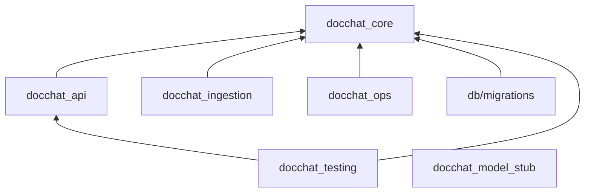

# 01 — Repository

This file sets out the DocChat repository: the full tree, what each directory owns and which imports are allowed, the uv workspace and how each deployable is built, the container images, the tools with their pinned versions, the coding rules and the gates that enforce them, the committed API contract, dependency management, the repository documents and the consolidated versions table. Every module path and file named by another file of this design appears in the tree of section 1. The application behaviour lives in `11-api.md` to `14-ingestion.md`, the web client in `10-web-client.md`, settings in `81-config.md`, security controls in `82-security.md`, Azure resources and delivery in `83-infrastructure.md`, and tests in `84-testing.md`.

## 1. Repository tree

The tree is exact to two levels below each app and package. A file of this design that owns a subpackage names the modules inside it and adds modules inside a listed directory; a new top-level subpackage of `docchat_core`, `docchat_api` or `docchat_ingestion`, or a new workspace member, needs an ADR (ADR 0011). Unit tests mirror the source tree module for module (section 5.5).

### 1.1 Top level

```text
docchat/
├── apps/
│   ├── api/                      docchat-api: the HTTP API (FastAPI under Gunicorn), section 1.2
│   ├── ingestion/                docchat-ingestion: the ingestion function app (Durable Functions), section 1.3
│   └── web/                      @docchat/web: the single-page web client (React, Vite), section 1.4
├── packages/
│   └── core/                     docchat-core: the shared library of both apps and every tool, section 1.5
├── db/                           docchat-db: Alembic migrations, a virtual uv member, section 1.6
├── infra/                        Bicep templates and their configuration, section 1.9
├── scripts/
│   ├── ops/                      docchat-ops: the operator CLI, section 1.7
│   ├── ci/                       CI checks, Python standard library only
│   ├── bootstrap/                one-time tenant, subscription and repository set-up
│   ├── preflight/                region, quota and model preflight
│   ├── deploy/                   azd hooks and deployment helpers
│   └── identity_post_provision.py   the tenant administrator's post-provision script
├── tests/
│   ├── support/                  docchat-testing: pytest plugin, fixtures, fakes and load tooling, section 1.8
│   ├── model-stub/               docchat-model-stub: the stubbed OpenAI-compatible model and Prompt Shields service
│   ├── integration/              integration tests that span packages
│   ├── deployed/                 tests against a deployed environment
│   ├── infra/                    tests of the compiled Bicep templates
│   ├── e2e/                      @docchat/e2e: the Playwright browser suites
│   ├── load/                     k6 scenarios, the k6 lock and the load generator
│   └── fixtures/                 fixture files shared by every test level
├── docs/
│   ├── adr/                      the architecture decision records
│   ├── spec/                     the design documents 00-overview.md to 90-build-order.md
│   └── runbooks/                 one Markdown file per runbook, plus rehearsals.md
├── .github/                      workflows, Dependabot, CODEOWNERS, the ruleset, the security waivers, section 1.10
├── .ps-rule/                     PSRule suppression groups and custom rules (83-infrastructure.md section 13)
└── root files                    section 1.12
```

### 1.2 `apps/api`

```text
apps/api/
├── pyproject.toml                distribution docchat-api (section 3.3)
├── Dockerfile                    the API image (section 4.4)
├── gunicorn.conf.py              bind address, workers, timeouts, worker class (11-api.md section 1.15)
├── openapi.json                  the committed API contract, generated (section 7)
├── src/docchat_api/
│   ├── __init__.py  py.typed
│   ├── app.py                    create_app(), the composition root, and the lifespan
│   ├── openapi.py                the exporter (python -m docchat_api.openapi) and document_streams()
│   ├── http/                     problems.py, routing.py (DocChatRoute), ratelimit.py, text.py, worker.py
│   │                             (DocChatUvicornWorker, DocChatServer); the package exports route_options,
│   │                             current_principal and content_disposition (11-api.md section 1)
│   ├── routes/                   health.py, me.py, projects.py, admin_projects.py, admin_users.py,
│   │                             admin_indexes.py, admin_documents.py, admin_uploads.py, admin_runs.py
│   ├── chat/                     the chat endpoints and the turn pipeline; tasks.py, screening.py,
│   │                             citations.py, stream.py (12-chat-pipeline.md section 1.3)
│   ├── usage/                    record_model_call, check_token_quota, rate windows, leases and counters
│   │                             (12-chat-pipeline.md section 3)
│   └── conversations/            store.py (ConversationStore) and the session, feedback and memory routes
│                                 (13-conversations-and-memory.md section 1.1)
└── tests/
    ├── unit/                     mirrors src/docchat_api module for module
    ├── integration/              the in-process API against the compose services;
    │                             test_authorization_matrix.py (84-testing.md)
    └── live/                     adapter tests against the dev environment's Azure services (ADR 0131)
```

### 1.3 `apps/ingestion`

```text
apps/ingestion/
├── pyproject.toml                distribution docchat-ingestion
├── Dockerfile                    the ingestion image (14-ingestion.md section 15.2)
├── host.json                     the Functions host configuration (14-ingestion.md section 15.9)
├── models.lock.json              repository, revision and SHA-256 of every pinned model file (14-ingestion.md section 15.3)
├── function_app.py               two-line entry shim: from docchat_ingestion.function_app import app
├── image/
│   ├── fetch_models.py           build-time model download and hash check
│   ├── check_readable_files.py   build-time check that no file a parse user can read holds a secret
│   └── selfcheck/                fixture PDF, DOCX and PPTX files of the offline self-check
├── src/docchat_ingestion/
│   ├── __init__.py  py.typed
│   ├── function_app.py           the df.DFApp, blueprint and method registration, start-up checks
│   ├── starters.py               queue, keep-alive and maintenance starters; ensure_dispatcher()
│   ├── boundary.py               guard(<function name>), the failure boundary
│   ├── selfcheck.py              the image's offline self-check (python -I -m docchat_ingestion.selfcheck) and run_isolation_probe()
│   ├── spike.py                  the stage-0 content-share spike (83-infrastructure.md section 2), section 1.3.1
│   ├── orchestrators/            ingestion_dispatcher, document_item_orchestrator, index_item_orchestrator
│   ├── activities/               one module per activity (14-ingestion.md section 4.2)
│   ├── methods/                  pagewise/ (with prompts.py) and recursive/
│   └── isolation/                the parsing child-process runner, parse_worker.py, syscall_filter.py,
│                                 office_checks.py, convert.py (the LibreOffice conversion) and results.py
└── tests/
    ├── unit/
    ├── integration/
    └── live/
```

#### 1.3.1 The spike module

`docchat_ingestion/spike.py` holds the queue-triggered starter and the Durable orchestration of the stage-0 content-share spike (`90-build-order.md`). While it exists, `function_app.py` registers its blueprint and nothing else, and `check_test_layout.py` (section 5.5) holds it to the unit-test rule. The pull request that adds `starters.py` deletes `spike.py`, its tests and its registration in the same change, so no build of the ingestion image carries both.

### 1.4 `apps/web`

`apps/web` follows `10-web-client.md` section 1.4 exactly:

```text
apps/web/
├── package.json  package-lock.json  .npmrc
├── index.html  config.example.json  config.local.json (git-ignored)
├── public/                       favicon.svg, not-found.html
├── staticwebapp.config.template.json
├── vite.config.ts  openapi-ts.config.ts
├── tsconfig.json  tsconfig.app.json  tsconfig.node.json
├── eslint.config.js  .prettierrc.json  .prettierignore
├── scripts/                      write-env-config.mjs, check-dist.mjs, gen-limits.mjs
└── src/
    ├── main.tsx
    ├── bootstrap/                zodSetup.ts, loadConfig.ts, msal.ts, Startup.tsx
    ├── platform/                 storage.ts, traceparent.ts, authChannel.ts, devLog.ts, constants.ts
    ├── api/                      generated/ (types.gen.ts, zod.gen.ts, limits.gen.ts), operations.ts, http.ts,
    │                             problem.ts, queryClient.ts
    ├── auth/                     tokens.ts, AccessScreens.tsx, SessionExpiredBar.tsx
    ├── shell/                    AppShell.tsx, TopBar.tsx, NavPanel.tsx, routes.tsx, AdminOnly.tsx
    ├── chat/                     ChatScreen.tsx, sessions/, project/, composer/, turns/, citations/, feedback/,
    │                             stream/ (ndjson.ts, events.ts, turnStore.ts),
    │                             render/ (pipeline.ts, policy.ts, redact.ts, sanitize.ts, AnswerBody.tsx,
    │                             copy.ts, speakable.ts)
    ├── memory/                   MemoryScreen.tsx
    ├── admin/                    projects/, indexes/, documents/, runs/, shared/ (ParamForm.tsx, conflict.ts)
    ├── a11y/                     LiveRegions.tsx, announce.ts
    ├── copy/                     en.ts, turnErrorTexts.ts
    ├── ui/                       ErrorBar.tsx, ConfirmDialog.tsx, PageHeader.tsx, format.ts
    └── test/                     setup.ts, MSW handlers, render helpers
```

Unit and component tests sit beside the module they test as `*.test.ts` or `*.test.tsx`.

### 1.5 `packages/core`

```text
packages/core/
├── pyproject.toml                distribution docchat-core
├── src/docchat_core/
│   ├── __init__.py  py.typed
│   ├── settings/                 DocChatSettings base, start-up validation, the local-emulator guard
│   ├── clients/                  ClientRegistry, search_client(); openai.py (the AsyncOpenAI profiles)
│   ├── sql/                      engine.py, statements.py, tables/<area>.py, repositories/
│   ├── opsconfig/                OpsConfig area models, OpsConfigStore, encode_value
│   ├── telemetry/                configure_telemetry, scrubbing, attributes, instruments, log_event, emit_event
│   ├── auth/                     TokenValidator, signing-key providers, Principal, AuthSettings
│   ├── errors/                   the CODES and REASONS registries
│   ├── models/                   shared identifiers and value types
│   ├── access/                   the authorisation functions, AccessibleProject, ResolvedIndex, the index-record cache
│   ├── users/                    ensure_user and the user search query
│   ├── audit/                    the action and target-type catalogues, write_audit_event, write_audit_event_after_commit
│   ├── memory/                   validators.py (validate_fact_text, is_suggested_question)
│   ├── chat/                     citations.py, models.py (MODEL_CAPABILITIES), capacity.py (capacity_shares)
│   ├── cosmos/                   conversations/ (with ids.py), memories.py, usage.py: document models and repositories
│   ├── search/                   schema.py, filters.py
│   └── ingestion/                models.py, methods.py, names.py, runs.py, settings.py
└── tests/
    ├── unit/
    ├── integration/
    └── live/
```

Section 2.2 gives each subpackage's owner and contents.

### 1.6 `db`

```text
db/
├── pyproject.toml                distribution docchat-db, [tool.uv] package = false, depends on docchat-core
├── alembic.ini
└── migrations/
    ├── env.py                    connects through connection_string("migrations")
    ├── script.py.mako
    └── versions/                 NNNN_<snake_slug>.py from 0001_initial_schema.py, one linear history
                                  (80-data-model.md)
```

### 1.7 `scripts`

```text
scripts/
├── ops/
│   ├── pyproject.toml            distribution docchat-ops, console script docchat-ops
│   ├── src/docchat_ops/
│   │   ├── __init__.py  py.typed  cli.py
│   │   ├── framework/            auth.py, endpoints.py, audit.py, confirm.py, exitcodes.py
│   │   └── commands/             local.py, config.py, override.py, users.py, jit.py, reindex.py,
│   │                             ingestion.py, chat.py, testusers.py, trace.py, document.py
│   └── tests/                    unit/ mirrors src/docchat_ops
├── ci/                           security_gate.py, check_test_layout.py, check_migrations.py, check_mypy_untyped.py,
│                                 check_forbidden_files.py, check_outbound_clients.py, check_contract_enums.py,
│                                 check_k6_lock.py, check_codeql_dismissals.py, check_deploy_run.py,
│                                 check_bicep_modules.py, check_workbook_queries.py, whatif_summary.py,
│                                 k6_selftest_server.py
├── bootstrap/                    bootstrap.py, bootstrap.config.json, configure_github.py, lock_prod.py,
│                                 tighten_conditions.py (83-infrastructure.md section 11)
├── preflight/                    preflight.py (83-infrastructure.md section 3)
├── deploy/                       deploy_checks.py, deploy_web.py, firewall.py, prod_checks.py, sql_principals.py,
│                                 teardown_load.py,
│                                 hooks/ (preprovision.py, postprovision.py, postdeploy.py, web_predeploy.py),
│                                 swa-cli/ (package.json, package-lock.json)
└── identity_post_provision.py
```

The operator commands and the files owning their semantics: `local.py` (`local init`, section 3.6), `config.py` and `override.py` (`81-config.md` section 3), `users.py` and `jit.py` (`13-conversations-and-memory.md` section 10), `reindex.py`, `ingestion.py` and `document.py` (`document fetch-source`) (`14-ingestion.md` section 19), `chat.py` (`capacity-check` and `model-check`, `12-chat-pipeline.md` sections 3.7 and 10.7), `testusers.py` and `trace.py` (`84-testing.md` and `86-operations.md`). Every other operator procedure that reads or writes application data is a `docchat-ops` command group, never a loose script. The CLI framework (identity, endpoints, `--ticket` and `--reason`, confirmation, audit, exit codes 0 to 7) is `86-operations.md`'s.

`scripts/ci/` and `tests/load/aci/run.py` use only the Python standard library, so they run under `uv run --frozen python <script>` without importing any workspace package.

### 1.8 `tests`

```text
tests/
├── support/
│   ├── pyproject.toml            distribution docchat-testing, console script docchat-load
│   ├── src/docchat_testing/      plugin.py, fixtures/ (sql.py, cosmos.py, storage.py, api.py, identities.py),
│   │                             tokens.py, apiclient.py, logquery.py, builders/, fakes/,
│   │                             clock.py, durable.py, loopguard.py, telemetry_capture.py, authz_matrix.py,
│   │                             isolation.py (DATA_PATHS), data_audit.py, streaming.py, resume_check.py, load/
│   └── tests/                    unit/ mirrors src/docchat_testing; test_repository_config.py (section 1.13);
│                                 test_catalogue_ids.py (the catalogue check, 84-testing.md section 5.1)
├── model-stub/
│   ├── pyproject.toml  Dockerfile    distribution docchat-model-stub (section 4.5)
│   ├── src/docchat_model_stub/   app.py, chat.py, embeddings.py, shields.py, directives.py, scripts.py,
│   │                             recorder.py, throttle.py, schema_fill.py
│   └── tests/
├── integration/                  isolation/, contracts/, chat/, ingestion/, ops/,
│                                 data_access/ (test_sql_plans.py and the Cosmos DB audit tests)
├── deployed/                     conftest.py, test_smoke.py, test_chat.py, test_memory_feedback.py, test_membership.py,
│                                 test_ingestion_resume.py, test_prod_smoke.py, test_cors_preflight.py,
│                                 test_infrastructure.py (the deployed infrastructure suite, marker infra)
├── infra/                        the compiled-template tests of 84-testing.md section 8.1, outside testpaths
├── e2e/                          package.json, package-lock.json, playwright.config.ts,
│                                 specs/web/ (identity.spec.ts, exfiltration.spec.ts and the other browser specs),
│                                 specs/web-deployed/ (the deployed smoke specs), fixtures/web/ (with stub-api/)
├── load/                         k6/ (s1-event-loop.js, s2-stateless.js, s3-calibrate.js, s3-scaleout.js, lib.js,
│                                 selftest.js), k6.lock.json, aci/ (loadgen.bicep, run.py)
└── fixtures/
    ├── documents/                tables.pdf, scanned.pdf, headings.docx, slides.pptx, each with
    │                             <file>.expected.json and its recorded layout result; generate.py;
    │                             indirect-attack.pdf; the archive and document-check fixtures (14-ingestion.md)
    ├── questions/                load.json, jailbreak.json
    ├── streams/                  recorded chat streams, *.ndjson
    └── http/<service>/           recorded exchanges for ReplayTransport and respx
```

The test levels, their markers and what each proves are `84-testing.md`'s. The browser specs and their harness (the stub API on `127.0.0.1:4010` and the shipped build served by `@azure/static-web-apps-cli` 2.0.10) are `10-web-client.md` section 13's.

### 1.9 `infra`

`infra/` follows `83-infrastructure.md` section 8.1 exactly:

```text
infra/
├── bicepconfig.json  main.bicep  main.bicepparam  types.bicep  shared.bicep  shared.bicepparam
├── env/                          dev.json, prod.json, load.json
├── config/                       app-settings.json, regions.json
├── modules/
│   ├── network/                  vnet.bicep, nsgs.bicep, private-dns.bicep, private-endpoints.bicep,
│   │                             nat-gateway.bicep
│   ├── identity/                 workload-identities.bicep, entra-apps.bicep
│   ├── data/                     sql.bicep, cosmos.bicep, storage-data.bicep, storage-host.bicep
│   ├── ai/                       search.bicep, openai.bicep, openai-deployments.bicep, content-safety.bicep,
│   │                             document-intelligence.bicep
│   ├── security/                 key-vault.bicep
│   ├── compute/                  api.bicep, ingestion.bicep, model-stub.bicep, app-settings.bicep
│   ├── web/                      static-site.bicep
│   ├── rbac/                     workload-roles.bicep, cosmos-data-roles.bicep, registry-pull.bicep
│   ├── monitoring/               workspace.bicep, action-group.bicep, budget.bicep, diagnostics.bicep,
│   │                             alerts.bicep, workbooks.bicep, workbooks/<key>.workbook.json
│   └── registry/                 registry.bicep
├── bootstrap/                    roles.bicep, identity.bicep, security.bicep, policies.bicep, assignments.bicep,
│                                 activity-log.bicep, ci-network-settings.bicep, one .bicepparam file per template
└── teardown/                     empty.bicep
```

The Entra app registrations live in `modules/identity/entra-apps.bicep`. If the pull-request what-if or PSRule's expansion fails on the Microsoft Graph extension, they move to `infra/identity.bicep`, which the `preprovision` hook deploys (`83-infrastructure.md` section 7.1); the tree then gains that file.

### 1.10 `.github` and `.ps-rule`

```text
.github/
├── workflows/                    ci.yaml, codeql.yaml, deployed-tests.yaml, nightly.yaml, load-test.yaml,
│                                 deploy.yaml, deploy-environment.yaml
├── dependabot.yml                section 8.2
├── CODEOWNERS                    section 2.6
├── pull_request_template.md      the review checklist of section 6.1
├── rulesets/main.json            the main-branch ruleset of section 2.6
└── security/                     waivers.yaml, approvers.yaml, exceptions.yaml (82-security.md)
.ps-rule/
├── docchat-suppressions.Rule.yaml
└── docchat.Rule.yaml
```

The jobs of `ci.yaml`, `codeql.yaml`, `deployed-tests.yaml`, `nightly.yaml` and `load-test.yaml` are `84-testing.md`'s; `deploy.yaml`, `deploy-environment.yaml`, the infrastructure jobs `infra-validate` and `preflight-whatif` of `ci.yaml` and the rules every workflow follows are `83-infrastructure.md` section 10's.

### 1.11 `docs`

```text
docs/
├── adr/                          NNNN-<slug>.md, one decision per file, and README.md (the index)
├── spec/                         00-overview.md to 90-build-order.md
└── runbooks/                     RNN-<slug>.md, one file per runbook, and rehearsals.md
```

Section 9 gives each document's required content.

### 1.12 Root files

| File | Content |
|---|---|
| `pyproject.toml` | the workspace root `docchat-workspace` and every shared tool configuration (section 3.2) |
| `uv.lock` | the one Python lockfile, committed (section 3.4) |
| `azure.yaml` | the azd project (`83-infrastructure.md` section 9.1) |
| `compose.yaml` | the local services: SQL Server, Azurite, the Cosmos DB emulator and the model stub (`84-testing.md` section 2.1) |
| `ps-rule.yaml` | PSRule configuration (`83-infrastructure.md` section 13) |
| `.pre-commit-config.yaml` | the hooks of section 5.7 |
| `.gitleaks.toml` | secret-scanning configuration (section 5.7) |
| `.python-version` | `3.13` |
| `.node-version` | `24.21.0` |
| `.editorconfig` | below |
| `.gitattributes` | below |
| `.gitignore` | below, exactly |
| `.dockerignore` | below, exactly |
| `.env.example` | below, exactly |
| `CONTEXT.md` | the glossary of every domain term the design uses |
| `README.md`, `LICENSE`, `SECURITY.md`, `CONTRIBUTING.md`, `CODE_OF_CONDUCT.md`, `CHANGELOG.md` | section 9 |

`.editorconfig`:

```ini
root = true

[*]
charset = utf-8
end_of_line = lf
insert_final_newline = true
trim_trailing_whitespace = true
indent_style = space
indent_size = 4

[*.{ts,tsx,js,mjs,cjs,json,yaml,yml,md,css,html,bicep,bicepparam}]
indent_size = 2
```

`.gitattributes`:

```text
* text=auto eol=lf
*.pdf binary
*.docx binary
*.pptx binary
*.png binary
```

`.gitignore`, exactly:

```text
.venv/
__pycache__/
*.pyc
.pytest_cache/
.mypy_cache/
.ruff_cache/
.coverage
coverage.xml
reports/
build/
dist/
node_modules/
apps/web/dist/
apps/web/config.local.json
test-results/
playwright-report/
load-results/
*.zip
*.tar
*.tgz
.env
.azure/
```

`.dockerignore`, exactly, in this order (a later line overrides an earlier one). The three exception lines keep the two test members' `pyproject.toml` files, which `uv export --locked` reads to check the lock against the whole workspace, and the model stub's source, which its image copies:

```text
.git
.azure
.env*
**/node_modules
**/tests
!tests/support/pyproject.toml
!tests/model-stub/pyproject.toml
!tests/model-stub/src
reports
build
dist
load-results
```

`.env.example`, exactly (names only; `uv run docchat-ops --env local local init` writes the real `.env`, `81-config.md` section 2.11):

```text
DOCCHAT_LOCAL_EMULATORS=
DOCCHAT_LOCAL_SQL_SA_PASSWORD=
```

No tracked path matches `*.zip`, `*.tar`, `*.tgz`, `*.gz`, `*.7z`, `*.rar`, `*.jar`, `*.whl`, `*.map`, `*.pfx`, `*.p12`, `**/dist/**`, `**/build/**`, `**/node_modules/**`, a final component exactly `.env`, `.azure/**` or `apps/web/config.local.json`; `scripts/ci/check_forbidden_files.py` enforces it (section 5.7). No tracked directory is named `build`, `dist` or `node_modules`, which is why build-time scripts of the ingestion image live under `apps/ingestion/image/`.

### 1.13 The repository-configuration test

`tests/support/tests/test_repository_config.py` checks this file against the repository on every pull request, in the `python-tests` job: the tree of section 1 and the absence of unlisted top-level subpackages; the workspace members and their declarations (sections 3.1 and 3.3); the exact root files of section 1.12; the Ruff, mypy and pytest tables (section 5); the pre-commit revisions and the gitleaks allowlist (section 5.7); the Dependabot file (section 8.2); the `uv export` output for the ingestion member (section 3.2); fixture packages that break each import contract (section 2.4); and every pin of section 10 against the file that applies it. It reads `docs/spec/01-repository.md` with the Python standard library and parses YAML with PyYAML, which `pre-commit` brings into the development environment. A difference fails the test, naming the file, the key and both values.

## 2. Ownership and import rules

### 2.1 What each directory owns

| Path | Owns | Specified in | Code owners (section 2.6) |
|---|---|---|---|
| `apps/api` | the HTTP API: routes, problem details, rate limits, the chat pipeline, usage, the conversation store, the server process | `11-api.md`, `12-chat-pipeline.md`, `13-conversations-and-memory.md`, `14-ingestion.md` (admin routes) | `docchat-backend` |
| `apps/ingestion` | the function app: starters, orchestrators, activities, the ingestion methods, parsing isolation, the image's self-check | `14-ingestion.md` | `docchat-backend` |
| `apps/web` | the web client | `10-web-client.md` | `docchat-frontend` |
| `packages/core` | every piece of logic that more than one deployable or tool uses (section 2.2) | section 2.2 | `docchat-backend`; the security paths of section 2.6 `docchat-security` |
| `db` | the SQL schema history | `80-data-model.md` | `docchat-backend` |
| `infra`, `azure.yaml`, `ps-rule.yaml`, `.ps-rule/` | every Azure resource and the azd project | `83-infrastructure.md` | `docchat-platform` |
| `scripts/ops` | the operator CLI | `86-operations.md` | `docchat-backend` |
| `scripts/ci` | the CI checks | this file and `84-testing.md` | `docchat-security` |
| `scripts/bootstrap`, `scripts/preflight`, `scripts/deploy` | bootstrap, preflight and deployment steps | `83-infrastructure.md` | `docchat-platform` |
| `scripts/identity_post_provision.py` | the tenant administrator's post-provision step | `83-infrastructure.md` section 11 | `docchat-maintainers` |
| `tests/support`, `tests/model-stub`, `tests/integration`, `tests/deployed`, `tests/infra`, `tests/load`, `tests/fixtures` | test support, the model stub and the cross-package suites | `84-testing.md` | `docchat-maintainers`; `tests/load/k6.lock.json` `docchat-security` |
| `tests/e2e` | the browser suites | `10-web-client.md`, `84-testing.md` | `docchat-frontend` |
| `docs` | the decision records, the design documents and the runbooks | section 9 | `docchat-maintainers` |
| `.github` | workflows, Dependabot, code owners, the ruleset, the security waivers | `83-infrastructure.md` section 10, `84-testing.md`, this file | `docchat-platform`; `workflows/` and `security/` `docchat-security` |

Shared logic lives only in `packages/core`. When a second deployable or tool needs a function that one app holds, the function moves to `docchat_core` in the same pull request; no code is copied between apps.

### 2.2 `docchat_core` subpackages

| Subpackage | Holds | Specified in |
|---|---|---|
| `settings` | `DocChatSettings` (prefix `DOCCHAT_`, `extra="forbid"`, frozen), start-up validation and the local-emulator guard; each area's settings classes sit with their area | `81-config.md` |
| `clients` | `ClientRegistry`, `search_client(physical_index_name)` and the `openai` module (section 2.3) | this file; client options from the file that calls each service; the Azure credential branch `83-infrastructure.md` section 6.2 |
| `sql` | `engine.py` (the data-access layer), `statements.py` (the only module that calls `sqlalchemy.text`), `tables/<area>.py` (SQLAlchemy Core metadata), `repositories/` | this file section 6.2; tables and repositories `80-data-model.md` |
| `opsconfig` | `OpsConfig` and its area models, `OpsConfigStore`, `encode_value` | `81-config.md` section 3; each area's keys by the file that reads them |
| `telemetry` | `configure_telemetry`, the scrubbing processors, the attribute registry, instruments, `emit_event`, `log_event`, `record_failure`, the loop-lag monitor | `85-observability.md` |
| `auth` | `AuthSettings`, `TokenValidator`, the signing-key providers, `Principal`, the authentication exceptions | `11-api.md` section 1.2 |
| `errors` | the `CODES` and `REASONS` registries | `11-api.md` section 2 |
| `models` | identifiers and value types shared by several subpackages | `11-api.md` |
| `access` | the authorisation functions, `AccessibleProject`, `ResolvedIndex`, the 60-second index-record cache | `11-api.md` section 1.4 |
| `users` | `ensure_user` and the user search query | `11-api.md` |
| `audit` | the action and target-type catalogues, `write_audit_event`, `write_audit_event_after_commit` | `82-security.md` section 10, `80-data-model.md` |
| `memory` | `validators.py`: `validate_fact_text`, fact normalisation, `is_suggested_question` | `13-conversations-and-memory.md` section 7 |
| `chat` | `citations.py` (`strip_citation_tokens`), `models.py` (`MODEL_CAPABILITIES`), `capacity.py` (`capacity_shares`) | `12-chat-pipeline.md` |
| `cosmos` | the Cosmos DB document models and repositories: `conversations/` (with `ids.py`), `memories.py`, `usage.py` | `13-conversations-and-memory.md`, `12-chat-pipeline.md` section 3 |
| `search` | `schema.py` (versioned index schemas), `filters.py` (the OData filter builder) | `80-data-model.md` section 6, `14-ingestion.md` |
| `ingestion` | `models.py`, `methods.py`, `names.py`, `runs.py`, `settings.py` | `14-ingestion.md` |

An area whose instruments sit outside `docchat_core.telemetry.instruments` creates them once, at import, in its own `telemetry.py` module (`85-observability.md` section 1.2).

### 2.3 The client factory

`docchat_core.clients` is the one place where a deployable builds a client for an Azure service or a model:

1. **Once per process.** `ClientRegistry` creates every client at start-up (the API lifespan; the ingestion worker's first invocation) from the `.aio` packages and closes every client, then the credential, at shutdown.
2. **One credential.** In Azure every client shares one `azure.identity.aio.ManagedIdentityCredential(client_id=<DOCCHAT_CORE_IDENTITY_CLIENT_ID>)`; `azure.identity.aio.AzureCliCredential` is used only when `DOCCHAT_CORE_ENVIRONMENT` is `local`; `DefaultAzureCredential` is never used. No client takes a key, a connection string or a SAS, except the emulators' published constants in local-emulator mode (`81-config.md` section 2.11), which start-up refuses inside Azure.
3. **Per-index search clients.** `search_client(physical_index_name)` returns the process's `azure.search.documents.aio.SearchClient` for that index, created on first use with `api_version="2026-04-01"` and the caller's timeouts, held in an LRU of at most 16 clients; an evicted client is closed once its in-flight requests finish, and every cached client is closed at shutdown.
4. **The model client.** `docchat_core.clients.openai` builds the `openai.AsyncOpenAI` profiles (API and ingestion) against `{endpoint}/openai/v1/` and is the only module that imports `httpx2` (section 6.3).
5. **Options from the caller.** Every client's timeouts and transport options come from the file that calls the service, collected in section 6.4; the data-account `BlobServiceClient` of the API sets `max_single_get_size=1048576` and `max_chunk_get_size=1048576` (`12-chat-pipeline.md`).
6. **Enforced.** `scripts/ci/check_outbound_clients.py` fails CI when a class from `azure.storage`, `azure.cosmos`, `azure.search.documents`, `azure.ai.documentintelligence` or `azure.keyvault`, or `openai.AsyncOpenAI`, is instantiated in `docchat_core`, `docchat_api` or `docchat_ingestion` outside `docchat_core.clients`, and Ruff bans the synchronous client classes everywhere (section 5.2). Tests construct the clients they need directly.

### 2.4 Import contracts

Seven import contracts hold. import-linter 2.15 checks contracts 1 to 5 and 7 from the root `pyproject.toml` in the CI job `lint` (`uv run lint-imports`), and `scripts/ci/check_outbound_clients.py` checks contract 6 in the same job; any broken contract fails the job:

```toml
[tool.importlinter]
root_packages = ["docchat_core", "docchat_api", "docchat_ingestion", "docchat_ops", "docchat_testing", "docchat_model_stub"]
include_external_packages = true

[[tool.importlinter.contracts]]
name = "1 core imports no deployable or tool"
type = "forbidden"
source_modules = ["docchat_core"]
forbidden_modules = ["docchat_api", "docchat_ingestion", "docchat_ops", "docchat_testing", "docchat_model_stub"]

[[tool.importlinter.contracts]]
name = "2 the two apps are independent"
type = "independence"
modules = ["docchat_api", "docchat_ingestion"]

[[tool.importlinter.contracts]]
name = "3 production code imports no test code"
type = "forbidden"
source_modules = ["docchat_core", "docchat_api", "docchat_ingestion"]
forbidden_modules = ["docchat_testing", "docchat_model_stub"]

[[tool.importlinter.contracts]]
name = "4 telemetry and settings sit at the bottom of core"
type = "forbidden"
source_modules = ["docchat_core.telemetry", "docchat_core.settings"]
forbidden_modules = [
  "docchat_core.clients", "docchat_core.sql", "docchat_core.opsconfig", "docchat_core.auth",
  "docchat_core.access", "docchat_core.users", "docchat_core.audit", "docchat_core.memory",
  "docchat_core.chat", "docchat_core.cosmos", "docchat_core.search", "docchat_core.ingestion",
]

[[tool.importlinter.contracts]]
name = "5 only the SQL engine imports pyodbc"
type = "forbidden"
source_modules = ["docchat_core", "docchat_api", "docchat_ingestion", "docchat_ops", "docchat_testing", "docchat_model_stub"]
forbidden_modules = ["pyodbc"]
ignore_imports = ["docchat_core.sql.engine -> pyodbc"]

[[tool.importlinter.contracts]]
name = "7 only the OpenAI client module imports httpx2"
type = "forbidden"
source_modules = ["docchat_core", "docchat_api", "docchat_ingestion", "docchat_ops", "docchat_testing", "docchat_model_stub"]
forbidden_modules = ["httpx2"]
ignore_imports = ["docchat_core.clients.openai -> httpx2"]
```

- Contract 4 leaves `docchat_core.telemetry` and `docchat_core.settings` free to import each other, `docchat_core.errors` and `docchat_core.models`, and nothing else in `docchat_core`.
- **Contract 6: only `docchat_core.clients` and `docchat_core.sql.engine` import `azure.identity` or `azure.identity.aio` in `docchat_core`, `docchat_api`, `docchat_ingestion` and `docchat_model_stub`.** import-linter 2.15 refuses a subpackage of an external package as a forbidden module (`Invalid forbidden module azure.identity: subpackages of external packages are not valid`, checked on 2026-10-25), and forbidding all of `azure` would forbid every SDK import, so `check_outbound_clients.py` enforces this contract on the parsed source (section 6.4 rule 4). `docchat_ops` and `docchat_testing` are outside it: both sign in with `azure.identity.aio.AzureCliCredential` (the operator's or the pipeline's own sign-in), and Ruff bans the synchronous credential classes in both (section 5.2).
- Contract 7 also covers the files whose Ruff `TID251` ignores exist for other names (`docchat_core.sql.engine`, `docchat_core.sql.statements`, the model stub), which lift Ruff's `httpx2` ban.
- `scripts/ci/`, `db/migrations/` and `tests/load/aci/run.py` belong to no root package and sit outside import-linter: the first and last use only the Python standard library, and the migrations run synchronously outside the apps (section 5.2).

### 2.5 Dependency direction



Arrows point from the importer to the imported package. `docchat_ops` never imports `docchat_api` or `docchat_ingestion`: an operator command reuses the `docchat_core` repositories, models and validation, so it can never write a value the apps would reject. The model stub imports no first-party package (section 4.5). `docchat_testing` imports `docchat_api` only to build the app under test, and import contract 3 keeps every production package from importing it. The tests under each member's `tests/` import their own package and `docchat_testing`; no package's `src/` imports a test directory.

### 2.6 Code owners, the ruleset and repository settings

Teams of the hosting organisation, created by the runbook "Repository and GitHub settings": `docchat-maintainers`, `docchat-backend`, `docchat-frontend`, `docchat-platform`, `docchat-security`, and the environment reviewers `docchat-release-approvers` (`prod` deploys) and `docchat-tenant-admins` (the `load-access` gate) of `83-infrastructure.md` section 10.4.

`.github/CODEOWNERS`, in this order. The last matching line names a path's owners, and the ruleset requires one approval from an owner of that line, so a pull request that touches a security path needs a `docchat-security` approval:

```text
*                                                    @<org>/docchat-maintainers
/apps/api/                                           @<org>/docchat-backend
/apps/ingestion/                                     @<org>/docchat-backend
/packages/core/                                      @<org>/docchat-backend
/db/                                                 @<org>/docchat-backend
/scripts/ops/                                        @<org>/docchat-backend
/apps/web/                                           @<org>/docchat-frontend
/tests/e2e/                                          @<org>/docchat-frontend
/infra/                                              @<org>/docchat-platform
/.github/                                            @<org>/docchat-platform
/scripts/bootstrap/                                  @<org>/docchat-platform
/scripts/preflight/                                  @<org>/docchat-platform
/scripts/deploy/                                     @<org>/docchat-platform
/azure.yaml                                          @<org>/docchat-platform
/ps-rule.yaml                                        @<org>/docchat-platform
/.ps-rule/                                           @<org>/docchat-platform
/packages/core/src/docchat_core/auth/                @<org>/docchat-security
/packages/core/src/docchat_core/clients/             @<org>/docchat-security
/packages/core/src/docchat_core/telemetry/           @<org>/docchat-security
/packages/core/src/docchat_core/sql/statements.py    @<org>/docchat-security
/packages/core/src/docchat_core/sql/engine.py        @<org>/docchat-security
/.github/security/                                   @<org>/docchat-security
/.github/workflows/                                  @<org>/docchat-security
/.gitleaks.toml                                      @<org>/docchat-security
/scripts/ci/                                         @<org>/docchat-security
/tests/load/k6.lock.json                             @<org>/docchat-security
/infra/modules/identity/                             @<org>/docchat-security
```

`<org>` is the hosting organisation's name, written by `scripts/bootstrap/configure_github.py`. `/.github/security/` holds `waivers.yaml`, `approvers.yaml` and `exceptions.yaml`, so only a security-team approval adds a waiver or an approver, or renews the exception.

**Ruleset** `.github/rulesets/main.json` on `main`, applied by the runbook "Repository and GitHub settings": a pull request is required; 1 approval from a code owner; stale approvals dismissed on push; conversation resolution required; required status checks in strict mode (the branch is up to date before merging) = every `ci.yaml` job plus CodeQL; linear history; no force push and no deletion; code-scanning merge protection at "Security alerts: High or higher" and "Alerts: Errors".

**Repository settings:** secret scanning and push protection on; Dependabot alerts and security updates on; private vulnerability reporting on; Actions limited to "Allow selected actions", namely the actions of section 10.6 and the repository's own reusable workflows; default workflow token permission read-only; "Allow GitHub Actions to create and approve pull requests" off.

## 3. The uv workspace, the lockfile and the builds

### 3.1 Workspace members

One uv workspace holds every Python body of code, exactly these seven members, with one lockfile, so every process, test and tool runs on one version of each library (ADR 0011):

| Path | Distribution | Import package | Kind | First-party dependencies | Console script |
|---|---|---|---|---|---|
| `packages/core` | `docchat-core` | `docchat_core` | library | none | none |
| `apps/api` | `docchat-api` | `docchat_api` | deployable | `docchat-core` | none |
| `apps/ingestion` | `docchat-ingestion` | `docchat_ingestion` | deployable | `docchat-core` | none |
| `db` | `docchat-db` | none (`[tool.uv] package = false`) | virtual member holding Alembic | `docchat-core` | none |
| `scripts/ops` | `docchat-ops` | `docchat_ops` | operator tool | `docchat-core` | `docchat-ops` |
| `tests/support` | `docchat-testing` | `docchat_testing` | test support | `docchat-core`, `docchat-api` (its API fixture builds the app with `create_app`) | `docchat-load` |
| `tests/model-stub` | `docchat-model-stub` | `docchat_model_stub` | test service and image | none | none |

Three npm packages sit outside the workspace, each with a committed `package-lock.json`: `apps/web` (`@docchat/web`), `tests/e2e` (`@docchat/e2e`) and `scripts/deploy/swa-cli` (a private package whose one dependency is `@azure/static-web-apps-cli`, with the `overrides` of section 8.1).

### 3.2 The root `pyproject.toml`

The root is a non-package project that holds the workspace, the development group and every shared tool configuration:

```toml
[project]
name = "docchat-workspace"
version = "0.0.0"
requires-python = ">=3.13,<3.14"
dependencies = []

[dependency-groups]
dev = [
  "ruff==0.17.0", "mypy==2.4.0", "pytest==9.1.1", "pytest-asyncio==1.4.0", "pytest-timeout==2.4.0",
  "pytest-cov==7.1.0", "coverage==7.16.2", "respx==0.23.1", "pre-commit==4.7.0", "pip-audit==2.10.1",
  "deptry==0.25.1", "import-linter==2.15", "zizmor==1.30.1", "docchat-testing",
]
torch-cpu = ["torch==2.14.1", "torchvision==0.29.1"]

[tool.uv]
package = false
required-version = "==0.13.1"
override-dependencies = ["opencv-python; sys_platform == 'never'"]

[tool.uv.workspace]
members = ["packages/core", "apps/api", "apps/ingestion", "db", "scripts/ops", "tests/support", "tests/model-stub"]

[[tool.uv.index]]
name = "pytorch-cpu"
url = "https://download.pytorch.org/whl/cpu"
explicit = true

[tool.uv.sources]
docchat-core = { workspace = true }
docchat-api = { workspace = true }
docchat-testing = { workspace = true }
torch = [
  { url = "https://download.pytorch.org/whl/cpu/torch-2.14.1%2Bcpu-cp313-cp313-manylinux_2_28_x86_64.whl", marker = "sys_platform == 'linux' and platform_machine == 'x86_64'" },
  { index = "pytorch-cpu", marker = "sys_platform != 'linux' or platform_machine != 'x86_64'" },
]
torchvision = [
  { url = "https://download.pytorch.org/whl/cpu/torchvision-0.29.1%2Bcpu-cp313-cp313-manylinux_2_28_x86_64.whl", marker = "sys_platform == 'linux' and platform_machine == 'x86_64'" },
  { index = "pytorch-cpu", marker = "sys_platform != 'linux' or platform_machine != 'x86_64'" },
]
```

The same file carries `[tool.ruff]` (section 5.2), `[tool.mypy]` and `[tool.pydantic-mypy]` (section 5.3), `[tool.pytest.ini_options]` (section 5.4), `[tool.coverage]` and `[tool.docchat.test-layout]` (section 5.5) and `[tool.importlinter]` (section 2.4).

- **OpenCV.** The override replaces every requirement on `opencv-python` with one whose marker never holds, so the GUI build of OpenCV is never installed; `docchat-ingestion` declares `opencv-python-headless>=5.0.0.93,<6` directly (`14-ingestion.md` section 15.2).
- **PyTorch on the CPU build.** `torch` reaches the lock only through the ingestion parsing libraries. The `torch-cpu` group makes it a direct requirement of the workspace, so the root source applies to it everywhere in the resolution: on Linux x86-64 (every image and every CI runner) the lock pins the one CPU wheel by URL, with SHA-256 `331fa474e26e428e2e6af1143b2fdab19cee492d7d21897b8899ce1c14755662` (read from PyTorch's CPU index on 2026-10-25); on any other developer platform it resolves from the explicit CPU index. `uv export` writes the Linux pin as a URL requirement with its hash, so the image install of section 4.2 fetches exactly that file, and no `nvidia-*` distribution enters the lock for Linux. An image export (`--no-dev`) never includes the group itself: the `torch` line it writes comes from the parsing libraries' own requirement, resolved through the root source. The group sits on the root, outside every member, so `deptry` sees no unused dependency (verified with uv 0.13.1 on 2026-10-25: a source applies to a transitive requirement only when a direct requirement names the package, and `uv export --format requirements-txt` writes the URL source with its hash but drops a per-package index pin).
- **`torchvision` on the CPU build too.** `timm`, which the table-structure model needs, requires `torchvision`. PyPI's Linux x86-64 `torchvision` wheel links `libtorch_cuda.so` and the CUDA runtime, so next to the CPU `torch` its operators don't load (`RuntimeError: operator torchvision::nms does not exist`) and the table-structure model can't be built. The `torch-cpu` group therefore names `torchvision` 0.29.1, the release paired with `torch` 2.14.1, and the root source pins its CPU wheel the same way: on Linux x86-64 by URL, with SHA-256 `7b27accfa545169ad070efb8a6679b25d63acc8513bbc0c05937c3ce94c13ea5` (read from PyTorch's CPU index on 2026-11-07), and from the explicit CPU index elsewhere. The two pins move together.
- **Who changes these lines.** Dependabot can't move a URL source, so `torch` and `torchvision` are ignored in the `uv` Dependabot entry (section 8.2) and move by hand, together, in the quarterly update (section 8.3): the pull request changes both group pins, both URLs, the hashes recorded above and `uv.lock` together.

### 3.3 Member declarations

Every member's `pyproject.toml` has:

```toml
[build-system]
requires = ["uv_build>=0.13.1,<0.14"]
build-backend = "uv_build"

[project]
name = "<distribution>"
version = "0.0.0"
requires-python = ">=3.13,<3.14"
dependencies = [ ... ]
```

- **Version.** Every member stays at `0.0.0`; the release identity is the commit SHA (`DOCCHAT_BUILD_COMMIT`, section 4.1), and no member is published to a package index.
- **Build backend.** uv 0.13.1 builds a `uv_build` project in this range through its built-in backend without downloading anything, so a wheel build needs no unhashed build dependency. Each member's module sits at `src/<import package>/`, the backend's default layout. `db` has no `[build-system]`, because it is never built.
- **Runtime dependencies.** Each member declares every third-party distribution its own code imports and nothing else (`deptry`, section 8.4), with two exceptions: `docchat-ingestion` also declares `azure-functions-runtime` (the pinned Python worker, which the Functions host runs) and `opencv-python-headless` (so that the override of section 3.2 can remove `opencv-python`), and its code imports neither, so its `pyproject.toml` ends with

  ```toml
  [tool.deptry.per_rule_ignores]
  DEP002 = ["azure-functions-runtime", "opencv-python-headless"]
  ```

  and `docchat-model-stub` declares `uvicorn`, which its image's `CMD` runs (section 4.5) and no module imports, so its `pyproject.toml` ends with

  ```toml
  [tool.deptry.per_rule_ignores]
  DEP002 = ["uvicorn"]
  ```

  These are the only deptry ignores in the repository: no other member, rule or distribution is ignored. Declarations carry a lower bound at the confirmed version of section 10 and an upper bound below the next major version (`fastapi>=0.143.1,<1`, `azure-cosmos>=4.17.1,<5`, `pyjwt[crypto]>=2.15.1,<3`). First-party dependencies carry no bound and resolve through the workspace sources.
- **Console scripts.** `docchat-ops` declares `[project.scripts] docchat-ops = "docchat_ops.cli:main"`; `docchat-testing` declares `docchat-load = "docchat_testing.load:main"`.

### 3.4 The lockfile and its commands

`uv.lock` is committed and pins every distribution to one version with the hashes of every file. Every command that installs or runs Python reads it:

| Purpose | Command | Where |
|---|---|---|
| install the whole workspace with every group | `uv sync --locked --all-packages --all-groups` | developers; every CI job that runs Python |
| check that `uv.lock` matches every `pyproject.toml` | `uv lock --locked` | the `uv-lock` pre-commit hook in check mode and the `lint` job |
| run a tool or script from an installed workspace | `uv run --frozen <command>` | scripts, hooks, workflow steps after `uv sync --locked` |
| export one member's locked dependencies for an image | `uv export --locked --no-dev --package <member> --no-emit-workspace --format requirements-txt -o /tmp/requirements.txt` | image build stages (section 4.2) |
| change the lock | `uv lock` (or `uv lock --upgrade-package <name>`) | a developer's pull request; Dependabot |

`--locked` fails when `uv.lock` and the `pyproject.toml` files disagree. Nothing in CI runs `uv lock` without `--locked`, and nothing exports with `--frozen`. `uv lock --locked` is a hidden flag in uv 0.13.1, equivalent to the documented `uv lock --check`; the pull request that raises `required-version` switches to `uv lock --check` when the new version drops the hidden flag. `required-version = "==0.13.1"` makes any other uv version exit with an error, so a developer machine, a runner and an image all run one uv.

### 3.5 How each deployable is built

| Deployable or record | Built from | Command | Output |
|---|---|---|---|
| API image | `apps/api/Dockerfile`, repository root as context | `docker buildx build --platform linux/amd64 --file apps/api/Dockerfile --build-arg DOCCHAT_BUILD_COMMIT=<sha> <labels> --tag <login server>/docchat/api:<sha> --load .` | `docchat/api` (section 4.4) |
| Ingestion image | `apps/ingestion/Dockerfile`, repository root | the same with `--file apps/ingestion/Dockerfile` and `docchat/ingestion` | `docchat/ingestion` (`14-ingestion.md` section 15.2) |
| Model-stub image | `tests/model-stub/Dockerfile`, repository root | the same with `--file tests/model-stub/Dockerfile` and `docchat/model-stub`; `compose.yaml` builds it locally as `docchat/model-stub:local` | `docchat/model-stub` (section 4.5) |
| Web build | `apps/web` | `npm ci`, then `npm run build` (`tsc -b`, `vite build`, the build-output gate) | the environment-free `dist`, artifact `web-dist` (`10-web-client.md` sections 1.5 and 2.3) |
| Static Web Apps CLI archive | `scripts/deploy/swa-cli` | `npm ci --ignore-scripts`, packed as `swa-cli.tgz` | artifact `swa-cli` (`83-infrastructure.md` section 10.17) |
| Migrations | `db` | no artifact: the `postprovision` hook runs `uv run --frozen --package docchat-db alembic -c db/alembic.ini upgrade head` from the deployed commit's checkout | the schema (`83-infrastructure.md` section 10.9) |
| Operator CLI | `scripts/ops` | no artifact: `uv run --frozen docchat-ops …` from a checkout synced with `uv sync --locked` | `86-operations.md` |

The `build` job of `deploy.yaml` builds each image once per commit on `main` and every environment deploys those bytes by digest (`83-infrastructure.md` section 10.8, ADR 0124); the `images` job of `ci.yaml` builds the three images on every pull request without pushing, runs their smoke steps and scans them (`84-testing.md`). The labels are `org.opencontainers.image.revision=<sha>` and `org.opencontainers.image.source=<repository URL>`.

### 3.6 Local development

A developer machine is x86-64, because the local SQL Server image is published for `linux/amd64` only, and has Docker with Compose, uv 0.13.1 and Node.js 24.21.0. From a fresh clone:

1. `uv sync --locked --all-packages --all-groups`
2. `uv run --frozen pre-commit install`
3. `npm ci --prefix apps/web` and `npm ci --prefix tests/e2e`
4. `uv run docchat-ops --env local local init`, which writes the git-ignored `.env` with a random 24-character `DOCCHAT_LOCAL_SQL_SA_PASSWORD` meeting SQL Server's complexity rules (`81-config.md` section 2.11)
5. `docker compose up -d --wait`
6. `uv run pytest` for the unit and integration suites, `npm --prefix apps/web test` for the web suites

## 4. Container images

### 4.1 Invariants of every image

Every image this repository builds (`docchat/api`, `docchat/ingestion`, `docchat/model-stub`) holds to these rules; the ingestion Dockerfile's content is `14-ingestion.md` section 15.2's and meets them:

1. **Two stages, both pinned by digest.** `build` and `runtime`, each `FROM` a base image by tag and digest (section 10.1). Compilers, headers, `curl`, `gnupg` and uv exist only in `build`.
2. **Dependencies only from the lock.** Python distributions come only from `uv.lock` through section 4.2; nothing is installed by name without a hash.
3. **Debian packages.** The API and model-stub images are Debian 13 (trixie), the ingestion image Debian 12 (bookworm), each its base image's release. Run-time OS packages are installed with `apt-get install --no-install-recommends` and the apt lists removed in the same layer. The API and ingestion images install `msodbcsql18` (ODBC Driver 18.7), `unixodbc` and `libgssapi-krb5-2`, the ODBC driver from Microsoft's repository for the image's Debian release, with `ACCEPT_EULA=Y` (section 4.3). The ingestion image also installs the LibreOffice and font packages of section 10.1 from the Debian 12 repository, each named with its exact version, so a build fails rather than install another release. The same apt layer of each runtime stage upgrades exactly the base packages whose Debian security fix the pinned digest predates, named in the Dockerfile (`apt-get install --no-install-recommends --only-upgrade -y <packages>`; sections 4.4 to 4.6), so no finding with a fix reaches the image scan; a package leaves that list once a base digest carries its fix (ADR 0154).
4. **Build commit.** `ARG DOCCHAT_BUILD_COMMIT` (40 lower-case hexadecimal characters, passed by the `build` job) becomes `ENV DOCCHAT_BUILD_COMMIT` (`81-config.md` section 2.9).
5. **Offline at run time.** Every model and encoding a process loads is in the image, read-only, below `/opt/docchat`, and the image environment of `81-config.md` section 2.9 points the libraries at it; nothing is downloaded at run time.
6. **Smoke step last.** The last `RUN` of `runtime` runs with `--network=none` and fails the build unless the image's own checks pass (sections 4.4 and 4.5; `14-ingestion.md` section 15.5).
7. **Nothing else.** No secret, `.env`, `.azure/`, test file, source map or build tool enters an image; the root `.dockerignore` (section 1.12) keeps them out of the build context, and the `images` job's Trivy scan with secret scanning proves it (`84-testing.md`).
8. **amd64 only.** Every image is built for `linux/amd64`, the platform of every App Service plan and of the base images' pinned digests.

### 4.2 Shared build-stage steps

Each `build` stage starts with these steps, in this order:

1. **uv from a hashed wheel.**

   ```dockerfile
   ARG UV_VERSION=0.13.1
   ARG UV_WHEEL_SHA256=696dcf6d807d85da978f4db8472da81dccc1254b18b52cbd1367c4d923c421e0
   RUN printf 'uv==%s --hash=sha256:%s\n' "$UV_VERSION" "$UV_WHEEL_SHA256" > /tmp/uv-requirements.txt \
    && python -m pip install --no-cache-dir --no-deps --require-hashes -r /tmp/uv-requirements.txt
   ```

   The hash is that of `uv-0.13.1-py3-none-manylinux_2_17_x86_64.manylinux2014_x86_64.whl` (PyPI, uploaded 2026-10-14, read 2026-10-25). Because `required-version` pins uv, a stale pair of arguments fails the build at the first uv command.
2. **The lock and the members.** `COPY pyproject.toml uv.lock ./`, every member's `pyproject.toml`, so uv sees the whole workspace (the `.dockerignore` exceptions of section 1.12 keep the two test members' manifests), and the `src/` trees of the wheels the stage builds.
3. **Locked install.** `uv venv /opt/venv`; `uv export --locked --no-dev --package <member> --no-emit-workspace --format requirements-txt -o /tmp/requirements.txt` (hashes included; `--no-emit-workspace` keeps the unhashed workspace members out); `uv pip install --python /opt/venv --require-hashes --no-deps -r /tmp/requirements.txt`.
4. **First-party wheels.** `uv build --offline --wheel --package docchat-core -o /tmp/wheels` and the same for the image's own member (the model stub builds only its own); `uv pip install --python /opt/venv --no-deps /tmp/wheels/*.whl`.

### 4.3 Microsoft's Debian repositories

The `build` stage of the API and ingestion images fetches the key that signs Microsoft's repository for the image's Debian release, fails unless the file holds exactly one primary key whose fingerprint is that key's, and writes it de-armoured to `/usr/share/keyrings/microsoft-prod.gpg`. The `runtime` stage copies that keyring, writes `/etc/apt/sources.list.d/microsoft-prod.list` with the image's one line, and installs the ODBC packages of section 4.1 rule 3 with `ACCEPT_EULA=Y`:

| Image | Key file | Fingerprint (confirmed) | Repository line |
|---|---|---|---|
| `docchat/api` (Debian 13) | `https://packages.microsoft.com/keys/microsoft-2025.asc` | `AA86F75E427A19DD33346403EE4D7792F748182B`, "Microsoft Corporation - General GPG Signer" (2026-11-07) | `deb [arch=amd64 signed-by=/usr/share/keyrings/microsoft-prod.gpg] https://packages.microsoft.com/debian/13/prod trixie main` |
| `docchat/ingestion` (Debian 12) | `https://packages.microsoft.com/keys/microsoft.asc` | `BC528686B50D79E339D3721CEB3E94ADBE1229CF`, "Microsoft (Release signing)" (2026-10-25) | `deb [arch=amd64 signed-by=/usr/share/keyrings/microsoft-prod.gpg] https://packages.microsoft.com/debian/12/prod bookworm main` |

No other third-party apt source is configured, and the runtime stage never runs `curl` or `gpg`.

### 4.4 The API image

`apps/api/Dockerfile`, both stages `FROM python:3.13.18-slim-trixie@sha256:09a17cad02668ae61ece136b4fd36ac3849e14f670ebedb637ea3e15580525bc` (Debian 13, amd64).

**Stage `build`:**

1. `apt-get install --no-install-recommends` of `ca-certificates`, `curl` and `gnupg`; the Microsoft key of section 4.3.
2. The steps of section 4.2 for `docchat-api`.
3. The encodings: `TIKTOKEN_CACHE_DIR=/opt/docchat/tiktoken /opt/venv/bin/python -I -c "import tiktoken; tiktoken.get_encoding('o200k_base'); tiktoken.get_encoding('cl100k_base')"`. tiktoken 0.14.0 downloads each file and checks it against its published SHA-256 (`o200k_base` `446a9538cb6c348e3516120d7c08b09f57c36495e2acfffe59a5bf8b0cfb1a2d`, `cl100k_base` `223921b76ee99bde995b7ff738513eef100fb51d18c93597a113bcffe865b2a7`, confirmed in the tiktoken 0.14.0 source on 2026-10-25), and the step fails on a mismatch.

**Stage `runtime`:**

1. The ODBC packages from Microsoft's repository (section 4.3), and in the same layer `apt-get install --no-install-recommends --only-upgrade -y zlib1g`, the base package whose Debian security update (`1:1.3.dfsg+really1.3.1-1+deb13u1`, 2026-11-01) the digest predates (section 4.1 rule 3).
2. `groupadd --gid 10001 docchat` and `useradd --uid 10001 --gid 10001 --no-create-home --home-dir /nonexistent --shell /usr/sbin/nologin docchat`.
3. `COPY --from=build /opt/venv /opt/venv` and `COPY --from=build /opt/docchat /opt/docchat`, then `chmod -R a-w /opt/docchat`; `COPY apps/api/gunicorn.conf.py /app/gunicorn.conf.py`; `WORKDIR /app`.
4. `ENV PATH=/opt/venv/bin:$PATH PYTHONDONTWRITEBYTECODE=1 PYTHONUNBUFFERED=1 TIKTOKEN_CACHE_DIR=/opt/docchat/tiktoken`; `ARG DOCCHAT_BUILD_COMMIT` and `ENV DOCCHAT_BUILD_COMMIT=$DOCCHAT_BUILD_COMMIT`.
5. Last, `RUN --network=none`, which fails unless: `/opt/microsoft/msodbcsql18/lib64/libmsodbcsql-18.*.so.*` exists; `python -I -c "import docchat_core, pyodbc; pyodbc.drivers().index('ODBC Driver 18 for SQL Server')"` succeeds; both encodings load from the cache; `python -I -c "from docchat_api.app import create_app; create_app()"` succeeds (the factory needs no settings and no network, section 7.1); and `DOCCHAT_BUILD_COMMIT` matches `^[0-9a-f]{40}$`.
6. `USER 10001:10001`; `EXPOSE 8000`; the command in exec form, with no `ENTRYPOINT`:

```dockerfile
CMD ["gunicorn", "--config", "/app/gunicorn.conf.py", "docchat_api.app:create_app()"]
```

The exec form makes Gunicorn the container's process 1, so it receives App Service's stop signal itself; a shell form would put `/bin/sh` in between, which doesn't forward it. `gunicorn.conf.py`, the worker class `docchat_api.http.worker.DocChatUvicornWorker` and the drain at the stop signal are `11-api.md` section 1.15's. The final image holds the Debian 13 slim base, the ODBC packages, `/opt/venv` (the locked distributions and the two first-party wheels), `/opt/docchat/tiktoken` and `/app/gunicorn.conf.py`, and nothing else.

### 4.5 The model-stub image

`tests/model-stub/Dockerfile`, both stages `FROM` the same `python:3.13.18-slim-trixie` digest as the API.

- **Build:** the steps of section 4.2 for `docchat-model-stub`, which depends on FastAPI, Uvicorn, Pydantic and pydantic-settings at the API's pins and on no first-party package, so only its own wheel is built.
- **Runtime:** `apt-get update`, `apt-get install --no-install-recommends --only-upgrade -y zlib1g` as in section 4.4 and the apt lists removed, in one layer; the user `docchat` (UID 10001, GID 10001) as in section 4.4; `COPY --from=build /opt/venv /opt/venv`; `WORKDIR /app`; `ENV PATH=/opt/venv/bin:$PATH PYTHONDONTWRITEBYTECODE=1 PYTHONUNBUFFERED=1`; `ENV DOCCHAT_BUILD_COMMIT` from its argument; a last `RUN --network=none` that fails unless `python -I -c "import docchat_model_stub.app"` succeeds and `DOCCHAT_BUILD_COMMIT` matches `^[0-9a-f]{40}$`; `USER 10001:10001`; `EXPOSE 8000`; and the command

```dockerfile
CMD ["sh", "-c", "exec uvicorn docchat_model_stub.app:app --host 0.0.0.0 --port 8000 --workers \"${DOCCHAT_STUB_WORKERS:-1}\""]
```

`exec` replaces the shell, so Uvicorn is process 1 and receives the stop signal; the shell exists only to expand `DOCCHAT_STUB_WORKERS` (`81-config.md` section 2.6). The stub carries no ODBC driver and no encodings. Its image is deployed only to `load` (`83-infrastructure.md` section 2) and runs locally under `compose.yaml`.

### 4.6 The ingestion image

`apps/ingestion/Dockerfile` is `14-ingestion.md` section 15.2's: both stages `FROM mcr.microsoft.com/azure-functions/python:4.1055.300-3-python3.13@sha256:a7f5fb3a2f98c9f883eaa2b6f2d2f602d9fc44f41a91c450623b6784c2d7b379` (Functions host 4.1055.300.3, .NET 8.0.33, Debian 12, amd64), with the steps of sections 4.2 and 4.3 in its stages. Its runtime stage's apt layer upgrades `apt`, `apt-transport-https` and `libapt-pkg6.0` to their Debian security release 2.6.2, which the digest predates (section 4.1 rule 3), and the stage removes `/opt/startupcmdgen`, App Service's startup-command generator, a Go binary that the image's start script `/opt/startup/start_nonappservice.sh` never runs and whose modules carry fixed vulnerabilities; that step fails when a script under `/opt/startup` names it. Its Functions host and worker keep the base image's UID 0, which the parsing child's user switch needs (Trivy's Dockerfile check DS002 reports it, and ADR 0153's exception passes it on this image alone); every parse runs as one of the 16 parse users `docchat-parse-0` to `docchat-parse-15` (UIDs and GIDs 10002 to 10017, home `/nonexistent`, shell `/usr/sbin/nologin`), each with its lock file `/run/docchat-parse/<uid>.lock` (owned by root, mode 0600), so two concurrent children never share a user, and under a system-call filter that the first-party binding `docchat_ingestion.isolation.syscall_filter` installs through the run-time package `libseccomp2` (`14-ingestion.md` section 15.6 items 11 and 12). The same image installs the converter of `14-ingestion.md` section 15.11, LibreOffice 7.4.7 from Debian 12 without a graphical toolkit and three metric-compatible font packages, each at its pinned version (section 10), which add about 300 MB to the image. Its final step runs the ODBC smoke check of section 4.4, the readable-files check `apps/ingestion/image/check_readable_files.py` and the offline self-check (`14-ingestion.md` section 15.5); its build stage fails when any `nvidia-*` distribution or `opencv-python` is installed, which the CPU pin and the override of section 3.2 prevent.

### 4.7 Tags, digests and inspection

Images are tagged `<login server>/docchat/<image>:<sha>`, pushed once by the `publish` job and deployed by digest; pull requests build them without pushing (`83-infrastructure.md` section 10.8). The `images` job also asserts, with `docker image inspect`, that the API image's `Config.Cmd` is exactly `["gunicorn","--config","/app/gunicorn.conf.py","docchat_api.app:create_app()"]`, its `Config.Entrypoint` is empty, its `Config.User` is `10001:10001`, and the model stub's `Config.User` is `10001:10001`. Dependabot moves each base image's tag and digest together (section 8.2), so every base-image change is a reviewed pull request that rebuilds and rescans all three images. A HIGH or CRITICAL vulnerability of a base image's OS package for which Debian has published no fix passes the `images` job only under that image's ADR 0154 exception (`84-testing.md` section 9.3); every finding with a fix fails it.

## 5. Tooling

### 5.1 Python tools

Every Python tool installs from `uv.lock` through the root `dev` group with an exact pin; none is installed globally. Each version was confirmed on its PyPI page on 2026-10-14.

| Tool | Version | Role | Runs in |
|---|---|---|---|
| CPython | 3.13 (`.python-version`; every member `requires-python = ">=3.13,<3.14"`) | every process, image and job | uv installs it in CI |
| uv | 0.13.1 (`required-version = "==0.13.1"`) | workspace, lock, installs, builds | everywhere |
| Ruff | 0.17.0 | lint and format (section 5.2) | pre-commit, `lint` |
| mypy | 2.4.0, with the `pydantic.mypy` plugin of Pydantic 2.14.1 | strict type checking (section 5.3) | pre-commit, `lint` |
| pytest | 9.1.1 | every Python test level (section 5.4) | `python-tests`, deployed and live runs |
| pytest-asyncio | 1.4.0 | async tests in auto mode with asyncio debug mode | with pytest |
| pytest-timeout | 2.4.0 | the per-test timeout | with pytest |
| pytest-cov, coverage | 7.1.0, 7.16.2 | branch coverage and the per-package gates (section 5.5) | `python-tests` |
| respx | 0.23.1 | mocks `httpx` transports in unit tests | with pytest |
| pre-commit | 4.7.0 | the hooks of section 5.7 | developers, `lint` |
| pip-audit | 2.10.1 | Python vulnerability scan | `security` |
| deptry | 0.25.1 | unused, missing and transitive-only dependencies, per member | `security` |
| import-linter | 2.15 | the contracts of section 2.4 | `lint` |
| zizmor | 1.30.1 | workflow security lint | `security` |

### 5.2 Ruff

Root `pyproject.toml`, exactly:

```toml
[tool.ruff]
target-version = "py313"
line-length = 100

[tool.ruff.lint]
select = ["E", "W", "F", "I", "N", "UP", "B", "A", "C4", "DTZ", "T10", "T20", "ISC", "G", "LOG", "PIE", "PT",
          "RET", "SIM", "TID", "PTH", "ERA", "PL", "TRY", "BLE", "S", "ASYNC", "RUF", "FAST", "PERF"]
ignore = ["TRY003", "TRY400", "PLR0913"]

[tool.ruff.lint.flake8-tidy-imports.banned-api]
"requests".msg = "Use httpx.AsyncClient."
"urllib.request".msg = "Use httpx.AsyncClient."
"httpx.Client".msg = "Use httpx.AsyncClient."
"httpx2".msg = "httpx2 is the openai package's transport; only docchat_core.clients.openai configures it."
"openai.OpenAI".msg = "Use openai.AsyncOpenAI against /openai/v1/, built by docchat_core.clients."
"openai.AzureOpenAI".msg = "Use openai.AsyncOpenAI against /openai/v1/, built by docchat_core.clients."
"openai.AsyncAzureOpenAI".msg = "Use openai.AsyncOpenAI against /openai/v1/, built by docchat_core.clients."
"azure.identity.DefaultAzureCredential".msg = "Use the process credential from docchat_core.clients."
"azure.identity.ManagedIdentityCredential".msg = "Use azure.identity.aio through docchat_core.clients."
"azure.identity.AzureCliCredential".msg = "Use azure.identity.aio.AzureCliCredential."
"azure.storage.blob.BlobServiceClient".msg = "Use azure.storage.blob.aio through docchat_core.clients."
"azure.storage.queue.QueueClient".msg = "Use azure.storage.queue.aio through docchat_core.clients."
"azure.cosmos.CosmosClient".msg = "Use azure.cosmos.aio through docchat_core.clients."
"azure.search.documents.SearchClient".msg = "Use docchat_core.clients.search_client()."
"azure.search.documents.indexes.SearchIndexClient".msg = "Use azure.search.documents.indexes.aio through docchat_core.clients."
"azure.ai.documentintelligence.DocumentIntelligenceClient".msg = "Use azure.ai.documentintelligence.aio through docchat_core.clients."
"azure.keyvault.secrets.SecretClient".msg = "Use azure.keyvault.secrets.aio."
"sqlalchemy.text".msg = "Write raw SQL only as constants in docchat_core.sql.statements."
"pyodbc".msg = "Reach SQL only through docchat_core.sql.engine."

[tool.ruff.lint.per-file-ignores]
"**/tests/**" = ["S101", "PLR2004", "S105", "S106"]
"packages/core/src/docchat_core/sql/statements.py" = ["TID251"]
"packages/core/src/docchat_core/sql/engine.py" = ["TID251"]
"db/migrations/**" = ["TID251"]
"packages/core/src/docchat_core/clients/openai.py" = ["TID251"]
"tests/model-stub/**" = ["TID251"]
"scripts/ci/**" = ["TID251"]
"scripts/deploy/**" = ["TID251"]
"tests/load/aci/run.py" = ["TID251"]

[tool.ruff.lint.isort]
known-first-party = ["docchat_core", "docchat_api", "docchat_ingestion", "docchat_ops", "docchat_testing", "docchat_model_stub"]

[tool.ruff.format]
docstring-code-format = true
```

- `S608` (SQL built from strings) and every `ASYNC` rule are errors with no per-file ignore anywhere.
- The ignores: `TRY003` allows long exception messages; `TRY400` doesn't force `logging.exception`, because exception text can carry content and the failure boundary logs only type and code; `PLR0913` leaves argument counts to review.
- Why each per-file ignore exists: `statements.py` holds the module-level `text()` constants with bound parameters only; `engine.py` imports `pyodbc`; the migrations run synchronously outside any event loop with `azure.identity.AzureCliCredential`, `sqlalchemy.text` and `pyodbc`; `clients/openai.py` sets the `httpx2` timeouts of the two `AsyncOpenAI` profiles; the model stub is a test service; `scripts/deploy/` runs synchronously in the deploy jobs and the azd hooks, outside any event loop, and `sql_principals.py` and `deploy_checks.py` take their SQL token from `azure.identity.AzureCliCredential` (the synchronous credential, signed in by `azure/login` or the operator's `az login`) and connect through `pyodbc` by way of `docchat_core.sql.engine`'s helpers; `scripts/ci/` and `tests/load/aci/run.py` call HTTPS with `urllib.request.urlopen`, always with an explicit `timeout` (section 6.4). Import contract 7 (section 2.4) still confines `httpx2` in every one of these files.

### 5.3 mypy

mypy 2.4.0 in strict mode, from the lock:

```toml
[tool.mypy]
python_version = "3.13"
strict = true
warn_unreachable = true
enable_error_code = ["ignore-without-code", "redundant-expr", "truthy-bool", "possibly-undefined",
                     "unused-awaitable", "explicit-override"]
plugins = ["pydantic.mypy"]
files = ["packages/core/src", "packages/core/tests", "apps/api/src", "apps/api/tests",
         "apps/ingestion/src", "apps/ingestion/tests", "scripts/ops/src", "scripts/ops/tests",
         "tests/support/src", "tests/support/tests", "tests/model-stub/src", "tests/model-stub/tests",
         "tests/integration", "tests/deployed", "tests/infra", "tests/load/aci", "scripts/ci", "db/migrations"]

[tool.pydantic-mypy]
init_forbid_extra = true
init_typed = true
warn_required_dynamic_aliases = true

[[tool.mypy.overrides]]
module = ["unstructured_inference.*"]
follow_untyped_imports = true
```

The one `[[tool.mypy.overrides]]` block lists exactly the third-party modules that the first type-checking run reports as `import-untyped`; `unstructured_inference.*` (whose wheel has no `py.typed`) is known in advance, and `pyodbc`'s stub-less submodules join it when reported. `scripts/ci/check_mypy_untyped.py` (Python standard library, `tomllib`, run by `lint`) fails CI when that block names a first-party package (`docchat_*`) or when a second override block sets `follow_untyped_imports` or `ignore_missing_imports`. `unused-awaitable` catches fire-and-forget tasks; the Pydantic plugin checks model construction, aliases and forbidden extras (ADR 0128).

### 5.4 pytest

```toml
[tool.pytest.ini_options]
minversion = "9.1"
testpaths = ["packages/core/tests", "apps/api/tests", "apps/ingestion/tests", "scripts/ops/tests",
             "tests/support/tests", "tests/model-stub/tests", "tests/integration"]
addopts = ["--strict-markers", "--strict-config", "-ra", "--import-mode=importlib", "-p", "docchat_testing.plugin"]
asyncio_mode = "auto"
asyncio_default_fixture_loop_scope = "function"
asyncio_default_test_loop_scope = "function"
asyncio_debug = true
timeout = 60
xfail_strict = true
filterwarnings = ["error"]
markers = [
  "integration: needs the compose services",
  "live: needs live Azure services; runs only with --live",
  "deployed: needs a deployed environment; runs only with --deployed",
  "smoke: deployed smoke suite",
  "full: deployed full suite",
  "resume: start of the deployed crash-resume test",
  "prod_smoke: prod's anonymous deployed checks",
  "scan_prepare: preparation of the deployed malware-scanning suite; dev only",
  "scan: deployed malware-scanning suite; dev only",
  "infra: deployed infrastructure suite; dev only, as the dev deploy identity",
  "allow_blocking(reason): exempts one test from the loop guard; tests/support/tests only",
]
```

- `filterwarnings = ["error"]` turns "coroutine was never awaited" and every other warning into a failure; each third-party warning that is ignored has its own entry with a comment naming the upstream issue.
- `timeout = 60` s per test; the deployed suites set 900 s per test, the 50 MB upload test 1,800 s and the start of the ingestion resume test 3,600 s.
- The plugin `docchat_testing.plugin` adds the options `--live`, `--deployed` and `--stage-acceptance`, marks every test under a `tests/integration/` directory `integration`, fails the session (never skips) when an integration test is selected and a compose service is unreachable, installs the event-loop guard, and fails any test outside `tests/support/tests` that carries `allow_blocking`. The stage-acceptance tests of `tests/deployed` skip unless `--stage-acceptance` is given (`84-testing.md` section 6.5).
- `tests/deployed` is outside `testpaths`; it runs only as `uv run pytest tests/deployed --deployed -m <suite>`. `tests/infra` is outside `testpaths` too, so the `python-tests` job doesn't collect it; it runs only in the `ci.yaml` job `infra-tests` as `uv run pytest tests/infra --compiled build/infra`, on the templates that job compiled (`84-testing.md` section 8.1). Live tests run only with `-m live --live`. The suites themselves are `84-testing.md`'s.

### 5.5 Coverage and the test-layout check

```toml
[tool.coverage.run]
branch = true
source = ["docchat_core", "docchat_api", "docchat_ingestion", "docchat_ops", "docchat_model_stub"]

[tool.coverage.report]
show_missing = true
skip_covered = true

[tool.docchat.test-layout]
exempt = [
  { path = "apps/ingestion/function_app.py", reason = "two-line entry shim" },
]
```

The `python-tests` job runs `uv run pytest --cov=docchat_core --cov=docchat_api --cov=docchat_ingestion --cov=docchat_ops --cov=docchat_model_stub --cov-branch --junitxml=reports/pytest.xml`, then, per package, `uv run coverage report --include=<package source path>/* --fail-under=<threshold>`:

| Package | Line-and-branch threshold |
|---|---|
| `docchat_core` | 90% |
| `docchat_api` | 85% |
| `docchat_ingestion` | 85% |
| `docchat_ops` | 80% |
| `docchat_model_stub` | 80% |

`scripts/ci/check_test_layout.py` (run by `lint`) fails CI when a module `src/<package>/<path>/<name>.py` (other than `__init__.py`, `__main__.py` and `py.typed`) has no `tests/unit/<path>/test_<name>.py` in the same member, unless `[tool.docchat.test-layout] exempt` lists it with a reason. The web thresholds (lines, statements and functions 85%, branches 80%, and the 95% branch floor on the listed modules) are `10-web-client.md`'s. The layout check proves a test exists for every module; coverage proves its depth.

### 5.6 Web tooling

The web packages and their versions are `10-web-client.md` sections 1.1 and 1.2. The shared settings that file relies on:

- **Node.js** 24.21.0 LTS from `.node-version`; `apps/web/package.json` `"engines": {"node": ">=24.15.0 <25"}`; `apps/web/.npmrc` `engine-strict=true` and `save-exact=true`; installs run only as `npm ci`.
- **TypeScript** 6.0.3, exactly. `tsconfig.json` sets `strict`, `noUncheckedIndexedAccess`, `exactOptionalPropertyTypes`, `noImplicitOverride`, `noFallthroughCasesInSwitch`, `noPropertyAccessFromIndexSignature`, `verbatimModuleSyntax`, `isolatedModules`, `moduleResolution: "bundler"`, `target: "ES2023"`, `lib: ["ES2023", "DOM", "DOM.Iterable"]`, `jsx: "react-jsx"` and `noEmit: true`. TypeScript 7 is out of scope because its native compiler doesn't expose the classic compiler API that `typescript-eslint` and the OpenAPI generator load (ADR 0013).
- **ESLint** 10.12.0 with the flat configuration `apps/web/eslint.config.js`: `@eslint/js` recommended; `typescript-eslint` `strictTypeChecked` and `stylisticTypeChecked` with `parserOptions.projectService: true`; `eslint-plugin-react-hooks` `recommended`; `eslint-plugin-jsx-a11y` `strict`, run under ESLint 10 through the `package.json` entry `"overrides": {"eslint-plugin-jsx-a11y": {"eslint": "$eslint"}}`; `globals.browser`; `eslint-config-prettier` last; `@typescript-eslint/no-floating-promises` at `error`; `src/api/generated/**` ignored. The client's own restricted globals, syntax and imports are `10-web-client.md` section 1.6's. `npm run lint` is `eslint . --max-warnings 0`.
- **Prettier** 3.9.10 with `.prettierrc.json` `{"printWidth": 100, "trailingComma": "all", "singleQuote": false}`.
- **Vitest** 5.0.4 in the `test` block of `vite.config.ts`: `environment: "jsdom"`, `setupFiles: ["src/test/setup.ts"]`, `restoreMocks: true`, `unstubGlobals: true`, coverage provider `v8` over `src/**` excluding `src/api/generated/**` and `src/main.tsx`; Testing Library with `@testing-library/jest-dom`; MSW 3.0.3 with `onUnhandledRequest: "error"`, so any unplanned request fails a test.
- **Playwright** `@playwright/test` 1.64.1 with `@axe-core/playwright` 4.13.0 in `tests/e2e` (`84-testing.md`).

### 5.7 pre-commit and secret scanning

`.pre-commit-config.yaml` sets `minimum_pre_commit_version: "4.7.0"`. Every `rev` is the full commit SHA of the tag below, written by `pre-commit autoupdate --freeze`, which records the tag in a `# frozen: <tag>` comment. The hooks, in this order:

| Repository and tag | Hooks and arguments |
|---|---|
| `pre-commit/pre-commit-hooks` v6.0.0 | `check-added-large-files` (`--maxkb=1024`, `--enforce-all`), `check-case-conflict`, `check-merge-conflict`, `check-yaml` (`--allow-multiple-documents`, because PSRule's `.Rule.yaml` files hold one resource per document, `83-infrastructure.md` sections 13.3 and 13.4), `check-json` (excluding `tsconfig*.json`), `check-toml`, `end-of-file-fixer`, `trailing-whitespace`, `mixed-line-ending` (`--fix=lf`), `detect-private-key`, `forbid-submodules` |
| `astral-sh/uv-pre-commit` 0.13.1 | `uv-lock` with `args: ["--locked"]` |
| `astral-sh/ruff-pre-commit` v0.17.0 | `ruff-check` (`--fix`), `ruff-format` |
| local | `mypy`: `entry: uv run --frozen mypy`, `language: system`, `pass_filenames: false`, `types: [python]` |
| local | `web-format` (`npm --prefix apps/web run format:check`), `web-lint` (`npm --prefix apps/web run lint`), `web-typecheck` (`npm --prefix apps/web run typecheck`), each `language: system` and limited to `files: ^(apps/web\|tests/e2e)/` |
| `gitleaks/gitleaks` v8.30.1 | `gitleaks`: `gitleaks git --pre-commit --redact --staged --verbose` (pre-commit bootstraps Go when it is absent) |

`--enforce-all` makes the large-file check cover every tracked file when CI runs `pre-commit run --all-files --show-diff-on-failure`, not only files staged for addition.

**`.gitleaks.toml`** extends the default rules (`[extend] useDefault = true`) and has one `[[allowlists]]` entry, the table-array form that gitleaks 8.25 and later reads, whose `regexes` match exactly two published constants, each as one escaped literal: the Azurite account key of `devstoreaccount1` and the Cosmos DB emulator key, both of which the local services of `compose.yaml` use. No path, commit or other pattern is allowlisted. The full-history scan runs nightly from the image `ghcr.io/gitleaks/gitleaks:v8.30.1@sha256:c00b6bd0aeb3071cbcb79009cb16a60dd9e0a7c60e2be9ab65d25e6bc8abbb7f` (`84-testing.md`); GitHub secret scanning with push protection runs on every push (section 2.6).

**Committed-file check.** `scripts/ci/check_forbidden_files.py` (Python standard library, run by `lint`) runs `git ls-files -z` and fails, naming each path, when any tracked path matches a pattern of section 1.12, with no allowlist. A file forced past `.gitignore` with `git add -f` still fails the pull request, because archives and build output can carry keys and source maps that no text scanner reads.

### 5.8 Other command-line tools

| Tool | Version | Use | Specified in |
|---|---|---|---|
| Trivy | 0.76.0, image `ghcr.io/aquasecurity/trivy:0.76.0@sha256:2416d1f74045b57274df1a340eee6b510cacd73c66a6ccb8da092b117eb7d222` | image vulnerability and secret scans | `84-testing.md` |
| gitleaks | 8.30.1 (pre-commit hook and the image above) | secret scanning | section 5.7 |
| k6 | 2.3.0, `k6-v2.3.0-linux-amd64.tar.gz`, SHA-256 `39c3117b6af817592dcd0ce4242105c0a7af10948c2a425306f0be8f7a8a8ab1`, pinned in `tests/load/k6.lock.json` | load scenarios | `84-testing.md` |
| Azure CLI | 2.76.0 or later; 2.91.0 in CI | every Azure job | `83-infrastructure.md` section 9.4 |
| Bicep CLI | 0.47.16 in CI | build, lint, provision | `83-infrastructure.md` section 9.4 |
| Azure Developer CLI | 1.35.1 or later (`requiredVersions`); 1.35.1 in CI | provision and deploy | `83-infrastructure.md` section 9.4 |
| PSRule, PSRule.Rules.Azure | 2.9.0; `>=1.47.0 <1.48.0`, baseline `Azure.GA_2025_12` | the infrastructure gate | `83-infrastructure.md` section 13 |
| `@azure/static-web-apps-cli` | 2.0.10, exact | the web upload and the emulated site of the browser suites | `83-infrastructure.md` section 10.10 |
| CodeQL | `github/codeql-action` v4.38.3, suite `security-extended` | code scanning | `84-testing.md` |

## 6. Coding rules and their gates

### 6.1 Each rule and the gate that enforces it

| Rule | Gate |
|---|---|
| Async end to end: no blocking call on an event loop | Ruff `ASYNC`; the banned synchronous clients (section 5.2); mypy `unused-awaitable`; the event-loop guard of `docchat_testing.plugin`; the loop-lag monitor (`85-observability.md`); the load test (`84-testing.md`) |
| SQL only through the data-access layer, statements only as bound parameters | import contract 5; Ruff `S608` and the `sqlalchemy.text` ban; section 6.2 |
| One process credential, built only by the client factory and the SQL engine | import contract 6 in `check_outbound_clients.py`; the banned credential classes (section 5.2) |
| Typed boundaries: every input model forbids unknown fields | mypy strict with the Pydantic plugin; the forbid-extra model test in each app, which walks the OpenAPI document and the registered queue-message, Cosmos DB document and settings models and fails when an input model lacks `extra="forbid"` |
| Shared logic lives in `docchat_core`; no copy-paste between apps; no speculative abstraction | import contracts 1 to 3; review against the pull request template |
| No dead code | Ruff `ERA` (commented-out code) and `F` (unused names); `deptry` (unused, missing and transitive-only dependencies); the coverage thresholds |
| Never swallow an exception; log each failure once, at the boundary | Ruff `BLE001`, `S110`, `S112` and the `TRY` rules; the failure boundaries of `11-api.md` section 1.5 and `14-ingestion.md` section 4.5; the logging rules of `85-observability.md` |
| A unit test for every module, written first | `check_test_layout.py` and the coverage thresholds (section 5.5); the pull request template asks for the failing test first |
| Comments explain why, not what | the review checklist of `.github/pull_request_template.md` |
| One HTTP client; outbound targets from configuration; explicit timeouts | sections 6.3 and 6.4; `check_outbound_clients.py` |
| No secret in the repository | gitleaks (section 5.7), push protection, `check_forbidden_files.py`, Trivy's secret scanner |

`.github/pull_request_template.md` has three parts: **What and why** (the change and the decision record or design section it implements); **Tests** (the test that failed before the change and passes after it, and the levels that ran); and the **review checklist**, one box each for: comments explain why; no copied logic; no unused code, dependency or configuration; new settings and ops-config keys documented in `81-config.md`; a migration follows the expand and contract rule of `80-data-model.md`; no content value, token or personal data logged or put on a span.

### 6.2 The async SQL data-access layer

`docchat_core.sql.engine` is the only way any Python process reaches Azure SQL or the local SQL Server (ADR 0026):

1. **Driver and pooling.** SQLAlchemy 2.1 Core over `pyodbc` 5.3 and Microsoft ODBC Driver 18. The module sets `pyodbc.pooling = False` when it is imported, before any connection. One `Engine` per process: `create_engine("mssql+pyodbc://", creator=<connect>, poolclass=QueuePool, pool_size=DOCCHAT_SQL_THREADS, max_overflow=0, pool_timeout=DOCCHAT_SQL_POOL_TIMEOUT_SECONDS, pool_pre_ping=True, pool_reset_on_return="rollback")`, created in the API lifespan or the ingestion worker's first invocation, warmed there (item 11) and disposed at shutdown.
2. **Thread pool.** One `concurrent.futures.ThreadPoolExecutor(max_workers=DOCCHAT_SQL_THREADS, thread_name_prefix="docchat-sql")`. Every SQL call runs there, never on the event loop and never on the default executor.
3. **Connection string.** `connection_string(service)` is the only builder. In Azure: `Driver={ODBC Driver 18 for SQL Server};Server=tcp:<DOCCHAT_SQL_SERVER>,1433;Database=<DOCCHAT_SQL_DATABASE>;Encrypt=strict;ConnectRetryCount=0;APP=docchat-<service>`, where `<service>` is `api`, `ingestion`, `migrations`, `grants` or `ops`, so `APP_NAME()` and `sys.dm_exec_sessions.program_name` name the calling component (`APP` is the driver's application-name keyword). The connect timeout is `DOCCHAT_SQL_CONNECT_TIMEOUT_SECONDS` and the query timeout `DOCCHAT_SQL_COMMAND_TIMEOUT_SECONDS` (`Connection.timeout`). In local-emulator mode only: `Server=127.0.0.1,14330;UID=sa;PWD=<DOCCHAT_LOCAL_SQL_SA_PASSWORD>;Encrypt=yes;TrustServerCertificate=yes;APP=docchat-<service>`.
4. **Entra tokens without blocking.** Before dispatching work to the SQL thread, the async entry point awaits `ensure_token()`, which returns the cached token or, when it expires within 300 s, awaits `ManagedIdentityCredential.get_token("https://database.windows.net/.default")` once under an `asyncio.Lock`. The connect function in the SQL thread reads the cached token and passes it as pre-connect attribute `1256` (`SQL_COPT_SS_ACCESS_TOKEN`): a 4-byte little-endian length followed by the token encoded as UTF-16-LE, with no terminator. No identity call runs in a thread or blocks the loop.
5. **Units of work.** `async def run(work: Callable[[Connection], T], *, name: str, retry: Literal["transient", "none"]) -> T` runs `work` on one connection in one SQL thread inside `with connection.begin():`, so the caller controls the transaction; `fetch_one`, `fetch_all` and `execute` wrap one statement, with `retry="transient"` for reads and an explicit choice for writes. `name` is a registered statement-set name, used by telemetry and the query-plan audit.
6. **Retry, outside the transaction.** A failed unit of work is rolled back and, with `retry="transient"`, re-run as a whole on error `1205` (deadlock), `40197`, `40501`, `40613`, `49918`, `49919`, `49920`, `4221`, `10928`, `10929`, `10053`, `10054`, `10060`, `233` or `64`, or ODBC SQLSTATE `08S01`. Attempt n waits `min(8 s, 0.25 s × 2^(n−1))` times a random factor from 0.8 to 1.2, awaited on the loop, for at most 6 attempts; error `40613` (a database resuming from auto-pause in `dev`) has its own budget of 12 attempts with waits capped at 10 s and at most 90 s in total. A unit of work that writes chooses `"transient"` only when it is idempotent; every other write chooses `"none"`.
7. **Errors by number.** `SqlError(number, sqlstate, constraint)` with the subclasses `SqlUniqueViolation` (`2627`, `2601`; `constraint` parsed from the server message), `SqlDeadlock` (`1205`), `SqlTimeout` (`HYT00`) and `SqlUnavailable` (retries exhausted or connection failure). The server's message text is discarded, because unique-violation messages quote the duplicate key; `11-api.md` maps `SqlUnavailable` and `SqlTimeout` to `503 dependency_unavailable`.
8. **Idle release.** Pool `checkout` and `checkin` events record the last activity; a background task in the API lifespan and in each ingestion worker process checks every 60 s and, when no connection is checked out and none was used for `DOCCHAT_SQL_IDLE_RELEASE_MINUTES` (default 10), calls `engine.dispose()` in the SQL thread pool, so a serverless database can pause.
9. **Telemetry.** One span `docchat.sql.<name>` per unit of work, kind `CLIENT`, with `db.system.name = "microsoft.sql_server"`, `docchat.sql.attempts`, `docchat.sql.error_number` and `docchat.outcome`; the metrics are `85-observability.md`'s. No statement text and no parameter value is ever recorded, and no implicit instrumentation of `pyodbc` exists.
10. **Statements.** Only SQLAlchemy Core constructs over the `docchat_core.sql.tables` metadata with bound parameters; raw `text()` only as module-level constants in `statements.py` (section 5.2), whose code owner is `docchat-security`. Repository functions on a request path carry `@request_path(example_params=…)`, a registration with no run-time effect, for the query-plan audit (`84-testing.md`).
11. **Warm-up at start-up** (added 2026-11-08, ADR 0026). Each serving process opens its pool's connections before its first unit of work, so the first requests don't wait for logins: the API lifespan right after the first ops-config snapshot loads (`11-api.md` section 1.15), and the ingestion worker process when it creates its engine at its first invocation (`14-ingestion.md` section 4.4 rule 4). `async def warm() -> int` awaits `ensure_token()` on the loop, then each of the `DOCCHAT_SQL_THREADS` SQL threads checks one connection out of the pool, which opens it through the same connect function, cached token and pool events as a unit of work's checkout, holds it until every thread has one (a `threading.Barrier`, so no connection is handed out twice) and checks it back in; it returns how many opened. No connect runs on the loop. The connections open at once, so the warm-up waits at most `DOCCHAT_SQL_CONNECT_TIMEOUT_SECONDS`, the bound of one login; a thread still waiting when it stops checks its connection in. A failed checkout, a failed token request or the bound ends it without a retry and without raising: the connections that opened stay in the pool and the others open at first use. The process starts regardless, under the existing rules: in the API the snapshot's read (`81-config.md` section 3.1 item 3) has just reached SQL under item 6's retries, a resuming `dev` database included, and a read that fails already stops the start-up (`11-api.md` section 1.15), while `GET /healthz` is liveness only (`11-api.md` section 3.1.1); in ingestion, the first invocation's units of work meet SQL under item 6 and the activity retries of `14-ingestion.md` section 4.7, and a first invocation cancelled during the warm-up disposes the engine and closes the client registry, so the next one creates both again. Telemetry follows item 9: one span `docchat.sql.warm_pool` (kind `CLIENT`, `docchat.sql.attempts` 1, `docchat.sql.error_number` of the first failure, `docchat.outcome`), `docchat.sql.duration` with `operation` `warm_pool`, `docchat.sql.pool.wait` per checkout, and a failure counted once in `docchat.sql.failures` (`reason` `token`, `pool_timeout` or `not_retryable`). A warm pool lets every SQL thread run units back to back, and those threads hold the interpreter lock while SQLAlchemy and pyodbc run Python code, so the engine hands at most `DOCCHAT_SQL_THREADS` pieces of work to the thread pool at once (an `asyncio.Semaphore` around each hand-over, released when its awaiting coroutine finishes); the rest wait on the loop, which the threads therefore can't crowd out (T-522). `docchat-ops`, the migrations, the grants tools and the ingestion start-up method check (`14-ingestion.md` section 4.11 check 5) don't warm: each runs a few statements, or one, and then exits or disposes its engine. After an idle release (item 8) the pool refills at first use, so a paused `dev` database stays paused.

Alembic (`db/migrations/env.py`, `APP=docchat-migrations`), the grants step (`scripts/deploy/sql_principals.py`, `APP=docchat-grants`) and the deploy job's grants check (`scripts/deploy/deploy_checks.py grants`, `APP=docchat-grants`) use the same connection-string and token-structure helpers synchronously, outside any event loop, with an access token for `https://database.windows.net/.default` from the synchronous `azure.identity.AzureCliCredential` after `azure/login` (or the operator's `az login`; section 5.2 exempts `db/migrations/**` and `scripts/deploy/**` from the synchronous-credential ban); `docchat-ops` uses `APP=docchat-ops`. The settings are `81-config.md`'s: `DOCCHAT_SQL_SERVER`, `DOCCHAT_SQL_DATABASE`, `DOCCHAT_SQL_THREADS` (8 on the API, 4 on ingestion, 2 to 32), `DOCCHAT_SQL_POOL_TIMEOUT_SECONDS` (10, 1 to 60), `DOCCHAT_SQL_CONNECT_TIMEOUT_SECONDS` (30, 5 to 60), `DOCCHAT_SQL_COMMAND_TIMEOUT_SECONDS` (30 on the API, 120 on ingestion, 5 to 300) and `DOCCHAT_SQL_IDLE_RELEASE_MINUTES` (10, 1 to 60).

### 6.3 One first-party HTTP client

First-party code makes plain HTTPS calls (the Entra signing keys, Prompt Shields, and in the tools the test-user token request, the GitHub OIDC token request, Microsoft Graph and the Log Analytics query API) only with `httpx` 0.28.1 `AsyncClient` (ADR 0130). `openai` 3.31.0 brings `httpx2` 2.13.1 as its own transport, which stays inside the `openai` client: `docchat_core.clients.openai` is the only module that imports `httpx2`, and only to configure the two `AsyncOpenAI` profiles. Ruff bans it elsewhere (section 5.2) and import contract 7 covers the files whose other ignores lift that ban. No test imports `httpx2`: model calls are tested at the integration level against the model stub, which the endpoint setting selects; code above the model calls takes an in-memory fake of its port in unit tests; a unit test of a client profile reads the built client's `max_retries` and its `timeout.connect`, `timeout.read`, `timeout.write` and `timeout.pool` values by attribute. Because the telemetry distro instruments `httpx` and not `httpx2`, model calls are traced by the chat pipeline's and ingestion's own spans (`85-observability.md`).

### 6.4 Outbound calls

Every outbound call that first-party code makes follows four rules (ADR 0150):

1. **Targets come from configuration, never from data.** Every outbound base URL comes from an app setting validated at start-up (`https://` and not a loopback host outside local-emulator mode, `81-config.md`) or from the Entra key-set URL built from `DOCCHAT_AUTH_TENANT_ID`. No value read from a request, a row, a document, a blob or a model output becomes the scheme, host or port of a call, and none becomes part of a path except a typed identifier (a UUID or an integer, validated by its model) or a name `docchat_core` generates and re-validates: blob paths and physical index names come only from `docchat_core.ingestion.names`. The tools outside the apps call only `login.microsoftonline.com`, `graph.microsoft.com`, `api.loganalytics.io`, `api.github.com`, `api.osv.dev`, the k6 release files named by `tests/load/k6.lock.json`, the endpoints in `.azure/<env>/.env` and the GitHub variables.
2. **Explicit timeouts, no redirects in first-party HTTP.** Every `httpx.AsyncClient` is created with an explicit `httpx.Timeout` and `follow_redirects=False`; every `urllib.request.urlopen` call in the standard-library tools passes `timeout=`. Every Azure SDK client built by `docchat_core.clients` passes explicit `connection_timeout` and `read_timeout` values (azure-core's defaults are 300 s each), and every Cosmos DB call passes a per-operation `timeout` covering its retries. Azure SDK clients keep azure-core's redirect policy and reach only configured Azure endpoints; the k6 download follows the release host's redirect, and the SHA-256 in the lock verifies what arrives.
3. **One place builds clients** (section 2.3). An `httpx.AsyncClient` is built by the module that owns its call, always under rule 2.
4. **Checked in CI.** `scripts/ci/check_outbound_clients.py` (an AST check, Python standard library, run by `lint`) parses every member's `src/`, `scripts/ci/` and `tests/load/aci/run.py`, and fails, naming file and line, when an `httpx.AsyncClient(` call has no `timeout=` keyword or passes `follow_redirects=True`; when a `urlopen(` call has no `timeout=`; when an Azure SDK client constructor inside `docchat_core.clients` lacks `connection_timeout=` or `read_timeout=` (Cosmos DB: `connection_timeout=`); when a client class is instantiated outside `docchat_core.clients` (section 2.3 rule 6); or when a module of `docchat_core`, `docchat_api`, `docchat_ingestion` or `docchat_model_stub` other than `docchat_core.clients` and `docchat_core.sql.engine` imports `azure.identity` or `azure.identity.aio` (import contract 6, section 2.4).

The timeouts, each owned by the file that calls the service:

| Client | Connect | Read or whole operation | Owner |
|---|---|---|---|
| Blob and Queue, both apps | 10 s | read 60 s per network read | `14-ingestion.md` |
| AI Search, API (`SearchClient`) | 10 s | read `DOCCHAT_SEARCH_TIMEOUT_SECONDS` (default 10 s) | `12-chat-pipeline.md` |
| AI Search, ingestion (`SearchClient`, `SearchIndexClient`) | 10 s | read 120 s | `14-ingestion.md` |
| Document Intelligence | 10 s | read 300 s per request; the analysis as a whole bounded by the activity deadline | `14-ingestion.md` |
| Cosmos DB | 5 s | point read 2 s; query page 5 s; conversation and memory writes 5 s; `usage` writes 3 s; 10 s only for the `docchat-ops user` commands | `13-conversations-and-memory.md`, `12-chat-pipeline.md` |
| Key Vault in `docchat_testing` and `docchat-ops` | 5 s | read 30 s | `84-testing.md` |
| `AsyncOpenAI`, API profile | 10 s (`DOCCHAT_OPENAI_CONNECT_TIMEOUT_SECONDS`) | read 60 s (`DOCCHAT_OPENAI_READ_TIMEOUT_SECONDS`), write 10 s, pool 10 s; `max_retries=0` | `12-chat-pipeline.md` |
| `AsyncOpenAI`, ingestion profile | 5 s | 60 s; `max_retries=3` | `14-ingestion.md` |
| `httpx.AsyncClient`, Entra signing keys | 4 s | 8 s, inside `asyncio.timeout(8.0)` | `11-api.md` |
| `httpx.AsyncClient`, Prompt Shields | 5 s | `DOCCHAT_CONTENTSAFETY_TIMEOUT_SECONDS` (default 5 s) | `12-chat-pipeline.md` |
| `httpx.AsyncClient`, tools | 5 s | test-user token request 15 s; GitHub OIDC token request 10 s; Microsoft Graph and the Log Analytics query API 30 s | `84-testing.md`, `86-operations.md` |

### 6.5 Errors, logging and comments

- A failure is logged once, at the boundary that turns it into a response, a stream event, a stored outcome or an exit code: the API's exception handlers (`11-api.md` section 1.5), the stream writer (`12-chat-pipeline.md`), the ingestion failure boundary `docchat_ingestion.boundary.guard` (`14-ingestion.md` section 4.5) and the CLI's exit-code mapping (`86-operations.md`). Code below a boundary raises typed exceptions and never logs and re-raises.
- An `except` clause names the exception types it handles; a bare `except:` or `except Exception:` exists only at a boundary, which records the type and code and never the message text.
- No content value (a question, an answer, document text, a memory fact, a search query), token, key or personal data is logged or put on a span; `85-observability.md` holds the scrubbing processors and the attribute registry that enforce it.
- A comment states why the code does what it does, a constraint it honours or the upstream issue a workaround follows; a comment that restates the code is removed in review.

## 7. The API contract

One generated OpenAPI document drives the web client's types and run-time schemas, and both are committed and checked for drift on every pull request (ADR 0013).

### 7.1 Export

- **Command.** `uv run --package docchat-api python -m docchat_api.openapi --output apps/api/openapi.json` writes the OpenAPI 3.1 document from `app.openapi()`. `create_app()` builds the application without settings or network access (settings load in the lifespan), so the export needs no environment and runs in any job.
- **Determinism.** The exporter writes sorted keys, two-space indentation, `ensure_ascii=False` and a trailing newline, so an unchanged API regenerates identical bytes.
- **Content.** Operation IDs, tags, security requirements, the `x-docchat-access`, `x-docchat-scoped-params`, `x-docchat-error-codes` and `x-docchat-stream` extensions and the request examples are `11-api.md` section 1.13's.

### 7.2 The stream schema

FastAPI's own JSON Lines path emits `application/jsonl` with an OpenAPI 3.2 `itemSchema`, which the generators type as `unknown`. The chat route therefore returns a `StreamingResponse`, and `document_streams()` in `docchat_api/openapi.py` post-processes the document:

1. every member of the `ChatStreamEvent` union goes into `components.schemas`, from `pydantic.TypeAdapter(ChatStreamEvent).json_schema(mode="serialization", ref_template="#/components/schemas/{model}")`;
2. a `ChatStreamEvent` schema with `oneOf` over those members and `discriminator.propertyName = "type"`;
3. the `createChatTurn` `200` response becomes `content: {"application/x-ndjson": {"schema": {"$ref": "#/components/schemas/ChatStreamEvent"}}}` with `x-docchat-stream: "ndjson-one-event-per-line"`.

The web client validates each stream line against its member schema (`10-web-client.md` section 5).

### 7.3 TypeScript types and Zod schemas

`@hey-api/openapi-ts` 0.99.0, exact, with `apps/web/openapi-ts.config.ts`:

```ts
import { defineConfig } from "@hey-api/openapi-ts";

export default defineConfig({
  input: "../api/openapi.json",
  output: "src/api/generated",
  plugins: ["@hey-api/typescript", { name: "zod", definitions: true }],
});
```

It writes `src/api/generated/types.gen.ts` and `src/api/generated/zod.gen.ts` (Zod 4.6.7); `apps/web/scripts/gen-limits.mjs` writes `src/api/generated/limits.gen.ts` from the same document. `npm run generate:api` runs both and then `prettier --write src/api/generated`. The generated files are committed and excluded from ESLint and from coverage. No generated client runtime is used; the client's hand-written operation table and its parsing rules are `10-web-client.md` section 5.1's.

### 7.4 The drift check

The CI job `contract` (10 minutes) runs:

1. `uv sync --locked --all-packages --all-groups` and `npm ci --prefix apps/web`;
2. the export of section 7.1;
3. `npm --prefix apps/web run generate:api`;
4. `git diff --exit-code -- apps/api/openapi.json apps/web/src/api/generated`, which fails the job, printing the difference, when either output changed;
5. `uv run --frozen python scripts/ci/check_contract_enums.py`.

### 7.5 Response enumerations evolve client first

A new value in a response enumeration ships in this order: the API model adds it and the committed document carries it; the web release that understands it deploys; only then does the API return it, and until then the code path that would return it is unreachable by the configuration of the file that owns it. `scripts/ci/check_contract_enums.py` compares the pull request's `apps/api/openapi.json` with the base branch's, and fails when a response enumeration gains a value while the same pull request adds a code path returning it, unless the pull request carries the label `enum-already-released`.

## 8. Dependency management

### 8.1 Lockfiles and pins

| What | Pinned in | Install or check | Updated by |
|---|---|---|---|
| Python distributions | `uv.lock` (versions and file hashes) | `uv sync --locked`; images `uv export --locked` with `--require-hashes` | Dependabot (`uv`) |
| PyTorch CPU wheel | `[tool.uv.sources]` URL in the root `pyproject.toml`, and `uv.lock` | as above | by hand (section 8.3) |
| npm packages of `apps/web`, `tests/e2e`, `scripts/deploy/swa-cli` | each `package-lock.json`; exact versions in `package.json` (`save-exact=true`) | `npm ci` (`npm ci --ignore-scripts` for the CLI archive) | Dependabot (`npm`) |
| Transitive npm versions forced for an advisory | the package's `package.json` `overrides`, an exact version each, and its `package-lock.json` | `npm ci`; `npm audit` in the `security` job | by hand (section 8.3) |
| Base images | `FROM <tag>@sha256:<digest>` in the three Dockerfiles | the image build | Dependabot (`docker`) |
| Local service images | `image: <tag>@sha256:<digest>` in `compose.yaml` | `docker compose up -d --wait` | Dependabot (`docker-compose`) |
| GitHub Actions | `uses: <action>@<40-hex commit>  # <tag>` | the workflow run | Dependabot (`github-actions`) |
| pre-commit hooks | `rev: <40-hex commit>  # frozen: <tag>` | `pre-commit run` | by hand (section 8.3) |
| uv | `required-version`, the image `UV_VERSION` and `UV_WHEEL_SHA256` arguments, the `uv-pre-commit` hook tag, the `setup-uv` `version` input | uv refuses any other version | by hand (section 8.3) |
| Node.js | `.node-version`, `engines.node` | `engine-strict=true`; `setup-node` reads `.node-version` | by hand (section 8.3) |
| k6 | `tests/load/k6.lock.json` (version, tarball URL, SHA-256) | `scripts/ci/check_k6_lock.py` compares the SHA-256 with the release's official checksums file | by hand (section 8.3) |
| Pinned models | `apps/ingestion/models.lock.json`, the spaCy wheel hash, the encodings' hashes | the image build | by hand (`14-ingestion.md` section 15.3) |
| Azure Verified Modules | `br/public:avm/res/<path>:<version>` in `infra/` | `check_bicep_modules.py`, the infrastructure gate | by hand (`83-infrastructure.md` section 8.6) |
| PSRule | `ps-rule.yaml` `requires` ranges and the baseline | the infrastructure gate | by hand (section 8.3) |
| Scanner images and CLIs in workflows | Trivy and gitleaks images by digest; Azure CLI, Bicep and azd versions | the workflow run | by hand (section 8.3) |

**npm `overrides`.** A package's `package.json` carries an `overrides` entry only for `apps/web`'s `{"eslint-plugin-jsx-a11y": {"eslint": "$eslint"}}` (`10-web-client.md` section 1.2), or to force a patched release of a transitive package that `npm audit` reports when no release of the dependency bringing it admits a patched version. Such an entry names the transitive package with an exact version (under its parent when another dependent must keep its own copy), the lockfile is regenerated from it, the package's own checks prove the dependent still works on it, and section 10.5 lists the forced version. The entries:

| Package | Override | Brought by | Advisories closed |
|---|---|---|---|
| `apps/web` | `"js-yaml": "4.3.2"` | `@hey-api/openapi-ts` 0.99.0 through `@hey-api/json-schema-ref-parser` 1.4.4, which pins 4.2.0 | GHSA-52cp-r559-cp3m, GHSA-5p4m-2wfm-xmqj, GHSA-2883-xcg3-v3hh (high) |
| `scripts/deploy/swa-cli`, `tests/e2e` | `"adm-zip": "0.6.1"` | `@azure/static-web-apps-cli` 2.0.10 (`^0.5.14`), which unpacks Functions Core Tools and Data API Builder with it | GHSA-xcpc-8h2w-3j85, GHSA-7q85-xj36-vmfc, GHSA-rcw4-f5rp-g42v, GHSA-j5f4-cc29-5x44, GHSA-8238-w5pm-2374 (high); GHSA-vwc7-r8mq-g2x9, GHSA-p634-w6r4-rjp2, GHSA-c6fg-446q-cg94 (moderate) |
| `scripts/deploy/swa-cli`, `tests/e2e` | `"tmp": "0.2.7"` | `@azure/static-web-apps-cli` 2.0.10 through `devcert` 1.2.3 (`^0.0.33`) | GHSA-ph9p-34f9-6g65 (high, fixed from 0.2.6; 0.2.7 also refuses non-string prefixes); GHSA-52f5-9888-hmc6 (low) |

### 8.2 Dependabot

`.github/dependabot.yml`, exactly:

```yaml
version: 2
updates:
  - package-ecosystem: "uv"
    directory: "/"
    schedule: &weekly {interval: "weekly", day: "monday", time: "05:00", timezone: "Etc/UTC"}
    open-pull-requests-limit: 10
    cooldown: &cooldown {default-days: 7, semver-major-days: 30, semver-minor-days: 7, semver-patch-days: 3}
    commit-message: {prefix: "deps"}
    ignore:
      - dependency-name: "torch"
      - dependency-name: "torchvision"
    groups:
      azure-sdk:
        patterns: ["azure-*"]
        exclude-patterns: ["azure-monitor-opentelemetry*"]
      opentelemetry:
        patterns: ["opentelemetry-*", "azure-monitor-opentelemetry*"]
      dev-tools:
        patterns: ["ruff", "mypy", "pytest", "pytest-*", "coverage", "respx", "pre-commit", "pip-audit",
                   "deptry", "import-linter", "zizmor"]
  - package-ecosystem: "npm"
    directories: ["/apps/web", "/tests/e2e", "/scripts/deploy/swa-cli"]
    schedule: *weekly
    open-pull-requests-limit: 10
    cooldown: *cooldown
    commit-message: {prefix: "deps"}
    groups:
      react: {patterns: ["react*", "@types/react*"]}
      lint: {patterns: ["eslint*", "@eslint/*", "typescript-eslint", "prettier"]}
      test: {patterns: ["vitest", "@vitest/*", "@testing-library/*", "msw", "jsdom", "@playwright/test", "@axe-core/*"]}
      msal: {patterns: ["@azure/msal-*"]}
  - package-ecosystem: "docker"
    directories: ["/apps/api", "/apps/ingestion", "/tests/model-stub"]
    schedule: *weekly
    open-pull-requests-limit: 10
    cooldown: *cooldown
    commit-message: {prefix: "deps"}
  - package-ecosystem: "docker-compose"
    directory: "/"
    schedule: *weekly
    open-pull-requests-limit: 10
    cooldown: *cooldown
    commit-message: {prefix: "deps"}
  - package-ecosystem: "github-actions"
    directory: "/"
    schedule: *weekly
    open-pull-requests-limit: 10
    cooldown: *cooldown
    commit-message: {prefix: "deps"}
```

- The cooldown holds every proposal until a release has been public for 7 days (30 for a major version, 3 for a patch), which defends against a compromised fresh release.
- Every Dependabot pull request passes the same required checks as any other; an update to MSAL, Fluent UI, React Router, DOMPurify, Zod or the `unified` family merges only after the full browser suite passes (`10-web-client.md` section 1.2), an update of the telemetry distro or exporter only after the telemetry tests pass (`85-observability.md`), and an `unstructured` update only after the fixture-document tests and the image's offline self-check pass (`14-ingestion.md`).
- A newer Cosmos DB emulator tag merges only when the full integration suite passes on it (`84-testing.md`).
- Dependabot security updates are on in the repository settings (section 2.6).

### 8.3 Pins updated by hand

The runbook "Dependency, base-image and tool updates" runs every quarter, and its pull request passes every required check. It moves, each in one reviewed change with the versions table of section 10:

1. the PyTorch CPU wheels: the `torch-cpu` group pins of `torch` and `torchvision`, their URLs and SHA-256 values (section 3.2), then `uv lock`;
2. uv: `required-version`, the image arguments `UV_VERSION` and `UV_WHEEL_SHA256` (from the wheel's PyPI page), the `uv-pre-commit` tag and the `setup-uv` `version` input, together, then switching the lock check to `uv lock --check` if the new version drops `--locked` (section 3.4);
3. the pre-commit hooks: `pre-commit autoupdate --freeze`, so each `rev` stays a commit SHA with its tag comment;
4. Node.js: `.node-version` within the LTS line that meets every package's engine floor (`10-web-client.md` section 1.2);
5. k6: `tests/load/k6.lock.json`, which `check_k6_lock.py` verifies against the release's checksums file;
6. the Trivy and gitleaks images by tag and digest, and the Azure CLI, Bicep and azd versions in the workflows (`83-infrastructure.md` section 9.4);
7. the Azure Verified Module pins (`83-infrastructure.md` section 8.6);
8. the PSRule for Azure `requires` range and baseline in `ps-rule.yaml`;
9. the npm `overrides` of section 8.1: an entry goes, with `npm install --package-lock-only` regenerating the lockfile, once a release of the dependency that brings the package admits a patched version (for `adm-zip` and `tmp`, a `@azure/static-web-apps-cli` release; for `js-yaml`, a `@hey-api/openapi-ts` release, whose pin then moves); until then it moves to the newest patched release that the package's checks pass on.

The load generator needs no separate update: its image is the ingestion Dockerfile's base image, which the `docker` entry keeps current.

### 8.4 Audits and gates

Every pull request runs the scanners into `build/audit/`, and `scripts/ci/security_gate.py` decides: any high or critical finding fails the build with no waiver, label or exception (ADR 0136), but for the two named exceptions: ADR 0153's, Trivy's DS002 on the ingestion image, and ADR 0154's, an image's OS-package vulnerabilities without a fix.

| Scanner | Scope | Never waivable | Waivable below high (`.github/security/waivers.yaml`) |
|---|---|---|---|
| pip-audit 2.10.1 | `uv export --locked --all-packages --all-groups --no-emit-workspace` with hashes, against OSV | `HIGH`, `CRITICAL` or unrated | `LOW`, `MODERATE` |
| npm audit | `apps/web`, `tests/e2e`, `scripts/deploy/swa-cli` | `high`, `critical` | `low`, `moderate` |
| Trivy 0.76.0 | each image (vulnerabilities and secrets) and the three Dockerfiles (misconfigurations) | every HIGH or CRITICAL finding and every secret, but DS002 on the ingestion image and an image's OS-package vulnerabilities without a fix while their exceptions are valid | none |
| zizmor 1.30.1 | `.github/workflows` | `high` | `medium` |
| deptry 0.25.1 | each workspace member; the only `[tool.deptry]` ignores are `docchat-ingestion`'s `DEP002` for `azure-functions-runtime` and `opencv-python-headless` and `docchat-model-stub`'s `DEP002` for `uvicorn` (section 3.3) | none | every finding |
| gitleaks 8.30.1 | staged changes, each pull request's commits, the full history nightly | every finding | none |
| CodeQL `security-extended` | Python, JavaScript and TypeScript, Actions | every High or Critical alert and every Error alert (merge protection) | none |

A waiver carries `id`, `scanner`, `scope`, `reason` (at least 20 characters), `ticket`, `added`, `expires` (at most 90 days after `added`) and `approved_by` (a handle in `.github/security/approvers.yaml`); an invalid or expired waiver fails the gate. The exceptions at high severity are `.github/security/exceptions.yaml`'s: `id`, `image`, `reason`, `decision`, `added` and `review_by`, admitted by the gate only for DS002 on the ingestion image (`review_by` at most 184 days after `added`, ADR 0153) and for `unfixed-os-packages` on the API, ingestion or model-stub image (at most 90 days, ADR 0154), and failing the gate once `review_by` has passed (`84-testing.md` section 9.3). The jobs and their reports are `84-testing.md`'s; the security rationale is `82-security.md` section 13's.

## 9. Repository documents

| File | Required content |
|---|---|
| `README.md` | What DocChat is (one paragraph); the architecture diagram of `docs/spec/00-overview.md`; the repository layout (a link to section 1 of this file); the prerequisites (an x86-64 machine, Docker with Compose, uv 0.13.1, Node.js 24.21.0, Azure CLI 2.76.0 or later and azd 1.35.1 or later); local development (the commands of section 3.6); running the tests; deploying (a link to the runbook "First provision of an environment"); links to `SECURITY.md`, `CONTRIBUTING.md` and the licence |
| `LICENSE` | the MIT licence, `Copyright (c) 2026 DocChat contributors` |
| `SECURITY.md` | GitHub private vulnerability reporting as the only reporting channel; never a public issue for a vulnerability; a first response within 5 business days; the supported version is the release deployed from `main` |
| `CONTRIBUTING.md` | the x86-64 requirement of the local SQL Server container; `uv sync --locked --all-packages --all-groups`; `pre-commit install`; `uv run docchat-ops --env local local init`; `docker compose up -d --wait`; the test commands; the pull request rules (the template of section 6.1, the failing test first, every required check green, one code-owner approval); when a change needs an ADR (section 1) and how to write one |
| `CODE_OF_CONDUCT.md` | the Contributor Covenant 2.1, with the organisation's published conduct contact as the enforcement contact |
| `CHANGELOG.md` | Keep a Changelog 1.1.0: entries under `## [Unreleased]` with that format's change types; each production release moves them under a heading named by its `deploy-prod-<yyyymmdd-hhmm>` tag and date |
| `CONTEXT.md` | the glossary: every domain term of the design with its one meaning |
| `docs/adr/` | one record per decision, `NNNN-<slug>.md`, with the fields Status, Date, Decided by, Specified in and Related ADRs, and the sections Context, Decision, Alternatives considered, Consequences and References; `README.md` indexes every record with its title, status, decider and the files that specify it. Numbers are never reused; a replaced decision gets a new record naming the one it supersedes |
| `docs/spec/` | the design documents `00-overview.md` to `90-build-order.md`, numbered as their file names |
| `docs/runbooks/` | one file per runbook, `RNN-<slug>.md`, each with numbered steps, exact commands and expected results (`86-operations.md`), and `rehearsals.md`, one table row per rehearsal (ADR 0142) |
| `.github/pull_request_template.md` | section 6.1 |

## 10. Consolidated versions table

Every version the design pins, in one place. "Confirmed" is the date the version, tag, digest or hash was checked on the vendor's own release page, package index, container registry or source. A pin changes only through a pull request that updates this table and the file that applies the pin in the same change. Status is GA unless the Status column says otherwise; every exception is in the register of ADR 0009.

### 10.1 Runtimes and base images

| Component | Version, tag and digest | Confirmed | Applied in |
|---|---|---|---|
| CPython | 3.13 (`>=3.13,<3.14`); 3.13.18 in both base images | 2026-10-14 (3.13.18: 2026-11-07) | `.python-version`, every member, every image |
| API and model-stub base image | `python:3.13.18-slim-trixie@sha256:09a17cad02668ae61ece136b4fd36ac3849e14f670ebedb637ea3e15580525bc` (Debian 13, amd64) | 2026-11-07 | `apps/api/Dockerfile`, `tests/model-stub/Dockerfile` |
| Ingestion base image | `mcr.microsoft.com/azure-functions/python:4.1055.300-3-python3.13@sha256:a7f5fb3a2f98c9f883eaa2b6f2d2f602d9fc44f41a91c450623b6784c2d7b379` (Functions host 4.1055.300.3, Debian 12, amd64) | 2026-11-07 | `apps/ingestion/Dockerfile`; the load generator |
| Functions extension bundle | `Microsoft.Azure.Functions.ExtensionBundle` `[4.39.1, 5.0.0)`, from the base image; Durable extension 3.15.0 | 2026-10-14 | `apps/ingestion/host.json` |
| Microsoft ODBC Driver 18 for SQL Server | 18.7, package `msodbcsql18` (Debian 13 in the API image, Debian 12 in the ingestion image), with `unixodbc` and `libgssapi-krb5-2` | 2026-10-14 (Debian 13: 2026-11-07) | API and ingestion images |
| libseccomp | 2.5.4-1+deb12u1, Debian 12 package `libseccomp2`, loaded through `ctypes` by the first-party module `docchat_ingestion.isolation.syscall_filter` | 2026-10-25 | ingestion image (`14-ingestion.md` section 15.2) |
| LibreOffice | 7.4.7, Debian 12 packages `libreoffice-core-nogui`, `libreoffice-writer-nogui` and `libreoffice-impress-nogui` at `4:7.4.7-1+deb12u14`, with `libreoffice-common`, `libreoffice-base-core`, `libreoffice-draw-nogui`, `libreoffice-style-colibre`, `ure` and `uno-libs-private` at the same version, `fonts-opensymbol` `4:102.12+LibO7.4.7-1+deb12u14` and `libnumbertext-data` `1.0.11-1`; the constant `docchat_ingestion.isolation.convert.LIBREOFFICE_PACKAGE_VERSION` | 2026-10-26 | ingestion image (`14-ingestion.md` sections 15.2 and 15.11) |
| Converter fonts | Debian 12 packages `fonts-crosextra-carlito` `20220224-1`, `fonts-crosextra-caladea` `20200211-1`, `fonts-liberation2` `2.1.5-1` | 2026-10-26 | ingestion image (`14-ingestion.md` section 15.2) |
| Microsoft package signing keys | Debian 13 (API image): fingerprint `AA86F75E427A19DD33346403EE4D7792F748182B`, repository `https://packages.microsoft.com/debian/13/prod trixie main`; Debian 12 (ingestion image): fingerprint `BC528686B50D79E339D3721CEB3E94ADBE1229CF`, repository `https://packages.microsoft.com/debian/12/prod bookworm main` | 2026-11-07 (Debian 13); 2026-10-25 (Debian 12) | section 4.3 |
| uv | 0.13.1; wheel `uv-0.13.1-py3-none-manylinux_2_17_x86_64.manylinux2014_x86_64.whl` SHA-256 `696dcf6d807d85da978f4db8472da81dccc1254b18b52cbd1367c4d923c421e0` | 2026-10-14 (version); 2026-10-25 (hash) | `required-version`, image build stages, CI |
| `uv_build` | `>=0.13.1,<0.14` (built into uv 0.13.1) | 2026-10-25 | every member's `[build-system]` |
| Node.js | 24.21.0 LTS; npm as bundled; `engines.node` `>=24.15.0 <25` | 2026-10-14 | `.node-version`, `apps/web/package.json` |

### 10.2 Python runtime libraries

| Distribution | Version | Status | Confirmed | Used by |
|---|---|---|---|---|
| `fastapi` (Starlette as locked by it) | 0.143.1 | GA | 2026-10-14 | API, model stub |
| `pydantic` | 2.14.1 | GA | 2026-10-14 | every member |
| `pydantic-settings` | 2.16.0 | GA | 2026-10-14 | every settings class |
| `gunicorn` | 26.2.0 | GA | 2026-10-14 | API |
| `uvicorn` | 0.54.0 | GA | 2026-10-14 | API, model stub |
| `uvicorn-worker` | 0.4.0 | GA | 2026-10-14 | API |
| `httpx` | 0.28.1 | final release, Beta classifier | 2026-10-14 | the one first-party HTTP client |
| `pyjwt[crypto]` | 2.15.1 | GA | 2026-10-14 | token validation |
| `cryptography` | 50.0.2 | GA | 2026-10-14 | RS256 verification |
| `azure-identity` | 1.26.0 | GA | 2026-10-14 | every Azure caller |
| `azure-cosmos` | 4.17.1 | GA | 2026-10-14 | API, operator CLI |
| `azure-storage-blob` | 12.31.0 | GA | 2026-10-14 | both apps |
| `azure-storage-queue` | 12.18.0 | GA | 2026-10-14 | both apps |
| `azure-search-documents` | 12.0.0 | GA | 2026-10-14 | both apps |
| `azure-ai-documentintelligence` | 1.0.2 | GA | 2026-10-14 | ingestion |
| `azure-keyvault-secrets` | 4.11.3 | GA | 2026-10-14 | `docchat-testing`, `docchat-ops` |
| `openai` | 3.31.0 | GA | 2026-10-14 | `docchat_core.clients.openai` |
| `httpx2` (dependency of `openai`, `>=2.12.0,<3`) | 2.13.1 | GA | 2026-10-14 | the `openai` transport only |
| `tiktoken` | 0.14.0 | GA | 2026-10-14 | token counting |
| `sqlalchemy` | 2.1.4 (Core only) | GA | 2026-10-14 | the data-access layer, migrations |
| `pyodbc` | 5.3.0 | GA | 2026-10-14 | the data-access layer |
| `alembic` | 1.20.0 | GA | 2026-10-14 | `docchat-db` |
| `azure-functions` | 2.3.0 | GA | 2026-10-14 | ingestion |
| `azure-functions-runtime` | 1.2.1 | GA | 2026-10-14 | ingestion (the pinned worker) |
| `azure-functions-durable` | 1.7.0 | GA | 2026-10-14 | ingestion |
| `azure-monitor-opentelemetry` | 1.8.11 | GA | 2026-10-14 | both apps |
| `azure-monitor-opentelemetry-exporter` (dependency of the distro, `~=1.0.0b58`) | 1.0.0b58, pinned exactly in `uv.lock` | pre-release, accepted in the GA register | 2026-10-14 | both apps |
| `opentelemetry-sdk` | 1.45.1 | GA | 2026-10-14 | both apps |
| `unstructured` | 0.27.25 | final release, Beta classifier | 2026-10-14 | the page-wise method |
| `unstructured-inference` | 1.6.13 | final release, Beta classifier | 2026-10-14 | the page-wise method |
| `nh3` | 0.3.7 | GA | 2026-10-14 | ingestion |
| `pikepdf` | 10.17.0 | GA | 2026-10-14 | ingestion |
| `opencv-python-headless` (`opencv-python` removed by override) | 5.0.0.93 | GA | 2026-10-14 | ingestion |
| `torch` | 2.14.1 (`2.14.1+cpu` on Linux x86-64, wheel SHA-256 `331fa474e26e428e2e6af1143b2fdab19cee492d7d21897b8899ce1c14755662`) | GA | 2026-10-14 (version); 2026-10-25 (wheel and hash) | ingestion (through the parsing libraries) |
| spaCy model `en_core_web_sm` | 3.8.0, release wheel SHA-256 `1932429db727d4bff3deed6b34cfc05df17794f4a52eeb26cf8928f7c1a0fb85` | GA | 2026-10-14 | ingestion image |
| tiktoken encodings | `o200k_base` SHA-256 `446a9538cb6c348e3516120d7c08b09f57c36495e2acfffe59a5bf8b0cfb1a2d`; `cl100k_base` SHA-256 `223921b76ee99bde995b7ff738513eef100fb51d18c93597a113bcffe865b2a7` | GA | 2026-10-25 | API and ingestion images |

### 10.3 Python development tools

| Tool | Version | Confirmed |
|---|---|---|
| Ruff | 0.17.0 | 2026-10-14 |
| mypy | 2.4.0 | 2026-10-14 |
| pytest | 9.1.1 | 2026-10-14 |
| pytest-asyncio | 1.4.0 | 2026-10-14 |
| pytest-timeout | 2.4.0 | 2026-10-14 |
| pytest-cov | 7.1.0 | 2026-10-14 |
| coverage | 7.16.2 | 2026-10-14 |
| respx | 0.23.1 | 2026-10-14 |
| pre-commit | 4.7.0 | 2026-10-14 |
| pip-audit | 2.10.1 | 2026-10-14 |
| deptry | 0.25.1 | 2026-10-14 |
| import-linter | 2.15 | 2026-10-14 |
| zizmor | 1.30.1 | 2026-10-14 |

### 10.4 Web runtime libraries

| Package | Version | Confirmed |
|---|---|---|
| `react`, `react-dom` | 19.3.0 | 2026-10-14 |
| `@fluentui/react-components` | 9.74.9 | 2026-10-14 |
| `@fluentui/react-icons` | 2.0.344 | 2026-10-14 |
| `@azure/msal-browser` | 5.25.1 | 2026-10-14 |
| `@azure/msal-react` | 5.7.2 | 2026-10-14 |
| `react-router` | 8.4.0 | 2026-10-14 |
| `@tanstack/react-query` | 5.104.2 | 2026-10-14 |
| `unified` | 11.0.5 | 2026-10-15 |
| `remark-parse` | 11.0.0 | 2026-10-15 |
| `remark-gfm` | 4.0.1 | 2026-10-14 |
| `remark-rehype` | 11.1.2 | 2026-10-15 |
| `rehype-stringify` | 10.0.1 | 2026-10-15 |
| `unist-util-visit` | 5.1.0 | 2026-10-15 |
| `dompurify` | 3.4.17 | 2026-10-14 |
| `zod` | 4.6.7 | 2026-10-14 |

### 10.5 Web and browser-test tooling

| Package | Version | Confirmed |
|---|---|---|
| `typescript` | 6.0.3 | 2026-10-14 |
| `vite` | 8.3.4 | 2026-10-14 |
| `@vitejs/plugin-react` | 6.1.2 | 2026-10-14 |
| `vitest`, `@vitest/coverage-v8` | 5.0.4, 5.0.4 | 2026-10-14, 2026-10-15 |
| `jsdom` | 30.1.2 | 2026-10-14 |
| `@testing-library/react` | 16.3.3 | 2026-10-14 |
| `@testing-library/dom` | 10.4.2 | 2026-10-15 |
| `@testing-library/jest-dom` | 7.0.1 | 2026-10-14 |
| `@testing-library/user-event` | 14.6.8 | 2026-10-14 |
| `msw` | 3.0.3 | 2026-10-15 |
| `eslint` | 10.12.0 | 2026-10-14 |
| `@eslint/js` | 10.0.1 | 2026-10-15 |
| `typescript-eslint` | 8.71.2 | 2026-10-14 |
| `eslint-plugin-react-hooks` | 7.1.1 | 2026-10-14 |
| `eslint-plugin-jsx-a11y` | 6.10.2 | 2026-10-14 |
| `eslint-config-prettier` | 10.1.8 | 2026-10-15 |
| `globals` | 17.13.0 | 2026-10-15 |
| `prettier` | 3.9.10 | 2026-10-14 |
| `@hey-api/openapi-ts` | 0.99.0 | 2026-10-14 |
| `js-yaml` (`apps/web` override, section 8.1) | 4.3.2 | 2026-11-06 |
| `@types/react`, `@types/react-dom` | 19.3.0 | 2026-10-15 |
| `@playwright/test` | 1.64.1 | 2026-10-14 |
| `@axe-core/playwright` (brings `axe-core` ~4.13.0) | 4.13.0 | 2026-10-15 |
| `@azure/static-web-apps-cli` | 2.0.10 | 2026-10-14 |
| `adm-zip`, `tmp` (`scripts/deploy/swa-cli` and `tests/e2e` overrides, section 8.1) | 0.6.1, 0.2.7 | 2026-11-06 |

### 10.6 CI, delivery and scanning tools

| Tool | Version, tag and digest | Confirmed |
|---|---|---|
| `pre-commit/pre-commit-hooks` | v6.0.0 | 2026-10-14 |
| `astral-sh/ruff-pre-commit` | v0.17.0 | 2026-10-14 |
| `astral-sh/uv-pre-commit` | 0.13.1 | 2026-10-14 |
| `gitleaks/gitleaks` hook; image | v8.30.1; `ghcr.io/gitleaks/gitleaks:v8.30.1@sha256:c00b6bd0aeb3071cbcb79009cb16a60dd9e0a7c60e2be9ab65d25e6bc8abbb7f` | 2026-10-14 |
| Trivy | 0.76.0; `ghcr.io/aquasecurity/trivy:0.76.0@sha256:2416d1f74045b57274df1a340eee6b510cacd73c66a6ccb8da092b117eb7d222` | 2026-10-14 |
| k6 | 2.3.0; `k6-v2.3.0-linux-amd64.tar.gz` SHA-256 `39c3117b6af817592dcd0ce4242105c0a7af10948c2a425306f0be8f7a8a8ab1` | 2026-10-15 |
| Azure CLI | 2.91.0 in CI; at least 2.76.0 | 2026-10-14 |
| Bicep CLI | 0.47.16 in CI | 2026-10-14 |
| Azure Developer CLI | 1.35.1 (`requiredVersions` at least 1.35.1) | 2026-10-14 |
| Microsoft Graph Bicep types | `microsoftgraph/v1.0:1.0.0` | 2026-10-14 |
| PSRule; PSRule.Rules.Azure | 2.9.0 (`>=2.9.0 <3.0.0`); 1.47.0 (`>=1.47.0 <1.48.0`), baseline `Azure.GA_2025_12` | 2026-10-14 |
| CodeQL query suite | `security-extended` | 2026-10-14 |

GitHub Actions, each pinned to the full commit SHA of the tag:

| Action | Tag | Confirmed |
|---|---|---|
| `actions/checkout` | v7.0.1 | 2026-10-14 |
| `actions/setup-node` | v7.1.0 | 2026-10-14 |
| `astral-sh/setup-uv` | v10.3.0 | 2026-10-14 |
| `actions/upload-artifact` | v7.0.2 | 2026-10-14 |
| `actions/download-artifact` | v8.0.2 | 2026-10-14 |
| `docker/setup-buildx-action` | v4.4.1 | 2026-10-14 |
| `azure/login` | v3.1.0 | 2026-10-14 |
| `Azure/setup-azd` | v2.4.0 (installs azd 1.35.1) | 2026-10-14 |
| `microsoft/ps-rule` | v2.9.0 | 2026-10-14 |
| `github/codeql-action` | v4.38.3 | 2026-10-14 |
| `actions/attest-build-provenance` | v4.2.2 | 2026-10-14 |

### 10.7 Local and CI service images

| Service | Image and digest | Confirmed |
|---|---|---|
| SQL Server | `mcr.microsoft.com/mssql/server:2025-CU9-GDR1-ubuntu-24.04@sha256:742481d1b1186cccc81220a1eaacef244ca8d0f7d19c8e5c70df8ae541ffbab2` (`linux/amd64`) | 2026-10-14 |
| Azurite | `mcr.microsoft.com/azure-storage/azurite:3.37.0@sha256:830430c1da1a2d537e08f3e6764dd1f5ae00cf0346bcaf625b968ec3f0971fd5` | 2026-10-14 |
| Cosmos DB emulator (vNext) | `mcr.microsoft.com/cosmosdb/linux/azure-cosmos-emulator:vnext-EN20260907@sha256:2db1f9e74c506bcf6fc347aa937aea1c00fa756061296a5a9efba530ce86ec02`, the first tag with working hierarchical partition keys | 2026-10-14 |

### 10.8 Service APIs and models

| Item | Version | Confirmed | Used by |
|---|---|---|---|
| OpenAPI | 3.1 | 2026-10-14 | `apps/api/openapi.json` |
| Azure OpenAI | GA v1 API, `{endpoint}/openai/v1/` (Chat Completions and embeddings) | 2026-10-14 | both apps |
| Chat model | `gpt-5.6-sol`, version `2026-07-09`, deployment `chat`, `GlobalStandard` | 2026-10-14 | answers |
| Chat-small model | `gpt-5.6-terra`, version `2026-07-09`, deployments `chat-small` and `ingest-summary` | 2026-10-14 | the search question, follow-ups, conversation summaries, memory, table summaries |
| Embedding model | `text-embedding-3-large`, version `1`, deployments `embed-query-te3-large-v1` and `embed-ingest-te3-large-v1` | 2026-10-14 | query and passage vectors |
| Azure AI Search data plane | `2026-04-01` | 2026-10-14 | both apps |
| Document Intelligence | API `2024-11-30`, model `prebuilt-layout` | 2026-10-14 | the recursive method |
| Prompt Shields | `text:shieldPrompt`, api-version `2024-09-01` | 2026-10-14 | source and fact screening |
| Logs query API | v1 (`https://api.loganalytics.io/v1/workspaces/{id}/query`) | 2026-10-14 | `docchat_testing.logquery`, `docchat-ops` |
| OSV API | v1 (`https://api.osv.dev/v1/vulns/<id>`) | 2026-10-14 | `security_gate.py` |
| Microsoft Graph | v1.0 | 2026-10-14 | the Graph Bicep extension, `docchat-ops`, `docchat_testing` |

The models and retirement pages give `2026-07-09` for both gpt-5.6 models while Microsoft's reasoning-models page lists `2026-06-25`; the preflight's Models API check settles it at the first provision, failing with `model_version_not_offered` for the deployment when the pin is wrong (`83-infrastructure.md` section 3).

### 10.9 Azure resource API versions and modules

The owning file is `83-infrastructure.md` sections 8.6 and 8.7; the two lists here equal those.

| Azure Verified Module | Version | Main API version |
|---|---|---|
| `web/site` | 0.24.0 | 2025-03-01 |
| `web/serverfarm` | 0.7.0 | 2025-03-01 |
| `web/static-site` | 0.9.6 | 2025-03-01 |
| `sql/server` | 0.22.1 | 2025-01-01 |
| `storage/storage-account` | 0.33.1 | 2025-06-01 |
| `search/search-service` | 0.13.0 | 2025-05-01 |
| `cognitive-services/account` | 0.19.1 | 2025-06-01 |
| `key-vault/vault` | 0.14.2 | 2026-02-01 |
| `operational-insights/workspace` | 0.16.1 | 2025-07-01 |
| `insights/component` | 0.8.0 | 2020-02-02 |
| `insights/action-group` | 0.8.0 | 2023-01-01 |
| `network/virtual-network` | 0.10.2 | 2025-05-01 |
| `network/private-dns-zone` | 0.8.1 | 2020-06-01 |
| `network/private-endpoint` | 0.12.1 | 2025-05-01 |
| `managed-identity/user-assigned-identity` | 0.6.0 | 2024-11-30 |

Each confirmed against the AVM index on 2026-10-14.

| Resource type declared outside a module | API version | Status |
|---|---|---|
| `Microsoft.Authorization/roleAssignments`, `roleDefinitions` | 2022-04-01 | GA |
| `Microsoft.Authorization/policyDefinitions`, `policyAssignments` | 2026-07-01 | GA |
| `Microsoft.CognitiveServices/accounts/deployments`, `accounts/raiPolicies` | 2026-07-01 | GA |
| `Microsoft.Consumption/budgets` | 2026-06-01 | GA |
| `Microsoft.ContainerRegistry/registries` | 2025-11-01 | GA |
| `Microsoft.DocumentDB/databaseAccounts`, `sqlDatabases`, `sqlDatabases/containers`, `sqlRoleAssignments` | 2026-03-15 | GA |
| `Microsoft.Insights/activityLogAlerts` | 2026-01-01 | GA |
| `Microsoft.Insights/scheduledQueryRules` | 2026-03-01 | GA |
| `Microsoft.Insights/autoscalesettings` | 2022-10-01 | GA |
| `Microsoft.Insights/actionGroups` | 2023-01-01 | GA |
| `Microsoft.ManagedIdentity/userAssignedIdentities`, `federatedIdentityCredentials` | 2024-11-30 | GA |
| `Microsoft.Network/networkSecurityGroups`, `natGateways`, `publicIPAddresses` | 2025-09-01 | GA |
| `Microsoft.Security/defenderForStorageSettings` | 2025-06-01 | GA |
| `Microsoft.Sql/servers/extendedAuditingSettings`, `servers/databases/extendedAuditingSettings` | 2025-01-01 | GA |
| `Microsoft.Web/sites/config` (`authsettingsV2`) | 2025-03-01 | GA |
| `GitHub.Network/networkSettings` | 2024-04-02 | GA |
| `Microsoft.Graph/applications`, `Microsoft.Graph/servicePrincipals` | v1.0 | GA |
| `Microsoft.Insights/diagnosticSettings` | 2021-05-01-preview | **preview**, the one entry of the preview register (ADR 0009) |

Each confirmed on its API reference page on 2026-10-14.

## Acceptance criteria

1. Every directory and file named in section 1 exists, the `docchat_core`, `docchat_api` and `docchat_ingestion` packages have no top-level subpackage beyond section 1, and `spike.py` is absent once `starters.py` exists. Proof: the repository-configuration test (`tests/support/tests/test_repository_config.py`).
2. `[tool.uv.workspace] members` lists exactly the seven members of section 3.1; every member declares `requires-python = ">=3.13,<3.14"` and, except `db`, the `[build-system]` of section 3.3. Proof: the repository-configuration test.
3. `.gitignore`, `.dockerignore` and `.env.example` equal section 1.12 byte for byte, and `.gitattributes`, `.editorconfig`, `.python-version` and `.node-version` hold the content shown there. Proof: the repository-configuration test.
4. On a clean checkout, `uv lock --locked` succeeds and `uv sync --locked --all-packages --all-groups` installs the workspace; a `pyproject.toml` change without the matching `uv.lock` change fails. Proof: the `lint` job.
5. `uv export --locked --no-dev --package docchat-ingestion --no-emit-workspace --format requirements-txt` writes `torch` as the CPU wheel URL with SHA-256 `331fa474e26e428e2e6af1143b2fdab19cee492d7d21897b8899ce1c14755662` for Linux x86-64, `opencv-python` only behind a never-true marker, and no `nvidia-*` line for Linux. Proof: the repository-configuration test, which runs the export.
6. The seven import contracts of section 2.4 pass, and a module of `docchat_core` that imports `docchat_api`, a module other than `docchat_core.sql.engine` that imports `pyodbc`, or a route module that imports `azure.identity.aio`, breaks a contract. Proof: the `lint` job's `uv run lint-imports` and `check_outbound_clients.py` steps, and the contract fixtures of the repository-configuration test.
7. Ruff, mypy and every pre-commit hook pass on `main` with the configuration of section 5, every `.pre-commit-config.yaml` `rev` is a 40-character commit SHA with a `# frozen:` comment, and `.gitleaks.toml` has exactly one `[[allowlists]]` entry with exactly two regexes. Proof: the `lint` job and the repository-configuration test.
8. A pull request that adds a module under a member's `src/` without its mirrored unit test, that drops a package below its coverage threshold of section 5.5, or that tracks a file matching a forbidden pattern of section 1.12 (a `.env` forced past `.gitignore` included), fails CI and names the module, package or path. Proof: the `lint` job (`check_test_layout.py`, `check_forbidden_files.py`) and the `python-tests` job.
9. Each of the three images builds in the `images` job with its last step under `--network=none`; the API image's `Config.Cmd` is exactly `["gunicorn","--config","/app/gunicorn.conf.py","docchat_api.app:create_app()"]`, its `Config.Entrypoint` is empty, and the API and model-stub images run as `10001:10001`. Proof: the `images` job's build and `docker image inspect` steps.
10. Each image's base is the tag and digest of section 10.1, the ODBC driver library exists in the API and ingestion images, both encodings load from `/opt/docchat/tiktoken` with no network, the ingestion image holds the LibreOffice and font packages of section 10.1 at exactly their versions and passes its readable-files check, and no path in an image is a test file, a source map, `.env` or under `.azure/`. Proof: the `images` job's smoke steps and its Trivy scan with secret scanning, gated by `security_gate.py`; the converter version unit test; the readable-files check unit test.
11. A high or critical finding of any scanner of section 8.4 fails the build, except Trivy's DS002 on the ingestion image while the exception of `84-testing.md` section 9.3 is valid, and a waiver naming one changes nothing. Proof: the `security` and `images` jobs and the security gate's unit tests (`84-testing.md`).
12. `apps/api/openapi.json` and `apps/web/src/api/generated` regenerate with no difference on `main`, two consecutive exports produce identical bytes, and the `createChatTurn` `200` response references `ChatStreamEvent` under `application/x-ndjson`. Proof: the `contract` job and the exporter's unit test.
13. A pull request that adds a response-enumeration value together with a code path that returns it fails `check_contract_enums.py` unless it carries the label `enum-already-released`. Proof: the `contract` job and the check's fixture tests.
14. `.github/dependabot.yml` equals section 8.2 and GitHub reports no configuration error for it. Proof: the repository-configuration test and the repository's Dependabot status page, read by the runbook "Repository and GitHub settings".
15. A pull request that touches `packages/core/src/docchat_core/sql/statements.py`, `/.github/security/` or `/.github/workflows/` can't merge without a `docchat-security` approval, and every ruleset and repository setting of section 2.6 is in force. Proof: the verification output of the runbook "Repository and GitHub settings".
16. No SQL call runs on an event loop; a unit of work re-runs as a whole on each transient error number of section 6.2, at most 6 attempts (12 within 90 s for `40613`); the server message text never reaches an exception; every session carries `APP=docchat-<service>`. Proof: the data-access integration tests (`tests/integration/data_access/`) under the event-loop guard.
17. An `httpx.AsyncClient(` call without `timeout=` or with `follow_redirects=True`, a `urlopen(` call without `timeout=`, an Azure SDK client in `docchat_core.clients` without its timeouts, an Azure client class instantiated outside `docchat_core.clients`, or an import of `azure.identity` outside the modules contract 6 allows, fails CI naming file and line. Proof: the `lint` job's `check_outbound_clients.py` step and its fixture tests.
18. Every version, tag, digest and hash of section 10 equals the one applied in `uv.lock`, the `package-lock.json` files, the Dockerfiles, `compose.yaml`, `.pre-commit-config.yaml`, the workflows, `tests/load/k6.lock.json` and the `infra/` module references. Proof: the repository-configuration test, which parses section 10 of `docs/spec/01-repository.md`.
19. A developer on an x86-64 machine who follows section 3.6 from a fresh clone gets passing unit and integration suites. Proof: the `python-tests` job, which runs the same commands with a generated SQL password.
