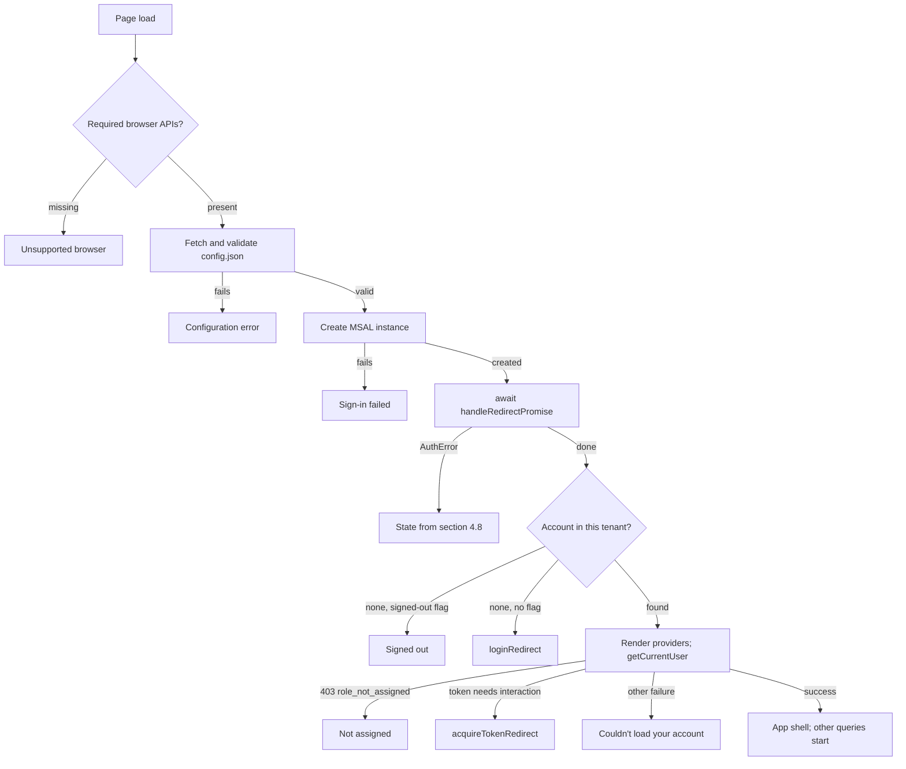
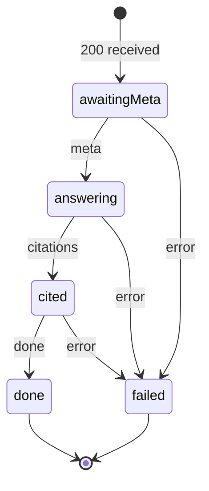

# 10 — Web client

This file specifies DocChat's browser application, the npm package `@docchat/web` in `apps/web`: its libraries and build, the runtime configuration written at deploy time, what Azure Static Web Apps serves and with which headers, sign-in and the access states, the one module that calls the API, the routes, every screen with its states, actions, operations and text, the chat client (the NDJSON reader, citations, feedback and the live regions), answer rendering and sanitisation, the upload client, accessibility to WCAG 2.2 AA, the error and copy rules, and the browser test harness with the release checks. The client owns no data and decides no access: only the API protects data (`11-api.md` section 1.4). Every operation, field, schema and error code it uses is defined in `11-api.md` sections 2 to 4; the stream protocol is `11-api.md` section 3.3; the Static Web Apps resource is built by `83-infrastructure.md`; the tests that prove each rule are listed in `84-testing.md`.

## 1. Stack and structure

### 1.1 Runtime libraries

`apps/web/package.json` lists exact versions with no ranges; `apps/web/.npmrc` sets `save-exact=true` and `engine-strict=true`; installs run only as `npm ci` from the committed `package-lock.json` (ADR 0082). Every package below is GA. "Confirmed" is the date the version was checked on the package's npm page or the project's own release page.

| Package | Version | Confirmed | Purpose |
|---|---|---|---|
| `react`, `react-dom` | 19.3.0 | 2026-10-14 | UI runtime |
| `@fluentui/react-components` | 9.74.9 | 2026-10-14 | every component, theming and styling (Griffel) |
| `@fluentui/react-icons` | 2.0.344 | 2026-10-14 | icons |
| `@azure/msal-browser` | 5.25.1 | 2026-10-14 | sign-in and the token cache |
| `@azure/msal-react` | 5.7.2 | 2026-10-14 | `MsalProvider`, `useMsal`, `useAccount` |
| `react-router` | 8.4.0 | 2026-10-14 | routing in data mode |
| `@tanstack/react-query` | 5.104.2 | 2026-10-14 | ordinary API calls, caching, paging and polling |
| `unified` | 11.0.5 | 2026-10-15 | hosts the Markdown pipeline |
| `remark-parse` | 11.0.0 | 2026-10-15 | Markdown parser |
| `remark-gfm` | 4.0.1 | 2026-10-14 | GitHub-flavoured extensions (tables, strikethrough, task lists, autolink literals, footnotes) |
| `remark-rehype` | 11.1.2 | 2026-10-15 | Markdown tree to HTML tree |
| `rehype-stringify` | 10.0.1 | 2026-10-15 | HTML tree to an HTML string |
| `unist-util-visit` | 5.1.0 | 2026-10-15 | tree walking inside the two policy plugins |
| `dompurify` | 3.4.17 | 2026-10-14 | sanitises the answer HTML immediately before insertion |
| `zod` | 4.6.7 | 2026-10-14 | run-time validation of `config.json`, API responses and stream events |

The peer ranges line up: `@azure/msal-react` 5.7.2 peers `@azure/msal-browser` ^5.24.0 and React ^19.2.1; Fluent 9.74.9 peers React below 20; TanStack Query 5 peers React 19. Component and icon names in this file were checked against the published type declarations of `@fluentui/react-components` 9.74.9 and `@fluentui/react-icons` 2.0.344, and MSAL request and result fields against those of `@azure/msal-browser` 5.25.1 and `@azure/msal-common` 16.14.2, on 2026-10-15.

### 1.2 Toolchain

| Tool | Version | Confirmed | Use |
|---|---|---|---|
| Node.js | 24.21.0 LTS (the repository's `.node-version`; `engines.node` `>=24.15.0 <25`) | 2026-10-14 | build, tests, the generator script |
| npm | the version bundled with Node.js 24.21.0 | 2026-10-14 | `npm ci` only |
| `typescript` | 6.0.3 | 2026-10-14 | strict type checking |
| `vite` | 8.3.4 | 2026-10-14 | build and development server |
| `@vitejs/plugin-react` | 6.1.2 | 2026-10-14 | React transform |
| `vitest` | 5.0.4 | 2026-10-14 | unit and component tests |
| `@vitest/coverage-v8` | 5.0.4 | 2026-10-15 | coverage |
| `jsdom` | 30.1.2 | 2026-10-14 | test DOM |
| `@testing-library/react` | 16.3.3 | 2026-10-14 | component tests |
| `@testing-library/dom` | 10.4.2 | 2026-10-15 | component tests |
| `@testing-library/jest-dom` | 7.0.1 | 2026-10-14 | DOM matchers |
| `@testing-library/user-event` | 14.6.8 | 2026-10-14 | simulated input |
| `msw` | 3.0.3 | 2026-10-15 | request mocking (`onUnhandledRequest: "error"`) |
| `eslint` | 10.12.0 | 2026-10-14 | lint, flat configuration |
| `@eslint/js` | 10.0.1 | 2026-10-15 | recommended rules |
| `typescript-eslint` | 8.71.2 | 2026-10-14 | `strictTypeChecked` and `stylisticTypeChecked` |
| `eslint-plugin-react-hooks` | 7.1.1 | 2026-10-14 | hook rules |
| `eslint-plugin-jsx-a11y` | 6.10.2 | 2026-10-14 | accessibility rules (strict), with the npm `overrides` entry `{"eslint-plugin-jsx-a11y": {"eslint": "$eslint"}}` |
| `eslint-config-prettier` | 10.1.8 | 2026-10-15 | turns off formatting rules |
| `globals` | 17.13.0 | 2026-10-15 | browser globals for ESLint |
| `prettier` | 3.9.10 | 2026-10-14 | formatting |
| `@hey-api/openapi-ts` | 0.99.0 | 2026-10-14 | types and Zod schemas from the OpenAPI document (section 5.1) |
| `js-yaml`, transitive through `@hey-api/openapi-ts` | 4.3.2, forced by the npm `overrides` entry `"js-yaml": "4.3.2"` | 2026-11-06 | the generator's YAML parser, patched for the high advisories GHSA-52cp-r559-cp3m, GHSA-5p4m-2wfm-xmqj and GHSA-2883-xcg3-v3hh |
| `@types/react`, `@types/react-dom` | 19.3.0 | 2026-10-15 | React types |

Node.js 24 is the LTS line that meets every engine floor of these packages (jsdom 24.15.0, React Router 22.22.0, `@hey-api/openapi-ts` 22.18.0, Vite 20.19.0). TypeScript stays on 6.0.3 because `typescript-eslint` 8.71.2 requires a version below 6.1.0 and TypeScript 7 doesn't expose the classic compiler API that the generator and the linter use (confirmed 2026-10-14 on both packages' npm pages). `apps/web/package.json` `overrides` holds exactly two entries, `{"eslint-plugin-jsx-a11y": {"eslint": "$eslint"}, "js-yaml": "4.3.2"}`. The first is the documented way to run `eslint-plugin-jsx-a11y` with ESLint 10. The second follows the override rule of `01-repository.md` section 8.1: `@hey-api/openapi-ts` 0.99.0, the latest release (checked 2026-11-06), pins `@hey-api/json-schema-ref-parser` 1.4.4, which pins `js-yaml` 4.2.0, inside the ranges of all three advisories; 4.3.2 is the first release outside them, and the generated files are byte-identical under it.

The browser test suites live in the `tests/e2e` package (`@docchat/e2e`, `84-testing.md`), which pins `@playwright/test` 1.64.1 (published and confirmed 2026-10-14), `@axe-core/playwright` 4.13.0 (confirmed 2026-10-15; it brings `axe-core` ~4.13.0) and `@azure/static-web-apps-cli` 2.0.10 (confirmed 2026-10-14), with the same `overrides` as `scripts/deploy/swa-cli`, `{"adm-zip": "0.6.1", "tmp": "0.2.7"}` (`01-repository.md` section 8.1). Dependabot opens weekly npm updates for `apps/web` (`01-repository.md`); an update to MSAL, Fluent UI, React Router, DOMPurify, Zod or the `unified` family merges only after the full browser suite passes, the stub identity-provider cases included.

### 1.3 Fluent UI v9 is the only UI system

Every component comes from `@fluentui/react-components` and every icon from `@fluentui/react-icons` (ADR 0082). Styles are written only with Griffel `makeStyles` and `makeResetStyles` and Fluent design tokens: no CSS files, CSS modules, other component libraries or icon fonts. The themes are `webLightTheme` and `webDarkTheme`, unmodified; the theme's system font stack is used, so no font file ships. The Griffel Vite plugin isn't used, because Fluent v9 still inserts run-time `<style>` elements with it (`https://www.npmjs.com/package/@griffel/vite-plugin/v/1.0.1`, confirmed 2026-10-14), so it would add a build step and change nothing on the page. One design system keeps contrast, focus indicators and high-contrast behaviour consistent across every screen.

### 1.4 Project structure

`apps/web` contains exactly this layout; unit and component tests sit beside the module they test as `*.test.ts` or `*.test.tsx`:

```text
apps/web/
├── package.json  package-lock.json  .npmrc
├── index.html                          app shell, the one entry
├── public/  favicon.svg  not-found.html
├── staticwebapp.config.template.json   template for the generator (section 3.2)
├── config.example.json                 the four fields with placeholder values (section 2.1)
├── config.local.json                   local development only; git-ignored
├── vite.config.ts                      build, development server and the Vitest `test` block
├── openapi-ts.config.ts                the generator's configuration (section 5.1)
├── tsconfig.json  tsconfig.app.json  tsconfig.node.json
├── eslint.config.js  .prettierrc.json  .prettierignore
├── scripts/
│   ├── write-env-config.mjs            writes dist/config.json and dist/staticwebapp.config.json (section 2.2)
│   ├── check-dist.mjs                  the build-output gate (section 1.7)
│   └── gen-limits.mjs                  request-field limits from the OpenAPI document (section 5.1)
└── src/
    ├── main.tsx                        start-up (section 4.2)
    ├── bootstrap/                      zodSetup.ts, loadConfig.ts, msal.ts, Startup.tsx
    ├── platform/                       storage.ts, traceparent.ts, authChannel.ts, devLog.ts, constants.ts
    ├── api/                            generated/, operations.ts, http.ts (the only fetch and XMLHttpRequest),
    │                                   problem.ts, queryClient.ts
    ├── auth/                           tokens.ts, AccessScreens.tsx, SessionExpiredBar.tsx
    ├── shell/                          AppShell.tsx, TopBar.tsx, NavPanel.tsx, routes.tsx, AdminOnly.tsx
    ├── chat/                           ChatScreen.tsx, sessions/, project/, composer/, turns/, citations/,
    │                                   feedback/, stream/ (ndjson.ts, events.ts, turnStore.ts),
    │                                   render/ (pipeline.ts, policy.ts, redact.ts, sanitize.ts, AnswerBody.tsx,
    │                                   copy.ts, speakable.ts)
    ├── memory/                         MemoryScreen.tsx
    ├── admin/                          projects/, indexes/, documents/, runs/, shared/ (ParamForm.tsx, conflict.ts)
    ├── a11y/                           LiveRegions.tsx, announce.ts
    ├── copy/                           en.ts (every user-visible string, section 12.6), turnErrorTexts.ts
    ├── ui/                             ErrorBar.tsx, ConfirmDialog.tsx, PageHeader.tsx, format.ts
    └── test/                           setup.ts, MSW handlers, render helpers
```

The composer (`src/chat/composer/`) and the answer view (`src/chat/render/AnswerBody.tsx`) are self-contained components with no other caller, so a later voice-input or read-aloud feature replaces or wraps one component without touching the stream or the renderer. The citation viewer is driven only by `openAs` (section 8.14), so a later viewer kind is one added branch there.

`.gitignore` (repository root) lists `apps/web/dist/`, `apps/web/config.local.json`, `*.zip`, `test-results/` and `playwright-report/`.

### 1.5 Build and the development server

`vite.config.ts` sets exactly:

| Option | Value | Why |
|---|---|---|
| `build.outDir` | `dist` | the artifact directory |
| `build.emptyOutDir` | `true` | no stale files |
| `build.target` | `es2023` | every supported browser (section 1.9) runs it |
| `build.sourcemap` | `false` | no source map reaches any environment |
| `build.assetsInlineLimit` | `0` | no `data:` URL is ever emitted; `font-src 'self'` allows none (Vite's default is 4,096 bytes, `https://vite.dev/config/build-options`, confirmed 2026-10-14) |
| `build.modulePreload` | `{ polyfill: false }` | no inline polyfill script, so `script-src 'self'` suffices |
| `build.cssCodeSplit` | `true` | Vite default, stated |
| entry | `index.html` only | one page |
| plugins | `@vitejs/plugin-react`; the serve-only `config.json` plugin below | – |
| `server.port`, `server.strictPort` | `5173`, `true` | the redirect URI of the `dev` registration's localhost entry |
| `server.proxy` | `{ '/v1': target, '/healthz': target }` with `const target = process.env.DOCCHAT_DEV_API_TARGET ?? 'http://127.0.0.1:8000'` | in development the page calls the API through its own origin, so no environment needs a localhost CORS rule (`11-api.md` section 1.10) |

`DOCCHAT_DEV_API_TARGET` is read only in `vite.config.ts`, never by the bundle; it names a local API process or the deployed `dev` API (an `http:` or `https:` origin). `127.0.0.1` is the default because `localhost` can resolve to the IPv6 address `::1`, where a local API listening only on IPv4 doesn't answer. `vite preview` isn't used. A production build emits only external module scripts (`https://vite.dev/guide/features`, confirmed 2026-10-14). The serve-only plugin (`apply: 'serve'`) answers `GET /config.json` from `config.local.json`, whose `apiBaseUrl` is `http://localhost:5173`, so the build output never contains a configuration file. `public/` holds only `favicon.svg` and `not-found.html`.

`npm run build` runs `tsc -b`, then `vite build`, then `node scripts/check-dist.mjs`. The package scripts are exactly: `dev` (`vite`), `build` (as above), `lint` (`eslint . --max-warnings 0`), `typecheck` (`tsc -b --noEmit`), `test` (`vitest run --coverage`), `format` (`prettier --write .`), `format:check` (`prettier --check .`) and `generate:api` (section 5.1). CI builds `apps/web` once per commit and keeps the unconfigured `dist/` as the `web-dist` artifact (ADR 0086); every environment deploys that same artifact (section 2.3).

### 1.6 TypeScript, lint and format rules

The compiler options (strict mode), the flat ESLint configuration (`@eslint/js` recommended, `typescript-eslint` `strictTypeChecked` and `stylisticTypeChecked`, `eslint-plugin-react-hooks` recommended, `eslint-plugin-jsx-a11y` strict, `eslint-config-prettier` last) and the Prettier options are the repository's shared settings (`01-repository.md`). `apps/web/eslint.config.js` adds these rules at `error`:

- `no-console`, `no-eval`, `no-implied-eval`, `no-new-func`.
- `no-restricted-syntax`: the JSX attribute `dangerouslySetInnerHTML` anywhere except `src/chat/render/AnswerBody.tsx`; assignments to `innerHTML` or `outerHTML`; calls to `insertAdjacentHTML`, `document.write` and `document.writeln`; calls to `z.compile`.
- `no-restricted-globals`: `fetch` and `XMLHttpRequest` outside `src/api/http.ts`; `localStorage`, `sessionStorage` and `indexedDB` outside `src/platform/storage.ts`.
- `no-restricted-imports`: `dompurify`, `unified`, `remark-*` and `rehype-*` outside `src/chat/render/`; `@azure/msal-browser` outside `src/bootstrap/` and `src/auth/`.

Lint runs with `--max-warnings 0`. Each rule gives one choke point: HTML insertion, sanitisation, network calls, browser storage and tokens each live in exactly one place, and production builds write nothing to the console.

### 1.7 The build-output gate

`scripts/check-dist.mjs` (Node 24, no dependencies) fails the build, exit code 1 with the offending path or string named, when `dist/` contains:

1. a `config.json` or a `staticwebapp.config.json`;
2. any `*.map` file;
3. an HTML file with an inline `<script>` element without `src`, a `<style>` element or a `style=` attribute;
4. any of the strings `AccountKey=`, `SharedAccessSignature`, `sig=`, `x-functions-key`, `-----BEGIN`, `.blob.core.windows.net`, `.azurewebsites.net`, `.search.windows.net`, `.openai.azure.com` or `api-key`, in any file;
5. initial JavaScript (the entry chunk and its static imports) larger than 500 KB gzip-compressed (`zlib.gzipSync` at level 9).

The build that reaches every environment therefore holds no endpoint, key or environment value, and the size gate catches an accidental heavy import into the first page load.

### 1.8 State

- **Server state** lives in one TanStack Query `QueryClient` (`src/api/queryClient.ts`; query keys, freshness and page sizes in section 5.8).
- **Turns being streamed** live in one external store, `src/chat/stream/turnStore.ts`, read through `useSyncExternalStore` (section 8.9).
- **React context** holds the validated configuration, the MSAL instance and the current user (`getCurrentUser`'s response).
- **Uploads in progress** live in the upload panel's component state (section 10).
- No other state library is used, and no user content is ever written to browser storage (section 2.4).

### 1.9 Supported browsers

The current and previous major versions of Microsoft Edge, Google Chrome, Mozilla Firefox and Apple Safari on desktop, and the current Safari on iOS and Chrome on Android. A browser without `ReadableStream`, `TextDecoder`, `crypto.subtle`, `crypto.randomUUID`, `BroadcastChannel` or `AbortController` gets the Unsupported browser screen before any network call (section 4.8). The PDF page preview needs `navigator.pdfViewerEnabled`, which is true in Edge and Chrome (tested 2026-10-14; `https://html.spec.whatwg.org/multipage/system-state.html#pdf-viewing-support`), and an unsandboxed frame, because a sandboxed frame shows no PDF viewer in Edge or Chrome; elsewhere the viewer offers Download page (section 8.14).

### 1.10 Client constants

These values shape the interface, live in `src/platform/constants.ts`, are tested with the code and change only with a release; none is a setting and none is domain-specific.

| Constant | Value | Section |
|---|---|---|
| Question limit; counter shown from | 4,000 code points; 3,600 | 8.5 |
| Memory fact block; fact input bound | `limits.maxFactChars` (200) code points on the trimmed text; 800 code points (the `MemoryFactRequest.text` limit from `limits.gen.ts`) | 7.3 |
| Feedback comment limit | 2,000 code points (`limits.gen.ts`); counter from 90% of it | 8.16 |
| Stall timeout | 45,000 ms | 8.10 |
| Largest stream line | 1,048,576 bytes | 8.7 |
| Render throttle | 100 ms | 9.6 |
| Plain-text answer above | 200,000 characters | 9.6 |
| Links per answer (`MAX_LINKS_PER_ANSWER`) | 10 allowed links, counted in document order; later ones render as text with their host | 9.3 |
| `turn_in_progress` resend | within 10,000 ms of `cited`; after 1,000 ms; at most 2 | 8.6 |
| Session page; turns page; admin list page; members and run items page; user search page | 30; 30; 50; 100; 20 | 5.8 |
| Recent chats in the navigation drawer | 6 | 6.3 |
| Query retries | 2, after 1,000 ms then 4,000 ms plus 0 to 250 ms of jitter, or after `retryAfterSeconds` when it is at most 30 | 5.7 |
| Upload retries; no-progress abort | 2, after 2,000 ms then 6,000 ms; 120,000 ms | 10.5 |
| `429 upload_busy` waits per file | at most 6 | 10.5 |
| Waits on a `429` limit in the two batch loops | at most 3 per person (Add people) and 3 per request (uploads), each `retryAfterSeconds` | 7.6, 10.8 |
| A time from `retryAfterSeconds` shown with seconds when closer than | 60 s | 5.10 |
| Files per upload batch | `uploadLimits.maxFilesPerBatch` (100 by default) | 10.1 |
| Largest PDF page accepted by the viewer | 20,971,520 bytes | 8.14 |
| Largest whole-document PDF accepted by Download full document and Download PDF | 104,857,600 bytes | 7.9, 8.14 |
| Object URL revocation after a download | 30,000 ms | 8.14 |
| Polling: run; runs list, documents and index; chat session with a `streaming` turn | 5,000 ms; 15,000 ms; 5,000 ms for at most 250 s | 7.11, 8.12 |
| Consecutive poll failures before polling stops | 3 | 7.11, 8.12 |
| Copy confirmation | 2,000 ms | 8.17 |
| Toast duration | 6,000 ms | 7.1 |
| Search debounce; minimum search length | 300 ms; 2 characters | 7.1, 7.6 |
| Live log children kept | 20 | 8.18 |
| Follow-the-stream threshold | 120 px from the bottom | 8.13 |
| Breakpoints | 768 px and 1,280 px | 8.1 |
| `state` return path, longest | 512 characters | 4.3 |
| Download file name stem, longest | 150 characters | 8.14 |

### 1.11 Quality gates

The CI job `web` runs, in `apps/web`: `npm ci`, `npm run lint`, `npm run typecheck`, `npm run format:check`, `npm test`, `npm run build` (with the gate of section 1.7) and the `generate:api` drift check (section 5.1). Coverage thresholds: lines, statements and functions 85%, branches 80%, excluding `src/api/generated/` and `src/main.tsx`; and at least 95% of branches in `src/chat/stream/`, `src/chat/render/`, `src/api/http.ts`, `src/platform/traceparent.ts` and `src/bootstrap/`. The npm advisory check of `apps/web`'s dependencies runs only in the repository's gated `security` job, where any high or critical advisory fails the build with no waiver (ADR 0136). Any failing test, any lint warning, coverage under a threshold, a gate failure or drift in generated files fails CI.

## 2. Runtime configuration

### 2.1 `config.json`

The client is configured by one file, `/config.json`, a JSON object with exactly these four members in this order and nothing else (ADR 0086):

| Field | Type and rule | Example shape |
|---|---|---|
| `tenantId` | canonical lower-case UUID (`^[0-9a-f]{8}-[0-9a-f]{4}-[0-9a-f]{4}-[0-9a-f]{4}-[0-9a-f]{12}$`) | 36 characters |
| `clientId` | canonical lower-case UUID: the web client registration's application ID | 36 characters |
| `apiBaseUrl` | the API's origin: scheme `https:`, lower-case host, optional port, no path, query, fragment or trailing slash; `http://localhost:<port>` or `http://127.0.0.1:<port>` only when the page itself is served from that host | `https://app-docchat-api-prod-a1b2c3.azurewebsites.net` |
| `apiScope` | an `api://` URI ending in `/access_as_user`, at most 255 characters | `api://<tenantId>/docchat-<environment>-<token>-api/access_as_user` (`83-infrastructure.md`) |

**Loading** (`src/bootstrap/loadConfig.ts`): `http.ts` fetches it with `fetch('/config.json', { cache: 'no-store', credentials: 'same-origin', redirect: 'error' })`, without `traceparent` or `Authorization`, and parses it with a strict Zod object (unknown members rejected) that applies the rules above; `apiBaseUrl` is also checked with `new URL()`: `origin` must equal the value, and the loopback form is accepted only when `window.location.hostname` is `localhost` or `127.0.0.1`. A network error, a status other than `200`, invalid JSON or any rule failure shows the Configuration error screen (section 4.8), whose Reload button reloads the page.

**Nothing else configures the client.** `import.meta.env` is read only for `DEV`; there are no build-time environment values, feature flags, endpoints in code or fallback values. The bundle and the configuration file carry only these four public values, and one build serves every environment. In Azure, `apiBaseUrl` is always the API's default App Service host, because the API has no custom domain in the first version (`83-infrastructure.md`).

`config.example.json` holds the four members with placeholder values: `00000000-0000-0000-0000-000000000000` for both identifiers, `http://localhost:5173` and `api://00000000-0000-0000-0000-000000000000/docchat-api/access_as_user`. `config.local.json` (git-ignored) holds a developer's values for `npm run dev` (section 1.5).

### 2.2 The deploy-time generator

`apps/web/scripts/write-env-config.mjs` (Node 24, no dependencies) is the only way `config.json` and `staticwebapp.config.json` are produced.

- **Inputs.** Environment variables `AZURE_TENANT_ID`, `WEB_CLIENT_ID`, `API_BASE_URL` and `API_SCOPE`, the azd environment values that Bicep outputs supply (`83-infrastructure.md`). Arguments: `--dist <dir>` (default `dist`) and `--allow-loopback`, which only the browser-test harness passes and which permits a loopback `API_BASE_URL`.
- **Validation.** The rules of section 2.1, with `API_BASE_URL` → `apiBaseUrl` and so on. On any violation the script writes nothing, prints one line naming the failing variable to standard error and exits with code 1.
- **Output 1.** `<dist>/config.json`: compact JSON (`JSON.stringify` with no spacing) with the four members in section 2.1's order, UTF-8, one trailing newline.
- **Output 2.** `<dist>/staticwebapp.config.json`: the text of `staticwebapp.config.template.json` with its single placeholder `__API_ORIGIN__` replaced by `new URL(API_BASE_URL).origin`, parsed with `JSON.parse` (a failure exits 1) and serialised with two-space indentation; when the serialised file exceeds 20,480 bytes, Static Web Apps' limit, the script exits 1 and writes nothing.
- **Behaviour.** The script is idempotent, never reads or writes anything outside `<dist>` and the template, and exits 0 after writing both files.

### 2.3 Deployment and local configuration

1. CI builds `apps/web` once per commit (`npm ci`, `npm run build` with the gate) and stores the unconfigured `dist/` as the `web-dist` artifact.
2. Each environment's deploy runs `scripts/deploy/deploy_web.py --env <env> --dist <artifact directory>` (`83-infrastructure.md`): it copies the artifact into a fresh directory, runs `node apps/web/scripts/write-env-config.mjs --dist <dir>` with that environment's four azd values (an invalid value stops the job before upload), and uploads `<dir>` with `@azure/static-web-apps-cli` 2.0.10 and the Static Web Apps deployment token read at deploy time.
3. The deployed smoke tests run against the environment's web origin (`84-testing.md`); any failure fails the deploy job.
4. azd's `web` service refuses to upload: its `predeploy` hook writes a one-line message naming `scripts/deploy/deploy_web.py` to standard error and exits 1, because the environment-free build has no `config.json` and no `staticwebapp.config.json`, and therefore no CSP. Local web deploys run `uv run --frozen python scripts/deploy/deploy_web.py --env <env> --dist apps/web/dist` after `npm ci` and `npm run build` in `apps/web`.
5. The API deploys before the web client in every environment, so a web release never calls an operation or field the running API lacks; a new value of a response enumeration ships in the web client before the API returns it (`11-api.md` section 1.13), because the generated schemas reject unknown enumeration values.
6. **Rolling back** redeploys the last good commit's `web-dist` artifact through the same deploy job, which writes that environment's two files once more; no data migration is involved. **Changing the API's origin**: deploy the API on the new origin while the old one works, change the `API_BASE_URL` output, redeploy the web client so `config.json` and the CSP change together, run the smoke tests, then retire the old origin. **Adding a custom domain** to the web client changes nothing in the build, because the redirect URI follows the page's origin (section 4.1); the domain is added to the Static Web Apps resource, the web registration's redirect URIs and the API's platform CORS origins (`83-infrastructure.md`, `82-security.md`). The procedures in full are in `86-operations.md`.

### 2.4 Browser storage

Every read and write goes through `src/platform/storage.ts` and sits in `try`/`catch`; a failure means the default.

| Storage | Key | Value | Written | Removed |
|---|---|---|---|---|
| `sessionStorage` | MSAL's own entries | account, ID token, access token for the API scope, refresh token, request state | sign-in, token renewal | `logoutRedirect`; `clearCache()` on a sign-out in another tab; tab closed |
| `sessionStorage` | `docchat.signedOut` | `1` | Sign out (section 4.6) | Sign in pressed; a successful redirect result |
| `localStorage` | `docchat.theme` | `light` or `dark` | theme toggled (section 6.3) | never by the app |
| `localStorage` | `docchat.nav.open` | `true` or `false` | navigation toggled (section 6.3) | never by the app |

When `docchat.theme` is absent the theme follows `prefers-color-scheme`; when `docchat.nav.open` is absent the drawer is open from 1,280 px wide. No user content (drafts, questions, answers, facts, file names) is ever written to browser storage; IndexedDB, Cache Storage and cookies aren't used. The preferences survive a reload and hold no personal data.

## 3. Hosting and response headers

### 3.1 The Static Web Apps resource

The client is served by Azure Static Web Apps as static files only (ADR 0082), built by `83-infrastructure.md` with these properties:

| Property | Value | Why |
|---|---|---|
| SKU | Free in `dev`, Standard in `prod` | `prod` gets the platform's SLA and custom domains with its own certificate |
| `stagingEnvironmentPolicy` | `Disabled` | no preview site exists that could run without the environment's `staticwebapp.config.json` |
| `allowConfigFileUpdates` | `true` | the deployed `staticwebapp.config.json` takes effect |
| Public network access | enabled | browsers reach the site directly |
| Linked backend, managed functions, app settings, Static Web Apps authentication, role assignments | none | the site serves files; sign-in runs in the browser against Entra ID and only the API checks access |

### 3.2 The site configuration

`apps/web/staticwebapp.config.template.json` is the only source of the site's rules and headers (ADR 0083); the generator writes it per environment with `__API_ORIGIN__` replaced (section 2.2). It is exactly:

```json
{
  "routes": [
    { "route": "/.auth/login/aad", "statusCode": 404 },
    { "route": "/.auth/login/github", "statusCode": 404 },
    { "route": "/.auth/*", "statusCode": 404 },
    { "route": "/assets/*", "headers": { "Cache-Control": "public, max-age=31536000, immutable" } }
  ],
  "navigationFallback": {
    "rewrite": "/index.html",
    "exclude": [
      "/assets/*",
      "/.auth/*",
      "/config.json",
      "/favicon.svg",
      "/not-found.html",
      "/*.{js,mjs,css,map,json,txt,xml,ico,png,jpg,svg,webmanifest}"
    ]
  },
  "responseOverrides": {
    "404": { "rewrite": "/not-found.html", "statusCode": 404 }
  },
  "globalHeaders": {
    "Content-Security-Policy": "default-src 'none'; script-src 'self'; style-src 'self' 'sha256-47DEQpj8HBSa+/TImW+5JCeuQeRkm5NMpJWZG3hSuFU='; img-src 'self' data: blob:; font-src 'self'; connect-src 'self' __API_ORIGIN__ https://login.microsoftonline.com; frame-src blob:; object-src 'none'; base-uri 'self'; form-action 'none'; frame-ancestors 'none'",
    "Strict-Transport-Security": "max-age=31536000; includeSubDomains",
    "X-Content-Type-Options": "nosniff",
    "Referrer-Policy": "strict-origin-when-cross-origin",
    "Permissions-Policy": "accelerometer=(), autoplay=(), camera=(), clipboard-read=(), clipboard-write=(self), display-capture=(), encrypted-media=(), fullscreen=(), geolocation=(), gyroscope=(), hid=(), idle-detection=(), magnetometer=(), microphone=(), midi=(), payment=(), picture-in-picture=(), publickey-credentials-get=(), screen-wake-lock=(), serial=(), usb=(), web-share=(), xr-spatial-tracking=()",
    "Cross-Origin-Opener-Policy": "same-origin",
    "Cross-Origin-Resource-Policy": "same-origin",
    "X-Robots-Tag": "noindex, nofollow",
    "Cache-Control": "no-store"
  },
  "mimeTypes": { ".json": "application/json" }
}
```

`trailingSlash` is left unset, so `/not-found.html` is served at its own path. Route headers override global headers of the same name, so `/assets/*` files carry the long-lived `Cache-Control` and every other response carries `no-store`.

### 3.3 What the site serves

| Request | Served | Status | Headers |
|---|---|---|---|
| `GET /`, `GET /index.html` | `index.html`: the app shell, also the MSAL redirect target | 200 | global (section 3.2), `no-store` |
| `GET` any other in-app path, such as `/chat/<id>` | `index.html` through the navigation fallback | 200 | global, `no-store` |
| `GET /assets/<hashed file>` | the file | 200; 404 with `not-found.html` when missing | global, then `Cache-Control: public, max-age=31536000, immutable` |
| `GET /config.json` | the generated file | 200 | global, `no-store` |
| `GET /favicon.svg`, `GET /not-found.html` | the file | 200 | global, `no-store` |
| any method on `/.auth/*` | `not-found.html` | 404, with no `Location` and no `Set-Cookie` | global |
| `GET` a missing path matching the fallback exclusions | `not-found.html` | 404 | global |

`no-store` on the shell and `config.json` means a deploy takes effect on the next page load, and the redirect URI's page is never served from a cache; content-hashed files under `/assets/` change name with their content, so they can be cached for a year.

### 3.4 Content Security Policy

| Directive | Value | Why |
|---|---|---|
| `default-src` | `'none'` | everything not listed is refused |
| `script-src` | `'self'` | the build emits only external module scripts from `/assets/` (section 1.5); no `'unsafe-inline'`, `'unsafe-eval'` or `'wasm-unsafe-eval'` |
| `style-src` | `'self' 'sha256-47DEQpj8HBSa+/TImW+5JCeuQeRkm5NMpJWZG3hSuFU='` | Fluent v9's Griffel creates empty `<style>` elements and fills them through the CSSOM; the hash is the SHA-256 of the empty string, so those elements are allowed and no other inline style is; static headers can't carry a nonce. In Edge and Chrome, tested 2026-10-14, Fluent renders fully styled under this policy with zero violations (`https://www.w3.org/TR/CSP3/#directive-style-src`) |
| `img-src` | `'self' data: blob:` | the app's own images; `data:` and `blob:` are local sources that make no network request, and answers never contain images (section 9.2) |
| `font-src` | `'self'` | the theme's system font stack; no font file ships |
| `connect-src` | `'self'`, the environment's API origin, `https://login.microsoftonline.com` | `/config.json` (and the development proxy), the API, and MSAL's metadata, discovery and token requests |
| `frame-src` | `blob:` | the PDF page preview is a client-built blob in a frame (section 8.14); sign-in never uses a frame, so neither `'self'` nor Entra ID appears. In Edge and Chrome, tested 2026-10-14, a PDF blob in an unsandboxed frame renders under this policy (`https://www.w3.org/TR/CSP3/#security-inherit-csp`) |
| `object-src` | `'none'` | no plug-in content |
| `base-uri` | `'self'` | no injected `<base>` can redirect relative URLs |
| `form-action` | `'none'` | the app submits no HTML form; sign-in uses top-level navigations |
| `frame-ancestors` | `'none'` | no site can frame the app |

No `report-uri` or `report-to` is set, because violation reports would be client telemetry (section 12.8); the browser test suite fails on any violation instead (`84-testing.md`). Trusted Types aren't enforced, because Fluent UI and MSAL don't guarantee typed sinks; the single HTML insertion point of section 9.6 and its lint rule hold the same line. Zod runs jitless (`z.config({ jitless: true })` in `src/bootstrap/zodSetup.ts`, imported first by `main.tsx`), because its compiled validators use `new Function`, which `script-src 'self'` refuses; `z.compile` is banned by lint (section 1.6).

### 3.5 Other headers

| Header | Value | Why |
|---|---|---|
| `Strict-Transport-Security` | `max-age=31536000; includeSubDomains` | HTTPS only for a year; no `preload`, because the default host belongs to Microsoft's domain |
| `X-Content-Type-Options` | `nosniff` | files run only as their declared type |
| `Referrer-Policy` | `strict-origin-when-cross-origin` | other origins see at most the site's origin |
| `Permissions-Policy` | the list in section 3.2 | every listed feature is denied to the page and every frame except `clipboard-write=(self)`, which Copy answer and Copy reference ID need; the microphone and camera are denied because the product has no voice or video input. Only features current Chromium recognises are listed, so the header produces no console warnings |
| `Cross-Origin-Opener-Policy` | `same-origin` | no other window keeps a handle on the app; sign-in uses full-page redirects, never popups |
| `Cross-Origin-Resource-Policy` | `same-origin` | no other site embeds the app's files |
| `X-Robots-Tag` | `noindex, nofollow` | the site holds no public content |
| `Cache-Control` | `no-store`, except `/assets/*` | section 3.3 |

The deployed smoke tests compare every response header with this section, with the environment's API origin in the CSP (`84-testing.md`).

### 3.6 Blocked routes, the fallback and the 404 page

`/.auth/login/aad`, `/.auth/login/github` and everything else under `/.auth/` answer `404` with `not-found.html`: the app uses none of Static Web Apps' built-in authentication, and a `404` route rule blocks those routes on every plan (`https://learn.microsoft.com/en-us/azure/static-web-apps/authentication-authorization`, confirmed 2026-10-14). Every navigation to a path that isn't a file returns `index.html` with `200`, so every route works on reload and as a shared link; the excluded patterns answer `404` with `not-found.html` when the file is missing, so a script that left with an earlier release fails as a `404` and never arrives as HTML (section 6.5).

`public/not-found.html` is static HTML with no script, no `<style>` element and no `style` attribute: `<html lang="en">`, the title `Page not found · DocChat`, the heading `Page not found` and the paragraph `Check the address, or go to DocChat.`, in which `go to DocChat` links to `/`. `public/favicon.svg` is the product mark.

## 4. Sign-in and access states

### 4.1 MSAL configuration

`src/bootstrap/msal.ts` creates one instance per page load with `createStandardPublicClientApplication` from exactly this configuration (ADR 0018):

```ts
{
  auth: {
    clientId: config.clientId,
    authority: `https://login.microsoftonline.com/${config.tenantId}`,
    redirectUri: `${window.location.origin}/`,
    postLogoutRedirectUri: `${window.location.origin}/`,
  },
  cache: { cacheLocation: 'sessionStorage' },
  system: {
    allowRedirectInIframe: false,
    loggerOptions: { logLevel: LogLevel.Error, piiLoggingEnabled: false, loggerCallback: devLog },
  },
}
```

- **Flow.** MSAL runs the authorization code flow with PKCE (S256). The authority is the tenant's own, never `common` or `organizations`. The redirect URI follows the page's origin, so the default host and every registered custom domain work without a rebuild; the web registration lists each origin's `/` (`83-infrastructure.md`).
- **Scope.** Every interactive and silent request names exactly one scope, `config.apiScope`; MSAL adds `openid`, `profile` and `offline_access`. The client asks for no other token and never calls Microsoft Graph.
- **The token.** The access token goes only into the `Authorization: Bearer` header of API calls; it is never logged, stored by the app, put in a URL or decoded. Role and projects come from the API (section 4.7).
- **Redirects only.** No popup API, `ssoSilent`, hidden-iframe flow or MSAL redirect-bridge page is used, because the CSP allows frames only for PDF blobs (section 3.4). The redirect URI is the real file `/` (`index.html`), served with `no-store`.
- **Logging.** `devLog` (`src/platform/devLog.ts`) writes to the console only when `import.meta.env.DEV` is true, and then only `{ code, referenceId }` and MSAL errors; it does nothing in production builds.

### 4.2 Start-up

`src/main.tsx` runs these steps in order; each failure ends in a screen of section 4.9, so no state waits without end (ADR 0091).

1. Import `src/bootstrap/zodSetup.ts` (jitless Zod). Check that `ReadableStream`, `TextDecoder`, `crypto.subtle`, `crypto.randomUUID`, `BroadcastChannel` and `AbortController` exist. *Missing:* the Unsupported browser screen; stop, with no network call made.
2. Render the Starting screen (`app.starting`).
3. Fetch and validate `/config.json` (section 2.1). *Fails:* the Configuration error screen; stop.
4. Create the MSAL instance. *Fails:* the Sign-in failed screen.
5. `await handleRedirectPromise({ navigateToLoginRequestUrl: false })`. *A result:* set the active account to its account, remove `docchat.signedOut`, and replace the location with the validated `state` (section 4.3) before the router exists. *Throws:* the state that section 4.8 assigns to the error; stop.
6. Pick the account: the redirect result's, else the first cached account whose `tenantId` equals `config.tenantId`; accounts of other tenants are ignored. *None, `docchat.signedOut` is `1`:* the Signed out screen; stop. *None, no flag:* show `app.redirecting` and call `loginRedirect({ scopes: [config.apiScope], state: pathname + search })`; stop.
7. Open the `BroadcastChannel` named `docchat-auth` (section 4.6).
8. Create the `QueryClient` and the router, and render `FluentProvider` → `MsalProvider` → `QueryClientProvider` → `LiveRegions` → `RouterProvider`.
9. The shell shows a loading state until `getCurrentUser` succeeds; every other query has `enabled` false until then (section 4.7). *The token needs interaction:* `acquireTokenRedirect({ scopes: [config.apiScope], account, state })` at once, because nothing is on screen to lose; stop. *`403 role_not_assigned`:* the Not assigned screen. *Any other failure:* the Couldn't load your account screen. *Success:* the shell renders with the navigation for `isAdmin`.



Signing in automatically on a first visit saves a click; the `docchat.signedOut` flag stops an immediate sign-in loop after an explicit sign-out.

### 4.3 The return path

Every interactive request (`loginRedirect`, `acquireTokenRedirect`) carries `state` = the in-app path to return to (`location.pathname + location.search`). After a redirect result the app replaces the location with `result.state` only when all of these hold: it starts with exactly one `/` (not `//`), contains no `\`, is at most 512 characters long, and `new URL(state, location.origin).origin` equals `location.origin`. Otherwise it replaces the location with `/chat`. The rule closes an open-redirect path through `state`.

### 4.4 Getting tokens

`src/auth/tokens.ts` is the only caller of MSAL's token methods; `http.ts` asks it for a token before every API call.

1. When the session-expired state is set (section 4.5), reject at once with the client outcome `session_expired`.
2. When a silent request is already pending, await it and start no other.
3. Call `acquireTokenSilent({ scopes: [config.apiScope], account, cacheLookupPolicy: CacheLookupPolicy.AccessTokenAndRefreshToken })`, which returns the cached access token or redeems the refresh token over `fetch` and never uses an iframe. MSAL renews an access token 300 seconds before it expires (its default offset).
4. `InteractionRequiredAuthError` (including `AADSTS700084`, the 24-hour single-page-app refresh-token expiry): before the shell has rendered, call `acquireTokenRedirect({ scopes: [config.apiScope], account, state })` and never resolve; after it has rendered, set the session-expired state and reject with `session_expired`.
5. Any other MSAL error (Entra ID unreachable, for one): reject as `network`, with the MSAL error's `correlationId` as the reference ID; no redirect starts.
6. Resolve with the access token.

One module-level guard in `tokens.ts` makes concurrent expiries share one redirect and one session-expired state.

### 4.5 A `401` and session expiry

1. The API answers `401`, with a problem body (`invalid_token`, `authentication_required`) or without one (platform authentication).
2. `tokens.ts` calls `acquireTokenSilent` with `cacheLookupPolicy: CacheLookupPolicy.RefreshToken`, which skips the cached access token and never uses an iframe, and `http.ts` repeats the request once with a new `traceparent`. *The token needs interaction:* section 4.4 step 4. For `createChatTurn` the repeat is the identical request with the same `clientTurnId`, because authentication fails before the API creates a turn.
3. A second `401`: set the session-expired state; the operation fails with `error.sessionExpired`.
4. While the session-expired state is set, the Session expired bar (a Fluent `MessageBar`, intent `warning`, `session.expired.*`) sits above the main content of every screen. Every new API call fails at once with `session_expired`; streams and uploads that already started continue, because their token was already sent.
5. The bar's Sign in button (`session.expired.action`) calls `acquireTokenRedirect({ scopes: [config.apiScope], account, state: pathname + search })`. After the round trip, start-up step 5 returns the user to the same screen. The client never redirects on its own once the shell is on screen, so the user can copy unsent text first; the bar says unsent text doesn't survive the reload.

A top-level visit to Entra ID is required at least every 24 hours for a single-page app (`https://learn.microsoft.com/en-us/entra/identity-platform/reference-third-party-cookies-spas`, confirmed 2026-10-14); that visit is this redirect.

### 4.6 Signing out, in this tab and the others

1. Account menu → Sign out. When a turn is before its terminal outcome or an upload is running, the Sign out now? dialog appears (`shell.signOut.*`); Stay signed in closes it and nothing else happens.
2. Set `sessionStorage` `docchat.signedOut` to `1`.
3. Post `{ "type": "signed-out" }` on the `BroadcastChannel` `docchat-auth`.
4. Abort every live turn and upload, then call `queryClient.clear()`.
5. Call `logoutRedirect({ account, postLogoutRedirectUri: <origin> + '/' })`, which clears MSAL's cache for the account, ends the Entra ID session and returns to `/`, where start-up step 6 shows the Signed out screen. *Throws:* call `clearCache()` and show the Signed out screen directly.
6. Every other tab of the app that receives `{ "type": "signed-out" }` aborts its live turns and uploads, calls `queryClient.clear()` and MSAL's `clearCache()`, sets its own `docchat.signedOut` flag and shows the Signed out screen, because session storage is per tab and those tabs would otherwise keep working tokens. A message of any other shape is ignored.

### 4.7 Role and projects come from the API

- `getCurrentUser` is the first API call after sign-in, and every other query waits for it, because the API provisions the user's row and default memberships on that first request (`11-api.md` section 3.2). The client uses its `displayName`, `email`, `isAdmin`, `features.memoryEnabled` and `features.feedbackComments`.
- Admin status is `isAdmin`. Reachable projects come only from `listMyProjects`. The client never decodes an ID or access token and never reads a `roles`, `groups` or `wids` claim.
- **The admin guard.** Routes under `/admin/` render only when `isAdmin` is true; otherwise the Admin only screen replaces the main content. The admin screens and the Memory screen are `React.lazy` modules loaded inside their guard, so a non-admin's browser never downloads admin code, and admin navigation items are hidden for non-admins. When an admin call answers `403 admin_required` (the role was removed during the session), the client refetches `getCurrentUser` and shows Admin only.
- **Only the API protects data.** The guard is presentation: the API checks the `Admin` role on every admin operation (`11-api.md` section 1.4) and admins see every project without membership rows.
- **No projects.** When the first page of `listMyProjects` has no items, the chat screen's main panel shows the No projects state (section 4.9): a user is asked to contact an administrator and gets Refresh, which refetches `listMyProjects`; an admin is told no projects exist and gets Go to Projects. Navigation, the session panel and the Memory screen stay available. A person who signs in for the first time and joins no project sees this state and asks an administrator (`11-api.md` section 3.8).

### 4.8 Signals and the states they cause

Every access state comes from exactly four inputs: the `AuthError` that `handleRedirectPromise` raises, the API's answers, the bodies of `getCurrentUser` and `listMyProjects`, and the flag `docchat.signedOut`.

| Signal | Client outcome | State |
|---|---|---|
| A required browser API is missing | `unsupported_browser` | Unsupported browser |
| `config.json` fails to load or validate | `config_unavailable` | Configuration error |
| No cached account and `docchat.signedOut` is `1`; or `handleRedirectPromise` raises `errorCode` `user_cancelled`, or `access_denied` without `AADSTS50105` | – | Signed out |
| `AuthError` whose `errorNo` is `"50105"` or whose `errorMessage` contains `AADSTS50105` | `not_assigned` | Not assigned |
| An API response `403` with a problem body whose `code` is `role_not_assigned` | `not_assigned` | Not assigned; every query stops and the shell is replaced |
| `AuthError` containing `AADSTS65001` or `AADSTS90094` (tenant-wide consent not granted) | `consent_missing` | Consent missing |
| Any other `AuthError` from `handleRedirectPromise`, or creating the MSAL instance fails | `signin_failed` | Sign-in failed |
| `InteractionRequiredAuthError` from `acquireTokenSilent`, or a second `401` | `session_expired` | before the shell: `acquireTokenRedirect` at once; after: the Session expired bar (section 4.5) |
| An API `401`, with or without a problem body | – | the one refresh-token repeat of section 4.5 |
| An API `403` with code `admin_required` | – | refetch `getCurrentUser`, then Admin only |
| An API `403` without a problem body | `http` failure | the operation's error with the request's trace ID; at start-up the Couldn't load your account screen; never Not assigned |
| `getCurrentUser` fails other than by a `401`, `403 role_not_assigned` or a token that needs interaction | – | Couldn't load your account |
| The first page of `listMyProjects` has no items | – | No projects |
| An admin route while `isAdmin` is false | – | Admin only |

A missing role reaches the client only as `AADSTS50105` or as `403 role_not_assigned` with a problem body. A `403` without one comes from platform authentication refusing the token's client application or tenant (a misconfigured deployment) or from App Service while the API's site is stopped (`11-api.md` section 1.5), so it is a server failure with a trace ID. When Entra ID stops an unassigned user on its own sign-in page, the browser never returns to the app; Entra ID's page explains the failure and the app has nothing to detect.

### 4.9 The access screens

The full-page states replace the whole page with a centred column at most 480 px wide: the product mark, an `h1` with the title, the body text, the actions (the primary one first) and, where listed, the reference ID line of section 12.1. Couldn't load your account also shows the failed call's error bar (section 12.1). No projects, Admin only and the Session expired bar appear inside the app shell. Each full-page state has the document title `<title> · DocChat`.

| State | Text keys: text | Actions | Reference ID |
|---|---|---|---|
| Starting | `app.starting`: Starting DocChat… (with a Fluent `Spinner`) | – | – |
| Redirecting | `app.redirecting`: Taking you to sign-in… | – | – |
| Unsupported browser | `access.unsupported.title`: This browser can't run DocChat · `access.unsupported.body`: Open DocChat in a current version of Microsoft Edge, Google Chrome, Mozilla Firefox or Apple Safari. | none | – |
| Configuration error | `app.configError.title`: DocChat can't start · `app.configError.body`: Its settings didn't load. Reload the page. If this keeps happening, tell your DocChat administrator. | `app.reload` Reload: reloads the page | – |
| Signed out | `access.signedOut.title`: You're signed out · `access.signedOut.body`: Sign in with your work account to use DocChat. | `access.signedOut.action` Sign in: removes the flag, then `loginRedirect` | – |
| Not assigned | `access.notAssigned.title`: You don't have access to DocChat yet · `access.notAssigned.body`: Your account, {account}, isn't set up to use DocChat. Ask your DocChat administrator to give you access, then select Retry. (`{account}` is MSAL's `account.username`, so the user can tell an administrator which account to assign) | `access.retry` Retry: `loginRedirect` with `prompt: 'select_account'`; `access.signOut` Sign out: section 4.6 | – |
| Consent missing | `access.consentMissing.title`: DocChat isn't set up for your organization yet · `access.consentMissing.body`: An administrator has to finish setting up DocChat before anyone can sign in. Send them the reference ID below. | `access.signOut` Sign out | the `AuthError`'s `correlationId` |
| Sign-in failed | `access.signInFailed.title`: Sign-in didn't finish · `access.signInFailed.body`: Select Retry. If sign-in keeps failing, send the reference ID below to your DocChat administrator. | `access.retry` Retry: `loginRedirect` | the `AuthError`'s `correlationId` (none when the instance couldn't be created) |
| Couldn't load your account | `access.loadUserFailed.title`: We couldn't load your account · `access.loadUserFailed.body`: Select Retry. If this keeps happening, send the reference ID below to your DocChat administrator. | `access.retry` Retry: refetch `getCurrentUser`; `access.signOut` Sign out | the failed call's (section 5.5) |
| No projects (user) | `access.noProjects.title`: You aren't in any projects yet · `access.noProjects.body`: Ask your DocChat administrator to add you to a project. Your projects appear here as soon as you're added. | `access.noProjects.action` Refresh: refetch `listMyProjects` | – |
| No projects (admin) | `access.noProjectsAdmin.title`: There are no projects yet · `access.noProjectsAdmin.body`: Create a project and map an index to it, then come back here to chat with its documents. | `access.noProjectsAdmin.action` Go to Projects: `/admin/projects` | – |
| Admin only | `access.adminOnly.title`: This page is for administrators · `access.adminOnly.body`: You need the DocChat administrator role to open it. If you think you should have it, ask your DocChat administrator. | `access.adminOnly.action` Go to chat: `/chat` | – |
| Session expired (bar) | `session.expired.title`: Your sign-in has expired · `session.expired.body`: Sign in to keep working. Copy any text you haven't sent first, because signing in reloads the page. | `session.expired.action` Sign in: `acquireTokenRedirect` (section 4.5) | – |

The client outcome codes `unsupported_browser`, `config_unavailable`, `signin_failed`, `not_assigned`, `consent_missing` and `session_expired` are raised in the browser and are never API codes (section 12.4).

## 5. Calling the API

### 5.1 Generated types, schemas and limits

- **Generation.** `@hey-api/openapi-ts` 0.99.0 reads the committed `apps/api/openapi.json` (`11-api.md` section 1.13) with the plugins `@hey-api/typescript` and `{ name: 'zod', definitions: true }` (`openapi-ts.config.ts`) and writes `src/api/generated/types.gen.ts` and `src/api/generated/zod.gen.ts`. `scripts/gen-limits.mjs` reads the same document and writes `src/api/generated/limits.gen.ts`: one exported constant per request field the forms use, holding its `maxLength`, `maxItems`, `minimum` or `maximum`, so form limits come from the same source as the API's validation.
- **Committed and checked.** The generated files are committed; `npm run generate:api` regenerates them and formats them with Prettier, and CI fails when regeneration changes any file (section 1.11).
- **No generated client runtime.** Calls go through the hand-written table `src/api/operations.ts`, one entry per operationId of section 5.2 (method, path template, request type, response schema). A unit test reads `apps/api/openapi.json` and fails when an entry's method or path differs from the document's. The generator is a 0.x release, so the client depends only on its type and schema output (`https://heyapi.dev/docs/openapi/typescript/plugins/zod/v4`, confirmed 2026-10-14).
- **Unknown fields and values.** Every `2xx` JSON body is parsed with the operation's generated Zod schema. Generated object schemas strip unknown members, so a field the API adds later is ignored; an enumeration value the schema doesn't list fails the parse (`unexpected`, section 5.5), so a new response value ships in the client before the API sends it (section 2.3 step 5). `config.json` is the one strict object (section 2.1).

### 5.2 The operations the client calls

`getHealth` is never called. `…` stands for the path prefix of the row above.

| operationId (`11-api.md`) | Method and path | Called by | `If-Match` |
|---|---|---|---|
| `getCurrentUser` (3.2.1) | `GET /v1/me` | start-up, account menu, admin guard, feedback controls | – |
| `listMyProjects` (3.2.2) | `GET /v1/projects` | project picker, empty state, session panel, No projects | – |
| `createChatTurn` (3.3.1) | `POST /v1/chat/turns` | Send, example question, follow-up, Retry | – |
| `listSessions` (3.4.1) | `GET /v1/sessions` | session panel, Recent chats | – |
| `getSession` (3.4.2) | `GET /v1/sessions/{sessionId}` | opening a session; polling a `streaming` turn (section 8.12) | – |
| `listSessionTurns` (3.4.3) | `GET /v1/sessions/{sessionId}/turns` | Show earlier messages | – |
| `putTurnFeedback` (3.4.4) | `PUT /v1/sessions/{sessionId}/turns/{turnId}/feedback` | Helpful, the feedback dialog | – |
| `getCitation` (3.5.1) | `GET /v1/sessions/{sessionId}/turns/{turnId}/citations/{citationNumber}` | opening a citation | – |
| `getCitationContent` (3.5.2) | `GET …/citations/{citationNumber}/content` | PDF page preview, Download page | – |
| `getCitationDocument` (3.5.3) | `GET …/citations/{citationNumber}/document` | Download full document | – |
| `getMemory` (3.6.1) | `GET /v1/memory` | Memory screen | – |
| `updateMemorySettings` (3.6.2) | `PATCH /v1/memory` | Use memory switch | `etag` |
| `updateMemoryFact` (3.6.3) | `PUT /v1/memory/facts/{factId}` | saving a memory | `etag` |
| `deleteMemoryFact` (3.6.4) | `DELETE /v1/memory/facts/{factId}` | deleting a memory | `etag` |
| `clearMemory` (3.6.5) | `DELETE /v1/memory/facts` | Clear all | `etag` |
| `adminListProjects` (3.7.2) | `GET /v1/admin/projects` | Projects | – |
| `adminCreateProject` (3.7.3) | `POST /v1/admin/projects` | Create project | – |
| `adminGetProject` (3.7.4) | `GET /v1/admin/projects/{projectId}` | Project; read before the Members and Indexes lists on every load (section 5.6) | – |
| `adminUpdateProject` (3.7.5) | `PATCH /v1/admin/projects/{projectId}` | Save changes, Archive, Restore | project `rowVersion` |
| `adminListProjectMembers` (3.7.6) | `GET …/members` | Members tab | – |
| `adminAddProjectMember` (3.7.7) | `PUT …/members/{userId}` | Add people, one person at a time | project `rowVersion`, then each `projectRowVersion` |
| `adminRemoveProjectMember` (3.7.8) | `DELETE …/members/{userId}` | Remove | project `rowVersion` |
| `adminSearchUsers` (3.8.1) | `GET /v1/admin/users` | people pickers | – |
| `adminListProjectIndexes` (3.9.1) | `GET /v1/admin/projects/{projectId}/indexes` | Indexes tab | – |
| `adminMapProjectIndex` (3.9.2) | `PUT …/indexes/{indexId}` | Map an index, Make default | project `rowVersion` |
| `adminUnmapProjectIndex` (3.9.3) | `DELETE …/indexes/{indexId}` | Unmap | project `rowVersion` |
| `adminGetIndexOptions` (3.10.1) | `GET /v1/admin/index-options` | New index, Edit settings, upload checks | – |
| `adminListIndexes` (3.10.2) | `GET /v1/admin/indexes` | Indexes, Map an index, the runs filter | – |
| `adminCreateIndex` (3.10.3) | `POST /v1/admin/indexes` | Create index | – |
| `adminGetIndex` (3.10.4) | `GET /v1/admin/indexes/{indexId}` | Index; Documents header and project picker | – |
| `adminUpdateIndex` (3.10.5) | `PATCH /v1/admin/indexes/{indexId}` | Save changes on Edit settings | index `rowVersion` |
| `adminDeleteIndex` (3.10.6) | `DELETE /v1/admin/indexes/{indexId}` | Delete index | index `rowVersion` |
| `adminStartReingest` (3.10.7) | `POST /v1/admin/indexes/{indexId}/reingest` | Start re-ingest | index `rowVersion` |
| `adminListDocuments` (3.11.1) | `GET …/indexes/{indexId}/documents` | Documents table | – |
| `adminGetDocument` (3.11.2) | `GET …/documents/{documentId}` | document panel | – |
| `adminGetDocumentPdf` (3.11.10) | `GET …/documents/{documentId}/pdf` | document panel: Download PDF | – |
| `adminDeleteDocument` (3.11.3) | `DELETE …/documents/{documentId}` | Delete | document `rowVersion` |
| `adminReingestDocument` (3.11.4) | `POST …/documents/{documentId}/reingest` | Re-ingest | document `rowVersion` |
| `adminPreflightUploads` (3.11.6) | `POST /v1/admin/indexes/{indexId}/uploads/preflight` | upload panel: checking files | – |
| `adminReserveUpload` (3.11.7) | `POST …/uploads` | upload: each file | – |
| `adminUploadContent` (3.11.8) | `PUT …/uploads/{versionId}/content` | upload: each file's bytes | – |
| `adminSubmitUploads` (3.11.9) | `POST …/uploads/submit` | upload: finishing the batch | – |
| `adminListIngestionRuns` (3.12.1) | `GET /v1/admin/ingestion-runs` | Ingestion runs | – |
| `adminGetIngestionRun` (3.12.2) | `GET /v1/admin/ingestion-runs/{runId}` | Ingestion run | – |

### 5.3 Building a request

Every call goes through `src/api/http.ts`, the only module that uses `fetch` or `XMLHttpRequest` (upload bodies, section 10.5); it also performs the unauthenticated `config.json` fetch.

- **URL.** `config.apiBaseUrl` + the operation's path, each path parameter passed through `encodeURIComponent`; query parameters through `URLSearchParams`, omitted when absent.
- **`fetch` options.** `mode: 'cors'`, `credentials: 'omit'`, `cache: 'no-store'`, `redirect: 'error'`, and an `AbortSignal` (the component's, the stream's or the download's). `redirect: 'error'` makes a misrouted call fail at once and never follow a sign-in page.
- **Headers, exactly.** `Authorization: Bearer <token>` (section 4.4); `Accept: application/json`, or `application/x-ndjson` for `createChatTurn` and `*/*` for the three file operations (`getCitationContent`, `getCitationDocument`, `adminGetDocumentPdf`); `Content-Type: application/json` when a JSON body is sent (`application/octet-stream` for upload bodies); `traceparent` (section 5.4); `If-Match` where section 5.6 requires it. No cookies, and never `tracestate`, `baggage`, `Request-Id` or `X-Requested-With`; these five request headers are the ones the API's CORS rule allows (`11-api.md` section 1.10).
- **Bodies.** JSON request bodies are built from the generated request types; forms validate them with the generated request schemas and `limits.gen.ts` before sending (section 7.1).

### 5.4 `traceparent`

Every HTTP request to the API, including each automatic retry and repeat, the chat stream, each upload attempt and each file download, carries `traceparent: 00-<trace-id>-<parent-id>-01` (ADR 0088): the 16-byte trace ID and the 8-byte parent ID come from `crypto.getRandomValues`, written as lower-case hexadecimal and drawn once more when all zero (`src/platform/traceparent.ts`). Every request gets a new trace ID, which the client keeps with the request, so a failure without a problem body still has a reference ID. The sampled flag is always `01`: the browser has no sampler and the API's own sampler decides from the trace ID (`85-observability.md`), so the browser can neither force nor suppress sampling. The `config.json` fetch and every Entra ID request carry no `traceparent`.

### 5.5 Classifying the answer and the reference ID

`http.ts` turns every answer into a result or an `ApiError { kind, status, code, title, detail, errors, retryAfterSeconds, traceId, referenceId }`:

1. Build the URL and a new `traceparent`; remember its trace ID.
2. Get a token (section 4.4). *Fails:* reject with that error.
3. Send. *`fetch` rejects:* `AbortError` → `aborted`; anything else → `network`.
4. `401`, with or without a problem body → section 4.5.
5. `2xx`: `204` resolves with no body; the three file operations resolve with their bytes under section 8.14's rules (a body read that rejects, or fewer bytes than `Content-Length`, is `network` with the client outcome `download_interrupted`); every other answer must have `Content-Type` `application/json`, parse as JSON and pass the operation's schema, otherwise `unexpected`.
6. Non-`2xx` with `Content-Type` `application/problem+json` and a body that passes the generated `Problem` schema (`zProblem`): `problem`, carrying `status`, `code`, `title`, `detail`, `correlationId`, `retryAfterSeconds` and `errors` (`11-api.md` section 1.5). Any other non-`2xx`: `http`.
7. A `problem` with status `403` and code `role_not_assigned` also tells the app root to show Not assigned (section 4.8). An `http` failure with status `403` stays an `http` failure.

| Kind | Meaning | Shown |
|---|---|---|
| `network` | no response (the request failed, a CORS refusal, a cut-short download) | `error.network.*` (section 12.5) |
| `problem` | a problem details body | its `title` and `detail` (section 12.3) |
| `http` | a non-`2xx` without a problem body: platform authentication, platform CORS, App Service while the API's site is stopped | `error.server.*` |
| `unexpected` | a `2xx` whose body or `Content-Type` fails the operation's contract | `error.unexpected.*` |
| `aborted` | the user, a navigation or sign-out stopped it | nothing |

**The reference ID** is the problem's `correlationId` when the answer carries a problem body, otherwise the trace ID the client sent. A failure the stream reader detects itself uses `meta.correlationId` when `meta` arrived, otherwise the request's trace ID; an `error` event uses its own `correlationId`; a sign-in failure uses the MSAL error's `correlationId`; a failure that involved no API call (configuration, clipboard, reading a chosen file) has none.

### 5.6 `If-Match` and the version kept with each resource

The client sends `If-Match` on exactly the 14 operations of `11-api.md` section 1.9 (ADR 0094):

| Operations | Value |
|---|---|
| `adminUpdateProject`, `adminAddProjectMember`, `adminRemoveProjectMember`, `adminMapProjectIndex`, `adminUnmapProjectIndex` | the project's `rowVersion` |
| `adminUpdateIndex`, `adminStartReingest`, `adminDeleteIndex` | the index's `rowVersion` |
| `adminDeleteDocument`, `adminReingestDocument` | the document's `rowVersion` |
| `updateMemorySettings`, `updateMemoryFact`, `deleteMemoryFact`, `clearMemory` | the memory's `etag` |

1. **Format.** The body value is sent verbatim when it already starts and ends with `"` (memory ETags include their quotes) and wrapped in double quotes otherwise: the `rowVersion` `AAAAAAAAB9E=` goes out as `If-Match: "AAAAAAAAB9E="`. The value travels in the body because a cross-origin script can't read the `ETag` header.
2. **Keeping it current.** Every successful write returns the updated resource, whose `rowVersion` or `etag` replaces the cached one. The four membership and mapping operations return `projectRowVersion` (in `ProjectMemberChange`, `ProjectIndexMappingChange` and `ProjectPartRemoval`), which replaces the `rowVersion` of the cached project (`['admin', 'project', projectId]`), so one admin's consecutive changes chain without a reload.
3. **Project first on the Members and Indexes tabs.** Every load or reload of either tab (each opening, whatever the cached data's age; window focus; after a change or a `412`) requests `adminGetProject`, then the first page of its list (`adminListProjectMembers` with `limit=100`, or `adminListProjectIndexes` with `limit=50`), and writes the project response into the cache only after that page has arrived. While either tab is shown, the project query doesn't refetch on its own. So the version a tab sends is never newer than the rows it shows.
4. **The Details form and the same admin's changes.** When a membership or mapping change succeeds and the Details form's kept `rowVersion` equals the version that change sent, the form takes the returned `projectRowVersion` and leaves its loaded values and the draft as they are, because members and mappings aren't form fields; a later Save changes then meets no `412` that the same admin caused.
5. **Answers.** A `412 precondition_failed` starts the screen's conflict handling (sections 7.3, 7.4 and 7.6). A `428 precondition_required` means the client sent no tag or a malformed one, which is a defect: the screen shows it with the reference ID and the `error.defect.body` line, and never repeats the request.
6. Feedback, upload and create operations send no `If-Match`.

### 5.7 Automatic retries

| Request | Retried automatically | Waits |
|---|---|---|
| Queries (`GET`) other than the three file operations | at most 2 times on `network`, `408`, `500`, `502`, `503`, `504`, and a `429` whose `retryAfterSeconds` is at most 30 (the burst limit's `429 too_many_requests` sends 1) | `retryAfterSeconds` when the answer carries it; otherwise 1,000 ms, then 4,000 ms, each plus 0 to 250 ms of random jitter |
| `getCitationContent`, `getCitationDocument`, `adminGetDocumentPdf` | at most 2 times, only on `429 too_many_requests` | `retryAfterSeconds` |
| Writes (`POST`, `PUT`, `PATCH`, `DELETE`) and `createChatTurn` | never, except the three bounded cases below | – |

The three bounded cases: the identical resend on `409 turn_in_progress` (section 8.6); upload bodies and the upload flow's waits on `429 too_many_requests` (section 10); and Add people's waits on `429 too_many_requests` and `429 write_rate_limited` (section 7.6). Reads are safe to repeat. A repeated write could double an action the user didn't repeat, but a write refused by either `429` limit was never applied (`11-api.md` section 1.11), so the two batch loops send it once more after the wait. A repeated download would transfer the file once more and count against the same download limits, so `429 rate_limited` and `429 too_many_downloads` from the three file operations are shown at once (sections 7.9 and 8.14). Any other write refused with a `429` shows the problem's text with the time (section 5.10), and the control that sent it stays disabled until then. The `401` repeat of section 4.5 isn't a retry: it happens once, after a fresh token.

### 5.8 Query keys, freshness and page sizes

| Query key | Operation | Request | Fresh for | Refetch on window focus |
|---|---|---|---|---|
| `['me']` | `getCurrentUser` | – | 300 s | yes |
| `['projects', 'mine']` | `listMyProjects` | `limit=100`, every page, at most 20 pages | 60 s | yes |
| `['sessions']` | `listSessions` (infinite) | `limit=30` | 30 s | yes |
| `['session', sessionId]` | `getSession` | `turnsLimit=30` | 300 s | no |
| `['session', sessionId, 'earlier']` | `listSessionTurns` (infinite) | `limit=30`, `cursor` | 300 s | no |
| `['citation', sessionId, turnId, n]` | `getCitation` | – | 300 s | no |
| `['memory']` | `getMemory` | – | 0 s | yes |
| `['admin', resource, params]` | every admin list and read not listed below | lists `limit=50`; `adminGetIngestionRun` `itemsLimit=100` | 30 s | yes |
| `['admin', 'project', projectId]` | `adminGetProject` | – | 30 s | yes, except while the Members or Indexes tab is shown (section 5.6) |
| `['admin', 'members', projectId]` | `adminListProjectMembers`, after `adminGetProject` | `limit=100` | refetched on each tab opening | yes |
| `['admin', 'project-indexes', projectId]` | `adminListProjectIndexes`, after `adminGetProject` | `limit=50` | refetched on each tab opening | yes |
| `['admin', 'users', q]` | `adminSearchUsers` | `limit=20` | 30 s | no |
| `['admin', 'index-options']` | `adminGetIndexOptions` | – | 900 s | no |

Cached data is kept 300 s after its last use (`gcTime`). Writes update the cache from their response bodies and invalidate the lists they change. Paged lists show a Show more button while `nextCursor` isn't null; `listSessions` pages are de-duplicated by `sessionId`, because a session that receives a turn while its owner pages moves to the top (`11-api.md` section 3.4.1).

### 5.9 Where failures are shown

Each screen shows a failure where it shows that action's result: under the field or the row, in the dialog, above the table, beside a form's Save, or in the panel. The text comes from section 12.3: the problem's `title` and `detail` for every `problem`, the client's own text for every other kind, and the client's lines for times, fields and next steps. The screens in section 7 and the chat in section 8 list the codes that change a screen's state instead of only showing text.

### 5.10 Times from `retryAfterSeconds`

The time shown for a `429`, a `409 turn_in_progress` or a `503` with `retryAfterSeconds` is now + `retryAfterSeconds`, formatted by `src/ui/format.ts` with `Intl.DateTimeFormat` in the browser's locale: with seconds (`timeStyle: 'medium'`) when it is less than 60 s away; as a short time (`timeStyle: 'short'`) when it falls later today; otherwise as a medium date with a short time. It is shown in the `error.retryAt` line (section 12.5), and the control that sent the request is disabled until that time, except in the flows that wait and send once more (section 5.7). Seconds matter because the API's limits answer waits of 1 to 120 s.

## 6. Routes and the app shell

### 6.1 The router and the routes

React Router 8.4.0 in data mode (`createBrowserRouter`, `RouterProvider`) with browser-history paths, never hash routing (ADR 0089). Real paths give shareable links and need only the navigation fallback of section 3.6.

| Path | Screen | Guard | Document title |
|---|---|---|---|
| `/` | start-up, then replaced by `/chat` | none | `DocChat` |
| `/chat` | Chat, new conversation; optional `?project=<uuid>` | signed in | `Chat · DocChat` |
| `/chat/:sessionId` | Chat, existing session; a `sessionId` that isn't a canonical UUID is replaced by `/chat` | signed in | `<session title> · DocChat` |
| `/memory` | Memory | signed in | `Memory · DocChat` |
| `/admin/projects` | Projects; `?q=`, `?status=active\|archived\|all` | `Admin` | `Projects · DocChat` |
| `/admin/projects/new` | New project | `Admin` | `New project · DocChat` |
| `/admin/projects/:projectId` | Project; `?tab=details\|members\|indexes` | `Admin` | `<project name> · Projects · DocChat` |
| `/admin/indexes` | Indexes | `Admin` | `Indexes · DocChat` |
| `/admin/indexes/new` | New index | `Admin` | `New index · DocChat` |
| `/admin/indexes/:indexId` | Index | `Admin` | `<index name> · Indexes · DocChat` |
| `/admin/indexes/:indexId/documents` | Documents; `?q=`, `?state=`, `?document=<uuid>` | `Admin` | `Documents · <index name> · DocChat` |
| `/admin/runs` | Ingestion runs; `?indexId=`, `?state=` | `Admin` | `Ingestion runs · DocChat` |
| `/admin/runs/:runId` | Ingestion run | `Admin` | `Ingestion run · DocChat` |
| any other path | replaced by `/chat` | none | – |

A query parameter outside its allowed values is dropped with `replace` navigation. Replacing an unknown path with the chat screen sends a stale or mistyped link to the screen most people want. Filters and the selected tab live in the URL, so a reload or a shared link shows the same view.

### 6.2 Guards and code splitting

"Signed in" is met once start-up step 9 has succeeded; until then the Starting screen shows. The `Admin` guard is section 4.7's. `src/memory/` and `src/admin/` are `React.lazy` modules loaded inside their guard; the chat screen, the shell, the access screens and the API client are in the initial bundle, which the build gate keeps at most 500 KB gzip-compressed (section 1.7).

### 6.3 The app shell

| Part | Content |
|---|---|
| Skip link | the first focusable element, `shell.skipLink` Skip to main content, visible on focus, moving focus to `main` |
| Top bar | 48 px high, a `header` landmark. On the left: the navigation toggle (`Hamburger`, accessible name `shell.nav.show` Show navigation or `shell.nav.hide` Hide navigation) and the product mark (`DocumentSearch24Regular` and `shell.productName` DocChat), a link to `/chat`. On the right: the theme `ToggleButton` (`shell.theme` Dark theme, pressed in the dark theme) and the account `Menu` |
| Account menu | the trigger is a subtle `Button` with an `Avatar` (initials of `displayName`), plus the display name from 768 px wide (accessible name `shell.account.label` Account: {displayName}). The menu holds a non-interactive `Persona` with the display name and e-mail, a `MenuDivider` and the `MenuItem` `shell.account.signOut` Sign out (section 4.6) |
| Navigation drawer | a `NavDrawer` (`nav` landmark, `shell.nav.label` Main navigation): for admins only, the section header `shell.nav.admin` Administration with `shell.nav.projects` Projects, `shell.nav.indexes` Indexes and `shell.nav.runs` Ingestion runs; then `shell.nav.chat` Chat and `shell.nav.memory` Memory; then the section header `shell.nav.recent` Recent chats with the 6 most recent sessions (from `['sessions']`) and `shell.nav.newChat` New chat. The item matching the route is selected. Loading: a `Skeleton` under Recent chats. Empty: `shell.nav.noChats` No chats yet. Error: `shell.nav.recentError` Recent chats didn't load. (the chat screen offers Retry) |
| Main | the `main` landmark (`tabindex="-1"`), holding the Session expired bar when set and the routed screen |

The drawer is inline and open by default from 1,280 px wide, and an overlay, closed by default, below that (section 8.1); `docchat.nav.open` remembers the inline state (section 2.4). The theme follows `docchat.theme`, else `prefers-color-scheme`; toggling writes the key.

| Key | Text |
|---|---|
| `shell.signOut.title` | Sign out now? |
| `shell.signOut.body` | An answer or upload is still in progress. Signing out stops it. |
| `shell.signOut.confirm` / `shell.signOut.cancel` | Sign out / Stay signed in |

### 6.4 Focus and titles on navigation

On every route change the document title becomes the route's title (section 6.1), and focus moves to the screen's `h1` (`tabindex="-1"`), so a screen-reader user hears where they arrived. Opening a session's link from the session panel keeps the panel's scroll position. Browser back and forward restore the previous route's URL state; the router's scroll restoration is off, because the message list manages its own scrolling (section 8.13).

### 6.5 A release under an open tab, and rendering errors

The router's error element distinguishes two cases; neither shows a reference ID, because no request failed.

| Case | Detected by | Screen | Action |
|---|---|---|---|
| A lazy module fails to load because its hashed file left with an earlier release (an excluded path answers `404`, never HTML, section 3.6) | the dynamic `import()` rejects | `app.updated.title` DocChat has been updated · `app.updated.body` Reload the page to get the latest version. (client outcome `app_updated`) | `app.reload` Reload |
| Any other rendering error | the error element catches it | `app.crashed.title` Something went wrong on this page · `app.crashed.body` Reload the page. If this keeps happening, tell your DocChat administrator what you were doing. (client outcome `render_failed`) | `app.reload` Reload |

The reload warning of section 8.19 still applies when a turn or an upload is in progress.

## 7. Screens

### 7.1 Rules shared by every screen

- **Structure.** Every screen has one `h1`, focused on arrival (section 6.4); uses Fluent v9 components only; takes every string from `src/copy/en.ts` (section 12.6); and defines four states: **Loading** (a `Skeleton` shaped like the content, never a blank area), **Empty**, **Error** (an error bar where the content would have been, with Retry, which refetches) and **Partial** (some content shown, one part failed). Every load ends in content or an error bar; no spinner waits without end.
- **Admin layout.** A page header with a `Breadcrumb` on every detail screen; Fluent `Table` (not `DataGrid`) with header cells and a visually hidden caption equal to the `h1`; a `SearchBox` filter with a 300 ms debounce and `Dropdown` filters, all mirrored to URL search parameters; row actions as buttons with icon and text from 768 px wide, and in a `Menu` named `admin.actionsFor` below it.
- **Paging.** Every admin list requests `limit=50` (members and run items 100, user search 20) and shows `admin.showMore` Show more while `nextCursor` isn't null, which appends the next page; a filter change starts from the first page. The client never sorts a page; it shows the API's order, because sorting one page would mislead.
- **Destructive actions** (delete, clear, archive, unmap, remove, re-ingest) open `ConfirmDialog` first: a modal Fluent `Dialog` naming the item, saying what happens, with the action button (appearance `primary`) and `confirm.cancel` Cancel; it opens with focus on its first control and returns focus to its trigger when it closes.
- **Success** is a polite Fluent `Toast` shown for 6,000 ms, paused while hovered or focused. **Errors** are always inline error bars next to what failed (section 12.1), never toasts, because a toast can vanish before it is read.
- **Forms.** Every field is a Fluent `Field` with a visible label and, where listed, a hint. Save and Create validate the draft with the generated request schema and `limits.gen.ts` before sending; a failure shows on its fields with `validationState="error"`, nothing is sent, and focus moves to the first invalid field. Typed values survive every failure.
- **`422` answers.** Each `errors[]` entry whose `path` starts with `body.` goes to the form field whose dotted name equals the rest of the path, list indices written as `.<i>` (so `body.exampleQuestions.2` is the third example question and `body.methodParameters.targetTokens` the method setting `targetTokens`); that field shows the screen's text for the entry's `reason`, or `error.validation.field` when the screen has none. Entries at `query.`, `path.` and `header.` paths, and `body.` paths that match no field, are listed in the error bar with the problem's `title` and `detail`.
- **Formats.** Counts use `Intl.PluralRules`; dates and times use `Intl.DateTimeFormat` in the browser's locale; file sizes are bytes ÷ 1,048,576 with one decimal place and the unit MB (section 12.7).

| Key | Text |
|---|---|
| `admin.showMore` | Show more |
| `admin.actionsFor` | Actions for {name} |
| `admin.backToList` | Back to {list} |
| `admin.notSet` | Not set |
| `confirm.cancel` | Cancel |

### 7.2 Chat

`/chat` and `/chat/:sessionId`; the behaviour is section 8.

| State | Shown |
|---|---|
| Loading | session panel: a `Skeleton` of 6 rows; main panel: the picker disabled with a tiny `Spinner`; for `/chat/<id>`, 3 `Skeleton` turn blocks |
| Empty | no reachable project: No projects (section 4.9); a new chat with a ready project: the empty state (section 8.4); no project chosen: `chat.project.chooseFirst`; a project that isn't ready: `chat.project.notReady`; no sessions: `chat.sessions.empty` |
| Error | `listSessions` fails: an error bar in the session panel with Retry; `listMyProjects` fails: an error bar in the main panel with Retry, the composer disabled; `getSession` `404`: the Chat not available state (section 8.12); any other `getSession` failure: an error bar with Retry |
| Partial | Show more chats fails: an error bar under the list; Show earlier messages fails: an error bar at the top of the conversation; a turn fails after text arrived: the partial answer with its error bar; a stored `streaming` turn: its caption while the session is polled (section 8.12) |

| Action | Operation |
|---|---|
| open the screen | `listMyProjects`, `listSessions`; `getSession` for `/chat/<id>` |
| Show more chats | `listSessions` with `cursor` |
| open a session, New chat, choose a project | navigation only |
| send, an example question, a follow-up, Retry | `createChatTurn` |
| Stop | aborts `createChatTurn` |
| Show earlier messages | `listSessionTurns` |
| open a citation | `getCitation`, then `getCitationContent` for the cited page |
| Download page | `getCitationContent` |
| Download full document | `getCitationDocument` |
| Helpful; Send feedback | `putTurnFeedback` |
| polling a `streaming` turn; Refresh | `getSession` |
| Copy answer | clipboard only |

### 7.3 Memory

`/memory`, a lazy module (section 6.2). Layout, top to bottom: the `h1` `memory.title`; the intro paragraph; a row with the Use memory `Switch` and, at its right, Clear all (`Delete20Regular`); the usage line; the information bar when memory is off or paused; the list of memories (Fluent `List`, `memory.list`).

- **Loading** `getMemory`: a `Skeleton` of 4 items; the switch and Clear all disabled. The screen keeps the latest `etag` and replaces the whole resource with each write's response.
- **The switch** is on when `paused` is false; changing it calls `updateMemorySettings` with `{ "paused": <true or false> }` and `If-Match`, and announces `memory.pausedDone` or `memory.resumedDone`.
- **The usage line** shows `memory.usage.facts` (`count` = `limits.usedFacts`, `max` = `limits.maxFacts`) and a Fluent `ProgressBar` in a `Field` labelled `memory.usage.space`, with value `usedTokens` ÷ `maxTokens`, hint `memory.usage.spaceValue` (the percentage rounded down to a whole number), and `color` `warning` from 90% and `error` at 100%. Token counts appear as memory space, because the copy avoids technical terms. Both update from each write's response.
- **Information bars** (Fluent `MessageBar`, intent `info`): when `enabled` is false, `memory.disabledBar` (memory is off for everyone, and editing, deleting, clearing and the switch still work, as the API allows; `13-conversations-and-memory.md` section 7); otherwise, when `paused` is true, `memory.pausedBar`.
- **Each memory** shows its text, its category as a `Badge` (section 7.12), `memory.updated` with `updatedAt` as a medium date, and Edit (`Edit20Regular`, accessible name `memory.editName`) and Delete (`Delete20Regular`, accessible name `memory.deleteName`), in the API's order.
- **Edit** swaps the text for an inline form: a `Field` (`memory.editLabel`) with a `Textarea` and a category `Dropdown` (`memory.field.category`), both prefilled, with Save and Cancel. The `Textarea` accepts at most 800 code points, the `MemoryFactRequest.text` limit from `limits.gen.ts`: typing or pasting past it keeps the first 800 code points of the new value, because the HTML `maxlength` attribute counts UTF-16 code units. Before sending, the client blocks an empty trimmed text (`memory.reason.empty`) and a trimmed text above `limits.maxFactChars` (200) code points (`memory.reason.too_long`). Save calls `updateMemoryFact` with `{ "text": <trimmed text>, "category": <value> }` and `If-Match`, then announces `memory.saved`.
- **Delete** confirms (`memory.deleteConfirm.*`), then calls `deleteMemoryFact` with `If-Match` and announces `memory.deleted`. **Clear all**, disabled when there are no memories, confirms (`memory.clearConfirm.*`), then calls `clearMemory` with `If-Match` and announces `memory.cleared`.

| Answer | Shown |
|---|---|
| `200` | the response replaces the cached memory, the usage line included |
| `412 precondition_failed` | refetch `getMemory`; the error bar with the problem's text and the `memory.conflict` line; an open editor keeps its typed text when its memory still exists and closes otherwise; the switch shows the refetched state |
| `422` | each entry shows `memory.reason.<reason>` on the field its path names (`body.text` on the text box, `body.category` on the category); a reason without a key shows `error.validation.field`; the editor stays open with the typed text, after `contains_instruction` too |
| `503 dependency_unavailable` on a save | the error bar under the memory with the problem's text, the `memory.saveUnavailable` line and the reference ID; the editor stays open with the typed text and category, and Save stays enabled |
| `404 memory_fact_not_found` | refetch; the problem's text with the `memory.factGone` line |
| `429 too_many_requests`, `429 write_rate_limited` | the problem's text with `error.retryAt`; the control that sent it disabled until then |
| any other failure | the error bar with the reference ID under the memory, or under the switch row for the switch and Clear all; nothing changes on screen, and an open editor keeps its text |

| State | Shown |
|---|---|
| Empty | `memory.empty`; Clear all disabled |
| Error | the error bar `memory.loadError` with Retry |
| Partial | a failed change shows its error bar under that memory, or under the switch row |

| Key | Text |
|---|---|
| `memory.title` | Memory |
| `memory.intro` | DocChat remembers lasting details you mention in chats, such as your role or how you like answers written, and uses them in later chats. It never saves anything from your documents. |
| `memory.toggle` | Use memory |
| `memory.disabledBar` | Memory is turned off for everyone by your DocChat administrator. Your saved details stay here, and you can still edit or delete them. |
| `memory.pausedBar` | Memory is paused. DocChat isn't saving new details or using saved ones. |
| `memory.empty` | Nothing saved yet. Details you share in chats will appear here. |
| `memory.list` | Saved details |
| `memory.updated` | Updated {date} |
| `memory.edit` / `memory.editName` | Edit / Edit memory: {fact} |
| `memory.delete` / `memory.deleteName` | Delete / Delete memory: {fact} |
| `memory.editLabel` | Memory |
| `memory.field.category` | Category |
| `memory.save` / `memory.cancel` | Save / Cancel |
| `memory.reason.empty` | Enter some text for this memory. |
| `memory.reason.too_long` | A memory can be up to {max} characters. Shorten it, then save. (`{max}` is `limits.maxFactChars`) |
| `memory.reason.contains_link` | Memories can't include web addresses. Remove the link, then save. |
| `memory.reason.contains_code` | Memories can't include code. Describe it in plain words instead. |
| `memory.reason.contains_instruction` | Write this as a fact about you, such as your role or how you like answers, rather than as an instruction. |
| `memory.reason.contains_secret` | This looks like a password or other secret. Don't keep secrets in memory. |
| `memory.reason.duplicate_fact` | You already have a memory that says this. |
| `memory.reason.memory_full` | Your memory is full. Delete or shorten other memories, then save this one. |
| `memory.usage.facts` | one: 1 of {max} memories saved / other: {count} of {max} memories saved |
| `memory.usage.space` | Memory space |
| `memory.usage.spaceValue` | {percent}% of memory space used |
| `memory.deleteConfirm.title` / `.body` / `.action` | Delete this memory? / DocChat stops using it in answers. You can't undo this. / Delete |
| `memory.clearAll` | Clear all |
| `memory.clearConfirm.title` / `.body` / `.action` | Clear all memories? / DocChat deletes everything it has saved about you. You can't undo this. / Clear all |
| `memory.conflict` | The latest version is shown now. Make your change once more if you still need it. |
| `memory.factGone` | The list is up to date now. |
| `memory.saveUnavailable` | Your text is still here. Select Save to retry. |
| `memory.saved` / `memory.deleted` / `memory.cleared` | Memory updated. / Memory deleted. / All memories cleared. |
| `memory.pausedDone` / `memory.resumedDone` | Memory paused. / Memory turned on. |
| `memory.loadError` | Your memory didn't load. |

### 7.4 Admin forms and edit conflicts

The project Details form and the index settings form follow these steps (ADR 0094); `src/admin/shared/conflict.ts` implements them once.

1. The form loads the resource as `base` and keeps its `rowVersion`; on the Project page a member or mapping change moves the kept `rowVersion` as section 5.6 step 4 says.
2. The user edits a `draft`. Save validates it (section 7.1) and sends the `PATCH` with `If-Match`, carrying only the fields that differ from `base`.
3. **`200`:** the response replaces the cache and becomes `base`; a toast confirms.
4. **`412`:** the client reads the resource once more (`latest`) and takes `latest.rowVersion`; it keeps the draft; under every field where `latest` differs from `base` it shows `admin.conflict.latestValue` with that field's saved value and an `admin.conflict.useLatest` link that copies it into the draft; it shows the error bar with the problem's text and the `admin.conflict.body` line; `base` becomes `latest`, and the next Save follows step 3.
5. **`404`:** the problem's text with an `admin.backToList` link. **`409`:** the problem's text, under the named field when `errors[]` or the code names one (`project_name_taken` and `display_name_taken` under the name). **`422`:** field errors (section 7.1). **`428`:** the defect line (section 5.6). **`429`:** the problem's text with `error.retryAt` beside Save, Save disabled until then. Every one keeps the draft.

**Actions on `412`.** Re-ingest of an index, re-ingest of a document and delete of a document refetch the resource or list, show the problem's text with the `admin.conflict.action` line, and leave the user to repeat the action deliberately. Add people, Remove, Map, Make default and Unmap send no further request (Add people stops its loop and the people not yet added stay in the picker; the Map an index dialog stays open with its choices), reload the tab project first (section 5.6 step 3), show the same error bar above the table, and leave the user to check the reloaded rows and repeat the action, which then sends the reloaded version. A toast still reports the people added before the `412`.

| Key | Text |
|---|---|
| `admin.conflict.body` | Your edits are still here. Fields that changed show the latest saved value. Review them, then save to replace them. |
| `admin.conflict.latestValue` | Latest saved value: {value} |
| `admin.conflict.useLatest` | Use latest value |
| `admin.conflict.action` | The latest version is shown now. Check it, then repeat the action if you still need it. |

### 7.5 Projects

`/admin/projects`. Layout: the `h1` `projects.title` and, on its right, New project (`Add20Regular`, a link to `/admin/projects/new`); a filter row with the `SearchBox` `projects.filter` (`q`) and the `Dropdown` `projects.statusFilter` (`status`: Active, the default; Archived; All); the `Table`; Show more. The list isn't polled.

| Column | Value |
|---|---|
| Name | a link to `/admin/projects/<projectId>` |
| Default index | `defaultIndex.displayName`, or `projects.noIndex` |
| Members | `memberCount` |
| New users join | `isDefault` as `projects.yes` or `projects.no` |
| Status | a `Badge` (section 7.12) |

Loading: 6 `Skeleton` rows. Empty: `projects.empty` when no project exists, `projects.noMatches` when filters hide every row. Error: the error bar `projects.loadError` with Retry. Partial: a failed Show more shows its error bar under the table. Operation: `adminListProjects`.

### 7.6 New project and Project

**The project form** has these fields in this order:

| Field | Control | Sent as | Limit (`limits.gen.ts`) |
|---|---|---|---|
| `project.form.members` (New project only) | a `TagPicker` over `adminSearchUsers`: searches from 2 characters with a 300 ms debounce and `limit=20`; hint `project.form.members.hint` | `initialMemberIds`, in the order chosen | 50 people |
| `project.form.name` | `Input` | `name` | 80 code points; required (`project.form.required`) |
| `project.form.description` | `Input`; hint `project.form.description.hint` | `description` | 400 code points |
| `project.form.examples` | one `Input` per question (`project.form.examples.item`), with `project.form.examples.add` and a remove button per row (`project.form.examples.remove`); hint `project.form.examples.hint` | `exampleQuestions` | 4 questions of 160 code points |
| `project.form.instructions` | `Textarea`; hint `project.form.instructions.hint` | `instructions` | 2,000 code points |
| `project.form.joinNewUsers` | `Switch`; hint `project.form.joinNewUsers.hint` | `isDefault` | – |

A value over its limit shows `project.form.tooLong` on the field.

**New project** (`/admin/projects/new`): Create project calls `adminCreateProject`; on `201` the new project's Details tab opens with the toast `project.created`. `409 project_name_taken` shows the problem's `detail` under Name. A `422` entry at `body.initialMemberIds.<i>` (reason `not_found`: that person has no DocChat account) marks the Members picker invalid with `project.form.members.notFound`, naming the person at zero-based position `<i>` of the list sent; the other fields keep their values, and removing that person and creating the project succeeds. Cancel returns to Projects. Operations: `adminSearchUsers`, `adminCreateProject`.

**Project** (`/admin/projects/:projectId`): a `Breadcrumb` (Projects › name); the `h1` (the name) with the status `Badge` and Archive project or Restore project; a `TabList` (`project.tabs.*`) mirrored to `?tab=` (default `details`). `adminGetProject` `404` shows the problem's text with `admin.backToList`.

- **Details:** the form without Members, prefilled; Save changes follows section 7.4 and shows the toast `project.savedToast`. Archive project confirms (`project.archiveConfirm.*`), then calls `adminUpdateProject` with `{ "status": "archived" }` and `If-Match`; Restore project calls it with `{ "status": "active" }`; toasts `project.archived` and `project.restored`. Operations: `adminGetProject`, `adminUpdateProject`.
- **Members:** each load reads `adminGetProject`, then `adminListProjectMembers` (section 5.6 step 3), and fills a table with `members.col.*`: Name (`displayName`), Email, Added by (`grantedBy.displayName`; `members.addedByDefault` when `grantedBy` is null, because the person joined at first sign-in; `members.addedByAdmin` when `grantedBy.displayName` is empty) and Added (`grantedAt`, a medium date), with Remove per row (accessible name `members.removeName`).
- **Indexes:** each load reads `adminGetProject`, then `adminListProjectIndexes`, and fills a table with `projectIndexes.col.*`: Index (a link to the index), Default (`projectIndexes.defaultBadge` on the default row) and Status (`indexStatus` as a `Badge`), with Make default and Unmap per row.

**Remove** confirms (`members.removeConfirm.*`), then calls `adminRemoveProjectMember` with `If-Match`; its `200 ProjectPartRemoval` shows the toast `members.removed` whether `removed` is true or false (false: the membership was already gone), keeps `projectRowVersion` and reloads the tab. Focus then moves to the next row's name, or to the table's caption heading when no row remains.

**Add people** opens a `TagPicker` (`members.picker.*`) that searches from 2 characters (300 ms debounce; `adminSearchUsers` with `limit=20` and this project's `projectId`, so current members return `isMember: true` and show disabled), and an Add button (`members.addAction`) that runs this loop (ADR 0094):

1. For each chosen person, in the order chosen and one after another, call `adminAddProjectMember` with `If-Match` = the cached project's `rowVersion` for the first call and the previous response's `projectRowVersion` for each later call. `201` (added) and `200` (already a member, such as a person who joined at first sign-in) both count as added and take the person out of the picker.
2. `429 too_many_requests` or `429 write_rate_limited`: wait `retryAfterSeconds`, showing `members.waiting` with the time beside the Add button, then send the same person with the same `If-Match`; at most 3 waits per person, so a fourth `429` fails that person and the loop goes on.
3. `412`: stop (section 7.4). `404 project_not_found`, `409 project_archived` and `428` also stop the loop and show the problem's text.
4. `404 user_not_found` or any other failure fails that person; the loop goes on with the next.
5. At the end: the toast `members.added` with the number added (when at least one), the error bar `members.addFailed` naming each failed person, who stay in the picker, and a reload of the tab. Leaving the tab ends the loop before its next request.

While the loop runs, the Add button shows a tiny `Spinner` and the picker is read-only. A refused write was never applied (`11-api.md` section 1.11), so the wait completes the batch without another click, while a change by another admin (`412`) stops it for a check.

**Map an index** opens a dialog with a `Dropdown` (`projectIndexes.picker`) of the `adminListIndexes` items (`limit=50`, every page, at most 20 pages) that aren't mapped to this project and whose status is mappable (`provisioning`, `ready`, `reingest_required`, `reingesting`, `rebuilding`; `11-api.md` section 4.8), each option showing the name and its status, and the `projectIndexes.makeDefaultSwitch` `Switch` (on by default when the project has no mapping); Map (`projectIndexes.mapAction`) calls `adminMapProjectIndex` with `{ "isDefault": <switch> }`. When no index qualifies, the dialog shows `projectIndexes.noneAvailable` and Map is disabled. Make default calls `adminMapProjectIndex` with `{ "isDefault": true }`; Unmap confirms (`projectIndexes.unmapConfirm.*`), then calls `adminUnmapProjectIndex`. All three send `If-Match` with the project's version; after each `200` or `201` the client keeps `projectRowVersion`, shows its toast (`projectIndexes.mapped`, `projectIndexes.defaultSet`, `projectIndexes.unmapped`, the last whatever `removed` says) and reloads the tab. `412` follows section 7.4, and the dialog stays open with its choices. Any other refusal (`409 index_not_mappable` when an index's status changed after the list loaded, `409 default_index_required`, `409 default_index_in_use`) shows the problem's text; a `429` shows it with `error.retryAt`, the button that sent it disabled until then. Offering only mappable indexes means a project never gains a default that can't serve.

| State | Shown |
|---|---|
| Loading | a `Skeleton` form or table |
| Empty | `members.empty`; `projectIndexes.empty` |
| Error | `adminGetProject` `404`: the problem's text with `admin.backToList`; other failures: the error bar with Retry |
| Partial | a failed row action shows its error bar above the table; failed adds are listed by `members.addFailed`; while the add loop waits, `members.waiting` shows beside Add |

| Key | Text |
|---|---|
| `projects.title` / `projects.new` | Projects / New project |
| `projects.filter` | Filter by name |
| `projects.statusFilter` | Status (options: Active, Archived, All) |
| `projects.col.*` | Name / Default index / Members / New users join / Status |
| `projects.yes` / `projects.no` / `projects.noIndex` | Yes / No / None |
| `projects.empty` | No projects yet. Create one to get started. |
| `projects.noMatches` | No projects match these filters. |
| `projects.loadError` | Projects didn't load. |
| `project.new.title` | New project |
| `project.form.members` | Members |
| `project.form.members.hint` | Search by name or email. People appear here after they first sign in to DocChat. |
| `project.form.members.notFound` | {name} doesn't have a DocChat account, so they can't be added. Remove them, then create the project. |
| `project.form.name` / `project.form.description` | Name / Description |
| `project.form.description.hint` | Shown to people when they start a chat in this project. |
| `project.form.examples` | Example questions |
| `project.form.examples.hint` | Shown as suggestions when a chat starts. Add up to {max}. |
| `project.form.examples.add` | Add example question |
| `project.form.examples.item` / `.remove` | Example question {n} / Remove example question {n} |
| `project.form.instructions` | Instructions for answers |
| `project.form.instructions.hint` | Plain text added to every question asked in this project, such as the tone to use or terms to explain. It can't override DocChat's own rules. |
| `project.form.joinNewUsers` | Add new users automatically |
| `project.form.joinNewUsers.hint` | People who sign in to DocChat for the first time join this project. Turning this on doesn't add people who have already signed in. |
| `project.form.required` | Enter a name. |
| `project.form.tooLong` | This can be up to {max} characters. |
| `project.create` / `project.save` / `project.cancel` | Create project / Save changes / Cancel |
| `project.created` / `project.savedToast` | Project created. / Changes saved. |
| `project.tabs.*` | Details / Members / Indexes |
| `project.archive` | Archive project |
| `project.archiveConfirm.title` / `.body` / `.action` | Archive {name}? / People can't chat in an archived project, and its chats are hidden until you restore it. Members and index mappings are kept. / Archive |
| `project.archived` / `project.restore` / `project.restored` | Project archived. / Restore project / Project restored. |
| `members.add` | Add people |
| `members.picker.label` / `.placeholder` | People to add / Search by name or email |
| `members.picker.minChars` | Type at least 2 characters to search. |
| `members.picker.none` | No one found. People appear here after they first sign in to DocChat. |
| `members.addAction` | Add |
| `members.added` | one: 1 person added. / other: {count} people added. |
| `members.addFailed` | These people weren't added: {names}. They stay in the picker, so you can select Add to retry. |
| `members.waiting` | Many changes in a short time. Adding the rest at {time}… |
| `members.col.*` | Name / Email / Added by / Added |
| `members.addedByDefault` | Joined automatically at first sign-in |
| `members.addedByAdmin` | An administrator |
| `members.remove` / `members.removeName` | Remove / Remove {name} |
| `members.removeConfirm.title` / `.body` / `.action` | Remove {name} from {project}? / They lose access to this project and its chats right away. Administrators keep access to every project. / Remove |
| `members.removed` | {name} removed. |
| `members.empty` | No members yet. Add people so they can chat in this project. |
| `projectIndexes.map` / `projectIndexes.picker` | Map an index / Index |
| `projectIndexes.makeDefaultSwitch` / `projectIndexes.mapAction` | Make this the default / Map |
| `projectIndexes.col.*` | Index / Default / Status |
| `projectIndexes.defaultBadge` | Default |
| `projectIndexes.makeDefault` / `projectIndexes.unmap` | Make default / Unmap |
| `projectIndexes.unmapConfirm.title` / `.body` / `.action` | Unmap {index} from {project}? / Chats in this project stop using this index. Its documents aren't deleted. / Unmap |
| `projectIndexes.empty` | No indexes mapped. Map an index so people can chat with its documents. |
| `projectIndexes.noneAvailable` | No index can be mapped right now. Indexes already mapped to this project, and indexes that failed or are being deleted, aren't listed. |
| `projectIndexes.mapped` / `.defaultSet` / `.unmapped` | Index mapped. / Default index changed. / Index unmapped. |

### 7.7 Indexes and New index

**Indexes** (`/admin/indexes`): the `h1` `indexes.title`, New index, the `Table` and Show more. Columns `indexes.col.*`: Name (a link), Method (`method.displayName`), Embedding model (`indexes.embeddingValue` with `embedding.model` and `embedding.dimensions`), Documents (`liveDocumentCount`) and Status (`Badge`; Re-ingest needed shows as a warning badge). Loading: 6 `Skeleton` rows. Empty: `indexes.empty`. Error: `indexes.loadError` with Retry. Operation: `adminListIndexes`.

**New index** (`/admin/indexes/new`) loads `adminGetIndexOptions` (a `Spinner` meanwhile; a failure shows the error bar `index.optionsError` with Retry) and shows, in order:

| Field | Control | Sent as |
|---|---|---|
| `index.form.name` | `Input`, 80 code points | `displayName`; `409 display_name_taken` shows the problem's `detail` under it |
| `index.form.description` | `Textarea`, 1,200 code points | `description` (omitted when empty) |
| `index.form.method` | `Dropdown` of `methods` (`displayName`, version shown when a key has several), with the method's `description` and `index.form.method.hint` under it | `methodKey`, `methodVersion` |
| `index.form.params` | the method settings form below, filled from `defaultParameters` | `methodParameters` |
| `index.form.embedding` | `Dropdown` of `embeddingModels` (`model`) | `embeddingModel` |
| `index.form.dimensions` | `Dropdown` of that model's `dimensions`, preselected with `defaultDimensions`; hint `index.form.dimensions.hint` | `embeddingDimensions` |
| `index.form.language` | `Dropdown` of `languageAnalyzers` (`label`); hint `index.form.language.hint` | `languageAnalyzer` |

Every field starts from `defaults`. Create index calls `adminCreateIndex`; its `202 IndexRunStarted` opens the new index's page with the toast `index.created`. A `422` maps `body.methodParameters.<name>` entries to their settings fields (section 7.1).

**The method settings form** (`src/admin/shared/ParamForm.tsx`) renders a method's `parameterSchema` and supports exactly the subset of `11-api.md` section 3.10.1, whose schemas `14-ingestion.md` section 9 holds:

| Schema | Control |
|---|---|
| root: `type: object` with `properties`, `required` and `additionalProperties: false` | the form |
| `integer` or `number`, with `minimum`, `maximum`, `multipleOf` | `SpinButton` with those bounds and step |
| `boolean` | `Switch` |
| `string` with `enum`, or `oneOf` of `{ const, title }` | `Dropdown` (option text `title`, else the value) |
| `string` with `minLength` and `maxLength` | `Input` |
| `array` of such enumerated strings, with `minItems`, `maxItems`, `uniqueItems: true` | multi-select `Combobox` |
| per property `title`, `description`, `default` | the label, the hint and the initial value |

A required property is marked required. A schema that uses any other keyword or type shows `index.form.paramsUnsupported` and disables Create index and Save changes; the form never sends a setting it can't show.

### 7.8 Index

`/admin/indexes/:indexId` (`adminGetIndex`): a `Breadcrumb` (Indexes › name); the `h1` (the name) with the status `Badge`; when `reingestRequired` is true, the warning `MessageBar` `index.reingestBanner.*` with Start re-ingest; a summary definition list (`index.summary.*`: method and its settings, embedding model and dimensions, language, status, `documentCounts`); while `rebuildProgress` isn't null, a `ProgressBar` of `servedCurrent` over `liveDocuments` with `index.rebuildProgress`; Edit settings; Delete index when allowed; the links `index.documents` (`/admin/indexes/<id>/documents`) and `index.runs` (`/admin/runs?indexId=<id>`); and the Auto-refresh switch while section 7.11 polls it.

- **Start re-ingest** confirms (`index.reingestConfirm.*`), then calls `adminStartReingest` with `{}` and `If-Match`; `202` shows the toast `index.reingestStarted` with `index.viewProgress`, a link to `/admin/runs/<runId>`.
- **Edit settings** shows the New index form prefilled with the index's values; changing the method, its settings, the model, the dimensions or the language first shows the warning `index.changeWarning` above Save. Save changes follows section 7.4 with `adminUpdateIndex` and shows the toast `index.saved`.
- **Delete index** is offered only when `mappedProjects` is empty and the status is `ready`, `reingest_required` or `failed`, the states `adminDeleteIndex` accepts (`11-api.md` section 3.10.6). It confirms (`index.deleteConfirm.*`), calls `adminDeleteIndex` with `If-Match`, and on `202` opens the Indexes list with the toast `index.deleted`.
- `409 index_busy` and `409 search_index_capacity` show the problem's text next to the action.

### 7.9 Documents and the document panel

`/admin/indexes/:indexId/documents`. Top to bottom: a `Breadcrumb` (Indexes › index › Documents); the `h1` `documents.title`; the `documents.project` Upload through project `Dropdown` of `adminGetIndex`'s `mappedProjects` (sorted by name; preselected when exactly one), with its hint; when no project is mapped, `documents.project.none` with the `documents.project.noneLink` link to Projects, and Upload documents disabled; the `documents.status` link to `/admin/runs?indexId=<id>`; Upload documents (`ArrowUpload20Regular`), which opens the upload panel (section 10); the Auto-refresh switch while section 7.11 polls; the filter row (`documents.filter` → `q`; `documents.stateFilter` → `state` `ingested`, `in_progress` or `failed`); the `Table`; Show more.

| Column | Value |
|---|---|
| Name | a button that opens the document panel |
| Version | `latestVersion.versionNumber` |
| State | `displayState` as a `Badge` |
| Size | `latestVersion.sizeBytes` in MB |
| Updated | `updatedAt` |

Row actions: **Re-ingest** confirms, then calls `adminReingestDocument` with `If-Match`; `202` or `200` shows the toast `documents.reingestStarted` with `index.viewProgress` to the run. **Delete** confirms (`documents.deleteConfirm.*`), then calls `adminDeleteDocument` with `If-Match`; on `202` the row is removed, because deleted documents are never listed, and the toast `documents.deleted` confirms. `409 no_current_version` and `409 index_busy` show the problem's text.

**The document panel** (an `OverlayDrawer` at the end, size `medium`; `?document=<id>` in the URL; `documentPanel.close`) calls `adminGetDocument` and lists `versions` (newest first) with `documentPanel.col.*`: Version, State (`Badge`), Uploaded (`reservedAt`), Uploaded by (`uploadedByName`, or `admin.notSet` when null), Through project (`uploadedViaProject.name`), Size, Scan result (`scanStatus`) and Problem (`failureMessage` and `failureCode` as `run.problem`).

Above the versions, **Download PDF** (`documentPanel.downloadPdf`, `ArrowDownload20Regular`) is shown when `currentVersion.documentPdfStatus` is `built`; it calls `adminGetDocumentPdf` and saves the whole-document rendition of the current version under the rules of section 8.14's **Downloads** (at most 104,857,600 bytes, `application/pdf` required, the safe name built from the document's `name` with its extension replaced by `.pdf`). When `documentPdfStatus` is `too_large` the button is replaced by the caption `documentPanel.pdfTooLarge`; when there is no current version or the status is `null`, neither is shown. The uploaded file itself is never offered: no API operation serves it. Its answers are those of section 8.14's table, with `409 document_pdf_unavailable` and `500 document_pdf_missing` showing the problem's text in a warning `MessageBar` above the versions.

| State | Shown |
|---|---|
| Loading | 6 `Skeleton` rows; the project `Dropdown` disabled |
| Empty | `documents.empty` or `documents.noMatches`; no mapped project: `documents.project.none` |
| Error | the error bar with Retry; `adminGetIndex` `404`: the problem's text with `admin.backToList` |
| Partial | a failed poll keeps the rows with `admin.poll.stale`; in the upload panel some files fail while others upload |

### 7.10 Ingestion runs and Ingestion run

**Ingestion runs** (`/admin/runs`): the `h1` `runs.title`; the filters `runs.filter.index` (a `Dropdown` from `adminListIndexes`, first option `runs.filter.indexAll`) and `runs.filter.state` (first option `runs.filter.stateAll`); the Auto-refresh switch; the `Table` and Show more. Columns `runs.col.*`: Started (`createdAt`, a link to the run), Type (`kind`), Index (`index.displayName`), Started by (`requestedByName`; `run.system` when null), Progress (`runs.progress`, where done counts `succeeded`, `skipped`, `failed` and `cancelled` items, followed by `runs.progressFailed` when any failed) and State (`Badge`).

**Ingestion run** (`/admin/runs/:runId`, `adminGetIngestionRun` with `itemsLimit=100`): a `Breadcrumb` (Ingestion runs › started time); the `h1` `run.title`; a definition list `run.field.*` (State, Type, Index, Started by, Started, Finished or `run.notFinished`); a `ProgressBar` of done over total; the Auto-refresh switch; the items table `run.items` with `run.col.*`: Document (`document.name`, or the item operation's display name when `document` is null), Version, Stage, State, Attempts and Problem (`run.problem` from `outcomeMessage` and `outcomeCode`); Show more passes `itemsCursor`.

Loading: 6 `Skeleton` rows. Empty: `runs.empty` or `runs.noMatches`. Error: the error bar with Retry; a run `404` shows the problem's text with `admin.backToList`. Partial: `admin.poll.stale`.

### 7.11 Polling

| Screen | Interval | Polls while |
|---|---|---|
| Ingestion run | 5,000 ms | the run is `queued` or `running` |
| Ingestion runs | 15,000 ms | any shown run is `queued` or `running` |
| Documents | 15,000 ms | any shown document's `displayState` is `in_progress` |
| Index | 15,000 ms | `openRun` isn't null, or the status is `provisioning`, `reingesting`, `rebuilding` or `deleting` |
| Chat session (`getSession`) | 5,000 ms | section 8.12 |

1. Each polled query's `refetchInterval` returns the interval while its condition holds and Auto-refresh is on, otherwise `false`. Polling pauses while the tab is hidden (`refetchIntervalInBackground: false`).
2. Each polled screen has an Auto-refresh `Switch` (`admin.autoRefresh`), on by default and not remembered, so content that changes by itself can be stopped (WCAG 2.2.2).
3. A failed poll keeps the last data and shows `admin.poll.stale` with the time of the last success; consecutive failures are counted and a success resets the count.
4. At 3 consecutive failures polling stops and the bar shows `admin.poll.stopped` with `admin.poll.refresh` Refresh, which refetches once and restarts polling when that succeeds.
5. A watched run that changes from `queued` or `running` to a final state is announced with `runs.announce.finished`.

Five seconds keeps a watched run current; fifteen seconds bounds list traffic.

### 7.12 Display names for API values

| Enumeration (`11-api.md` section 4.8) | Display names |
|---|---|
| Run state | `queued` Queued, `running` Running, `completed` Completed, `completed_with_errors` Completed with errors, `failed` Failed |
| Run kind | `upload` Upload, `document_reingest` Re-ingest document, `document_delete` Delete document, `index_create` Create index, `index_reingest` Re-ingest index, `index_rebuild` Rebuild index, `index_delete` Delete index, `maintenance` Maintenance |
| Item state | `queued` Queued, `running` Running, `succeeded` Done, `skipped` Skipped, `failed` Failed, `cancelled` Cancelled |
| Item operation (an item without a document) | `ingest` Ingest, `cleanup_document` Clean up document, `rerender` Refresh page previews, `create_physical_index` Create search index, `delete_physical_index` Delete search index, `purge_index_blobs` Remove index files |
| Item stage | `validate` Validate, `extract` Extract, `enrich` Enrich, `chunk` Chunk, `embed` Embed, `index` Index, `render` Render pages, `flip` Publish, `clean_up` Clean up, `purge_document` Remove document, `create_index` Create search index, `delete_index` Delete search index, `purge_blobs` Remove files |
| Document version state | `uploading` Uploading, `pending` Waiting, `superseded` Replaced, `ingesting` Ingesting, `ingested` Ingested, `failed` Failed |
| Document display state | `ingested` Ingested, `in_progress` In progress, `failed` Failed, `no_content` No content |
| Scan status | `not_required` Not required, `awaiting` Waiting for scan, `clean` No threats found, `malicious` Malware found, `failed` Scan failed, `unavailable` Scan unavailable |
| Logical index status | `provisioning` Setting up, `ready` Ready, `reingest_required` Re-ingest needed, `reingesting` Re-ingesting, `rebuilding` Rebuilding, `failed` Failed, `deleting` Deleting, `deleted` Deleted |
| Project status | `active` Active, `archived` Archived |
| Fact category | `role` Role, `team` Team, `expertise` Expertise, `topic` Topic, `answer_style` Answer style |
| Feedback category | `incorrect` Incorrect, `incomplete` Incomplete, `not_relevant` Not relevant, `other` Other |
| Media type | PDF document, Word document, PowerPoint presentation |

Badges use appearance `tint` with colour `informative` for queued, waiting, awaiting and skipped; `brand` for running and the working index statuses (setting up, re-ingesting, rebuilding, deleting); `success` for completed, done, ingested, clean, ready and active; `warning` for completed with errors, re-ingest needed, archived, cancelled and no content; `danger` for failed, malicious and unavailable. Every badge carries its text, so colour is never the only signal. A value the generated schema doesn't list fails the response's parse (section 5.1), so each new value ships here before the API sends it.

| Key | Text |
|---|---|
| `admin.autoRefresh` | Auto-refresh |
| `admin.poll.stale` | Couldn't refresh. Showing results from {time}. |
| `admin.poll.stopped` | Automatic refresh stopped because DocChat couldn't be reached. |
| `admin.poll.refresh` | Refresh |
| `indexes.title` / `indexes.new` | Indexes / New index |
| `indexes.col.*` | Name / Method / Embedding model / Documents / Status |
| `indexes.embeddingValue` | {model}, {dimensions} dimensions |
| `indexes.empty` | No indexes yet. Create one, then upload documents to it. |
| `indexes.loadError` | Indexes didn't load. |
| `index.new.title` | New index |
| `index.form.name` / `.description` | Name / Description |
| `index.form.method` | Ingestion method |
| `index.form.method.hint` | How documents are split into searchable passages. Changing it later means re-ingesting every document. |
| `index.form.params` | Method settings |
| `index.form.paramsUnsupported` | This ingestion method has settings this page can't show. Choose another method, or ask a developer to update the method's settings. |
| `index.form.embedding` | Embedding model |
| `index.form.dimensions` | Vector dimensions |
| `index.form.dimensions.hint` | Fewer dimensions use less space; more can find closer matches. |
| `index.form.language` | Language |
| `index.form.language.hint` | The language most of the documents are written in. |
| `index.create` / `index.created` | Create index / Index created. Upload documents to start ingestion. |
| `index.delete` | Delete index |
| `index.deleteConfirm.title` / `.body` / `.action` | Delete {name}? / Its documents and search data are removed for good. No project uses this index. You can't undo this. / Delete |
| `index.deleted` | {name} is being deleted. |
| `index.optionsError` | The index options didn't load. |
| `index.edit` / `index.save` / `index.saved` | Edit settings / Save changes / Settings saved. |
| `index.changeWarning` | Saving this change means every document must be re-ingested before it applies. Answers keep using the current version until then. |
| `index.reingestBanner.title` / `.body` | Re-ingest needed / This index's settings changed. Re-ingest its documents to apply them. Answers keep using the current version until then. |
| `index.reingest` | Start re-ingest |
| `index.reingestConfirm.title` / `.body` / `.action` | Re-ingest every document in {name}? / Each document is processed with the current settings. Answers keep using the current version of each document until its new version is ready. / Start re-ingest |
| `index.reingestStarted` / `index.viewProgress` | Re-ingest started. / View progress |
| `index.documents` / `index.runs` | Documents / Ingestion runs |
| `index.rebuildProgress` | Rebuilding: {ready} of {total} documents ready |
| `index.summary.*` | Method / Settings / Embedding model / Language / Status / Documents |
| `documents.title` | Documents in {index} |
| `documents.project` | Upload through project |
| `documents.project.hint` | Uploads are recorded against this project. Only projects that use this index are listed. |
| `documents.project.none` | No project uses this index yet. Map it to a project before uploading documents. |
| `documents.project.noneLink` | Go to Projects |
| `documents.status` | Ingestion status |
| `documents.upload` | Upload documents |
| `documents.filter` / `documents.stateFilter` | Filter by name / State (options: All, Ingested, In progress, Failed) |
| `documents.col.*` | Name / Version / State / Size / Updated |
| `documents.reingest` / `documents.reingestStarted` | Re-ingest / Re-ingest started for {name}. |
| `documents.delete` | Delete |
| `documents.deleteConfirm.title` / `.body` / `.action` | Delete {name}? / It's removed from this index and from answers in every project that uses the index. You can't undo this. / Delete |
| `documents.deleted` | {name} deleted. |
| `documents.empty` | No documents yet. Upload PDF, Word or PowerPoint files to add them. |
| `documents.noMatches` | No documents match these filters. |
| `documentPanel.versions` | Versions |
| `documentPanel.col.*` | Version / State / Uploaded / Uploaded by / Through project / Size / Scan result / Problem |
| `documentPanel.close` | Close |
| `documentPanel.downloadPdf` | Download PDF |
| `documentPanel.pdfTooLarge` | This document is too large to download as one PDF. Its pages still open from chat citations. |
| `runs.title` | Ingestion runs |
| `runs.filter.index` / `runs.filter.indexAll` | Index / All indexes |
| `runs.filter.state` / `runs.filter.stateAll` | State / All states |
| `runs.col.*` | Started / Type / Index / Started by / Progress / State |
| `runs.progress` / `runs.progressFailed` | {done} of {total} documents / {failed} failed |
| `runs.empty` | No ingestion runs yet. Runs appear here when you upload, re-ingest or delete documents. |
| `runs.noMatches` | No runs match these filters. |
| `runs.announce.finished` | Run finished: {state}. |
| `run.title` | Ingestion run |
| `run.field.*` | State / Type / Index / Started by / Started / Finished |
| `run.notFinished` | Not finished |
| `run.system` | System |
| `run.items` | Documents in this run |
| `run.col.*` | Document / Version / Stage / State / Attempts / Problem |
| `run.problem` | {message} ({code}) |

## 8. Chat

### 8.1 Layout and breakpoints

The chat screen has a left session panel, with the New chat button above the session list, and a main panel holding, top to bottom, the project picker, the message list, the follow-up suggestions and the composer; the citation viewer opens at the right-hand end (ADR 0082).

| Viewport width | Navigation drawer | Session panel | Citation viewer |
|---|---|---|---|
| 1,280 px and wider | `NavDrawer` inline, open by default (remembered, section 2.4) | inline, 280 px | `InlineDrawer`, 440 px |
| 768 to 1,279 px | `NavDrawer` overlay, closed by default | inline, 280 px | `OverlayDrawer`, size `medium` |
| below 768 px | `NavDrawer` overlay, closed by default | hidden; a Chats button (`chat.sessions.open`) left of the project picker opens it as an `OverlayDrawer` at the start | `OverlayDrawer`, size `full` |

The message column is at most 860 px wide and centred. At 320 px nothing scrolls horizontally except tables inside their own scroll regions (section 9.2). The breakpoints keep the main panel at least 360 px wide.

The main panel holds: the `h1` (visually hidden, `chat.heading`); the project picker; the conversation (a `section` labelled `chat.conversation.label`) with one `article` per turn, labelled by its question, holding the question (`chat.turn.youAsked`), the answer label (`chat.turn.answerLabel`), the progress line, the answer, the Sources list, the outcome caption or error bar, and the action row (Helpful, Not helpful and Copy answer, each with a `Tooltip`), with the comment link under it while the confirmed rating is up (section 8.16); Show earlier messages at the top; Jump to latest at the bottom right; the follow-up group; the composer.

### 8.2 The session panel

- **List.** An `aside` labelled `chat.sessions.label`. `listSessions` with `limit=30`, in the API's order (newest first by `lastTurnAt`). `chat.sessions.more` Show more chats loads the next page while `nextCursor` isn't null; pages are de-duplicated by `sessionId`.
- **Items.** Each item is a link to `/chat/<sessionId>` with two lines: the title, as a text node on one line cut with a CSS ellipsis (titles are derived by the API, `13-conversations-and-memory.md` section 5); then the project's name (from `['projects', 'mine']`; omitted when absent) and the last activity time (today: a short time; the previous 6 days: a short weekday and time; older: a medium date). The open session's link has `aria-current="page"`.
- **Live answers.** A session with an answer streaming in this tab shows a tiny `Spinner` labelled `chat.sessions.answering`.
- **Freshness.** `['sessions']` is invalidated after `meta` with `sessionCreated: true`, after every terminal outcome and after a stop. A `getSession` `404` removes that session from the cached list and refetches it.
- **New chat** (`chat.sessions.new`, `Add20Regular`) navigates to `/chat`, keeping `?project=` when a project is chosen.
- The navigation drawer's Recent chats group shows the first 6 items of the same query (section 6.3).

### 8.3 The project picker

A Fluent `Dropdown` labelled `chat.project.label`, listing every `listMyProjects` item sorted by name with `localeCompare` at base sensitivity; the option text is the name.

- **On `/chat`** the selection is, in order: the `?project=` value when it names a listed project; the project of the newest loaded session when listed; the only project when exactly one is listed; otherwise none, with the composer disabled and the hint `chat.project.chooseFirst`. The selection is mirrored to `?project=` with `replace`.
- **On `/chat/<sessionId>`** the picker shows the session's project, the hint `chat.project.changeHint` sits under it, and choosing another project navigates to `/chat?project=<id>`, a new chat. The hint announces the change of context before it happens (WCAG 3.2.2).
- **Not ready.** A project whose `hasDefaultIndex` is false is listed with the suffix `chat.project.notReadySuffix`; when it is selected, the composer is disabled and `chat.project.notReady` shows.
- A session whose project isn't in the list shows the picker without a selection and the composer disabled; the next `getSession` answers `404` and section 8.12 applies.

### 8.4 The empty state

On `/chat` with a ready project selected and no turns yet: the decorative icon `ChatSparkle48Regular`; the heading `chat.empty.title`; the project's `description` as body text, or `chat.empty.body` when it is empty; then, when the project has `exampleQuestions`, the label `chat.empty.examples` and one Fluent `Card` button per question in a grid (2 columns from 768 px wide, 1 below). Activating a card sends its question at once under the composer's rules; while sending is blocked the cards are disabled.

### 8.5 The composer

A Fluent `Field` with the visually hidden label `chat.composer.label`, holding a `Textarea` (`resize="none"`, placeholder `chat.composer.placeholder`, hint `chat.composer.hint`, growing from 1 to 8 lines, then scrolling) and the Send button (`Send24Filled`, appearance `primary`, accessible name `chat.composer.send`). While the session's newest turn hasn't reached its `citations` event, the Stop button (`Stop24Filled`, accessible name `chat.composer.stop`) takes the Send button's place.

- **Keys.** Enter sends. Shift+Enter, Alt+Enter and Ctrl+Enter insert a new line. Enter does nothing while an input method is composing (`isComposing`, or `keyCode` 229) or while sending is blocked. Escape stops the answer while the Stop button shows.
- **Length.** Counted in Unicode code points (`[...text].length`), the API's unit. From 3,600 code points the counter `chat.composer.counter` appears; above 4,000, sending is blocked and the field shows `chat.composer.tooLong`.
- **The question sent** is the text with leading and trailing white space removed; when that is empty, Send is disabled.
- **Sending is blocked** when no project is selected, the project isn't ready, the session's newest turn hasn't reached `citations`, or a wait from a `429` is running (until its time passes, with `chat.composer.blockedUntil` under the field).
- **Drafts** are kept in memory per session (key `sessionId`, or `new:<projectId>`) for the page's lifetime, never in browser storage. The `Textarea` stays enabled while an answer streams, and focus stays in it when a question is sent.

### 8.6 Sending a question

1. Do nothing when sending is blocked.
2. Create a live turn in `turnStore` (section 8.9) with `clientTurnId` = `crypto.randomUUID()` and phase `sending`; clear the draft; hide the follow-up suggestions; show the question and the progress line (section 8.11).
3. Get a token (section 4.4). *Fails:* the turn fails with that error.
4. `POST {apiBaseUrl}/v1/chat/turns` with the JSON body `{ "projectId", "sessionId", "clientTurnId", "question" }` (`sessionId` omitted for a new session), the headers of section 5.3 with `Accept: application/x-ndjson`, and the turn's `AbortController` signal. The request names nothing else: no index, model, prompt or option. Start the stall timer (section 8.10).
5. A `200` whose `Content-Type` starts with `application/x-ndjson`: phase `streaming`; the reader of section 8.7 takes the body. A `200` of another type: the turn fails as `stream_unreadable`.
6. A `401`: section 4.5, then the identical request once more.
7. Any other status is a pre-stream failure:

| Answer | Outcome |
|---|---|
| `403 role_not_assigned` | Not assigned (section 4.8) |
| `404 session_not_found` | the Chat not available state replaces the conversation (section 8.12) |
| `404 project_not_found` (a new chat) | the turn fails with the problem's text; `['projects', 'mine']` is refetched |
| `409 turn_in_progress` | when this tab's previous turn in the session reached `cited` less than 10,000 ms earlier: send the identical request (same `clientTurnId`) after 1,000 ms, at most 2 times, because the session's active turn is cleared before `citations` is written and a replica can lag behind it (`11-api.md` section 3.3.3). Otherwise the turn fails with the problem's text and `error.retryAt`, and sending is blocked until that time |
| `409 session_turn_limit` | the turn fails with the problem's text and a New chat button; no Retry |
| `409 project_index_unavailable` | the turn fails with the problem's text; `['projects', 'mine']` is refetched; no Retry |
| `409 client_turn_id_conflict` | the turn fails with the problem's text; no Retry |
| other `409` (`turn_already_ended`) | the turn fails with the problem's text; Retry |
| `422` | the live turn is removed, the question returns to the composer, and the entry's reason shows under it (`chat.composer.reason.empty`, `chat.composer.tooLong` for `too_long`, `chat.composer.reason.invalid_characters`); no Retry, because the same text would be refused |
| `429 rate_limited`, `too_many_streams`, `token_quota_exceeded` | the turn fails with the problem's text and `error.retryAt`; sending, Retry, example cards and follow-ups are disabled until that time |
| `503` | the turn fails with the problem's text and, when `retryAfterSeconds` is present, `error.retryAt`; Retry enabled from that time |
| other `problem` | the turn fails with the problem's text; Retry |
| `http`, `network`, `unexpected` | the turn fails with `error.server.*`, `chat.error.network` or `error.unexpected.*`; Retry |

A failed turn keeps its question on screen.

### 8.7 The NDJSON reader

`src/chat/stream/ndjson.ts` reads `response.body.getReader()` and splits the byte stream at `0x0A` before decoding, so a line or a multi-byte character cut across network chunks is joined before it is decoded (ADR 0085):

```text
reader  := response.body.getReader()
pending := empty list of byte chunks; pendingBytes := 0
repeat:
    (value, done) := await reader.read()
        user stop        → phase stopped (section 8.10); end
        stall timer      → failed stream_stalled; end
        other rejection  → failed stream_interrupted; end
    if done: leave the loop
    start := 0
    for each index i where value[i] = 0x0A:
        line := concat(pending, value[start .. i-1]); pending := empty; pendingBytes := 0
        handleLine(line); start := i + 1
        if the turn is terminal: reader.cancel(); end
    rest := value[start ..]; if rest isn't empty: append rest to pending; pendingBytes += length(rest)
    if pendingBytes > 1,048,576: failed stream_unreadable; reader.cancel(); end
after the loop:
    pendingBytes > 0 → failed stream_unreadable
    no terminal event → failed stream_incomplete

handleLine(line):
    drop one trailing 0x0D; if line is empty: return
    if length(line) > 1,048,576 → stream_unreadable
    restart the stall timer (45,000 ms)
    text  := new TextDecoder('utf-8', { fatal: true }).decode(line)   (throws → stream_unreadable)
    value := JSON.parse(text)                                          (throws → stream_unreadable)
    value isn't an object, or value.type isn't a string → stream_unreadable
    value.type not in {meta, status, delta, citations, followups, heartbeat, error, done} → skip
    event := the generated schema for value.type, safeParse(value)     (fails → stream_unreadable)
    apply(event)                                                       (section 8.8)
```

An object whose `type` isn't one of the eight is skipped, so a newer API doesn't break an open page during a deploy. The 1,048,576-byte cap bounds memory: the largest event, `citations`, holds at most 16 citations and 50 links of 2,048 characters. Zod runs jitless (section 3.4).

### 8.8 The event state machine

`src/chat/stream/events.ts` holds each turn in one of `awaitingMeta`, `answering`, `cited`, `done` or `failed`:

| State | Allowed (effect) | Anything else |
|---|---|---|
| `awaitingMeta` | `heartbeat`; `meta` (to `answering`); `error` (to `failed`) | `stream_unreadable` |
| `answering` | `heartbeat`; `status` at most once and before any `delta`; `delta` (append text); `citations` (to `cited`, sending unblocked); `error` (to `failed`) | `stream_unreadable` |
| `cited` | `heartbeat`; `followups` at most once; `done` (to `done`); `error` (to `failed`; the answer and its sources stay visible) | `stream_unreadable` |



`meta.sessionId` must equal the request's `sessionId` when one was sent, otherwise `stream_unreadable`. After `done` or `error` the client cancels the reader and ignores anything further. A body that ends in `awaitingMeta`, `answering` or `cited` is `stream_incomplete`. Every turn gets exactly one terminal outcome.

| Event | Effect |
|---|---|
| `meta` | store `turnId` and `sessionId`; for a new chat still on screen, replace the location with `/chat/<sessionId>` without remounting the screen; when `sessionCreated` is true, invalidate `['sessions']` |
| `heartbeat` | nothing beyond the stall-timer restart |
| `status` (`search_broadened`) | set `broadened`; the progress line changes and is announced (section 8.11) |
| `delta` | append its text; schedule a render (at most every 100 ms, section 9.6); feed the announcer (section 8.18) |
| `citations` | store the citations and the normalised `allowedLinks` (section 9.3); phase `cited`; unblock sending; render at once; flush the announcer; announce `chat.announce.done` |
| `followups` | store the questions; show them while this turn is the session's newest |
| `done` | store `truncated`; `usage` is validated as the generated `TurnUsageSummary` with the event and never shown; phase `done`; invalidate `['session', sessionId]` and `['sessions']` |
| `error` | `failure` = `{ kind: 'event', code, message, referenceId: correlationId }`; phase `failed`; announce `chat.announce.failed`; invalidate the session queries |

### 8.9 Live turns

Live turns sit in `src/chat/stream/turnStore.ts`, one external store read through `useSyncExternalStore`, keyed by `clientTurnId` and, from `meta` on, by `sessionId`.

| Field | Type | Meaning |
|---|---|---|
| `clientTurnId` | UUID | the request's idempotency key |
| `projectId` | UUID | the project sent |
| `sessionId` | UUID or null | from the request, or from `meta` for a new session |
| `turnId` | UUID or null | from `meta` |
| `question` | string, at most 4,000 code points | the question sent |
| `phase` | `sending`, `streaming`, `cited`, `done`, `failed` or `stopped` | `sending` until the `200`; `streaming` in `awaitingMeta` and `answering`; `cited` unblocks sending |
| `broadened` | boolean | a `search_broadened` status arrived |
| `text` | string | the joined `delta` text |
| `citations` | array or null | from `citations` |
| `allowedLinks` | array of strings or null | from `citations`, normalised |
| `followups` | array of up to 3 strings or null | from `followups` |
| `truncated` | boolean | from `done` |
| `failure` | `{ kind, code, message, referenceId }` or null | the terminal failure |
| `traceId` | 32 lower-case hexadecimal characters | the request's trace ID |
| `metaCorrelationId` | 32 lower-case hexadecimal characters or null | `meta.correlationId` |
| `controller` | `AbortController` | used by stop, sign-out and the stall timer |
| `startedAt` | epoch milliseconds | send time |

A live turn is removed when refetched session data holds its `turnId` with a final status (section 8.13), when the page unloads, or on sign-out.

### 8.10 Stall timeout, stop and retry

- **Stall.** A 45,000 ms timer starts when the request is sent and restarts on every complete line, heartbeats included; when it fires, the client aborts the request and the turn fails as `stream_stalled`. The API writes a heartbeat after 15 seconds without a line (`12-chat-pipeline.md` section 14), so the timer allows three missed heartbeats; it also bounds the wait for response headers.
- **Stop.** The Stop button, or Escape while it shows, aborts the request. The turn keeps its partial answer and any sources, shows `chat.turn.stopped`, and the status region announces `chat.announce.stopped`; the API saves the turn `cancelled` (`11-api.md` section 3.3.4). `['sessions']` and `['session', sessionId]` are then invalidated. Stop isn't offered after `citations`, because the answer is then complete.
- **Retry** (`chat.turn.retry`) shows on the session's newest turn when it failed or was stopped, and sends the same question with a new `clientTurnId` in the same session, or as a new session when the turn never received `meta`. The failed or stopped turn stays above the new one, because the API stores both. Retry is offered: for a live `error` event whose `retryable` is true (from the time `retryAfterSeconds` gives, when not null); for every failure the client detects itself (`stream_incomplete`, `stream_stalled`, `stream_unreadable`, `stream_interrupted`, `network`); for a stop; for the pre-stream failures section 8.6 marks; and for a stored `failed` turn whose `errorCode` is retryable in `11-api.md` sections 2.3 and 2.4 (every code except `prompt_too_large`, `question_filtered`, `answer_filtered` and `model_request_rejected`, whose texts ask the user to change the question or start a new chat).

### 8.11 Progress and the broadened search

From sending until the first `delta`, the answer area shows a tiny `Spinner` with `chat.turn.searching`. When the `status` event `search_broadened` arrives, the line reads `chat.turn.broadened`, "Searching more broadly for better matches", word for word, and the status region announces it. The line disappears with the first `delta`. No other status value exists (`11-api.md` section 3.3.2), and the client never names the technique behind a broadened search.

### 8.12 Turn outcomes, reopening a session and the streaming-turn poll

**How each outcome looks.**

| Outcome | Shown |
|---|---|
| live `done`, or stored `completed` | the answer, the Sources list, feedback and Copy answer; when `done.truncated` or the stored `answerTruncated` is true, the caption `chat.turn.truncated` under the answer |
| live stop, or stored `cancelled` | the partial answer and any sources; the caption `chat.turn.stopped` (live) or `chat.turn.stoppedStored` (stored); feedback and Copy answer when the answer isn't empty; Retry on the newest turn |
| live failure | the partial answer and any sources; an error bar: for an `error` event, the title of its code from `src/copy/turnErrorTexts.ts` (section 12.6), the event's `message` and its `correlationId`; for a failure the reader detects, `chat.error.title` with `chat.error.cutOff` (`stream_incomplete`), `chat.error.stalled` (`stream_stalled`), `chat.error.unreadable` (`stream_unreadable`) or `chat.error.network` (`stream_interrupted`, `network`) and `meta.correlationId` when `meta` arrived, otherwise the request's trace ID; for a pre-stream failure, section 8.6. Retry per section 8.10 |
| stored `failed` | the partial answer and the turn's stored citations and allowed links (`12-chat-pipeline.md` section 11); a `MessageBar` (intent `error`) with the title and text of its `errorCode` from `turnErrorTexts.ts` (`chat.turn.failedStored` when the code is null), with no reference ID, because the turn view carries none; Retry on the newest turn per section 8.10 |
| stored `streaming` | the caption `chat.turn.inProgress` with the `chat.turn.autoRefresh` Auto-refresh `Switch` while the session is polled (below) |

**Reopening a session** (`13-conversations-and-memory.md` section 4.7). Selecting a session, or opening its URL, calls `getSession(sessionId, turnsLimit=30)`. The picker takes the session's `projectId`. Turns render oldest first, each answer through section 9 with links only for that turn's `allowedLinks`. Feedback controls show on `completed` turns and on `cancelled` turns with an answer, prefilled from `feedback`. Follow-up suggestions show only for the newest turn, and only when it is `completed`. A `404 session_not_found` shows the **Chat not available** state in place of the conversation: the problem's `title` as a heading and its `detail`, with `chat.unavailable.action` New chat; the session is removed from the cached list and `listSessions` is refetched. Opening a stored session announces nothing.

**The streaming-turn poll.** When the open session's newest stored turn is `streaming` and isn't a turn this tab is streaming itself (another tab, or a stream cut by a page reload, which the API cancels within seconds), the client calls `getSession` every 5,000 ms while the tab is visible and Auto-refresh is on, for at most 250 s from the poll's start: the longest turn deadline (220 s) plus 30 s, after which session reads show the turn as `failed` with `turn_abandoned` (`11-api.md` section 3.4.2). A refetch whose newest turn isn't `streaming` ends the poll and renders the stored outcome. A failed poll changes nothing on screen. At 3 consecutive failures, or when the 250 s pass, the caption becomes `chat.turn.inProgressLong` with the `chat.turn.refresh` Refresh button, which refetches `getSession` once and polls for at most 250 s more while the turn is still `streaming`.

### 8.13 Earlier turns and scrolling

- Opening a session renders `getSession`'s newest 30 turns, oldest at the top, and scrolls to the newest turn.
- While `earlierTurnsCursor` isn't null, `chat.earlier.load` Show earlier messages at the top calls `listSessionTurns(limit=30, cursor)` and inserts the page above, keeping the visible content still (the scroll offset grows by the inserted height). A failure shows the error bar `chat.earlier.error` at the top with Retry.
- While an answer streams, the list follows new text only when the user is within 120 px of the bottom; otherwise `chat.jumpToLatest` Jump to latest (`ArrowDown20Regular`) appears at the bottom right of the list and scrolls to the end.
- The scroll container's `scroll-padding-bottom` equals the composer's height plus 16 px and its `scroll-padding-top` the top bar's height, so a focused element never sits behind either (WCAG 2.4.11).
- When refetched session data holds a live turn's `turnId` with a final status (`completed`, `cancelled` or `failed`), the stored turn replaces the live one in place and the stored outcome of section 8.12 applies from then on. A stored `streaming` copy of a turn this tab is still showing live is ignored and never starts the poll.

### 8.14 Citations, the Sources list and the side viewer

**Markers.** Answer text carries citation tokens `⟦n⟧`, minted only by the API (`12-chat-pipeline.md` section 11). Before `citations` each token renders as plain superscript text `[n]`; after it, a token whose `n` is listed renders as a superscript button with the accessible name `chat.turn.citation`, and a token with an unlisted `n` renders as nothing (section 9.4).

**The Sources list.** Under the answer, the heading `chat.turn.sources` and an ordered list with one Fluent `Button` per citation (appearance `subtle`, at least 32 px high) reading "<title>, <locator>". The locator is `chat.locator.page` with the citation's `pageNumber`, for every format: a DOCX or PPTX citation names a page of the PDF converted from it, which is the page the viewer shows. Both kinds of button open the viewer.

**Opening** citation `n` of a turn (ADR 0087): the viewer opens at the right-hand end with the size of section 8.1, an `aside` labelled by its title, holding a `DrawerHeader` with `DrawerHeaderTitle` `citation.title`, the citation's title (`Subtitle2`) and locator (`Caption1`), and a close `Button` (`Dismiss24Regular`, `citation.close`). Focus moves to the title, the button that opened it is remembered, the body shows a `Spinner` with `citation.loading`, and the client calls `getCitation(sessionId, turnId, n)`. Then, by `openAs`:

- **`pdf_page` with `navigator.pdfViewerEnabled` true:** call `getCitationContent`; require status `200`, `Content-Type` `application/pdf`, a `Content-Length` (when present) and a body of at most 20,971,520 bytes, the largest page rendition (`14-ingestion.md` section 15.6); read the body with `arrayBuffer()`; make `new Blob([bytes], { type: 'application/pdf' })`, create an object URL and show it in an `<iframe>` filling the viewer body, with `title` `citation.frame`, `referrerPolicy="no-referrer"` and no `sandbox` attribute, because a sandboxed frame shows no PDF viewer in Edge or Chrome.
- **`pdf_page` with `navigator.pdfViewerEnabled` false** (client outcome `pdf_viewer_unavailable`): the metadata panel (a definition list of `citation.field.*`: the title, the type `citation.type.pdf`, `citation.type.docx` or `citation.type.pptx` from `contentType`, the location and `CitationDetail.fileName`), `citation.noPdfViewer` and the `citation.downloadPage` Download page button (`ArrowDownload20Regular`).

`pdf_page` is the only `openAs` value, and it applies to every format: a DOCX or PPTX citation shows the cited page of the PDF ingestion converted from it, exactly as a PDF citation does. Below the frame or the metadata panel, a footer holds **Download full document** (`citation.downloadDocument`, `ArrowDownload20Regular`) when `CitationDetail.documentPdfAvailable` is `true`, and the caption `citation.documentTooLarge` in its place when it is `false`. The uploaded file itself is never offered: no API operation serves it.

A frame is never pointed at anything but a PDF blob. The viewer holds one object URL at a time and revokes it on close, on switching citations, on leaving the session and on unmount.

**Downloads.** Download page and Download full document show `citation.downloading` on the button and call `getCitationContent` or `getCitationDocument`; each requires status `200`, `Content-Type` `application/pdf` and a body of at most 20,971,520 bytes (a page) or 104,857,600 bytes (the whole document, `14-ingestion.md` section 14.4), else it is a failed content check; the blob is typed `application/pdf`; the client creates an object URL, appends a temporary `<a download="<safe name>">`, clicks and removes it, and revokes the URL after 30,000 ms. The safe name is `fileName` (a page) or `documentFileName` (the whole document) with control characters and `\ / : * ? " < > |` replaced by `_`, cut to 150 characters before the extension, with the extension forced to `.pdf`; an empty name becomes `source-<n>.pdf`. Only the API is fetched: the browser never receives a storage URL, and no third-party viewer is used.

**Cut-short bodies.** A body read that rejects, or that yields fewer bytes than the response's `Content-Length`, is the client outcome `download_interrupted`: the API ends a download early after 300 s, or when the client accepts less than 64 KiB in 30 s (ADR 0148), and the browser can read `Content-Length` without exposed headers because it is a CORS-safelisted response header (`https://developer.mozilla.org/en-US/docs/Glossary/CORS-safelisted_response_header`, confirmed 2026-10-14). No object URL is made and no file is saved.

| Answer | In the viewer body | On a download |
|---|---|---|
| `404 citation_not_found` | the problem's `title` and `detail`; no Retry | the same |
| `410 document_changed` | a warning `MessageBar` with the problem's `title` and `detail`; no Retry | the same |
| `409 document_pdf_unavailable` (Download full document) | none: the page stays shown | a warning `MessageBar` with the problem's `title` and `detail`; no Retry; Download full document is replaced by `citation.documentTooLarge` |
| `429 rate_limited`, `429 too_many_downloads` (`getCitationContent`, `getCitationDocument`) | the problem's text with `error.retryAt`; Retry disabled until that time, then repeating the refused call | the same, with the download button disabled for the same wait |
| `429 too_many_requests` | retried automatically at most twice (section 5.7), then as the row above | the same |
| `download_interrupted`, a failed content check, `http`, `network`, `unexpected` | the error bar `citation.error` with Retry and the reference ID | the error bar `citation.downloadFailed` with Retry and the reference ID |
| any other `problem` | the problem's text with Retry and the reference ID | the same |

Retry repeats the step that failed: `getCitation`, the frame's content, the page download or the whole-document download. **Closing** (the close button, Escape, or opening another session) revokes the object URL, closes the viewer and returns focus to the remembered button; opening another citation revokes the current URL and starts from the top.

### 8.15 Follow-up suggestions

The newest turn's follow-up questions (at most 3) appear as Fluent `Button`s (appearance `outline`, shape `circular`) in a group labelled `chat.followups.label` between the message list and the composer, as text nodes. Each button's text is `redactRefusedUrls(item, [])` (section 9.8), with no allowed link, so a follow-up never shows a URL with a scheme and `//`, a `www.` address or a protocol-relative address; the server drops every item that holds one (`12-chat-pipeline.md` section 13.3), so the redaction leaves a stored item unchanged. Activating one sends that same redacted text as the next question under the composer's rules; they are disabled while sending is blocked and removed when a new question is sent. A reopened session shows its newest turn's stored follow-ups the same way when that turn is `completed`.

### 8.16 Feedback

Helpful and Not helpful are Fluent `ToggleButton`s (`ThumbLike20Regular` / `ThumbLike20Filled`, `ThumbDislike20Regular` / `ThumbDislike20Filled`; accessible names `chat.turn.helpful` and `chat.turn.notHelpful`) on every `completed` turn and every `cancelled` turn with a non-empty answer, live or reopened (`13-conversations-and-memory.md` section 8.5). The pressed state shows only the rating the API confirmed.

- **Helpful** sends `putTurnFeedback` with `{ "rating": "up", "category": null, "comment": null }` at once, with no dialog. While it is pending both toggles are disabled and a tiny `Spinner` shows. Pressing it while it is already pressed does nothing.
- **The comment link.** While the confirmed rating is up and `features.feedbackComments` is true, a Fluent `Link` rendered as a button sits under the action row: `feedback.addComment`, or `feedback.editComment` when the confirmed up feedback has a comment. It opens the dialog in up mode. It appears after Helpful's `200` and on a reopened turn whose stored feedback is up, and is hidden while the rating is down or unset and whenever `features.feedbackComments` is false.
- **Not helpful** opens the dialog in down mode, prefilled from stored down feedback; pressing it while it is already pressed reopens the dialog to edit.
- **The dialog** (a modal Fluent `Dialog`, `src/chat/feedback/`): down mode is titled `feedback.title` and holds a `Field` `feedback.category.label` with a `RadioGroup` of four `Radio`s (`feedback.category.*`, sent as `incorrect`, `incomplete`, `not_relevant`, `other`) and the comment `Field`; up mode is titled `feedback.titleUp` and holds the comment `Field` only, because the API accepts a category only with a down rating. The comment `Field` (`feedback.comment.label`, hint `feedback.comment.hint`) has a `Textarea` limited to 2,000 code points (`limits.gen.ts`), with the counter `feedback.comment.counter` from 1,800; it is hidden when `features.feedbackComments` is false. `feedback.submit` Send feedback (primary; `feedback.sending` while pending) sends `{ "rating": "down", "category": <value or null>, "comment": <trimmed text or null> }` in down mode and `{ "rating": "up", "category": null, "comment": <trimmed text or null> }` in up mode; a blank comment is sent as `null`, which removes a saved comment. `feedback.cancel` Cancel or Escape closes the dialog without a call.

| Answer | Shown |
|---|---|
| `200` | the returned feedback is written into `['session', sessionId]` (and the live turn); the matching toggle is pressed and the other released (up mode leaves Helpful pressed); the dialog closes; the status region announces `feedback.saved`; the comment link reads `feedback.editComment` when the saved up feedback has a comment, otherwise `feedback.addComment` |
| `422` | each entry shows `feedback.reason.<reason>` on the field its path names (`body.category` on the category group, `body.comment` on the comment box); after `comments_disabled` the client refetches `['me']`, so the comment box and the link disappear |
| `429 too_many_requests`, `429 write_rate_limited` | the problem's text with `error.retryAt`; the toggles, or Send feedback, disabled until then |
| any other failure (`404 turn_not_found`, `409 feedback_not_allowed`, `http`, `network`) | the error bar with the reference ID, under the turn for Helpful and inside the dialog for Send feedback; the dialog stays open with its choices; nothing is marked saved |

### 8.17 Copy answer

`chat.turn.copy` Copy answer (`Copy20Regular`) on every turn with a non-empty answer writes only `text/plain` through `navigator.clipboard.writeText`, never HTML and never the model's raw Markdown. `answerToPlainText(text, context)` in `src/chat/render/copy.ts` builds the text from the answer's rendered, policy-applied tree: it runs the `unified()` chain of section 9.1 step 1 up to and including `rehypeDocchatPolicy` (`runSync` on the parsed tree, no stringify) with the turn's citations and `allowedLinks`, so the tree it walks is the one whose text section 9.8 has redacted, and walks that tree:

1. text as its text after that redaction, so raw HTML is the literal text the policy made of it with every refused URL replaced by `[link removed]`; a paragraph, heading, list item, table row, block quote or code block ends with a line break, a list item starts with `- ` or its number, and table cells are separated by a tab;
2. an allowed link that renders as a link: `<link text> (<URL>)`, the URL in its normalised form (section 9.3), in place of its host label;
3. an allowed link past the first 10, which renders as text: its text and host label, ` (<host>)`, as shown;
4. a refused link: its link text after the redaction, as shown, so a refused bare URL or `www.` address, whose link text is the URL, copies as `[link removed]`, and a refused Markdown link copies as its words without its URL;
5. an image: never copied; the answer renders none, and the policy left only its alt text, which is copied as text after the redaction;
6. a code block or inline code: its text after the redaction, so every character stays except a refused URL, which copies as `[link removed]`;
7. a citation, button or plain token: `[n]`.

After the ` (<URL>)` of rule 2 or the ` (<host>)` of rule 3, a space is written when the next character copied isn't white space, so the text that follows an allowed link (a citation, or words in the next element) never continues its URL in an application that turns pasted URLs into links.

So a pasted answer holds no URL with a scheme and `//`, no `www.` address and no protocol-relative `//` address that the page refused, no link the page refused and no image; what it can still hold is the text of section 9.8 "What remains". When the tree can't be built (the pipeline throws, or the answer is longer than 200,000 characters and renders without the pipeline, section 9.6), nothing is written and the copy fails as below. On success the icon becomes `Checkmark20Regular` for 2,000 ms and the status region announces `chat.turn.copied`; on failure (client outcome `clipboard_failed`) an inline message shows `chat.turn.copyFailed`.

### 8.18 Announcing streamed text

Only turns started in this tab are announced, through the `answerLog` region of section 11.2 (`src/chat/render/speakable.ts`):

1. Each live turn keeps `spokenUpTo` = 0, an index into its text.
2. After each render, take `pending` = the text from `spokenUpTo` and find its last boundary: `.`, `!`, `?` or `:` followed by white space, or a line break. With no boundary, wait for more text.
3. `chunk` = `pending` up to and including the boundary; `spokenUpTo` grows by its length.
4. The speakable text is `chunk` with citation tokens removed, parsed with `remark-parse` and reduced to its text values, with white space collapsed, then passed through `redactRefusedUrls` (section 9.8) with the turn's `allowedLinks` as known at that moment; while the answer streams they are absent, so every URL is announced as `[link removed]`.
5. When it isn't empty, it is appended to `answerLog` as a new `<p>`; at most 20 are kept, oldest removed first.
6. On `citations` the remaining text is flushed the same way, then the status region announces `chat.announce.done`. On stop or failure the remainder is flushed, then `chat.announce.stopped` or `chat.announce.failed` follows.

### 8.19 Streams outlive navigation

Leaving the chat screen or opening another session doesn't stop a live turn; the session list marks a session with a live turn (section 8.2), and coming back shows the turn as it continues. The API's concurrency limit bounds parallel streams (`11-api.md` section 1.11). While any turn is before its terminal outcome, or any upload runs, a `beforeunload` handler asks the browser to confirm leaving the page. Closing or reloading the tab ends the stream, and the API saves the turn `cancelled`.

### 8.20 Chat text

| Key | Text |
|---|---|
| `chat.heading` | Chat (with a session: Chat: {title}) |
| `chat.sessions.label` / `chat.sessions.open` | Chats / Chats |
| `chat.sessions.new` | New chat |
| `chat.sessions.empty` | No chats yet. Your conversations will appear here. |
| `chat.sessions.more` | Show more chats |
| `chat.sessions.error` | Your chats didn't load. |
| `chat.sessions.answering` | Answering… |
| `chat.project.label` / `chat.project.placeholder` | Project / Choose a project |
| `chat.project.chooseFirst` | Choose a project to start asking questions. |
| `chat.project.changeHint` | Choosing a different project starts a new chat. |
| `chat.project.notReadySuffix` | (no documents yet) |
| `chat.project.notReady` | This project has no documents yet, so it can't answer questions. Ask your DocChat administrator to add documents to it. |
| `chat.projects.error` | Your projects didn't load. |
| `chat.empty.title` | What would you like to know? |
| `chat.empty.body` | Ask a question and DocChat answers from this project's documents, with numbered sources you can open. |
| `chat.empty.examples` | Try one of these |
| `chat.composer.label` | Your question |
| `chat.composer.placeholder` | Ask a question about this project's documents |
| `chat.composer.hint` | Press Enter to send. Press Shift+Enter for a new line. |
| `chat.composer.counter` | {count} of 4,000 characters |
| `chat.composer.tooLong` | Questions can be up to 4,000 characters. Shorten yours, then send it. |
| `chat.composer.reason.empty` | Type a question with at least one letter, number or symbol. |
| `chat.composer.reason.invalid_characters` | Your question contains characters DocChat can't accept. Remove them, then send it. |
| `chat.composer.send` / `chat.composer.stop` | Send question / Stop answer |
| `chat.composer.blockedUntil` | You can send your next question at {time}. |
| `chat.conversation.label` | Conversation |
| `chat.turn.youAsked` / `chat.turn.answerLabel` | You asked / DocChat |
| `chat.turn.searching` | Searching your documents… |
| `chat.turn.broadened` | Searching more broadly for better matches |
| `chat.turn.sources` | Sources |
| `chat.turn.citation` | Source {n}: {title} |
| `chat.locator.page` | page {page} |
| `chat.turn.linkSuffix` | (opens in a new tab) |
| `chat.turn.linkRemoved` | [link removed] |
| `chat.turn.table` | Table {k} |
| `chat.turn.helpful` / `chat.turn.notHelpful` | Helpful / Not helpful |
| `chat.turn.copy` / `chat.turn.copied` | Copy answer / Answer copied |
| `chat.turn.copyFailed` | Couldn't copy the answer. Select the text and copy it instead. |
| `chat.turn.stopped` | You stopped this answer. |
| `chat.turn.stoppedStored` | This answer was stopped before it finished. |
| `chat.turn.truncated` | This answer reached its length limit, so it may be incomplete. Ask a narrower question to get the rest. |
| `chat.turn.failedStored` | This answer couldn't be completed. |
| `chat.turn.inProgress` | This answer is still being written. |
| `chat.turn.inProgressLong` | This answer is taking longer than expected. Refresh to check on it. |
| `chat.turn.refresh` / `chat.turn.autoRefresh` | Refresh / Auto-refresh |
| `chat.turn.retry` | Retry |
| `chat.followups.label` | Suggested questions |
| `chat.earlier.load` | Show earlier messages |
| `chat.earlier.error` | Earlier messages didn't load. |
| `chat.jumpToLatest` | Jump to latest |
| `chat.unavailable.action` | New chat |
| `chat.error.title` | The answer couldn't be completed |
| `chat.error.cutOff` | The connection closed before the answer finished. Select Retry to send the question. |
| `chat.error.stalled` | The answer stopped arriving. Select Retry to send the question. |
| `chat.error.unreadable` | DocChat sent a reply this page couldn't read. Reload the page, then send the question. |
| `chat.error.network` | The connection was interrupted. Check your connection, then select Retry. |
| `chat.announce.done` | zero: Answer complete. No sources were cited. / one: Answer complete. 1 source. / other: Answer complete. {count} sources. |
| `chat.announce.stopped` | Answer stopped. |
| `chat.announce.failed` | The answer couldn't be completed. |
| `citation.title` | Source {n} |
| `citation.close` | Close source |
| `citation.loading` | Loading source… |
| `citation.frame` | Source {n}: {title}, {locator} |
| `citation.type.pdf` / `.docx` / `.pptx` | PDF document / Word document / PowerPoint presentation |
| `citation.field.type` / `.location` / `.file` | Type / Location / File |
| `citation.noPdfViewer` | Your browser can't show PDFs here. Download the page to open it. |
| `citation.downloadPage` / `citation.downloadDocument` | Download page / Download full document |
| `citation.documentTooLarge` | This document is too large to download as one file. Its cited pages still open here. |
| `citation.downloading` | Preparing download… |
| `citation.downloadFailed` | The download didn't finish. Select Retry. |
| `citation.error` | The source didn't load. Select Retry. |
| `feedback.title` / `feedback.titleUp` | What went wrong? / What made this answer helpful? |
| `feedback.addComment` / `feedback.editComment` | Add a comment / Edit your comment |
| `feedback.category.label` | Problem (optional) |
| `feedback.category.incorrect` / `.incomplete` / `.notRelevant` / `.other` | Incorrect / Incomplete / Not relevant / Other |
| `feedback.comment.label` | Comment (optional) |
| `feedback.comment.hint` | Don't include passwords or other private details. |
| `feedback.comment.counter` | {count} of {max} characters |
| `feedback.submit` / `feedback.sending` / `feedback.cancel` | Send feedback / Sending… / Cancel |
| `feedback.saved` | Thanks. Your feedback was saved. |
| `feedback.reason.category_requires_down` | A problem type can only be chosen for an answer that wasn't helpful. |
| `feedback.reason.too_long` | Comments can be up to {max} characters. Shorten yours, then send it. |
| `feedback.reason.comments_disabled` | Comments are turned off by your DocChat administrator, so this comment can't be saved. Remove it to send your rating. |

## 9. Answer rendering

### 9.1 The pipeline

`renderAnswer(text, context)` in `src/chat/render/pipeline.ts`, with `context` = `{ citations, allowedLinks }` (each absent until the turn has them), runs exactly this order (ADR 0084):

1. `unified().use(remarkParse).use(remarkGfm, { singleTilde: false }).use(remarkDocchatPolicy, context).use(remarkRehype).use(rehypeDocchatPolicy, context).use(rehypeStringify)`, then `processSync(text)`: Markdown becomes an HTML string. `remark-rehype` and `rehype-stringify` keep their default `allowDangerousHtml: false`.
2. `sanitizeAnswerHtml(html, context)`: DOMPurify with the profile of section 9.5.
3. `AnswerBody` inserts the sanitised string (section 9.6).

Answers are the only formatted text in the product, and DOMPurify sanitises strings: a renderer that builds React elements never yields a string to sanitise, so the pipeline produces one and sanitises it immediately before its single insertion. The policy plugins live in `src/chat/render/policy.ts`.

### 9.2 Markdown and HTML rules

`remarkDocchatPolicy` changes the Markdown tree in this order:

1. Every `html` node (raw HTML, block or inline) becomes a `text` node with the same characters, so `` shows as literal text.
2. Every `image` and `imageReference` node becomes a `text` node holding its alt text (nothing when the alt is empty), so images are never loaded.
3. `footnoteReference` becomes the text `[^<label>]`; `footnoteDefinition` becomes its own paragraphs, the first prefixed with `[^<label>]: `; so no in-page anchors or generated IDs exist.
4. A task-list item loses its checkbox, and its first paragraph starts with `☑ ` (U+2611) or `☐ ` (U+2610); no `<input>` is produced.
5. Heading depth `d` becomes `min(d + 2, 6)`, so answer headings never compete with the page's `h1` and `h2`.
6. In `code` and `inlineCode` values each `⟦n⟧` becomes `[n]`.
7. In `text` nodes, citation tokens become citation nodes (section 9.4).

`rehypeDocchatPolicy` then, in this order, redacts every refused URL in the tree's text (section 9.8); applies the link policy (section 9.3) to every `a`; wraps every `table` in a `div` with `role="region"`, `tabindex="0"` and `aria-label` `chat.turn.table` (k counts the answer's tables from 1), so a wide table scrolls inside its own focusable region (WCAG 1.4.10 and 2.1.1); and removes `className` and `id` from every element. Kept GitHub-flavoured extensions: tables, strikethrough, autolink literals (under the link policy) and task lists (as glyphs).

### 9.3 The link policy

**The normalisation rule.** The normalised form of a URL string `s` is `new URL(s).href`: the WHATWG URL parser lower-cases the scheme and the host, converts an internationalised host to its punycode form (`xn--…`), drops the default port 443, resolves `.` and `..` path segments and percent-encodes the characters it encodes. A URL and an `allowedLinks` entry match when their normalised forms are equal, character for character. This is the one matching rule for links; `12-chat-pipeline.md` section 11.5 and `82-security.md` SEC-39 cite it.

A link is an allowed link only when all of these hold:

1. the turn's `allowedLinks` has arrived (live: in the `citations` event; stored: in the turn view);
2. the link's URL parses with `new URL()`, its protocol is `https:`, it has no user name or password and it is at most 2,048 characters long;
3. its normalised form equals the normalised form of an `allowedLinks` entry; entries are normalised when they arrive, and an entry that doesn't parse is dropped.

The first `MAX_LINKS_PER_ANSWER` (10, section 1.10) allowed links of an answer, counted in document order with repeats of one URL counted each time, render as links: `href` = the normalised URL, `target="_blank"`, `rel="noopener noreferrer"` and an `aria-label` of the link text followed by `chat.turn.linkSuffix`, followed directly by the link's host label. Every later allowed link renders as its text followed by the same host label, and isn't clickable. The host label is a `span` with the attribute `data-link-host` (empty value) whose text is a space and the normalised URL's `host` in parentheses, ` (<host>)`: the host in lower-case ASCII, an internationalised host in the punycode form the parser gives (`xn--…`, never decoded back to Unicode, so a look-alike name can't pass for another), and `:<port>` when the port isn't 443; `AnswerBody` shows it in the secondary text colour (section 9.6). The text of every allowed link, rendered as a link or as text, has every code point of Unicode general category Cc, Cf, Co, Cs or Cn removed (`text.replace(/[\p{Cc}\p{Cf}\p{Co}\p{Cs}\p{Cn}]/gu, '')`), the categories a file name may not hold (`14-ingestion.md` section 2.2), and the host label is a bidirectional isolate (section 9.6), so no control or format character can reorder the link text or make it pass for another host. The user therefore sees where a click goes before clicking, and one answer can't offer more than 10 destinations. Every other link (inline, reference, autolink literals including `www.` ones, which become `http:`, `mailto:` and every other scheme) is replaced by its text, with no host label, so the words stay and nothing is clickable or fetched. That text is the link text after section 9.8 has redacted it, so a refused autolink literal, whose text is its URL, shows as `[link removed]`. Before `citations` arrives no link exists. The API puts in `allowedLinks` only URLs that appear verbatim in the screened sources sent for the answer (`12-chat-pipeline.md` section 11.5), so a URL the model invents never becomes a link, and `remark-gfm` turning bare URLs into links (`https://www.npmjs.com/package/remark-gfm/v/4.0.1`, confirmed 2026-10-14) is why the rule runs on every link the renderer produces.

### 9.4 Citation tokens

In `text` nodes outside links, matches of `/⟦([1-9][0-9]?)⟧/g` render as:

| Citation list | Rendered |
|---|---|
| not yet known | `<sup>[n]</sup>` |
| known and lists `n` | `<sup><button type="button" data-citation="n" aria-label="Source n: <title>">n</button></sup>` (`chat.turn.citation`) |
| known and doesn't list `n` | nothing |

Inside a link's text a token becomes plain `[n]`, because a button can't sit inside a link. The plugin emits these through mdast `data.hName`, `data.hProperties` and `data.hChildren`. One click listener on the answer container (`event.target.closest('button[data-citation]')`) opens the viewer for that number (section 8.14); native buttons give Enter and Space activation. Only the API mints tokens, so no other bracketed text can become a citation.

### 9.5 The DOMPurify profile

`src/chat/render/sanitize.ts` creates one instance with `DOMPurify(window)`, registers its hooks once, and passes the answer's allowlist through a module variable set before and cleared after each synchronous `sanitize` call. Configuration:

```ts
{
  ALLOWED_TAGS: ['p', 'br', 'hr', 'h3', 'h4', 'h5', 'h6', 'strong', 'em', 'del', 'code', 'pre',
    'blockquote', 'ul', 'ol', 'li', 'table', 'thead', 'tbody', 'tr', 'th', 'td', 'a', 'sup',
    'button', 'div', 'span'],
  ALLOWED_ATTR: ['href', 'target', 'rel', 'aria-label', 'type', 'data-citation', 'align', 'start',
    'role', 'tabindex', 'data-link-host'],
  ALLOWED_URI_REGEXP: /^https:\/\//i,
  ALLOW_DATA_ATTR: false,
  ALLOW_ARIA_ATTR: false,
  ALLOW_UNKNOWN_PROTOCOLS: false,
  ALLOW_SELF_CLOSE_IN_ATTR: false,
  KEEP_CONTENT: true,
  SAFE_FOR_TEMPLATES: false,
  SAFE_FOR_XML: true,
  SANITIZE_DOM: true,
  SANITIZE_NAMED_PROPS: true,
  WHOLE_DOCUMENT: false,
  RETURN_DOM: false,
  RETURN_DOM_FRAGMENT: false,
  RETURN_TRUSTED_TYPE: false,
  FORBID_TAGS: ['style', 'img', 'svg', 'math', 'form', 'input', 'textarea', 'select', 'option',
    'iframe', 'frame', 'object', 'embed', 'video', 'audio', 'source', 'track', 'picture', 'link',
    'meta', 'base', 'script', 'template', 'noscript'],
  FORBID_ATTR: ['style', 'id', 'name', 'class', 'src', 'srcset', 'action', 'formaction', 'xlink:href'],
}
```

Hooks:

- `uponSanitizeAttribute` keeps an attribute only where it belongs: on `a`, `href`, `target`, `rel` and `aria-label`; on `button`, `type` (value `button`), `data-citation` (matching `^[1-9][0-9]?$`) and `aria-label`; on `th` and `td`, `align` (`left`, `center` or `right`); on `ol`, `start` (matching `^[0-9]{1,6}$`); on `div`, `role` (`region`), `tabindex` (`0`) and `aria-label`; on `span`, `data-link-host` (empty value); on every other element, nothing. Anything else gets `keepAttr = false`.
- `afterSanitizeAttributes`: on an `a` whose `href` is absent, whose normalised value (section 9.3) isn't in the current allowlist, that comes after the first `MAX_LINKS_PER_ANSWER` (10) linked `a` elements of this `sanitize` call (a counter in the module variable, reset with the allowlist), or whose next sibling isn't a `span[data-link-host]` whose text is ` (<host>)` for the `host` of its `href`, removes `href`, `target` and `rel`, so the element is inert text; otherwise sets `rel="noopener noreferrer"` and `target="_blank"`. On every `button`, sets `type="button"`.

DOMPurify's default profile allows CSS, data attributes and many URL schemes (`https://www.npmjs.com/package/dompurify/v/3.4.17`, confirmed 2026-10-14), so answers need this explicit allowlist; the hooks repeat the link rule, so a defect in the Markdown stage can't produce a working link.

### 9.6 One insertion point and the rendering cadence

- `src/chat/render/AnswerBody.tsx` is the only component that inserts HTML: a `div` styled with `makeStyles` (rules for its nested elements, `button[data-citation]`, `a[target="_blank"]::after { content: " ↗" / ""; }` and `span[data-link-host] { color: tokens.colorNeutralForeground3; unicode-bidi: isolate; direction: ltr; }`, the secondary text colour and left-to-right isolation of the host label of section 9.3, included) whose `dangerouslySetInnerHTML` is the sanitised string, memoised on the text, the citation list and the allowlist. The lint rules of section 1.6 enforce it.
- While a turn streams, the pipeline runs at most once per 100 ms (trailing edge), and at once on `citations`, on the terminal outcome and on stop. Stored turns render once and are memoised.
- An answer longer than 200,000 characters renders as plain text in a `pre-wrap` block without the pipeline, after `redactRefusedUrls(text, allowedLinks)` (section 9.8); the API caps an answer at 100,000 characters (`11-api.md` section 4.5), so this bound only guards the browser.
- If the pipeline throws, the text renders as plain text in a `pre-wrap` block with each `⟦n⟧` as `[n]`, after `redactRefusedUrls(text, allowedLinks)`; no text is lost except refused URLs, and no HTML is inserted. `redactRefusedUrls` itself never throws, because a candidate that `new URL()` can't parse is refused.

### 9.7 Everything else is text

Questions, session titles, project names, descriptions, instructions, example questions, follow-ups, memory facts, document and file names, user names, e-mail addresses and every text from the API (problem titles and details, event messages, item messages) render only as React text nodes, never as Markdown or HTML. Only the answer needs formatting, and one HTML path is easier to keep safe.

### 9.8 Refused URLs in text

`redactRefusedUrls(text, allowedLinks)` in `src/chat/render/redact.ts` returns `text` with every refused URL replaced by the text of `chat.turn.linkRemoved`, `[link removed]`. `refusedUrlRanges(text, allowedLinks)`, in the same module, returns the start and end offsets of those URLs, and `redactRefusedUrls` is built on it. `allowedLinks` is the turn's list, or absent before the turn has it.

1. **Candidates.** Matching reads the text with every code point of Unicode category Cf left out (the soft hyphen, zero-width spaces and joiners, bidirectional controls), and a candidate's range in the text covers the Cf code points inside it, so no invisible character can split `://`. A candidate is each match of `/[A-Za-z][A-Za-z0-9+.\-]{0,31}:\/\/[^\s<>"'`]+|[Ww]{3}\.[^\s<>"'`]+|(?<![A-Za-z0-9:\/])\/\/[A-Za-z0-9\-]+(?:\.[A-Za-z0-9\-]+)+[^\s<>"'`]*/g`: a URL of any scheme written with `//`, a `www.` address in any letter case, and a protocol-relative address (`//host.example/…`), which a Markdown or HTML image in a pasted answer would load. `\s` is JavaScript's white-space class, which includes U+00A0 and the other Unicode space separators. The scheme part is bounded, one letter and at most 31 more, so that the search stays linear in the text's length; a longer run of letters before `://` still gives a candidate, made of as many of its final letters as the bound allows.
2. **Trailing punctuation.** The candidate's end is trimmed by the GitHub Flavored Markdown rules for extended autolinks (GFM 0.29, section 6.9), applied repeatedly until none applies: a trailing `?`, `!`, `.`, `,`, `:`, `*`, `_` or `~` is removed; a trailing `)` is removed while the candidate holds more `)` than `(`; and a trailing `;` is removed together with the `&` and the ASCII letters and digits before it when they form `&` followed by one or more of them and `;`. The removed characters stay in the text after the replacement, so `see https://example.net/a.` keeps its full stop.
3. **Kept or refused.** A candidate is kept only when `allowedLinks` has arrived and the candidate meets conditions 2 and 3 of section 9.3: it parses with `new URL()`, its protocol is `https:`, it has no user name or password, it is at most 2,048 characters long, and its normalised form equals the normalised form of an `allowedLinks` entry. A `www.` candidate is read as `http://` followed by the candidate and a protocol-relative one as `http:` followed by it, so both are always refused, as the link policy refuses the `http:` link that `remark-gfm` makes of a `www.` address. Every other candidate is refused, a candidate that `new URL()` can't parse included, so the function never throws.
4. **Replacement.** Each refused candidate, after trimming, is replaced by `[link removed]`; text outside candidates is unchanged. An email address (`name@example.net`, or `mailto:name@example.net`, which has no `//`) is no candidate and stays, because pasting one starts no fetch.

**In the rendered answer.** The first step of `rehypeDocchatPolicy` (section 9.2), before the link policy adds any host label, applies these rules to every text node of the tree: prose, link text, inline code, code blocks, the alt text of images and the raw HTML that section 9.2 turned into text. Markup can split a URL across nodes (`https:*//*example.net/a` shows as one URL), so matching runs over runs of text, not single nodes:

- every text node belongs to the run of its nearest block ancestor, a block being an `h1` to `h6`, `p`, `ul`, `ol`, `li`, `blockquote`, `pre`, `table`, `thead`, `tbody`, `tr`, `th`, `td` or `div` element or the tree's root; consecutive text nodes of one block, with no other block, `br` or `hr` between them, form one run, so the text of inline elements (`strong`, `em`, `del`, `code`, `a`, `sup`, `span`) joins the run;
- a citation element (section 9.4) counts as one space, so no candidate crosses it; its visible text is digits and brackets, so no `://` and no `www.` can form across it;
- for each refused range of a run, the part of the first text node it covers becomes `[link removed]` and the parts of the later text nodes it covers are deleted; an element left with no text stays, empty.

A refused link therefore renders as its link text after this step, so a refused bare URL, whose link text is the URL, renders as `[link removed]` and never as its URL; an allowed link's text, and an allowed URL in prose or in code, stay as written. The answer on screen holds no refused candidate, so neither selecting its text nor Copy answer (section 8.17) can carry one out. The fallbacks of section 9.6, the speakable text of section 8.18 and the follow-up suggestions of section 8.15, both as shown and as sent, pass through `redactRefusedUrls` too, so the redaction holds for every model-written text the page shows, wherever it sits.

**What remains.** A domain or path written without a scheme, `www.` or a leading `//` (`example.net/abc`, or a UNC path `\\host\share`) is no candidate and stays as plain text. DocChat never makes it a link or loads it. An application that turns bare domains into links can do so after the reader copies the answer and pastes it there, and can then fetch a preview of it; Outlook turns a pasted UNC path into a link, and a click on that link sends the reader's NTLM credentials to the host it names. Each takes the reader copying the answer and pasting it into such an application, and for a UNC path the reader's click as well (`82-security.md` section 1.6 and SEC-40).

## 10. Uploads

### 10.1 The upload panel and the checks before hashing

Upload documents on the Documents screen opens the upload panel (`OverlayDrawer` at the end, size `large`, titled `upload.title`) for the index and the project chosen in Upload through project (section 7.9); with no mapped project, uploads are disabled. The panel holds `upload.choose` Choose files (`<input type="file" multiple accept=".pdf,.docx,.pptx">` behind a Fluent `Button`), a drop zone with `upload.drop` (nothing needs dragging), the results `Table` (`upload.col.*`: file, result, the update `Checkbox`, a per-file `ProgressBar`), the Upload and `upload.stop` Stop uploading buttons, the summary `MessageBar`, and an error bar for the batch.

Each chosen file is checked against `adminGetIndexOptions.uploadLimits` (ADR 0093):

| Check | Failure | Client outcome |
|---|---|---|
| the extension is in `allowedExtensions`, compared case-insensitively, so `.PDF` passes | listed as `upload.result.rejectedType` | `file_rejected_type` |
| the size is at most `maxFileBytes` (52,428,800 bytes by default) | listed as `upload.result.rejectedSize` | `file_rejected_size` |
| the selection keeps the panel at most `maxFilesPerBatch` (100 by default) files | `upload.tooMany`, and none of the new selection is added | `too_many_files` |

### 10.2 Hashing, one file at a time

For each remaining file: `await file.arrayBuffer()`, then `crypto.subtle.digest('SHA-256', bytes)`, written as 64 lower-case hexadecimal characters, while the panel shows `upload.checking`. The next file starts only after the previous digest, so at most one file's bytes are in memory. A failed read lists that file as `upload.result.unreadable` (client outcome `file_unreadable`).

### 10.3 Preflight

One `adminPreflightUploads` call with `{ "files": [{ "name", "sizeBytes", "sha256" }] }` for every remaining file. Each result's `status` and `reason` pick the file's text:

| Result | Text | Uploaded |
|---|---|---|
| `new` | `upload.result.new` | yes |
| `unchanged` | `upload.result.unchanged` | no |
| `duplicate` | `upload.result.duplicate`, naming `existingDocument.name` | no |
| `update` | `upload.result.update` with the confirmation checkbox (section 10.4) | when confirmed |
| `rejected`, `unsupported_type` | `upload.result.rejectedType` | no |
| `rejected`, `too_large` | `upload.result.rejectedSize` | no |
| `rejected`, `empty_file` | `upload.result.empty` | no |
| `rejected`, `invalid_name` | `upload.result.invalidName` | no |
| `rejected`, `duplicate_in_batch` | `upload.result.duplicateInBatch` | no |
| `rejected`, any other reason | `upload.result.rejected` | no |

`503 malware_scanning_not_ready` starts the paused state (section 10.7). Any other failure shows the batch error bar with Retry, which repeats the call with the same hashes.

### 10.4 Confirmation

Each `update` row shows the question `upload.result.update`, "This document is already ingested. Update it?", word for word, with an unchecked `Checkbox` labelled `upload.result.updateLabel`. The Upload button reads `upload.start` with the count of `new` files plus checked updates and is disabled at zero, when `upload.nothingToUpload` shows if no file is `new` or `update`.

Directly above the Upload button, whenever it is shown, a `MessageBar` (intent `warning`) states with `upload.sharedIndex` that documents belong to the index, not to the project chosen in Upload through project, so everyone in every project mapped to the index can find them in chat, and names those projects: the `name` of each `mappedProjects` entry of `adminGetIndex` (`11-api.md` section 4.7), in the response's order, joined with `, `; the first 10 names, then `upload.sharedIndex.more` with the count of the rest. The panel refetches `adminGetIndex` when it opens, so a mapping added after the Documents screen loaded is named; while that refetch is pending or after it fails, the bar shows `upload.sharedIndex.unknown`, which names no project, and the Upload button stays usable, because the access rule doesn't depend on what the bar shows.

### 10.5 Uploading, one file at a time

For each file to upload, in the table's order:

1. **Reserve.** `adminReserveUpload` with `{ "name", "sizeBytes", "sha256", "projectId", "confirmUpdate" }`, where `confirmUpdate` is true only for a checked update. `409 content_unchanged` or `409 duplicate_content` marks the file skipped with the problem's `detail`; `503 malware_scanning_not_ready` starts the paused state; any other failure marks it `upload.fileFailed` with the problem's `detail` as the reason. Either way the loop goes on with the next file.
2. **Send the bytes.** `adminUploadContent` by `XMLHttpRequest` in `http.ts`: `PUT` with `Authorization`, `Content-Type: application/octet-stream` and a new `traceparent` on every attempt (the browser sets `Content-Length`), and the `File` itself as the body, so the browser streams it from disk. `upload.onprogress` drives the file's `ProgressBar` (`upload.progress`); 120,000 ms without a progress event aborts the attempt as stalled (client outcome `upload_stalled`). `fetch` reports no upload progress, so this one call uses `XMLHttpRequest`.

| Answer | Next step |
|---|---|
| `200` | `upload.fileDone`; the `versionId` joins the submit list |
| `429 upload_busy` | wait `retryAfterSeconds` and send once more, at most 6 times; not counted as a failure retry |
| a network failure, `408`, a `5xx` other than `503 malware_scanning_not_ready`, or a stall | retry after 2,000 ms, then after 6,000 ms; then `upload.fileFailed` with `error.network.body`, the problem's `detail` or `upload.stalled` as the reason |
| `503 malware_scanning_not_ready` | never retried; the paused state |
| `422 hash_mismatch`, `size_mismatch`, `file_signature_mismatch` | `upload.fileFailed` with the problem's `detail`: the file changed after hashing, and the admin chooses it in a new selection |
| `409 content_unchanged`, `409 duplicate_content` | skipped, with the problem's `detail` |
| any other `4xx` | `upload.fileFailed` with the problem's `detail` |

3. **Stop.** Stop uploading aborts the current request (that file shows `upload.fileStopped`), skips the files not yet sent and goes to the submit; closing the panel during this step does the same, and signing out asks for confirmation first (section 4.6) and then aborts the upload.

### 10.6 Submitting once

When at least one file was uploaded, one `adminSubmitUploads` call carries every uploaded `versionId`. Success (`202`, or `200` with `runId` null) counts the results whose `outcome` is `queued` or `already_queued` as submitted and shows `upload.complete.*` when every file chosen for upload was uploaded and submitted, or `upload.partial` otherwise (`{uploaded}` the files submitted, `{total}` the files chosen for upload), with `upload.viewProgress`, a link to `/admin/runs/<runId>` (no link when `runId` is null, because every version was already queued), and invalidates the Documents list. `503 malware_scanning_not_ready` starts the paused state; any other failure shows the batch error bar whose Retry sends the same IDs.

### 10.7 The paused state

When any of the four upload operations answers `503 malware_scanning_not_ready`, malware scanning hasn't been confirmed working (`14-ingestion.md` section 2.1), and the batch sends no further request and never retries on its own:

1. The current file and every file not yet uploaded show `upload.filePaused`; files already uploaded stay uploaded.
2. The batch error bar shows the problem's `title` and `detail`, `error.retryAt` with now + `retryAfterSeconds` (3,600 s: a short time when it falls today, otherwise a medium date with a short time, section 5.10) and the reference ID.
3. Upload and Retry stay disabled until that time; then Retry repeats the refused step: the preflight, the paused file onwards, or the submit.

### 10.8 Waits on the burst limit

In every step of this section, a request answered `429 too_many_requests` waits `retryAfterSeconds` and is sent once more, at most 3 times per request and not counted as a failure retry, before the step's failure rules apply. The upload operations aren't write-limited (`14-ingestion.md` section 2.1), so `429 write_rate_limited` never reaches this flow, and a request refused by the burst limit was never applied, so the wait keeps a batch going.

### 10.9 The API is the only destination

`src/api/http.ts` is the only module that calls `fetch` or `XMLHttpRequest`. File bytes go only to `adminUploadContent`; the browser receives no SAS, names no storage account, container or blob path, and identifies the index only by its `indexId` path parameter.

### 10.10 Upload text

| Key | Text |
|---|---|
| `upload.title` | Upload documents |
| `upload.choose` | Choose files |
| `upload.drop` | Or drop files here. PDF, Word (.docx) and PowerPoint (.pptx) files, up to {maxSize} each. |
| `upload.checking` | Checking {done} of {total} files… |
| `upload.tooMany` | Choose up to {max} files at a time. |
| `upload.col.*` | File / Result |
| `upload.result.new` | New |
| `upload.result.unchanged` | Already uploaded. Skipped. |
| `upload.result.duplicate` | Same file as {existingName}. Skipped. |
| `upload.result.update` | This document is already ingested. Update it? |
| `upload.result.updateLabel` | Update {name} |
| `upload.result.rejectedType` | Not a PDF, Word or PowerPoint file. Skipped. |
| `upload.result.rejectedSize` | Larger than {maxSize}. Skipped. |
| `upload.result.rejected` | Can't be uploaded. Skipped. |
| `upload.result.unreadable` | This file couldn't be read. Check it, then choose it in a new selection. |
| `upload.result.empty` | This file is empty. Skipped. |
| `upload.result.invalidName` | This file name can't be used. Rename the file, then choose it in a new selection. |
| `upload.result.duplicateInBatch` | This file is already in this batch. Skipped. |
| `upload.nothingToUpload` | Nothing to upload. Every file was skipped. |
| `upload.sharedIndex` | one: Everyone in the project that uses this index can find these documents in chat: {projects}. / other: Everyone in the {count} projects that use this index can find these documents in chat: {projects}. |
| `upload.sharedIndex.more` | and {count} more |
| `upload.sharedIndex.unknown` | Everyone in every project that uses this index can find these documents in chat. |
| `upload.start` | one: Upload 1 file / other: Upload {count} files |
| `upload.progress` | Uploading {name}: {percent}% |
| `upload.fileDone` | Uploaded |
| `upload.fileFailed` | Not uploaded. {reason} |
| `upload.fileStopped` | Not uploaded. You stopped the upload. |
| `upload.stalled` | The upload stopped making progress. |
| `upload.stop` | Stop uploading |
| `upload.filePaused` | Not uploaded. Uploads are paused. |
| `upload.complete.title` | Upload complete |
| `upload.complete.body` | one: Ingestion has started for 1 file. / other: Ingestion has started for {count} files. |
| `upload.partial` | {uploaded} of {total} files uploaded. Ingestion has started for those. Choose the others in a new batch to upload them. |
| `upload.viewProgress` / `upload.close` | View progress / Close |

## 11. Accessibility

### 11.1 WCAG 2.2 level AA

The target is WCAG 2.2 level AA (ADR 0090). The criteria the app's own code can break are met this way:

| Criterion | How it is met |
|---|---|
| 1.1.1 Non-text content | icon-only buttons have the accessible names of the text tables; decorative icons are `aria-hidden`; answers never contain images |
| 1.3.1 Info and relationships | landmarks `header`, `nav` (`shell.nav.label`), `main`, and `aside` for the session panel (`chat.sessions.label`) and the citation viewer (`citation.title`); one `h1` per screen (visually hidden on the chat screen); tables with header cells and captions; lists as lists |
| 1.3.2 Meaningful sequence; 2.4.3 Focus order | DOM order equals visual order at every breakpoint |
| 1.4.1 Use of colour | every badge and status has text; error bars have an icon and text |
| 1.4.3 Contrast; 1.4.11 Non-text contrast | Fluent tokens only (section 1.3), checked by axe in both themes |
| 1.4.4 Resize text; 1.4.10 Reflow; 1.4.12 Text spacing | works at 200% zoom and at 320 CSS px wide without two-way scrolling (tables scroll in their own regions); no set heights on text containers |
| 1.4.13 Content on hover or focus | only Fluent `Tooltip` (dismissed with Escape, hoverable, persistent) |
| 2.1.1 Keyboard; 2.1.2 No keyboard trap; 2.1.4 Character key shortcuts | everything works by keyboard (section 11.3); dialogs and overlay drawers hold focus and close with Escape; no single-character shortcuts |
| 2.2.1 Timing adjustable | the only limit is the 24-hour sign-in, past the 20-hour exception, and its expiry loses no typed text (section 4.5) |
| 2.2.2 Pause, stop, hide | a streaming answer can be stopped; polled screens have Auto-refresh switches (section 7.11) |
| 2.4.1 Bypass blocks | the skip link is the first focusable element; landmarks |
| 2.4.2 Page titled | one title per route (section 6.1) |
| 2.4.6 Headings and labels; 3.3.2 Labels or instructions | every field has a visible label, except the composer, whose label is visually hidden and whose visible placeholder and hint explain it |
| 2.4.7 Focus visible; 2.4.11 Focus not obscured (minimum) | Fluent focus indicators; `scroll-padding` keeps the focused element clear of the top bar and the composer (section 8.13) |
| 2.5.3 Label in name | every accessible name starts with the visible text |
| 2.5.7 Dragging movements | the upload drop zone has Choose files; nothing needs dragging |
| 2.5.8 Target size (minimum) | every target is at least 24 × 24 CSS px, except citation buttons inside answer text (the inline exception), whose Sources-list counterparts are 32 px high |
| 3.1.1 Language of page | `<html lang="en">` |
| 3.2.2 On input | choosing another project in an open session is announced by the hint before it happens (section 8.3); no other control changes context on input |
| 3.3.1 Error identification; 3.3.3 Error suggestion | Fluent `Field` with `validationState="error"` and text that says how to fix it; focus moves to the first invalid field |
| 3.3.4 Error prevention | confirmation before delete, clear, archive, unmap, remove and re-ingest (section 7.1) |
| 3.3.7 Redundant entry | typed values survive every error, `412` included (section 7.4) |
| 3.3.8 Accessible authentication (minimum) | sign-in happens on Entra ID's pages; the app adds no cognitive test |
| 4.1.2 Name, role, value | Fluent components; citation buttons are native `<button>` elements |
| 4.1.3 Status messages | the polite live regions of section 11.2; errors in `MessageBar`s |

### 11.2 Live regions

`src/a11y/LiveRegions.tsx` renders two visually hidden regions once at the app root, inside `FluentProvider`, present and empty from the first paint; `src/a11y/announce.ts` is the only writer.

- **`answerLog`**: `<div role="log" aria-live="polite">`. Streamed answer text is appended sentence by sentence as new `<p>` children (section 8.18); at most 20 are kept, oldest removed first.
- **`statusRegion`**: `<div role="status" aria-live="polite" aria-atomic="true">`. Short messages (copied, saved, stopped, the broadened search, answer complete, run finished) replace its text: the client empties it and sets the new text 50 ms later, so a repeated message is announced each time.

Errors appear in `MessageBar`s (intent `error`), whose politeness Fluent sets. `aria-live` is never put on the message list or on an answer container, because a region that re-renders would be read over and over. Fluent's `AriaLiveAnnouncer` isn't used, because without `document.ariaNotify` it falls back to an assertive region (`https://www.w3.org/TR/wai-aria-1.2/#aria-live`, `https://react.fluentui.dev/?path=/docs/concepts-developer-accessibility-notification-best-practices--docs`, confirmed 2026-10-14).

### 11.3 Keyboard

Tab and Shift+Tab move through controls in visual order; Enter and Space activate buttons; Enter follows links. In the composer, Enter sends, Shift+Enter, Alt+Enter and Ctrl+Enter insert a new line, and Escape stops a streaming answer. In the citation viewer and every dialog or overlay drawer, Escape closes it and focus returns to the control that opened it. Arrow keys work inside `Dropdown`, `Combobox`, `Menu`, `TabList`, `RadioGroup` and `TagPicker` as Fluent implements them. The app defines no global shortcuts.

### 11.4 Focus

- On every route change, focus moves to the screen's `h1` (`tabindex="-1"`).
- Sending a question leaves focus in the composer.
- Opening the citation viewer focuses its title; closing it returns focus to the button that opened it.
- A dialog opens with focus on its first control and returns focus to its trigger when it closes.
- After a create, focus goes to the new page's `h1`.
- After a row is removed, focus goes to the next row's name, or to the table's caption heading when no row remains.
- A failed form submit moves focus to the first invalid field.

### 11.5 Themes, motion and forced colours

The themes are Fluent `webLightTheme` and `webDarkTheme`; `index.html` carries `<meta name="color-scheme" content="light dark">`. The theme toggle shows `WeatherMoon20Regular` in the light theme and `WeatherSunny20Regular` in the dark one, with `aria-pressed`. Under `@media (forced-colors: active)` the few custom styles (the answer body, citation buttons, list markers) use system colour keywords. `prefers-reduced-motion: reduce` turns Jump to latest's smooth scroll into an instant jump; Fluent honours it for its own motion.

### 11.6 Checks

Every browser test runs an axe scan after each screen state it reaches (section 13.2), in both themes. Before each production release that changes the web client, the release accessibility check runs by hand: a keyboard-only pass of every screen; NVDA with Firefox and with Chrome on Windows, and VoiceOver with Safari on macOS (current versions), sending a question and hearing the answer sentence by sentence, opening a citation, giving feedback and editing a memory; 200% zoom and 320 px width; Windows contrast themes. The results go into the release checklist (`86-operations.md`), and a failure blocks the release.

## 12. Errors and copy

### 12.1 The error bar

`src/ui/ErrorBar.tsx` shows every error as a Fluent `MessageBar` with intent `error` (ADR 0088): a `MessageBarTitle` with the title; the body text and the client's added lines (section 12.3); and, on its own line, `error.reference` in a monospace font with a `error.copyReference` button that copies the ID and announces `error.referenceCopied`. Actions (Retry, and the others each screen lists) sit in `MessageBarActions`. A loading error appears where the content would have been; an action's error appears next to the control that failed. A failure that involved no API call (configuration, clipboard, reading a chosen file) shows no reference ID, because no server trace exists.

### 12.2 Copy rules

- The client is English only (`<html lang="en">`), and every user-visible string lives in `src/copy/en.ts` under the keys of this file's text tables.
- Text says what happened and what to do next, in plain words and the second person, without technical terms ("HTTP", "token", "stream", "JSON" never appear; "index" appears only on admin screens, where it is a product term).
- Two strings are set by the product and used word for word: "Searching more broadly for better matches" (`chat.turn.broadened`) and "This document is already ingested. Update it?" (`upload.result.update`).
- `{name}` in a text marks a value inserted at run time, always as a text node; "one / other" (and "zero" for `chat.announce.done`) gives the plural forms chosen with `Intl.PluralRules`.

### 12.3 Text for a failed call

The API's error catalogue (`11-api.md` section 2) gives every code one title and one safe `detail`, and the client shows them; the client writes its own text only where no API text exists.

1. **A `problem`** shows its `title` as the error bar's title and its `detail` as the body, for every status and code. The client adds only these lines: `error.retryAt` with the time from `retryAfterSeconds` (section 5.10); the field texts of a `422` on their fields (section 7.1); the next-step lines that a screen lists (`admin.conflict.body`, `admin.conflict.action`, `memory.conflict`, `memory.factGone`, `memory.saveUnavailable`, `error.defect.body`); and the reference ID.
2. **A screen's own handling** for the codes it lists replaces or adds to rule 1: the access states (section 4.8), the Chat not available state (section 8.12), the source-changed state (section 8.14), the paused upload state (section 10.7) and the conflict flows (section 7.4) show the problem's text inside their own layout.
3. **A stream `error` event** shows its code's title from `turnErrorTexts.ts` and the event's `message`; a stored failed turn shows its `errorCode`'s title and text from the same file (section 8.12).
4. **`http`** shows `error.server.*`; **`network`** `error.network.*` (`chat.error.network` in the chat); **`unexpected`** `error.unexpected.*`; **`session_expired`** `error.sessionExpired`; **`aborted`** nothing. The stream reader's own failures show `chat.error.*` (section 8.12); a citation's client failures `citation.error` or `citation.downloadFailed` (section 8.14).

### 12.4 Client outcome codes

Raised in the browser; none is an API code.

| Code | Raised when | Text shown | Retryable |
|---|---|---|---|
| `unsupported_browser` | a required browser API is missing | `access.unsupported.*` | no |
| `config_unavailable` | `config.json` fails to load, parse or validate | `app.configError.*` | Reload |
| `signin_failed` | `handleRedirectPromise` throws an unclassified error, or the MSAL instance can't be created | `access.signInFailed.*` | yes |
| `not_assigned` | `AADSTS50105`, or `403 role_not_assigned` with a problem body | `access.notAssigned.*` | after an administrator assigns access |
| `consent_missing` | `AADSTS65001` or `AADSTS90094` | `access.consentMissing.*` | after an administrator consents |
| `session_expired` | `InteractionRequiredAuthError`, or a second `401` | `session.expired.*`, `error.sessionExpired` | Sign in |
| `network` | `fetch` or `XMLHttpRequest` fails without a response | `error.network.*` or `chat.error.network` | yes |
| `unexpected` | a `2xx` body fails its schema or has the wrong type | `error.unexpected.*` | after a reload |
| `stream_incomplete` | the body ends without `done` or `error` | `chat.error.cutOff` | yes |
| `stream_stalled` | 45,000 ms pass without a complete line | `chat.error.stalled` | yes |
| `stream_unreadable` | invalid UTF-8, JSON, event, order or size | `chat.error.unreadable` | after a reload |
| `stream_interrupted` | reading the body fails mid-stream | `chat.error.network` | yes |
| `app_updated` | a lazy module fails to load | `app.updated.*` | Reload |
| `render_failed` | any other rendering error | `app.crashed.*` | Reload |
| `file_rejected_type`, `file_rejected_size`, `too_many_files` | the upload pre-checks | `upload.result.rejectedType`, `upload.result.rejectedSize`, `upload.tooMany` | choose other files |
| `file_unreadable` | reading a chosen file fails | `upload.result.unreadable` | choose it in a new selection |
| `upload_stalled` | no upload progress for 120,000 ms | `upload.fileFailed` with `upload.stalled`, after 2 retries | yes |
| `clipboard_failed` | `navigator.clipboard.writeText` rejects | `chat.turn.copyFailed` | yes |
| `download_failed` | a citation download fails without a problem body | `citation.downloadFailed` | yes |
| `download_interrupted` | after a `200`, a body read of one of the three file operations rejects or ends with fewer bytes than its `Content-Length` | `citation.error` (the frame) or `citation.downloadFailed` (a download), with the request's trace ID | yes |
| `pdf_viewer_unavailable` | `navigator.pdfViewerEnabled` is false | `citation.noPdfViewer` | not applicable |

### 12.5 Shared error text

| Key | Text |
|---|---|
| `error.reference` | Reference ID: {id} |
| `error.copyReference` / `error.referenceCopied` | Copy reference ID / Reference ID copied |
| `error.retry` | Retry |
| `error.retryAt` | You can retry at {time}. |
| `error.network.title` / `.body` | Can't reach DocChat / Check your connection, then select Retry. |
| `error.server.title` / `.body` | Something went wrong / DocChat had a problem on its side. Retry in a few minutes. If it keeps happening, send the reference ID to your DocChat administrator. |
| `error.unexpected.title` / `.body` | Unexpected reply / DocChat sent a reply this page couldn't read. Reload the page, then retry. |
| `error.validation.field` | This value isn't valid. Check it and correct it. |
| `error.sessionExpired` | You need to sign in before this can finish. |
| `error.defect.body` | Reload the page. If this keeps happening, send the reference ID to your DocChat administrator. |
| `app.reload` | Reload |
| `access.retry` / `access.signOut` | Retry / Sign out |

### 12.6 The text files

- **`src/copy/en.ts`** exports one object holding every key of this file's text tables, typed so that a missing or extra key fails `tsc`; components read text only from it. Plural entries are objects with `zero` (where listed), `one` and `other`.
- **`src/copy/turnErrorTexts.ts`** maps each value of the generated `TurnView.errorCode` enumeration (the 14 stream codes of `11-api.md` section 2.3 and `turn_abandoned`) to `{ title, text, retryable }`, word for word from `11-api.md` sections 2.3 and 2.4. It is typed as a `Record` over the generated enumeration, so a code without an entry fails `tsc`, and a unit test compares the 15 entries with a fixture copied from those two tables.

### 12.7 Display formats

Counts use `Intl.PluralRules`; dates and times use `Intl.DateTimeFormat` in the browser's locale (medium date for dates, short time for times, and the `retryAfterSeconds` rule of section 5.10); file sizes are bytes ÷ 1,048,576 shown with one decimal place and the unit MB (`{maxSize}` from `uploadLimits.maxFileBytes` the same way); percentages are rounded down to whole numbers. `src/ui/format.ts` holds every formatter.

### 12.8 No client analytics

The client sends no telemetry of its own (ADR 0088): no Application Insights JavaScript SDK, no third-party script, no beacon, no CSP report endpoint and no error-reporting service. Its whole contribution is the `traceparent` header (section 5.4). Production builds write nothing to the console (section 1.6); `devLog` writes `{ code, referenceId }` and MSAL errors only in development, never question or answer text, file names, user names or tokens. Static Web Apps produces platform metrics only. To answer a user's report, an operator takes the reference ID: for an API error it is the request's trace ID, which finds the request in Application Insights; for a sign-in failure it is Entra ID's correlation ID, found in the Entra ID sign-in logs (`86-operations.md`). The browser holds no logs to collect.

## 13. Tests and release checks

### 13.1 Levels and gates

| Level | Tools | Runs |
|---|---|---|
| unit and component | Vitest 5.0.4 with jsdom 30.1.2, Testing Library and MSW 3.0.3 (`onUnhandledRequest: "error"`), beside each module | every pull request, with the coverage gates of section 1.11 |
| browser integration | Playwright 1.64.1 against the stub API and stub identity provider (section 13.2), projects `chromium`, `firefox`, `webkit` and `msedge` (`channel: "msedge"`, which has Edge's PDF viewer) | every pull request; `retries` 0 locally and 1 in CI; `forbidOnly: true` in CI; `trace: "retain-on-failure"` |
| deployed smoke | Playwright, `chromium`, unauthenticated (section 13.3) | after every web deploy to `dev` and `prod` |
| manual | the release accessibility check (section 11.6) and the release sign-in check (section 13.4) | before each production release that changes the web client |

The test suites and their names are listed in `84-testing.md`; the browser specs live in `tests/e2e/specs/web/` (with `identity.spec.ts` for sign-in, storage, sign-out and renewal, and `exfiltration.spec.ts` for answer rendering) and `tests/e2e/specs/web-deployed/`.

### 13.2 The browser test harness

- **The site under test is the shipped build** (ADR 0092): the unconfigured `dist` artifact, configured by `write-env-config.mjs --allow-loopback` with API origin `http://127.0.0.1:4010` and served on `http://127.0.0.1:4280` by `swa start <dir> --port 4280` (`@azure/static-web-apps-cli` 2.0.10), which applies the generated `staticwebapp.config.json`. The bundle has no test mode, flag or alternative code path; MSAL, the CSP and every module run unchanged.
- **The stub identity provider** is `context.route('https://login.microsoftonline.com/**')`: it answers the OpenID metadata and instance-discovery calls; `/authorize` with a `302` to the redirect URI carrying `code` and `state`, or one carrying the error a case needs (`AADSTS50105`, `AADSTS65001`, `AADSTS90094`, `access_denied` or another); `/token` with an ID token carrying the authorize request's `nonce`, an access token, a refresh token and `client_info` (a per-case option answers without `refresh_token`, so no test edits MSAL's storage entries); and `/logout` with a `302` to the post-logout URI.
- **The stub API** (`tests/e2e/fixtures/web/stub-api/`, Node's `http` module, no dependencies, on `127.0.0.1:4010`) implements every operation of section 5.2 with fixture data and scripted NDJSON streams (normal; split at every byte; slow with heartbeats; broadened search; error event; missing terminal event; stalled; oversized line; invalid event; unknown event type), answers CORS preflights the way App Service platform CORS does (origin `http://127.0.0.1:4280`, any method and header), records every request, and fails any request without a valid `traceparent` or bearer token. A spec can script every problem answer this file handles, a bare `403`, and a `getCitationContent` `200` whose body ends before its `Content-Length`.
- **Gates in every browser test.** A shared fixture registers a `securitypolicyviolation` collector with `page.addInitScript` and collects console messages; any CSP violation, console error or Permissions-Policy warning fails the test. After each screen state a test reaches, an `AxeBuilder` scan with the tags `wcag2a`, `wcag2aa`, `wcag21a`, `wcag21aa` and `wcag22aa` must report zero violations.

The web client can't sign in to Entra ID without a person (multi-factor sign-in has no exclusion for it), so stubs make every state reachable and repeatable, and the deployed smoke tests and the manual sign-in check cover the real services.

### 13.3 Deployed smoke tests

`tests/e2e/specs/web-deployed/` runs unauthenticated against each environment's web origin after each web deploy, and any failure fails the deploy job:

1. every response header equals sections 3.2 to 3.5, with that environment's API origin in the CSP;
2. `/chat/<random UUID>` returns `200` with the app shell;
3. `/.auth/login/aad`, `/.auth/login/github` and `/.auth/me` return `404` with no `Location` and no `Set-Cookie`;
4. `/assets/missing.js` returns `404`;
5. `/config.json` returns `200` with exactly four members equal to the environment's Bicep outputs;
6. loading `/` navigates to `https://login.microsoftonline.com/<tenantId>/oauth2/v2.0/authorize` with the environment's `client_id`, `redirect_uri` `<origin>/`, a `scope` containing the API scope and `code_challenge_method=S256`, with no CSP violation and no request to another origin before that navigation.

### 13.4 The release sign-in check

In `dev`, then in `prod` after the deploy, by hand with a real account against the real Entra ID: sign in, send one question, open one PDF citation, open one DOCX citation's page and download its full document, sign out and confirm the Signed out screen, then sign in once more and confirm that Entra ID asks for an account (an account picker or a user name) and doesn't sign in silently. The web client registration keeps public client flows off, so no automated password sign-in exists for it; signed-in behaviour in deployed environments is otherwise covered by the API's deployed tests (`84-testing.md`).

## Acceptance criteria

Test names refer to the web client entries of `84-testing.md`. Unit and component tests sit beside their modules in `apps/web/src`; browser tests are in `tests/e2e/specs/web/` and run in the four Playwright projects of section 13.1 under the gates of section 13.2, unless an item names its browsers; deployed smoke tests are in `tests/e2e/specs/web-deployed/`. "Fake timers" marks tests that run on Vitest's fake clock.

**Build, configuration and hosting**

1. `loadConfig` accepts the four valid members and rejects an extra member, a missing member, an upper-case or malformed UUID, an `http:` API origin on a page not served from a loopback host, an origin with a path or a trailing slash, and a scope not ending in `/access_as_user`; each rejection shows the Configuration error screen with Reload. Proof: the `loadConfig` unit test.
2. `write-env-config.mjs` writes `config.json` byte for byte and `staticwebapp.config.json` equal to the template with the API origin substituted; it exits with code 1 and writes nothing for each invalid input, for a loopback origin without `--allow-loopback`, and for a site configuration above 20,480 bytes. Proof: the generator unit test.
3. `check-dist.mjs` fails the build on a planted `.map` file, a planted `config.json`, an inline script, a `style=` attribute, each forbidden string of section 1.7 and an initial JavaScript size above 500 KB gzip-compressed, and passes on the clean build. Proof: the build-output gate unit test.
4. `vite.config.ts` proxies `/v1` and `/healthz` to `DOCCHAT_DEV_API_TARGET` when it is set and to `http://127.0.0.1:8000` otherwise, and the production build contains neither value. Proof: the development proxy unit test.
5. Regenerating `src/api/generated/` from `apps/api/openapi.json` changes no file, and every operationId in the table of section 5.2 matches the OpenAPI document's method and path. Proof: the `generate:api` drift check in the `web` CI job and the operation table unit test.
6. Every response of the served site carries exactly the headers of sections 3.2 to 3.5, with the configured API origin in `connect-src`; `/chat/<uuid>` serves the app shell with `200`; `/assets/missing.js` answers `404` with the 404 page. Proof: the hosting headers browser test.
7. After every web deploy to `dev` and `prod`, the six checks of section 13.3 pass, and a failing check fails the deploy job. Proof: the deployed smoke tests.

**Sign-in and access**

8. With no account, loading `/memory` redirects to the stub authorize endpoint with the return path `/memory` in `state`, and after the round trip the Memory screen shows; a tampered `state` of `//evil.example` or `https://evil.example/` lands on `/chat`. Proof: the return-path cases of `identity.spec.ts`.
9. An authorize error carrying `AADSTS50105` shows Not assigned; `AADSTS65001` shows Consent missing with the reference ID; `access_denied` alone shows Signed out; any other error shows Sign-in failed with the reference ID. Proof: the access-state cases of `identity.spec.ts`.
10. `getCurrentUser` answering `403 role_not_assigned` shows Not assigned and no other API call follows; a `403` without a problem body shows Couldn't load your account with the request's trace ID and Retry, never Not assigned; a `401` without a body goes through the single refresh-token repeat of section 4.5. Proof: the start-up cases of `identity.spec.ts`.
11. A non-admin opening `/admin/projects` sees Admin only, makes no admin API call and downloads no module of `src/admin/`; an admin call answered `403 admin_required` refetches `getCurrentUser` and shows Admin only. Proof: the admin guard browser test.
12. With no projects, a user sees the No projects state with Refresh, which refetches `listMyProjects`, and an admin sees the admin variant with Go to Projects. Proof: the No projects component test.
13. An expired refresh token at start-up calls `acquireTokenRedirect` at once; after the shell has rendered, the same condition shows the Session expired bar and the composer keeps its draft. A `401` followed by `200` after a refresh-token renewal (`CacheLookupPolicy.RefreshToken`) changes nothing on screen; two `401`s in a row show the Session expired bar. Proof: the renewal cases of `identity.spec.ts`.
14. No request goes to `/authorize` with `prompt=none`, and no frame loads `login.microsoftonline.com`. Proof: the no-iframe case of `identity.spec.ts`.
15. Sign out removes MSAL's entries from session storage, calls the logout endpoint and shows Signed out; a second open tab shows Signed out at the same moment and sends no further API call; with a turn streaming, Sign out first shows Sign out now?, and Stay signed in leaves the turn running. Proof: the sign-out cases of `identity.spec.ts`.

**Calling the API**

16. Every API request carries `traceparent` matching `^00-[0-9a-f]{32}-[0-9a-f]{16}-01$` with no all-zero ID, and 10,000 generated values hold no duplicate trace ID; the stub API records a valid `traceparent` and a bearer token on every request, the stream, uploads and downloads included, while the `config.json` and Entra ID requests carry neither. Proof: the `traceparent` unit test and the request headers browser test.
17. The reference ID is the problem's `correlationId` when present and the request's trace ID otherwise; a non-`2xx` body that isn't `application/problem+json` or fails `zProblem` is `http`; a `2xx` body that fails its schema is `unexpected`. Proof: the answer classification unit test.
18. For every code of the catalogue in `11-api.md` section 2 that an operation of section 5.2 can return, the error bar shows the problem's `title` and `detail` word for word; an `http` failure shows `error.server.*`, `network` `error.network.*` and `unexpected` `error.unexpected.*`, each with the reference ID. Proof: the ErrorBar component test, driven by a fixture of the catalogue.
19. A `422` entry at `body.exampleQuestions.2` marks the third example question field; entries at `query.limit`, `path.projectId`, `header.If-Match` and a `body.` path that matches no field appear in the error bar. Proof: the field error unit test.
20. Queries are retried at most twice on `503`, after 1,000 ms and 4,000 ms plus at most 250 ms of jitter, and after 1,000 ms on a `429` with `retryAfterSeconds` 1; a `429` with `retryAfterSeconds` 31 isn't retried; writes are never retried; `getCitationContent` is retried on `429 too_many_requests` but not on `429 rate_limited` or `429 too_many_downloads`. Proof: the retry policy unit test.
21. `If-Match` is sent verbatim for a quoted ETag and quoted for a bare `rowVersion`, on exactly the 14 operations of section 5.6 and never on feedback, upload or create operations; each membership or mapping response's `projectRowVersion` replaces the cached project's `rowVersion`. Proof: the `If-Match` unit test.
22. Save changes answered `429 write_rate_limited` with `retryAfterSeconds` 20 shows the problem's text with `error.retryAt` beside the form, keeps the typed values and keeps Save disabled for 20 s; a `retryAfterSeconds` time 10 s away is shown with seconds, one 2 hours away and still today as a short time, and one 3 days away as a medium date with a short time. Proof: the rate-limit component test (fake timers) and the time format unit test.

**Streaming and the chat**

23. Every recorded stream of the shared stream fixtures (`84-testing.md`), which hold 2-, 3- and 4-byte UTF-8 characters and a 70 KB line, parses to the same events when its bytes are split into two chunks at every byte offset and when sent one byte per chunk; `\r\n` line endings parse; empty lines and unknown event types are skipped. Proof: the NDJSON reader unit test.
24. A body that ends after `delta` gives `stream_incomplete`; a final line without `\n`, invalid UTF-8, invalid JSON, a known event failing its schema, `delta` before `meta`, a second `citations`, `done` before `citations` and a 1,048,577-byte line each give `stream_unreadable`; after `done` a further line is ignored and the reader is cancelled. Proof: the event state machine unit test.
25. 45,000 ms without a complete line gives `stream_stalled`, and heartbeats every 15 s keep a 3-minute stream alive. Proof: the stall timer unit test (fake timers).
26. Sending is blocked until `citations` and unblocked at it; Stop, by button or Escape, keeps the partial answer with `chat.turn.stopped`; Retry sends a new `clientTurnId` with the same question and session and the failed turn stays visible; no Retry is offered for `question_filtered`, `answer_filtered`, `prompt_too_large` or `model_request_rejected`. Proof: the live turn component test and the chat retry browser test.
27. `409 turn_in_progress` within 10,000 ms of the previous turn reaching `cited` is resent after 1,000 ms with the same `clientTurnId` and succeeds. Proof: the turn-in-progress browser test.
28. A `422` from `createChatTurn` puts the question back in the composer with its reason's text under it and offers no Retry. Proof: the composer component test.
29. A new chat's URL becomes `/chat/<sessionId>` after `meta` and the session appears at the top of the session list; a `status` event `search_broadened` shows and announces "Searching more broadly for better matches", and no page text names the technique behind it. Proof: the new chat browser test and the broadened search browser test.
30. A reopened session whose newest turn is `streaming` shows `chat.turn.inProgress` and polls `getSession` every 5,000 ms; a poll that returns the turn `completed` stops polling and renders the answer; with no change, polling stops at 250 s and shows `chat.turn.inProgressLong` with Refresh; Auto-refresh off and a hidden tab pause polling; 3 failed polls in a row show the Refresh state; a refetch that returns this tab's live turn as `streaming` leaves the live answer on screen and starts no poll, and one that returns it `completed` replaces it in place. Proof: the streaming-turn poll component test (fake timers).
31. A stored `failed` turn shows the title and text of its `errorCode` and no reference ID; `turnErrorTexts.ts` holds one entry for each of the 15 values of `TurnView.errorCode`, equal to a fixture copied from `11-api.md` sections 2.3 and 2.4. Proof: the stored turn component test and the turn error texts unit test.
32. Opening a session answered `404 session_not_found` shows Chat not available with the problem's `title` and `detail` and New chat, and removes the session from the session list. Proof: the session-not-found component test.

**Rendering and exfiltration**

33. An answer holding ``, raw ``, `<script>`, `[a](https://evil.example/?d=secret)`, a bare `https://evil.example/x`, `www.evil.example`, `<https://evil.example>`, a reference link, `javascript:` and `data:` links, an `<iframe>`, a footnote and a task list renders HTML with no `img`, `script`, `iframe`, `input`, `style` or `src`, and exactly one `a`, for the allowlisted `https://docs.example/a`, with `rel="noopener noreferrer"` and `target="_blank"`. Proof: the render pipeline unit test.
34. Rendering that answer from the stub makes no request to any origin other than the app, the stub API and the stub Entra ID, and clicking the plain-text URL navigates nowhere. Proof: `exfiltration.spec.ts`.
35. Before `citations` arrives no link exists, even for an allowlisted URL; afterwards a URL that equals an allowlist entry after normalisation matches and one with a user name doesn't. Tokens `⟦1⟧` and `⟦7⟧` with citations 1 and 2 render one button for 1 and nothing for 7, and inside a link or inside code they render as `[1]` and `[7]`. Proof: the link policy unit test and the citation token unit test.
36. The sanitiser alone, given hand-written HTML, removes an `a` with an `onclick` whose URL isn't allowlisted down to its text, removes every `style` attribute and sets `type="button"` on every `button`. Proof: the sanitiser profile unit test.
37. `dangerouslySetInnerHTML` appears only in `AnswerBody.tsx`, and a pipeline that throws shows the answer as plain text with `[n]` markers and inserts no HTML. Proof: the lint rules of section 1.6 in the `web` CI job and the pipeline fallback unit test.
38. Copy answer writes plain text built from the rendered, policy-applied and redacted answer, with `[n]` citations and no HTML: a refused Markdown link is copied as its text without its URL, a refused bare URL with a query as `[link removed]`, an allowed link as `<link text> (<URL>)` followed by a space when text follows directly, a Markdown image not at all, and code as its text with every refused URL in it, in raw `` text and in alt text copied as `[link removed]`. Proof: the copy action unit test.

**Citations and feedback**

39. Where `navigator.pdfViewerEnabled` is true, a `pdf_page` citation of a PDF, of a DOCX and of a PPTX each shows its cited page in a frame without a `sandbox` attribute and with zero CSP violations; where it is false, the metadata panel shows `citation.noPdfViewer` with Download page and no frame; closing the viewer revokes every object URL it created. Proof: the citation viewer browser test, which reads the property in each of the four projects and asserts the matching view, and in which the `msedge` project reports true.
40. Download page saves a file named from `fileName`, and Download full document one named from `documentFileName`, each with unsafe characters replaced and the extension `.pdf`; a citation with `documentPdfAvailable` `false` shows `citation.documentTooLarge` and no Download full document; `409 document_pdf_unavailable` replaces the button by that caption; no viewer action offers or fetches the uploaded file, and no frame ever points at anything but a PDF blob; in the document panel, Download PDF saves the current version's PDF through `adminGetDocumentPdf` and is replaced by `documentPanel.pdfTooLarge` for a `too_large` version. Proof: the citation download browser test.
41. `410 document_changed` shows the problem's `title` and `detail` in the viewer; Escape closes the viewer and focus returns to the citation button. Proof: the citation viewer browser test.
42. `getCitationContent` or `getCitationDocument` answered `429 too_many_downloads` with `retryAfterSeconds` 10, or `429 rate_limited` with 25, shows the problem's text with `error.retryAt` and a disabled Retry that enables when the time passes and then repeats the call, on the frame path and on Download full document, with no request before Retry is pressed; a `200` whose body ends before its `Content-Length`, or whose read rejects, shows `citation.error` on the frame path or `citation.downloadFailed` on Download full document, each with Retry and the request's trace ID, and creates no object URL and saves no file. Proof: the citation limits component test (fake timers) and the cut-short download component test.
43. Helpful shows as pressed only after the `200`; on a `500` it stays unpressed and shows the error with a reference ID. The dialog sends `category` and `comment` or `null`, stays open on failure and hides the comment when `features.feedbackComments` is false; feedback controls appear only on `completed` turns and `cancelled` turns with an answer. Proof: the feedback component test.
44. After Helpful's `200` the Add a comment link opens the dialog in up mode without a category group and sends `{"rating":"up","category":null,"comment":"<trimmed text>"}`, a blank comment as `null`; afterwards the link reads Edit your comment, and after a reload the turn shows Helpful pressed and Edit your comment opens the dialog with the comment prefilled; a `422` at `body.comment` with reason `comments_disabled` shows its text on the comment box and refetches `['me']`. Proof: the feedback comment component test and the feedback browser test.

**Memory and admin**

45. Each memory action sends `If-Match` with the current ETag; a `412` refetches, shows `memory.conflict` and keeps the open editor's text; each `updateMemoryFact` `422` reason shows its `memory.reason.*` text on the field its path names, and an unknown reason shows `error.validation.field`; `503 dependency_unavailable` keeps the editor open with the typed text and shows `memory.saveUnavailable` with the reference ID. Proof: the memory component tests and the memory concurrency browser test.
46. The fact `Textarea` keeps at most 800 code points (pasting 900 keeps the first 800, an astral character counting as one), and Save is blocked with `memory.reason.too_long` while the trimmed text exceeds `limits.maxFactChars`; the usage line and bar follow `limits` and each write's response, and the bar turns `warning` at 90% and `error` at 100%. Proof: the memory limits component test.
47. A `412` on Save changes keeps the typed values, shows the latest saved value under each changed field, and the next save succeeds with the new `rowVersion`. Proof: the edit conflict browser test.
48. Add people with three people sends three `adminAddProjectMember` calls one after another, the first with the project's `rowVersion` and each later one with the previous answer's `projectRowVersion`; a `412` on the second sends no third add, reloads the project and then the members, shows `admin.conflict.action` and keeps the second and third people in the picker; `429 write_rate_limited` with `retryAfterSeconds` 2 shows `members.waiting` and sends the same person after 2 s, and a person refused a fourth time is listed in `members.addFailed` while the next person is still sent. Proof: the Add people component tests (fake timers).
49. The Members and Indexes tabs request `adminGetProject` before their lists, and the project response reaches the cache only after the list's first page; Map an index lists only unmapped indexes with a mappable status and shows `projectIndexes.noneAvailable` when none qualify; a `422` at `body.initialMemberIds.1` marks the Members picker with `project.form.members.notFound` naming the second person and keeps every other field's value. Proof: the project tabs component tests and the New project component test.
50. A method schema with an unsupported keyword shows `index.form.paramsUnsupported` and disables Create index; a `422` at `body.methodParameters.targetTokens` marks that field. Proof: the method settings form component test.
51. The ingestion run page polls every 5,000 ms while the run is `running` and stops when it finishes; Auto-refresh off stops polling; 3 failed polls in a row stop polling and show Refresh. Proof: the polling component test (fake timers).

**Uploads**

52. A `.PDF` file passes the checks of section 10.1; `.xlsx`, `.png` and `.zip` files and a file above `maxFileBytes` are rejected before hashing; a selection that would make 101 files shows `upload.tooMany`. Proof: the upload checks unit test.
53. Uploading three files whose preflight results are `new`, `update` and `duplicate` shows each result, uploads only the `new` file and the confirmed update, one at a time with progress and as `application/octet-stream`, and submits exactly those version IDs; every request of the batch goes to the stub API. Proof: the upload browser test.
54. A `503` other than `malware_scanning_not_ready` is retried after 2,000 ms and 6,000 ms; `429 upload_busy` waits `retryAfterSeconds`; `adminReserveUpload` answered `429 too_many_requests` with `retryAfterSeconds` 1 waits 1 s and sends the same request, and a fourth consecutive `429` falls to the step's failure rule; Stop uploading aborts the current file and still submits the uploaded ones. Proof: the upload retry browser test and the upload waits component test (fake timers).
55. `503 malware_scanning_not_ready` from `adminPreflightUploads` shows the problem's `title` and `detail` with `error.retryAt`, never `error.server.*`; the same answer from `adminUploadContent` mid-batch isn't retried, marks the current and remaining files `upload.filePaused`, sends no further request and keeps Upload disabled until that time. Proof: the paused upload browser test.

**Accessibility**

56. axe reports zero violations for the tags `wcag2a`, `wcag2aa`, `wcag21a`, `wcag21aa` and `wcag22aa` in every screen state that a browser test reaches, in both themes, and every browser test fails on any CSP violation, console error or Permissions-Policy warning. Proof: the shared gates fixture of section 13.2.
57. Using the keyboard only, a user can skip to main content, open a session, send a question with Enter, stop it with Escape, open a citation with Enter, close it with Escape with focus returned, and give feedback. Proof: the keyboard browser test.
58. Streamed text reaches the `role="log"` region sentence by sentence with at most 20 children, the answer container has no `aria-live`, and status messages reach the `role="status"` region. Proof: the live regions component test.
59. At 320 px wide no screen scrolls horizontally, and at 200% zoom no text is clipped. Proof: the reflow browser test.
60. `zodSetup.ts` sets `jitless: true` before any schema is used, so parsing under the site's CSP raises no `script-src` violation. Proof: the Zod setup unit test and the CSP gate of every browser test.
61. Before each production release that changes the web client, the release accessibility check of section 11.6 and the release sign-in check of section 13.4 pass and are recorded in the release checklist. Proof: the release checklist (`86-operations.md`).

**Copy and telemetry**

62. `src/copy/en.ts` holds every key of this file's text tables and nothing else, a missing or extra key fails `tsc`, and the strings "Searching more broadly for better matches" and "This document is already ingested. Update it?" appear word for word. Proof: the `typecheck` step of the `web` CI job and the copy unit test.
63. The production bundle contains no `console` call, the CSP names no `report-uri` or `report-to`, and during every browser test the page sends requests only to the app origin, the API origin and Entra ID. Proof: the `no-console` lint rule in the `web` CI job, the hosting headers browser test and the request recorder of the browser harness.
64. Every allowed link shows ` (<host>)` after its text in the secondary text colour, the host lower-cased and an internationalised host in punycode (`xn--…`); in an answer with 12 allowed links the first 10 are links and the 11th and 12th render as their text with their host and no link; link text loses its Cc, Cf, Co, Cs and Cn code points (an unassigned code point such as U+0378 included). Proof: the link host label unit test.
65. With the index mapped to three projects, the upload panel shows `upload.sharedIndex` naming all three above the Upload button; with 12 mapped projects it names 10 and `upload.sharedIndex.more` with 2; a mapping added after the Documents screen loaded is named when the panel opens. Proof: the upload sharing browser test.
66. On screen, every URL with a scheme and `//`, every `www.` address and every protocol-relative address that isn't an allowed link renders as `[link removed]`, in prose, link text, inline code, code blocks, image alt text and raw HTML text alike, also when markup or a zero-width character splits it; trailing punctuation stays after the marker; an allowed URL stays in prose and in code; an email address stays; before `allowedLinks` arrives every candidate is redacted. Proof: the refused URL redaction unit test.
67. A follow-up suggestion shows as `redactRefusedUrls(item, [])` and activating it sends that same text as the question: a follow-up holding `https://evil.example/p`, `//evil.example/p` or `www.evil.example` shows and is sent with `[link removed]` in its place, even when `allowedLinks` lists that URL; a follow-up holding none, `\\host\share` and `example.net/abc` included, shows and is sent unchanged. Proof: the follow-up redaction unit test.
