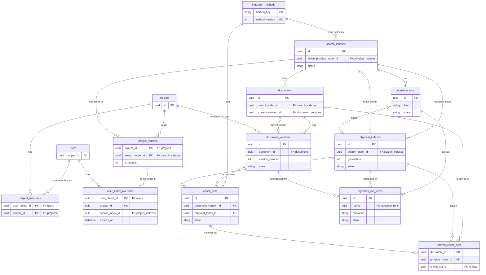
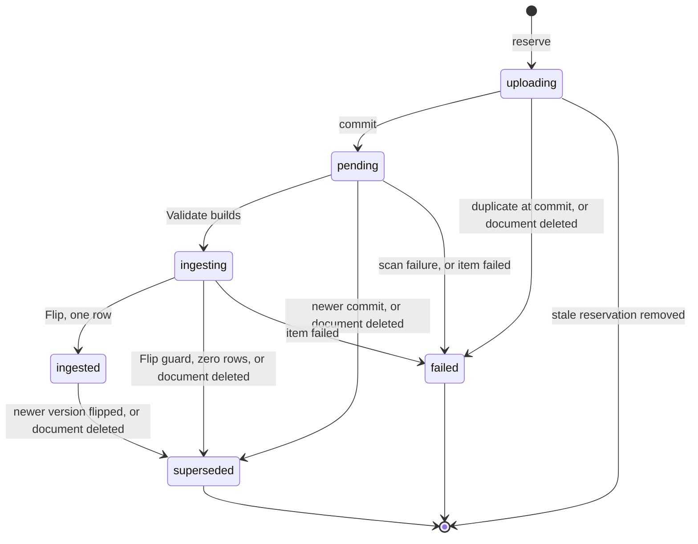
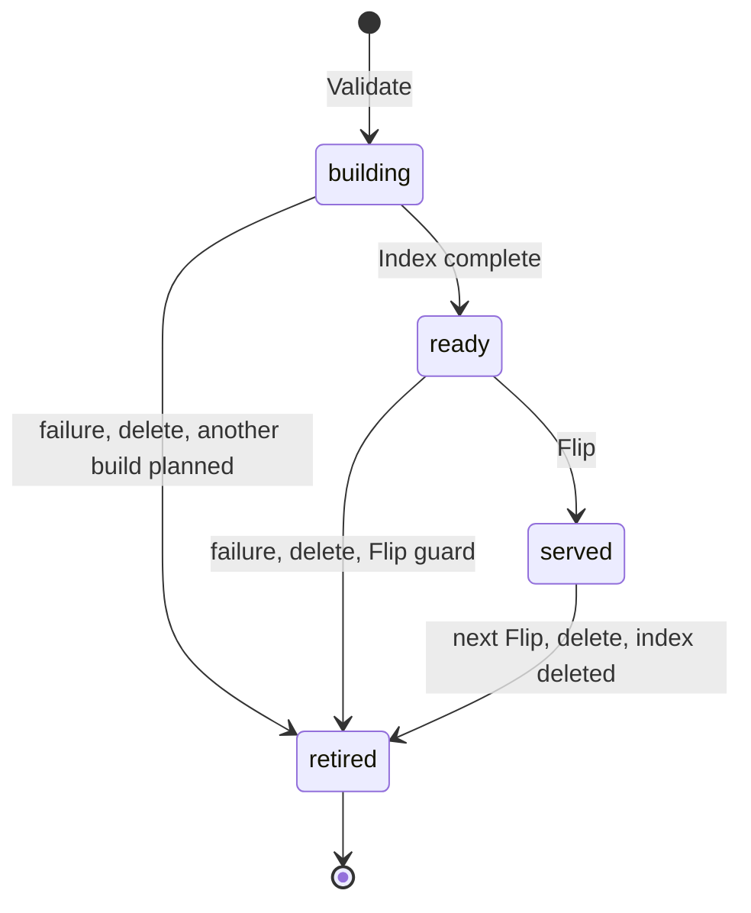
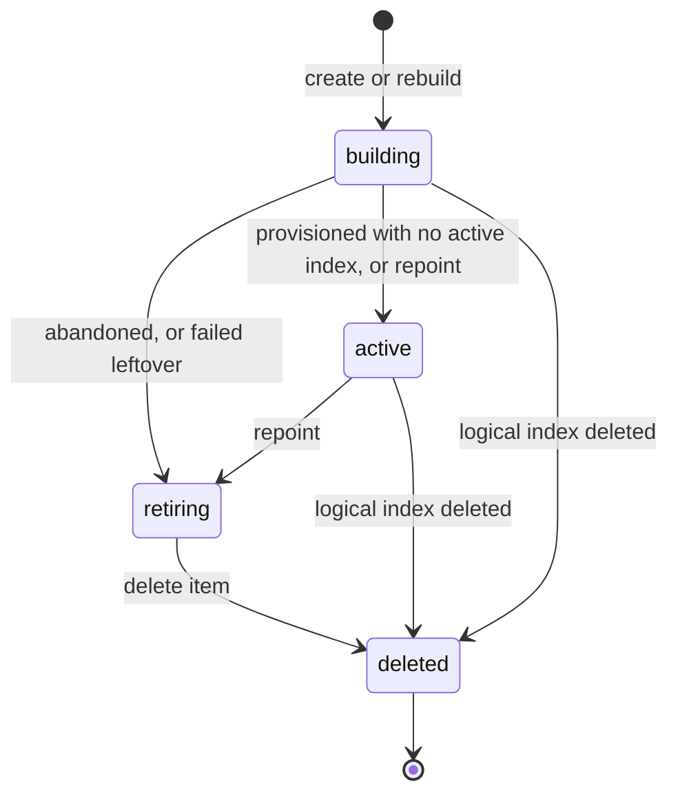
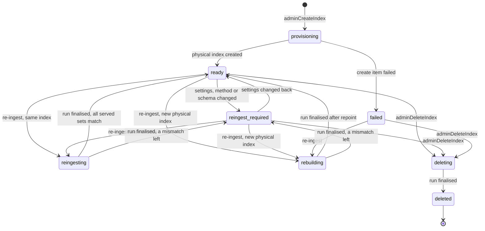
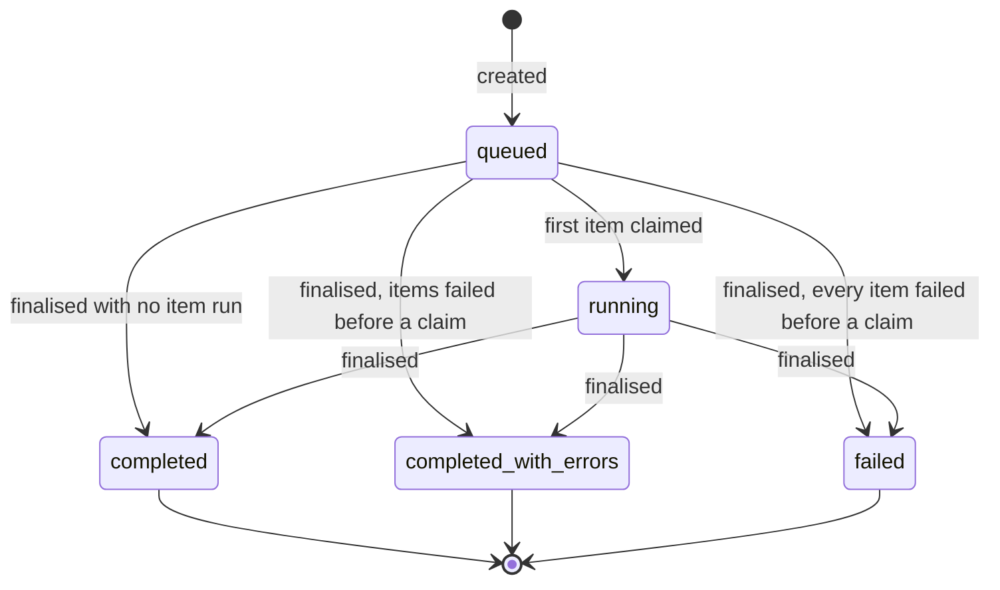
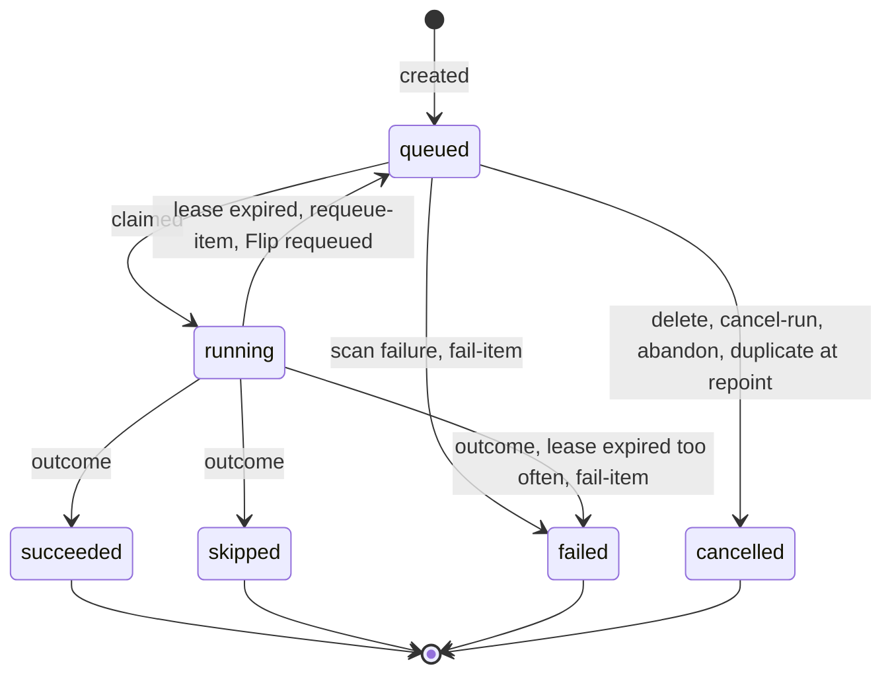
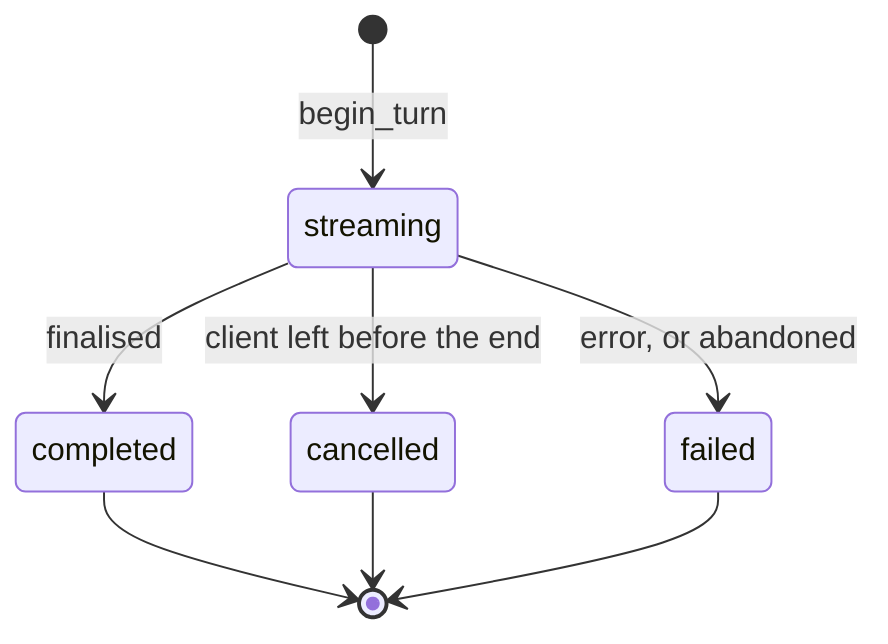
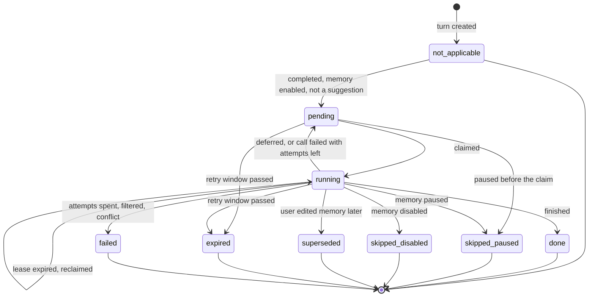

# 80 — Data model

This file specifies every store DocChat keeps data in and the exact shape of that data: the Azure SQL Database tables with every column, constraint, key and index, the database roles and the grant matrix per identity, and the migration rules that create them; the Cosmos DB containers and every document type, field by field; the Blob Storage containers, path patterns, metadata and lifecycle; the ingestion queue message; the Azure AI Search chunk index; the model that ties projects, logical and physical indexes, methods, documents, versions and chunk sets together; and the state machines that the stored data carries. The algorithms that read and write these stores are specified in `11-api.md`, `12-chat-pipeline.md`, `13-conversations-and-memory.md` and `14-ingestion.md`; this file is the authority for names, types, limits, constraints and rights. Settings named here are catalogued in `81-config.md`, telemetry in `85-observability.md`, operator commands in `86-operations.md` and Azure resources in `83-infrastructure.md`.

## 1. The stores

### 1.1 What each store holds

Each store holds one kind of data, and no application state lives anywhere else: API instances and ingestion workers keep nothing between requests, and their in-process caches (the 60-second ops-config snapshot and the 60-second index-record cache, `11-api.md` section 1) are copies of SQL rows.

| Store | Resource per environment | Holds | Owning area |
|---|---|---|---|
| Azure SQL Database | server `sql-docchat-<env>-<token>`, database `docchat`, schema `app` | configuration (`ops_config`); access (users, projects, memberships, project-to-index mappings, per-user index overrides); the audit trail; the ingestion ledger (method catalogue, logical and physical indexes, documents, versions, chunk sets, served chunk sets, runs, run items, dispatcher heartbeat, scanner canaries) | access and configuration: 7 tables; ingestion: 11 tables (section 2) |
| Azure Cosmos DB for NoSQL | account `cosmos-docchat-<env>-<token>`, database `docchat` | conversations (sessions, turns, turn traces); user memory; usage counters, rate windows and leases | conversations and memory: containers `conversations`, `memories`; chat pipeline: container `usage` (section 3) |
| Azure Blob Storage, data account | `stdocchatdata<env><token>` | uploaded source files, the PDFs converted from DOCX and PPTX sources and scanner canaries (`documents`, access tier Cool); single-page and whole-document PDF renditions (`renditions`); intermediate ingestion files (`ingestion-work`) | ingestion (section 4) |
| Azure Queue Storage, data account | the same account | the ingestion hint queue `ingestion-requests` and its poison queue `ingestion-requests-poison` | ingestion (section 5) |
| Azure Storage, host account | `stdocchathost<env><token>` | the Functions host's own blobs, queues and tables and the Durable task hub `docchat<env>` (instances, history, control and work-item queues, leases); nothing the application defines | the Functions runtime (section 4.1) |
| Azure AI Search | `srch-docchat-<env>-<token>` | chunks: one physical index per generation of each logical index | ingestion writes, the chat pipeline reads (section 6) |

The environment Key Vault `kv-docchat-<env>-<token>` holds no application data (`83-infrastructure.md` section 2). Telemetry and diagnostic logs live in Log Analytics (`85-observability.md` section 1).

### 1.2 Who reaches each store

Every data-plane right belongs to one identity or group and to one store scope. The complete matrix of Azure calls with role IDs and scopes is `83-infrastructure.md` section 6; the SQL grants are section 2.22 of this file.

| Identity | SQL database `docchat` | Cosmos DB database `docchat` | Data account blobs | Data account queues | AI Search | Host account |
|---|---|---|---|---|---|---|
| API managed identity `id-docchat-api-<env>` | contained user in role `docchat_api` | Cosmos DB Built-in Data Contributor (`00000000-0000-0000-0000-000000000002`) at `/dbs/docchat` | Storage Blob Data Contributor on `documents`; Storage Blob Data Reader on `renditions`; nothing on `ingestion-work` | Storage Queue Data Message Sender on `ingestion-requests` | Search Index Data Reader on the service | none |
| Ingestion managed identity `id-docchat-ingest-<env>` | contained user in role `docchat_ingestion` | none | Storage Blob Data Contributor on `documents`, `renditions` and `ingestion-work`; custom role DocChat Blob Tag Reader (data action `blobs/tags/read` only) on `documents` | Storage Queue Data Reader and Storage Queue Data Message Processor on `ingestion-requests`; Storage Queue Data Message Sender and Storage Queue Data Reader on `ingestion-requests-poison` | custom role DocChat Search Index Manager (`indexes/read`, `write`, `delete`) and Search Index Data Contributor on the service | Storage Blob Data Owner, Storage Queue Data Contributor, Storage Table Data Contributor |
| Just-in-time group `sg-docchat-<env>-config-operators` | contained user in role `docchat_config_operator` | none | none | Storage Queue Data Message Processor on `ingestion-requests-poison` | none | none |
| Just-in-time group `sg-docchat-<env>-conversation-readers` | contained user in role `docchat_conversation_reader` | Cosmos DB Built-in Data Reader (`00000000-0000-0000-0000-000000000001`) at `/dbs/docchat/colls/conversations` | none | none | none | none |
| Just-in-time group `sg-docchat-<env>-user-data-operators` | contained user in role `docchat_user_data_operator` | Cosmos DB Built-in Data Contributor at `/dbs/docchat` | Storage Blob Data Reader on `documents`, granted for `docchat-ops document fetch-source`; during an activation it also permits a direct read of any blob of the container, recorded by the activation and by the `StorageRead` entries of `StorageBlobLogs` (`82-security.md` section 1.6) | none | none | none |
| Deploy identity `id-docchat-deploy-<env>` | standing member of `sg-docchat-<env>-sql-admins`, the server's Microsoft Entra administrator (`dbo`): runs the migrations and the grants step | no data-plane role | none | none | none | in the task-hub reset mode only, deletes through Resource Manager the containers, queues and tables whose names start with `docchat<env>` |
| Defender for Storage scanner (`StorageDataScanner`) | none | none | scans each blob written to `documents` and writes its index tags | none | none | none |

When Cosmos DB refuses a group as a data-plane principal, the two Cosmos DB rows for the just-in-time groups become time-bound per-principal assignments made by `docchat-ops jit grant` (`83-infrastructure.md` section 6, `86-operations.md` section 1); the SQL rows don't change.

### 1.3 Versions

Each version below was confirmed on its official package or vendor page on 2026-10-14. `uv.lock` pins every Python package exactly; `01-repository.md` section 10 holds the repository-wide table with image digests.

| Component | Version | Used for |
|---|---|---|
| SQLAlchemy | 2.1.4 (Core only) | table metadata in `docchat_core.sql.tables`, every SQL statement |
| Alembic | 1.20.0 | migrations in `db/migrations/versions/` |
| pyodbc | 5.3.0 | the driver binding under SQLAlchemy (`mssql+pyodbc`), pooling off |
| Microsoft ODBC Driver 18 for SQL Server | 18.7 (Debian 12 package `msodbcsql18`) | every SQL connection, `Encrypt=strict` |
| Pydantic | 2.14.1 | every Cosmos DB document model, the queue message, audit metadata models, ops-config area models |
| azure-cosmos | 4.17.1 (`azure.cosmos.aio`) | the API's one `CosmosClient`, the operator user commands |
| azure-storage-blob | 12.31.0 (`azure.storage.blob.aio`) | blob reads and writes of both apps |
| azure-storage-queue | 12.18.0 (`azure.storage.queue.aio`) | the API's queue send, the poison-queue peek and drain |
| azure-search-documents | 12.0.0 (`azure.search.documents.aio`), data-plane API 2026-04-01 | index creation, chunk upload and deletion, search |
| Azure SQL resource API | `Microsoft.Sql/servers@2025-01-01` through Azure Verified Module `avm/res/sql/server` 0.22.1 | server and database `docchat` |
| Cosmos DB resource API | `Microsoft.DocumentDB/databaseAccounts@2026-03-15` (GA) | account, database `docchat`, the three containers |
| Storage resource API | 2025-06-01 through `avm/res/storage/storage-account` 0.33.1 | data and host accounts, containers, queues, lifecycle rule |
| Defender for Storage settings API | `Microsoft.Security/defenderForStorageSettings@2025-06-01` | on-upload malware scanning of `documents` |
| AI Search resource API | 2025-05-01 through `avm/res/search/search-service` 0.13.0 | the search service (no index is declared in Bicep) |
| SQL Server image (local and CI) | `mcr.microsoft.com/mssql/server:2025-CU9-GDR1-ubuntu-24.04` | migrations and integration tests |
| Cosmos DB emulator (local and CI) | `mcr.microsoft.com/cosmosdb/linux/azure-cosmos-emulator:vnext-EN20260907`, the first tag with working hierarchical partition keys | integration tests |
| Azurite (local and CI) | `mcr.microsoft.com/azure-storage/azurite:3.37.0` | blob and queue integration tests |

### 1.4 Conventions every store follows

1. **Identifiers.** Every entity ID is a UUID: canonical lower-case hyphenated text in JSON, Cosmos DB documents, blob paths and queue messages, `UNIQUEIDENTIFIER` in SQL. IDs are random (version 4) except the deterministic version-5 IDs of section 3.10. A person is identified only by the Microsoft Entra object ID (`oid`) of the validated token; display names and e-mail addresses are display data and never keys.
2. **Casing.** SQL tables and columns use snake_case. Cosmos DB documents, the queue message, search field names and API JSON use camelCase. Python uses snake_case with Pydantic aliases to camelCase.
3. **Time.** UTC everywhere. SQL stores `DATETIME2(3)` with `SYSUTCDATETIME()` defaults. Cosmos DB documents and JSON carry ISO 8601 strings with milliseconds and `Z` (`2026-10-14T09:30:00.000Z`).
4. **Hashes.** SHA-256 values are `BINARY(32)` in SQL and 64 lower-case hexadecimal characters in JSON and work files.
5. **Partition keys from the token.** The `userId` of every Cosmos DB read, write and query is `str(principal.oid)` of the validated token. No request field, path segment, header or cursor supplies it, admins included; only the operator commands of `13-conversations-and-memory.md` section 10, run under just-in-time access, name another user.
6. **Parameterised access only.** SQL statements are SQLAlchemy Core constructs with bound parameters (Ruff rule S608 fails the build on string-built SQL; `sqlalchemy.text` appears only as constants in `docchat_core.sql.statements`). Cosmos DB queries are constant text with `@` parameters, the `type`, `status` and state literals included. Azure AI Search filters come only from the filter builder of section 6.8.
7. **No supplied text in names.** No text that an admin or user enters (a file name, a title, an index display name, a question) ever becomes a SQL identifier, a blob path, a container, queue or index name, or a document ID.
8. **Content-free records.** Audit rows hold identifiers, counts, codes, field names, enum values, booleans and timestamps only (section 2.21); logs and telemetry follow `85-observability.md` section 3.

## 2. Azure SQL Database

### 2.1 Database, schema and conventions

1. **Database.** One database `docchat` per environment, collation `SQL_Latin1_General_CP1_CI_AS`, so every uniqueness rule and prefix search on a name is case-insensitive and accent-sensitive. `READ_COMMITTED_SNAPSHOT` is `ON` (the Azure SQL Database default): every transaction runs at READ COMMITTED with row versioning, and every guard that must see the latest committed row is a locking write or an `UPDLOCK` read. Every local or test database that holds this schema has the same collation and `READ_COMMITTED_SNAPSHOT ON`, so tests run under the isolation production uses. Server and database resource settings (SKU, backups, auditing, TLS) are `83-infrastructure.md` section 2.
2. **Schema.** Every application table lives in schema `app`: the seven access and configuration tables of sections 2.2 to 2.8 and the eleven ingestion tables of sections 2.9 to 2.19. No other schema holds application data. The schema holds one trigger, `app.trg_document_versions_scan_insert` (section 2.13), and no view, procedure or function.
3. **Types.** IDs are `UNIQUEIDENTIFIER`. Text is `NVARCHAR(n)` with an explicit length; the two W3C trace-context columns, which only ever hold ASCII, are `VARCHAR`. JSON is `NVARCHAR(MAX)` (or a bounded `NVARCHAR(n)`) with an `ISJSON(...) = 1` check. A closed set is `NVARCHAR(32)` (or `NVARCHAR(64)` for keys) with a `CHECK` listing every value. Times are `DATETIME2(3)` in UTC with `SYSUTCDATETIME()` defaults. Flags are `BIT`. Hashes are `BINARY(32)`. A row an admin edits through the API carries `row_version ROWVERSION`, exposed by the API as `rowVersion`: the 8 bytes as standard base64 with padding, 12 characters matching `^[A-Za-z0-9+/]{11}=$` (`11-api.md` section 1).
4. **Literals.** String literals in `CHECK` constraints, filtered-index predicates and statements are Unicode literals (`N'active'`). A predicate that must match a filtered index keeps the filter's constant in the statement text (`is_default = 1`, `state = N'queued'`), rendered with SQLAlchemy `literal_column` from constants in `docchat_core.sql.tables`, because SQL Server can't match a filtered index to a bound parameter. Every value that comes from a request, a message, a document or an operator is a bound parameter.
5. **Session options.** Filtered indexes need the session options that ODBC Driver 18 sets on every connection by default (`ANSI_NULLS`, `ANSI_PADDING`, `ANSI_WARNINGS`, `CONCAT_NULL_YIELDS_NULL` and `QUOTED_IDENTIFIER` on); no code issues a `SET` statement that changes them.
6. **Names.** Every key, constraint and index has an explicit name: `PK_<table>`, `UQ_<table>_<columns>` (unique constraint), `UX_<table>_<columns>` (unique index, usually filtered), `FK_<table>_<target>`, `CK_<table>_<rule>` and `IX_<table>_<columns>`; the run-item table uses the short form `run_items` in its names. The SQLAlchemy metadata declares every name below, so `alembic check` compares names as well as shapes, and no name is ever generated.
7. **Primary keys** are clustered.
8. **Metadata.** SQLAlchemy 2.1 Core metadata `MetaData(schema="app")` lives in `docchat_core.sql.tables`: module `access` defines the seven tables of sections 2.2 to 2.8 and module `ingestion` the eleven tables of sections 2.9 to 2.19. Repositories in `docchat_core.sql.repositories` and the apps build every statement from these `Table` objects.
9. **Actor columns.** Columns that record who acted hold a Microsoft Entra object ID (a person) or a managed identity's principal ID (an app) and carry no foreign key to `app.users`, so a user's deletion never blocks or rewrites history: `created_by`, `updated_by`, `archived_by`, `granted_by` and `set_by` in the access tables, and `created_by`, `updated_by`, `deleted_by`, `uploaded_by` and `requested_by` in the ingestion tables. Each of them is declared with `info={"actor": True}` in the metadata, which the user-data export reads to find every reference to a user (section 2.23). `audit_events.actor_object_id` and `audit_events.subject_object_id` carry no marker, because the export reads them directly.
10. **Foreign keys** take no action on delete, with exactly three exceptions in the access tables: `FK_project_members_users`, `FK_user_index_overrides_users` and `FK_user_index_overrides_mapping` cascade (section 2.20). No ingestion foreign key cascades: every ingestion delete is an explicit statement, which also rules out multiple cascade paths. The two circular foreign keys, `FK_search_indexes_active_physical` and `FK_documents_current_version`, are created after both of their tables exist (Alembic `use_alter=True`).
11. **Writes go through the data-access layer.** Every Python process reaches SQL only through `docchat_core.sql.engine` (SQLAlchemy over pyodbc in a dedicated thread pool, Entra access tokens per connection, whole-unit retries outside the transaction; `01-repository.md` section 6). The application identities read and write rows and never change the schema.

### 2.2 Table `app.users`

One row per person who has signed in at least once, created by the first-sign-in provisioning step that every authenticated `/v1` request passes (`11-api.md` section 1). Only people with a row can be found and added to projects.

| Column | Type | Null | Default | Rule |
|---|---|---|---|---|
| `object_id` | `UNIQUEIDENTIFIER` | no | | `PK_users`; the person's Entra object ID |
| `tenant_id` | `UNIQUEIDENTIFIER` | no | | the `tid` claim of the latest token that wrote the row |
| `display_name` | `NVARCHAR(256)` | no | `N''` | from the `name` claim: Unicode NFC, every code point of category Cc, Cf, Cs, Co or Cn removed, trimmed, cut to 256 characters; an empty claim never overwrites a stored value; display only |
| `email` | `NVARCHAR(320)` | no | `N''` | from the `email` claim, else from `preferred_username` when it holds exactly one `@`, no whitespace and no `#`; trimmed, at most 320 characters; an empty value never overwrites a stored one; display only, never an identifier |
| `last_known_role` | `NVARCHAR(32)` | no | | `CK_users_last_known_role`: `last_known_role IN (N'Admin', N'User')`; `Admin` when the token's `roles` contain `Admin`, else `User`; display only, because every decision reads roles from the token |
| `first_seen_at` | `DATETIME2(3)` | no | `SYSUTCDATETIME()` | |
| `last_seen_at` | `DATETIME2(3)` | no | `SYSUTCDATETIME()` | `CK_users_seen_order`: `last_seen_at >= first_seen_at`; refreshed at most once every 15 minutes per process |

Keys and indexes:

| Name | Kind | Columns | Use |
|---|---|---|---|
| `PK_users` | primary key, clustered | `object_id` | identity, provisioning upsert under `UPDLOCK, HOLDLOCK` |
| `IX_users_display_name` | index | `display_name`, `object_id` | name-prefix search and the user list's order (`display_name`, then `object_id`) |
| `IX_users_email` | index | `email`, `object_id` | e-mail-prefix search |

No credential column of any kind exists, and no `row_version`, because no admin edits these rows. Writers: the API's provisioning (`INSERT`, `UPDATE`); `docchat-ops user delete` (`DELETE`). Readers: the API (admin user search, uploader and requester names), config operators (override checks), user-data operators.

### 2.3 Table `app.projects`

| Column | Type | Null | Default | Rule |
|---|---|---|---|---|
| `id` | `UNIQUEIDENTIFIER` | no | | `PK_projects`; UUID version 4 generated by the API |
| `name` | `NVARCHAR(80)` | no | | `UQ_projects_name`; `CK_projects_name_not_empty`: `LEN(name) >= 1`; single-line text of 1 to 80 code points after the API's normalisation |
| `description` | `NVARCHAR(400)` | no | `N''` | single-line text, 0 to 400 code points |
| `instructions` | `NVARCHAR(2000)` | no | `N''` | plain multi-line text with LF line breaks, 0 to 2,000 code points; the chat pipeline places it in its own prompt block (`12-chat-pipeline.md` section 9) |
| `example_questions_json` | `NVARCHAR(MAX)` | no | `N'[]'` | `CK_projects_example_questions_json`: `ISJSON(example_questions_json) = 1 AND LEFT(example_questions_json, 1) = N'['`; a JSON array of 0 to 4 strings of 1 to 160 code points each, the counts and lengths enforced by the API |
| `is_default` | `BIT` | no | `0` | no limit applies to the number of default projects; a default project's membership is granted at a person's first sign-in |
| `status` | `NVARCHAR(32)` | no | `N'active'` | `CK_projects_status`: `status IN (N'active', N'archived')` |
| `archived_at` | `DATETIME2(3)` | yes | | set when archived |
| `archived_by` | `UNIQUEIDENTIFIER` | yes | | actor column; the archiving admin's `oid` |
| `created_at` | `DATETIME2(3)` | no | `SYSUTCDATETIME()` | |
| `created_by` | `UNIQUEIDENTIFIER` | no | | actor column; the creating admin's `oid` |
| `updated_at` | `DATETIME2(3)` | no | `SYSUTCDATETIME()` | time of the last admin change to the project's fields, members or mappings |
| `updated_by` | `UNIQUEIDENTIFIER` | no | | actor column; the admin of that change |
| `row_version` | `ROWVERSION` | no | | the API's `rowVersion`; moves with every admin change to the project, its members or its mappings |

Checks:

- `CK_projects_default_active`: `is_default = 0 OR status = N'active'`. An archived project can't be default, so first-sign-in provisioning never grants membership of an archived project.
- `CK_projects_archive_fields`: `(status = N'active' AND archived_at IS NULL AND archived_by IS NULL) OR (status = N'archived' AND archived_at IS NOT NULL AND archived_by IS NOT NULL)`.

Keys and indexes:

| Name | Kind | Columns and filter | Use |
|---|---|---|---|
| `PK_projects` | primary key, clustered | `id` | every project lookup |
| `UQ_projects_name` | unique constraint | `name` | names are unique case-insensitively, archived projects included; the admin list without a status filter |
| `IX_projects_status_name` | index | `status`, `name` `INCLUDE (description, example_questions_json)` | the active and archived admin lists, reachable projects for admins (it holds every column of Q5's administrator page, `11-api.md` section 1.4.4, which reads it in name order with no key lookup and no sort) |
| `IX_projects_default` | index | `id` `WHERE is_default = 1` | the provisioning insert of default memberships |

No operation deletes a project: it is archived and restored (`11-api.md` section 3). Writers: the API (admin operations). Readers: the API, config operators, user-data operators.

### 2.4 Table `app.project_members`

| Column | Type | Null | Default | Rule |
|---|---|---|---|---|
| `user_object_id` | `UNIQUEIDENTIFIER` | no | | `FK_project_members_users` → `app.users (object_id)`, `ON DELETE CASCADE` |
| `project_id` | `UNIQUEIDENTIFIER` | no | | `FK_project_members_projects` → `app.projects (id)`, no action |
| `grant_source` | `NVARCHAR(32)` | no | | `CK_project_members_grant_source`: `grant_source IN (N'default', N'admin')`; `default` for a membership granted at first sign-in, `admin` for one an admin added |
| `granted_by` | `UNIQUEIDENTIFIER` | yes | | actor column; `CK_project_members_granted_by`: `(grant_source = N'default' AND granted_by IS NULL) OR (grant_source = N'admin' AND granted_by IS NOT NULL)` |
| `granted_at` | `DATETIME2(3)` | no | `SYSUTCDATETIME()` | |

Keys and indexes:

| Name | Kind | Columns | Use |
|---|---|---|---|
| `PK_project_members` | primary key, clustered | `user_object_id`, `project_id` | the membership check on every request, a user's reachable projects |
| `IX_project_members_project` | index | `project_id`, `user_object_id` | a project's member list and count |

Admins need no row to reach a project. There is no `row_version`: membership changes are guarded by the project's `row_version`, and provisioning and user deletion don't move it. Writers: the API (admin operations, provisioning); `docchat-ops user delete` (cascade from `app.users` and an explicit delete). Readers: the API, user-data operators.

### 2.5 Table `app.project_indexes`

| Column | Type | Null | Default | Rule |
|---|---|---|---|---|
| `project_id` | `UNIQUEIDENTIFIER` | no | | `FK_project_indexes_projects` → `app.projects (id)`, no action |
| `search_index_id` | `UNIQUEIDENTIFIER` | no | | `FK_project_indexes_search_indexes` → `app.search_indexes (id)`, no action |
| `is_default` | `BIT` | no | `0` | |
| `created_at` | `DATETIME2(3)` | no | `SYSUTCDATETIME()` | when the mapping was created |
| `created_by` | `UNIQUEIDENTIFIER` | no | | actor column; the admin who mapped the index |
| `updated_at` | `DATETIME2(3)` | no | `SYSUTCDATETIME()` | the last change of `is_default` |
| `updated_by` | `UNIQUEIDENTIFIER` | no | | actor column; the admin of that change |

Keys and indexes:

| Name | Kind | Columns and filter | Use |
|---|---|---|---|
| `PK_project_indexes` | primary key, clustered | `project_id`, `search_index_id` | a project's mappings |
| `UX_project_indexes_default` | unique index | `project_id` `WHERE is_default = 1` | at most one default mapping per project; the default lookup of chat index resolution |
| `IX_project_indexes_index` | index | `search_index_id`, `project_id` | projects that map an index (the delete-index refusal, the index detail's project list) and support for the foreign key |

A project with at least one mapping has exactly one default mapping, and a project with none has none: the filtered unique index enforces "at most one", and the mapping operations enforce "at least one" (section 7.2). There is no `row_version`: mapping changes are guarded by the project's `row_version`. Writers: the API (admin operations). Readers: the API (chat resolution, citations, uploads), config operators, user-data operators.

### 2.6 Table `app.user_index_overrides`

An expiring per-user, per-project index override for testing a different index against live questions. Operators set and clear it with `docchat-ops override`; no API operation and no screen writes it.

| Column | Type | Null | Default | Rule |
|---|---|---|---|---|
| `user_object_id` | `UNIQUEIDENTIFIER` | no | | `FK_user_index_overrides_users` → `app.users (object_id)`, `ON DELETE CASCADE` |
| `project_id` | `UNIQUEIDENTIFIER` | no | | first column of the mapping key below |
| `search_index_id` | `UNIQUEIDENTIFIER` | no | | second column of the mapping key below |
| `reason` | `NVARCHAR(500)` | no | | `CK_user_index_overrides_reason`: `LEN(reason) >= 10`; the 10 to 500 characters of the command's `--reason`; never logged, never in audit metadata, never shown in the app |
| `set_by` | `UNIQUEIDENTIFIER` | no | | actor column; the operator's `oid` |
| `set_at` | `DATETIME2(3)` | no | `SYSUTCDATETIME()` | |
| `expires_at` | `DATETIME2(3)` | no | | `CK_user_index_overrides_expiry`: `expires_at > set_at AND expires_at <= DATEADD(DAY, 30, set_at)` |

Keys and indexes:

| Name | Kind | Columns | Use |
|---|---|---|---|
| `PK_user_index_overrides` | primary key, clustered | `user_object_id`, `project_id` | one override per user and project; the override lookup of chat index resolution |
| `FK_user_index_overrides_mapping` | foreign key | (`project_id`, `search_index_id`) → `app.project_indexes (project_id, search_index_id)`, `ON DELETE CASCADE` | an override can only point at an index mapped to the same project, and unmapping removes it |
| `IX_user_index_overrides_mapping` | index | `project_id`, `search_index_id` | the cascade and the override count reported by an unmapping |

Expired rows are ignored by every reader (`expires_at > SYSUTCDATETIME()` in the lookup) and never deleted automatically. Two cascade paths reach this table, from `app.users` and from `app.project_indexes`; SQL Server accepts them because they start at different tables, and a migration integration test proves it. Writers: config operators (`docchat-ops override set|clear`); the cascades. Readers: the API (chat resolution), config operators, user-data operators.

### 2.7 Table `app.ops_config`

One typed row per runtime operational setting. The keys, their types, defaults, ranges and owners are catalogued in `81-config.md` section 3; section 2.24 lists the seeded rows.

| Column | Type | Null | Default | Rule |
|---|---|---|---|---|
| `config_key` | `NVARCHAR(64)` | no | | `PK_ops_config`; `CK_ops_config_key`: `config_key COLLATE Latin1_General_BIN2 NOT LIKE N'%[^a-z0-9_.]%' AND CHARINDEX(N'.', config_key) > 1 AND RIGHT(config_key, 1) <> N'.'`, so a key is dotted lower case `<area>.<name>` |
| `value_json` | `NVARCHAR(MAX)` | no | | `CK_ops_config_value_json`: `ISJSON(value_json) = 1`; the shape `{"value": <typed value>}` |
| `default_json` | `NVARCHAR(MAX)` | no | | `CK_ops_config_default_json`: `ISJSON(default_json) = 1`; the same shape; written only by migrations |
| `change_reason` | `NVARCHAR(500)` | yes | | `NULL` while seeded; after an operator change, the command's `--reason` of 10 to 500 characters; `CK_ops_config_reason`: `change_reason IS NULL OR LEN(change_reason) >= 10` |
| `updated_at` | `DATETIME2(3)` | no | `SYSUTCDATETIME()` | |
| `updated_by` | `UNIQUEIDENTIFIER` | yes | | actor column; `NULL` while seeded, the operator's `oid` after a change |
| `row_version` | `ROWVERSION` | no | | optimistic concurrency of `docchat-ops config set` and `config reset` (exit 6 on a conflict) |

Wrapping every value in `{"value": …}` keeps `ISJSON` meaningful for scalar values, which `ISJSON` alone rejects. The area of a key is the text before its first dot; each area is validated by one Pydantic model of `docchat_core.opsconfig.OpsConfig` (`81-config.md` section 3). Ops-config values are configuration, never personal data or content, which is why they are the one kind of value audit metadata may carry. Writers: migrations (`INSERT`, `DELETE` of a retired key); config operators (`UPDATE` only). Readers: the API and the ingestion app (one statement reads every row), config operators, user-data operators (`updated_by`).

### 2.8 Table `app.audit_events`

Append-only rows recording admin, operator and security actions. The catalogue of actions, target types and metadata is section 2.21.

| Column | Type | Null | Default | Rule |
|---|---|---|---|---|
| `id` | `BIGINT IDENTITY(1,1)` | no | | `PK_audit_events` |
| `occurred_at` | `DATETIME2(3)` | no | `SYSUTCDATETIME()` | |
| `actor_type` | `NVARCHAR(32)` | no | | `CK_audit_events_actor_type`: `actor_type IN (N'user', N'operator', N'system')` |
| `actor_object_id` | `UNIQUEIDENTIFIER` | no | | `user`: the caller's token `oid`; `operator`: the `oid` of the person's SQL access token; `system`: the acting app's managed identity principal ID (app setting `DOCCHAT_CORE_WORKLOAD_PRINCIPAL_ID`) |
| `subject_object_id` | `UNIQUEIDENTIFIER` | yes | | the user whose data or access the action concerns, when there is one |
| `action` | `NVARCHAR(64)` | no | | `CK_audit_events_action`: `action IN (<the 43 actions of section 2.21>)` |
| `target_type` | `NVARCHAR(32)` | no | | `CK_audit_events_target_type`: `target_type IN (<the 18 target types of section 2.21>)` |
| `target_id` | `NVARCHAR(128)` | yes | | lower-case UUID text, an ops-config key or a queue name; `NULL` only for `test_users.rotated` and `model_deployments.checked` |
| `project_id` | `UNIQUEIDENTIFIER` | yes | | no foreign key, so a row outlives anything it names |
| `metadata_json` | `NVARCHAR(MAX)` | yes | | `CK_audit_events_metadata`: `metadata_json IS NULL OR (ISJSON(metadata_json) = 1 AND LEN(metadata_json) <= 4000)` |
| `correlation_id` | `NVARCHAR(32)` | yes | | `CK_audit_events_correlation`: `correlation_id IS NULL OR (LEN(correlation_id) = 32 AND correlation_id COLLATE Latin1_General_BIN2 NOT LIKE N'%[^0-9a-f]%')`; the 32-character W3C trace ID of the request or operator run that wrote the row |

Indexes:

| Name | Kind | Columns and filter | Use |
|---|---|---|---|
| `PK_audit_events` | primary key, clustered | `id` | insert order |
| `IX_audit_events_subject` | index | `subject_object_id`, `occurred_at` `WHERE subject_object_id IS NOT NULL` | the user-data export of rows about a user |
| `IX_audit_events_actor` | index | `actor_object_id`, `occurred_at` | the export of rows a user wrote |
| `IX_audit_events_project` | index | `project_id`, `occurred_at` `WHERE project_id IS NOT NULL` | investigations by project |
| `IX_audit_events_target` | index | `target_type`, `target_id`, `occurred_at` | investigations by target, the deletion register read after a restore |

No app operation reads this table. The application roles hold `INSERT` only (section 2.22). Rows are kept indefinitely, and a user's data deletion keeps them.

### 2.9 Table `app.ingestion_methods`

The method catalogue: one row per shipped method key and version. Rows change only through migrations (section 2.24).

| Column | Type | Null | Default | Rule |
|---|---|---|---|---|
| `method_key` | `NVARCHAR(64)` | no | | primary-key part; `CK_ingestion_methods_key`: `method_key COLLATE Latin1_General_BIN2 NOT LIKE N'%[^a-z0-9_]%'` |
| `method_version` | `INT` | no | | primary-key part; `CK_ingestion_methods_version`: `method_version >= 1` |
| `display_name` | `NVARCHAR(100)` | no | | shown in the index form |
| `description` | `NVARCHAR(500)` | no | | shown in the index form |
| `parameter_schema` | `NVARCHAR(MAX)` | no | | `CK_ingestion_methods_parameter_schema`: `ISJSON(parameter_schema) = 1`; a JSON Schema (draft 2020-12) object, equal to the method descriptor's constant in `docchat_core.ingestion.methods` |
| `default_parameters` | `NVARCHAR(MAX)` | no | | `CK_ingestion_methods_default_parameters`: `ISJSON(default_parameters) = 1`; the parameter object an index gets when it names no parameters |
| `supported_content_types` | `NVARCHAR(400)` | no | | `CK_ingestion_methods_content_types`: `ISJSON(supported_content_types) = 1`; a JSON array of media types |
| `is_active` | `BIT` | no | `1` | an inactive row can't be chosen for a new or edited index; it stays, because chunk sets and runs reference it |
| `created_at` | `DATETIME2(3)` | no | `SYSUTCDATETIME()` | |

Key: `PK_ingestion_methods` (`method_key`, `method_version`), clustered, the target of `FK_search_indexes_methods` and `FK_chunk_sets_methods`. A unit test fails when a row and its descriptor differ in key, version, display name, description, schema, defaults or content types, and the ingestion app refuses to start when an active row has no registered implementation (`14-ingestion.md` section 4.11). Readers: the API (index options and validation), the ingestion app, config operators.

### 2.10 Table `app.search_indexes`

Logical indexes. A logical index belongs to no project: any number of projects map it (section 2.5).

| Column | Type | Null | Default | Rule |
|---|---|---|---|---|
| `id` | `UNIQUEIDENTIFIER` | no | | `PK_search_indexes`; UUID version 4 generated by the API |
| `display_name` | `NVARCHAR(80)` | no | | `CK_search_indexes_display_name`: `LEN(LTRIM(display_name)) BETWEEN 1 AND 80`; single-line text of 1 to 80 code points, the same limit as project names |
| `description` | `NVARCHAR(1200)` | yes | | 0 to 1,200 code points; `NULL` when cleared |
| `method_key` | `NVARCHAR(64)` | no | | with `method_version`, `FK_search_indexes_methods` → `app.ingestion_methods (method_key, method_version)`; an active row when set |
| `method_version` | `INT` | no | | |
| `method_parameters` | `NVARCHAR(MAX)` | no | | `CK_search_indexes_method_parameters`: `ISJSON(method_parameters) = 1`; the parameters validated by the method's parameter model, defaults filled in |
| `method_parameter_hash` | `BINARY(32)` | no | | the parameter hash of section 2.14 for (`method_key`, `method_version`, `method_parameters`) |
| `embedding_model` | `NVARCHAR(64)` | no | | a `model` of the embedding catalogue (`DOCCHAT_OPENAI_EMBEDDING_MODELS`, `81-config.md` section 2); the model new builds use |
| `embedding_dimensions` | `INT` | no | | `CK_search_indexes_dimensions`: `embedding_dimensions IN (256, 1024, 3072)`; one of the model's allowed dimensions |
| `language_analyzer` | `NVARCHAR(32)` | no | `N'standard.lucene'` | a value of the analyzer allowlist (section 6.5), checked in code |
| `active_physical_index_id` | `UNIQUEIDENTIFIER` | yes | | `FK_search_indexes_active_physical` → `app.physical_indexes (id)`, created after that table; the physical index readers use; `NULL` until the first physical index is provisioned |
| `status` | `NVARCHAR(32)` | no | `N'provisioning'` | `CK_search_indexes_status`: `status IN (N'provisioning', N'ready', N'reingest_required', N'reingesting', N'rebuilding', N'failed', N'deleting', N'deleted')`; transitions in section 8.4 |
| `status_changed_at` | `DATETIME2(3)` | no | `SYSUTCDATETIME()` | set by every statement that changes `status` |
| `created_at` | `DATETIME2(3)` | no | `SYSUTCDATETIME()` | |
| `updated_at` | `DATETIME2(3)` | no | `SYSUTCDATETIME()` | |
| `created_by` | `UNIQUEIDENTIFIER` | no | | actor column; the admin or operator who created the index |
| `updated_by` | `UNIQUEIDENTIFIER` | no | | actor column; the admin or operator of the last change |
| `row_version` | `ROWVERSION` | no | | the API's `rowVersion` of the index |

Keys and indexes:

| Name | Kind | Columns and filter | Use |
|---|---|---|---|
| `PK_search_indexes` | primary key, clustered | `id` | every lookup; the `UPDLOCK, ROWLOCK` read that serialises flips, repoints and re-ingest starts of one logical index |
| `UX_search_indexes_display_name` | unique index | `display_name` `WHERE status <> N'deleted'` | display names are unique, case-insensitively, among indexes that aren't deleted, so a deleted index's name becomes free |
| `IX_search_indexes_status` | index | `status` | the admin list's status filter, the sweep's search for indexes in `rebuilding` |

A deleted logical index keeps its row as the target of run history and audit rows. Writers: the API (admin operations), the ingestion app (status, active pointer), config operators (`docchat-ops reindex`, `abandon-rebuild`). Readers: the API, the ingestion app, config operators, user-data operators (actor columns).

### 2.11 Table `app.physical_indexes`

One row per Azure AI Search index behind a logical index. The embedding settings are copied from the embedding catalogue when the row is created, so a later change of the catalogue never alters an existing index.

| Column | Type | Null | Default | Rule |
|---|---|---|---|---|
| `id` | `UNIQUEIDENTIFIER` | no | | `PK_physical_indexes`; UUID version 4 generated by the writer |
| `search_index_id` | `UNIQUEIDENTIFIER` | no | | `FK_physical_indexes_search_indexes` → `app.search_indexes (id)` |
| `generation` | `INT` | no | | `CK_physical_indexes_generation`: `generation >= 1`; 1 for the first physical index of a logical index, then the highest generation plus 1 |
| `name` | `NVARCHAR(128)` | no | | the generated Azure index name of section 6.2 (47 characters in this pattern); never returned by the API |
| `schema_version` | `INT` | no | | `CK_physical_indexes_schema_version`: `schema_version >= 1`; the chunk index schema version it was built with (1, section 6.3) |
| `embedding_model` | `NVARCHAR(64)` | no | | copied from the catalogue entry |
| `embedding_model_version` | `NVARCHAR(32)` | no | | copied (`1` for `text-embedding-3-large`) |
| `embedding_dimensions` | `INT` | no | | `CK_physical_indexes_dimensions`: `embedding_dimensions IN (256, 1024, 3072)` |
| `embedding_encoding` | `NVARCHAR(32)` | no | | copied tokenizer encoding (`cl100k_base` for `text-embedding-3-large`) |
| `embedding_max_input_tokens` | `INT` | no | | copied input limit (8,192 for `text-embedding-3-large`) |
| `language_analyzer` | `NVARCHAR(32)` | no | | the analyzer its searchable fields were created with |
| `query_embedding_deployment` | `NVARCHAR(64)` | no | | the Azure OpenAI deployment chat uses to embed questions for this index |
| `ingestion_embedding_deployment` | `NVARCHAR(64)` | no | | the deployment ingestion uses to embed chunks for this index |
| `state` | `NVARCHAR(32)` | no | `N'building'` | `CK_physical_indexes_state`: `state IN (N'building', N'active', N'retiring', N'deleted')`; transitions in section 8.3 |
| `build_run_id` | `UNIQUEIDENTIFIER` | yes | | `FK_physical_indexes_build_run` → `app.ingestion_runs (id)`; the `index_create` or `index_rebuild` run filling it; set to `NULL` by the statement that moves the row out of `building` |
| `provisioned_at` | `DATETIME2(3)` | yes | | set once the Azure index exists |
| `created_at` | `DATETIME2(3)` | no | `SYSUTCDATETIME()` | |
| `activated_at` | `DATETIME2(3)` | yes | | set when it becomes `active` |
| `retiring_at` | `DATETIME2(3)` | yes | | set when it becomes `retiring` |
| `delete_after` | `DATETIME2(3)` | yes | | earliest claim time of its delete item: the repoint time plus 10 minutes, or the time of an abandonment |
| `deleted_at` | `DATETIME2(3)` | yes | | set when it becomes `deleted` |

Keys and indexes:

| Name | Kind | Columns and filter | Use |
|---|---|---|---|
| `PK_physical_indexes` | primary key, clustered | `id` | every lookup, the index-record join of chat resolution |
| `UX_physical_indexes_name` | unique index | `name` | one row per Azure index name |
| `UX_physical_indexes_generation` | unique index | `search_index_id`, `generation` | generations never repeat within a logical index |
| `UX_physical_indexes_one_active` | unique index | `search_index_id` `WHERE state = N'active'` | at most one active physical index per logical index |
| `UX_physical_indexes_one_building` | unique index | `search_index_id` `WHERE state = N'building'` | at most one physical index being built per logical index |
| `IX_physical_indexes_retiring` | index | `state`, `delete_after` `WHERE state = N'retiring'` | the sweep's due-deletion check |

A physical index keeps the deployment names it was built with; only `docchat-ops ingestion set-deployments` changes them, to deployments of the same model and version (`86-operations.md` section 3). Writers: the API (creation and rebuild, the retirement of a failed index's never-provisioned leftover), the ingestion app, config operators. Readers: the API (chat resolution), the ingestion app, config operators.

### 2.12 Table `app.documents`

One row per (logical index, normalised name). The document ID never changes, including when a deleted name is uploaded once more.

| Column | Type | Null | Default | Rule |
|---|---|---|---|---|
| `id` | `UNIQUEIDENTIFIER` | no | | `PK_documents`; UUID version 4 generated by the API at the first reservation of the name |
| `search_index_id` | `UNIQUEIDENTIFIER` | no | | `FK_documents_search_indexes` → `app.search_indexes (id)` |
| `source_name` | `NVARCHAR(255)` | no | | the name of the latest reservation after Unicode NFC and trimming; display data only, never a path |
| `normalized_name` | `NVARCHAR(255)` | no | | `normalize_document_name(name)`: Unicode NFC, trimmed, every whitespace run replaced by one space, then `str.casefold()` |
| `current_version_id` | `UNIQUEIDENTIFIER` | yes | | `FK_documents_current_version` → `app.document_versions (id)`, created after that table; the version readers see; set only by a Flip into the active physical index; `NULL` before the first Flip and after a delete |
| `next_version_number` | `INT` | no | `1` | `CK_documents_next_version_number`: `next_version_number >= 1`; taken and incremented under the row's update lock, so a number is never reused |
| `is_deleted` | `BIT` | no | `0` | |
| `deleted_at` | `DATETIME2(3)` | yes | | `CK_documents_deleted_at`: `is_deleted = 0 OR deleted_at IS NOT NULL` |
| `deleted_by` | `UNIQUEIDENTIFIER` | yes | | actor column; the deleting admin |
| `created_at` | `DATETIME2(3)` | no | `SYSUTCDATETIME()` | |
| `updated_at` | `DATETIME2(3)` | no | `SYSUTCDATETIME()` | also set by every Flip and by a document re-ingest request, so the row version moves |
| `created_by` | `UNIQUEIDENTIFIER` | no | | actor column; the admin of the first reservation |
| `updated_by` | `UNIQUEIDENTIFIER` | no | | actor column; the admin of the last admin change; system writes (the Flip) change `updated_at` only |
| `row_version` | `ROWVERSION` | no | | the API's `rowVersion` of the document |

Keys and indexes:

| Name | Kind | Columns and filter | Use |
|---|---|---|---|
| `PK_documents` | primary key, clustered | `id` | lookups, the guarded updates of the Flip and the delete |
| `UQ_documents_index_name` | unique constraint | `search_index_id`, `normalized_name` | one document per name in an index; the reservation's `UPDLOCK` read; two first reservations racing roll back one, which retries once |
| `UQ_documents_id_index` | unique constraint | `id`, `search_index_id` | target of the versions' composite foreign key, so a version's logical index always equals its document's |
| `IX_documents_index_live` | index | `search_index_id`, `is_deleted` `INCLUDE (current_version_id, normalized_name)` | live-document counts, the repoint condition, the document list |

A deleted document keeps its row and its versions, which back the `410` answer of an old citation and the return of the name under the same ID. Writers: the API (reservation, deletion, re-ingest request), the ingestion app (Flip; deletion of a row left with no version by a stale upload). Readers: the API, the ingestion app, config operators, user-data operators.

### 2.13 Table `app.document_versions`

One row per uploaded content version.

| Column | Type | Null | Default | Rule |
|---|---|---|---|---|
| `id` | `UNIQUEIDENTIFIER` | no | | `PK_document_versions`; UUID version 4 generated by the API |
| `document_id` | `UNIQUEIDENTIFIER` | no | | with `search_index_id`, `FK_document_versions_documents` → `app.documents (id, search_index_id)` |
| `search_index_id` | `UNIQUEIDENTIFIER` | no | | `FK_document_versions_search_indexes` → `app.search_indexes (id)`; stored on the version so the (index, SHA-256) rule is a single-table filtered index |
| `version_number` | `INT` | no | | `CK_document_versions_version_number`: `version_number >= 1`; the `{v}` of every blob path of the version |
| `sha256` | `BINARY(32)` | no | | SHA-256 of the bytes: the version's content identity |
| `size_bytes` | `BIGINT` | no | | `CK_document_versions_size`: `size_bytes > 0`; at most `DOCCHAT_UPLOAD_MAX_BYTES` (52,428,800 bytes by default) |
| `content_type` | `NVARCHAR(100)` | no | | `CK_document_versions_content_type`: `content_type IN (N'application/pdf', N'application/vnd.openxmlformats-officedocument.wordprocessingml.document', N'application/vnd.openxmlformats-officedocument.presentationml.presentation')`; from the name's extension at reservation |
| `source_name` | `NVARCHAR(255)` | no | | the name as uploaded for this version, after NFC and trimming |
| `blob_path` | `NVARCHAR(200)` | no | | `{indexId}/{documentId}/{v}/source` in container `documents` |
| `blob_last_modified` | `DATETIME2(3)` | yes | | the blob's `last_modified` from the commit; a scan time earlier than it is unusable |
| `page_count` | `INT` | yes | | the page count of the version's PDF (the source of a PDF version, the PDF converted from a DOCX or PPTX source), set by Extract (`14-ingestion.md` section 6.3 step 5); `NULL` until the first Extract call counts it |
| `uploaded_by` | `UNIQUEIDENTIFIER` | no | | actor column; the uploading admin |
| `uploaded_via_project_id` | `UNIQUEIDENTIFIER` | no | | `FK_document_versions_projects` → `app.projects (id)`; the active project, mapped to this index at reservation, the upload came through |
| `state` | `NVARCHAR(32)` | no | `N'uploading'` | `CK_document_versions_state`: `state IN (N'uploading', N'pending', N'superseded', N'ingesting', N'ingested', N'failed')`; transitions in section 8.1 |
| `scan_required` | `BIT` | no | `0` | set by the reservation's insert from `DOCCHAT_STORAGE_MALWARE_SCANNING_ENABLED` and never changed (only `docchat_ingestion` holds `UPDATE` on it, section 2.22, and no ingestion statement sets it), so a version reserved while scanning was off never waits for a scan, also on later rebuilds (`14-ingestion.md` section 5.4) |
| `scan_status` | `NVARCHAR(32)` | no | `N'not_required'` | `CK_document_versions_scan_status`: `scan_status IN (N'not_required', N'awaiting', N'clean', N'malicious', N'failed', N'unavailable')`; set by the reservation's insert, which the trigger below limits to `awaiting` or `not_required`, then changed only by `docchat_ingestion` (section 8) |
| `scan_raw_result` | `NVARCHAR(256)` | yes | | the raw scan-result tag value when `scan_status = N'failed'`, kept so an admin sees why |
| `scan_time` | `DATETIME2(3)` | yes | | the scan-time tag of a `clean` result |
| `converter_version` | `NVARCHAR(64)` | yes | | for a DOCX or PPTX, the `CONVERTER_VERSION` (`14-ingestion.md` section 15.11 item 2, for example `lo-4:7.4.7-1+deb12u14/` followed by 12 hexadecimal characters) of the stored converted PDF, set by Render with `converted_sha256`; `NULL` for a PDF and until the first Render. Only `docchat_ingestion` changes it, and the trigger below makes every inserted row start with `NULL` |
| `converted_sha256` | `BINARY(32)` | yes | | `CK_document_versions_converted`: `converted_sha256 IS NULL OR content_type <> N'application/pdf'`; SHA-256 of `converted.pdf` in container `documents`, the PDF the version's renditions come from, set by Render (`14-ingestion.md` section 6.8) and set to `NULL` by a Render that is about to write pages of a different PDF; the citation checks compare it with the chunk set's `pdf_sha256` (`12-chat-pipeline.md` section 16.2). Only `docchat_ingestion` changes it, and every inserted row starts with `NULL` |
| `document_pdf_status` | `NVARCHAR(16)` | yes | | `CK_document_versions_document_pdf`: `document_pdf_status IS NULL OR document_pdf_status IN (N'built', N'too_large')`; whether the whole-document rendition `document.pdf` exists (`built`) or was skipped above 104,857,600 bytes (`too_large`), set by Render (`14-ingestion.md` section 14.7); `NULL` until the first Render. Only `docchat_ingestion` changes it, and every inserted row starts with `NULL` |
| `failure_code` | `NVARCHAR(64)` | yes | | set with `state = N'failed'`: an ingestion item failure code (`14-ingestion.md` section 17), or `content_unchanged` or `duplicate_content` (a commit refused by a SHA-256 index), or `document_deleted` (an upload that a delete ended) |
| `reserved_at` | `DATETIME2(3)` | no | `SYSUTCDATETIME()` | refreshed when a reservation reuses the row |
| `committed_at` | `DATETIME2(3)` | yes | | set by the commit; with `version_number`, the order that decides which of several pending versions wins |
| `ingest_started_at` | `DATETIME2(3)` | yes | | set when the version becomes `ingesting` |
| `ingested_at` | `DATETIME2(3)` | yes | | set when the version becomes `ingested` |
| `superseded_at` | `DATETIME2(3)` | yes | | set when the version becomes `superseded` |
| `failed_at` | `DATETIME2(3)` | yes | | set when the version becomes `failed` |
| `storage_purged_at` | `DATETIME2(3)` | yes | | set once the source blob, the converted PDF and every rendition of the version are deleted |
| `created_at` | `DATETIME2(3)` | no | `SYSUTCDATETIME()` | |

Check `CK_document_versions_committed`: `state = N'uploading' OR committed_at IS NOT NULL OR state = N'failed'`, so every version past the upload carries its commit time, except an upload that failed before committing.

Trigger `app.trg_document_versions_scan_insert`, `AFTER INSERT`. SQL Server has no column-level `INSERT` permission, so the role that inserts versions (`docchat_api`, section 2.22) could otherwise insert a scan result; the trigger makes every inserted row start at the scan columns' initial values:

```sql
CREATE TRIGGER app.trg_document_versions_scan_insert ON app.document_versions AFTER INSERT AS
BEGIN
    SET NOCOUNT ON;
    IF EXISTS (SELECT 1 FROM inserted
               WHERE NOT ((scan_required = 1 AND scan_status = N'awaiting')
                          OR (scan_required = 0 AND scan_status = N'not_required'))
                  OR scan_time IS NOT NULL
                  OR scan_raw_result IS NOT NULL
                  OR converter_version IS NOT NULL
                  OR converted_sha256 IS NOT NULL
                  OR document_pdf_status IS NOT NULL)
        THROW 51010, N'document_versions scan and rendition columns must start at their initial values', 1;
END
```

`THROW` inside a trigger ends the batch and rolls back the transaction, so a refused insert leaves no row. Error 51010 is the schema's one application error number (`THROW` takes numbers from 50,000 up; SQL Server's own messages sit below). The reservation's insert always sets `awaiting` with `scan_required = 1` or `not_required` with `scan_required = 0` (`14-ingestion.md` section 2.4 step 8), so the error never occurs on that path; when it does occur, the statement fails like any non-transient SQL error and the API answers `500 internal_error`. Because the table has an `INSERT` trigger, no statement inserts into it with an `OUTPUT` clause that lacks `INTO` (SQL Server refuses that with error 334), and its `Table` object is declared with `implicit_returning=False`.

Keys and indexes:

| Name | Kind | Columns and filter | Use |
|---|---|---|---|
| `PK_document_versions` | primary key, clustered | `id` | lookups and guarded updates |
| `UQ_document_versions_number` | unique constraint | `document_id`, `version_number` | version numbers are unique per document |
| `UX_document_versions_document_sha` | unique index | `document_id`, `sha256` `WHERE state IN (N'pending', N'ingesting', N'ingested')` | the same bytes under the same name are refused (`content_unchanged`) |
| `UX_document_versions_index_sha` | unique index | `search_index_id`, `sha256` `WHERE state IN (N'pending', N'ingesting', N'ingested')` | the same bytes under another name in the same index are refused (`duplicate_content`) |
| `UX_document_versions_one_ingested` | unique index | `document_id` `WHERE state = N'ingested'` | at most one ingested version per document |
| `IX_document_versions_document_state` | index | `document_id`, `state` `INCLUDE (committed_at, version_number, sha256)` | the reservation's checks, the Flip's newer-version test, the latest version in document lists |
| `IX_document_versions_pending` | index | `state`, `committed_at` `INCLUDE (document_id, search_index_id, scan_required, scan_status)` `WHERE state = N'pending'` | the scan-result and orphaned-version sweeps |
| `IX_document_versions_uploading` | index | `reserved_at` `WHERE state = N'uploading'` | the stale-upload sweep |
| `IX_document_versions_unpurged` | index | `state`, `superseded_at` `INCLUDE (document_id, failed_at)` `WHERE storage_purged_at IS NULL` | the leftover clean-up sweep |

The two SHA-256 indexes overlap on purpose: the (index, SHA-256) index alone would refuse every duplicate, but the two distinct names give the two distinct errors. Both are filtered to the active states, so a failed, superseded or uploading version never blocks the same bytes. Writers: the API (reservation, commit, delete), the ingestion app (scan results, Validate, Extract's page count, Render's converter and whole-document columns, Flip, outcomes, purge marks, deletion of stale `uploading` rows), config operators (`fail-item` side effects). Readers: the API, the ingestion app, config operators, user-data operators (`docchat-ops document fetch-source` reads `blob_path`, `sha256` and `content_type`).

### 2.14 Table `app.chunk_sets`

One build of one document version into one physical index with one method snapshot.

| Column | Type | Null | Default | Rule |
|---|---|---|---|---|
| `id` | `UNIQUEIDENTIFIER` | no | | `PK_chunk_sets`; UUID version 4 generated by Validate; part of every chunk key |
| `document_id` | `UNIQUEIDENTIFIER` | no | | `FK_chunk_sets_documents` → `app.documents (id)` |
| `document_version_id` | `UNIQUEIDENTIFIER` | no | | `FK_chunk_sets_document_versions` → `app.document_versions (id)` |
| `physical_index_id` | `UNIQUEIDENTIFIER` | no | | `FK_chunk_sets_physical_indexes` → `app.physical_indexes (id)` |
| `method_key` | `NVARCHAR(64)` | no | | with `method_version`, `FK_chunk_sets_methods` → `app.ingestion_methods (method_key, method_version)` |
| `method_version` | `INT` | no | | |
| `parameter_hash` | `BINARY(32)` | no | | the parameter hash below |
| `method_parameters` | `NVARCHAR(MAX)` | no | | `CK_chunk_sets_method_parameters`: `ISJSON(method_parameters) = 1`; the parameter snapshot this build used |
| `embedding_model` | `NVARCHAR(64)` | no | | copied from the physical index |
| `embedding_dimensions` | `INT` | no | | copied from the physical index |
| `chunk_count` | `INT` | yes | | `CK_chunk_sets_chunk_count`: `chunk_count IS NULL OR chunk_count BETWEEN 1 AND 100000`; set by Chunk; with the two IDs it determines every chunk key, so deleting a set's chunks needs no search query |
| `parse_seconds_used` | `INT` | no | `0` | `CK_chunk_sets_parse_seconds`: `parse_seconds_used >= 0`; parsing child-process wall-clock seconds spent on this build, conversion included, failed attempts included, bounded by `ingestion.max_parse_seconds_per_document` |
| `pdf_sha256` | `BINARY(32)` | yes | | SHA-256 of the PDF this build parsed: the source of a PDF version, the converted PDF of a DOCX or PPTX version; set by Extract's first call while the set is `building` (`14-ingestion.md` section 6.3) and never changed after the set leaves `building`. A citation is served only while it equals the version's `sha256` (PDF) or `converted_sha256` (DOCX and PPTX), so a chunk's page number always names a page of the renditions served (`12-chat-pipeline.md` section 16.2) |
| `state` | `NVARCHAR(32)` | no | `N'building'` | `CK_chunk_sets_state`: `state IN (N'building', N'ready', N'served', N'retired')`; transitions in section 8.2 |
| `rendition_rules_version` | `INT` | yes | | the `RENDITION_RULES_VERSION` (`14-ingestion.md` section 14.8 item 6) under which the renditions this set cites were built; `NULL` until a Render for its `pdf_sha256` completes; written only by `docchat_ingestion`, by Render and `rerender_pages` (`14-ingestion.md` sections 6.8 step 6 and 6.15); read by sweep duty 12, which re-renders a served set whose value is `NULL` or below the deployed constant |
| `build_item_id` | `UNIQUEIDENTIFIER` | yes | | the run item that built the set; no foreign key, because run items are deleted after their retention period |
| `created_at` | `DATETIME2(3)` | no | `SYSUTCDATETIME()` | |
| `ready_at` | `DATETIME2(3)` | yes | | set when every chunk is in the index |
| `served_at` | `DATETIME2(3)` | yes | | set by the Flip that serves it |
| `retired_at` | `DATETIME2(3)` | yes | | set when it becomes `retired` |
| `chunks_deleted_at` | `DATETIME2(3)` | yes | | set once its chunks are deleted from the search index, by clean-up or with its physical index |

Parameter hash: `parameter_hash` = SHA-256 of the UTF-8 bytes of `json.dumps({"key": method_key, "version": method_version, "parameters": params}, sort_keys=True, separators=(",", ":"), ensure_ascii=False)`, where `params` is the validated parameter model dumped with `model_dump(mode="json", by_alias=True)`, defaults filled in. The same function (`docchat_core.ingestion.methods.parameter_hash`) computes `search_indexes.method_parameter_hash`.

Keys and indexes:

| Name | Kind | Columns and filter | Use |
|---|---|---|---|
| `PK_chunk_sets` | primary key, clustered | `id` | lookups |
| `UX_chunk_sets_build_key` | unique index | `document_version_id`, `physical_index_id`, `method_key`, `method_version`, `parameter_hash` `WHERE state IN (N'building', N'ready', N'served')` | one live build per key: a retry finds and reuses the unserved row, a re-ingest whose key matches the served set is skipped, and a retired row is never reused, so a retrying clean-up can't delete chunks a later build serves |
| `IX_chunk_sets_document` | index | `document_id`, `physical_index_id`, `state` | a document's sets per physical index (delete flows, the served-set retirement of the Flip) |
| `IX_chunk_sets_cleanup` | index | `retired_at` `INCLUDE (document_id, physical_index_id, chunk_count)` `WHERE state = N'retired' AND chunks_deleted_at IS NULL` | the leftover clean-up sweep |
| `IX_chunk_sets_served_rules` | index | `rendition_rules_version`, `served_at` `INCLUDE (document_id, document_version_id, physical_index_id)` `WHERE state = N'served'` | the stale-renditions sweep (`14-ingestion.md` section 5.3 duty 12) |

Rows are never deleted: they back the `410` answer of a citation to a superseded build. Writers: the ingestion app, the API (delete flows retire sets), config operators (`fail-item` side effects). Readers: the API, the ingestion app, config operators.

### 2.15 Table `app.served_chunk_sets`

The chunk set readers see for each document in each physical index. Changing a row is the Flip; deleting a document's rows hides it from readers at once.

| Column | Type | Null | Default | Rule |
|---|---|---|---|---|
| `document_id` | `UNIQUEIDENTIFIER` | no | | primary-key part; `FK_served_chunk_sets_documents` → `app.documents (id)` |
| `physical_index_id` | `UNIQUEIDENTIFIER` | no | | primary-key part; `FK_served_chunk_sets_physical_indexes` → `app.physical_indexes (id)` |
| `chunk_set_id` | `UNIQUEIDENTIFIER` | no | | `FK_served_chunk_sets_chunk_sets` → `app.chunk_sets (id)`; a set in state `served` |
| `document_version_id` | `UNIQUEIDENTIFIER` | no | | `FK_served_chunk_sets_document_versions` → `app.document_versions (id)`; the version the served set was built from |
| `served_at` | `DATETIME2(3)` | no | `SYSUTCDATETIME()` | time of the last Flip of the row |

Keys and indexes:

| Name | Kind | Columns | Use |
|---|---|---|---|
| `PK_served_chunk_sets` | primary key, clustered | `document_id`, `physical_index_id` | the chat pipeline's served-set filter: one seek per document of the search results |
| `UQ_served_chunk_sets_chunk_set` | unique constraint | `chunk_set_id` | a chunk set is served for one document in one physical index |
| `IX_served_chunk_sets_physical` | index | `physical_index_id`, `document_id` `INCLUDE (document_version_id, chunk_set_id)` | the repoint condition and the deletion of a physical index's rows |

A search result survives the chat pipeline's filter only when its `chunkSetId` equals its document's row here for the physical index searched, and the document isn't deleted (`12-chat-pipeline.md` section 6). Writers: the ingestion app (Flip, physical index deletion), the API (delete flows). Readers: the API (served filter, citations), the ingestion app, config operators.

### 2.16 Table `app.ingestion_runs`

A run groups the items one request, one sweep duty or one operator command created for one logical index.

| Column | Type | Null | Default | Rule |
|---|---|---|---|---|
| `id` | `UNIQUEIDENTIFIER` | no | | `PK_ingestion_runs`; UUID version 4 generated by the writer |
| `kind` | `NVARCHAR(32)` | no | | `CK_ingestion_runs_kind`: `kind IN (N'upload', N'document_reingest', N'document_delete', N'index_create', N'index_reingest', N'index_rebuild', N'index_delete', N'maintenance')` |
| `search_index_id` | `UNIQUEIDENTIFIER` | no | | `FK_ingestion_runs_search_indexes` → `app.search_indexes (id)`; a `maintenance` run belongs to one logical index too (the sweep creates one per index per duty and wake) |
| `priority` | `TINYINT` | no | | `CK_ingestion_runs_priority`: `priority IN (0, 1)`; set from `kind` by `docchat_core.ingestion.runs`: 0 (interactive) for `upload`, `document_reingest`, `document_delete`, `index_create` and `maintenance`, 1 (bulk) for `index_reingest`, `index_rebuild` and `index_delete` and for the `maintenance` runs of sweep duty 12, which hold only `rerender` items (`14-ingestion.md` section 5.3) |
| `state` | `NVARCHAR(32)` | no | `N'queued'` | `CK_ingestion_runs_state`: `state IN (N'queued', N'running', N'completed', N'completed_with_errors', N'failed')`; transitions in section 8.5 |
| `requested_by` | `UNIQUEIDENTIFIER` | yes | | actor column; the admin or operator who caused the run; `NULL` for `maintenance` runs |
| `traceparent` | `VARCHAR(55)` | yes | | `CK_ingestion_runs_traceparent`: `traceparent IS NULL OR LEN(traceparent) = 55`; the W3C `traceparent` of the request that created the run, the same value as its queue message; `NULL` for runs without a request |
| `tracestate` | `VARCHAR(512)` | yes | | the request's W3C `tracestate`, cut to at most 512 characters by the W3C rule (whole list members removed, every member longer than 128 characters first, then members from the end); `NULL` when empty |
| `total_items` | `INT` | yes | | written at finalisation |
| `succeeded_items` | `INT` | yes | | written at finalisation |
| `skipped_items` | `INT` | yes | | written at finalisation |
| `failed_items` | `INT` | yes | | written at finalisation |
| `cancelled_items` | `INT` | yes | | written at finalisation |
| `created_at` | `DATETIME2(3)` | no | `SYSUTCDATETIME()` | |
| `started_at` | `DATETIME2(3)` | yes | | the first claim of one of its items |
| `completed_at` | `DATETIME2(3)` | yes | | finalisation; the start of the retention period |

Keys and indexes:

| Name | Kind | Columns and filter | Use |
|---|---|---|---|
| `PK_ingestion_runs` | primary key, clustered | `id` | lookups |
| `IX_ingestion_runs_created` | index | `created_at DESC`, `id DESC` `INCLUDE (kind, search_index_id, priority, state, requested_by, started_at, completed_at)` | the run list, newest first (it holds every run column the list selects) |
| `IX_ingestion_runs_index_created` | index | `search_index_id`, `created_at DESC`, `id DESC` `INCLUDE (kind, priority, state, requested_by, started_at, completed_at)` | the run list filtered by index (it holds every run column the list selects), the index detail's open run |
| `IX_ingestion_runs_open` | index | `state` `WHERE state IN (N'queued', N'running')` | the sweep's finalisation duty |

Writers: the API (run-creating operations), the ingestion app (sweep, claim, finalisation, retention), config operators (`reindex`, `cancel-run`, `abandon-rebuild`). Readers: the API, the ingestion app, config operators, user-data operators (actor column).

### 2.17 Table `app.ingestion_run_items`

One unit of work. Items are claimed by priority, then first in, first out across every run, by the one dispatcher (`14-ingestion.md` section 5).

| Column | Type | Null | Default | Rule |
|---|---|---|---|---|
| `id` | `UNIQUEIDENTIFIER` | no | | `PK_ingestion_run_items`; UUID version 4 generated by the writer |
| `run_id` | `UNIQUEIDENTIFIER` | no | | `FK_run_items_runs` → `app.ingestion_runs (id)` |
| `queue_seq` | `BIGINT IDENTITY(1,1)` | no | | the first-in, first-out order across all runs |
| `operation` | `NVARCHAR(32)` | no | | `CK_run_items_operation`: `operation IN (N'ingest', N'cleanup_document', N'rerender', N'create_physical_index', N'delete_physical_index', N'purge_index_blobs')` |
| `search_index_id` | `UNIQUEIDENTIFIER` | no | | `FK_run_items_search_indexes` → `app.search_indexes (id)` |
| `physical_index_id` | `UNIQUEIDENTIFIER` | yes | | `FK_run_items_physical_indexes` → `app.physical_indexes (id)`; the target; a re-target changes it in place |
| `document_id` | `UNIQUEIDENTIFIER` | yes | | `FK_run_items_documents` → `app.documents (id)` |
| `document_version_id` | `UNIQUEIDENTIFIER` | yes | | `FK_run_items_document_versions` → `app.document_versions (id)` |
| `priority` | `TINYINT` | no | | copied from the run |
| `state` | `NVARCHAR(32)` | no | `N'queued'` | `CK_run_items_state`: `state IN (N'queued', N'running', N'succeeded', N'skipped', N'failed', N'cancelled')`; transitions in section 8.6 |
| `stage` | `NVARCHAR(32)` | yes | | `CK_run_items_stage`: `stage IS NULL OR stage IN (N'validate', N'extract', N'enrich', N'chunk', N'embed', N'index', N'render', N'flip', N'clean_up', N'purge_document', N'create_index', N'delete_index', N'purge_blobs')`; the last stage reached (a `rerender` item has the one stage `render`) |
| `claim_count` | `INT` | no | `0` | the fencing token: incremented by every claim and named in every write about the item; shown as attempts |
| `instance_id` | `NVARCHAR(100)` | yes | | `docchat-item-{id}-{claim_count}`, the sub-orchestration's instance ID |
| `lease_expires_at` | `DATETIME2(3)` | yes | | while `running`: the claim time plus 30 minutes, then each activity's start plus its deadline plus 10 minutes |
| `not_before` | `DATETIME2(3)` | yes | | earliest claim time (a requeue's time, a delete item's `delete_after`) |
| `chunk_set_id` | `UNIQUEIDENTIFIER` | yes | | `FK_run_items_chunk_sets` → `app.chunk_sets (id)`; set by Validate for an `ingest` item, and at insert for a `rerender` item (the served set it re-renders) |
| `outcome_code` | `NVARCHAR(64)` | yes | | an item code of `14-ingestion.md` section 17.2 for every `failed` and `skipped` item and for an item cancelled by a document delete (`document_deleted`), a logical index delete (`index_deleted`) or a duplicate at the repoint (`target_repointed`); `NULL` for `queued`, `running` and `succeeded` items and for items cancelled by `cancel-run` or `abandon-rebuild` (section 8.6) |
| `outcome_message` | `NVARCHAR(400)` | yes | | the catalogue's safe message for `outcome_code`; `NULL` exactly when `outcome_code` is `NULL` |
| `warnings` | `NVARCHAR(4000)` | yes | | `CK_run_items_warnings`: `warnings IS NULL OR ISJSON(warnings) = 1`; a JSON array of at most 50 objects `{"code": <warning code>, "page": <integer or null>}` |
| `embedding_tokens` | `INT` | yes | | embedding input tokens reported by the service |
| `summary_input_tokens` | `INT` | yes | | table-summary prompt tokens |
| `summary_output_tokens` | `INT` | yes | | table-summary completion tokens, reasoning tokens included |
| `docintel_pages` | `INT` | yes | | pages analysed by Document Intelligence |
| `created_at` | `DATETIME2(3)` | no | `SYSUTCDATETIME()` | |
| `started_at` | `DATETIME2(3)` | yes | | the first claim; kept by later claims |
| `completed_at` | `DATETIME2(3)` | yes | | set when the item reaches a terminal state |

Check `CK_run_items_shape`: `(operation = N'ingest' AND document_id IS NOT NULL AND document_version_id IS NOT NULL AND physical_index_id IS NOT NULL) OR (operation = N'cleanup_document' AND document_id IS NOT NULL AND document_version_id IS NULL) OR (operation = N'rerender' AND document_id IS NOT NULL AND document_version_id IS NOT NULL AND physical_index_id IS NOT NULL AND chunk_set_id IS NOT NULL) OR (operation IN (N'create_physical_index', N'delete_physical_index') AND physical_index_id IS NOT NULL AND document_id IS NULL) OR (operation = N'purge_index_blobs' AND document_id IS NULL AND physical_index_id IS NULL)`, so each operation carries exactly the targets it needs.

Keys and indexes:

| Name | Kind | Columns and filter | Use |
|---|---|---|---|
| `PK_ingestion_run_items` | primary key, clustered | `id` | lookups and fenced updates |
| `UQ_run_items_queue_seq` | unique constraint | `queue_seq` | the total first-in, first-out order |
| `UX_run_items_run_version` | unique index | `run_id`, `document_version_id` `WHERE document_version_id IS NOT NULL` | one item per document version per run; a re-target changes an item in place and never adds one |
| `UX_run_items_running_target` | unique index | `document_id`, `physical_index_id` `WHERE state = N'running'` | the hard guard against two running items for one document and physical index; a violation rolls the claim back and the next wake retries the claim. SQL Server treats `NULL` values as equal in a unique index, so it also allows at most one running `cleanup_document` item per document and at most one running `purge_index_blobs` item at a time; the claim is stricter and starts a purge only while no item of its logical index runs (`14-ingestion.md` section 5.6 item 3) |
| `IX_run_items_claim` | index | `priority`, `queue_seq` `INCLUDE (document_id, document_version_id, physical_index_id, operation, not_before, created_at)` `WHERE state = N'queued'` | the claim's candidate order, the queued counts per priority |
| `IX_run_items_running` | index | `lease_expires_at` `INCLUDE (document_id, physical_index_id)` `WHERE state = N'running'` | the free-slot count, the expired-lease sweep |
| `IX_run_items_run` | index | `run_id`, `state` | a run's items and counts, finalisation |
| `IX_run_items_document` | index | `document_id`, `created_at DESC` | a document's recent items |

Writers: the API (item creation, cancellation of queued items), the ingestion app, config operators (`requeue-item`, `fail-item`, `cancel-run`, `abandon-rebuild`, `reindex`). Readers: the API, the ingestion app, config operators.

### 2.18 Table `app.ingestion_dispatcher_state`

A single heartbeat row that lets an operator see the dispatcher's progress in SQL without the Durable management API. The keep-alive and its watchdog read the dispatcher's Durable custom status instead, so the 5-minute keep-alive never opens a SQL connection and an idle development database can pause.

| Column | Type | Null | Default | Rule |
|---|---|---|---|---|
| `id` | `TINYINT` | no | | `PK_ingestion_dispatcher_state`; `CK_ingestion_dispatcher_state_id`: `id = 1`; the first migration inserts the row |
| `generation` | `INT` | no | `0` | the dispatcher generation of the last sweep |
| `last_sweep_at` | `DATETIME2(3)` | no | `SYSUTCDATETIME()` | written by every sweep |
| `last_claim_at` | `DATETIME2(3)` | yes | | written by every claim |
| `running_items` | `INT` | no | `0` | `running` items counted by the last sweep |
| `updated_at` | `DATETIME2(3)` | no | `SYSUTCDATETIME()` | |

Writers: the ingestion app (sweep and claim). Readers: the ingestion app, config operators (`docchat-ops ingestion status`). The API holds no right on this table.

### 2.19 Table `app.scan_canaries`

One scanner canary per day while malware scanning is enabled: a generated PDF that proves Defender still scans, and the gate that keeps uploads closed while no canary got a clean result in 48 hours.

| Column | Type | Null | Default | Rule |
|---|---|---|---|---|
| `id` | `UNIQUEIDENTIFIER` | no | | `PK_scan_canaries`; UUID version 4 generated by the ingestion app |
| `blob_path` | `NVARCHAR(256)` | no | | `_scanner-canary/{id}.pdf` in container `documents` |
| `written_at` | `DATETIME2(3)` | no | `SYSUTCDATETIME()` | the row is inserted before the blob is uploaded, so no scan time can precede it |
| `result` | `NVARCHAR(32)` | yes | | `CK_scan_canaries_result`: `result IS NULL OR result IN (N'clean', N'malicious', N'failed', N'unavailable')`; `NULL` while open |
| `scanned_at` | `DATETIME2(3)` | yes | | the scan-time tag; `NULL` for `unavailable` |
| `minutes_to_result` | `INT` | yes | | `CK_scan_canaries_minutes`: `minutes_to_result IS NULL OR minutes_to_result >= 0`; whole minutes from `written_at` to `scanned_at`, or to the resolution time for `unavailable` |

Index `IX_scan_canaries_written_at` (`written_at`) `INCLUDE (result)` serves the upload gate (`result = N'clean' AND written_at > DATEADD(hour, -48, SYSUTCDATETIME())`, one seek per gated request), the sweep's open canaries and the retention delete. Rows are deleted 90 days after `written_at`, after the blob of any canary never resolved (section 2.25). Writers: the ingestion app. Readers: the API (upload gate), the ingestion app, config operators.

### 2.20 Foreign keys and delete behaviour

Every foreign key of the schema, with its delete rule. "No action" means a delete of a referenced row fails with error 547 while a referencing row exists, so every delete below that removes a referenced row first removes or clears what references it.

| Name | From (columns) | To (columns) | On delete |
|---|---|---|---|
| `FK_project_members_users` | `project_members (user_object_id)` | `users (object_id)` | cascade |
| `FK_project_members_projects` | `project_members (project_id)` | `projects (id)` | no action |
| `FK_project_indexes_projects` | `project_indexes (project_id)` | `projects (id)` | no action |
| `FK_project_indexes_search_indexes` | `project_indexes (search_index_id)` | `search_indexes (id)` | no action |
| `FK_user_index_overrides_users` | `user_index_overrides (user_object_id)` | `users (object_id)` | cascade |
| `FK_user_index_overrides_mapping` | `user_index_overrides (project_id, search_index_id)` | `project_indexes (project_id, search_index_id)` | cascade |
| `FK_search_indexes_methods` | `search_indexes (method_key, method_version)` | `ingestion_methods (method_key, method_version)` | no action |
| `FK_search_indexes_active_physical` | `search_indexes (active_physical_index_id)` | `physical_indexes (id)` | no action; created after `physical_indexes` |
| `FK_physical_indexes_search_indexes` | `physical_indexes (search_index_id)` | `search_indexes (id)` | no action |
| `FK_physical_indexes_build_run` | `physical_indexes (build_run_id)` | `ingestion_runs (id)` | no action |
| `FK_documents_search_indexes` | `documents (search_index_id)` | `search_indexes (id)` | no action |
| `FK_documents_current_version` | `documents (current_version_id)` | `document_versions (id)` | no action; created after `document_versions` |
| `FK_document_versions_documents` | `document_versions (document_id, search_index_id)` | `documents (id, search_index_id)` (`UQ_documents_id_index`) | no action |
| `FK_document_versions_search_indexes` | `document_versions (search_index_id)` | `search_indexes (id)` | no action |
| `FK_document_versions_projects` | `document_versions (uploaded_via_project_id)` | `projects (id)` | no action |
| `FK_chunk_sets_documents` | `chunk_sets (document_id)` | `documents (id)` | no action |
| `FK_chunk_sets_document_versions` | `chunk_sets (document_version_id)` | `document_versions (id)` | no action |
| `FK_chunk_sets_physical_indexes` | `chunk_sets (physical_index_id)` | `physical_indexes (id)` | no action |
| `FK_chunk_sets_methods` | `chunk_sets (method_key, method_version)` | `ingestion_methods (method_key, method_version)` | no action |
| `FK_served_chunk_sets_documents` | `served_chunk_sets (document_id)` | `documents (id)` | no action |
| `FK_served_chunk_sets_physical_indexes` | `served_chunk_sets (physical_index_id)` | `physical_indexes (id)` | no action |
| `FK_served_chunk_sets_chunk_sets` | `served_chunk_sets (chunk_set_id)` | `chunk_sets (id)` | no action |
| `FK_served_chunk_sets_document_versions` | `served_chunk_sets (document_version_id)` | `document_versions (id)` | no action |
| `FK_ingestion_runs_search_indexes` | `ingestion_runs (search_index_id)` | `search_indexes (id)` | no action |
| `FK_run_items_runs` | `ingestion_run_items (run_id)` | `ingestion_runs (id)` | no action |
| `FK_run_items_search_indexes` | `ingestion_run_items (search_index_id)` | `search_indexes (id)` | no action |
| `FK_run_items_physical_indexes` | `ingestion_run_items (physical_index_id)` | `physical_indexes (id)` | no action |
| `FK_run_items_documents` | `ingestion_run_items (document_id)` | `documents (id)` | no action |
| `FK_run_items_document_versions` | `ingestion_run_items (document_version_id)` | `document_versions (id)` | no action |
| `FK_run_items_chunk_sets` | `ingestion_run_items (chunk_set_id)` | `chunk_sets (id)` | no action |

All 30 foreign keys are created `WITH CHECK` and are never disabled, so SQL Server trusts every one (`sys.foreign_keys.is_not_trusted = 0`). Every row delete the system performs, and what makes it legal:

| Delete | By | Preconditions the statement sequence guarantees |
|---|---|---|
| `users` row | `docchat-ops user delete` | the user's `user_index_overrides` and `project_members` rows are deleted first in the same transaction; the cascades are a second guard; no other table references `users` |
| `project_members` row | the API (remove member), the user deletion | nothing references it |
| `project_indexes` row | the API (unmap) | its overrides cascade (`FK_user_index_overrides_mapping`) |
| `user_index_overrides` row | config operators (`override clear`), the user deletion, the cascades | nothing references it |
| `ops_config` row | a contract migration that retires the key | nothing references it |
| `served_chunk_sets` row | the API (document and index delete flows), the ingestion app (Flip, physical index deletion) | nothing references it |
| `document_versions` row in state `uploading` | the ingestion app's stale-upload sweep | an `uploading` version has no chunk set, served row or run item, and the document's `current_version_id` never names it |
| `documents` row with no version | the ingestion app's stale-upload sweep, in the same transaction as the deletion of its last version | a document whose versions never left `uploading` has no chunk set, served row or run item |
| `ingestion_run_items` rows | the ingestion app's retention step | `chunk_sets.build_item_id` carries no foreign key |
| `ingestion_runs` row | the ingestion app's retention step, after its items | the statement skips a run that a `physical_indexes.build_run_id` still names (section 2.25) |
| `scan_canaries` row | the ingestion app's retention step | nothing references it |

No statement deletes a row of `projects`, `audit_events`, `ingestion_methods`, `search_indexes`, `physical_indexes`, `chunk_sets` or `ingestion_dispatcher_state`, or a `documents` or `document_versions` row other than the two above.

### 2.21 Audit-action catalogue

`app.audit_events` (section 2.8) holds 43 actions on 18 target types. This section is the one list: `CK_audit_events_action` and `CK_audit_events_target_type` list exactly these values, and `docchat_core.audit` generates its `Literal` action and target-type types from the same constants.

**Rules every row follows.**

1. **Names.** An action is `<area>.<event>`: lower-case snake case with exactly one dot, at most 64 characters. A target type is lower-case snake case, at most 32 characters.
2. **Writing.** `docchat_core.audit.write_audit_event(connection, event)` inserts one row on the caller's connection inside the caller's transaction, so a SQL change and its row commit together and a failed insert fails the change. `docchat_core.audit.write_audit_event_after_commit(event)` is the one path for a change committed in Cosmos DB (the memory operations of `13-conversations-and-memory.md` section 7): its own unit of work, 3 retries after 0.2, 0.8 and 2 seconds, then the custom event `audit_write_failed` and the metric `docchat.audit.write_failures` without raising.
3. **The event model.** `AuditEvent` holds `action`, `actor_type`, `actor_object_id`, `subject_object_id`, `target_type`, `target_id`, `project_id` and `metadata`. `metadata` is `None` for the three actions without metadata and otherwise an instance of that action's model: the action with its dot and underscores removed, each part capitalised, plus `Metadata` (`project_member.added` → `ProjectMemberAddedMetadata`, `document.traces_redacted` → `DocumentTracesRedactedMetadata`). Every metadata model is a Pydantic model with `extra="forbid"` and camelCase field names, serialised compactly with `model_dump_json(by_alias=True)`, a field whose value is `None` written as `null`, so no unlisted key and no free text reaches the column. `correlation_id` is the 32-character trace ID of the current span: the request's, the after-response task's or the operator run's.
4. **Content-free.** Metadata holds identifiers, counts, codes, field names, enum values, booleans, timestamps and ops-config values only; never a name, e-mail address, title, question, answer, comment, fact text, file name or the text of `--reason`. Ops-config values are allowed because they are configuration, never personal data or content.
5. **Size.** Every list in a metadata model has a maximum length, so every row fits the 4,000-character limit of `CK_audit_events_metadata`; the one value without a natural bound, an ops-config value, follows rule 7. A unit test serialises every model at its maximum and asserts at most 4,000 characters.
6. **Types used below.** `uuid`: lower-case hyphenated UUID text; `int`: integer ≥ 0 unless a range is given; `bool`; `time`: ISO 8601 UTC with milliseconds and `Z`; `ticket`: the `--ticket` value of `docchat-ops`, matching `^[A-Za-z0-9_#-]{1,64}$`, an identifier and never free text; `counts`: an object of integers ≥ 0, one per store, with the members `conversations`, `memories` and `usage` (items) and `users`, `projectMembers` and `userIndexOverrides` (rows), plus `auditEvents` and `actorReferences` (rows) on an export.
7. **Ops-config values in metadata.** `ops_config.set` carries `previous` and `new`, and `ops_config.reset` carries `previous`: the JSON values inside `value_json`. When the serialised metadata would exceed 4,000 characters (possible only for a large `pricing.model_rates` object), each of these values is left out and its hash takes its place: `previousSha256`, and on `ops_config.set` also `newSha256`, each 64 hexadecimal characters, the SHA-256 of the value's compact JSON with sorted keys. The model's validator requires exactly one of the two forms.
8. **Changes to the catalogue.** A new action or target type is added to the constants, to its metadata model and, in an expand revision, to both constraints, which the revision drops and re-creates with the wider lists in one transaction (section 2.24). No action or target type is ever removed while rows carry it.
9. **No other events.** Just-in-time grants and revocations aren't rows here: Microsoft Entra ID's audit log and the Azure Activity Log record them.

**Access and configuration actions** (14):

| `action` | `actor_type` | Actor | Subject | `target_type` / `target_id` | `project_id` | Metadata model fields |
|---|---|---|---|---|---|---|
| `user.provisioned` | `user` | caller | caller | `user` / caller's `oid` | `NULL` | `defaultProjectCount` int |
| `project.created` | `user` | admin | `NULL` | `project` / project ID | the project | `isDefault` bool |
| `project.updated` | `user` | admin | `NULL` | `project` / project ID | the project | `changedFields`: 1 to 5 unique values of `name`, `description`, `instructions`, `exampleQuestions`, `isDefault` |
| `project.archived` | `user` | admin | `NULL` | `project` / project ID | the project | `wasDefault` bool |
| `project.restored` | `user` | admin | `NULL` | `project` / project ID | the project | none (`metadata_json` `NULL`) |
| `project_member.added` | `user` | admin | the member | `project_member` / member's `oid` | the project | `grantSource`: `admin` |
| `project_member.removed` | `user` | admin | the member | `project_member` / member's `oid` | the project | `grantSource`: `default` or `admin`, of the removed row |
| `project_index.mapped` | `user` | admin | `NULL` | `project_index` / index ID | the project | `isDefault` bool |
| `project_index.default_set` | `user` | admin | `NULL` | `project_index` / index ID | the project | `previousDefaultIndexId` uuid |
| `project_index.unmapped` | `user` | admin | `NULL` | `project_index` / index ID | the project | `wasDefault` bool, `overridesRemoved` int |
| `ops_config.set` | `operator` | operator | `NULL` | `ops_config` / the key | `NULL` | `area` (the key's area), `previous` and `new` (or their hashes, rule 7), `ticket` |
| `ops_config.reset` | `operator` | operator | `NULL` | `ops_config` / the key | `NULL` | `area`, `previous` (or `previousSha256`, rule 7), `ticket` |
| `user_index_override.set` | `operator` | operator | the user | `user_index_override` / user's `oid` | the project | `searchIndexId` uuid, `expiresAt` time, `replaced` bool, `ticket` |
| `user_index_override.cleared` | `operator` | operator | the user | `user_index_override` / user's `oid` | the project | `searchIndexId` uuid, `ticket` |

`adminCreateProject` writes its `project.created` row and then one `project_member.added` row per initial member, all in its transaction. First-sign-in provisioning writes one `user.provisioned` row and no row per default membership.

**Conversation, memory and user-data actions** (10). `project_id` is `NULL` on every row of this table.

| `action` | `actor_type` | Actor | Subject | `target_type` / `target_id` | Metadata model fields |
|---|---|---|---|---|---|
| `memory.paused` | `user` | caller | caller | `memory` / caller's `oid` | none (`metadata_json` `NULL`) |
| `memory.resumed` | `user` | caller | caller | `memory` / caller's `oid` | none (`metadata_json` `NULL`) |
| `memory.fact_updated` | `user` | caller | caller | `memory_fact` / fact ID | `category` and `previousCategory` (each `role`, `team`, `expertise`, `topic` or `answer_style`), `previousSourceKind` (`user` or `extracted`) |
| `memory.fact_deleted` | `user` | caller | caller | `memory_fact` / fact ID | `category`, `sourceKind` |
| `memory.cleared` | `user` | caller | caller | `memory` / caller's `oid` | `factsRemoved` int (1 to 200) |
| `memory.facts_extracted` | `system` | the API identity's principal ID | the user | `memory` / user's `oid` | `addedFactIds` and `replacedFactIds` (uuid lists, 0 to 10 each, together 1 to 10), `categories` (1 to 5 unique category values), `sessionId` uuid, `turnId` uuid |
| `conversation.read` | `operator` | operator | the user | `session` / session ID | `turnIds` (uuid list, 0 to 50), `ticket`, `level`: `read` |
| `user_data.exported` | `operator` | operator | the user | `user` / user's `oid` | `ticket`, `counts`, `manifestSha256` (64 hexadecimal characters) |
| `user_data.deleted` | `operator` | operator | the user | `user` / user's `oid` | `ticket`, `counts` |
| `document.traces_redacted` | `operator` | operator | `NULL` | `document` / document ID | `documentId` uuid, `traceCount` int, `ticket` |

The `user_data.deleted` and `document.traces_redacted` rows are the deletion register that a point-in-time restore re-applies (`13-conversations-and-memory.md` section 10.11).

**Ingestion actions** (17). `subject_object_id` is `NULL` on every row except `document.malware_detected`, whose subject is the uploader, so the user-data export lists the event among the rows about that person. Every operator row carries `ticket`.

| `action` | `actor_type` | Actor | Subject | `target_type` / `target_id` | `project_id` | Metadata model fields |
|---|---|---|---|---|---|---|
| `index.created` | `user` | admin | `NULL` | `search_index` / index ID | `NULL` | `methodKey`, `methodVersion` int ≥ 1, `embeddingModel`, `embeddingDimensions` int, `languageAnalyzer`, `physicalIndexId` uuid, `runId` uuid |
| `index.updated` | `user` | admin | `NULL` | `search_index` / index ID | `NULL` | `changedFields`: 1 to 8 unique values of `displayName`, `description`, `methodKey`, `methodVersion`, `methodParameters`, `embeddingModel`, `embeddingDimensions`, `languageAnalyzer`; `status` (one of the eight index statuses, after the update) |
| `index.deleted` | `user` | admin | `NULL` | `search_index` / index ID | `NULL` | `runId` uuid, `physicalIndexCount` int, `documentCount` int |
| `index.reingest_started` | `user` | admin | `NULL` | `search_index` / index ID | `NULL` | `runId` uuid, `mode` (`same_index` or `new_physical_index`), `itemCount` int |
| `ingestion.reindex_started` | `operator` | operator | `NULL` | `search_index` / index ID | `NULL` | `runId` uuid, `mode`, `itemCount` int, `ticket` |
| `document.upload_committed` | `user` | admin | `NULL` | `document_version` / version ID | `uploaded_via_project_id` | `indexId` uuid, `documentId` uuid, `versionNumber` int ≥ 1, `sizeBytes` int ≥ 1, `contentType` (one of the three accepted media types) |
| `document.malware_detected` | `system` | the ingestion identity's principal ID | `uploaded_by` | `document_version` / version ID | `uploaded_via_project_id` | `indexId` uuid, `documentId` uuid, `versionNumber` int ≥ 1 |
| `document.source_fetched` | `operator` | operator | `NULL` | `document_version` / version ID | `uploaded_via_project_id` | `indexId` uuid, `documentId` uuid, `versionNumber` int ≥ 1, `sizeBytes` int ≥ 1, `ticket` |
| `document.deleted` | `user` | admin | `NULL` | `document` / document ID | `NULL` | `indexId` uuid, `runId` uuid, `supersededVersionCount` int, `cancelledItemCount` int |
| `document.reingest_requested` | `user` | admin | `NULL` | `document` / document ID | `NULL` | `indexId` uuid, `runId` uuid or `null` (nothing queued), `itemCount` int (0 or 1) |
| `ingestion.run_submitted` | `user` | admin | `NULL` | `ingestion_run` / run ID | `NULL` | `indexId` uuid, `itemCount` int ≥ 1, `notQueuedCount` int |
| `ingestion.run_cancelled` | `operator` | operator | `NULL` | `ingestion_run` / run ID | `NULL` | `indexId` uuid, `cancelledItemCount` int, `ticket` |
| `ingestion.item_requeued` | `operator` | operator | `NULL` | `ingestion_run_item` / item ID | `NULL` | `runId` uuid, `claimCount` int, `ticket` |
| `ingestion.item_failed` | `operator` | operator | `NULL` | `ingestion_run_item` / item ID | `NULL` | `runId` uuid, `outcomeCode`: `processing_interrupted`, `ticket` |
| `ingestion.rebuild_abandoned` | `operator` | operator | `NULL` | `physical_index` / physical index ID | `NULL` | `indexId` uuid, `generation` int ≥ 1, `cancelledItemCount` int, `runId` uuid (the run holding the delete item), `ticket` |
| `ingestion.deployments_changed` | `operator` | operator | `NULL` | `physical_index` / physical index ID | `NULL` | `indexId` uuid, `generation` int ≥ 1, `previousQueryDeployment`, `queryDeployment`, `previousIngestionDeployment`, `ingestionDeployment` (deployment names, which are configuration identifiers), `ticket` |
| `ingestion.poison_drained` | `operator` | operator | `NULL` | `ingestion_queue` / `ingestion-requests-poison` | `NULL` | `deletedCount` int, `ticket` |

Every ingestion row is written in the transaction of the SQL change it records; for `document.malware_detected` that is the scan-result transaction that fails the version, so the row exists before the source blob is deleted after the commit. `document.source_fetched` records a read, not a SQL change: `docchat-ops document fetch-source` writes it in a transaction of its own once the file is written and its SHA-256 checked (`14-ingestion.md` section 19.1), and a failed insert makes the command remove the file and exit 1, so no fetched file lacks its row. Ingestion metadata never holds a file name, a display name or a description.

**Quality actions** (2):

| `action` | `actor_type` | Actor | Subject | `target_type` / `target_id` | `project_id` | Metadata model fields |
|---|---|---|---|---|---|---|
| `test_users.rotated` | `operator` | operator | `NULL` | `test_users` / `NULL` | `NULL` | `environment`: `dev` (the row is written in the `dev` database), `aliasCount` int (1 to 25) |
| `model_deployments.checked` | `operator` | operator | `NULL` | `model_deployments` / `NULL` | `NULL` | `environment`: `dev` (the row is written in the `dev` database); `result`: `passed`, `failed`; `callCount` int (1 to 60), the Azure OpenAI calls made; `failures`: the first 0 to 10 failed calls as objects `{deployment, call, reasoningEffort, status}`, where `deployment` is a deployment name (2 to 64 characters, or `contentsafety` for a Prompt Shields probe), `call` one of `effort`, `standalone_query`, `search_passage`, `followup_questions`, `memory_extraction`, `tokenizer`, `summary_latency`, `memory_latency`, `shield_request`, `shield_empty_user_prompt`, `reasoningEffort` one of `none`, `low`, `medium`, `high` or `null`, and `status` the HTTP status (int 100 to 599, or 0 for a schema, count, timeout or detection failure); `tokenizer`: 0 to 2 objects `{deployment, localTokens int, reportedTokens int}`, one per probe that returned a usage count; `latency`: 0 to 2 objects `{call, calls int, p95Ms int, timeoutSeconds int}`, `call` `summary` or `memory`, one per set of 20 calls that completed; `promptShields`: 0 to 2 objects `{probe, status int (100 to 599, or 0 for a timeout), attackDetected bool or null, outcome}`, `probe` `request` or `empty_user_prompt`, `outcome` one of `passed`, `documents_refused`, `user_prompt_refused`, `failed`; `ticket` |

`model_deployments.checked` is written by `docchat-ops chat model-check` (`86-operations.md` section 2.8.7) in its own transaction after the last call, with `result` `passed` or `failed`; a run that stops with exit 3 or 7 before its calls complete writes no row.

**Target types** (18): `user`, `project`, `project_member`, `project_index`, `ops_config`, `user_index_override` (access); `memory`, `memory_fact`, `session` (conversations, with `user` and `document` shared); `search_index`, `document`, `document_version`, `ingestion_run`, `ingestion_run_item`, `physical_index`, `ingestion_queue` (ingestion); `test_users`, `model_deployments` (quality).

### 2.22 Principals, database roles and the grant matrix

**Authentication.** The server runs Microsoft Entra-only authentication (`azureADOnlyAuthentication: true`), so no SQL login exists. Its Entra administrator is the group `sg-docchat-<env>-sql-admins`, whose only member is the deploy identity `id-docchat-deploy-<env>`; that identity runs the migrations and the grants step as `dbo` and is no contained user. Every application connection authenticates with a Microsoft Entra access token for `https://database.windows.net/.default`.

**Roles.** The first migration creates five database roles with `CREATE ROLE <name> AUTHORIZATION dbo`:

| Role | Members | Purpose |
|---|---|---|
| `docchat_api` | contained user `id-docchat-api-<env>` | the API |
| `docchat_ingestion` | contained user `id-docchat-ingest-<env>` | the ingestion Functions app |
| `docchat_config_operator` | contained user `sg-docchat-<env>-config-operators` | ops config, index overrides and ingestion recovery (`docchat-ops config`, `override`, `reindex`, `ingestion`); the `app.ops_config` reads of `chat capacity-check` run by a person; the `test_users.rotated` row of `testusers rotate` and the `app.ops_config` reads and `model_deployments.checked` row of `chat model-check`, both in `dev`; under just-in-time membership |
| `docchat_conversation_reader` | contained user `sg-docchat-<env>-conversation-readers` | the `conversation.read` audit row of `docchat-ops user read-conversation`, under just-in-time membership |
| `docchat_user_data_operator` | contained user `sg-docchat-<env>-user-data-operators` | the user-data export, deletion and verification, the trace redaction and the source fetch (`docchat-ops document fetch-source`), under just-in-time membership |

**Contained users.** The grants step `scripts/deploy/sql_principals.py --env <env>` (the azd `postprovision` hook, right after the migrations, connection `APP=docchat-grants`) creates exactly these five contained users, idempotently, and is the only code that creates or drops a database principal:

| Contained user | Statement | SID source |
|---|---|---|
| `id-docchat-api-<env>` | `CREATE USER [id-docchat-api-<env>] WITH SID = 0x<32 hex>, TYPE = E` | the managed identity's client ID (`DOCCHAT_API_IDENTITY_CLIENT_ID`), or its principal ID (`DOCCHAT_API_IDENTITY_PRINCIPAL_ID`) with `--sid-source object-id` |
| `id-docchat-ingest-<env>` | the same form | `DOCCHAT_INGESTION_IDENTITY_CLIENT_ID`, or `DOCCHAT_INGESTION_IDENTITY_PRINCIPAL_ID` with `--sid-source object-id` |
| `sg-docchat-<env>-config-operators` | `CREATE USER [sg-docchat-<env>-config-operators] WITH SID = 0x<32 hex>, TYPE = X` | the group's object ID |
| `sg-docchat-<env>-conversation-readers` | the same form | the group's object ID, field `groups.conversationReaders` of `infra/env/<env>.json` |
| `sg-docchat-<env>-user-data-operators` | the same form | the group's object ID, field `groups.userDataOperators` of `infra/env/<env>.json` |

DDL can't bind parameters, so the script validates every ID as a UUID before any SQL runs and builds the SID literal as `uuid.UUID(<id>).bytes_le.hex()`, which equals SQL Server's `CONVERT(VARBINARY(16), <uniqueidentifier>)` byte order; the statement texts are constants in `docchat_core.sql.statements` with the validated literal substituted. It adds each user with `ALTER ROLE <role> ADD MEMBER [<user>]`, removes every member of the five roles that isn't in the table, and drops and re-creates a user whose SID differs from its identity's current ID (an identity re-created under the same name). The default SID source of the two managed identities is the client ID; the SID-source spike of `90-build-order.md` confirms it or switches the default to `object-id`. A failure stops the hook with `sql_principal_failed` before any app deploys.

**Rights belong to roles.** The migrations grant table-level rights on `app` tables to the five roles and to nothing else, with statements of the form `GRANT SELECT, INSERT, UPDATE ON OBJECT::app.users TO docchat_api`:

1. No grant to a contained user, to `public` or to any other principal; none on the schema `app` or the database; no column-level grant other than the two `UPDATE` grants on `app.document_versions` marked `U(cols)` in the matrix, of the form `GRANT UPDATE ON OBJECT::app.document_versions (state, failure_code, failed_at) TO docchat_config_operator`, which keep every scan column out of reach of the API and the operators.
2. No role holds `ALTER`, `CONTROL`, `REFERENCES`, `EXECUTE`, `VIEW DEFINITION`, `TAKE OWNERSHIP` or any DDL right.
3. No contained user and no role is a member of any built-in database role (`db_owner`, `db_ddladmin`, `db_datareader`, `db_datawriter`, `db_securityadmin` or any other).
4. Each table's owning area grants every role's rights on its tables: the access part of the migrations on the seven access tables, the ingestion part on the eleven ingestion tables, the operator roles' rights included. The conversations area owns `docchat_conversation_reader` and `docchat_user_data_operator` and no table.

**The grant matrix.** `S` SELECT, `I` INSERT, `U` UPDATE, `U(cols)` UPDATE on the columns its footnote lists and no other, `D` DELETE, `–` none. The deployed grants test compares the database with exactly this matrix, column grants included.

| Table (owning area) | `docchat_api` | `docchat_ingestion` | `docchat_config_operator` | `docchat_conversation_reader` | `docchat_user_data_operator` |
|---|---|---|---|---|---|
| `users` (access) | S I U | – | S | – | S D |
| `projects` (access) | S I U | – | S | – | S |
| `project_members` (access) | S I D | – | – | – | S D |
| `project_indexes` (access) | S I U D | – | S | – | S |
| `user_index_overrides` (access) | S | – | S I U D | – | S D |
| `ops_config` (access) | S | S | S U | – | S |
| `audit_events` (access) | I | I | I | I | S I |
| `ingestion_methods` (ingestion) | S | S | S | – | – |
| `search_indexes` (ingestion) | S I U | S U | S U | – | S |
| `physical_indexes` (ingestion) | S I U | S U | S I U | – | – |
| `documents` (ingestion) | S I U | S U D | S | – | S |
| `document_versions` (ingestion) | S I U(cols)¹ | S U D | S U(cols)² | – | S |
| `chunk_sets` (ingestion) | S U | S I U | S U | – | – |
| `served_chunk_sets` (ingestion) | S D | S I U D | S | – | – |
| `ingestion_runs` (ingestion) | S I | S I U D | S I U | – | S |
| `ingestion_run_items` (ingestion) | S I U | S I U D | S I U | – | – |
| `ingestion_dispatcher_state` (ingestion) | – | S U | S | – | – |
| `scan_canaries` (ingestion) | S | S I U D | S | – | – |

¹ `docchat_api` on `app.document_versions`: `UPDATE (state, reserved_at, uploaded_by, uploaded_via_project_id, committed_at, blob_last_modified, failure_code, failed_at, superseded_at)`, the columns the reservation's reuse, the commit, the duplicate refusal at commit and the document delete change (`14-ingestion.md` sections 2.4 step 7, 2.5 step 7 and 7.1). The API sets `scan_required` and `scan_status` only in the reservation's `INSERT` (`14-ingestion.md` section 2.4 step 8), where the trigger `app.trg_document_versions_scan_insert` allows only their initial values (section 2.13).

² `docchat_config_operator` on `app.document_versions`: `UPDATE (state, failure_code, failed_at)`, the columns `docchat-ops ingestion fail-item`'s failure side effect changes (`14-ingestion.md` section 6.11).

Neither column grant names `scan_required`, `scan_status`, `scan_time`, `scan_raw_result`, `converter_version`, `converted_sha256`, `document_pdf_status`, `sha256`, `size_bytes`, `content_type`, `blob_path` or `storage_purged_at`, so only `docchat_ingestion`, which keeps its table-level `UPDATE`, sets a scan result or a rendition column: an `UPDATE` of one of those columns by another role fails with SQL error 230 (permission denied on the column), and an insert that carries a scan result or a rendition column fails with error 51010 (the trigger of section 2.13). The API's insert still chooses `scan_required`; `82-security.md` section 1.6 states that residual risk.

**The use of every narrow or unusual right.**

- `docchat_api`: `INSERT` alone on `audit_events`, which no app operation reads; `SELECT` alone on `ops_config` and `user_index_overrides`, which only operators change; `INSERT` on `physical_indexes` creates generation 1 and rebuild generations, and `UPDATE` retires a `failed` index's leftover `building` physical index (`adminStartReingest`); `UPDATE` on `chunk_sets` and `DELETE` on `served_chunk_sets` serve the document and index delete flows; `UPDATE` on `ingestion_run_items` cancels queued items; no right on `ingestion_dispatcher_state`; `SELECT` on `scan_canaries` is the upload gate; `SELECT` on `projects`, `project_indexes` and `users` also serves the upload and delete checks and the uploader and requester names of the admin views.
- `docchat_ingestion`: among the access tables only `SELECT` on `ops_config` and `INSERT` on `audit_events`; `DELETE` on `documents` and `document_versions` removes the rows of stale uploads; `DELETE` on `ingestion_runs` and `ingestion_run_items` is the run retention; `DELETE` on `scan_canaries` is the 90-day canary retention; `DELETE` on `served_chunk_sets` serves the physical-index deletion.
- `docchat_config_operator`: `S U` on `ops_config` (`config set`, `config reset`); `S I U D` on `user_index_overrides` (`override set`, `override clear`); `SELECT` on `users`, `projects` and `project_indexes` validates an override; `I` and `U` on the ingestion tables serve only `docchat-ops reindex` and `docchat-ops ingestion` (`requeue-item`, `fail-item`, `cancel-run`, `abandon-rebuild`, `set-deployments`), and `fail-item` needs `U` on `chunk_sets` and the column `U` of footnote 2 on `document_versions` for its failure side effects; `SELECT` on `scan_canaries` and `ingestion_dispatcher_state` serves `docchat-ops ingestion status`; it holds `DELETE` on no ingestion table.
- `docchat_conversation_reader`: `INSERT` on `audit_events` alone; its reads are Cosmos DB reads.
- `docchat_user_data_operator`: `SELECT` on the seven access tables and on the four ingestion tables with actor columns (`search_indexes`, `documents`, `document_versions`, `ingestion_runs`), for the export; `DELETE` on `users`, `project_members` and `user_index_overrides`, for the deletion; `INSERT` on `audit_events`, for `user_data.exported`, `user_data.deleted`, `document.traces_redacted` and `document.source_fetched`; `SELECT` on `document_versions` also gives `docchat-ops document fetch-source` the version's `blob_path`, `sha256` and `content_type`.

**Cascades and references.** The API deletes a mapping whose overrides cascade through `FK_user_index_overrides_mapping` without holding `DELETE` on `user_index_overrides`, because SQL Server checks no permission on the referencing table for a cascading action; the integration test "cascade under the API role" proves it, and if it ever fails the migrations grant `DELETE` on `app.user_index_overrides` to `docchat_api` and nothing else changes. The user deletion relies on no cascade permission either, because it deletes the referencing rows itself first. A foreign-key check needs no right on the referenced table, so the ingestion identity writes rows that reference `app.projects`.

**Checks of the matrix.**

1. Integration tests in the SQL Server container map one test-only SQL login to each role and prove, for every role and table, each granted verb and each refused verb (error 229), the named uses above, the cascade under the API role, and for `app.document_versions` that `docchat_api` and `docchat_config_operator` can update each column of their footnote and that an `UPDATE` of `scan_status`, `scan_required`, `scan_time` or `converted_sha256` by either fails with error 230.
2. A unit test proves the SID conversion for five known UUID and SID pairs and the rejection of a non-UUID before any SQL runs.
3. The deployed grants test, step `grants-check` of every `dev` deploy job (`83-infrastructure.md` section 10.7 step 10), runs as the `dev` deploy identity, a member of `sg-docchat-dev-sql-admins`, through the job's transient SQL runner rule; it reads `sys.database_permissions`, `sys.database_principals` and `sys.database_role_members` and fails the job with `grants_mismatch` on any difference from the matrix and the principal table: a missing or extra right of a role (a column grant, a row of `sys.database_permissions` with a non-zero `minor_id`, compared by column name), a right on an `app` object held by any other principal, a member of a built-in database role, or a contained user other than the five.

### 2.23 Actor columns and a user's data

A person's object ID appears in SQL in three ways: as a key (`users.object_id`, `project_members.user_object_id`, `user_index_overrides.user_object_id`), in an actor column, and in `audit_events.actor_object_id` and `subject_object_id`. The actor columns, each declared with `info={"actor": True}`:

| Table | Actor columns |
|---|---|
| `projects` | `created_by`, `updated_by`, `archived_by` |
| `project_members` | `granted_by` |
| `project_indexes` | `created_by`, `updated_by` |
| `user_index_overrides` | `set_by` |
| `ops_config` | `updated_by` |
| `search_indexes` | `created_by`, `updated_by` |
| `documents` | `created_by`, `updated_by`, `deleted_by` |
| `document_versions` | `uploaded_by` |
| `ingestion_runs` | `requested_by` |

A unit test fails when a column whose name ends in `_by` lacks the marker, or when the marked columns differ from this table.

**Export** (`docchat-ops user export`, `13-conversations-and-memory.md` section 10.8). In one read-only transaction at `SNAPSHOT` isolation (`ALLOW_SNAPSHOT_ISOLATION` is `ON`, the Azure SQL Database default, and every test database is created with it), under `docchat_user_data_operator`: the user's `users` row; the user's `project_members` rows joined to `projects.name`; the user's `user_index_overrides` rows; the `audit_events` rows whose `actor_object_id` or `subject_object_id` is the user (seeks on `IX_audit_events_actor` and `IX_audit_events_subject`); and, for each marked column, the primary-key values of every row holding the user's ID, written to `actor_references.json` as `{"table": <name>, "column": <name>, "primaryKey": {<column>: <value>}}` objects. The statements are built from the metadata's marked columns, so a column added in an expand revision is exported from the release that declares it.

**Deletion** (`docchat-ops user delete`, `13-conversations-and-memory.md` section 10.9). One transaction deletes the user's `user_index_overrides` rows, then `project_members` rows, then the `users` row, and inserts `user_data.deleted`. It keeps every actor column value and every `audit_events` row, which hold only the object ID, and every organisational row the user created as an admin.

### 2.24 Migrations

**Layout.** The workspace member `db` (distribution `docchat-db`, virtual with `[tool.uv] package = false`, depending on `docchat-core`) holds `db/alembic.ini`, `db/migrations/env.py`, `db/migrations/script.py.mako` and the revisions `db/migrations/versions/NNNN_<snake_slug>.py`. Each revision sets `revision = "NNNN"` (4 digits, sequential from `0001`) and `down_revision` to the previous number, so the history is one line with one head. `env.py` sets `target_metadata` to the metadata of `docchat_core.sql.tables`, `include_schemas=True` with an `include_name` hook that admits only schema `app`, `compare_type=True` and `transaction_per_migration=True`, so each revision commits in its own transaction; it connects synchronously through `docchat_core.sql.engine.connection_string("migrations")`, so the session carries `APP=docchat-migrations`. Alembic's version table `alembic_version` lives in schema `dbo`, where no role holds a right. No app creates or alters a table, and no code calls `metadata.create_all` against an Azure database; tests build their databases with `alembic upgrade head`.

**The first revision.** `0001_initial_schema.py` creates the whole first-version schema and its data, in this order:

1. the five roles (section 2.22);
2. the access tables `users`, `projects`, `project_members`, `ops_config`, `audit_events`;
3. the ingestion tables `ingestion_methods`, `search_indexes` (without `FK_search_indexes_active_physical`), `ingestion_runs`, `physical_indexes`, then `FK_search_indexes_active_physical`; `documents` (without `FK_documents_current_version`), `document_versions` with every column of section 2.13 (`converter_version`, `converted_sha256` and `document_pdf_status` included) and its trigger `app.trg_document_versions_scan_insert` (`op.execute` of the statement in section 2.13), then `FK_documents_current_version`; `chunk_sets` with every column of section 2.14 (`rendition_rules_version` included) and `IX_chunk_sets_served_rules`, `served_chunk_sets`, `ingestion_run_items`, `ingestion_dispatcher_state`, `scan_canaries`;
4. the access tables that reference ingestion tables, `project_indexes` and `user_index_overrides`;
5. the grants of section 2.22, the access area's then the ingestion area's;
6. the seed rows: the one `ingestion_dispatcher_state` row, the two `ingestion_methods` rows and the 73 `ops_config` rows below.

The revision is organised in one function per owning area, so each area's tables, grants and seed rows stay together and later revisions follow the same split.

**No downgrade.** Every revision's `downgrade()` raises `NotImplementedError("roll forward")`. A rollback redeploys an earlier release's images with no provision and no migration (`83-infrastructure.md` section 10), and the rollback runbook (`86-operations.md` section 3) refuses to roll back across a contract revision, so the fix goes forward.

**Expand, deploy, contract.** Every revision keeps the release serving `prod` working.

1. A revision is an expand revision unless the first line of its docstring is `Contract: completes NNNN`, naming the expand revision whose change it finishes.
2. Only a contract revision contains a destructive operation: `op.drop_table`, `op.drop_column`, `op.drop_constraint`, `op.drop_index` of an index created before the revision's parent, `op.alter_column` that changes `type_` or sets `nullable=False`, a table or column rename, or an `op.execute` whose SQL contains `DROP`, `TRUNCATE` or a `DELETE` without `WHERE`. Re-creating `CK_audit_events_action` and `CK_audit_events_target_type` with wider lists in one revision is the one drop allowed in an expand revision, because the new constraint accepts every row the old one did.
3. An expand revision adds only nullable columns or columns with a default, new tables, new indexes, new constraints that every existing row satisfies, new grants and new rows.
4. A contract revision merges only when its expand revision is in the commit of the latest successful `prod` deployment, and it removes only what the release serving `prod` doesn't read or write; the CI check proves the first condition and the pull request's review the second.

**Checks.** The CI job `migrations` (15 minutes; checkout with `fetch-depth: 0`; the SQL Server container of section 1.3; workflow permission `deployments: read`) asserts exactly one head, runs `alembic upgrade head` on an empty database, runs `alembic check` (no difference between the metadata and the migrated schema, names included) and runs `scripts/ci/check_migrations.py`. The script parses each new revision, fails on a destructive operation outside a contract revision, finds the newest `prod` deployment with a `success` status through `GET /repos/{owner}/{repo}/deployments?environment=prod&per_page=10` and its statuses, and fails unless `git cat-file -e <sha>:db/migrations/versions/<NNNN>_<slug>.py` finds the named expand revision in that deployment's commit.

**Where migrations run.** The azd `postprovision` hook, under the deploy identity, after every provision: open the job's transient SQL firewall rule; wait for a login (`Encrypt=strict`, the deploy identity's token), retrying errors 40613 and 40615 every 5 seconds and then backing off to 30 seconds, for at most 5 minutes; `uv run --frozen --package docchat-db alembic -c db/alembic.ini upgrade head` with `DOCCHAT_SQL_SERVER` and `DOCCHAT_SQL_DATABASE` from the azd environment; the grants step (section 2.22); in `dev` and `prod`, `docchat-ops chat capacity-check`; finally close the firewall rule. A failure fails `azd provision`, and no app deploys (`83-infrastructure.md` section 9).

**Ops-config rows.** The revision that ships a key inserts its row with `value_json` and `default_json` both equal to the key's canonical JSON, with `change_reason`, `updated_by` `NULL`: `INSERT INTO app.ops_config (config_key, value_json, default_json) VALUES (:key, :json, :json)`. The canonical JSON of a value `v` is `docchat_core.opsconfig.encode_value(v)` = `json.dumps({"value": v}, sort_keys=True, separators=(",", ":"), ensure_ascii=False)`, and `docchat-ops config set` and `config reset` write the same form, so a text comparison of two stored values is a value comparison. A revision that changes a default runs `UPDATE app.ops_config SET value_json = CASE WHEN value_json = default_json THEN :new ELSE value_json END, default_json = :new WHERE config_key = :key`, so an operator's change survives. A contract revision deletes a retired key's row. The first revision seeds these 73 rows (`value_json` = `default_json`); the area models that validate them are `ApiOps` (`api`), `ChatOps` (`chat`), `RetrievalOps` (`retrieval`), `FollowupsOps` (`followups`), `RateLimitOps` (`ratelimit`), `QuotaOps` (`quota`), `PricingOps` (`pricing`), `ConversationsOps` (`conversations`), `SummaryOps` (`summary`), `MemoryOps` (`memory`), `FeedbackOps` (`feedback`) and `IngestionOpsConfig` (`ingestion`); types, ranges and readers are `81-config.md` section 3.

| Key | Seeded `value_json` and `default_json` | Area model |
|---|---|---|
| `api.write_requests_per_minute` | `{"value":120}` | `ApiOps` |
| `chat.context_token_budget` | `{"value":40000}` | `ChatOps` |
| `chat.answer_max_completion_tokens` | `{"value":12000}` | `ChatOps` |
| `chat.small_call_max_completion_tokens` | `{"value":800}` | `ChatOps` |
| `chat.rewrite_history_turns` | `{"value":4}` | `ChatOps` |
| `chat.rewrite_timeout_seconds` | `{"value":8}` | `ChatOps` |
| `chat.max_turn_seconds` | `{"value":180}` | `ChatOps` |
| `retrieval.candidate_count` | `{"value":50}` | `RetrievalOps` |
| `retrieval.keep_count` | `{"value":8}` | `RetrievalOps` |
| `retrieval.reranker_threshold` | `{"value":2.0}` | `RetrievalOps` |
| `retrieval.min_confident_results` | `{"value":1}` | `RetrievalOps` |
| `retrieval.semantic_max_wait_ms` | `{"value":2000}` | `RetrievalOps` |
| `retrieval.broaden_timeout_seconds` | `{"value":8}` | `RetrievalOps` |
| `followups.enabled` | `{"value":true}` | `FollowupsOps` |
| `followups.timeout_seconds` | `{"value":5}` | `FollowupsOps` |
| `followups.max_count` | `{"value":3}` | `FollowupsOps` |
| `followups.source_count` | `{"value":3}` | `FollowupsOps` |
| `followups.source_excerpt_tokens` | `{"value":300}` | `FollowupsOps` |
| `ratelimit.chat_requests_per_minute` | `{"value":3}` | `RateLimitOps` |
| `ratelimit.max_concurrent_streams` | `{"value":2}` | `RateLimitOps` |
| `ratelimit.citation_downloads_per_minute` | `{"value":30}` | `RateLimitOps` |
| `ratelimit.max_concurrent_downloads` | `{"value":2}` | `RateLimitOps` |
| `quota.tokens_per_day` | `{"value":2000000}` | `QuotaOps` |
| `quota.tokens_per_month` | `{"value":32000000}` | `QuotaOps` |
| `pricing.currency` | `{"value":"USD"}` | `PricingOps` |
| `pricing.model_rates` | `{"value":{}}` | `PricingOps` |
| `conversations.max_turns_per_session` | `{"value":500}` | `ConversationsOps` |
| `summary.trigger_tokens` | `{"value":3000}` | `SummaryOps` |
| `summary.keep_recent_tokens` | `{"value":1200}` | `SummaryOps` |
| `summary.max_input_tokens` | `{"value":12000}` | `SummaryOps` |
| `summary.max_summary_tokens` | `{"value":800}` | `SummaryOps` |
| `summary.max_completion_tokens` | `{"value":2000}` | `SummaryOps` |
| `summary.reasoning_effort` | `{"value":"low"}` | `SummaryOps` |
| `summary.timeout_seconds` | `{"value":30}` | `SummaryOps` |
| `summary.lease_seconds` | `{"value":120}` | `SummaryOps` |
| `summary.max_backoff_minutes` | `{"value":60}` | `SummaryOps` |
| `memory.enabled` | `{"value":true}` | `MemoryOps` |
| `memory.max_facts` | `{"value":50}` | `MemoryOps` |
| `memory.max_tokens` | `{"value":1000}` | `MemoryOps` |
| `memory.prompt_max_tokens` | `{"value":1300}` | `MemoryOps` |
| `memory.max_operations_per_turn` | `{"value":3}` | `MemoryOps` |
| `memory.max_completion_tokens` | `{"value":1200}` | `MemoryOps` |
| `memory.reasoning_effort` | `{"value":"low"}` | `MemoryOps` |
| `memory.timeout_seconds` | `{"value":20}` | `MemoryOps` |
| `memory.lease_seconds` | `{"value":60}` | `MemoryOps` |
| `memory.max_attempts` | `{"value":3}` | `MemoryOps` |
| `memory.retry_window_hours` | `{"value":24}` | `MemoryOps` |
| `feedback.comments_enabled` | `{"value":true}` | `FeedbackOps` |
| `ingestion.max_parallel_items` | `{"value":1}` | `IngestionOpsConfig` |
| `ingestion.active_wake_seconds` | `{"value":60}` | `IngestionOpsConfig` |
| `ingestion.idle_wake_minutes` | `{"value":60}` | `IngestionOpsConfig` |
| `ingestion.scan_wait_minutes` | `{"value":240}` | `IngestionOpsConfig` |
| `ingestion.stale_upload_hours` | `{"value":24}` | `IngestionOpsConfig` |
| `ingestion.orphan_pending_minutes` | `{"value":15}` | `IngestionOpsConfig` |
| `ingestion.cleanup_retry_minutes` | `{"value":15}` | `IngestionOpsConfig` |
| `ingestion.max_item_claims` | `{"value":3}` | `IngestionOpsConfig` |
| `ingestion.retry_max_attempts` | `{"value":7}` | `IngestionOpsConfig` |
| `ingestion.retry_first_delay_seconds` | `{"value":15}` | `IngestionOpsConfig` |
| `ingestion.retry_max_delay_seconds` | `{"value":480}` | `IngestionOpsConfig` |
| `ingestion.activity_time_budget_seconds` | `{"value":1200}` | `IngestionOpsConfig` |
| `ingestion.max_pages_per_document` | `{"value":2000}` | `IngestionOpsConfig` |
| `ingestion.pagewise_pages_per_extract` | `{"value":40}` | `IngestionOpsConfig` |
| `ingestion.max_parse_seconds_per_document` | `{"value":7200}` | `IngestionOpsConfig` |
| `ingestion.embedding_batch_max_inputs` | `{"value":64}` | `IngestionOpsConfig` |
| `ingestion.embedding_batch_max_tokens` | `{"value":60000}` | `IngestionOpsConfig` |
| `ingestion.embedding_concurrency` | `{"value":2}` | `IngestionOpsConfig` |
| `ingestion.index_batch_max_documents` | `{"value":100}` | `IngestionOpsConfig` |
| `ingestion.index_batch_max_bytes` | `{"value":8000000}` | `IngestionOpsConfig` |
| `ingestion.table_summary_concurrency` | `{"value":4}` | `IngestionOpsConfig` |
| `ingestion.table_summary_max_input_tokens` | `{"value":6000}` | `IngestionOpsConfig` |
| `ingestion.table_summary_max_output_tokens` | `{"value":300}` | `IngestionOpsConfig` |
| `ingestion.run_retention_days` | `{"value":180}` | `IngestionOpsConfig` |
| `ingestion.durable_history_retention_days` | `{"value":30}` | `IngestionOpsConfig` |

**Method rows.** The first revision inserts two active rows of `app.ingestion_methods`. `parameter_schema` holds the descriptor's schema constant serialised with `json.dumps(schema, separators=(",", ":"), ensure_ascii=False)` in the key order shown, and `default_parameters` the compact JSON of the defaults; both content-type lists are `["application/pdf","application/vnd.openxmlformats-officedocument.wordprocessingml.document","application/vnd.openxmlformats-officedocument.presentationml.presentation"]`.

| `method_key` | `method_version` | `display_name` | `description` | `default_parameters` |
|---|---|---|---|---|
| `pagewise` | 1 | Page by page | One passage per page, with tables summarised and kept as structured tables. Uses the built-in parser. | `{"summarizeTables":true,"ocrLanguages":["eng"]}` |
| `recursive` | 1 | By headings and paragraphs | Splits by headings, then paragraphs and sentences, into passages of a target size. Uses Azure AI Document Intelligence. | `{"targetTokens":512,"overlapPercent":25,"tableMaxTokens":1600}` |

`pagewise` version 1 parameter schema:

```json
{"type": "object", "additionalProperties": false,
 "required": ["summarizeTables", "ocrLanguages"],
 "properties": {
  "summarizeTables": {"type": "boolean", "title": "Summarise tables", "description": "Add a short written summary before each table so it can be found by meaning.", "default": true},
  "ocrLanguages": {"type": "array", "title": "Languages in scanned pages", "description": "Used to read text from scanned pages. Choose up to three.", "minItems": 1, "maxItems": 3, "uniqueItems": true, "default": ["eng"],
   "items": {"type": "string", "oneOf": [{"const": "eng", "title": "English"}, {"const": "fra", "title": "French"}, {"const": "deu", "title": "German"}, {"const": "spa", "title": "Spanish"}, {"const": "ita", "title": "Italian"}, {"const": "nld", "title": "Dutch"}, {"const": "por", "title": "Portuguese"}]}}}}
```

`recursive` version 1 parameter schema (the overlap is an integer percentage, so validation never depends on floating-point remainders):

```json
{"type": "object", "additionalProperties": false,
 "required": ["targetTokens", "overlapPercent", "tableMaxTokens"],
 "properties": {
  "targetTokens": {"type": "integer", "title": "Passage size (tokens)", "minimum": 128, "maximum": 2048, "default": 512},
  "overlapPercent": {"type": "integer", "title": "Overlap between passages (%)", "description": "Share of each passage repeated at the start of the next one in the same section.", "minimum": 0, "maximum": 50, "multipleOf": 5, "default": 25},
  "tableMaxTokens": {"type": "integer", "title": "Largest table kept whole (tokens)", "description": "Longer tables are split between rows, repeating the header rows.", "minimum": 256, "maximum": 6000, "default": 1600}}}
```

**Dispatcher row.** The first revision inserts `INSERT INTO app.ingestion_dispatcher_state (id) VALUES (1)`, the defaults filling `generation` 0, `running_items` 0 and both times.

**Changes that later revisions make.**

| Change | Revision | What it does |
|---|---|---|
| a new ops-config key | expand | inserts the row as above; the code that reads it ships in the same release, and a process that doesn't know the key ignores it |
| a changed default | expand | the `CASE` update above |
| a retired key | contract | `DELETE FROM app.ops_config WHERE config_key = :key`, after a release that doesn't read the key serves `prod` |
| a new method version (`key`, `version + 1`) | expand | inserts the new row; sets the prior row's `is_active` to 0; moves every logical index on the prior version whose status isn't `deleting` or `deleted` to the new version, validating its stored parameters with the new parameter model (defaults filling added fields) and writing the recomputed `method_parameter_hash`; sets `reingest_required` on each moved index in status `ready` or `reingest_required` (a moved index in `provisioning` serves nothing yet and needs no re-ingest; one in `reingesting` or `rebuilding` reaches its status through `compute_index_status` when its run ends; a `failed` one keeps `failed`). The prior row stays, inactive, because chunk sets and runs reference it; a version is never changed in place and a number is never reused |
| a new chunk index schema version | expand | sets `reingest_required`, by the same status rule, on every logical index whose active physical index has an older `schema_version`; no index is changed in place (section 6.9) |
| a new audit action or target type | expand | drops and re-creates `CK_audit_events_action` and `CK_audit_events_target_type` with the wider lists in one transaction |
| a new table or column | expand | creates it with its grants in the owning area's revision; a column is nullable or has a default |
| a removed column, table, index or constraint | contract | after the release that stopped using it serves `prod` |

### 2.25 Row lifetimes and retention

| Table | Lifetime | Removed by |
|---|---|---|
| `users` | until the user's data deletion | `docchat-ops user delete` |
| `projects` | indefinite: archived and restored, never deleted | — |
| `project_members` | until removed, or until the user is deleted | the API; the user deletion |
| `project_indexes` | until unmapped | the API |
| `user_index_overrides` | until cleared, unmapped or the user is deleted; expired rows are ignored, never deleted | config operators; the cascades; the user deletion |
| `ops_config` | one row per catalogue key | the contract revision that retires the key |
| `audit_events` | indefinite (append-only) | — |
| `ingestion_methods`, `search_indexes`, `physical_indexes` | indefinite; deleted indexes stay as history | — |
| `documents`, `document_versions`, `chunk_sets` | indefinite, because they back citation `410` answers and a deleted name's return under its document ID; except a stale upload's `uploading` version and a document left with no version | the sweep |
| `served_chunk_sets` | until the next Flip, the document's deletion or the physical index's deletion | the ingestion app; the API |
| `ingestion_runs`, `ingestion_run_items` | `ingestion.run_retention_days` (default 180, range 30 to 3,650) after the run completes | maintenance step 2 |
| `ingestion_dispatcher_state` | one row, never deleted | — |
| `scan_canaries` | 90 days after `written_at` (a constant) | maintenance step 4 |

The statements of the two retention steps of the ingestion app's daily maintenance (`14-ingestion.md` section 4.10), each repeated until it affects no row, every value from a setting bound as a parameter:

```sql
-- Step 2, runs: the items of finished runs past retention, then the runs.
DELETE TOP (500) i
FROM app.ingestion_run_items AS i
JOIN app.ingestion_runs AS r ON r.id = i.run_id
WHERE r.state IN (N'completed', N'completed_with_errors', N'failed')
  AND r.completed_at < DATEADD(day, -@retentionDays, SYSUTCDATETIME());

DELETE TOP (500) r
FROM app.ingestion_runs AS r
WHERE r.state IN (N'completed', N'completed_with_errors', N'failed')
  AND r.completed_at < DATEADD(day, -@retentionDays, SYSUTCDATETIME())
  AND NOT EXISTS (SELECT 1 FROM app.ingestion_run_items AS i WHERE i.run_id = r.id)
  AND NOT EXISTS (SELECT 1 FROM app.physical_indexes AS p WHERE p.build_run_id = r.id);

-- Step 4, canaries, after the blob of every open canary older than 90 days is deleted.
DELETE TOP (500) FROM app.scan_canaries
WHERE written_at < DATEADD(day, -90, SYSUTCDATETIME());
```

The last predicate of the run delete keeps a run that a physical index still names as its build run. Every transition out of `building` sets `build_run_id` to `NULL`, but the leftover `building` index of a logical index whose creation failed keeps its build run until a re-ingest retires it, and deleting that run would fail with error 547 and stop the step every day; the predicate skips it instead, and the next day's step deletes it once the reference is cleared. Both steps run once a day at 02:40 UTC in batches of 500 rows, so no batch holds its locks for long; the item delete reaches a run's items through `IX_run_items_run`.

## 3. Azure Cosmos DB for NoSQL

### 3.1 Account and database

One account `cosmos-docchat-<env>-<token>` per environment, declared by the local module `infra/modules/data/cosmos.bicep` on the GA API `Microsoft.DocumentDB/databaseAccounts@2026-03-15`; every container on `Microsoft.DocumentDB/databaseAccounts/sqlDatabases/containers@2026-03-15`.

| Property | Value |
|---|---|
| `kind`, `databaseAccountOfferType` | `GlobalDocumentDB`, `Standard` |
| Locations | one region, `failoverPriority` 0; `isZoneRedundant` `true` in `prod` and `load`, `false` in `dev` |
| Capacity | serverless (`capabilities: [{name: 'EnableServerless'}]`) in `dev`; provisioned autoscale per container in `prod` and `load` |
| Consistency | `defaultConsistencyLevel: 'Session'` |
| Authentication | `disableLocalAuth: true`, `disableKeyBasedMetadataWriteAccess: true`: Microsoft Entra data-plane roles only |
| Network | `minimalTlsVersion: 'Tls12'`; `publicNetworkAccess` and `ipRules` from the environment's network rules (`83-infrastructure.md` section 4); `isVirtualNetworkFilterEnabled: false`; `networkAclBypass: 'None'` |
| Replication | `enableAutomaticFailover: false`, `enableMultipleWriteLocations: false` |
| Other features | `enableFreeTier`, `enableAnalyticalStorage` and `enableBurstCapacity` all `false`; no managed identity; full-text query logging at its default, off, so data-plane request logs carry no query text |
| Backup | continuous: `Continuous30Days` in `prod`, `Continuous7Days` in `dev` and `load` |
| Database | `docchat`, with no shared throughput |

| Container | Partition key | `defaultTtl` | Autoscale maximum |
|---|---|---|---|
| `conversations` | `{"paths": ["/userId", "/sessionId"], "kind": "MultiHash", "version": 2}` | `-1` when `conversationRetentionDays` is 0 (the default), otherwise days × 86,400 seconds | `prod` 4,000 RU/s; `load` 30,000 RU/s |
| `memories` | `{"paths": ["/userId"], "kind": "Hash", "version": 2}` | `-1` when `memoryRetentionDays` is 0 (the default), otherwise days × 86,400 seconds | `prod` 1,000 RU/s; `load` 30,000 RU/s |
| `usage` | `{"paths": ["/userId"], "kind": "Hash", "version": 2}` | `-1`: only items that carry `ttl` expire | `prod` 1,000 RU/s; `load` 30,000 RU/s |

`dev` containers declare no throughput options. No container has unique keys: every `id` is unique within its logical partition and derived or random (section 3.10). The two retention fields are `environmentConfig` fields of `infra/env/<env>.json` (`83-infrastructure.md` section 8.3).

### 3.2 Conventions for every document

1. **Fields.** camelCase names; timestamps are ISO 8601 UTC strings with milliseconds and `Z`; UUIDs are lower-case hyphenated strings; "code points" counts Unicode code points after the normalisation the field states; "chat encoding" is the tokenizer encoding of the chat deployment, `DOCCHAT_OPENAI_CHAT_ENCODING` (default `o200k_base`).
2. **Models.** Every document type is a Pydantic model: `SessionDocument`, `TurnDocument` and `TurnTraceDocument` with the nested `StoredCitation`, `CitationView`, `Feedback`, `TurnUsage`, `ModelCallUsage` and `MemoryExtractionState` in `docchat_core.cosmos.conversations`; `MemoryDocument` and `Fact` in `docchat_core.cosmos.memories`; `UsageDayCounter`, `UsageMonthCounter`, `RateWindow`, `StreamLease`, `DownloadRateWindow`, `DownloadLease` and `WriteRateWindow` in `docchat_core.cosmos.usage`. Each model forbids unknown fields when it builds a write and ignores unknown fields when it reads a stored item, so during a rolling deployment the release being replaced reads what the next one writes.
3. **Versions.** Every `conversations` and `memories` document carries `schemaVersion: 1`. A change that an older reader can't handle takes a new `schemaVersion` and two releases: the first writes and reads both shapes, the second drops the old one. The `usage` documents carry no `schemaVersion`: each lives at most 400 days, and a changed shape takes a new `type` and `id` prefix.
4. **System fields.** `_rid`, `_self`, `_etag`, `_attachments` and `_ts` are never returned to a client, except the memory document's `_etag`, returned as `etag`. Every conditional write passes the item's `_etag` with `MatchConditions.IfNotModified`.
5. **Partition keys come from the token.** Every `userId` value is `str(principal.oid)` of the validated token, lower-case hyphenated. A `sessionId` from a path or body is only ever combined with the caller's own `oid`.
6. **No per-item `ttl` in `conversations` and `memories`.** Expiry there comes only from `defaultTtl`. Every `usage` document carries its own `ttl`.
7. **Parameterised queries.** Every query is constant text with `@` parameters; `type`, `status` and state literals are parameters too.
8. **Who reaches the data.** The API identity holds Cosmos DB Built-in Data Contributor at `/dbs/docchat`; the ingestion identity has no Cosmos DB access; people reach data only through the just-in-time groups of section 1.2. No app operation reads another user's partition, admins included.

### 3.3 Container `conversations`

Every document of one session lives in the logical partition `[userId, sessionId]`: one `session` document, one `turn` document per turn and one `turn_trace` per finalised turn, told apart by `type`. The algorithms that write them are `13-conversations-and-memory.md` sections 2 to 6.

| Property | Value |
|---|---|
| Indexing policy | `{"indexingMode": "consistent", "automatic": true, "includedPaths": [{"path": "/userId/?"}, {"path": "/sessionId/?"}, {"path": "/type/?"}, {"path": "/projectId/?"}, {"path": "/lastTurnAt/?"}, {"path": "/seq/?"}, {"path": "/status/?"}, {"path": "/endedAt/?"}, {"path": "/memoryExtraction/state/?"}, {"path": "/retrieval/kept/[]/documentId/?"}], "excludedPaths": [{"path": "/*"}, {"path": "/\"_etag\"/?"}], "compositeIndexes": [[{"path": "/lastTurnAt", "order": "ascending"}, {"path": "/sessionId", "order": "ascending"}]]}` |
| Sizing input | about 300 RU per completed turn with its after-response work (start 25, history query 5, finalisation 90 with a 100 KB trace, follow-ups 15, memory work 50, summary 40 amortised, session reads 75); the load test's measurement replaces the estimate |

The indexing policy holds exactly the paths the queries of section 3.11 filter or sort on; questions, answers and model input are never indexed, so they add no index cost to a write.

### 3.4 The `session` document

One per session; `id` = `sessionId`. Model `SessionDocument`.

| Field | Type | Values and limits | Written by |
|---|---|---|---|
| `id` | string | = `sessionId` | `begin_turn` (create) |
| `userId` | string | the caller's `oid`; partition key level 1 | create |
| `sessionId` | string | UUID (section 3.10); partition key level 2 | create |
| `type` | string | `session` | create |
| `schemaVersion` | integer | `1` | create |
| `projectId` | string | UUID; never changes | create |
| `title` | string | 1 to 80 code points (`13-conversations-and-memory.md` section 5); never changes | create |
| `createdAt` | string | timestamp | create |
| `updatedAt` | string | timestamp of the latest write | every write |
| `lastTurnAt` | string | `createdAt` of the newest turn, the time that turn started; the session list's sort key | `begin_turn` |
| `turnCount` | integer | 1 to `conversations.max_turns_per_session`; equals the newest turn's `seq` | `begin_turn` |
| `activeTurn` | object or null | `{turnId: UUID, deadlineAt: timestamp}` while a turn runs (`13-conversations-and-memory.md` section 2.3) | `begin_turn`, `finalize_turn`, duplicate handling |
| `history.unsummarisedTokens` | integer | ≥ 0; sum of `historyTokens` over `completed` turns with `seq` above `summary.coversThroughSeq` | `finalize_turn`, summary rebuild |
| `history.unsummarisedTurns` | integer | ≥ 0; count of those turns | `finalize_turn`, summary rebuild |
| `summary` | object | always present; before the first rebuild `{text: null, tokens: 0, coversThroughSeq: 0, version: 0, updatedAt: null, deployment: null, lastUsage: null}` | create, summary rebuild |
| `summary.text` | string or null | 1 to 6,000 code points and at most `summary.max_summary_tokens` tokens; null before the first rebuild | summary rebuild |
| `summary.tokens` | integer | ≥ 0; tokens of `summary.text`, chat encoding | summary rebuild |
| `summary.coversThroughSeq` | integer | ≥ 0; `seq` of the newest folded turn; 0 without a summary | summary rebuild |
| `summary.version` | integer | ≥ 0; +1 per successful rebuild | summary rebuild |
| `summary.updatedAt` | string or null | timestamp of the latest rebuild | summary rebuild |
| `summary.deployment` | string or null | at most 64 characters; the chat-small deployment name used | summary rebuild |
| `summary.lastUsage` | object or null | the `ModelCallUsage` record (section 3.6) of the latest rebuild call | summary rebuild |
| `summaryJob.leaseExpiresAt` | string or null | timestamp while a rebuild holds the session (`13-conversations-and-memory.md` section 6.6) | summary rebuild |
| `summaryJob.consecutiveFailures` | integer | 0 to 1,000 | summary rebuild |
| `summaryJob.notBefore` | string or null | earliest next attempt after a failure | summary rebuild |
| `summaryJob.lastErrorCode` | string or null | at most 64 characters; one of the internal codes of `13-conversations-and-memory.md` section 11.1 | summary rebuild |
| `summaryJob.lastAttemptAt` | string or null | timestamp | summary rebuild |
| `summaryJob.lastSucceededAt` | string or null | timestamp | summary rebuild |

### 3.5 The `turn` document

One per turn; `id` = the turn ID (section 3.10). Model `TurnDocument`. It holds what the user sees and every field that changes after finalisation.

| Field | Type | Values and limits | Written by |
|---|---|---|---|
| `id` | string | turn ID | `begin_turn` (create) |
| `userId`, `sessionId` | string | partition key, as on the session | create |
| `type` | string | `turn` | create |
| `schemaVersion` | integer | `1` | create |
| `seq` | integer | 1 to `conversations.max_turns_per_session`; contiguous per session (`13-conversations-and-memory.md` section 1.9) | create |
| `clientTurnId` | string | UUID from the request; never returned | create |
| `projectId` | string | the session's `projectId` | create |
| `status` | string | `streaming`, `completed`, `failed`, `cancelled` (`13-conversations-and-memory.md` section 2.1) | create, `finalize_turn`, takeover, duplicate handling |
| `question` | string | 1 to 4,000 code points, as the chat pipeline normalised it (`12-chat-pipeline.md` section 2) | create |
| `answer` | string | `""` at creation and when no text was released; otherwise the released text, partial for `cancelled` and `failed`; at most 100,000 code points; contains citation tokens `⟦n⟧` | `finalize_turn` |
| `answerTruncated` | boolean | `true` when generation stopped at the completion cap (finish reason `length`) | `finalize_turn` |
| `finishReason` | string or null | `stop`, `length`, `content_filter`, `cancelled`, `error`, or null when generation wasn't reached | `finalize_turn` |
| `error` | object or null | `{code: string of at most 64 characters, retryable: boolean}` when `failed`: a stream error code of the chat pipeline, or `turn_abandoned` | `finalize_turn`, takeover, duplicate handling |
| `citations` | array | at most 16 `StoredCitation` (section 3.6); empty unless the answer cited sources | `finalize_turn` |
| `allowedLinks` | array of string | at most 50 `https` URLs, each at most 2,048 characters, chosen by the chat pipeline's allowed-link rule (`12-chat-pipeline.md` section 11) | `finalize_turn` |
| `followups` | array of string | at most 3 items of 1 to 200 characters; `[]` until attached; also read by `read_recent_turns` for the suggested-question test (`13-conversations-and-memory.md` section 7.11) | `attach_followups` |
| `followupsAt` | string or null | timestamp when follow-ups were stored | `attach_followups` |
| `feedback` | object or null | `Feedback` (section 3.6); null until the first save | `putTurnFeedback` |
| `historyTokens` | integer or null | tokens of the question plus tokens of the answer without citation tokens, chat encoding; set only for `completed` | `finalize_turn` |
| `usage` | object | `TurnUsage` (section 3.6); empty totals at creation | `finalize_turn`, `attach_followups` |
| `memoryExtraction` | object | `MemoryExtractionState` (section 3.6); `{state: "not_applicable", reason: null, attempts: 0}` at creation | `finalize_turn`, after-response work |
| `traceId` | string | 32 lower-case hexadecimal characters: the W3C trace ID of the request; never returned | create |
| `deadlineAt` | string | timestamp (`13-conversations-and-memory.md` section 2.3); never returned | create |
| `createdAt` | string | timestamp: when the turn started | create |
| `endedAt` | string or null | timestamp when the status became terminal | `finalize_turn`, takeover, duplicate handling |
| `updatedAt` | string | timestamp of the latest write | every write |

### 3.6 Types nested in a turn

`StoredCitation`, one per citation number:

| Field | Type | Values and limits |
|---|---|---|
| `number` | integer | 1 to 16; the number shown to the user, in order of first use in the answer |
| `sourceId` | string | `S1` to `S16`: the source's ID in the answer prompt |
| `chunkKey` | string | at most 256 characters; the AI Search key `{documentId}_{chunkSetId}_{ordinal}` |
| `searchIndexId` | string | UUID of the logical index |
| `physicalIndexId` | string | UUID |
| `documentId` | string | UUID |
| `documentVersionId` | string | UUID |
| `chunkSetId` | string | UUID |
| `title` | string | 1 to 300 characters |
| `pageNumber` | integer | ≥ 1: the page of the version's PDF where the cited chunk starts, for every format (for a DOCX or PPTX, a page of its converted PDF) |
| `headingPath` | array of string | at most 8 items of at most 200 characters |
| `contentType` | string | the MIME type of the cited file: `application/pdf`, `application/vnd.openxmlformats-officedocument.wordprocessingml.document` or `application/vnd.openxmlformats-officedocument.presentationml.presentation` |
| `openAs` | string | the chat pipeline's viewer kind for the citation: `pdf_page`, the page rendition, for every format (`12-chat-pipeline.md` section 16) |

`CitationView` is the only citation shape that leaves the server (session reads, replays and the stream's `citations` event): `number`, `title`, `pageNumber`, `headingPath`, `contentType`, `openAs`. It equals the chat pipeline's public `Citation` model field for field (`11-api.md` section 4).

`Feedback`:

| Field | Type | Values and limits |
|---|---|---|
| `rating` | string | `up`, `down` |
| `category` | string or null | `incorrect`, `incomplete`, `not_relevant`, `other`; non-null only when `rating` is `down` |
| `comment` | string or null | at most 2,000 code points after the normalisation of `13-conversations-and-memory.md` section 8.1 |
| `createdAt` | string | first save |
| `updatedAt` | string | latest save |

`TurnUsage`:

| Field | Type | Values and limits |
|---|---|---|
| `calls` | array | at most 10 `ModelCallUsage` records, in call order. `ModelCallUsage` is the chat pipeline's record (`12-chat-pipeline.md` section 15): `call` (`rewrite`, `search_passage`, `answer`, `followups`, `query_embedding`, `passage_embedding`, `summary`, `memory`), `deployment`, `model`, `promptTokens`, `completionTokens`, `reasoningTokens`, `cachedTokens`, `cacheWriteTokens`, `totalTokens`, `estimated`, `estimatedCostMicros`, `durationMs`, `outcome` (`ok`, `filtered`, `failed`, `cancelled`, `timed_out`) |
| `totals` | object | `{promptTokens, completionTokens, reasoningTokens, cachedTokens, cacheWriteTokens, totalTokens, estimatedCostMicros, unpricedCalls, estimated}` over `calls` |
| `billable` | object | `{semanticQueries, shieldCalls, shieldCharacters}`, integers ≥ 0 |

`MemoryExtractionState`:

| Field | Type | Values and limits |
|---|---|---|
| `state` | string | `not_applicable`, `pending`, `running`, `done`, `skipped_paused`, `skipped_disabled`, `superseded`, `expired`, `failed` (`13-conversations-and-memory.md` section 7.11) |
| `reason` | string or null | `suggested_question` when finalisation set `not_applicable` because the question was a suggestion; otherwise null |
| `leaseExpiresAt` | string or null | timestamp while `running` |
| `attempts` | integer | 0 to 5: failed extraction calls so far |
| `factsAdded` | integer | 0 to 10 |
| `factsReplaced` | integer | 0 to 10 |
| `rejected` | object | counts by reason, each an integer ≥ 0: `sensitivity`, `invalid_target`, `empty`, `too_long`, `contains_link`, `contains_code`, `contains_instruction`, `contains_secret`, `duplicate_fact`, `cap_reached`, `over_limit` |
| `shieldCalls` | integer | 0 to 1,000 (stops counting at 1,000): Prompt Shields calls made for this turn's proposals over every run, retries included; feeds the query cost |
| `errorCode` | string or null | one of the internal codes of `13-conversations-and-memory.md` section 11.1 when `failed` |
| `usage` | object or null | `ModelCallUsage` of the extraction call |
| `updatedAt` | string | timestamp |

### 3.7 The `turn_trace` document

One per finalised turn, created in the finalisation batch together with the turn and session replacements, and never changed afterwards except by the legal-removal redaction (`13-conversations-and-memory.md` section 10.10). Model `TurnTraceDocument`. No app operation returns a trace or any of its fields. Keeping these bulky, write-once fields in their own document keeps the turn small, because Cosmos DB rewrites a whole item on every patch.

| Field | Type | Values and limits |
|---|---|---|
| `id` | string | UUIDv5 of `"{turnId}:trace"` (section 3.10) |
| `userId`, `sessionId` | string | partition key |
| `type` | string | `turn_trace` |
| `schemaVersion` | integer | `1` |
| `turnId` | string | UUID |
| `rewriteOutcome` | string | `skipped`, `rewritten`, `fallback` |
| `standaloneQuery` | string or null | at most 1,200 characters; null when the standalone-query step didn't run or fell back |
| `searchQuery` | string or null | at most 4,000 characters; the text actually searched; null when the turn ended before retrieval |
| `retrieval` | object or null | null when the turn ended before retrieval; otherwise `{searchIndexId, physicalIndexId, physicalIndexName, indexSource (project_default, user_override), queryEmbeddingDeployment, embeddingModel, embeddingDimensions, candidateCount, keepCount, rerankerThreshold, minConfidentResults, rerankPartial, broadenAttempted, broadened, broadenOutcome (not_needed, replaced, failed, skipped_partial), searchPassage (at most 1,200 characters, or null), firstPass (at most 50 of {chunkKey, documentId, chunkSetId, searchScore, rerankerScore, served}), broadenedPass (the same shape, or null when not run), kept (at most 16 of {rank, sourceId (null for a flagged source), chunkKey, documentId, documentVersionId, chunkSetId, rerankerScore, outcome: sent, flagged or budget_dropped}), screening ({outcome (passed, flagged, unavailable), calls, segments, characters, flagged})}` |
| `modelInput` | object or null | the answer call exactly as sent: `{rulesVersion, marker, deployment, model, maxCompletionTokens, reasoningEffort, messages ({role, content} as sent), promptTokens, droppedTurns, droppedSourceIds}`; null when generation wasn't reached; `{"omitted": "size_limit"}` under section 3.12; the bodies of a withdrawn document's `SOURCE` blocks read `[removed]` after `13-conversations-and-memory.md` section 10.10 |
| `promptBudget` | object or null | `{budgetTokens, completionReserveTokens, memoryFactsIncluded, summaryIncluded}`: integers ≥ 0 for the first three, boolean for the last; null when prompt assembly wasn't reached |
| `deployments` | object or null | `{chat: {deployment, model, modelVersion, reasoningEffort}, small: {deployment, model, modelVersion, reasoningEffort}, queryEmbedding: {deployment, model, dimensions}}` |
| `timings` | object | integers in ms, or null for a step that didn't run: `{rewriteMs, queryEmbeddingMs, searchMs, servedFilterMs, searchPassageMs, broadenedSearchMs, screeningMs, assemblyMs, timeToFirstTokenMs, generationMs, totalMs}` |
| `contentFilterDegraded` | boolean | `true` when a streamed chunk reported the filtering system unavailable |
| `createdAt` | string | timestamp |
| `redactedAt` | string or null | null at creation; the time the legal-removal command last replaced a `SOURCE` block body (`13-conversations-and-memory.md` section 10.10) |

### 3.8 Container `memories` and the `memory` document

One `memory` document per user, `id` = `userId`, model `MemoryDocument`; the container holds nothing else. Indexing policy `{"indexingMode": "consistent", "automatic": true, "includedPaths": [], "excludedPaths": [{"path": "/*"}]}`, because every access is a point read or a conditioned replace or create (about 2 point reads and 1 write per completed turn with memory on). The document is created empty (`paused` false, `pausedAt`, `userEditedAt` and `clearedAt` null, `facts` empty) by the first `getMemory` or the first extraction that needs it, with `create_item`; a `409` means a concurrent request created it, so it is read.

| Field | Type | Values and limits | Written by |
|---|---|---|---|
| `id` | string | = `userId` | create |
| `userId` | string | the caller's `oid`; partition key | create |
| `type` | string | `memory` | create |
| `schemaVersion` | integer | `1` | create |
| `paused` | boolean | default `false` | `updateMemorySettings` |
| `pausedAt` | string or null | timestamp of the latest pause | `updateMemorySettings` |
| `facts` | array | at most `memory.max_facts` (ceiling 200) `Fact` items, each `text` unique under the duplicate rule of `13-conversations-and-memory.md` section 7.9 | memory operations, extraction |
| `userEditedAt` | string or null | timestamp of the latest user operation of any kind: pause, resume, update, delete, clear | memory operations |
| `clearedAt` | string or null | timestamp of the latest `clearMemory` | `clearMemory` |
| `createdAt` | string | timestamp | create |
| `updatedAt` | string | timestamp of the latest write | every write |

`Fact`, the one nested type:

| Field | Type | Values and limits |
|---|---|---|
| `id` | string | UUIDv4 |
| `text` | string | 1 to 200 code points, stored in the stored form of `13-conversations-and-memory.md` section 7.9 (NFC) |
| `category` | string | `role`, `team`, `expertise`, `topic`, `answer_style` (`13-conversations-and-memory.md` section 7.2) |
| `tokens` | integer | ≥ 1; tokens of `text`, chat encoding |
| `source.kind` | string | `extracted` (written by extraction; a later extraction's `replace` changes it) or `user` (written or rewritten by the user; extraction never replaces it) |
| `source.sessionId` | string or null | session of the turn the fact came from; null for `user` |
| `source.turnId` | string or null | turn the fact came from; null for `user` |
| `createdAt` | string | timestamp |
| `updatedAt` | string | timestamp |

### 3.9 Container `usage` and its documents

Per-user counters, rate windows and leases, owned by the chat pipeline (`12-chat-pipeline.md` section 3), plus the write-rate windows of the API's write limit (`11-api.md` section 1). Indexing policy `{"indexingMode": "consistent", "automatic": true, "includedPaths": [], "excludedPaths": [{"path": "/*"}]}`, because the container sees only point reads, creates, patches, replaces and deletes. Every document is at most 1 KB, carries its own `ttl` in seconds and lives in the partition `userId` = `str(principal.oid)`. The `id` prefixes (`day:`, `month:`, `rate:`, `lease:`, `dlrate:`, `dllease:`, `wrate:`) keep the seven types apart in one partition.

`UsageDayCounter`, one per user per UTC day:

| Field | Type | Rules |
|---|---|---|
| `id` | string | `day:{YYYY-MM-DD}`, the UTC date |
| `userId` | string | the caller's `oid`; partition key |
| `type` | string | `usage_day` |
| `period` | string | `YYYY-MM-DD` |
| `promptTokens` | integer | ≥ 0 |
| `completionTokens` | integer | ≥ 0; includes reasoning tokens |
| `reasoningTokens` | integer | ≥ 0 |
| `cachedTokens` | integer | ≥ 0 |
| `cacheWriteTokens` | integer | ≥ 0 |
| `totalTokens` | integer | ≥ 0; `promptTokens` + `completionTokens`; compared with `quota.tokens_per_day` |
| `estimatedCostMicros` | integer | ≥ 0; the sum of the known call costs, in 10⁻⁶ of `pricing.currency` |
| `calls` | integer | ≥ 0 |
| `unpricedCalls` | integer | ≥ 0; calls whose model had no rate |
| `estimatedCalls` | integer | ≥ 0; calls whose usage was estimated |
| `createdAt`, `updatedAt` | string | timestamps |
| `ttl` | integer | 3,456,000: the item expires 40 days after its last write |

`UsageMonthCounter`, one per user per UTC month: the fields of `UsageDayCounter`, with `id` `month:{YYYY-MM}`, `type` `usage_month`, `period` `YYYY-MM`, `totalTokens` compared with `quota.tokens_per_month`, and `ttl` 34,560,000 (400 days).

`RateWindow`, one per user per UTC minute in which the user sent a counted chat request:

| Field | Type | Rules |
|---|---|---|
| `id` | string | `rate:{epochMinute}`; `epochMinute` = whole minutes since 1970-01-01T00:00:00Z |
| `userId` | string | partition key |
| `type` | string | `rate_window` |
| `count` | integer | ≥ 1; counted requests in that minute |
| `ttl` | integer | 180 |

`StreamLease`, one per running stream:

| Field | Type | Rules |
|---|---|---|
| `id` | string | `lease:{slot}`, slot 1 to 200 |
| `userId` | string | partition key |
| `type` | string | `stream_lease` |
| `turnId`, `sessionId` | string | UUIDs of the turn and session the request will create or replay, derived by the functions of section 3.10 |
| `acquiredAt` | string | timestamp |
| `expiresAt` | string | `acquiredAt` + `chat.max_turn_seconds` + 30 seconds |
| `ttl` | integer | `chat.max_turn_seconds` + 30 (210 with the default) |

`DownloadRateWindow`, one per user per UTC minute in which the user requested a cited file:

| Field | Type | Rules |
|---|---|---|
| `id` | string | `dlrate:{epochMinute}` |
| `userId` | string | partition key |
| `type` | string | `download_rate_window` |
| `count` | integer | ≥ 1; counted `getCitationContent`, `getCitationDocument` and `adminGetDocumentPdf` requests in that minute |
| `ttl` | integer | 180 |

`DownloadLease`, one per running citation download:

| Field | Type | Rules |
|---|---|---|
| `id` | string | `dllease:{slot}`, slot 1 to 10 |
| `userId` | string | partition key |
| `type` | string | `download_lease` |
| `turnId`, `sessionId` | string or null | UUIDs of the cited turn and its session; `null` for an `adminGetDocumentPdf` download |
| `acquiredAt` | string | timestamp |
| `expiresAt` | string | `acquiredAt` + 300 seconds |
| `ttl` | integer | 300 |

`WriteRateWindow`, one per user per UTC minute in which the user sent a counted write request; the chat pipeline never reads it:

| Field | Type | Rules |
|---|---|---|
| `id` | string | `wrate:{epochMinute}` |
| `userId` | string | partition key |
| `type` | string | `write_rate_window` |
| `count` | integer | ≥ 1; counted writes in that minute |
| `ttl` | integer | 180: the window needs the current and the previous minute only |

The `usage` documents hold no content and decide no access; losing one only resets a count or frees a slot early.

### 3.10 Identifiers

Every Cosmos DB identifier is derived as below. Names are UTF-8 strings, and every UUID inside a name is canonical lower-case hyphenated, so upper-case input yields the same ID.

| ID | Rule |
|---|---|
| New session ID | UUIDv5, namespace `60191fe1-b79c-4c47-995d-e0a0e20cb164`, name `"{oid}:{clientTurnId}"` |
| Turn ID | UUIDv5, namespace `fc6c167c-bdc0-407d-9fcb-0bb4c6a2c701`, name `"{sessionId}:{clientTurnId}"` |
| Turn trace ID | UUIDv5, namespace `fc6c167c-bdc0-407d-9fcb-0bb4c6a2c701`, name `"{turnId}:trace"` |
| Memory document ID | the user's `oid` |
| Fact ID | UUIDv4 |
| `usage` IDs | the prefixed forms of section 3.9 |

The two namespaces are constants in `docchat_core.cosmos.conversations.ids` and never change, because stored IDs depend on them. A double submit of the same request derives the same session and turn IDs, so its create conflicts (`409`) instead of duplicating. The reference vectors that the ID unit test checks are in `13-conversations-and-memory.md` section 1.4.

### 3.11 Queries and the paths they use

Every app access names the full partition key except the two prefix queries marked below; operator commands are listed separately.

| Query | Container and scope | Filter and order | Index paths used | Specified in |
|---|---|---|---|---|
| recent completed turns (`read_recent_turns`) | `conversations`, single partition | `type`, `status`, `seq > @covered`; `seq` descending | `/type/?`, `/status/?`, `/seq/?` | `13-conversations-and-memory.md` section 3.5 |
| session list (`listSessions`) | `conversations`, prefix `[oid]` | `type`, `ARRAY_CONTAINS(@projectIds, projectId)`, keyset on (`lastTurnAt`, `sessionId`); `lastTurnAt` descending, `sessionId` descending | `/userId/?`, `/type/?`, `/projectId/?`, the composite index | `13-conversations-and-memory.md` section 4.2 |
| session turns (`getSession`, `listSessionTurns`) | `conversations`, single partition | `type`, `seq < @before`; `seq` descending | `/type/?`, `/seq/?` | `13-conversations-and-memory.md` sections 4.3 and 4.4 |
| pending-extraction re-check | `conversations`, prefix `[oid]` | `type`, `ARRAY_CONTAINS(@states, memoryExtraction.state)`; `endedAt` ascending | `/userId/?`, `/type/?`, `/memoryExtraction/state/?`, `/endedAt/?` | `13-conversations-and-memory.md` section 6.4 |
| summary input | `conversations`, single partition | `type`, `status`, `seq > @covered`; `seq` ascending | `/type/?`, `/status/?`, `/seq/?` | `13-conversations-and-memory.md` section 6.6 |
| operator: read a conversation | `conversations`, single partition | `type`, optional `ARRAY_CONTAINS(@turnIds, id)` or `turnId` | `/type/?` | `13-conversations-and-memory.md` section 10.7 |
| operator: export and delete | `conversations`, prefix `[oid]`; `usage` and `memories`, partition `oid` | `userId` | `/userId/?` | `13-conversations-and-memory.md` sections 10.8 and 10.9 |
| operator: legal removal | `conversations`, cross-partition | `type`, `EXISTS` over `retrieval.kept[].documentId` | `/type/?`, `/retrieval/kept/[]/documentId/?` | `13-conversations-and-memory.md` section 10.10 |

`memories` and `usage` serve point reads and conditioned writes only; the export and deletion read the `usage` partition with `SELECT * FROM c WHERE c.userId = @userId`, which needs no index path because it reads one whole logical partition.

### 3.12 Size limits

The document models validate every limit before each write. A breach is a programming defect and is never silently truncated: `500 internal_error` before a stream starts, the stream's `error` event `internal_error` after; the one exception is the trace fallback below.

| Item | Limit |
|---|---|
| `question` | 1 to 4,000 code points |
| `answer` | at most 100,000 code points |
| `title` | 1 to 80 code points |
| `citations` | at most 16 items |
| `allowedLinks` | at most 50 items, each an `https` URL of at most 2,048 characters |
| `followups` | at most 3 items, each 1 to 200 characters |
| `usage.calls` | at most 10 records |
| feedback `comment` | at most 2,000 code points |
| `summary.text` | at most 6,000 code points and `summary.max_summary_tokens` tokens |
| memory facts | at most `memory.max_facts` facts (ceiling 200), each 1 to 200 code points |
| `turn` document | at most 350,000 bytes of UTF-8 JSON |
| `turn_trace` document | at most 1,300,000 bytes; a larger trace is written with `modelInput` replaced by `{"omitted": "size_limit"}`, and `docchat.conversations.trace_truncated` increments |
| `session` document | at most 64,000 bytes |
| `memory` document | at most 200,000 bytes |
| every `usage` document | at most 1,024 bytes |

A finalisation batch therefore carries at most 1,714,000 bytes (turn, trace and session), below Cosmos DB's 2 MB limit for a transactional batch and for one item. A unit test builds each document at its field maximums and asserts its size limit.

### 3.13 Retention and backup

1. `conversations` and `memories`: `defaultTtl` from `conversationRetentionDays` and `memoryRetentionDays` (integer 0 to 3,650, default 0 = keep: `-1`); with a value `N`, each item expires `N` days after its own last modification. What expiry means for sessions, turns, traces and memory is `13-conversations-and-memory.md` section 9.
2. `usage`: `defaultTtl` `-1`; each document's own `ttl` (section 3.9).
3. A user's data deletion removes every item of the user's partitions in the three containers (`13-conversations-and-memory.md` section 10.9).
4. Continuous backup keeps 30 days in `prod` and 7 days in `dev` and `load`. A point-in-time restore keeps TTL enabled (never `restoreWithTtlDisabled`), and before the app is switched to a restored account the operator re-applies the deletion register of section 2.21.

## 4. Azure Blob Storage

### 4.1 Accounts

| Account | Holds | Settings that concern data |
|---|---|---|
| data account `stdocchatdata<env><token>` | containers `documents`, `renditions`, `ingestion-work`; queues of section 5 | `kind: 'StorageV2'`; Standard_LRS in `dev`, Standard_ZRS in `prod` and `load`; access tier Hot; `allowBlobPublicAccess: false`; `allowSharedKeyAccess: false`; `defaultToOAuthAuthentication: true`; `isHnsEnabled: false` (blob index tags need a flat namespace); `requireInfrastructureEncryption: true`; `minimumTlsVersion: 'TLS1_2'`; network rules in `83-infrastructure.md` section 4.5; the full resource in `83-infrastructure.md` section 2.11 |
| host account `stdocchathost<env><token>` | the Functions host's own blobs, queues and tables and the Durable task hub `docchat<env>` | declared in `83-infrastructure.md` section 2.12; public network access always disabled; blob and container soft delete 7 days; the application declares no container, queue or table in it and reads none of its data |

Every access to the data account is a Microsoft Entra-authenticated call with a managed identity or a person's token; no account key, shared access signature or connection string with a key reaches it.

### 4.2 Containers

| Container | Access | Malware scanning | Lifecycle |
|---|---|---|---|
| `documents` | private (`publicAccess: 'None'`) | Defender for Storage on-upload scanning when enabled, of each source and canary; each `converted.pdf` is excluded (`excludeBlobsWithSuffix: ["/converted.pdf"]`), because only the ingestion app writes it | none; deletes are explicit (section 4.6); every source and converted PDF is written in the Cool access tier (section 4.5) |
| `renditions` | private | excluded (`excludeBlobsWithPrefix: ["renditions/", "ingestion-work/"]`), because only the ingestion app writes it | none; deletes are explicit; the account's Hot tier, because readers open renditions |
| `ingestion-work` | private | excluded | rule `ingestion-work-expiry` (section 4.5) |

Rights per identity are in section 1.2. Neither app identity holds `blobs/tags/write`, so only Defender's scanner writes index tags, and only `docchat_ingestion` can change a version's `scan_status` in SQL (the column grants of section 2.22), so neither a workload nor an operator role can forge a scan result.

### 4.3 Path patterns

Every path is built from generated identifiers only, by the path builders of `docchat_core.ingestion.names` (`source_path(index_id, document_id, version)`, `converted_path(index_id, document_id, version)`, `rendition_page_path(index_id, document_id, version, page)`, `rendition_document_path(index_id, document_id, version)`, `rendition_marker_path(index_id, document_id, version)`, `work_prefix(run_id, document_id, version)`), which both apps use. IDs are lower-case hyphenated UUIDs; `{v}` is `document_versions.version_number` in decimal without padding; page numbers are decimal without padding; part and batch numbers are zero-padded to 5 digits. No admin-supplied text (a file name, a title, an index name) ever enters a path.

| Container | Path | Written by | Holds | Content type |
|---|---|---|---|---|
| `documents` | `{indexId}/{documentId}/{v}/source` | the API, `adminUploadContent` | the uploaded bytes of one version, in the Cool tier; after the commit its bytes are read by the ingestion app and by `docchat-ops document fetch-source`, the supported operator path, and never by the API; a user-data operator's just-in-time grant also permits a direct read (`82-security.md` section 1.6) | the version's media type |
| `documents` | `{indexId}/{documentId}/{v}/converted.pdf` | the ingestion app, Render (DOCX and PPTX versions only) | the PDF converted from the source (`14-ingestion.md` section 15.11), in the Cool tier; read by the ingestion app (Extract and `rerender_pages`) and never by the API; a user-data operator's just-in-time grant also permits a direct read (`82-security.md` section 1.6) | `application/pdf` |
| `documents` | `_scanner-canary/{canaryId}.pdf` | the ingestion app's daily maintenance (the sweep writes the first) | a generated one-page PDF that proves scanning works (section 2.19) | `application/pdf` |
| `renditions` | `{indexId}/{documentId}/{v}/pages/{n}.pdf` | the ingestion app, Render and `rerender_pages` | the single-page PDF of page `n` (1-based) of the version's PDF, for every format; at most 20 MiB a page, at most max(10 × the PDF's size, 500 MiB) for all pages of a version | `application/pdf` |
| `renditions` | `{indexId}/{documentId}/{v}/document.pdf` | the ingestion app, Render and `rerender_pages` | the whole-document rendition, at most 104,857,600 bytes (`14-ingestion.md` section 14.7); absent when `document_versions.document_pdf_status` is `too_large` | `application/pdf` |
| `renditions` | `{indexId}/{documentId}/{v}/complete.json` | Render and `rerender_pages`, deleted before the first page is written and written last | `{"pageCount": <n>, "pdfSha256": "<64 hex>", "renditionRulesVersion": <integer>, "documentPdf": "built" \| "too_large"}`; its presence means the rendition set of that PDF is complete under that rules version | not set |
| `ingestion-work` | `{runId}/{documentId}/{v}/convert/converted.pdf` | Extract's conversion call | the converted PDF that later Extract calls and Render read (DOCX and PPTX) | not set |
| `ingestion-work` | `{runId}/{documentId}/{v}/extract/part-{first:05d}-{last:05d}.json` | Extract | extracted structure of pages `first` to `last` (page-wise) | not set |
| `ingestion-work` | `{runId}/{documentId}/{v}/extract/document.json` | Extract | whole-document extraction (recursive) | not set |
| `ingestion-work` | `{runId}/{documentId}/{v}/enrich/table-summaries.jsonl` | Enrich | one line per finished table | not set |
| `ingestion-work` | `{runId}/{documentId}/{v}/chunks/{chunkSetId}.jsonl` | Chunk | a header line, then one line per chunk | not set |
| `ingestion-work` | `{runId}/{documentId}/{v}/embeddings/{chunkSetId}/batch-{n:05d}.json` | Embed | the vectors of one embedding batch | not set |

"Not set" leaves the service default `application/octet-stream`; the API sets the `Content-Type` of every file it serves itself (`12-chat-pipeline.md` section 16).

Rules:

1. A version's source path is written once: the API stages blocks and commits the block list with `match_condition=MatchConditions.IfMissing` (`If-None-Match: *`) only after the size and SHA-256 match the reservation (`14-ingestion.md` section 2.5). `document_versions.blob_path` stores the source path.
2. Work paths start with the run ID, so two runs never share a work file. Index operations write no work files. Work files are written with `upload_blob(overwrite=True)` and read whole, so a retried activity replaces its own output.
3. Render skips a version whose `complete.json` exists with the `pdfSha256` of the PDF its chunk set parsed (`chunk_sets.pdf_sha256`) and the deployed `renditionRulesVersion` (`14-ingestion.md` section 14.8 item 6); a marker under another rules version counts as absent. Render and `rerender_pages` delete the marker before they write the first page or `document.pdf`, and write it after the last (`14-ingestion.md` sections 6.8, 6.15 and 14.5), so its presence means that every rendition at its path comes from the PDF and the rules version it names; a run that fails part-way leaves no marker, and the next run renders every page.
4. Activities, sub-orchestration inputs and queue messages carry paths and IDs, never file content.

### 4.4 Work-file formats

Every work file other than `convert/converted.pdf` is UTF-8 JSON or JSON Lines and carries `formatVersion: 1`, in its object or in its header line.

| File | Shape |
|---|---|
| extract part (`extract/part-*.json`, page-wise) | `{"formatVersion": 1, "method": "pagewise", "pageCount": <total pages>, "firstPage": n, "lastPage": m, "pages": [{"pageNumber": n, "elements": [{"kind": "text" \| "title" \| "list_item" \| "table" \| "header" \| "footer" \| "other", "text": "...", "tableHtml": "<sanitised html>" \| null, "headingLevel": int \| null}]}]}`; element text keeps the parser's reading order, and `tableHtml` is already sanitised |
| extract document, recursive (`extract/document.json`) | `{"formatVersion": 1, "method": "recursive", "pageCount": n, "markdown": "<the analyze result's content>", "pageOffsets": [{"pageNumber": n, "offset": <code-point offset>, "length": <code points>}], "docIntelPages": n}`, one `pageOffsets` entry per span of the analyze result's `pages[].spans` |
| table summaries (`enrich/table-summaries.jsonl`) | one line per table: `{"tableSha256": "<64 hex of the sanitised html>", "pageNumber": n, "outcome": "summarised" \| "filtered" \| "discarded" \| "skipped", "summary": "<text>" \| null, "inputTokens": n, "outputTokens": n}`; rewritten after each batch of 16 finished tables, so a retry resumes after the last saved batch |
| chunks (`chunks/{chunkSetId}.jsonl`) | header `{"formatVersion": 1, "chunkSetId": "...", "documentId": "...", "documentVersionId": "...", "chunkCount": n, "encoding": "<embedding encoding>", "title": "..."}`, then one line per chunk `{"ordinal": i, "chunkText": "...", "headingPath": [...], "pageNumber": n, "tokenCount": n}` |
| embeddings (`embeddings/{chunkSetId}/batch-{n}.json`) | `{"formatVersion": 1, "firstOrdinal": i, "vectors": [[float, ...], ...], "promptTokens": n}`; a batch file that exists with the right ordinal range and dimension count is reused on retry |

### 4.5 Soft delete, versioning and the lifecycle rule

Blob service of the data account: `deleteRetentionPolicy {enabled: true, days: 14, allowPermanentDelete: false}`; `containerDeleteRetentionPolicy {enabled: true, days: 30}`; `isVersioningEnabled: false`; change feed off; restore policy off. Fourteen days lets an operator undelete a source after a mistaken delete and re-ingest it. The account's default access tier is Hot, which renditions and work files keep; every source and every converted PDF is written in the Cool tier by the call that writes it (`commit_block_list` and `upload_blob` with `standard_blob_tier=StandardBlobTier.COOL`, `14-ingestion.md` sections 2.5 step 7 and 6.8), so no lifecycle rule changes a tier. Cool has a 30-day minimum storage charge, prorated, for a blob deleted within 30 days of entering it; a source deleted on the day of its upload is charged as 30 days of Cool storage ("Access tiers for blob data", Microsoft Learn, ms.date 2026-04-02, read 2026-10-26). The management policy `default` holds exactly one rule:

```json
{"name": "ingestion-work-expiry", "enabled": true, "type": "Lifecycle",
 "definition": {"filters": {"blobTypes": ["blockBlob"], "prefixMatch": ["ingestion-work/"]},
                "actions": {"baseBlob": {"delete": {"daysAfterModificationGreaterThan": 7}}}}}
```

An expired work file then stays soft-deleted for 14 days.

### 4.6 Who deletes what

Every delete leaves the blob soft-deleted for 14 days; an absent blob counts as deleted.

| Files | Deleted by | When |
|---|---|---|
| an item's work files | `clean_up_item` (every blob under the item's `work_prefix`), in its success and its discard mode | at the end of the item; the lifecycle rule removes what an interrupted item or a failed clean-up left, 7 days after the last write |
| a superseded version's source, converted PDF and renditions | `clean_up_item` after the Flip | at once; the sweep retries leftovers as `cleanup_document` items after `ingestion.cleanup_retry_minutes` (default 15) |
| a failed version's source, converted PDF and renditions | the sweep, through a `cleanup_document` item | `ingestion.cleanup_retry_minutes` after `failed_at` |
| a duplicate refused at commit (`409 content_unchanged` or `duplicate_content`) | the API | at once |
| a deleted document's sources, converted PDFs and renditions | its `cleanup_document` item | in the `document_delete` run the delete creates |
| a deleted logical index's blobs | its `purge_index_blobs` item | in the `index_delete` run |
| a stale `uploading` version's blob | the sweep | `ingestion.stale_upload_hours` (default 24) after `reserved_at`, at most 200 a wake |
| a malicious source | the sweep | when its result tag says `Malicious`, after the version's failure commits |
| a canary blob | the sweep once its result is recorded; daily maintenance step 4 otherwise | at the result, or 90 days after `written_at`, before its row |
| blocks staged by an upload that never committed | the storage service | 7 days after the last staged block |

`document_versions.storage_purged_at` records that a version's source, its converted PDF and every rendition are deleted.

### 4.7 Metadata and index tags

No blob metadata is written: SQL holds every attribute, and a metadata write right after an upload can disturb the scan. Blob index tags are written only by Defender for Storage (`malwareScanning.blobScanResultsOptions: 'blobIndexTags'`) and read only by the ingestion identity, with `BlobClient.get_blob_tags()`:

| Tag key | Values | Read for |
|---|---|---|
| `Malware scanning scan result` | `No threats found`, `Malicious`, or another value (`Error`, `Not scanned`, a SAM code) | the scan-result mapping of `14-ingestion.md` section 5.4 (`scan_status`, `scan_raw_result`) |
| `Malware scanning scan time` | the scan's UTC time | `scan_time`, compared with `blob_last_modified` (a version) or `written_at` (a canary) |

The SAM codes `SAM259213` (throttled) and `SAM259215` (delayed) keep a version waiting until `committed_at` + `ingestion.scan_wait_minutes`. The Defender spike of `90-build-order.md` confirms both keys' casing and the time format; the mapper holds them as constants.

### 4.8 Malware scanning settings

`Microsoft.Security/defenderForStorageSettings@2025-06-01` named `current` on the data account, always declared: `isEnabled` and `malwareScanning.onUpload.isEnabled` from the environment's `storage.malwareScanning` (`true` in `prod`; `false` in `load`, and in `dev` except while the deployed end-to-end malware-scanning test runs), `capGBPerMonth` from `storage.malwareScanCapGbPerMonth` (default 1,000 GB), `filters.excludeBlobsWithPrefix: ["renditions/", "ingestion-work/"]`, `filters.excludeBlobsWithSuffix: ["/converted.pdf"]`, `blobScanResultsOptions: 'blobIndexTags'`, `sensitiveDataDiscovery.isEnabled: false`, `overrideSubscriptionLevelSettings: true` (`83-infrastructure.md` section 2.11). The app setting `DOCCHAT_STORAGE_MALWARE_SCANNING_ENABLED` carries the same value to both apps (`81-config.md` section 2): at commit it decides `scan_required`, and while it is `true` the scanner canary and the upload gate of section 2.19 apply.

## 5. Azure Queue Storage

### 5.1 Queues

| Queue | Account | Written by | Read by | Settings |
|---|---|---|---|---|
| `ingestion-requests` | data | the API, after the commit of every operation that creates a run | the ingestion app's queue trigger `ingestion_queue_starter` | messages sent with `time_to_live` 86,400 seconds and no visibility delay |
| `ingestion-requests-poison` | data | the Functions runtime, after 5 failed dequeues of a message | the sweep (a 32-message peek per sweep for the gauge `docchat.ingestion.poison_queue.length`); config operators (`docchat-ops ingestion drain-poison`) | declared in Bicep in advance; messages stay until drained |

Both queues are declared in Bicep. The trigger's `host.json` settings: `batchSize` 8, `newBatchThreshold` 4, `maxDequeueCount` 5, `visibilityTimeout` `00:00:30`, `maxPollingInterval` `00:00:05`, `messageEncoding` `base64` (`14-ingestion.md` section 15.9).

### 5.2 The message `IngestionQueueMessage`

A Pydantic model in `docchat_core.ingestion.models` with `extra="forbid"`:

| Field | Type | Rules |
|---|---|---|
| `runId` | string | required; the run's UUID, lower-case hyphenated |
| `traceparent` | string | required; matches `^00-[0-9a-f]{32}-[0-9a-f]{16}-[0-9a-f]{2}$`; the W3C trace context of the request that created the run |
| `tracestate` | string | at most 512 characters, cut by the W3C rule (section 2.16); omitted when empty |

Example: `{"runId":"6c1f3e2a-9b4d-4f0e-8a71-2d5c9e0b7f13","traceparent":"00-4bf92f3577b34da6a3ce929d0e0e4736-00f067aa0ba902b7-01"}`.

### 5.3 Encoding and handling

1. The JSON object is serialised as compact UTF-8, then base64-encoded: the API's `QueueClient` uses `TextBase64EncodePolicy`, and the trigger decodes with `messageEncoding: base64`. The encoded message is at most 1 KB, far below the 64 KiB queue limit.
2. The message carries only the run ID and trace context: it names no operation, document, method or path, so no message can choose what work runs; SQL holds the run and its items. The API stores the same `traceparent` and `tracestate` on the `ingestion_runs` row.
3. A message that doesn't validate is logged as `ingestion_message_invalid` with the message ID and deleted, because a malformed message never becomes valid. A message whose handling fails returns to the queue and moves to `ingestion-requests-poison` after 5 dequeues; nothing is lost, because the dispatcher's sweep finds every queued item at its next wake.
4. A message older than one day is worthless for the same reason, which is why its time to live is 86,400 seconds.

## 6. Azure AI Search

### 6.1 Service and access

One service `srch-docchat-<env>-<token>` per environment (`83-infrastructure.md` section 2.13): SKU `basic` in `dev` and `standard` in `prod` and `load`; 1 replica in `dev`, 2 in `prod` and `load`; 1 partition; semantic ranker plan `standard` in every environment; `disableLocalAuth: true`, so every call carries a Microsoft Entra token. The ingestion identity creates, fills and deletes indexes (DocChat Search Index Manager and Search Index Data Contributor); the API only searches (Search Index Data Reader). No index is declared in Bicep: each physical index is created by the ingestion app with `SearchIndexClient.create_index()` (`azure-search-documents` 12.0.0, data-plane API 2026-04-01).

Capacity: a new logical index or a rebuild is refused with `409 search_index_capacity` when the physical indexes not in state `deleted`, plus 1, would exceed `DOCCHAT_SEARCH_MAX_INDEXES` − 1, which keeps one slot free for a rebuild; `DOCCHAT_SEARCH_MAX_INDEXES` is 15 on `basic` and 50 on `standard`. The Basic tier's limits (15 indexes, 15 GB of storage and 5 GB of vector index per partition) hold about 7 logical indexes with one active and one building physical index each.

### 6.2 Index names

`physical_index_name(search_index_id, generation)` = `docchat-` + the logical index ID's 32 lower-case hexadecimal digits (hyphens removed) + `-g` + the generation in decimal. Generation 2 of logical index `3f2c0d9e-8b7a-41c6-a5d4-e3f2c1b0a998` is `docchat-3f2c0d9e8b7a41c6a5d4e3f2c1b0a998-g2`.

1. The name is checked against `^docchat-[0-9a-f]{32}-g[1-9][0-9]{0,4}$` and the service rules (2 to 128 characters of lower-case letters, digits, `-` and `_`, no consecutive dashes; at most 47 characters here) before any call; a mismatch fails the activity as a programming error.
2. The name is stored in `physical_indexes.name` (unique) and never returned by the API.
3. No admin text ever enters an index name.

### 6.3 Chunk index schema version 1

`docchat_core.search.schema` defines `CHUNK_INDEX_SCHEMA_VERSION = 1` and `build_chunk_index(name, dimensions, analyzer) -> SearchIndex`, which builds exactly these eleven fields, in this order. `sortable` and `facetable` are false on every field.

| Field | Type | Key | Searchable | Filterable | Retrievable | Stored | Analyzer | Content |
|---|---|---|---|---|---|---|---|---|
| `id` | `Edm.String` | yes | no | yes | yes | yes | | `{documentId}_{chunkSetId}_{ordinal}` |
| `documentId` | `Edm.String` | | no | yes | yes | yes | | document UUID |
| `documentVersionId` | `Edm.String` | | no | yes | yes | yes | | version UUID |
| `chunkSetId` | `Edm.String` | | no | yes | yes | yes | | chunk set UUID |
| `chunkOrdinal` | `Edm.Int32` | | no | no | yes | yes | | 0-based position in the chunk set |
| `title` | `Edm.String` | | yes | no | yes | yes | the index's | the version's `source_name` without its extension, at most 300 characters |
| `headingPath` | `Collection(Edm.String)` | | yes | no | yes | yes | the index's | 0 to 8 headings, outermost first, each at most 200 characters |
| `chunkText` | `Edm.String` | | yes | no | yes | yes | the index's | the chunk text, exactly the embedding input |
| `pageNumber` | `Edm.Int32` | | no | yes | yes | yes | | 1-based page of the version's PDF where the chunk's own text starts, set on every chunk in both methods; for a DOCX or PPTX, a page of its converted PDF |
| `contentType` | `Edm.String` | | no | yes | yes | yes | | the version's media type |
| `chunkVector` | `Collection(Edm.Single)` | | yes | no | no | no | | `dimensions` = the physical index's `embedding_dimensions` (256, 1,024 or 3,072); `vectorSearchProfile` = `chunk-vector-profile` |

"The index's" analyzer is the physical index's `language_analyzer`, set through the field `analyzer` property (section 6.5).

### 6.4 Vector search and semantic configuration

Index-level settings of version 1:

```json
{
  "vectorSearch": {
    "algorithms": [{"name": "chunk-hnsw", "kind": "hnsw",
                    "hnswParameters": {"m": 8, "efConstruction": 640, "efSearch": 640, "metric": "cosine"}}],
    "profiles": [{"name": "chunk-vector-profile", "algorithm": "chunk-hnsw"}]
  },
  "semantic": {
    "defaultConfiguration": "chunk-semantic-v1",
    "configurations": [{
      "name": "chunk-semantic-v1",
      "prioritizedFields": {
        "titleField": {"fieldName": "title"},
        "prioritizedContentFields": [{"fieldName": "headingPath"}, {"fieldName": "chunkText"}],
        "prioritizedKeywordsFields": []
      },
      "rankingOrder": "RerankerScore"
    }]
  }
}
```

1. No `compressions` and no `vectorizers`: the API embeds each question itself with the physical index's query deployment and dimensions, and each chunk's embedding input is exactly its `chunkText`.
2. `m` 8 gives each vector more graph links than the service default; `efConstruction` 640 builds a better graph at the cost of slower offline indexing; `efSearch` 640 is far above the 50 neighbours retrieval asks for. Cosine matches Azure OpenAI embeddings. No quantisation: at 1,024 dimensions a Basic partition's 5 GB vector quota holds about 1.2 million chunks.
3. The short heading path is the first prioritised content field, so the ranker's trimming cuts chunk text, never the heading path. The low-confidence threshold `retrieval.reranker_threshold` (default 2.0) is compared with the reranker score.
4. No scoring profiles, suggesters or CORS options; similarity is the service's BM25.
5. The semantic configuration name belongs to the schema version: `docchat_core.search.schema.SEMANTIC_CONFIGURATION_NAME[1]` = `chunk-semantic-v1`.
6. A unit test snapshots the generated index JSON for each allowlisted analyzer and each dimension value.

### 6.5 Language analyzers

`title`, `headingPath` and `chunkText` take the logical index's `language_analyzer`, chosen at index creation from `docchat_core.search.schema.ANALYZER_ALLOWLIST` (value, label), in this order: `standard.lucene` (Any language, the default), `en.microsoft` (English), `en.lucene` (English, Lucene), `fr.microsoft` (French), `fr.lucene` (French, Lucene), `de.microsoft` (German), `de.lucene` (German, Lucene), `es.microsoft` (Spanish), `es.lucene` (Spanish, Lucene), `it.microsoft` (Italian), `it.lucene` (Italian, Lucene), `nl.microsoft` (Dutch), `nl.lucene` (Dutch, Lucene), `pt-Pt.microsoft` (Portuguese, Portugal), `pt-Br.microsoft` (Portuguese, Brazil), `ja.microsoft` (Japanese), `ko.microsoft` (Korean), `zh-Hans.microsoft` (Chinese, Simplified), `ar.microsoft` (Arabic), `hi.microsoft` (Hindi). Any other value is `422 unsupported_analyzer`. The field analyzer also analyses the query text, so indexing and retrieval use one language, and the search request sends no query language or speller. A field's analyzer can't change after the index exists, so an analyzer change builds a new physical index.

### 6.6 Field names: `ChunkIndexFields`

`docchat_core.search.schema.ChunkIndexFields` is a frozen record (`@dataclass(frozen=True, slots=True)`) with the attributes `key`, `document_id`, `document_version_id`, `chunk_set_id`, `chunk_ordinal`, `title`, `heading_path`, `chunk_text`, `page_number`, `content_type` and `vector`, each holding one schema version's field name. `ChunkIndexFields.for_version(schema_version: int) -> ChunkIndexFields` returns the one immutable record of that version and raises `KeyError` for any other. Version 1's values are `id`, `documentId`, `documentVersionId`, `chunkSetId`, `chunkOrdinal`, `title`, `headingPath`, `chunkText`, `pageNumber`, `contentType` and `chunkVector`, in that order.

`build_chunk_index` takes every field name, the semantic configuration's field names and the vector profile assignment from `ChunkIndexFields.for_version(CHUNK_INDEX_SCHEMA_VERSION)`; the chat search request (its `select` list, its vector field and every result field it reads) takes them from `ChunkIndexFields.for_version(physical_index.schema_version)`. No other code holds a field-name literal, so the index builder and the search request can't disagree; a turn whose physical index has a schema version the record doesn't know ends with the stream error `retrieval_unavailable`.

### 6.7 Chunk documents

What the ingestion app writes into each field is `14-ingestion.md` section 8.13. The rules that make the index safe to rebuild and to clean:

1. **Keys.** `id` = `{documentId}_{chunkSetId}_{ordinal}`: lower-case hyphenated UUIDs and the 0-based ordinal, at most 79 characters, all within the key alphabet of letters, digits, `-` and `_`, never starting with `_`. A new build never overwrites the chunks being served, because the key carries the chunk set ID.
2. **Exact deletion.** Every key of a chunk set is computable from (`document_id`, `chunk_set_id`, `chunk_count`), so chunks are deleted only by key with `SearchClient.delete_documents()` in batches of 500 keys, a missing key counting as deleted, followed by `chunk_sets.chunks_deleted_at`. No deletion needs a search query. A retiring or deleted physical index loses its chunks with the index.
3. **Upload batches.** `SearchClient.upload_documents()` batches hold at most `ingestion.index_batch_max_documents` (default 100) documents and `ingestion.index_batch_max_bytes` (default 8,000,000) serialised bytes.
4. **Visibility.** A chunk is visible to chat only while its `chunkSetId` is its document's row in `app.served_chunk_sets` for the physical index searched and the document isn't deleted (section 2.15), so chunks of a build that isn't served yet, or of a retired build not yet deleted, never reach a prompt.

### 6.8 The filter builder

`docchat_core.search.filters` is the only code that produces OData filter text:

1. `FilterField` is an enum of the filterable fields of the schema in use: `documentId`, `documentVersionId`, `chunkSetId`, `pageNumber`, `contentType`. Field names never come from input; the enum's values are read from `ChunkIndexFields`.
2. `eq(field, value)` takes a `uuid.UUID`, an `int` or a `ContentType` member.
3. `any_of(field, values)` takes 1 to 100 `uuid.UUID` values and renders `search.in(<field>, '<v1>,<v2>', ',')`.
4. `all_of(*filters)` joins its operands with ` and `.
5. Every string literal is rendered between single quotes with each embedded single quote doubled, UUIDs included although their text holds none, so a later string-typed field stays safe.
6. A unit test fails when any `filter=` argument in the code base is not built by this module.

### 6.9 Schema changes

A search index schema never changes in place. A new schema ships as a new `CHUNK_INDEX_SCHEMA_VERSION`, a new `ChunkIndexFields.for_version` record, a new semantic configuration name and the expand migration of section 2.24 that marks affected logical indexes `reingest_required`; the next re-ingest builds a new physical index with the new version (section 8.3), and `physical_indexes.schema_version` always names the exact definition an index was built with. This holds for a semantic-configuration change too, although the service would accept one in place. Version 1 is the first version, so no index exists under any other field names.

## 7. The project, index and method model

### 7.1 Entity relationships

The SQL entities and their keys. Conversations reference this model by ID only (`projectId` on sessions and turns; the five IDs of a `StoredCitation`), never by a foreign key, because they live in Cosmos DB.



`ops_config`, `audit_events`, `ingestion_dispatcher_state` and `scan_canaries` stand alone: no foreign key reaches or leaves them.

### 7.2 Rules that tie the model together

1. **Projects and logical indexes are many-to-many.** A logical index belongs to no project; any number of projects map it through `project_indexes`, and a project maps any number of indexes.
2. **One default per project.** A project with at least one mapping has exactly one default mapping, and a project with none has none. `UX_project_indexes_default` allows at most one; the mapping operations guarantee at least one: a project's first mapping must be the default (`409 default_index_required`), setting a new default clears the old one first in the same transaction, the default can't be unset directly, and the default can't be removed while other mappings exist (`409 default_index_in_use`). Every mapping operation locks the project row and checks its `row_version`.
3. **What is mappable.** A logical index in `provisioning`, `ready`, `reingest_required`, `reingesting` or `rebuilding` is mappable; `failed` and `deleting` answer `409 index_not_mappable`, and `deleted` answers `404 index_not_found`. A mapped index can't be deleted (`409 index_mapped`), so no mapping or override ever points at a deleted index.
4. **Overrides stay inside the project.** An override names a (project, index) pair that is a mapping (`FK_user_index_overrides_mapping`), expires at most 30 days after it is set, and disappears with its mapping and with its user (cascades).
5. **Chat index resolution.** For a project, the caller's override whose `expires_at` is later than now, else the default mapping, names the logical index; the logical index resolves to the physical index its `active_physical_index_id` names, in state `active`. No override and no default mapping, or no active physical index, answers `409 project_index_unavailable`. An index in `reingest_required`, `reingesting` or `rebuilding` keeps serving from its active physical index.
6. **Generations.** A logical index has physical indexes of generations 1, 2, 3 and so on (`UX_physical_indexes_generation`), at most one `active` and at most one `building` at a time. While the logical index isn't `deleted`, `search_indexes.active_physical_index_id` names the `active` one, or is `NULL` before the first activation. A physical index copies its embedding model, model version, dimensions, encoding, input limit, analyzer, schema version and deployment names when it is created, so a later settings or catalogue change never alters an existing index.
7. **Method.** A logical index names one active `ingestion_methods` row (key and version) when it is created or edited, with its validated parameters and their hash. Every chunk set records the method key, version, parameters and hash it was built with, so a build never changes when the index is edited during a run.
8. **Documents.** A document belongs to exactly one logical index, its normalised name is unique in that index, and its ID never changes, also when a deleted name returns. A version belongs to its document and to the same logical index (`FK_document_versions_documents`, composite), its number is unique per document and never reused, and its bytes are unique per document and per index among `pending`, `ingesting` and `ingested` versions.
9. **Uploads come through a project.** `document_versions.uploaded_via_project_id` is an active project that maps the version's logical index at reservation.
10. **Current and served.** `documents.current_version_id` names the version readers see; only a Flip into the active physical index sets it, and it is the document's one `ingested` version. Per physical index, `served_chunk_sets` names the chunk set readers see for each document; a chunk set is served for at most one (document, physical index) pair.
11. **Live builds are unique.** At most one chunk set in `building`, `ready` or `served` exists per (version, physical index, method key, method version, parameter hash) (`UX_chunk_sets_build_key`); a retired set is never reused.
12. **Runs and items.** A run belongs to one logical index; its items target physical indexes of that index; a run holds at most one item per document version (`UX_run_items_run_version`); and at most one item runs at a time per (document, physical index) (`UX_run_items_running_target`).
13. **Citations.** A stored citation names (`searchIndexId`, `physicalIndexId`, `documentId`, `documentVersionId`, `chunkSetId`); a citation open answers the cited file only while that chunk set is still the served one and the document isn't deleted, and `410` otherwise, which is why documents, versions and chunk sets are never deleted (`12-chat-pipeline.md` section 16).

## 8. State machines

Each state column has a check constraint listing its values (section 2) and moves only along the transitions below. Every state write is a guarded `UPDATE` (or a Cosmos DB patch conditioned on the ETag) that names the expected prior state, so a write that lost a race changes zero rows and is never applied twice. The behaviour that triggers each transition belongs to `14-ingestion.md` (sections 5 to 8) and `13-conversations-and-memory.md` (sections 2 and 7); a transition not listed here is never written.

### 8.1 Document version: `document_versions.state` and `scan_status`

| From | To | Trigger |
|---|---|---|
| (new row) | `uploading` | `adminReserveUpload`; a reservation with the same bytes only refreshes `reserved_at` |
| `uploading` | `pending` | the commit of `adminUploadContent` (`committed_at`, `blob_last_modified`; `scan_required` and `scan_status` stay as the reservation's insert set them) |
| `uploading` | `failed` | the commit hits `UX_document_versions_document_sha` (`content_unchanged`) or `UX_document_versions_index_sha` (`duplicate_content`), or the document is deleted (`document_deleted`) |
| `uploading` | (row deleted) | the sweep, `ingestion.stale_upload_hours` (default 24) after `reserved_at`, its blob first |
| `pending` | `ingesting` | Validate builds the version |
| `pending` | `superseded` | Validate finds a newer commit; the document is deleted |
| `pending` | `failed` | the scan result `Malicious`, another scan failure, no result within `ingestion.scan_wait_minutes` (default 240), or the failure of an item targeting the active physical index (the building one when there is no active one) |
| `ingesting` | `ingested` | the Flip into the active physical index (one row) |
| `ingesting` | `superseded` | the Flip's guard finds zero rows; the document is deleted |
| `ingesting` | `failed` | the failure of an item targeting the active physical index (the building one when there is no active one) |
| `ingested` | `superseded` | a newer version's Flip into the active physical index; the document is deleted |

`superseded` and `failed` are terminal. `storage_purged_at` is set once the source and every rendition are deleted, and `failed_at` and `failure_code` are set with `failed`. At most one version per document is `ingested`, and it is the document's `current_version_id`.



`scan_status` is set by the reservation's insert, moves at most once, and only the ingestion app moves it (the column grants of section 2.22):

| From | To | Trigger |
|---|---|---|
| (insert) | `not_required` | `DOCCHAT_STORAGE_MALWARE_SCANNING_ENABLED` is `false` at the reservation (`scan_required = 0`); never changes |
| (insert) | `awaiting` | the setting is `true` at the reservation (`scan_required = 1`) |
| `awaiting` | `clean` | the result `No threats found` with a usable scan time; the version stays `pending` |
| `awaiting` | `malicious` | the result `Malicious`; in the same transaction the version becomes `failed` (`malware_detected`) |
| `awaiting` | `failed` | any other result value; with the version `failed` (`scan_failed`) and `scan_raw_result` stored |
| `awaiting` | `unavailable` | no usable result by `committed_at` + `ingestion.scan_wait_minutes`; with the version `failed` (`scan_unavailable`) |

In each failure transition the version's `queued` items become `failed` with the version's code in the same transaction. Only `not_required` and `clean` let an `ingest` item of a `pending` version be claimed.

### 8.2 Chunk set: `chunk_sets.state`

| From | To | Trigger |
|---|---|---|
| (new row) | `building` | Validate inserts it under its build key |
| `building` | `ready` | Index accepted all `chunk_count` documents; a repeated Index keeps `ready` |
| `ready` | `served` | the Flip makes it the `served_chunk_sets` row of its document and physical index |
| `building`, `ready` | `retired` | the Flip's guard finds zero rows or its target is gone; its item fails; the document or the logical index is deleted; Validate plans another build for the same item |
| `served` | `retired` | the next Flip of the document in that physical index; the document or the logical index is deleted; its physical index is deleted |

`retired` is terminal and a retired set is never reused. `chunks_deleted_at` is set once its chunks are gone, by key or with the whole physical index.



### 8.3 Physical index: `physical_indexes.state`

| From | To | Trigger |
|---|---|---|
| (new row) | `building` | `adminCreateIndex` (generation 1); `adminStartReingest` in mode `new_physical_index` (the next generation) |
| `building` | `active` | `create_search_index` while the logical index has no active physical index; the repoint |
| `building` | `retiring` | `docchat-ops ingestion abandon-rebuild`; a failed index's never-provisioned physical index at a re-ingest |
| `active` | `retiring` | the repoint, for the old index, with `delete_after` = the repoint time + 10 minutes |
| `retiring` | `deleted` | its `delete_physical_index` item, not before `delete_after` |
| `active`, `building` | `deleted` | the `delete_physical_index` item of an `index_delete` run |

`deleted` is terminal; the row stays as history. `provisioned_at` is set when the Azure index exists, and `ingest` items are claimed into a physical index only after that. Every transition out of `building` sets `build_run_id` to `NULL`. `search_indexes.active_physical_index_id` is set to a physical index in the same transaction that makes it `active`.



### 8.4 Logical index: `search_indexes.status`

| From | To | Trigger |
|---|---|---|
| (new row) | `provisioning` | `adminCreateIndex` |
| `provisioning` | `ready` | `create_search_index` creates the first physical index |
| `provisioning` | `failed` | finalisation of the `index_create` run whose `create_physical_index` item failed |
| `ready` | `reingest_required` | `adminUpdateIndex` changes a setting or the method; a method-version migration (section 2.24); a schema-version migration; finalisation through `compute_index_status` |
| `reingest_required` | `ready` | `adminUpdateIndex` changes the settings back; finalisation through `compute_index_status` |
| `ready`, `reingest_required` | `reingesting` | `adminStartReingest` in mode `same_index` |
| `ready`, `reingest_required`, `failed` | `rebuilding` | `adminStartReingest` in mode `new_physical_index` |
| `reingesting` | `ready`, `reingest_required` | finalisation of the `index_reingest` run, through `compute_index_status` |
| `rebuilding` | `ready`, `reingest_required` | finalisation of the `index_rebuild` run once no `building` physical index names it as `build_run_id`, through `compute_index_status` |
| `ready`, `reingest_required`, `failed` | `deleting` | `adminDeleteIndex`, refused with `409 index_mapped` while a project maps the index |
| `deleting` | `deleted` | finalisation of the `index_delete` run |

`compute_index_status(index_id)` (`docchat_core.ingestion.runs`) returns `failed` when the logical index has no active physical index; `reingest_required` when the active physical index's embedding model, dimensions, analyzer or schema version differs from the logical index's settings and `CHUNK_INDEX_SCHEMA_VERSION`, or when any live document's served chunk set in the active physical index has a method key, method version or parameter hash other than the index's current ones; `ready` otherwise. `status_changed_at` is set with every change. `deleted` is terminal and the row stays as history; `deleted` answers `404 index_not_found` everywhere.



### 8.5 Ingestion run: `ingestion_runs.state`

| From | To | Trigger |
|---|---|---|
| (new row) | `queued` | an operation that creates a run, the sweep, or an operator command |
| `queued` | `running` | the claim of its first item (`started_at`) |
| `queued`, `running` | `completed`, `completed_with_errors`, `failed` | finalisation once no item is `queued` or `running` (an `index_rebuild` run only once no `building` physical index names it): `failed` when at least one item failed and none succeeded or was skipped, `completed_with_errors` when at least one failed and at least one succeeded or was skipped, `completed` otherwise; cancelled items count with skipped ones, and a run with no items ends `completed` |

The three end states are terminal; finalisation writes the five item counts and `completed_at` in the same `UPDATE`.



### 8.6 Run item: `ingestion_run_items.state`

| From | To | Trigger | `outcome_code` |
|---|---|---|---|
| (new row) | `queued` | run creation; an active-index Flip during a rebuild; the repoint's delete item (with `not_before`) | `NULL` |
| `queued` | `running` | the claim: `claim_count + 1`, `instance_id`, `lease_expires_at`, `started_at` on the first claim | `NULL` |
| `queued` | `cancelled` | a document delete | `document_deleted` |
| `queued` | `cancelled` | a logical index delete | `index_deleted` |
| `queued` | `cancelled` | a duplicate found at the repoint | `target_repointed` |
| `queued` | `cancelled` | `docchat-ops ingestion cancel-run`; `docchat-ops ingestion abandon-rebuild` | `NULL` |
| `queued` | `failed` | a scan failure of its version | `malware_detected`, `scan_failed` or `scan_unavailable` |
| `queued` | `failed` | `docchat-ops ingestion fail-item` | `processing_interrupted` |
| `running` | `succeeded` | `record_item_outcome` | `NULL` |
| `running` | `skipped` | `record_item_outcome` | `already_served`, `superseded_by_newer`, `version_not_ready`, `document_deleted`, `target_retired`, `target_repointed` or `renditions_current` |
| `running` | `failed` | `record_item_outcome` | a failure code of `14-ingestion.md` section 17.2 |
| `running` | `failed` | an expired lease at `ingestion.max_item_claims` claims; `fail-item` after the lease expired | `processing_interrupted` |
| `running` | `queued` | an expired lease with claims left; `requeue-item` after the lease expired; the Flip's `requeued` result | `NULL`; `claim_count` stays, so writes of the earlier claim stay fenced |

`succeeded`, `skipped`, `failed` and `cancelled` are terminal and set `completed_at`; `outcome_message` holds the catalogue's safe message whenever `outcome_code` is set.



### 8.7 Turn status and memory extraction

`turn.status`:

| From | To | Trigger |
|---|---|---|
| (new document) | `streaming` | `begin_turn` |
| `streaming` | `completed` | `finalize_turn`: generation finished with visible text and finish reason `stop` or `length` |
| `streaming` | `cancelled` | `finalize_turn`: the client disconnected before generation finished |
| `streaming` | `failed` | `finalize_turn`: an error ended the turn; `begin_turn` of a later start or a duplicate, for a turn still `streaming` after its `deadlineAt` (`errorCode` `turn_abandoned`) |

The three end states are terminal. After finalisation only `followups`, `followupsAt`, `feedback`, `usage`, `memoryExtraction` and `updatedAt` change on a `completed` turn, only `feedback` and `updatedAt` on a `cancelled` turn, and nothing on a `failed` turn.

`turn.memoryExtraction.state`:

| From | To | Trigger |
|---|---|---|
| (new document) | `not_applicable` | `begin_turn` |
| `not_applicable` | `pending` | `finalize_turn` of a `completed` turn while `memory.enabled` is true and the question isn't a suggestion |
| `pending`, `running` with an expired lease | `running` | the claim: `leaseExpiresAt` = now + `memory.lease_seconds` (default 60) |
| `pending`, `running` with an expired lease | `skipped_paused` | the run reads a paused memory document before its claim |
| `pending`, `running` with an expired lease | `expired` | the re-check finds `endedAt` older than `memory.retry_window_hours` (default 24) |
| `running` | `skipped_disabled`, `skipped_paused`, `superseded`, `expired` | the run-time checks after the claim |
| `running` | `pending` | a deferral (quota or screening unavailable, no attempt counted), or a failed call with attempts left (`attempts` + 1) |
| `running` | `done` | extraction finished, with or without facts written |
| `running` | `failed` | `memory.max_attempts` (default 3) failed calls, a content-filter refusal, or a memory-document conflict that 3 attempts couldn't settle |

A turn that stays `not_applicable` at finalisation keeps it, with `reason` `suggested_question` for a suggestion. Every state other than `pending` and `running` is terminal, and every patch after the claim is conditioned on the turn's ETag.





## Acceptance criteria

Each item names the test or check that proves it. "Integration test" means a test against the SQL Server container, the Cosmos DB emulator or Azurite of section 1.3; "deployed test" means a test against the `dev` environment.

1. On an empty database, `alembic upgrade head` creates schema `app` with exactly the 18 tables of sections 2.2 to 2.19, every column with the type, nullability and default given there, and every key, unique index, filtered index, check constraint and foreign key under the name given there, and exactly one trigger, `app.trg_document_versions_scan_insert`, with the body of section 2.13. Proof: the CI job `migrations` (one head, `upgrade head`, `alembic check` with no difference) plus the schema inventory integration test, which reads `sys.tables`, `sys.columns`, `sys.default_constraints`, `sys.indexes` (with `filter_definition`), `sys.check_constraints`, `sys.foreign_keys` and `sys.triggers` (with `OBJECT_DEFINITION`, because `alembic check` doesn't compare triggers) and compares them with an inventory fixture written from section 2.
2. `alembic_version` lives in schema `dbo`, and `alembic check` ignores every object outside schema `app`. Proof: the CI job `migrations`, plus a unit test of `env.py`'s `include_name` hook.
3. Every revision's `downgrade()` raises `NotImplementedError("roll forward")`. Proof: a unit test that imports every revision and calls `downgrade()`.
4. `scripts/ci/check_migrations.py` fails a revision holding a destructive operation (each operation listed in section 2.24) whose docstring doesn't start with `Contract: completes NNNN`, and fails a contract revision whose expand revision is missing from the latest successful `prod` deployment's commit. Proof: the script's unit tests, with one fixture revision per destructive operation and a stubbed deployments API.
5. Each check constraint and each unique index of section 2 refuses a violating row: `CK_*` with error 547, `UX_*` and `UQ_*` with error 2601 or 2627. Each filtered unique index allows the row that its filter leaves out, for example a second `failed` version with the same SHA-256 and a second `retired` chunk set with the same build key. Proof: the constraint integration tests, one valid and one violating row per constraint and index.
6. `UX_run_items_running_target` refuses a second `running` `cleanup_document` item for the same document and a second `running` `purge_index_blobs` item, as section 2.17 describes. Proof: the constraint integration tests.
7. The 30 foreign keys of section 2.20 exist with their delete actions, and a delete that section 2.20 doesn't make legal fails with error 547. Proof: the schema inventory integration test and the constraint integration tests.
8. The API's database role deletes a mapping that has overrides, the overrides disappear through the cascade, and the role holds no `DELETE` on `app.user_index_overrides`. Proof: the integration test "cascade under the API role".
9. No code path deletes a row of `projects`, `audit_events`, `ingestion_methods`, `search_indexes`, `physical_indexes`, `chunk_sets` or `ingestion_dispatcher_state`. Proof: a unit test that scans every SQL statement built in `docchat_core`, `docchat_api`, `docchat_ingest` and `docchat_ops` for a delete on those tables.
10. `CK_audit_events_action` lists exactly the 43 actions and `CK_audit_events_target_type` exactly the 18 target types of section 2.21, equal to the constants in `docchat_core.audit`. Proof: the audit catalogue constraint test (a unit test parsing both constraint definitions from the migration and comparing them with the constants; an integration test inserting one row per action and one refused row with an unknown action).
11. Every audit metadata model serialised at its maximum fits 4,000 characters, and an `ops_config.set` row whose `pricing.model_rates` values exceed that limit carries `previousSha256` and `newSha256` in their place. Proof: the audit metadata size unit test, with a 10,000-character rate object for the hash case.
12. The five database roles hold exactly the rights of the grant matrix in section 2.22: each granted verb succeeds and each refused verb fails with error 229, per role and table; on `app.document_versions`, `docchat_api` and `docchat_config_operator` update only the columns of their footnotes, and an `UPDATE` of `scan_status`, `scan_required` or `scan_time` by either fails with error 230. Proof: the grants integration tests, with one test-only login per role.
13. The `dev` database has no right on an `app` object outside the five roles, no member of a built-in database role and no contained user other than the five of section 2.22. Proof: the deployed grants test.
14. The SID literal of a contained user is `0x` + `uuid.UUID(object_id).bytes_le.hex()`, and a non-UUID object ID is refused before any SQL runs. Proof: the SID unit test, with five known UUID and SID pairs.
15. Every column whose name ends in `_by` carries `info={"actor": True}`, and the marked columns equal the table of section 2.23. Proof: the actor-column marker unit test.
16. `docchat-ops user export` returns every SQL row and actor reference that section 2.23 lists for a user, and `docchat-ops user delete` removes the user's overrides, memberships and `users` row in one transaction while every actor column value and every `audit_events` row stays. Proof: the user-data integration test, with a user present in every table of section 2.23.
17. After `upgrade head`, `app.ops_config` holds exactly the 73 rows of section 2.24, each with `value_json` = `default_json` = `encode_value(<default>)`, and each area's ops-config model validates its rows at start-up. Proof: the ops-config seed integration test, plus the start-up validation tests of both apps run against the seeded database.
18. A default-change revision leaves an operator-changed value in place and moves an unchanged value to the new default. Proof: an integration test that applies the `CASE` statement of section 2.24 to one changed and one unchanged row.
19. The `app.ingestion_methods` rows equal the registered method descriptors in key, version, display name, description, parameter schema, defaults and content types, and the ingestion app refuses to start when an active row has no registered implementation. Proof: the method catalogue consistency unit test, plus the ingestion app's start-up check test.
20. `app.ingestion_dispatcher_state` holds one row with `id` 1 after `upgrade head`, and inserting a second row fails with error 547. Proof: the constraint integration tests.
21. The retention steps delete the items and runs older than `ingestion.run_retention_days` and the canaries older than 90 days, in batches of at most 500 rows, keep every younger row, and keep a run that a `physical_indexes.build_run_id` still names, without error 547. Proof: the retention integration test.
22. The three Cosmos DB containers have the partition keys, `defaultTtl` rules and indexing policies of section 3, and the deployed account uses `Session` consistency and continuous backup with the tier of section 3.13. Proof: the deployed Cosmos DB settings test, which reads the account and container definitions through the management API.
23. Every Cosmos DB document model refuses an unknown field on write and ignores one on read, and every `session`, `turn`, `turn_trace` and `memory` document carries `schemaVersion: 1` while no `usage` document carries `schemaVersion`. Proof: the Cosmos document model unit tests.
24. Each document type built at its field maximums stays within its limit of section 3.12, and a `turn_trace` above 1,300,000 bytes is written with `modelInput` replaced by `{"omitted": "size_limit"}`. Proof: the Cosmos size-limit unit test.
25. The session, turn and trace IDs derived from the reference inputs equal the reference vectors of `13-conversations-and-memory.md` section 1.4, for lower-case and upper-case input alike. Proof: the ID reference vector unit test.
26. Each query of section 3.11 runs in the emulator against its container's indexing policy and returns the expected documents in the expected order. Proof: the Cosmos query integration tests.
27. The path builders of `docchat_core.ingestion.names` return the paths of section 4.3 for reference inputs (an unpadded version and page number, part and batch numbers padded to 5 digits) and refuse an input that isn't a UUID or a positive integer. Proof: the blob path unit test.
28. A second block-list commit to an existing source path fails with `409` (`BlobAlreadyExists`) and leaves the first bytes in place. Proof: the upload commit integration test in Azurite.
29. Each work-file model of section 4.4 round-trips its reference file with `formatVersion: 1` and refuses any other `formatVersion`. Proof: the work-file format unit tests.
30. The `dev` data account has blob soft delete of 14 days without permanent delete, container soft delete of 30 days, versioning off, exactly one lifecycle rule equal to the JSON of section 4.5, the three private containers, both queues, the Defender for Storage settings of section 4.8, and the account default access tier Hot; each source and each converted PDF is written in the Cool tier, and each rendition takes the account default. Proof: the deployed storage settings test; the access-tier unit test.
31. Neither app identity holds `Microsoft.Storage/storageAccounts/blobServices/containers/blobs/tags/write` on the data account, the ingestion identity holds the tag-read data action on `documents`, and `sg-docchat-<env>-user-data-operators` holds Storage Blob Data Reader on `documents` and no other role on the data account. Proof: the deployed role-assignment test.
32. `IngestionQueueMessage` accepts the example of section 5.2, refuses an extra field, a `runId` that isn't a UUID, a `traceparent` that doesn't match its pattern and a `tracestate` of 513 characters, and omits an empty `tracestate` when serialised; a message sent through the API's `QueueClient` decodes to the same object under `messageEncoding: base64` and is at most 1 KB. Proof: the queue message unit test, plus the queue round-trip integration test in Azurite.
33. A message that fails validation is deleted and logged as `ingestion_message_invalid`, and a message whose handling fails 5 times lands in `ingestion-requests-poison`. Proof: the queue starter integration tests in the Functions host with Azurite.
34. `build_chunk_index` produces, for each of the 20 analyzers of section 6.5 and each dimension value 256, 1,024 and 3,072, an index with exactly the 11 fields and attributes of section 6.3 and the vector and semantic settings of section 6.4. Proof: the `build_chunk_index` snapshot unit test.
35. An index built by `build_chunk_index` is accepted by the search service, reads back unchanged, and accepts a chunk whose key has 79 characters. Proof: the deployed search schema test, which creates, reads and deletes one index in `dev`.
36. `physical_index_name` returns `docchat-3f2c0d9e8b7a41c6a5d4e3f2c1b0a998-g2` for the example of section 6.2, every name it returns matches `^docchat-[0-9a-f]{32}-g[1-9][0-9]{0,4}$` and has at most 47 characters, and generation 0 or 100,000 is refused. Proof: the index name unit test.
37. `ChunkIndexFields.for_version(1)` returns the values of section 6.6, `for_version(2)` raises `KeyError`, and no module outside `docchat_core.search.schema` holds a field-name literal of the chunk index. Proof: the chunk index field unit tests, including a source scan.
38. The filter builder doubles every embedded single quote, renders `any_of` as `search.in(<field>, '<v1>,<v2>', ',')`, refuses 0 and 101 values, and every `filter=` argument in the code base comes from `docchat_core.search.filters`. Proof: the filter builder unit test, plus the filter source-scan unit test.
39. Every state write of section 8 that doesn't start from an allowed prior state changes zero rows (or fails its ETag condition in Cosmos DB), and every listed transition succeeds once. Proof: the state transition integration tests, one per table of section 8.
40. `compute_index_status` returns `failed` for a logical index with no active physical index, `reingest_required` for each mismatch listed in section 8.4, and `ready` otherwise. Proof: the `compute_index_status` unit tests.
41. A project's first mapping must be its default, a project with mappings always has exactly one default, and an override to an unmapped index is refused by `FK_user_index_overrides_mapping`. Proof: the mapping invariant integration tests.
42. `uv.lock` and the image tags of the compose file and CI workflows carry exactly the versions of section 1.3. Proof: the version pin unit test.
43. As `docchat_api`, an insert into `app.document_versions` with `scan_status` `clean`, with `awaiting` and `scan_required = 0`, with `not_required` and `scan_required = 1`, or with a non-null `scan_time`, `scan_raw_result`, `converter_version`, `converted_sha256` or `document_pdf_status` fails with error 51010 and leaves no row, while the reservation's two inserts (`awaiting` with 1, `not_required` with 0) succeed. Proof: the scan-insert trigger integration test.
