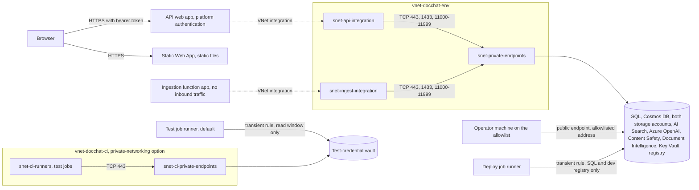
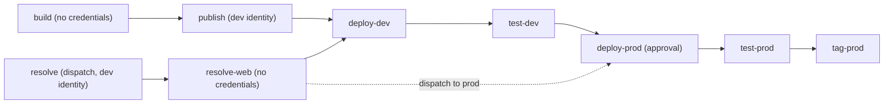

# 83 — Infrastructure

This file specifies everything DocChat deploys to Azure and GitHub, and how it gets there: the three environments and the resources of each, the region preflight, networking, the Azure OpenAI deployments and their content filters, every identity with the role that permits each Azure call it makes, the app registrations, the Bicep and Azure Developer CLI (azd) layout, the GitHub Actions workflows, the one-time bootstrap, the policies, locks and alerts that sit outside the pipeline's reach, the hardening checks and each environment's idle monthly cost. The tables, documents, blobs and indexes inside the stores are specified in `80-data-model.md`; every setting's purpose and range in `81-config.md`; the security statements in `82-security.md`; tests in `84-testing.md`; dashboards and monitoring alerts in `85-observability.md`; runbooks in `86-operations.md`; stages and spikes in `90-build-order.md`. Unless a line gives another date, every vendor fact, role ID, API version, tool version and price below was confirmed on Microsoft Learn, on the vendor's release page or through the Azure Retail Prices API on 2026-10-14 or 2026-10-15.

## 1. Environments, subscription, resource groups and naming

### 1.1 Environments

| Environment | Lifetime | SKUs | Identity rules | Purpose |
|---|---|---|---|---|
| `dev` | long-lived | development SKUs | non-production: has the test client and the `dev` test users (section 7) | integration, deployed tests, the first stop of every release |
| `prod` | long-lived | production SKUs | production: no test client, no test user, an empty Key Vault | the only production environment |
| `load` | one load-test run: created by the load-test workflow and torn down after it (section 10.14) | production SKUs for every component the load test measures (API plan, ingestion plan, SQL, Cosmos DB, AI Search), the free or minimum tier elsewhere, and no Azure OpenAI account: both apps call the model stub (section 2.21) | non-production: has the test client and the `load` test users | proving the scaling targets of `84-testing.md` |

The azd environment name equals the environment name. `infra/main.bicep` declares `@allowed(['dev', 'prod', 'load']) param environmentName string`, and every environment deploys the same `main.bicep` with its own environment file (section 8.3), so `dev`, `prod` and `load` differ only in parameters (ADR 0095).

### 1.2 Subscription

The three environments, the shared resources and the pipeline identities live in one Azure subscription by default, which keeps the model quota pool (section 5.5) and the budgets in one place. Each environment's subscription ID is the field `subscriptionId` of `infra/env/<env>.json`; `prod` moves to a subscription of its own by changing that value and running the bootstrap (section 11) for the new subscription. Every subscription in use is listed in `scripts/bootstrap/bootstrap.config.json`, and the custom roles of section 6.4 are assignable in each of them.

### 1.3 Resource groups

The bootstrap's `resource-groups` step creates five resource groups. No pipeline identity creates, deletes or re-scopes a resource group: each environment deploys with `targetScope = 'resourceGroup'` into the group named by the GitHub environment variable `AZURE_RESOURCE_GROUP`, so `azd provision` needs rights in that one group (azd deploys into an existing group when `AZURE_RESOURCE_GROUP` is set).

| Resource group | Region | Holds | Pipeline write access |
|---|---|---|---|
| `rg-docchat-identity` | `eastus2` | the five pipeline identities and their federated credentials (section 6.1); the security workspace `log-docchat-security`; the action group `ag-docchat-security`; the security alert rules (section 12) | none: no pipeline identity holds any role here |
| `rg-docchat-shared` | `eastus2` | the container registry (section 2.16); the test-credential vault (section 2.17); under the private-networking option only, the CI network `vnet-docchat-ci` with the vault's private endpoint, its private DNS zone and the GitHub network settings (section 4.2) | each deploy identity: deployments only, through DocChat Shared Deployment Operator (section 6.4), plus the registry rights of section 6.8 |
| `rg-docchat-dev`, `rg-docchat-prod` | the environment's `location` | every resource of the environment, its workload identities included | that environment's deploy identity: Contributor and a conditioned Role Based Access Control Administrator (section 6.11); in `dev` also `id-docchat-citest`: Log Analytics Reader on `log-docchat-dev` only |
| `rg-docchat-load` | the `load` environment's `location` | every resource of the current load run | the `load` deploy identity: Contributor and a conditioned Role Based Access Control Administrator; `id-docchat-citest`: Log Analytics Reader and DocChat Load Test Operator only |

`rg-docchat-load` exists permanently: the load teardown empties it and never deletes it, so its role and policy assignments survive between runs.

### 1.4 Naming rules

Every name is the Cloud Adoption Framework abbreviation, then `docchat`, then the environment, then a token where the name must be globally unique:

- `resourceToken = take(uniqueString(subscription().id, environmentName), 6)` in `dev` and `prod`;
- in `load`, `resourceToken = take(uniqueString(subscription().id, environmentName, resourceTokenSalt), 6)` with `resourceTokenSalt = 'run-<GitHub run ID>'`, so every load run gets new globally unique names: soft-deleted Key Vault and Cognitive Services names of an earlier run never block a later run, and the `load` deploy identity needs no subscription-level purge right;
- shared resources use `sharedToken = take(uniqueString(subscription().id, 'shared'), 6)`.

Every pattern was checked against its resource type's length and character rules; the longest instance is in brackets.

| Resource | Pattern | Rule checked (longest instance) |
|---|---|---|
| Static Web App | `stapp-docchat-<env>` | 2–40 letters, digits, hyphens (17) |
| API App Service plan | `asp-docchat-api-<env>` | 1–60 (20) |
| API web app | `app-docchat-api-<env>-<token>` | 2–60, globally unique host name (27) |
| Ingestion plan | `asp-docchat-ingest-<env>` | 1–60 (23) |
| Ingestion function app | `func-docchat-ingest-<env>-<token>` | 2–60; below 32 characters, so the Functions host ID is never truncated (30) |
| Model stub plan and app (`load` only) | `asp-docchat-stub-load`, `app-docchat-stub-load-<token>` | as above (28) |
| Workload identities | `id-docchat-api-<env>`, `id-docchat-ingest-<env>`, `id-docchat-stub-load` | 3–128 |
| SQL server; database | `sql-docchat-<env>-<token>`; database `docchat` | 1–63 lower case, globally unique (23) |
| Cosmos DB account | `cosmos-docchat-<env>-<token>` | 3–44 lower case (26) |
| Storage, data | `stdocchatdata<env><token>` | 3–24 lower-case letters and digits (23) |
| Storage, Functions host | `stdocchathost<env><token>` | as above (23) |
| AI Search | `srch-docchat-<env>-<token>` | 2–60 lower case, no consecutive hyphens (24) |
| Azure OpenAI (name and custom subdomain) | `oai-docchat-<env>-<token>` | 2–64 (23) |
| Content Safety | `cs-docchat-<env>-<token>` | 2–64 (22) |
| Document Intelligence | `di-docchat-<env>-<token>` | 2–64 (22) |
| Key Vault | `kv-docchat-<env>-<token>` | 3–24, starts with a letter (22) |
| Test-credential vault (shared) | `kv-docchat-tst-<sharedToken>` | 3–24 (21) |
| CI network, its subnets and network security groups (shared; private-networking option only) | `vnet-docchat-ci`; `snet-ci-runners`, `snet-ci-private-endpoints`; `nsg-docchat-ci-runners`, `nsg-docchat-ci-pe` | 2–64, 1–80, 1–80 (25) |
| GitHub network settings (shared; private-networking option only) | `ghns-docchat-ci` (the Cloud Adoption Framework has no abbreviation for this type) | starts with a letter or digit (15) |
| GitHub organization objects (private-networking option only) | network configuration `docchat-ci`; runner group and larger runner `docchat-ci-private` | 1–100 and 1–64 characters of letters, digits, `.`, `-`, `_` (18) |
| Log Analytics; Application Insights | `log-docchat-<env>`; `appi-docchat-<env>` | 4–63; 1–260 |
| Virtual network; subnets | `vnet-docchat-<env>`; `snet-api-integration`, `snet-ingest-integration`, `snet-private-endpoints`, `snet-stub-integration` | 2–64; 1–80 |
| Network security groups | `nsg-docchat-<env>-api`, `nsg-docchat-<env>-ingest`, `nsg-docchat-<env>-pe`, `nsg-docchat-load-stub` | 1–80 |
| NAT gateway and its public IP (content-share fallback 1 only, section 2.7) | `ng-docchat-<env>`, `pip-docchat-<env>-nat` | 1–80 each (20) |
| Private endpoint; its network interface | `pe-<target resource name>-<group ID>`; `nic-pe-<target resource name>-<group ID>` | 2–64 and 1–80 (`nic-pe-cosmos-docchat-prod-a1b2c3-sql`, 37) |
| Action group; budget; autoscale setting | `ag-docchat-<env>-ops` (short name `dc<env>ops`); `budget-docchat-<env>`; `autoscale-docchat-api-<env>` | action-group short name at most 12 (11) |
| Security action group (bootstrap) | `ag-docchat-security` (short name `docchat-sec`) | short name at most 12 (11) |
| Container registry (shared) | `crdocchat<sharedToken>` | 5–50 alphanumerics, globally unique (15) |
| Pipeline identities | `id-docchat-deploy-dev`, `id-docchat-deploy-prod`, `id-docchat-deploy-load`, `id-docchat-pr`, `id-docchat-citest` | 3–128 |
| Entra security groups | `sg-docchat-operators`; per environment `sg-docchat-<env>-sql-admins`, `sg-docchat-<env>-users`, `sg-docchat-<env>-admins`, `sg-docchat-<env>-config-operators`, `sg-docchat-<env>-conversation-readers`, `sg-docchat-<env>-user-data-operators` | display name and mail nickname identical |

### 1.5 Tags

| Tag | Value | On |
|---|---|---|
| `docchat-env` | the environment name; `shared` on `rg-docchat-identity`, `rg-docchat-shared` and the resources in them | every resource and resource group |
| `docchat-component` | `web` (Static Web App); `api` (API plan, site, autoscale setting, API identity); `ingestion` (ingestion plan, function app, host storage account, ingestion identity); `data` (SQL server and database, Cosmos DB, data storage account); `ai` (AI Search, Azure OpenAI, Content Safety, Document Intelligence, model stub plan, site and identity); `network` (virtual networks, network security groups, private endpoints, private DNS zones, NAT gateway, public IP, GitHub network settings); `monitoring` (workspaces, Application Insights, action groups, budget, alert rules, workbooks); `security` (environment Key Vault, test-credential vault, pipeline identities); `registry` (container registry) | every resource |
| `azd-env-name` | the environment name | every environment resource |
| `azd-service-name` | `web`, `api`, `ingestion` | the Static Web App, the API site, the function app (azd finds each service's resource by this tag) |
| `resource-usage` | `azure-functions` | the Functions host storage account |
| `docchat-release-sha` | the deployed 40-hexadecimal commit | the API site; written by the `postdeploy` hook (section 9.2), read by the release-ordering check (section 10.11) |
| `docchat-load-run`, `docchat-load-created` | the load-test workflow run ID; the creation time as `yyyy-MM-ddTHH:mm:ssZ` | `rg-docchat-load`, written before provisioning (section 10.14) and removed by the teardown |
| `docchat-purpose` | `identity`, `shared` or `environment` | the five resource groups |

No tag carries personal data. Tags give azd its service discovery, cost reporting by environment and component, and the release ordering.

## 2. Resources per environment

### 2.1 Inventory

The values `infra/env/<env>.json` ships with (section 8.3):

| Resource | `dev` | `prod` | `load` |
|---|---|---|---|
| Static Web Apps | Free | Standard | Free |
| API plan, Linux | Basic B1, 1 instance, no autoscale | Premium v3 P1v3, autoscale 2 to 6 | Premium v3 P1v3, autoscale 1 to 6 |
| Ingestion plan, Linux Elastic Premium | EP1, always ready 1, burst 2 | EP2, always ready 1, burst 4 | EP2, always ready 2, burst 4 |
| Model stub plan | none | none | Premium v3 P1v3, 1 instance |
| Load generator | none | none | nothing declared here: the load-test workflow creates one container group per scenario in `rg-docchat-load`, with no virtual network, identity or custom image (`84-testing.md`) |
| Azure SQL Database | General Purpose serverless `GP_S_Gen5_2`, 0.5 to 2 vCores, auto-pause 15 minutes, 32 GiB | General Purpose `GP_Gen5_2` provisioned, 64 GiB | General Purpose `GP_Gen5_2`, 32 GiB |
| Cosmos DB for NoSQL | serverless | autoscale (maximum 4,000 / 1,000 / 1,000 RU/s), zone-redundant | autoscale (maximum 30,000 RU/s per container), zone-redundant |
| Storage, data | Standard_LRS | Standard_ZRS | Standard_ZRS |
| Storage, Functions host | Standard_LRS | Standard_ZRS | Standard_ZRS |
| AI Search | basic, 1 replica, 1 partition | standard (S1), 2 replicas, 1 partition | standard (S1), 2 replicas, 1 partition |
| Azure OpenAI | S0, five Global Standard deployments (section 5) | S0, the same five deployments with larger capacities | none: both apps call the model stub |
| Content Safety; Document Intelligence | S0; S0 | S0; S0 | S0; S0 |
| Key Vault | Standard, purge protection off, empty | Standard, purge protection on, empty | Standard, purge protection off, empty |
| Log Analytics retention; daily cap | 30 days; 2 GB | 90 days; none | 30 days; none |
| Budget (USD a month) | 650 | 2,200 | 400 |
| Defender for Storage malware scanning | off, except while the deployed end-to-end malware-scanning test runs (section 2.11) | on | off |
| Private endpoints; private DNS zones | 13; 10 | 13; 10 | 13; 10 |

No environment deploys an API Management instance, a Front Door profile, an application gateway or a firewall. `load` mirrors `prod` for every component the load test measures and keeps the free or minimum tier elsewhere; it keeps two always-ready ingestion instances so the parallelism-4 ingestion scenario measures parallelism rather than best-effort scale-out.

### 2.2 Static Web App

`stapp-docchat-<env>`, `Microsoft.Web/staticSites@2025-03-01` through the Azure Verified Module (AVM) `avm/res/web/static-site` 0.9.6:

- `sku`: `Free` in `dev` and `load`, `Standard` in `prod` (the environment-file field `web.sku`);
- `location`: `staticWebAppLocation` (default `eastus2`; Static Web Apps serves content globally and the property places only the management resource);
- `stagingEnvironmentPolicy: 'Disabled'`; `allowConfigFileUpdates: true`; `publicNetworkAccess: 'Enabled'` (static files only); `enterpriseGradeCdnStatus: 'Disabled'`;
- no `repositoryUrl`, `branch`, `buildProperties`, linked backend, function app settings or custom authentication, so nothing but the deployment token of section 10.10 publishes content to it;
- custom domains: one `Microsoft.Web/staticSites/customDomains` per entry of the environment-file field `webCustomDomains` (string array, default `[]`), each with `validationMethod: 'cname-delegation'`; at most 2 on Free and 5 on Standard, which the preflight enforces (section 3.3, check 14);
- tag `azd-service-name: web`.

The site serves one environment-free build of the web client plus the `config.json` and `staticwebapp.config.json` that the web deployment writes per environment (section 10.10; contents in `10-web-client.md`).

### 2.3 API App Service plan and autoscale

Plan `asp-docchat-api-<env>`, `Microsoft.Web/serverfarms@2025-03-01` through AVM `avm/res/web/serverfarm` 0.7.0: `kind: 'linux'`; `reserved: true`; `skuName` from `api.sku` (`B1` in `dev`, `P1v3` in `prod` and `load`); `skuCapacity` 1 (`dev`), 2 (`prod`), 1 (`load`); `zoneRedundant` from `api.zoneRedundant` (default `false` everywhere; the module's default of `true` for Premium SKUs is always overridden); `perSiteScaling: false`; `elasticScaleEnabled: false`.

Autoscale (`prod` and `load` only): `autoscale-docchat-api-<env>`, `Microsoft.Insights/autoscalesettings@2022-10-01`, `enabled: true`, `targetResourceUri` the plan, one profile `default`:

| Setting | Value |
|---|---|
| `capacity` | `{minimum: api.minInstances, default: api.minInstances, maximum: api.maxInstances}`: `prod` 2 / 2 / 6, `load` 1 / 1 / 6 |
| Rule 1, scale out | metric `CpuPercentage`, namespace `microsoft.web/serverfarms`, resource the plan, `timeGrain: PT1M`, `statistic: Average`, `timeWindow: PT5M`, `timeAggregation: Average`, `operator: GreaterThan`, `threshold: 70`; action `Increase`, `ChangeCount`, `1`, `cooldown: PT5M` |
| Rule 2, scale in | metric `CpuPercentage`, `timeGrain: PT1M`, `statistic: Average`, `timeWindow: PT10M`, `timeAggregation: Average`, `operator: LessThan`, `threshold: 35`; action `Decrease`, `ChangeCount`, `1`, `cooldown: PT10M` |

When `api.zoneRedundant` is `true`, the plan's `skuCapacity` and every profile's `minimum` and `default` become at least 2, the platform's zone-redundant minimum. The scale-in threshold of 35% sits far enough below 70% that removing one instance can't push the remaining instances back over the scale-out threshold, which autoscale would treat as flapping and abort. `load` starts at one instance so both the single-instance and the scale-out load scenarios run against it. The scale-out rule implements the scaling target "autoscale adds an instance when average CPU stays above 70% for 5 minutes".

### 2.4 API web app and platform authentication

Site `app-docchat-api-<env>-<token>`, `Microsoft.Web/sites@2025-03-01` through AVM `avm/res/web/site` 0.24.0, `kind: 'app,linux,container'`, user-assigned identity `id-docchat-api-<env>` only (no system-assigned identity), tag `azd-service-name: api`.

| Area | Properties |
|---|---|
| Site | `httpsOnly: true`; `clientAffinityEnabled: false`; `clientAffinityProxyEnabled: false`; `publicNetworkAccess: 'Enabled'` (the only internet-facing endpoint); `virtualNetworkSubnetId` = `snet-api-integration`; `outboundVnetRouting: {allTraffic: false, applicationTraffic: false, imagePullTraffic: true, contentShareTraffic: false, backupRestoreTraffic: false}` (route-all off; image pulls through the network); `keyVaultReferenceIdentity` unset (no Key Vault reference exists) |
| `siteConfig` | `linuxFxVersion: 'DOCKER|<current API image digest reference>'` (section 10.8); `acrUseManagedIdentityCreds: true`; `acrUserManagedIdentityID` = the API identity's client ID (the stage-0 registry pull identity format check of section 11.8 can switch it to the resource ID); `alwaysOn: true`; `http20Enabled: true`; `minTlsVersion: '1.3'`; `scmMinTlsVersion: '1.3'`; `ftpsState: 'Disabled'`; `remoteDebuggingEnabled: false`; `use32BitWorkerProcess: false`; `webSocketsEnabled: false`; `healthCheckPath: '/healthz'`; `ipSecurityRestrictionsDefaultAction: 'Allow'` with no rules; `scmIpSecurityRestrictionsDefaultAction: 'Deny'` with no rules and `scmIpSecurityRestrictionsUseMain: false` (the deployment site accepts no traffic); `cors: {allowedOrigins: ['https://<Static Web App default host name>'] plus 'https://<domain>' for each webCustomDomains entry, supportCredentials: false}`; `appCommandLine: ''` (the image's own command runs) |
| `basicPublishingCredentialsPolicies` | `ftp` and `scm`, each `allow: false` |
| `configs` `appsettings` | exactly the API settings of section 8.9 |

Platform authentication: `Microsoft.Web/sites/config@2025-03-01` named `authsettingsV2`:

| Property | Value |
|---|---|
| `platform` | `{enabled: true, runtimeVersion: '~1'}` |
| `globalValidation` | `{requireAuthentication: true, unauthenticatedClientAction: 'Return401', excludedPaths: []}`; App Service health checks pass through platform authentication without an excluded path |
| `httpSettings` | `{requireHttps: true, forwardProxy: {convention: 'NoProxy'}}` |
| `identityProviders.azureActiveDirectory` | `{enabled: true, registration: {clientId: <API appId>, openIdIssuer: 'https://login.microsoftonline.com/<tenantId>/v2.0'}, validation: {allowedAudiences: [<API appId>], defaultAuthorizationPolicy: {allowedApplications: [<web appId>] plus [<test appId>] in dev and load}}}`; no client secret or certificate |
| `login` | `{tokenStore: {enabled: false}}` |
| Other identity providers | none |
| App setting `WEBSITE_AUTH_AAD_ALLOWED_TENANTS` | the tenant ID, lower case (section 8.9) |

Platform authentication answers `401` with `WWW-Authenticate: Bearer` when a token is missing or invalid, and `403` when the token's authorised party or tenant isn't allowed; those responses come from the platform and carry no problem body. The API validates every token a second time in-app (`11-api.md` section 1). Because the API registration has no redirect URI and no implicit grant (section 7.2), `/.auth/login/aad` can't complete a sign-in.

### 2.5 API process settings

| Setting | Value | Reason |
|---|---|---|
| `DOCCHAT_API_WORKERS` | the instance's vCPU count from the SKU map `{B1: 1, P0v3: 1, P1v3: 2, P2v3: 4}` (section 8.4), never a free parameter | one worker per vCPU, moving with the SKU |
| `DOCCHAT_API_GRACEFUL_TIMEOUT_SECONDS` | 110 | Gunicorn must finish inside App Service's 120-second stop window |
| `DOCCHAT_API_WORKER_TIMEOUT_SECONDS` | 120 | Gunicorn's worker heartbeat timeout, which never limits a request under the Uvicorn worker |
| `WEBSITES_PORT` | 8000 | Gunicorn binds `0.0.0.0:8000` |
| `WEBSITES_CONTAINER_START_TIME_LIMIT` | 300 | seconds the platform waits for the container to start |
| `WEBSITES_CONTAINER_STOP_TIME_LIMIT` | 120 | the platform maximum: App Service waits at most 120 s after signalling a container to stop (default 5 s) |
| `WEBSITE_HEALTHCHECK_MAXPINGFAILURES` | 3 | failed health pings before an instance is replaced |

`apps/api/gunicorn.conf.py` sets `bind = '0.0.0.0:8000'`, `workers = DOCCHAT_API_WORKERS`, `graceful_timeout` from `DOCCHAT_API_GRACEFUL_TIMEOUT_SECONDS`, `timeout` from `DOCCHAT_API_WORKER_TIMEOUT_SECONDS` and `worker_class = 'docchat_api.http.worker.DocChatUvicornWorker'`, whose `CONFIG_KWARGS` set `timeout_keep_alive = 65`: above the 60-second idle timeout common to HTTP proxies, so the platform front end never reuses a connection the worker has just closed (the 30-minute deployed soak test asserts zero `502` responses; a `502` there raises the value to 245 s). The API image's command, in exec form so that Gunicorn is process 1 and receives the platform's SIGTERM, is exactly:

```dockerfile
CMD ["gunicorn", "--config", "/app/gunicorn.conf.py", "docchat_api.app:create_app()"]
```

with an empty `ENTRYPOINT`. A shell-form command would put `/bin/sh` in front of Gunicorn, which doesn't forward the signal. On a restart, a deploy or a scale-in, turns still running 90 s after the stop signal end with the stream error `service_restarting` and are saved `failed` by the chat drain, inside the 110-second graceful timeout; the drain is specified in `12-chat-pipeline.md` section 14 and ADR 0007.

### 2.6 Ingestion plan and function app

Plan `asp-docchat-ingest-<env>`, `Microsoft.Web/serverfarms@2025-03-01` through AVM `avm/res/web/serverfarm` 0.7.0: `kind: 'elastic'`; `reserved: true`; `sku {name: <ingestion.sku>, tier: 'ElasticPremium', family: 'EP', capacity: 1}` (`EP1` in `dev`, `EP2` in `prod` and `load`); `maximumElasticWorkerCount` = `ingestion.maxBurst` (2 `dev`, 4 `prod`, 4 `load`); `elasticScaleEnabled: true`; `zoneRedundant: false` in every environment (ingestion is queued, checkpointed work that a zone outage delays without losing, ADR 0102).

Function app `func-docchat-ingest-<env>-<token>`, `Microsoft.Web/sites@2025-03-01` through AVM `avm/res/web/site` 0.24.0, `kind: 'functionapp,linux,container'`, user-assigned identity `id-docchat-ingest-<env>` only, tag `azd-service-name: ingestion`:

| Area | Properties |
|---|---|
| Site | `httpsOnly: true`; `clientAffinityEnabled: false`; `publicNetworkAccess: 'Disabled'` (no inbound traffic of any kind; the Durable client reaches the host on its loopback listener); `virtualNetworkSubnetId` = `snet-ingest-integration`; `outboundVnetRouting {allTraffic: false, applicationTraffic: false, imagePullTraffic: true, contentShareTraffic: false, backupRestoreTraffic: false}` |
| `siteConfig` | `linuxFxVersion: 'DOCKER|<current ingestion image digest reference>'`; `acrUseManagedIdentityCreds: true`; `acrUserManagedIdentityID` = the ingestion identity's client ID; `functionsRuntimeScaleMonitoringEnabled: true` (the platform scales the app from its private queue); `minimumElasticInstanceCount` (always ready) = `ingestion.alwaysReady` (1 `dev`, 1 `prod`, 2 `load`); `preWarmedInstanceCount: 1`; `functionAppScaleLimit` = `ingestion.maxBurst`; `minTlsVersion: '1.3'`; `scmMinTlsVersion: '1.3'`; `ftpsState: 'Disabled'`; `remoteDebuggingEnabled: false`; `http20Enabled: false`; `ipSecurityRestrictionsDefaultAction: 'Deny'`; `scmIpSecurityRestrictionsDefaultAction: 'Deny'`; no `healthCheckPath` (an Elastic Premium health check needs an HTTP trigger, and the app has none) |
| Publishing | `basicPublishingCredentialsPolicies` `ftp` and `scm`, each `allow: false`; no platform authentication; no CORS |
| Storage | `WEBSITES_ENABLE_APP_SERVICE_STORAGE` = `false` (the image is the app content); no Azure Files content share, no `WEBSITE_CONTENTAZUREFILECONNECTIONSTRING`, no `WEBSITE_CONTENTSHARE` (section 2.7 covers the fallback); the host and the Durable task hub use the host storage account of section 2.12 through identity-based `AzureWebJobsStorage__*` settings |
| Start-up | `WEBSITES_CONTAINER_START_TIME_LIMIT` = 900: the image loads its pinned layout and table models at first start, and 900 s leaves headroom on EP1 below the platform maximum of 1,800 s |

Worker concurrency comes from app settings derived from the SKU (section 8.4), so a SKU change moves them together. None of these names contains a period, because Linux Elastic Premium doesn't support app-setting names with a period:

| App setting | EP1 | EP2 | EP3 |
|---|---|---|---|
| `FUNCTIONS_WORKER_PROCESS_COUNT` | 1 | 2 | 4 |
| `AzureFunctionsJobHost__extensions__durableTask__maxConcurrentActivityFunctions` | 2 | 4 | 8 |
| `AzureFunctionsJobHost__extensions__durableTask__maxConcurrentOrchestratorFunctions` | 2 | 4 | 8 |

`AzureFunctionsJobHost__extensions__durableTask__hubName` = `docchat<env>` (letters and digits only) sets the task hub; `host.json` carries no hub name. Each worker process has one parse slot (`DOCCHAT_INGESTION_PARSE_SLOTS_PER_PROCESS` = 1), so two activity slots per process let the dispatcher's sweep and claim activities run beside a parse that takes up to 20 minutes, and the dispatcher watchdog never restarts a healthy dispatcher whose sweep waited behind a parse (`14-ingestion.md` section 15).

Sizing: one parsing process needs about 2 GB (2,048 MB per parsing child, the Office conversion's `convert` child included, which runs alone in its slot; `14-ingestion.md` section 15.10), so EP1 (1 vCPU, 3.5 GB) runs one parse at a time and EP2 (2 vCPU, 7 GB) runs two; a global parallelism of `p` items needs `ceil(p / 2)` EP2 instances. `prod` runs at the ops-config default `ingestion.max_parallel_items` = 1, and its burst of 4 adds instances as best-effort scale-out; `load` keeps two EP2 instances always ready for the parallelism-4 ingestion scenario. An operator who raises `prod`'s `ingestion.max_parallel_items` above 2 raises `prod`'s `ingestion.alwaysReady` to the parallelism divided by 2, rounded up, in the same change (runbook "Ingestion failures and stuck runs" in `86-operations.md`). An idle Elastic Premium app is billed for its always-ready instances only; a prewarmed instance is allocated, and billed, only once the active instances are in use.

### 2.7 Content-share spike and fallback 1

Elastic Premium apps normally use an Azure Files content share, which needs a storage key. Stage 0 (`90-build-order.md`) therefore runs the content-share spike: it deploys the `dev` ingestion app exactly as section 2.6 specifies, with no content share, running the stage-0 spike build of the ingestion image (module `docchat_ingestion.spike`: a queue-triggered starter and a Durable orchestration that fans out 200 activities of 30 s each, with `maxConcurrentActivityFunctions` 1). The spike deploys the image with `azd deploy ingestion --from-package <digest>` (section 9.3) and creates the ingestion identity's SQL contained user from its client ID (section 6.12).

Pass criteria, all seven required:

1. Provisioning succeeds with no content-share validation error.
2. Application Insights receives the spike worker's start-up event (`ingestion_worker_started` in the real image) within 10 minutes of the deploy.
3. A message on `ingestion-requests` starts the orchestration within 2 minutes.
4. During the fan-out the app runs on 2 instances (two distinct `cloud_RoleInstance` values) within 10 minutes, and returns to 1 within 70 minutes of the last activity.
5. The orchestration completes.
6. 24 hours pass with no host error that mentions Azure Files, the content share or `AzureWebJobsStorage`.
7. The image pull succeeds with `acrUserManagedIdentityID` set to the identity's client ID.

Decision rule:

- Criteria 1 to 6 pass: no share exists, and the results are written into ADR 0103.
- Any of criteria 1 to 6 fails, scale-out included: fallback 1 applies at once, and criteria 1 to 6 run against it.
- Criterion 4 still fails with fallback 1 deployed: the build stops, and fallback 2 (Functions on Container Apps with the MSSQL Durable storage provider) goes to the product owner as a new ADR. Fallback 2 isn't chosen in advance because it changes the hosting resource, the Durable storage provider and the ingestion scaling model, while fallback 1 confines the change to one storage account, one secret and the ingestion subnet's outbound path.
- Criterion 7 fails (the pull hasn't succeeded within 10 minutes, or fails with an identity error): both apps and the model stub set `acrUserManagedIdentityID` to the identity's resource ID, and the result is written into ADR 0103.

Fallback 1, chosen now (keep Elastic Premium and add a content share). The exact changes, applied by the runbook "Content-share fallback activation":

| Resource | Change |
|---|---|
| Host storage account `stdocchathost<env><token>` | `allowSharedKeyAccess: true`, the single exception to "no keys"; a `file` private endpoint in `snet-private-endpoints` with the private DNS zone `privatelink.file.core.windows.net` linked to the environment's network; the share `func-docchat-ingest-<env>` (`fileServices/default/shares`, quota 100 GiB) |
| Environment Key Vault `kv-docchat-<env>-<token>` | the secret `ingestion-content-share-connection` = `DefaultEndpointsProtocol=https;AccountName=<host account>;AccountKey=<listKeys().keys[0].value>;EndpointSuffix=core.windows.net`, content type `text/plain`, written by Bicep from `listKeys()` |
| Ingestion identity | Key Vault Secrets User (`4633458b-17de-408a-b874-0445c86b69e6`) on that secret only |
| Function app | `WEBSITE_CONTENTAZUREFILECONNECTIONSTRING` = `@Microsoft.KeyVault(SecretUri=https://<vault>.vault.azure.net/secrets/ingestion-content-share-connection)`; `WEBSITE_CONTENTSHARE` = `func-docchat-ingest-<env>`; `WEBSITE_SKIP_CONTENTSHARE_VALIDATION` = `1`; `keyVaultReferenceIdentity` = the ingestion identity's resource ID; `outboundVnetRouting.contentShareTraffic: true` and `outboundVnetRouting.allTraffic: true` (a Linux app reading Key Vault references from a vault behind a private endpoint must route all traffic through the network) |
| Outbound path | NAT gateway `ng-docchat-<env>` (`Microsoft.Network/natGateways@2025-09-01`, `sku.name: 'Standard'`, `idleTimeoutInMinutes: 4`, no zone) with one public IP `pip-docchat-<env>-nat` (`Microsoft.Network/publicIPAddresses@2025-09-01`, `sku {name: 'Standard', tier: 'Regional'}`, `publicIPAllocationMethod: 'Static'`, `publicIPAddressVersion: 'IPv4'`), associated with `snet-ingest-integration` only (the subnet's `natGateway` property); `nsg-docchat-<env>-ingest` keeps the platform's default internet-outbound rule, so Microsoft Entra ID and Azure Monitor ingestion stay reachable through the NAT gateway's address; the API subnet is unchanged |
| Policy | before the fallback deploys, the bootstrap operator adds the host account to the `notScopes` of `docchat-deny-storage-shared-key` on `rg-docchat-<env>` (policy exemptions have no GA API version, section 12.1) |
| Rotation | every 90 days and at once on suspected exposure, in a window with no ingestion work running: `az storage account keys renew --key key1`, a `full` deploy writes the secret from the new key, the ingestion app restarts through `deploy-environment.yaml` `mode: restart-ingestion` (section 10.13), and the next ingestion run must complete (runbook "Rotate the host-account key (content-share fallback 1 only)") |

Writing the secret calls `Microsoft.Storage/storageAccounts/listKeys/action` on every provision of that environment, which `docchat-alert-key-access` reports (section 12.5): while fallback 1 is active, `ag-docchat-security` receives one key-access alert per provision, and the alert-response runbook routes one that a provision run of that environment explains to incident review and an unexplained one to the pipeline-compromise runbook. Fallback 1 adds about $44.30 a month per environment (section 14.2).

### 2.8 Azure SQL server and database

Server `sql-docchat-<env>-<token>`, `Microsoft.Sql/servers@2025-01-01` through AVM `avm/res/sql/server` 0.22.1:

- `administrators {administratorType: 'ActiveDirectory', azureADOnlyAuthentication: true, login: 'sg-docchat-<env>-sql-admins', principalType: 'Group', sid: <that group's object ID>, tenantId: <tenant ID>}` and the child `azureADOnlyAuthentications/Default {azureADOnlyAuthentication: true}`; no SQL login exists;
- `minimalTlsVersion: '1.3'`: every client connects with Microsoft ODBC Driver 18 and `Encrypt=strict` (TDS 8.0), which negotiates TLS 1.3 (section 6.2);
- `publicNetworkAccess: 'Enabled'` in every environment, admitting only the firewall rules of sections 4.5 and 4.6 and the private endpoint; no `AllowAllWindowsAzureIps` rule;
- `restrictOutboundNetworkAccess: 'Disabled'` (no vendor documentation covers SQL auditing to Log Analytics with outbound restriction on; outbound restriction is later hardening);
- `connectionPolicy: 'Default'`; no server identity (contained users are created with `TYPE = E` and `TYPE = X`, which need no directory lookup, so the server holds no Microsoft Graph permission).

Database `docchat`: collation `SQL_Latin1_General_CP1_CI_AS`; transparent data encryption on with a service-managed key.

| Property | `dev` | `prod` | `load` |
|---|---|---|---|
| SKU | `GP_S_Gen5_2` (General Purpose, Gen5, at most 2 vCores), `minCapacity` 0.5 | `GP_Gen5_2` (2 vCores), `licenseType: 'LicenseIncluded'` | `GP_Gen5_2` |
| `autoPauseDelay` | 15 minutes | -1 (not serverless) | -1 |
| `maxSizeBytes` | 34,359,738,368 (32 GiB) | 68,719,476,736 (64 GiB) | 34,359,738,368 (32 GiB) |
| `zoneRedundant` | `false` | `sql.zoneRedundant`, default `false` | `false` |
| `requestedBackupStorageRedundancy` | `Local` | `Geo` | `Local` |
| Point-in-time retention | 7 days | 14 days (`backupShortTermRetentionPolicies/default`, `diffBackupIntervalInHours: 12`) | 7 days |
| Long-term retention | none | none | none |

Dev auto-pause: the serverless `dev` database pauses after 15 minutes with no session and no CPU, the shortest delay the service accepts and the only one that pauses between the dispatcher's idle wakes. `dev` SQL's only scheduled traffic is the dispatcher's wakes (every 60 s while work is outstanding, every 60 minutes when idle) and the 02:40 UTC ingestion maintenance; the dispatcher keep-alive reads only Durable status, both apps release idle connections after 10 minutes (`DOCCHAT_SQL_IDLE_RELEASE_MINUTES`), and the API's 60-second ops-config refresh runs on the first request after expiry, never on a timer. An idle `dev` database is therefore online about 25 minutes of every hour, and both apps retry SQL error 40613 while it resumes (ADR 0036).

### 2.9 SQL auditing

Auditing has two specifications, so that every principal except the two workload identities is audited with its full batch text, and the workload identities' bound values (names, email addresses, file names) never reach a log.

1. **Privileged audit** (server level): `Microsoft.Sql/servers/extendedAuditingSettings@2025-01-01` named `default`, `{state: 'Enabled', isAzureMonitorTargetEnabled: true, isDevopsAuditEnabled: true, queueDelayMs: 1000, auditActionsAndGroups: ['BATCH_COMPLETED_GROUP', 'SUCCESSFUL_DATABASE_AUTHENTICATION_GROUP', 'FAILED_DATABASE_AUTHENTICATION_GROUP'], predicateExpression: "database_principal_name <> 'id-docchat-api-<env>' AND database_principal_name <> 'id-docchat-ingest-<env>'"}`. It records every statement of the deploy identity (migrations, grants), of the just-in-time groups and of any other principal, whose `app.audit_events` rows their own `docchat-ops` process writes and so could skip or forge. Its records reach Log Analytics through two diagnostic settings on the `master` database, each with categories `SQLSecurityAuditEvents` and `DevOpsOperationsAudit`: `sql-audit` to the environment's workspace (declared in `main.bicep`; the AVM module doesn't create it, and auditing to Log Analytics doesn't work without it), and `sql-audit-security` to `log-docchat-security`, created by the bootstrap operator's `tighten_conditions.py` after the first provision of `dev` and of `prod` (section 11.6), so no template change removes it and deleting it raises `docchat-alert-diagnostic-settings`. `load` has `sql-audit` only.
2. **Workload audit** (database level): `Microsoft.Sql/servers/databases/extendedAuditingSettings@2025-01-01` named `default` on `docchat`, `{state: 'Enabled', isAzureMonitorTargetEnabled: true, queueDelayMs: 1000, predicateExpression: "database_principal_name = 'id-docchat-api-<env>' OR database_principal_name = 'id-docchat-ingest-<env>'", auditActionsAndGroups: <the set the sentinel check chooses>}`. Its records reach the environment's workspace through category `SQLSecurityAuditEvents` of the `docchat` database's diagnostic setting (section 2.19). The two predicates are complements, so each event is recorded once.

The stage-0 SQL audit sentinel check (`90-build-order.md`) chooses the workload audit's action groups: under the deploy identity, run `SELECT COUNT(*) FROM app.users WHERE display_name = ?` with the bound value `docchat-audit-sentinel-<uuid4>`; 20 minutes later query `SQLSecurityAuditEvents | where Statement has '<sentinel>' or AdditionalInformation has '<sentinel>'`.

| Result | Workload audit `auditActionsAndGroups` |
|---|---|
| Zero rows (bound values don't reach the log) | `BATCH_COMPLETED_GROUP`, `SUCCESSFUL_DATABASE_AUTHENTICATION_GROUP`, `FAILED_DATABASE_AUTHENTICATION_GROUP` |
| One or more rows | `SCHEMA_OBJECT_CHANGE_GROUP`, `DATABASE_OBJECT_CHANGE_GROUP`, `DATABASE_PRINCIPAL_CHANGE_GROUP`, `DATABASE_ROLE_MEMBER_CHANGE_GROUP`, `DATABASE_PERMISSION_CHANGE_GROUP`, `DATABASE_OBJECT_PERMISSION_CHANGE_GROUP`, `SUCCESSFUL_DATABASE_AUTHENTICATION_GROUP`, `FAILED_DATABASE_AUTHENTICATION_GROUP` |

The privileged audit keeps `BATCH_COMPLETED_GROUP` in both outcomes. The same stage-0 run confirms that `database_principal_name` carries the contained users' names: the ingestion identity's successful authentication (its `SELECT USER_NAME()` connection, section 6.12) appears in the workload audit only, and the deploy identity's sentinel statement in the privileged audit only. When the records show a different `database_principal_name` for a workload identity, both predicates use the value the records show and the check runs once more. The results and their date go into ADR 0108 before stage 1 starts.

Every SQL session names its component through the ODBC Driver 18 keyword `APP` (`docchat-api`, `docchat-ingestion`, `docchat-migrations`, `docchat-grants`, `docchat-ops`), so each audit record's application name says which component ran the statement. The privileged audit records an operator's bound values (names, email addresses or file names inside up to 4,000 characters of batch text) in both of its destinations; that is the accepted price of a privileged-access record its author can't remove. Operators read both workspaces through Log Analytics Reader, the environment's deploy identity can read the environment's workspace through Contributor, and `prod` keeps `SQLSecurityAuditEvents` 365 days (section 2.18).

### 2.10 Cosmos DB account, database and containers

Account `cosmos-docchat-<env>-<token>`, declared by the local module `infra/modules/data/cosmos.bicep` on the GA API `Microsoft.DocumentDB/databaseAccounts@2026-03-15` and its child types at that version (the AVM module 0.21.1 deploys `2026-04-01-preview` and sets serverless through a preview-only property, section 8.6):

- `kind: 'GlobalDocumentDB'`; `databaseAccountOfferType: 'Standard'`;
- `locations: [{locationName: <location>, failoverPriority: 0, isZoneRedundant: <true in prod and load, false in dev>}]` (derived from the environment name, section 8.4);
- `capabilities: [{name: 'EnableServerless'}]` in `dev` only;
- `consistencyPolicy {defaultConsistencyLevel: 'Session'}`;
- `disableLocalAuth: true`; `disableKeyBasedMetadataWriteAccess: true`; `minimalTlsVersion: 'Tls12'` (the only settable value; clients that offer TLS 1.3 negotiate 1.3);
- `publicNetworkAccess` and `ipRules` per section 4.5; `isVirtualNetworkFilterEnabled: false`; `networkAclBypass: 'None'`;
- `enableAutomaticFailover: false`; `enableMultipleWriteLocations: false`; `enableFreeTier: false`; `enableAnalyticalStorage: false`; `enableBurstCapacity: false`;
- `backupPolicy {type: 'Continuous', continuousModeProperties {tier: 'Continuous30Days' in prod, 'Continuous7Days' in dev and load}}` (the environment-file field `cosmos.backupTier`); `dev` and `load` take the free 7-day tier because their data is test data;
- no identity; full-text query logging stays at the GA default (off), so data-plane request logs carry no query text, and no preview property is set (the account property that controls it exists only in preview API versions).

Database `docchat` with no throughput options. Containers are `Microsoft.DocumentDB/databaseAccounts/sqlDatabases/containers@2026-03-15`; in `prod` and `load` each sets `options.autoscaleSettings.maxThroughput` from `cosmos.maxThroughput`, applied when the container is created so its physical partitions exist before the first load scenario; in `dev` no `options` are set. Indexing policies and document shapes are in `80-data-model.md` section 3.

| Container | Partition key | `defaultTtl` | Autoscale maximum |
|---|---|---|---|
| `conversations` | `{paths: ['/userId', '/sessionId'], kind: 'MultiHash', version: 2}` | -1 when `conversationRetentionDays` is 0 (default), else days × 86,400 | `prod` 4,000 RU/s (scales 400 to 4,000); `load` 30,000 RU/s |
| `memories` | `{paths: ['/userId'], kind: 'Hash', version: 2}` | -1 when `memoryRetentionDays` is 0 (default), else days × 86,400 | `prod` 1,000 RU/s; `load` 30,000 RU/s |
| `usage` | `{paths: ['/userId'], kind: 'Hash', version: 2}` | -1 | `prod` 1,000 RU/s; `load` 30,000 RU/s |

Sizing: about 300 RU per completed turn gives `prod`'s 4,000 RU/s room for about 13 turns per second before throttling; the event-loop load scenario compares its measured per-container peak with `prod`'s maxima and its charge per completed turn with 400 RU. `load`'s maxima are the scale-out scenario's 60 turns per second × 400 RU per completed turn × 1.25 (ADR 0151). Autoscale bills at least 10% of the maximum each hour (400 + 100 + 100 RU/s idle in `prod`), and zone redundancy adds no charge under autoscale.

### 2.11 Data storage account and Defender for Storage

`stdocchatdata<env><token>` through AVM `avm/res/storage/storage-account` 0.33.1 (GA API 2025-06-01):

| Area | Properties |
|---|---|
| Account | `kind: 'StorageV2'`; `skuName` `Standard_LRS` (`dev`) or `Standard_ZRS` (`prod`, `load`), derived from the environment name; `accessTier: 'Hot'`; `allowBlobPublicAccess: false`; `allowSharedKeyAccess: false`; `defaultToOAuthAuthentication: true`; `allowCrossTenantReplication: false`; `allowedCopyScope: 'AAD'`; `minimumTlsVersion: 'TLS1_2'` (a TLS 1.3 minimum isn't supported); `supportsHttpsTrafficOnly: true`; `isHnsEnabled: false` (blob index tags need a flat namespace); `isSftpEnabled: false`; `isLocalUserEnabled: false`; `isNfsV3Enabled: false`; `requireInfrastructureEncryption: true`; `dnsEndpointType: 'Standard'` |
| Network | `publicNetworkAccess` per section 4.5; `networkAcls {defaultAction: 'Deny', bypass: 'None', ipRules: [{value: <address>, action: 'Allow'} for each allowlist entry], virtualNetworkRules: [], resourceAccessRules: <when scanning is on: [{tenantId: <tenant ID>, resourceId: '/subscriptions/<subscription ID>/providers/Microsoft.Security/datascanners/StorageDataScanner'}], else []>}` |
| Blob service | `deleteRetentionPolicy {enabled: true, days: 14, allowPermanentDelete: false}`; `containerDeleteRetentionPolicy {enabled: true, days: 30}`; `isVersioningEnabled: false`; change feed off; restore policy off |
| Containers | `documents`, `renditions`, `ingestion-work`, each `publicAccess: 'None'` (paths and blob contents: `80-data-model.md` section 4) |
| Access tiers | the account default `accessTier: 'Hot'` holds `renditions` and `ingestion-work`; every blob in `documents` (each uploaded source and each converted PDF) is written in the Cool tier by the call that writes it, `commit_block_list` and `upload_blob` with `standard_blob_tier=StandardBlobTier.COOL` (`80-data-model.md` section 4.5), because no reader is ever served from `documents`; no lifecycle rule changes a tier, so a blob is never written Hot and moved, and Cool's 30-day minimum charge applies from the write |
| Queue service | queues `ingestion-requests` and `ingestion-requests-poison`; the poison queue exists in advance, so the Functions runtime needs only Message Sender on it (message schema and encoding: `80-data-model.md` section 5) |
| Lifecycle | `managementPolicies/default` with one rule `ingestion-work-expiry`: `enabled: true`, `type: 'Lifecycle'`, `definition.filters {blobTypes: ['blockBlob'], prefixMatch: ['ingestion-work/']}`, `definition.actions.baseBlob.delete.daysAfterModificationGreaterThan: 7` |
| Private endpoints | `blob` and `queue` (section 4.4) |

Defender for Storage malware scanning: `Microsoft.Security/defenderForStorageSettings@2025-06-01` named `current`, scoped to the account and always declared:

```text
isEnabled: <storage.malwareScanning>
malwareScanning.onUpload: {isEnabled: <storage.malwareScanning>, capGBPerMonth: <storage.malwareScanCapGbPerMonth>,
                           filters: {excludeBlobsWithPrefix: ['renditions/', 'ingestion-work/'],
                                     excludeBlobsWithSuffix: ['/converted.pdf']}}
malwareScanning.blobScanResultsOptions: 'blobIndexTags'
sensitiveDataDiscovery.isEnabled: false
overrideSubscriptionLevelSettings: true
```

`storage.malwareScanning` is `true` in `prod` and `false` in `load`. In `dev` it is `false` except while the deployed end-to-end malware-scanning test runs (its stage-2 acceptance and any later re-run): the acceptance performer sets it `true` with one pull request to `infra/env/dev.json` and restores `false` with a second as soon as the suite ends, pass or fail. `storage.malwareScanCapGbPerMonth` (default 1,000 GB) is an explicit cost ceiling: a reached cap closes the upload gate through the daily scanner canary rather than letting uploads through unscanned. Only the sources and canaries in `documents` are scanned, because their scan result gates ingestion of uploads. Renditions, work files and each version's `converted.pdf` are written by the trusted ingestion app from a scanned source, no reader is served from `documents`, and no code reads a scan tag on a converted PDF, so scanning them would only add cost. The filters are joined by OR, and a suffix matches the end of the blob name (Microsoft Learn, "Microsoft.Security/defenderForStorageSettings 2025-06-01", `OnUploadFilters`, read 2026-10-26). `/converted.pdf` is the end of `{indexId}/{documentId}/{v}/converted.pdf` and of no other name in `documents`: sources are `{indexId}/{documentId}/{v}/source` and canaries `_scanner-canary/{canaryId}.pdf` (`80-data-model.md` section 4.3). Spike SP-3 proves that a blob whose name ends with that suffix, written while scanning is on, carries no scan-result tag (`90-build-order.md` section 2.5). When scanning is on, a diagnostic setting `scan-results` at `<account>/providers/Microsoft.Security/DefenderForStorageSettings/current` sends category `ScanResults` to the environment's workspace (table `StorageMalwareScanningResults`).

The scanner's resource-instance rule is declared in Bicep, so a redeploy never removes it, and it stays effective while public access is disabled. The stage-0 Defender spike (`90-build-order.md`) compares the rule Defender writes on the `dev` account with this constant (case-insensitively), lists the scanner's role assignment and reads a test blob's index tags: a different `resourceId` replaces the Bicep constant, a role other than Defender for Storage Data Scanner (`1e7ca9b1-60d1-4db8-a914-f2ca1ff27c40`) replaces it in the role-assignment condition of section 6.11, and the tag key casing and time format become the ingestion app's constants. Enablement, the upload gate and the acceptance check are in section 11.7.

### 2.12 Functions host storage account

`stdocchathost<env><token>`, the same module and the same hardening as section 2.11, with these differences: `publicNetworkAccess: 'Disabled'` in every environment and with any allowlist; `networkAcls {defaultAction: 'Deny', bypass: 'None'}` with no rules; blob soft delete 7 days and container soft delete 7 days; no containers, queues, tables, lifecycle rule or scanning declared (the Functions host and the Durable task hub `docchat<env>` create their own); tag `resource-usage: azure-functions`; private endpoints `blob`, `queue` and `table`. The account holds the Functions host and the task hub only; the ingestion identity reaches it through `AzureWebJobsStorage__blobServiceUri`, `__queueServiceUri`, `__tableServiceUri`, `__credential` = `managedidentity` and `__clientId` (Durable Functions doesn't support a resource-ID form).

### 2.13 Azure AI Search

`srch-docchat-<env>-<token>` through AVM `avm/res/search/search-service` 0.13.0 (GA API 2025-05-01): `sku` `basic` (`dev`) or `standard` (`prod`, `load`); `replicaCount` from `search.replicas` (1 `dev`, 2 `prod`, 2 `load`; `main.bicep` fails the build when `prod` or `load` asks for fewer than 2); `partitionCount` 1; `hostingMode: 'Default'`; `semanticSearch: 'standard'` in every environment (the `free` plan returns billing errors once its monthly allowance is spent, which would stop retrieval in `dev` mid-month, while `standard` charges only beyond the allowance); `disableLocalAuth: true` with `authOptions` omitted (role-based access only); `publicNetworkAccess` and `networkRuleSet {ipRules, bypass: 'None'}` per section 4.5; `computeType: 'Default'`; no identity (the service makes no outbound connection: no indexer, skillset, vectorizer or customer-managed key); private endpoint `searchService`. The service holds no index at deployment: the ingestion app creates physical indexes from the schemas in `packages/core` (`80-data-model.md` section 6), through the data-plane API 2026-04-01. Basic's limits (15 indexes, 15 GB of storage and 5 GB of vector index per partition) bound `dev` to about 7 logical indexes with one active and one building physical index each; `DOCCHAT_SEARCH_MAX_INDEXES` (15 on `basic`, 50 on `standard`, section 8.4) passes the limit to the API.

### 2.14 Content Safety and Document Intelligence

Two accounts through AVM `avm/res/cognitive-services/account` 0.19.1 (GA API 2025-06-01):

| Account | Kind | Use |
|---|---|---|
| `cs-docchat-<env>-<token>` | `ContentSafety` | Prompt Shields, REST `POST https://<account>.cognitiveservices.azure.com/contentsafety/text:shieldPrompt?api-version=2024-09-01`, for retrieved sources and memory facts (`12-chat-pipeline.md` section 8) |
| `di-docchat-<env>-<token>` | `FormRecognizer` | the layout model on API 2024-11-30 for the recursive ingestion method (`14-ingestion.md` section 11) |

Each: `sku: 'S0'`; `customSubDomainName` = the account name (Microsoft Entra authentication needs a custom subdomain); `disableLocalAuth: true`; `publicNetworkAccess` and `networkAcls {defaultAction: 'Deny', bypass: 'None', ipRules}` per section 4.5; `restrictOutboundNetworkAccess: true` with `allowedFqdnList: []` (documents are sent as bytes, never as URLs, so no feature in use calls out); no identity; private endpoint `account` in the zone `privatelink.cognitiveservices.azure.com`. Content Safety is real in every environment, `load` included.

### 2.15 Environment Key Vault

`kv-docchat-<env>-<token>` through AVM `avm/res/key-vault/vault` 0.14.2 (GA API 2026-02-01): `sku: 'standard'` (the module's default `premium` is overridden); `enableRbacAuthorization: true`; `enableSoftDelete: true`; `softDeleteRetentionInDays` from `keyVault.softDeleteDays` (90 `prod`, 7 `dev` and `load`); `enablePurgeProtection` from `keyVault.purgeProtection` (`true` in `prod`; `false` in `dev` and `load`, overriding the module's default `true`; purge protection can never be turned off once on); `enabledForDeployment`, `enabledForTemplateDeployment` and `enabledForDiskEncryption` all `false`; `networkAcls {defaultAction: 'Deny', bypass: 'None', ipRules: <operator allowlist>}`; `publicNetworkAccess` per section 4.5; no access policies; private endpoint `vault`.

Every environment vault is empty in the first version: no app reads a secret, so no app identity holds a Key Vault role. Under content-share fallback 1 the vault holds only `ingestion-content-share-connection` (section 2.7). The test-user passwords live in the shared test-credential vault (section 2.17), never in an environment vault, and every `prod` deploy checks that `prod`'s vault holds no secret (section 10.7, step 9).

### 2.16 Shared container registry

`crdocchat<sharedToken>`, declared by the local module `infra/modules/registry/registry.bicep` on the GA API `Microsoft.ContainerRegistry/registries@2025-11-01` (the AVM module 0.13.1 deploys `2025-06-01-preview`) and deployed by `infra/shared.bicep` into `rg-docchat-shared` by the bootstrap only; no pipeline deploys it.

| Property | Value |
|---|---|
| `sku` | `Premium` (500 GiB included) |
| `adminUserEnabled`; `anonymousPullEnabled` | `false`; `false` |
| `publicNetworkAccess` | `'Enabled'`, with `networkRuleSet {defaultAction: 'Deny', ipRules: [{action: 'Allow', value: <address>} for each sharedOperatorIpAllowlist entry]}`; the `dev` publish jobs add and remove one transient runner rule (section 4.6) |
| `networkRuleBypassOptions`; `networkRuleBypassAllowedForTasks` | `'None'`; `false` |
| `dataEndpointEnabled` | `true` (the regional data endpoints resolve through the same private zone) |
| `zoneRedundancy` | `'Enabled'` (Premium in an availability-zone region) |
| `roleAssignmentMode` | `'LegacyRegistryPermissions'`: AcrPull and AcrPush are honoured, so the conditioned delegation of AcrPull keeps working when the ABAC repository-permission mode becomes the platform default (that mode ignores AcrPull) |
| `policies` | `azureADAuthenticationAsArmPolicy {status: 'enabled'}` (App Service managed-identity pulls need ARM-audience tokens); `exportPolicy {status: 'enabled'}` (exports can't be disabled while public access stays on for the `dev` runner rule); `quarantinePolicy {status: 'disabled'}`; `trustPolicy {status: 'disabled'}` |
| Encryption; identity | Microsoft-managed keys; none |
| Repositories | `docchat/api`, `docchat/ingestion`, `docchat/model-stub` |
| Tags on images | the full 40-character commit SHA, used only as a lookup key: every pushed digest carries a build-provenance attestation, a tag-resolved digest is verified before it deploys, and every environment deploys by digest (section 10.8) |
| Diagnostic setting | `registry-audit`: `ContainerRegistryRepositoryEvents`, `ContainerRegistryLoginEvents` and `AllMetrics` to `log-docchat-security` |
| Retention | no ACR retention policy or purge task; the runbook "Prune the registry" deletes, at most once a quarter, images older than 400 days that no `deploy-prod-*` git tag references |

Each environment's `main.bicep` declares the registry's private endpoint in its own `snet-private-endpoints` (section 4.4) and the app identities' AcrPull assignments through a module scoped to `rg-docchat-shared` (section 6.8). No identity holds `Microsoft.ContainerRegistry/registries/delete`.

### 2.17 Shared test-credential vault

`kv-docchat-tst-<sharedToken>` in `rg-docchat-shared`, declared by `infra/shared.bicep` (deployed by the bootstrap only) through AVM `avm/res/key-vault/vault` 0.14.2: `sku: 'standard'`; `enableRbacAuthorization: true`; soft delete 90 days; `enablePurgeProtection: true`; diagnostic setting with `AuditEvent` and `AllMetrics` to `log-docchat-security`.

- **Network** (the Key Vault rule of section 4.5 with the shared allowlist, and the CI path chosen by the bootstrap configuration key `ciPrivateNetworking`, section 8.5; ADR 0122): `publicNetworkAccess: 'Enabled'` with `networkAcls {defaultAction: 'Deny', bypass: 'None', ipRules: <sharedOperatorIpAllowlist>}` while that list holds an address. While it is empty: by default (`ciPrivateNetworking: false`) `publicNetworkAccess: 'Enabled'`, `defaultAction: 'Deny'`, `bypass: 'None'` and no rule, so only the transient runner rule of a test job's read window admits a runner (section 4.6), and the vault has no private endpoint; under the private-networking option (`true`) `publicNetworkAccess: 'Disabled'`, with `defaultAction: 'Deny'` and no rule, no job ever adds a network rule, and its one private endpoint, `pe-kv-docchat-tst-<sharedToken>-vault` (group `vault`), sits in `snet-ci-private-endpoints` of the CI network (section 4.2). No environment network reaches it. Each deployment of `infra/shared.bicep` writes `ipRules` from the shared allowlist, removing any live runner rule.
- **Contents**: only the secrets `test-user-<alias>`, aliases `admin`, `member`, `outsider`, `norole` (the `dev` set, assigned to `dev`'s registrations) and `load-01` to `load-20`, `load-admin` (the `load` set, assigned to each load run's registrations); value the password; `contentType: 'text/plain'`; `exp` = write time + 30 days; tag `docchat-test-user=<alias>`, never a user principal name.
- **Reader**: `id-docchat-citest` only, through Key Vault Secrets User at the vault, from jobs of the GitHub environments `dev-tests` and `load-tests`: by default on standard runners inside a read window, under the private-networking option on the runner group in the CI network (section 10.16). By default `id-docchat-citest` also holds DocChat Test Vault Firewall Editor at the vault, for its own runner rule (section 6.4). No app identity can read it.
- **Writers**: `sg-docchat-operators` through DocChat Test Secret Writer (set secrets and read metadata, never read a value), used by `docchat-ops testusers rotate` every 30 days from a machine whose address is in the shared allowlist (with an empty shared list no operator reaches the vault, so the operator first adds an address through the bootstrap's `shared` step and removes it the same way afterwards), by an operator who also holds Password Administrator scoped to the administrative unit `DocChat test users`, which contains only the test users (`86-operations.md`, runbook "Test-user password rotation").

Every environment vault, `prod`'s included, stays empty; `prod` has no test client, test user or test secret.

### 2.18 Log Analytics and Application Insights

Workspace `log-docchat-<env>` through AVM `avm/res/operational-insights/workspace` 0.16.1:

| Property | Value |
|---|---|
| `sku` | `PerGB2018` |
| `retentionInDays` | `monitoring.retentionDays`: 30 (`dev`, `load`), 90 (`prod`) |
| `dailyQuotaGb` | `monitoring.dailyCapGb`: 2 (`dev`); -1, no cap (`prod`, so audit records are never dropped); -1 (`load`: a full load-test run sends about 6.5 GB, about 1.6 GB outside the scale-out scenario's main phase and about 4.9 GB inside it at 60 turns per second, and every load verdict checks `_LogOperation` for `OverQuota`) |
| `features` | `{disableLocalAuth: true, enableLogAccessUsingOnlyResourcePermissions: true}` |
| `publicNetworkAccessForIngestion`, `publicNetworkAccessForQuery` | `'Enabled'`, `'Enabled'` (private monitoring ingestion is deferred hardening) |
| `prod` audit tables | `Microsoft.OperationalInsights/workspaces/tables` entries for `CDBDataPlaneRequests`, `SQLSecurityAuditEvents`, `AZKVAuditLogs`, `StorageBlobLogs` and `AppServiceAuditLogs`, each `retentionInDays: 90`, `totalRetentionInDays: 365`, so data-plane access logs stay a year for access reviews |

Application Insights `appi-docchat-<env>` through AVM `avm/res/insights/component` 0.8.0 (API 2020-02-02, the latest GA version): `kind: 'web'`; `applicationType: 'web'`; `workspaceResourceId` = the workspace; `disableLocalAuth: true` (Entra-only ingestion); `publicNetworkAccessForIngestion` and `publicNetworkAccessForQuery` `'Enabled'`; no ingestion sampling. Both apps export telemetry with Entra authentication (`APPLICATIONINSIGHTS_AUTHENTICATION_STRING` and Monitoring Metrics Publisher, section 6.5). Trace sampling is the environment-file field `telemetrySamplingRatio` (default 1.0, allowed 0.1 to 1.0), surfaced on both apps as the one app setting `DOCCHAT_TELEMETRY_SAMPLING_RATIO`; `configure_telemetry` sets the OpenTelemetry sampler inside each process from it (`85-observability.md` section 1), so no `OTEL_*` app setting exists, and `host.json` turns the Functions host's own sampling off.

The security workspace `log-docchat-security` (bootstrap, section 12.4) keeps 365 days of analytics retention for everything it holds.

### 2.19 Diagnostic settings

Every resource with diagnostic categories gets one setting named `to-log-analytics` to its environment's workspace (the registry and the test-credential vault send theirs to `log-docchat-security`), with `logAnalyticsDestinationType: 'Dedicated'` (resource-specific tables), on `Microsoft.Insights/diagnosticSettings@2021-05-01-preview` (the one preview dependency, section 8.7):

| Resource | Log categories | Metrics |
|---|---|---|
| API web app | `AppServicePlatformLogs`, `AppServiceAuditLogs`, `AppServiceIPSecAuditLogs` | `AllMetrics` |
| Ingestion function app | `FunctionAppLogs` | `AllMetrics` |
| Model stub app (`load`) | `AppServicePlatformLogs` | `AllMetrics` |
| App Service plans | none exist | `AllMetrics` |
| SQL `master` (settings `sql-audit`, and `sql-audit-security` to `log-docchat-security` in `dev` and `prod`, section 2.9) | `SQLSecurityAuditEvents` (privileged audit), `DevOpsOperationsAudit` | none |
| SQL `docchat` | `SQLSecurityAuditEvents` (workload audit), `Errors`, `Timeouts`, `Blocks`, `Deadlocks` | `Basic`, `InstanceAndAppAdvanced` |
| Cosmos DB | `DataPlaneRequests`, `ControlPlaneRequests`, `PartitionKeyRUConsumption` | `Requests` |
| Data storage, blob and queue services | `StorageRead`, `StorageWrite`, `StorageDelete` | `Transaction` |
| Host storage, blob, queue and table services | `StorageWrite`, `StorageDelete` | `Transaction` |
| Storage accounts | none exist | `Transaction` |
| AI Search | `OperationLogs` | `AllMetrics` |
| Azure OpenAI, Content Safety, Document Intelligence | `Audit`, `RequestResponse` | `AllMetrics` |
| Environment Key Vault | `AuditEvent` | `AllMetrics` |
| Test-credential vault (to `log-docchat-security`) | `AuditEvent` | `AllMetrics` |
| Autoscale setting | `AutoscaleScaleActionsLog` | `AllMetrics` |
| Container registry (`registry-audit`, to `log-docchat-security`) | `ContainerRegistryRepositoryEvents`, `ContainerRegistryLoginEvents` | `AllMetrics` |
| Data account's Defender settings (`scan-results`, when scanning is on) | `ScanResults` | none |

Excluded on purpose:

- `AppServiceHTTPLogs`: per request it records the authenticated user name (a sign-in name, which the logging policy treats as an email address), the query string, user agent and referrer; the application's own request telemetry carries the user's object ID and the operation.
- `AppServiceConsoleLogs`: it duplicates the OpenTelemetry logs and would carry, unscrubbed, anything a library prints.
- `AppServiceAuthenticationLogs`: its content is undocumented, so nothing proves it holds no token or user identifier.
- `StorageRead` on the host account: Durable Functions polls its queues and tables continuously, and those reads carry no audit value.

Resources with no categories (virtual networks, the CI network included, network security groups, private endpoints, private DNS zones, GitHub network settings, managed identities, Static Web Apps, action groups, budgets) get none; under content-share fallback 1 the NAT gateway and its public IP get `AllMetrics` only (their only log categories report DDoS mitigation, which isn't deployed). Audit logs keep their source addresses on purpose: `AppServiceIPSecAuditLogs`, `StorageBlobLogs`, `CDBDataPlaneRequests`, `SQLSecurityAuditEvents`, `AZKVAuditLogs` and the Activity Log record caller IP addresses and principal IDs, because an access record without its source can't support an investigation; none carries document text, prompts or answers (storage paths are generated IDs, and Cosmos DB records carry no query text).

Reading `prod` audit data older than its 90 days of analytics retention (inside the 365-day total retention) needs a search job, which needs Log Analytics Contributor's rights on the workspace (`workspaces/tables/write`, `searchJobs/write`) and is charged by the data scanned; no standing operator role holds them, so only the bootstrap operator (Owner) runs one, for an investigation. `log-docchat-security` stays interactive for its full 365 days. Deleting any diagnostic setting, or changing one outside a deploy-identity deployment, raises `docchat-alert-diagnostic-settings` (section 12.6).

### 2.20 Zone redundancy

| Resource | `dev` | `prod` | `load` | Control |
|---|---|---|---|---|
| Data and host storage | Standard_LRS | Standard_ZRS | Standard_ZRS | derived from `environmentName` in `main.bicep`, no parameter |
| Cosmos DB | `isZoneRedundant: false` | `isZoneRedundant: true` at creation | `true` | derived, no parameter |
| AI Search | 1 replica, not zone-redundant | 2 replicas, zone-redundant automatically in a region with availability zones | 2 replicas | derived minimum of 2 replicas outside `dev`; the count is `search.replicas` |
| API plan | `false` (B1 can't be zone-redundant) | `api.zoneRedundant`, default `false` | `false` | parameter; `true` needs a Premium v3 `api.sku` and raises the plan's instances and every autoscale minimum to at least 2 |
| SQL database | `false` | `sql.zoneRedundant`, default `false` (General Purpose zone redundancy carries an extra charge) | `false` | parameter, read only in `prod` |
| Ingestion plan | `false` | `false` | `false` | always `false` |
| Container registry | zone-redundant (Premium in an availability-zone region) | | | shared |

No other zone parameter or options object exists. AI Search stays at 2 replicas in `prod`: that meets the query SLA, while the read-write SLA's 3 replicas is a cost the product doesn't take. `api.zoneRedundant` switches on in place only while the plan reports `properties.maximumNumberOfZones` greater than 1; a plan reporting 1 sits on a scale unit without zones and becomes zone-redundant only by redeployment into a new resource group (ADR 0102), which the runbook "Zone-redundancy conversions" checks before any change. That runbook also covers a storage LRS-to-ZRS conversion and the Cosmos DB temporary-region procedure. The preflight's availability-zone check (section 3.3, check 8) runs for `prod` and `load` always and for `dev` when either zone parameter is `true`.

### 2.21 Model stub host (`load` only)

In `load`, `openAi.enabled` is `false` and `modelStub.enabled` is `true` (exactly one of the pair is `true` in every environment). `main.bicep` then declares no Azure OpenAI account, content filter policy, deployment, private endpoint, private DNS zone or Cognitive Services OpenAI User assignment, so no `load` run consumes the subscription's model quota, and declares:

- plan `asp-docchat-stub-load`: Linux, Premium v3 P1v3, 1 instance, no autoscale, `zoneRedundant: false`;
- site `app-docchat-stub-load-<token>`: `kind: 'app,linux,container'`; user-assigned identity `id-docchat-stub-load` only (AcrPull on the registry and nothing else); VNet integration on `snet-stub-integration` with `outboundVnetRouting.imagePullTraffic: true` and route-all off; `publicNetworkAccess: 'Disabled'`; private endpoint `sites` in `snet-private-endpoints` with the zone `privatelink.azurewebsites.net`; `httpsOnly: true`; `minTlsVersion` and `scmMinTlsVersion` `'1.3'`; `ftpsState: 'Disabled'`; basic publishing off for `ftp` and `scm`; SCM denying all traffic; `alwaysOn: true`; `healthCheckPath: '/healthz'`; `WEBSITES_PORT: 8000`; `WEBSITES_ENABLE_APP_SERVICE_STORAGE: false`; `WEBSITES_CONTAINER_START_TIME_LIMIT: 300`; `WEBSITE_HEALTHCHECK_MAXPINGFAILURES: 3`;
- image `docchat/model-stub@<digest>` from the release's `publish` job, set through provisioning (`DOCCHAT_MODEL_STUB_IMAGE`);
- process: `uvicorn docchat_model_stub.app:app --host 0.0.0.0 --port 8000 --workers ${DOCCHAT_STUB_WORKERS}` with `DOCCHAT_STUB_WORKERS` = 2 (the event-loop scenario's 100 streams and the scale-out scenario's peak rate need more than one vCPU); its other settings are the `DOCCHAT_STUB_*` values under key `modelStub` of `infra/config/app-settings.json` (`84-testing.md` section 7).

Both apps' `DOCCHAT_OPENAI_ENDPOINT` is `https://<stub default host name>`, which the linked zone resolves to the stub's private endpoint. The deployment-name settings keep their usual values (`chat`, `chat-small`, `ingest-summary`, `embed-query-te3-large-v1`, `embed-ingest-te3-large-v1`), by which the stub keys its statistics and throttling. The clients send their Entra bearer token as in every environment, and the stub ignores it. Every other service, Content Safety included, is real. No production module imports `docchat_model_stub` (an import-linter contract, `01-repository.md`).

### 2.22 The API host name

The API keeps its default host name in the first version: `API_BASE_URL` is always `https://app-docchat-api-<env>-<token>.azurewebsites.net` (scheme and host, no path, no trailing slash), and no API custom domain, certificate (`Microsoft.Web/certificates`) or host-name binding (`Microsoft.Web/sites/hostNameBindings`) is declared. A custom API domain needs a managed certificate whose validation depends on DNS records outside the template; platform CORS and platform authentication don't depend on the host name, so a domain can be added later as infrastructure and deploy-time configuration only (ADR 0110). Web custom domains stay available through `webCustomDomains` (section 2.2): `WEB_BASE_URL` is the first custom domain, else the Static Web App's default host name.

## 3. Region and preflight checks

### 3.1 Region rule

Every resource of an environment is in the region its environment file names (`location`), default `eastus2` for all three environments. `eastus2` offers Static Web Apps, Linux Elastic Premium (up to 100 instances per plan), Prompt Shields on Content Safety, the AI Search semantic ranker, availability zones and every default model as Global Standard. Three placements differ:

- the Static Web App's `location` is `staticWebAppLocation` (default `eastus2`), because Static Web Apps serves content globally and the property places only the management resource;
- the shared registry is in `sharedRegistryLocation` (default `eastus2`), and `rg-docchat-identity` and `rg-docchat-shared` are in `eastus2`;
- under the private-networking option only, the shared CI network is in `ciNetworkLocation` (default `eastus2`), which must be one of the regions where GitHub joins hosted runners to an Azure network (section 4.2).

Data stays in the environment's region, except that Global Standard deployments process prompts and completions in any Azure region; the product owner has no data-residency requirement and accepted that (section 5).

### 3.2 The preflight script

`scripts/preflight/preflight.py`: Python 3.13 standard library plus `az` CLI calls through `subprocess`, run as `uv run --frozen python scripts/preflight/preflight.py --env <env> [--check all|models]` (default `all`).

- **Inputs:** `infra/env/<env>.json`, `infra/config/regions.json` and, for check 9, the environment variable `DOCCHAT_OPERATOR_IP_ALLOWLIST`; for check 12, `DOCCHAT_OPS_ALERT_EMAILS`.
- **When it runs:** before every provision, as its own step of the deploy job (which then sets `azd env set DOCCHAT_PREFLIGHT_DONE true`) and in the azd `preprovision` hook unless `DOCCHAT_PREFLIGHT_DONE` is `true`, so a local `azd provision` runs it too; in the pull-request job `preflight-whatif` against `dev`; every night as `--check models` for `dev` and `prod` (section 3.4).
- **Output:** one JSON report printed to standard output and written to `reports/preflight-<env>.json` (uploaded as an artifact kept 30 days) and the job summary: `{"env": "dev"|"prod"|"load", "location": <region>, "generatedAt": <ISO 8601 UTC>, "checks": [{"name": <snake_case>, "status": "pass"|"fail"|"warn", "code": <code of section 10.18 or null>, "detail": <at most 500 characters, never a secret>}]}`.
- **Exit:** 0 when no check fails, 2 when any check fails. A failed check stops provisioning before any resource changes.
- **Rights:** DocChat Preflight Reader (section 6.4) at every subscription in use, held by each deploy identity and the pull-request identity.

### 3.3 The checks

| # | Check | Method and pass condition | Fails with |
|---|---|---|---|
| 1 | Resource providers registered | `az provider show -n <namespace> --query registrationState` is `Registered` for Microsoft.Web, Microsoft.Sql, Microsoft.DocumentDB, Microsoft.Storage, Microsoft.Search, Microsoft.CognitiveServices, Microsoft.KeyVault, Microsoft.ContainerRegistry, Microsoft.Network, Microsoft.OperationalInsights, Microsoft.Insights, Microsoft.ManagedIdentity, Microsoft.Security, Microsoft.EventGrid, Microsoft.AlertsManagement and Microsoft.ContainerInstance (the load generator) | `provider_not_registered` |
| 2 | Services offered in the region | the region appears in the provider's `resourceTypes[].locations` for `Microsoft.Web/sites`, `Microsoft.Web/serverFarms`, `Microsoft.Sql/servers`, `Microsoft.DocumentDB/databaseAccounts`, `Microsoft.Storage/storageAccounts`, `Microsoft.Search/searchServices`, `Microsoft.KeyVault/vaults` and `Microsoft.Network/privateEndpoints`, and `staticWebAppLocation` appears for `Microsoft.Web/staticSites` | `service_not_in_region` |
| 3 | AI account SKUs | `POST /subscriptions/{sub}/providers/Microsoft.CognitiveServices/locations/{loc}/checkSkuAvailability?api-version=2026-07-01` with `{"skus": ["S0"], "kind": "<kind>", "type": "Microsoft.CognitiveServices/accounts"}` for the kinds `OpenAI`, `ContentSafety` and `FormRecognizer`; every `skuAvailable` is `true` | `ai_sku_unavailable` |
| 4 | Linux Elastic Premium | `GET /subscriptions/{sub}/providers/Microsoft.Web/geoRegions?sku=ElasticPremium&linuxWorkersEnabled=true&api-version=2025-03-01` lists the region, and `ingestion.maxBurst` is at most the region's Linux maximum in `regions.json` | `linux_premium_unavailable` |
| 5 | Prompt Shields and semantic ranker | the region is in `regions.json` `promptShieldsRegions` and in `semanticRankerRegions` (neither has a GA availability API) | `prompt_shields_unavailable`, `semantic_ranker_unavailable` |
| 6 | Model version per deployment type (when `openAi.enabled`) | `GET /subscriptions/{sub}/providers/Microsoft.CognitiveServices/locations/{loc}/models?api-version=2024-10-01`; each deployment checked against its own type: `chat`, `chatSmall` and `tableSummary` against `type`, and for each `openAi.embeddingModels` entry `embed-query-<key>` against `queryType` and `embed-ingest-<key>` against `ingestionType`; the matching entry has `model.format` `OpenAI` and the pinned `model.name` and `model.version` | `model_version_not_offered` (no matching entry); `model_retired` (`model.lifecycleStatus` is `Deprecated`, the API's word for retired); `model_deprecated` (`Deprecating`, closed to new customers, while the environment's account holds no deployment of that model and version: the account is found among the `kind: OpenAI` accounts of `rg-docchat-<env>` with `Microsoft.CognitiveServices/accounts/read`, and its deployments read with `accounts/deployments/read`); `model_sku_not_offered` (no `model.skus[].name` equals the deployment's type); `model_retires_soon` (the matching SKU's `deprecationDate`, or `model.deprecation.inference`, is earlier than today plus 183 days) |
| 7 | Quota (when `openAi.enabled`) | `GET /subscriptions/{sub}/providers/Microsoft.CognitiveServices/modelCapacities?api-version=2024-10-01&modelFormat=OpenAI&modelName=<name>&modelVersion=<version>`; capacities of the same model, version and type across all the run's deployments are summed, and the entry whose `location` is the region and `properties.skuName` is that type shows `properties.availableCapacity` of at least the sum minus the capacity of the same-named deployments already in the environment's account (`az cognitiveservices account deployment show`; 0 when absent) | `quota_insufficient`, with the shortfall in units |
| 8 | Availability zones (`prod` and `load` always; `dev` when `api.zoneRedundant` or `sql.zoneRedundant` is `true`) | `GET /subscriptions/{sub}/locations?api-version=2022-12-01` gives the region a non-empty `availabilityZoneMappings` | `availability_zones_unavailable` |
| 9 | Operator allowlist | every entry of `DOCCHAT_OPERATOR_IP_ALLOWLIST` is a dotted-quad IPv4 address with no prefix length, outside 10.0.0.0/8, 172.16.0.0/12, 192.168.0.0/16, 100.64.0.0/10, 127.0.0.0/8 and 169.254.0.0/16, and the list holds at most 20 entries | `allowlist_invalid` |
| 10 | Federated-credential region | `rg-docchat-identity` isn't in `malaysiasouth`, where managed identities can't hold federated credentials | `fic_region_unsupported` |
| 11 | Document Intelligence layout | the region is in `regions.json` `documentIntelligenceLayoutRegions` | `document_intelligence_unavailable` |
| 12 | Alert receivers (`prod`) | `DOCCHAT_OPS_ALERT_EMAILS` holds at least one address; security alerts go to the bootstrap's `ag-docchat-security`, whose receivers the bootstrap requires, so no environment carries a security mailbox | `alert_receivers_missing` |
| 13 | Load-generator capacity (`load` only) | `GET /subscriptions/{sub}/providers/Microsoft.ContainerInstance/locations/{loc}/capabilities?api-version=2026-07-01` holds an entry with `resourceType` `containerGroups`, `osType` `Linux`, `gpu` `None`, `capabilities.maxCpu` at least 4 and `capabilities.maxMemoryInGB` at least 8, and `GET …/locations/{loc}/usages?api-version=2026-07-01` leaves at least 4 standard cores free (`limit` minus `currentValue`) | `container_capacity_unavailable` |
| 14 | Static Web Apps custom domains | `webCustomDomains` holds at most 2 host names when `web.sku` is `Free` and at most 5 when it is `Standard` | `custom_domains_exceed_plan` |

Checks 6 and 7 don't run in `load`, which has no Azure OpenAI account. A check that can't reach its API fails with its own code and a `detail` naming the failed call, so a preflight never passes on missing data.

### 3.4 Models-only mode and the nightly watch

`--check models` runs check 6 alone and adds a `warn` entry for each pinned version whose retirement date (the same two dates as check 6) falls within 274 days (9 months). The `nightly.yaml` job `model-watch` (section 10.15) runs it every night as the `dev` deploy identity for both long-lived configurations: `preflight.py --env dev --check models` and `preflight.py --env prod --check models`. DocChat Preflight Reader holds `accounts/read` and `accounts/deployments/read` at every subscription in use, so the `dev` identity finds `prod`'s existing deployments wherever `prod` lives. A failure opens or updates one issue per finding titled `Model retirement: <deployment> <model> <version>`, and the fix follows the runbook "Model version upgrade" (ADR 0140).

### 3.5 Region data without a GA API

`infra/config/regions.json` holds the facts no GA API answers, each changed by a reviewed pull request:

| Key | Content |
|---|---|
| `linuxPremiumMaxInstances` | the Linux Elastic Premium maximum instances per plan: 100 for `eastus`, `eastus2`, `centralus`, `southcentralus`, `westus`, `canadacentral`, `northeurope`, `westeurope`, `uksouth`, `uaenorth`; 60 for `francecentral`; 40 for `australiaeast`; 20 for every other region where the plan exists; absent for `australiacentral2` and `southindia` |
| `promptShieldsRegions` | `canadaeast`, `centralus`, `eastus`, `eastus2`, `northcentralus`, `southcentralus`, `westus2`, `westus3`, `francecentral`, `polandcentral`, `switzerlandnorth`, `westeurope`, `australiaeast`, `japaneast`, `koreacentral`, `southeastasia`, `southindia` |
| `semanticRankerRegions` | the regions of the AI Search semantic ranker region table on Microsoft Learn, copied at stage 0 with the page's `ms.date` |
| `documentIntelligenceLayoutRegions` | the regions where the Document Intelligence region table lists the layout model on API 2024-11-30, copied at stage 0 with the page's `ms.date` |
| `githubPrivateNetworkingRegions` | GitHub's Azure private networking regions for GitHub.com: `australiaeast`, `brazilsouth`, `canadacentral`, `canadaeast`, `centralus`, `eastasia`, `eastus`, `eastus2`, `francecentral`, `japanwest`, `koreacentral`, `northcentralus`, `norwayeast`, `southcentralus`, `southeastasia`, `southindia`, `swedencentral`, `switzerlandnorth`, `uksouth`, `ukwest`, `westus`, `westus2`, `westus3` (read by the bootstrap's `ci-runner` step) |

## 4. Networking

### 4.1 Environment virtual networks and subnets

One virtual network per environment, `vnet-docchat-<env>`, through AVM `avm/res/network/virtual-network` 0.10.2 (GA API 2025-05-01), with Azure-provided DNS, no peering and no DDoS Network Protection plan. Subnets are derived from the environment-file field `network.addressSpace` with `cidrSubnet()`:

| Environment | Address space | `snet-api-integration` | `snet-ingest-integration` | `snet-private-endpoints` | Fourth range |
|---|---|---|---|---|---|
| `dev` | 10.61.0.0/22 | 10.61.0.0/24 | 10.61.1.0/24 | 10.61.2.0/24 | 10.61.3.0/24 reserved |
| `prod` | 10.62.0.0/22 | 10.62.0.0/24 | 10.62.1.0/24 | 10.62.2.0/24 | 10.62.3.0/24 reserved |
| `load` | 10.63.0.0/22 | 10.63.0.0/24 | 10.63.1.0/24 | 10.63.2.0/24 | `snet-stub-integration` 10.63.3.0/26; 10.63.3.64 to 10.63.3.255 reserved |

- `snet-api-integration`, `snet-ingest-integration` and `snet-stub-integration` are each delegated to `Microsoft.Web/serverFarms` (one plan per subnet; plans can't share one); App Service manages a delegated subnet's outbound path, so they leave `defaultOutboundAccess` unset.
- `snet-private-endpoints` has no delegation, `privateEndpointNetworkPolicies: 'Enabled'` (its network security group applies to private-endpoint traffic) and `defaultOutboundAccess: false`.
- Each /24 holds 251 usable addresses: Elastic Premium needs at least 100 free addresses to scale, App Service takes one address per instance and doubles it during scale operations, and a /24 covers about 125 instances.
- The address spaces never overlap each other or the CI network, so environments can be peered to a hub later without renumbering; the reserved ranges hold a later NAT gateway, firewall or in-network runner subnet.

### 4.2 The shared CI network

`vnet-docchat-ci` exists only under the private-networking option: `infra/shared.bicep` declares it, and everything else in this section, only when `ciPrivateNetworking` is `true` (default `false`, section 8.5; ADR 0122). It suits an organization on GitHub Team or GitHub Enterprise Cloud, the plans that offer larger runners, that wants the test-credential vault closed to every public client; by default the test jobs run on standard GitHub-hosted runners and reach the vault through the transient runner rule of section 4.6, and no paid GitHub plan is needed. Declared in `rg-docchat-shared` with the same AVM module, in `ciNetworkLocation`, address space 10.60.0.0/24, never peered, it lets CI jobs read the test-credential vault through a private endpoint, from GitHub-hosted larger runners joined to it through GitHub's Azure private networking (section 10.16):

| Subnet | Range | Settings |
|---|---|---|
| `snet-ci-runners` | 10.60.0.0/26 (59 usable addresses: at most 10 concurrent runners plus GitHub's recommended 30% buffer) | delegated to `GitHub.Network/networkSettings`; `defaultOutboundAccess: true` set explicitly (the service manages a delegated subnet's outbound path, and the explicit value keeps it from changing with an API version's default) |
| `snet-ci-private-endpoints` | 10.60.0.64/27 | no delegation; `privateEndpointNetworkPolicies: 'Enabled'`; `defaultOutboundAccess: false`; holds only the test vault's private endpoint |
| reserved | 10.60.0.96 to 10.60.0.255 | none |

The GitHub network settings resource `ghns-docchat-ci` (`GitHub.Network/networkSettings@2024-04-02`, GA) links `snet-ci-runners` to the GitHub organization; the bootstrap creates it and the GitHub objects that use it (section 11.3). The test vault's zone `privatelink.vaultcore.azure.net` in `rg-docchat-shared` is linked to `vnet-docchat-ci` only (`link-vnet-docchat-ci`, `registrationEnabled: false`).



### 4.3 Network security groups

One network security group per subnet, `Microsoft.Network/networkSecurityGroups@2025-09-01`, deny by default inside the network:

| Network security group (subnet) | Direction | Priority and name | Rule |
|---|---|---|---|
| `nsg-docchat-<env>-pe` (`snet-private-endpoints`) | Inbound | 100 `allow-apps-https` | TCP from the two integration subnets (and `snet-stub-integration` in `load`) to the subnet, port 443, allow |
| | Inbound | 110 `allow-apps-sql` | TCP from the API and ingestion integration subnets to the subnet, ports 1433 and 11000–11999, allow |
| | Outbound | 4000 `deny-vnet-outbound` | any protocol to `VirtualNetwork`, deny |
| | Inbound | 4000 `deny-vnet-inbound` | any protocol from `VirtualNetwork` to any, deny |
| `nsg-docchat-<env>-api` (`snet-api-integration`), `nsg-docchat-<env>-ingest` (`snet-ingest-integration`) | Outbound | 100 `allow-private-endpoints` | TCP to `snet-private-endpoints`, ports 443, 1433 and 11000–11999, allow |
| | Outbound | 4000 `deny-vnet-outbound` | any protocol to `VirtualNetwork`, deny |
| | Inbound | 4000 `deny-vnet-inbound` | any protocol from `VirtualNetwork`, deny |
| `nsg-docchat-load-stub` (`snet-stub-integration`) | Outbound | 100 `allow-private-endpoints-https` | TCP 443 to `snet-private-endpoints`, allow |
| | Outbound | 4000 `deny-vnet-outbound` | any protocol to `VirtualNetwork`, deny |
| `nsg-docchat-ci-runners` (`snet-ci-runners`) | Outbound | 100 `allow-vault-endpoint` | TCP 443 to `snet-ci-private-endpoints`, allow |
| | Outbound | 4000 `deny-vnet-outbound` | any protocol to `VirtualNetwork`, deny; the platform's internet-outbound rule stays, so runners reach GitHub, Microsoft Entra ID, Azure Resource Manager, the environments' API host names and package indexes |
| | Inbound | 4000 `deny-vnet-inbound` | any protocol from `VirtualNetwork`, deny (runners accept no inbound connection) |
| `nsg-docchat-ci-pe` (`snet-ci-private-endpoints`) | Inbound | 100 `allow-runners-https` | TCP 443 from `snet-ci-runners`, allow |
| | Outbound | 4000 `deny-vnet-outbound` | any protocol to `VirtualNetwork`, deny |
| | Inbound | 4000 `deny-vnet-inbound` | any protocol from `VirtualNetwork`, deny |

Private endpoints originate no connection and the replies to admitted flows pass statefully, so the outbound deny of the two private-endpoint groups changes no path; it keeps every group deny-by-default in both directions, which PSRule's `Azure.NSG.LateralTraversal` checks (section 13.4). The two `nsg-docchat-ci-*` groups exist only with the CI network (section 4.2). With route-all off, only RFC 1918 traffic enters the network, so these rules govern exactly the app-to-private-endpoint paths; the platform's default rules (load-balancer probes, outbound internet) stay in place. Under content-share fallback 1 the ingestion app routes all traffic through the network, and the default internet-outbound rule of `nsg-docchat-<env>-ingest` admits its internet-bound calls to the NAT gateway. A compromised component reaches only the private endpoints, on their service ports.

### 4.4 Private endpoints and private DNS zones

Every private endpoint uses AVM `avm/res/network/private-endpoint` 0.12.1 (GA API 2025-05-01) in `snet-private-endpoints`, is named `pe-<target resource name>-<group ID>` with network interface `nic-pe-<target resource name>-<group ID>`, is approved automatically (`privateLinkServiceConnections`) and has one DNS zone group named `default`. Zones use AVM `avm/res/network/private-dns-zone` 0.8.1, live in the environment's resource group and are linked to its network only (`link-vnet-docchat-<env>`, `registrationEnabled: false`):

| Target | Group ID | Private DNS zone |
|---|---|---|
| SQL server | `sqlServer` | `privatelink.database.windows.net` |
| Cosmos DB account | `Sql` | `privatelink.documents.azure.com` |
| Data storage | `blob`, `queue` | `privatelink.blob.core.windows.net`, `privatelink.queue.core.windows.net` |
| Host storage | `blob`, `queue`, `table` | the blob and queue zones above, `privatelink.table.core.windows.net` |
| AI Search | `searchService` | `privatelink.search.windows.net` |
| Azure OpenAI (`dev`, `prod`) | `account` | `privatelink.openai.azure.com` |
| Content Safety; Document Intelligence | `account` each | `privatelink.cognitiveservices.azure.com` |
| Environment Key Vault | `vault` | `privatelink.vaultcore.azure.net` |
| Shared registry | `registry` | `privatelink.azurecr.io` (the registry's regional data-endpoint records go in the same zone) |
| Model stub site (`load`) | `sites` | `privatelink.azurewebsites.net` |
| Host storage, content-share fallback 1 only | `file` | `privatelink.file.core.windows.net` |

That is 13 endpoints and 10 zones in every environment: `load` has no Azure OpenAI endpoint or zone and adds the stub's `sites` endpoint and zone; fallback 1 adds the `file` endpoint and zone. The registry endpoint is approved automatically because each deploy identity holds the approval action on the registry (DocChat Registry Endpoint Approver, section 6.4). The test vault has an endpoint only under the private-networking option, in the CI network (section 4.2). Every service is called on its public host name (a custom subdomain for each AI account), which the linked zones resolve to a private address inside the network.

### 4.5 Public network access and the operator allowlist

The operator allowlist is the Bicep parameter `operatorIpAllowlist`, read by `infra/main.bicepparam` from the environment variable `DOCCHAT_OPERATOR_IP_ALLOWLIST`: comma-separated single public IPv4 addresses, at most 20, validated by preflight check 9; set as a GitHub environment variable of `dev`, `prod` and `load` and in the local azd environment, never in the repository. The shared registry and the shared test vault use `sharedOperatorIpAllowlist` in `infra/shared.bicepparam`, read from `DOCCHAT_SHARED_OPERATOR_IP_ALLOWLIST` in the operator's shell and applied by the bootstrap's `shared` step. No resource uses an "allow Azure services" or trusted-service exception (`bypass: 'None'` or its equivalent everywhere).

| Resource | Allowlist holds addresses | Allowlist empty |
|---|---|---|
| SQL server | public access enabled; one firewall rule `operator-<n>` per address (n from 1; start = end = the address); no other standing rule | enabled with no standing rule: only the private endpoint and a live transient runner rule (section 4.6) reach it |
| Cosmos DB | enabled, `ipRules` = allowlist | `publicNetworkAccess: 'Disabled'` |
| Data storage | enabled, `defaultAction: 'Deny'`, `ipRules` = allowlist, plus Defender's resource-instance rule | disabled, `defaultAction: 'Deny'`; the resource-instance rule stays declared and effective |
| Functions host storage | disabled always | disabled |
| AI Search | enabled, `ipRules` = allowlist | disabled |
| Azure OpenAI, Content Safety, Document Intelligence | enabled, `defaultAction: 'Deny'`, `ipRules` = allowlist | disabled |
| Environment Key Vault | enabled, `defaultAction: 'Deny'`, `ipRules` = allowlist | disabled |
| Shared test-credential vault | enabled, `defaultAction: 'Deny'`, `ipRules` = shared allowlist (operators' password rotation); by default CI reads it inside a transient runner rule (section 4.6), under the private-networking option only through its private endpoint | by default enabled, `defaultAction: 'Deny'`, no rule (only a live transient runner rule of a test job opens it); under the private-networking option disabled, reachable only through its private endpoint in `vnet-docchat-ci` |
| Shared registry | enabled, `defaultAction: 'Deny'`, `ipRules` = shared allowlist | enabled, `defaultAction: 'Deny'`, no rule (only transient `dev` runner rules open it) |
| API web app | public, the only internet-facing endpoint, behind platform authentication; the SCM site denies all traffic | same |
| Ingestion function app; model stub app | public network access disabled | same |
| Static Web App | public (static files only) | same |
| Log Analytics; Application Insights | public ingestion and query | same |

### 4.6 Transient runner rules

A GitHub-hosted runner's address is unknown until the job runs, so three resources admit it for one job only: SQL, the shared registry and, by default, the test-credential vault. Each rule is added and removed by the job's own identity inside one GitHub Actions job and is recorded by the Activity Log; these rules count as part of the operator allowlist, and no other resource ever takes one (ADR 0119; ADR 0122).

| Target | Jobs | Identity and right | Rule | Serialised by |
|---|---|---|---|---|
| The environment's SQL server | the `deploy` job of `deploy-environment.yaml` for `dev`, `prod` and `load` (its `postprovision` hook: migrations, grants and, in `dev` and `prod`, the chat capacity check; in `dev` also its `grants-check` step, section 10.7 step 10); in `dev` also `deployed-tests.yaml`'s `infra-checks` (the deployed infrastructure suite, `84-testing.md` section 8.2); in `load` also `load-test.yaml`'s `seed-config`, `stream-reset`, `s4-set1-config`, `s4-set2-config` and `s4-reset`, each running `docchat-ops --env load config set` | that environment's deploy identity, Contributor (`Microsoft.Sql/servers/firewallRules/write`, `delete`) | firewall rule `ci-runner-<GITHUB_RUN_ID>-<GITHUB_RUN_ATTEMPT>`, start = end = the runner's address | concurrency group `docchat-env-<env>`; in `load` also the workflow group `docchat-load-test` (one run at a time) and the run's job order |
| The shared registry | `deploy.yaml`'s `publish` and `resolve`; `nightly.yaml`'s `trivy-rescan` | the `dev` deploy identity, DocChat Registry Firewall Editor (`registries/read`, `registries/write`) | one IP rule `{action: 'Allow', value: <runner address>}` | concurrency group `docchat-registry` |
| The shared test-credential vault, only while `ciPrivateNetworking` is `false` (the default) | every `dev-tests` and `load-tests` job that reads the vault: `deployed-tests.yaml`'s `pytest` and `resume-start`; `load-test.yaml`'s `seed`, `s1` to `s3`, `s4-set1` and `s4-set2`; `nightly.yaml`'s `test-credential-expiry` (section 10.16) | `id-docchat-citest`, DocChat Test Vault Firewall Editor (`vaults/read`, `vaults/write`) at the vault only | one IP rule `<runner address>/32`, for the job's read window only | nothing: windows of parallel jobs may overlap, each holds only its own address, and every write is read back and repeated (item 5) |

`scripts/deploy/firewall.py` (Python standard library and `az`) has the subcommands `sweep`, `open` and `close`, each taking `--target sql|registry|vault --env <env>`; any other target exits 2 with a usage error. For the vault, `--env` names the environment the job tests (`dev` or `load`), and the vault is the one of `DOCCHAT_TEST_VAULT_URI`; addresses are compared without a trailing `/32`.

1. `sweep --target sql` runs first in every job that uses SQL and removes every firewall rule named `ci-runner-*`; the concurrency groups above guarantee that no other job's live rule exists at that moment, so it clears only rules a crashed runner left behind. No job sweeps the registry or the vault: their runner rules are bare addresses, and no job holds the shared allowlist (section 10.4), so a job can't tell a crashed runner's address from an operator's. `sweep --target registry` and `sweep --target vault` remove every address outside the shared allowlist and run only in runbook "Remove a stray runner rule", where the bootstrap operator exports `DOCCHAT_SHARED_OPERATOR_IP_ALLOWLIST`. With that variable unset they remove nothing, print a `::warning::` naming the runbook and exit 0: an unset list is never read as empty, which would remove every operator's standing address.
2. `open` reads the runner's public address from `https://api.ipify.org?format=text` and cross-checks it with `https://ifconfig.me/ip` (HTTPS, 5-second timeouts). A failed call, two different answers or an address that isn't a public IPv4 address (private, CGNAT, loopback or link-local) exits 2 with `runner_ip_unresolved` or `runner_ip_mismatch` and adds nothing. It then adds the rule (`az sql server firewall-rule create`, `az acr network-rule add`, `az keyvault network-rule add --name <vault> --ip-address <address>/32`) and probes every 15 s for at most 300 s until the rule takes effect, because a SQL firewall change can take up to five minutes: for SQL a TDS login with `Encrypt=strict` (error 40615 means not yet), for the registry an anonymous `GET https://<registry>.azurecr.io/v2/` (`401` means reachable, `403` not yet), for the vault `az keyvault secret list --vault-name <vault> --maxresults 1` as the job's identity (`403` with `ForbiddenByFirewall` means not yet). A rule that never takes effect is removed and `open` exits 3 with `rule_not_effective`.
3. `close` removes exactly the rule `open` added, in a step with `if: always()` (in the `postprovision` hook and in each test of the deployed infrastructure suite that opens a rule, a `finally` block). A failure exits 4 with `rule_close_failed` and fails the job; on SQL the next job's `sweep` removes the rule, on the registry and the vault runbook "Remove a stray runner rule" does (item 1). The `deploy` job also runs `firewall.py sweep --target sql` with `if: always()` after `azd provision`.
4. Outside GitHub Actions (`GITHUB_ACTIONS` unset), `open` adds nothing: it resolves the caller's address and exits 2 with `not_in_allowlist` unless the address is already in the allowlist, because operators work from allowlisted machines.
5. **The vault target** differs in three ways, because test jobs run for hours and in parallel and no concurrency group serialises them (ADR 0122 item 5):
   - **The rule covers the read window, not the job.** The process that reads the vault (`docchat_testing.tokens.load_passwords`, `84-testing.md` section 6.4) runs `open --target vault` as a child process before its first vault read and `close --target vault` in a `finally` right after its last; the nightly `test-credential-expiry` job runs `open` as the step before its `testusers check` step and `close` as the step after it. Every job that opens it ends with `firewall.py close --target vault --env <env>` under `if: always()`, which removes the rule when the reading process was killed before its own `close`. `open` records `{address, openedAt}` in `$RUNNER_TEMP/docchat-firewall-vault.json`, so the always-run step knows which address to remove.
   - **Every write is verified.** `az keyvault network-rule add` and `remove` rewrite the vault's whole rule list, so a concurrent job's write can undo this one: `open` reads `ipRules` back after its write and writes again while its address is missing, at most 5 attempts with a random wait of 2 to 5 s, and a probe whose read-back lacks the address writes it again; `close` removes only its own address and reads back until it is gone, at most 5 attempts, else exits 4 with `rule_close_failed`. A vault read answered `403 ForbiddenByFirewall` after `open` succeeded runs `open` once more and repeats the read once.
   - **No job removes another address.** A sweep at a job's start would remove another job's live window, and a job doesn't hold the shared allowlist (item 1), so a job's `open` and `close` touch only its own address. A window lasts well under 30 minutes (`open` gives up after its 5 writes and 300 s of probing, `load_passwords` bounds its reads at 120 s and repeats `open` at most once), so an address still listed long after its job is one a runner left when it died inside its window, before its always-run step: it stays until runbook "Remove a stray runner rule" runs `sweep --target vault` while no test job runs, or until the next run of the bootstrap's `shared` step rewrites `ipRules` (section 2.17). It admits only that dead runner's former address, and every read still needs `id-docchat-citest`'s token.

A rule lives at most its job's `timeout-minutes`: `deploy` 90, `infra-checks` 60, `publish` and `resolve` 30, `seed-config` 20, the `stream-reset`, `s4-*-config` and `s4-reset` jobs 15; a vault rule lives for its read window, minutes long. No rule is kept between jobs and none is standing; only an address a dead runner left on the registry or the vault outlives its job, until runbook "Remove a stray runner rule" removes it (item 1). Each create and delete is an Administrative Activity Log event under the job's identity (`Microsoft.Sql/servers/firewallRules/write` and `delete`, `Microsoft.ContainerRegistry/registries/write`, `Microsoft.KeyVault/vaults/write`), copied to `log-docchat-security` and kept 365 days where no pipeline identity can write, and every registry write raises `docchat-alert-registry-writes` (section 12.6). The two address echo services are the only third-party dependency in the deploy path; a wrong answer can only open a rule for a few minutes to an address that still needs Entra credentials and a role. Under the private-networking option the test-credential vault takes no runner rule: its readers run inside the CI network (section 10.16).

### 4.7 Outbound paths

- **Private endpoints:** both apps and the stub send RFC 1918 traffic, which is every private-endpoint call, through VNet integration and the network security groups of section 4.3.
- **Image pulls:** through the network (`imagePullTraffic: true`) to the registry's private endpoint, with the app's user-assigned identity.
- **Everything else** leaves through the platform's default outbound path with the plan's outbound addresses: Microsoft Entra ID (`login.microsoftonline.com`, tokens and signing keys), the managed-identity endpoint and Azure Monitor ingestion. The ingestion image carries its Functions extension bundle, so the host downloads none.
- **CI runners:** standard GitHub-hosted runners (the default) leave through GitHub's own network; under the private-networking option the larger runners leave through their delegated subnet's default outbound access.
- **No egress device:** no NAT gateway, firewall, route table or monitoring private link scope is deployed, except the NAT gateway that content-share fallback 1 adds to `snet-ingest-integration` (section 2.7). Egress filtering is deferred hardening, and the reserved ranges of section 4.1 hold it later (ADR 0109).
- **Services that can't call out:** Azure OpenAI, Content Safety and Document Intelligence set `restrictOutboundNetworkAccess: true` with `allowedFqdnList: []`; AI Search makes no outbound call; SQL keeps outbound restriction off (section 2.8).

### 4.8 The in-network SQL alternative (recorded, not built)

An organisation that forbids any public SQL endpoint runs the provision job on a GitHub-hosted Ubuntu 24.04 larger runner joined through Azure private networking to a subnet carved from the environment's reserved range (10.61.3.0/24 in `dev`, 10.62.3.0/24 in `prod`, 10.63.3.64 to 10.63.3.255 in `load`) and delegated to `GitHub.Network/networkSettings`, with its network settings resource, network configuration and runner group created by the bootstrap exactly as for the CI network (section 11.3). That subnet keeps `defaultOutboundAccess: true`, so the job still reaches GitHub, Microsoft Entra ID and Azure Resource Manager; its network security group allows outbound TCP 1433 and 11000–11999 to `snet-private-endpoints` and denies the rest of the network, and `nsg-docchat-<env>-pe` gains the matching inbound rule from that subnet. The job then sets the server's `publicNetworkAccess` to `'Disabled'`, skips `firewall.py` for SQL and reaches SQL through the private endpoint. With public access disabled, allowlisted operator machines can't reach SQL either, so just-in-time SQL work and the operator CLI need an in-network path the adopting organisation provides. A Bicep deployment script inside the network is rejected: its storage account must allow shared-key access, a second key exception that the shared-key Deny policy forbids (section 12.1), and its Azure CLI container would fetch the ODBC driver and the migration code at run time, outside the pinned, scanned images (ADR 0104).

## 5. Azure OpenAI deployments and content filters

### 5.1 The account

`oai-docchat-<env>-<token>`, declared when `openAi.enabled` is `true` (`dev` and `prod`; `load` has none, section 2.21), through AVM `avm/res/cognitive-services/account` 0.19.1 (GA API 2025-06-01) with the module's `deployments` parameter left empty: `kind: 'OpenAI'`; `sku: 'S0'`; `customSubDomainName` = the account name; `disableLocalAuth: true`; `publicNetworkAccess` and `networkAcls {defaultAction: 'Deny', bypass: 'None', ipRules}` per section 4.5; `restrictOutboundNetworkAccess: true` with `allowedFqdnList: []` (no feature in use makes an outbound call); `dynamicThrottlingEnabled: false`; no identity; private endpoint `account` in the zone `privatelink.openai.azure.com`.

The local module `infra/modules/ai/openai-deployments.bicep` declares the two content filter policies first (section 5.6), then every deployment on `Microsoft.CognitiveServices/accounts/deployments@2026-07-01` with `@batchSize(1)`, so deployments are written one at a time, each depending on its policy. The apps call the Azure OpenAI GA v1 API (`<endpoint>/openai/v1/`) with Chat Completions and Embeddings and an Entra bearer token (section 6.2).

### 5.2 Deployment parameter types

Every chat model deployment is one parameter object of the exported, sealed Bicep user-defined type `openAiDeployment` (`infra/types.bicep`):

| Field | Type and rule |
|---|---|
| `name` | string, 2–64 characters of letters, digits, `-`, `_`, `.` |
| `model` | string, the model name |
| `version` | string, the pinned model version, never omitted (an omitted version can change under a deployment) |
| `type` | `'GlobalStandard'` (default) \| `'DataZoneStandard'` \| `'Standard'`, written to the deployment's `sku.name` |
| `capacity` | integer 1–10,000, in the model's capacity units (1,000 tokens per minute each for these models), written to `sku.capacity` |
| `versionUpgradeOption` | `'NoAutoUpgrade'` \| `'OnceCurrentVersionExpired'` \| `'OnceNewDefaultVersionAvailable'` |
| `raiPolicyName` | string, the content filter policy; omitted for embedding deployments |
| `encoding` | `'o200k_base'` \| `'cl100k_base'`, surfaced as an app setting for token counting |

`openAi.deployments` holds three such objects: `chat`, `chatSmall` and `tableSummary`. Embedding models form the array `openAi.embeddingModels` of the sealed type `embeddingModel` `{key, model, version, queryType, ingestionType, queryCapacity, ingestionCapacity, defaultDimensions, allowedDimensions, maxInputTokens, encoding}`; each entry produces the deployment pair `embed-query-<key>` (type `queryType`, capacity `queryCapacity`) and `embed-ingest-<key>` (type `ingestionType`, capacity `ingestionCapacity`), both `versionUpgradeOption: 'NoAutoUpgrade'` with no `raiPolicyName`. `queryType` and `ingestionType` are each `'GlobalStandard'` (default), `'DataZoneStandard'` or `'Standard'`, so each of the five deployments has its own deployment-type parameter; no deployment inherits another's type, and Bicep derives none (ADR 0099). The array holds 1 to 8 entries.

### 5.3 Default deployments

The defaults in `infra/env/dev.json` and `infra/env/prod.json`. `infra/env/load.json` carries the same `openAi.deployments` and `openAi.embeddingModels` objects as `prod.json`; because `openAi.enabled` is `false` in `load`, Bicep reads only their name, model, version and encoding there (for the apps' settings and the model stub), declares no deployment and outputs empty capacities (`81-config.md` section 4.3). Every deployment type defaults to `GlobalStandard`, a product-owner decision: the product owner has no data-residency requirement, so Azure processes prompts and completions in whichever Azure region has capacity, while the account, its deployments and every stored conversation stay in the environment's region (ADR 0099).

| Role | `name` | `model` | `version` | `type` (default) | `versionUpgradeOption` | `raiPolicyName` | `encoding` | Capacity `dev` / `prod` (units) |
|---|---|---|---|---|---|---|---|---|
| Chat | `chat` | `gpt-5.6-sol` | `2026-07-09` | `GlobalStandard` | `OnceCurrentVersionExpired` | `docchat-text-guard` | `o200k_base` | 30 / 500 |
| Chat small | `chat-small` | `gpt-5.6-terra` | `2026-07-09` | `GlobalStandard` | `OnceCurrentVersionExpired` | `docchat-text-guard` | `o200k_base` | 30 / 530 |
| Table summary (ingestion) | `ingest-summary` | `gpt-5.6-terra` | `2026-07-09` | `GlobalStandard` | `OnceCurrentVersionExpired` | `docchat-table-summary-guard` | `o200k_base` | 30 / 150 |
| Query embedding, model key `te3-large-v1` | `embed-query-te3-large-v1` | `text-embedding-3-large` | `1` | `GlobalStandard` (`queryType`) | `NoAutoUpgrade` | none | `cl100k_base` | 30 / 100 |
| Ingestion embedding, model key `te3-large-v1` | `embed-ingest-te3-large-v1` | `text-embedding-3-large` | `1` | `GlobalStandard` (`ingestionType`) | `NoAutoUpgrade` | none | `cl100k_base` | 60 / 250 |

The default `openAi.embeddingModels` entry is `{key: 'te3-large-v1', model: 'text-embedding-3-large', version: '1', queryType: 'GlobalStandard', ingestionType: 'GlobalStandard', queryCapacity: 30 (dev) | 100 (prod), ingestionCapacity: 60 (dev) | 250 (prod), defaultDimensions: 1024, allowedDimensions: [256, 1024, 3072], maxInputTokens: 8192, encoding: 'cl100k_base'}`. The API calls only `chat`, `chat-small` and `embed-query-<key>`; the ingestion app calls only `ingest-summary` and `embed-ingest-<key>`, so a bulk upload's throttling stays on ingestion's own deployments and never starves chat.

### 5.4 Model choice, versions and upgrades

- `gpt-5.6-sol` is the GA general-purpose flagship with the latest published retirement (2028-01-11) offered as Global Standard; `gpt-5.6-terra` is the GA small tier with the same retirement, later than `gpt-5.4-mini`'s 2027-09-21; `text-embedding-3-large` version 1 is GA and retires 2028-02-09 (Microsoft Learn models page and retirement schedule, read 2026-10-15). Every default is offered as Global Standard in `eastus2`.
- The GPT-6 models aren't chosen: they are absent from the retirement schedule, and `tiktoken` 0.14.0 has no encoding for them. `gpt-5.6-luna` (same version and retirement) isn't chosen either, because the model capability table and the deployed model check cover `gpt-5.6-sol` and `gpt-5.6-terra` only; it can replace `gpt-5.6-terra` by a parameter change once a capability-table row for it passes the same check (`12-chat-pipeline.md` section 10).
- The pinned version `2026-07-09` is the one the models and retirement pages give, while Microsoft's reasoning-models page lists the gpt-5.6 versions as `2026-06-25`. Preflight check 6 settles it at the first provision: a wrong pin fails `model_version_not_offered` naming the deployment, and the fix is a one-line parameter change.
- Chat model deployments keep serving at retirement through `OnceCurrentVersionExpired`, while the preflight fails 183 days before a pinned version retires (`model_retires_soon`) and the nightly watch warns 274 days before, so the parameter changes first.
- Embedding deployments use `NoAutoUpgrade` and never change model in place, because a changed embedding model needs a new physical index (`14-ingestion.md` section 8): a new embedding model or version is a new `openAi.embeddingModels` entry with a new key, hence a new deployment pair; the old pair is removed only when no physical index names it. Changing an embedding deployment's type keeps its model and version, so the physical indexes that name the deployment stay valid.
- Changing a type, version or capacity is a pull request to `infra/env/<env>.json`; the pull-request job runs the preflight against `dev` and what-if shows the SKU change; `prod` takes it through the approved release.

### 5.5 Capacities and quota

Model quota is pooled per subscription, model and deployment type. All environments share one Tier-1 subscription, whose Global Standard pool holds 1,000 units per model; the default capacities fit inside it with `load` consuming none:

| Model (Global Standard) | `dev` | `prod` | Sum | Pool |
|---|---|---|---|---|
| `gpt-5.6-sol` | 30 | 500 | 530 | 1,000 |
| `gpt-5.6-terra` | 30 + 30 | 530 + 150 | 740 | 1,000 |
| `text-embedding-3-large` | 30 + 60 | 100 + 250 | 440 | 1,000 |

Below quota Tier 5, Azure grants `gpt-5.6` capacity above the default pool only after a quota request; until then preflight check 7 fails with `quota_insufficient` and provisioning doesn't start. `prod`'s `chat` capacity of 500 units admits about 12 answers per minute at the full 40,000-token turn budget (`chat.context_token_budget`), because the service's limiter counts the prompt plus `max_completion_tokens` against tokens per minute. `chat` 500 and `chat-small` 530 are the capacities against which one user's worst-case charge stays at or below 25% of each deployment at the default per-user limits (ADR 0147); every `prod` deploy proves it with `docchat-ops chat capacity-check` (section 10.9). `embed-ingest-te3-large-v1`'s 250 units take the two embedding requests of up to 60,000 tokens that a document keeps in flight at the default parallelism of 1. Raising a capacity is a parameter change that preflight check 7 validates.

### 5.6 Content filter policies

The module declares two policies on `Microsoft.CognitiveServices/accounts/raiPolicies@2026-07-01` before any deployment (ADR 0066):

| Setting | `docchat-text-guard` (on `chat` and `chat-small`) | `docchat-table-summary-guard` (on `ingest-summary`) |
|---|---|---|
| `basePolicyName` | `Microsoft.DefaultV2` | `Microsoft.DefaultV2` |
| `mode` | `Default`: synchronous filtering, streamed output included; never `Asynchronous_filter` or `Deferred` | `Default` |
| `Hate`, `Sexual`, `Violence`, `Selfharm` | each twice, `source: Prompt` and `source: Completion`, with `enabled: true`, `blocking: true`, `severityThreshold: Medium` | the same |
| `Jailbreak` (`source: Prompt`) | `enabled: true`, `blocking: true` | the same |
| `Indirect Attack` (`source: Prompt`) | `enabled: false` | `enabled: true`, `blocking: true` |
| `Protected Material Text`, `Protected Material Code` (`source: Completion`) | `enabled: true`, `blocking: true` | the same |
| `Profanity` | `enabled: false` | `enabled: false` |
| Custom blocklists | none | none |

The deployment objects `openAi.deployments.chat` and `openAi.deployments.chatSmall` carry `raiPolicyName: 'docchat-text-guard'`, and `openAi.deployments.tableSummary` carries `raiPolicyName: 'docchat-table-summary-guard'`. The jailbreak shield judges the user's question in the answer call; third-party source text is screened per source by Prompt Shields before generation (`12-chat-pipeline.md` section 8), and the table-summary call wraps each table's sanitised HTML in `"""<documents>` … `</documents>"""` with JSON escaping so the indirect-attack shield inspects it (`14-ingestion.md` section 12). Embedding deployments carry no `raiPolicyName`, because content filtering doesn't apply to embedding models; the platform-filter rule is met on the three chat model deployments, which judge every question and write every model output (ADR 0067). The PSRule rule `DocChat.OpenAI.DeploymentRules` (section 13.3) fails a pull request in which a deployment whose model name doesn't start with `text-embedding` names no policy, or an embedding deployment names one or lacks `NoAutoUpgrade`. A change to either policy is a reviewed change to `infra/modules/ai/openai-deployments.bicep`. How each call handles a filtered prompt or completion is specified with the call (`12-chat-pipeline.md` section 10, `13-conversations-and-memory.md` sections 6 and 7, `14-ingestion.md` section 12).

### 5.7 What the apps and the capacity check receive

App settings, never constants in code (section 8.9): `DOCCHAT_OPENAI_ENDPOINT` (`https://<account>.openai.azure.com`, or the stub's host in `load`); `DOCCHAT_OPENAI_CHAT_DEPLOYMENT`, `DOCCHAT_OPENAI_CHAT_MODEL`, `DOCCHAT_OPENAI_CHAT_MODEL_VERSION`, `DOCCHAT_OPENAI_CHAT_ENCODING` from `openAi.deployments.chat`; the same four as `DOCCHAT_OPENAI_SMALL_*` from `openAi.deployments.chatSmall`; `DOCCHAT_OPENAI_TABLE_SUMMARY_DEPLOYMENT` and `DOCCHAT_OPENAI_TABLE_SUMMARY_ENCODING` from `openAi.deployments.tableSummary`; and `DOCCHAT_OPENAI_EMBEDDING_MODELS`, `openAi.embeddingModels` serialised as a compact JSON array whose entries are exactly:

```json
{"model": "<model>", "modelVersion": "<version>", "queryDeployment": "embed-query-<key>",
 "ingestionDeployment": "embed-ingest-<key>", "dimensions": [<allowedDimensions>],
 "defaultDimensions": <defaultDimensions>, "maxInputTokens": <maxInputTokens>, "encoding": "<encoding>"}
```

`key`, the two deployment types and the two capacities stay Bicep-only. The apps address deployments by name only, so a type change needs no code or app-setting change. A new physical index copies its model, version, dimensions, encoding, input limit and both deployment names into its row, so a later setting change never alters an existing index (`80-data-model.md` section 2). The `chat` and `chat-small` capacities also become the azd outputs `DOCCHAT_OPENAI_CHAT_CAPACITY` and `DOCCHAT_OPENAI_SMALL_CAPACITY` (decimal integers in capacity units, from the same objects that create the deployments; both empty in `load`), read only by `docchat-ops chat capacity-check` (section 8.8); they are never app settings.

## 6. Identities and role assignments

### 6.1 Identities

| Identity | Kind | Where | Used by | Authenticates with |
|---|---|---|---|---|
| `id-docchat-api-<env>` | user-assigned managed identity (`Microsoft.ManagedIdentity/userAssignedIdentities@2024-11-30`, AVM `avm/res/managed-identity/user-assigned-identity` 0.6.0) | `rg-docchat-<env>` | the API web app only | `ManagedIdentityCredential(client_id=DOCCHAT_CORE_IDENTITY_CLIENT_ID)`; image pull through `acrUserManagedIdentityID` |
| `id-docchat-ingest-<env>` | user-assigned managed identity | `rg-docchat-<env>` | the ingestion function app only | the same credential in code; the Functions host through `AzureWebJobsStorage__clientId` and `DOCCHAT_INGESTION_QUEUE__clientId` (Durable Functions doesn't support a resource-ID form) |
| `id-docchat-stub-load` | user-assigned managed identity | `rg-docchat-load` | the `load` model stub only | image pull only |
| `id-docchat-deploy-dev`, `id-docchat-deploy-prod`, `id-docchat-deploy-load` | user-assigned managed identities | `rg-docchat-identity` | the jobs of GitHub environment `dev`, `prod` or `load` | GitHub OIDC through a federated credential (below) |
| `id-docchat-pr` | user-assigned managed identity | `rg-docchat-identity` | the pull-request job `preflight-whatif` | GitHub OIDC, subject `pull_request` |
| `id-docchat-citest` | user-assigned managed identity | `rg-docchat-identity` | jobs of GitHub environments `dev-tests` and `load-tests` only, on the test runner of section 10.16 (`ubuntu-24.04`, or the runner group `docchat-ci-private` under the private-networking option) | GitHub OIDC; in code `ClientAssertionCredential(tenant_id, client_id=DOCCHAT_CI_TEST_CLIENT_ID, func=lambda: assertion)` |
| Defender `StorageDataScanner` | system identity of the subscription's `Microsoft.Security/datascanners/StorageDataScanner` | subscription | Defender for Storage malware scanning | managed by Defender |
| `sg-docchat-operators` | Entra security group, standing members: the people listed in `operators` and the just-in-time approvers (section 6.13) | tenant | the Azure reads of every person below who runs one | members' own sign-in |
| `sg-docchat-<env>-sql-admins` | Entra security group, only member: that environment's deploy identity | tenant | the SQL server's Microsoft Entra administrator | as its member |
| `sg-docchat-<env>-users`, `sg-docchat-<env>-admins` | Entra security groups; owners: the people listed in `groupOwners` (section 11.2, step `groups`) | tenant | assignment to the API's `User` and `Admin` app roles (section 7.5) | members' own sign-in |
| `sg-docchat-<env>-conversation-readers`, `sg-docchat-<env>-user-data-operators`, `sg-docchat-<env>-config-operators` | Entra security groups with no standing members; owners: the environment's just-in-time approvers | tenant | just-in-time operator access (section 6.13) | members' own sign-in |
| Bootstrap operator | a person holding Owner on every subscription in use, and the Entra roles Privileged Role Administrator, Groups Administrator and Security Administrator; a GitHub organization owner | tenant | the bootstrap, the post-provision steps (section 11) and the runbook actions that need Owner (section 6.9) | own sign-in |
| `sg-docchat-dev-test-users`, `sg-docchat-dev-test-admins`, `sg-docchat-dev-test-norole` | Entra security groups; members: the `dev` test users of `84-testing.md` section 6.1 | tenant | assignment to the `dev` API's `User` and `Admin` app roles, and default access with no app role for `-norole` (section 7.5) | members' own sign-in |
| `sg-docchat-load-test-users`, `sg-docchat-load-test-admins` | Entra security groups; members: `docchat-load-01` to `docchat-load-20`, and `docchat-load-admin` | tenant | assignment to each `load` run's API roles at its `load-access` gate (section 7.5) | members' own sign-in |
| Test users `docchat-test-admin`, `docchat-test-member`, `docchat-test-outsider`, `docchat-test-norole`, `docchat-load-01` to `docchat-load-20`, `docchat-load-admin` | cloud-only Entra users, members of the administrative unit below | tenant | the deployed and load tests, by the resource-owner password grant against the environment's test client (`84-testing.md` section 6) | passwords in the shared test vault (section 2.17), rotated every 30 days |
| `DocChat test users` | Entra administrative unit; members: the test users | tenant | the only scope of the rotating operators' Password Administrator | – |

The five test groups and the test users are created once per tenant (runbook "First admins and test identities", part A); every Conditional Access policy that requires multi-factor sign-in excludes the five groups, and the policy `DocChat test users: non-production APIs only` blocks them from every resource except the non-production API and test-client registrations (part C).

**People who run Azure reads.** Every person who runs a `docchat-ops` command, `azd env refresh` or an `az` read in a runbook is a member of `sg-docchat-operators`, which holds Reader on each environment group and on `rg-docchat-shared` and Log Analytics Reader on each environment workspace and on `log-docchat-security` (section 6.13). That includes the just-in-time approvers, whom the bootstrap adds from `approverObjectIds`, and every maintainer, release approver, tenant administrator and Conditional Access Administrator who performs such a step, whom the bootstrap adds from `operators`. A person outside the group performs no such step.

**Person roles.** The Microsoft Entra role template IDs below were confirmed on Microsoft Learn's built-in roles page (Microsoft Entra built-in roles, "All roles") on 2026-10-25:

| Person role | Microsoft Entra role (template ID) | Where it acts | Authenticates with | What it does in this design |
|---|---|---|---|---|
| Tenant administrator | Cloud Application Administrator (`158c047a-c907-4556-b7ef-446551a6b5f7`), or Application Administrator (`9b895d92-2cd3-44c7-9d02-a6ac2d5ea5c3`) | the tenant's DocChat app registrations and service principals | own sign-in (`az login --tenant <tenant ID>`); in GitHub a member of `docchat-tenant-admins`, the required reviewer of `load-access` | `scripts/identity_post_provision.py` (section 7.5); removal of a user's DocChat app-role assignments; the deletes and permanent purges of registrations and service principals in runbooks "Run the load test" step 13 and "Decommission an environment" step 2 |
| User Administrator | User Administrator (`fe930be7-5e62-47db-91af-98c3a49a38b1`); for an account that holds a directory role, Privileged Authentication Administrator (`7be44c8a-adaf-4e2a-84d6-ab2649e08a13`) | the tenant's users and the five test groups | own sign-in | creates the test users and the five test groups and their memberships (runbook "First admins and test identities", part A); disables and re-enables an account and revokes its sign-in sessions (runbook "Incident response" step 6); deletes an account (runbook "User data export and deletion", part B) |
| Conditional Access Administrator | Conditional Access Administrator (`b1be1c3e-b65d-4f19-8427-f6fa0d97feb9`) | the tenant's Conditional Access policies | own sign-in | the test groups' exclusion from every multi-factor policy and the policy `DocChat test users: non-production APIs only` (runbook "First admins and test identities", part C); that policy's excluded applications at each load run's gate (runbook "Run the load test" steps 5 and 11) |
| Privileged Role Administrator | Privileged Role Administrator (`e8611ab8-c189-46e8-94e1-60213ab1f814`) | the administrative unit, directory role assignments, PIM for Groups | own sign-in | creates the administrative unit `DocChat test users` and adds the test users to it (Microsoft Learn names this role for both; User Administrator holds no administrative-unit right); assigns Password Administrator at that unit's scope (part A step 4); configures PIM for Groups on the three just-in-time groups of each environment (section 11.5 step 8); the bootstrap operator holds it for the `graph-permission` step |
| Security Administrator | Security Administrator (`194ae4cb-b126-40b2-bd5b-6091b380977d`) | Microsoft Entra diagnostic settings | own sign-in | creates `docchat-prod-audit` (section 11.5 step 4; runbook "First provision of an environment" step 5) and deletes it (runbook "Decommission an environment" step 6); the bootstrap operator holds it for `docchat-security` |
| Rotating operator | Password Administrator (`966707d0-3269-4727-9be2-8c3a10f19b9d`) at the scope of the administrative unit `DocChat test users` only | the test users | own sign-in; an operator | `docchat-ops testusers rotate` (runbook "Test-user password rotation") |
| Owners of `sg-docchat-<env>-users` and `sg-docchat-<env>-admins` | none: group ownership, set by the bootstrap `groups` step from `groupOwners` | those two groups of each environment | own sign-in | add and remove members (runbooks "First admins and test identities" part D, "User data export and deletion" part B, "Incident response" step 6) |
| Just-in-time approvers | none: ownership of the environment's three just-in-time groups, set by the bootstrap `groups` step from `approverObjectIds`; DocChat Cosmos Data Access Granter only while `cosmosGroupDataAccess` is `false` | the three just-in-time groups of their environment | own sign-in; members of `sg-docchat-operators` | PIM approvals, or `docchat-ops jit grant`, `revoke` and `list` (section 6.13) |
| Maintainer, release approver | none in Entra; members of the GitHub teams `docchat-maintainers` and `docchat-release-approvers` | the repository; the GitHub environment `prod` | GitHub sign-in; for the Azure reads of their runbook steps, own Azure sign-in as members of `sg-docchat-operators` | pull requests, merges, workflow dispatches, `prod` approvals; Azure reads such as the current release commit and KQL through the Logs query API |

No app runs with a system-assigned identity, and no app identity holds a federated credential (denied by policy, section 12.1). Every group is created with `securityEnabled: true`, `mailEnabled: false` and `isAssignableToRole: false`.

Federated credentials, `Microsoft.ManagedIdentity/userAssignedIdentities/federatedIdentityCredentials@2024-11-30`, created one at a time (`@batchSize(1)`), issuer `https://token.actions.githubusercontent.com`, audience `api://AzureADTokenExchange`:

| Identity | Credential name | Subject |
|---|---|---|
| `id-docchat-deploy-dev` | `github-environment-dev` | `repo:<owner>/<repo>:environment:dev` |
| `id-docchat-deploy-prod` | `github-environment-prod` | `repo:<owner>/<repo>:environment:prod` |
| `id-docchat-deploy-load` | `github-environment-load` | `repo:<owner>/<repo>:environment:load` |
| `id-docchat-pr` | `github-pull-request` | `repo:<owner>/<repo>:pull_request` |
| `id-docchat-citest` | `github-environment-dev-tests` | `repo:<owner>/<repo>:environment:dev-tests` |
| `id-docchat-citest` | `github-environment-load-tests` | `repo:<owner>/<repo>:environment:load-tests` |

The bootstrap reads `GET /repos/<owner>/<repo>/actions/oidc/customization/sub`: with `use_default: true` it uses the subjects above; with a returned immutable prefix it substitutes that prefix for `repo:<owner>/<repo>`; any other customisation stops it with `oidc_subject_customised`. Before creating any credential it compares every issuer and subject pair across the five identities and stops with `oidc_subject_shared` when two identities would trust the same pair. A job therefore signs in as exactly one identity, chosen by its GitHub environment; work that needs two identities is split into one job per identity, passing only non-secret values (base URLs, client IDs, the API scope, resource names, run IDs, digest references, timestamps) between them as job outputs. A subject shared by two identities would let any job of that environment choose the stronger identity by its client ID (ADR 0120).

### 6.2 How workloads authenticate

`docchat_core.clients` creates every Azure client of a process once at start-up and closes it at shutdown, all from `.aio` packages and all sharing one `azure.identity.aio.ManagedIdentityCredential(client_id=<DOCCHAT_CORE_IDENTITY_CLIENT_ID>)`, so each process holds one token cache. `DefaultAzureCredential` is never used, so no other credential source can be picked up. `azure.identity.aio.AzureCliCredential` is used only when `DOCCHAT_CORE_ENVIRONMENT` is `local`, and the local-emulator branch only when `DOCCHAT_LOCAL_EMULATORS` is `true` outside Azure (refused at start-up with `local_emulators_in_azure` when `WEBSITE_SITE_NAME` or `WEBSITE_INSTANCE_ID` is set). No client accepts a key, connection string or SAS; every endpoint comes from one app setting, and the AST check `scripts/ci/check_outbound_clients.py` fails CI when an Azure client or credential is built outside `docchat_core.clients` or a transport timeout is missing (ADR 0113, ADR 0150).

One sanctioned exception exists: the ingestion worker's start-up check that every active ingestion method has an implementation (`14-ingestion.md` section 4.11 check 5) runs while the worker imports `function_app`, before the worker accepts any invocation, and opens its own `ManagedIdentityCredential` and SQL engine through `docchat_core.clients` on a private event loop in a one-off thread. Both exist only for that one query and are closed before the worker serves, so blocking the import thread delays no work, and while the process serves it holds one credential and one token cache. No other code creates a second credential.

| Client | Package and construction | Endpoint setting | Token scope |
|---|---|---|---|
| SQL | SQLAlchemy 2.1 Core over `pyodbc` 5.3 and ODBC Driver 18 in a bounded thread pool, connection string `Driver={ODBC Driver 18 for SQL Server};Server=tcp:<DOCCHAT_SQL_SERVER>,1433;Database=<DOCCHAT_SQL_DATABASE>;Encrypt=strict;ConnectRetryCount=0;APP=docchat-<service>` from `docchat_core.sql.engine.connection_string(service)` (`service` `api`, `ingestion`, `migrations`, `grants` or `ops`), access token in connection attribute 1256 (`SQL_COPT_SS_ACCESS_TOKEN`) | `DOCCHAT_SQL_SERVER`, `DOCCHAT_SQL_DATABASE` | `https://database.windows.net/.default` |
| Cosmos DB | `azure.cosmos.aio.CosmosClient(url, credential, consistency_level='Session', connection_timeout=5)`; every container call passes its owner's per-operation `timeout` | `DOCCHAT_COSMOS_ENDPOINT` | the account scope the SDK requests (`https://<account>.documents.azure.com/.default`) |
| Blob | `azure.storage.blob.aio.BlobServiceClient(account_url, credential, connection_timeout=10, read_timeout=60)`; the API's client adds `max_single_get_size=1048576` and `max_chunk_get_size=1048576`, so a citation file streams in 1 MiB reads | `DOCCHAT_STORAGE_BLOB_ENDPOINT` | `https://storage.azure.com/.default` |
| Queue | `azure.storage.queue.aio.QueueClient(account_url, '<queue>', credential, connection_timeout=10, read_timeout=60)` with the message encoding of `80-data-model.md` section 5 | `DOCCHAT_STORAGE_QUEUE_ENDPOINT` | `https://storage.azure.com/.default` |
| AI Search | `azure.search.documents.aio.SearchClient` per physical index, only from `docchat_core.clients.search_client(physical_index_name)`: created on first use with `api_version='2026-04-01'`; API `connection_timeout=10`, `read_timeout=DOCCHAT_SEARCH_TIMEOUT_SECONDS`; ingestion `connection_timeout=10`, `read_timeout=120`; at most 16 clients in an LRU keyed by physical index name, each counting its in-flight requests, an evicted client closed with `await client.close()` once they finish, every cached client closed at shutdown; `azure.search.documents.indexes.aio.SearchIndexClient` (ingestion) | `DOCCHAT_SEARCH_ENDPOINT` | `https://search.azure.com/.default` |
| Azure OpenAI | `openai.AsyncOpenAI(base_url='<DOCCHAT_OPENAI_ENDPOINT>/openai/v1/', api_key=azure.identity.aio.get_bearer_token_provider(credential, 'https://ai.azure.com/.default'))`, built in `docchat_core.clients.openai` | `DOCCHAT_OPENAI_ENDPOINT` | `https://ai.azure.com/.default` |
| Content Safety | `httpx.AsyncClient`, `POST <DOCCHAT_CONTENTSAFETY_ENDPOINT>/contentsafety/text:shieldPrompt?api-version=2024-09-01` with a bearer token, timeout `DOCCHAT_CONTENTSAFETY_TIMEOUT_SECONDS` (5 s) | `DOCCHAT_CONTENTSAFETY_ENDPOINT` | `https://cognitiveservices.azure.com/.default` |
| Document Intelligence | `azure.ai.documentintelligence.aio.DocumentIntelligenceClient(endpoint, credential, api_version='2024-11-30', connection_timeout=10, read_timeout=300)` | `DOCCHAT_DOCINTEL_ENDPOINT` | `https://cognitiveservices.azure.com/.default` |
| Azure Monitor | `azure.monitor.opentelemetry.configure_azure_monitor(connection_string=..., credential=credential)` | `APPLICATIONINSIGHTS_CONNECTION_STRING` | `https://monitor.azure.com/.default` |

Every call is async and awaited (`.aio` clients, `httpx.AsyncClient`, or SQL awaited on its dedicated thread pool). The SDK versions are pinned in `01-repository.md` section 10.

### 6.3 Role-assignment rules

- Every Azure RBAC assignment is `Microsoft.Authorization/roleAssignments@2022-04-01`, named `guid(<scope resource ID>, <principal ID>, <role definition ID>)` so a redeploy is idempotent, at the narrowest scope that permits the call: a container, a queue, a secret, an account or a resource group, never broader.
- `principalType` matches the principal: `ServicePrincipal` for managed identities, `Group` for groups (Resource Manager rejects a mismatch).
- `main.bicep` creates the environment's workload and group assignments (`infra/modules/rbac/workload-roles.bicep`; the AcrPull assignments through `registry-pull.bicep`, scoped to `rg-docchat-shared`). The bootstrap creates every pipeline-identity assignment and every assignment in `rg-docchat-shared`, `rg-docchat-identity` and at the subscription (section 11.2, step `assignments`), and four group assignments in environment groups. Three are for `sg-docchat-dev-config-operators` at `rg-docchat-dev`: Cognitive Services User (`a97b65f3-24c7-4388-baec-2e87135dc908`), for the Azure OpenAI and Content Safety calls of `docchat-ops chat model-check` and the Prompt Shields and Document Intelligence live contract suites; Search Service Contributor (`7ca78c08-252a-4471-8644-bb5ff32d4ba0`) and Search Index Data Contributor (`8ebe5a00-799e-43f5-93ac-243d3dce84a7`), for the AI Search live contract suite, which creates, fills and deletes an index of its own (`84-testing.md` section 1.6). None of those accounts and services exists at bootstrap, so these three sit at the resource group (section 6.9); they exist only in `dev`, where every account and service in `rg-docchat-dev` holds test data. The fourth is Reader for `sg-docchat-operators` at `rg-docchat-load`, which `main.bicep` also declares for `load` under the same name, so a provision finds it in place. Defender assigns its own scanner role.
- No assignment uses a built-in role broader than the call needs: Search Service Contributor, Storage Account Contributor, Cognitive Services Contributor and Key Vault Administrator are never assigned to a workload, and Search Service Contributor is held only by `sg-docchat-dev-config-operators` at `rg-docchat-dev`, whose search service holds test data only and has `disableLocalAuth: true`, so its admin-key action yields no usable key.

### 6.4 Custom role definitions

The bootstrap template `infra/bootstrap/roles.bicep` (`targetScope = 'subscription'`, `Microsoft.Authorization/roleDefinitions@2022-04-01`) creates twelve custom roles; each role's resource `name` is the constant GUID below, and its `assignableScopes` lists `/subscriptions/<subscription ID>` for each subscription in use. Before deploying, the bootstrap validates every action with `az provider operation show --namespace <namespace>` and stops with `unknown_action`, creating nothing, when one is unknown. Neither Contributor nor Role Based Access Control Administrator can create role definitions, so only the bootstrap does.

| Role name | GUID | Actions or DataActions | Assigned to (scope) |
|---|---|---|---|
| DocChat Search Index Manager | `e622b7ad-d5a9-48fb-8d1c-ae3d52a7cb9d` | Actions `Microsoft.Search/searchServices/indexes/read`, `Microsoft.Search/searchServices/indexes/write`, `Microsoft.Search/searchServices/indexes/delete` | ingestion identity (the search service) |
| DocChat Blob Tag Reader | `a5f5ab92-08e9-42d6-b9f2-31ca2b30a345` | DataActions `Microsoft.Storage/storageAccounts/blobServices/containers/blobs/tags/read` | ingestion identity (container `documents`) |
| DocChat Template Validator | `dca0c110-c46b-4a92-9466-128364b58b52` | Actions `Microsoft.Resources/deployments/read`, `Microsoft.Resources/deployments/validate/action`, `Microsoft.Resources/deployments/whatIf/action`, `Microsoft.Resources/deployments/operations/read`, `Microsoft.Resources/deployments/operationstatuses/read` | `id-docchat-pr` (`rg-docchat-dev`, `rg-docchat-shared`) |
| DocChat Defender Scanner Enabler | `2b1b37e4-43e4-4a34-8e89-05dacdf549cf` | Actions `Microsoft.Security/datascanners/read`, `Microsoft.Security/datascanners/write` | each deploy identity (subscription) |
| DocChat Registry Firewall Editor | `1c6b44a0-732f-4fb9-b65e-520d77014b79` | Actions `Microsoft.ContainerRegistry/registries/read`, `Microsoft.ContainerRegistry/registries/write` | `id-docchat-deploy-dev` only (the registry) |
| DocChat Registry Endpoint Approver | `aa667e85-6da6-4ceb-838f-505789b07fc5` | Actions `Microsoft.ContainerRegistry/registries/read`, `Microsoft.ContainerRegistry/registries/privateEndpointConnectionsApproval/action` | each deploy identity (the registry) |
| DocChat Shared Deployment Operator | `fefff72b-0dcb-4495-8fc3-c93f2aeef356` | Actions `Microsoft.Resources/subscriptions/resourceGroups/read`, `Microsoft.Resources/deployments/read`, `Microsoft.Resources/deployments/write`, `Microsoft.Resources/deployments/validate/action`, `Microsoft.Resources/deployments/whatIf/action`, `Microsoft.Resources/deployments/cancel/action`, `Microsoft.Resources/deployments/operations/read`, `Microsoft.Resources/deployments/operationstatuses/read` | each deploy identity (`rg-docchat-shared`) |
| DocChat Test Secret Writer | `4cd80105-6b57-4baa-b1dd-ef94ca94278e` | DataActions `Microsoft.KeyVault/vaults/secrets/setSecret/action`, `Microsoft.KeyVault/vaults/secrets/readMetadata/action` | `sg-docchat-operators` (the test-credential vault): rotation writes passwords it can't read back |
| DocChat Test Vault Firewall Editor | `28936cba-1b39-4715-987a-4fc5adcdc5ab` | Actions `Microsoft.KeyVault/vaults/read`, `Microsoft.KeyVault/vaults/write` | `id-docchat-citest` (the test-credential vault only), only while `ciPrivateNetworking` is `false`: the vault's transient runner rule (section 4.6) |
| DocChat Preflight Reader | `63c4387a-e306-4ef7-9bfa-2e921c67f02b` | Actions `Microsoft.CognitiveServices/locations/models/read`, `Microsoft.CognitiveServices/locations/modelCapacities/read`, `Microsoft.CognitiveServices/modelCapacities/read`, `Microsoft.CognitiveServices/locations/usages/read`, `Microsoft.CognitiveServices/locations/checkSkuAvailability/action`, `Microsoft.CognitiveServices/accounts/read`, `Microsoft.CognitiveServices/accounts/deployments/read` (metadata only), `Microsoft.ContainerInstance/locations/capabilities/read`, `Microsoft.ContainerInstance/locations/usages/read`, `Microsoft.Web/geoRegions/read`, `Microsoft.Resources/subscriptions/read`, `Microsoft.Resources/subscriptions/locations/read`, `Microsoft.Resources/subscriptions/providers/read` | each deploy identity and `id-docchat-pr` (every subscription in use) |
| DocChat Cosmos Data Access Granter | `f6b96867-d30e-4380-9a16-fbac2370fcd8` | Actions `Microsoft.DocumentDB/databaseAccounts/read`, `Microsoft.DocumentDB/databaseAccounts/sqlRoleDefinitions/read`, `Microsoft.DocumentDB/databaseAccounts/sqlRoleAssignments/read`, `Microsoft.DocumentDB/databaseAccounts/sqlRoleAssignments/write`, `Microsoft.DocumentDB/databaseAccounts/sqlRoleAssignments/delete` | each just-in-time approver, at the environment's Cosmos DB account, only when `cosmosGroupDataAccess` is `false` (a post-provision step, section 11.5) |
| DocChat Load Test Operator | `cc43bd13-3731-4abc-9386-d2a7c3e6fcb4` | Actions `Microsoft.Resources/deployments/write`, `Microsoft.Resources/deployments/validate/action`, `Microsoft.ContainerInstance/containerGroups/write`, `Microsoft.ContainerInstance/containerGroups/delete`, `Microsoft.Insights/autoscalesettings/write` | `id-docchat-citest` (`rg-docchat-load`, beside Log Analytics Reader there) |

DocChat Test Vault Firewall Editor is the only role that edits the test vault's network rules, and only `id-docchat-citest` holds it, at that vault alone. `Microsoft.KeyVault/vaults/write` is the only action that covers a vault's `networkAcls`, so the role can change the vault's other properties too: the deny assignments `docchat-deny-keyvault-access-policies` and `docchat-deny-keyvault-purge` (section 12.1) keep the RBAC permission model and purge protection, and the next run of the bootstrap's `shared` step restores every declared setting (ADR 0122). Under the private-networking option the bootstrap assigns it to nobody: the vault's CI readers reach it through its private endpoint.

### 6.5 Call matrix: API identity `id-docchat-api-<env>`

Sections 6.5 to 6.9 list every call any component, script or person makes to an Azure service or to Microsoft Graph, with the identity, the role that permits it (built-in role IDs as Microsoft Learn lists them; custom role GUIDs from section 6.4) and who creates the assignment. Each assignment exists at exactly that scope, and no identity holds a role that no call in these tables needs. Application calls are async (section 6.2); scripts are command-line processes.

| Call | Client and operation | Target scope | Role (ID) | Assigned by |
|---|---|---|---|---|
| Entra signing keys | `httpx.AsyncClient.get` of `https://login.microsoftonline.com/<tenantId>/discovery/v2.0/keys`, anonymous, URL built only from `DOCCHAT_AUTH_TENANT_ID` (client limits in `11-api.md` section 1) | public endpoint | none | – |
| Tokens | `ManagedIdentityCredential.get_token` for each scope of section 6.2 | the identity | the identity itself | `main.bicep` (the identity) |
| Access checks, admin writes, uploads ledger, upload gate (`app.scan_canaries`), served-chunk-set filter, citation checks, ops-config refresh, audit inserts | the SQL data-access layer, `APP=docchat-api` | database `docchat`, schema `app` | contained user `[id-docchat-api-<env>]` in database role `docchat_api` (table grants: `80-data-model.md` section 2) | `sql_principals.py` (section 6.12); grants by the owners' migrations |
| Sessions, turns, traces, memory, usage counters, chat rate windows and stream leases, write windows, download windows and leases | `ContainerProxy.read_item`, `query_items`, `create_item`, `replace_item`, `patch_item`, `delete_item`, `execute_item_batch`, each with a per-operation `timeout` | `<account ID>/dbs/docchat` (containers `conversations`, `memories`, `usage`) | Cosmos DB Built-in Data Contributor (`00000000-0000-0000-0000-000000000002`, data plane) | `main.bicep` (section 6.10) |
| Upload staging and commit, malware-gate checks | `BlobClient.stage_block`, `commit_block_list(standard_blob_tier=StandardBlobTier.COOL, match_condition=MatchConditions.IfMissing)`, `get_blob_properties`, `delete_blob`; never `download_blob`, because no API operation serves an uploaded file | container `documents` | Storage Blob Data Contributor (`ba92f5b4-2d11-453d-a403-e96b0029c9fe`) | `main.bicep` |
| Citation page files and whole-document renditions | `download_blob().chunks()` | container `renditions` | Storage Blob Data Reader (`2a2b9908-6ea1-4ae2-8e65-a410df84e7d1`) | `main.bicep` |
| Ingestion hint | `QueueClient.send_message` (base64 JSON, time to live 86,400 s) | queue `ingestion-requests` | Storage Queue Data Message Sender (`c6a89b2d-59bc-44d0-9896-0f6e12d7b80a`) | `main.bicep` |
| Retrieval | `SearchClient.search` (API 2026-04-01) on the client `search_client(<physical index name>)` returns | search service | Search Index Data Reader (`1407120a-92aa-4202-b7e9-c0e197c71c8f`) | `main.bicep` |
| Answer, question rewrite, search passage, follow-ups, rolling summary, memory extraction | `AsyncOpenAI.chat.completions.create`, `POST <endpoint>/openai/v1/chat/completions` (API client profile, `max_retries=0`) | Azure OpenAI account; deployments `chat`, `chat-small` | Cognitive Services OpenAI User (`5e0bd9bd-7b93-4f28-af87-19fc36ad61bd`) | `main.bicep` (`dev`, `prod`) |
| Query and passage embeddings | `AsyncOpenAI.embeddings.create` | Azure OpenAI account; deployment `embed-query-<key>` | Cognitive Services OpenAI User (`5e0bd9bd-7b93-4f28-af87-19fc36ad61bd`) | `main.bicep` (`dev`, `prod`) |
| The same two call families in `load` | the same client against `https://<stub default host name>/openai/v1/` | model stub site, through its private endpoint | none: the token is sent and the stub ignores it | – |
| Source screening and memory-fact screening | `httpx.AsyncClient.post` to `<endpoint>/contentsafety/text:shieldPrompt?api-version=2024-09-01` | Content Safety account | Cognitive Services User (`a97b65f3-24c7-4388-baec-2e87135dc908`) | `main.bicep` (every environment, `load` included) |
| Telemetry export | Azure Monitor exporter with Entra authentication | Application Insights component | Monitoring Metrics Publisher (`3913510d-42f4-4e42-8a64-420c390055eb`) | `main.bicep` |
| Image pull at start and restart (platform, `acrUserManagedIdentityID`) | registry pull through its private endpoint with an ARM-audience token | shared registry | AcrPull (`7f951dda-4ed3-4680-a7ca-43fe172d538d`) | `main.bicep` (`registry-pull.bicep`, scoped to `rg-docchat-shared`) |
| Platform authentication | Easy Auth reads the tenant's public OpenID metadata | `login.microsoftonline.com` | none | – |

The API identity holds no Key Vault role, no Document Intelligence role and no Microsoft Graph permission.

### 6.6 Call matrix: ingestion identity `id-docchat-ingest-<env>`

| Call | Client and operation | Target scope | Role (ID) | Assigned by |
|---|---|---|---|---|
| Tokens | `ManagedIdentityCredential.get_token` | the identity | the identity itself | `main.bicep` |
| Functions host and the Durable task hub `docchat<env>` | blob, queue and table operations through `AzureWebJobsStorage__*` (client-ID form) | host storage account | Storage Blob Data Owner (`b7e6dc6d-f1e8-4753-8033-0f276bb0955b`), Storage Queue Data Contributor (`974c5e8b-45b9-4653-ba55-5f855dd0fb88`), Storage Table Data Contributor (`0a9a7e1f-b9d0-4cc4-a60d-0319b160aaa3`) | `main.bicep` (three assignments) |
| Queue trigger | get and delete messages, no update, through `DOCCHAT_INGESTION_QUEUE__*` | queue `ingestion-requests` | Storage Queue Data Reader (`19e7f393-937e-4f77-808e-94535e297925`) and Storage Queue Data Message Processor (`8a0f0c08-91a1-4084-bc3d-661d67233fed`) | `main.bicep` |
| Spike trigger (stage 0 only) | `QueueClient.send_message` of one message to start the fan-out, sent by the stage-0 spike build of the ingestion image when a worker starts and the task hub holds no orchestration instance `spike-<image digest>` (`90-build-order.md` section 2.1 item 5) | queue `ingestion-requests` | Storage Queue Data Message Sender (`c6a89b2d-59bc-44d0-9896-0f6e12d7b80a`) | `main.bicep` in stage 0 only; the stage-1 pull request that adds `starters.py` deletes it from the template, and the bootstrap operator deletes the `dev` assignment with `az role assignment delete --ids <assignment ID>` before stage 1's deployed infrastructure suite runs |
| Poison move | the runtime's `send_message` after 5 dequeues | queue `ingestion-requests-poison` | Storage Queue Data Message Sender (`c6a89b2d-59bc-44d0-9896-0f6e12d7b80a`) | `main.bicep` |
| Poison gauge | `QueueClient.peek_messages(max_messages=32)` at each dispatcher sweep, endpoint `DOCCHAT_STORAGE_QUEUE_ENDPOINT` | queue `ingestion-requests-poison` | Storage Queue Data Reader (`19e7f393-937e-4f77-808e-94535e297925`) | `main.bicep` |
| Sources, converted PDFs and purge | `download_blob`, `delete_blob`, `get_blob_properties`, `list_blobs`, `delete_blobs`; `upload_blob(overwrite=True, standard_blob_tier=StandardBlobTier.COOL)` for each version's `converted.pdf` (`14-ingestion.md` section 6.8 step 5) | container `documents` | Storage Blob Data Contributor (`ba92f5b4-2d11-453d-a403-e96b0029c9fe`) | `main.bicep` |
| Scan results | `get_blob_tags` | container `documents` | DocChat Blob Tag Reader (`a5f5ab92-08e9-42d6-b9f2-31ca2b30a345`) | `main.bicep` |
| Scanner canary | `upload_blob` (after its `app.scan_canaries` row) and `delete_blob` under `documents/_scanner-canary/` | container `documents` | Storage Blob Data Contributor (`ba92f5b4-2d11-453d-a403-e96b0029c9fe`) | `main.bicep` |
| Renditions and work files | `upload_blob`, `download_blob`, `list_blobs`, `delete_blobs`; `delete_blob` for a version's `complete.json` before its pages change (`14-ingestion.md` sections 6.8 step 2 and 6.15 step 2) | containers `renditions`, `ingestion-work` | Storage Blob Data Contributor (`ba92f5b4-2d11-453d-a403-e96b0029c9fe`) | `main.bicep` (two assignments) |
| Physical index lifecycle | `SearchIndexClient.create_index`, `get_index`, `delete_index` | search service | DocChat Search Index Manager (`e622b7ad-d5a9-48fb-8d1c-ae3d52a7cb9d`) | `main.bicep` |
| Chunk upload and removal | `SearchClient.upload_documents`, `delete_documents` on `search_client(<physical index name>)` | search service | Search Index Data Contributor (`8ebe5a00-799e-43f5-93ac-243d3dce84a7`) | `main.bicep` |
| Table summaries and ingestion embeddings | `AsyncOpenAI.chat.completions.create` (`ingest-summary`) and `embeddings.create` (`embed-ingest-<key>`), ingestion client profile (`max_retries=3`, `httpx2.Timeout(60.0, connect=5.0)`) | Azure OpenAI account (`load`: the stub, no role) | Cognitive Services OpenAI User (`5e0bd9bd-7b93-4f28-af87-19fc36ad61bd`) | `main.bicep` (`dev`, `prod`) |
| Layout analysis | `DocumentIntelligenceClient.begin_analyze_document(..., string_index_type=StringIndexType.UNICODE_CODE_POINT)`, polling, `delete_analyze_result` | Document Intelligence account | Cognitive Services User (`a97b65f3-24c7-4388-baec-2e87135dc908`) | `main.bicep` |
| Ledger, ops config, audit and canary rows | the SQL data-access layer, `APP=docchat-ingestion` | database `docchat` | contained user `[id-docchat-ingest-<env>]` in database role `docchat_ingestion` | `sql_principals.py`; grants by the owners' migrations |
| Telemetry export | Azure Monitor exporter | Application Insights component | Monitoring Metrics Publisher (`3913510d-42f4-4e42-8a64-420c390055eb`) | `main.bicep` |
| Image pull | registry pull through its private endpoint | shared registry | AcrPull (`7f951dda-4ed3-4680-a7ca-43fe172d538d`) | `main.bicep` (`registry-pull.bicep`) |
| Content-share Key Vault reference (fallback 1 only) | the platform reads the reference with `keyVaultReferenceIdentity` | secret `ingestion-content-share-connection` | Key Vault Secrets User (`4633458b-17de-408a-b874-0445c86b69e6`) | `main.bicep` (fallback 1 only) |

The queue trigger's release of a failed message needs `messages/write`, which neither queue role holds, so a failing starter message reappears after the 10-minute visibility timeout; the dispatcher's sweep finds the run regardless (`14-ingestion.md` section 3). The ingestion identity has no Cosmos DB access, no Content Safety role and no Key Vault role outside fallback 1.

### 6.7 Call matrix: other workload identities and platform callers

| Caller | Call and operation | Target scope | Role (ID) | Assigned by |
|---|---|---|---|---|
| `id-docchat-stub-load` | image pull at start | shared registry | AcrPull (`7f951dda-4ed3-4680-a7ca-43fe172d538d`) | `main.bicep` (`load`) |
| Load generator container group (no identity) | pulls the ingestion image's pinned base image from Microsoft Artifact Registry by digest; downloads k6 and checks it against `tests/load/k6.lock.json` | public registries | none: no identity, subnet or custom image is declared for it | – |
| Defender `StorageDataScanner` (system identity) | scans each `documents` upload and writes the scan-result index tags | data storage account, through the resource-instance rule | Defender for Storage Data Scanner (`1e7ca9b1-60d1-4db8-a914-f2ca1ff27c40`) | Defender, under the deploy identity's conditioned right (sections 6.11 and 11.7) |
| GitHub's hosted compute service (private-networking option only) | attaches each CI runner's network interface | `snet-ci-runners` | the subnet's delegation to `GitHub.Network/networkSettings` and the `ghns-docchat-ci` resource; no RBAC assignment | the bootstrap's `shared` and `ci-runner` steps |

### 6.8 Call matrix: pipeline identities

Deploy identities `id-docchat-deploy-<env>` (each holds only its own environment's rights, granted by the bootstrap's `assignments` and `graph-permission` steps):

| Call (script or job) | Operation | Scope | Role (ID) |
|---|---|---|---|
| `preflight.py` (every provision; the nightly `--check models` for `dev` and `prod` as the `dev` identity) | provider reads, `checkSkuAvailability`, `geoRegions` read, `locations/models` read, `modelCapacities` read, `usages` read, `locations` read, `accounts/read` and `accounts/deployments/read` (metadata only, any environment's account), Container Instances `capabilities` and `usages` reads | every subscription in use | DocChat Preflight Reader (`63c4387a-e306-4ef7-9bfa-2e921c67f02b`) |
| `azd provision` | `Microsoft.Resources/deployments/write` and every resource write `main.bicep` declares; Event Grid subscription writes that Defender enablement needs; `Microsoft.DocumentDB/databaseAccounts/sqlRoleAssignments/write` (Cosmos DB data-plane assignments, which no RBAC condition can restrict and `docchat-alert-cosmos-data-access` watches) | `rg-docchat-<env>` | Contributor (`b24988ac-6180-42a0-ab88-20f7382dd24c`) |
| `azd provision`, role assignments | `Microsoft.Authorization/roleAssignments/write` and `delete`, only within the condition of section 6.11 | `rg-docchat-<env>` | Role Based Access Control Administrator (`f58310d9-a9f6-439a-9e8d-f62e7b41a168`) with the condition |
| `azd provision`, registry module | nested deployment that writes the AcrPull assignments | `rg-docchat-shared` | DocChat Shared Deployment Operator (`fefff72b-0dcb-4495-8fc3-c93f2aeef356`) |
| `azd provision`, AcrPull assignments | `Microsoft.Authorization/roleAssignments/write` and `delete` for AcrPull to service principals only | shared registry | Role Based Access Control Administrator (`f58310d9-a9f6-439a-9e8d-f62e7b41a168`) with the AcrPull-only condition |
| `azd provision`, registry private endpoint | `Microsoft.ContainerRegistry/registries/privateEndpointConnectionsApproval/action` | shared registry | DocChat Registry Endpoint Approver (`aa667e85-6da6-4ceb-838f-505789b07fc5`) |
| `azd provision`, Defender | `Microsoft.Security/defenderForStorageSettings/write` (Contributor, data account); `Microsoft.Security/datascanners/read` and `write`; the scanner's role assignment | data account; subscription | Contributor; DocChat Defender Scanner Enabler (`2b1b37e4-43e4-4a34-8e89-05dacdf549cf`); conditioned Role Based Access Control Administrator |
| `azd provision`, Graph module | create and update the `applications` and `servicePrincipals` it owns | tenant | Microsoft Graph application permission `Application.ReadWrite.OwnedBy` (app role `18a4783c-866b-4cc7-a460-3d5e5662c884`) |
| `azd provision`, content-share fallback 1 only | `Microsoft.Storage/storageAccounts/listKeys/action` (Bicep `listKeys()`) | host storage account | Contributor (`b24988ac-6180-42a0-ab88-20f7382dd24c`); raises `docchat-alert-key-access` |
| `preprovision` hook | each site's `linuxFxVersion` read (site found by its `azd-service-name` tag); `GET …/providers/Microsoft.Consumption/budgets/budget-docchat-<env>?api-version=2026-06-01` | `rg-docchat-<env>` | Contributor (`b24988ac-6180-42a0-ab88-20f7382dd24c`) |
| `firewall.py --target sql` | `Microsoft.Sql/servers/firewallRules/write`, `delete` and list (one rule per job) | SQL server | Contributor (`b24988ac-6180-42a0-ab88-20f7382dd24c`) |
| Migrations, `sql_principals.py`, `docchat-ops chat capacity-check` (the `postprovision` hook in `dev` and `prod`), `docchat-ops --env load config set` (the load workflow's configuration jobs) | DDL, `CREATE USER`, `ALTER ROLE`, `app.ops_config` reads and writes through TDS with an Entra token, `APP=docchat-migrations`, `docchat-grants` or `docchat-ops` | database `docchat` | member of `sg-docchat-<env>-sql-admins`, the server's Microsoft Entra administrator (mapped to `dbo`) |
| `publish`, `resolve`, nightly `trivy-rescan` (`dev` identity only): registry firewall | `Microsoft.ContainerRegistry/registries/write` (IP rules through `firewall.py --target registry`) | shared registry | DocChat Registry Firewall Editor (`1c6b44a0-732f-4fb9-b65e-520d77014b79`) |
| `publish`, `resolve`, nightly `trivy-rescan` (`dev` identity only): images | `az acr login`, image push, `az acr manifest show-metadata` (tag lookup: `resolve`'s commit tags, and `trivy-rescan`'s lookup of the commit of the newest `deploy-prod-*` Git tag), manifest reads for `gh attestation verify oci://…`, pulls by digest for the re-scan | shared registry | AcrPush (`8311e382-0749-4cb8-b61a-304f252e45ec`), which includes pull and the tag, repository and manifest metadata reads under the registry's `roleAssignmentMode` (section 2.16; Microsoft Learn, Azure Container Registry built-in roles, confirmed 2026-10-25) |
| Nightly `trivy-rescan` (`dev` identity): the deployed set | no site read: the `dev` digests come from the `release-manifest` artifact (section 10.17) of the newest `deploy.yaml` run whose `deploy-dev` job succeeded (`gh run list --workflow deploy.yaml`, `gh run view <run ID> --json jobs`, `gh run download <run ID> --name release-manifest`, job permission `actions: read`), the `prod` digests from the newest `deploy-prod-*` Git tag's commit through the tag lookup above; a missing or expired artifact (90-day retention) or a commit with no image tag fails the job, which names the environment, and the job still scans the other environment's set | the repository; shared registry | GitHub job permissions only; AcrPush |
| `deploy-environment.yaml`, `load` path | `Microsoft.Resources/tags/write` (`az tag update --operation Merge`, the run tags) | `rg-docchat-load` | Contributor (`b24988ac-6180-42a0-ab88-20f7382dd24c`) |
| `azd deploy api`, `azd deploy ingestion` | `Microsoft.Web/sites/config/write` (`linuxFxVersion`) | the two sites | Contributor (`b24988ac-6180-42a0-ab88-20f7382dd24c`) |
| `postdeploy` hook | site configuration read; `Microsoft.Insights/metrics/read` (`HealthCheckStatus`); the Logs query API on the environment's workspace through `az rest` (waiting for `ingestion_worker_started`); `Microsoft.Resources/tags/write` on the API site | the sites; the workspace | Contributor (`b24988ac-6180-42a0-ab88-20f7382dd24c`) |
| `deploy_web.py` | `Microsoft.Web/staticSites/listSecrets/action`, then the Static Web Apps CLI 2.0.10 upload, authorised by the deployment token, not by a role | the Static Web App | Contributor (`b24988ac-6180-42a0-ab88-20f7382dd24c`) |
| `deploy-environment.yaml` `mode: reset-task-hub` | `Microsoft.Web/sites/stop/action` and `start/action`; Resource Manager list and delete of the host account's `blobServices/default/containers`, `queueServices/default/queues` and `tableServices/default/tables` named for the hub | the function app; the host account | Contributor (`b24988ac-6180-42a0-ab88-20f7382dd24c`) |
| `deploy-environment.yaml` `mode: restart-ingestion` | `Microsoft.Web/sites/restart/action`; resource and tag reads; the Logs query API on the workspace | the function app; the API site's tag; the workspace | Contributor (`b24988ac-6180-42a0-ab88-20f7382dd24c`) |
| `deployed-tests.yaml` jobs `endpoints` and `resume-restart` (`dev` identity) | `azd env refresh -e dev` (deployment outputs); `Microsoft.Web/sites/restart/action` on the `dev` ingestion app, then the Logs query API on the `dev` workspace | `rg-docchat-dev` | Contributor (`b24988ac-6180-42a0-ab88-20f7382dd24c`) |
| `deployed-tests.yaml` job `infra-checks` (`dev` identity) | the resource, setting and Logs reads of the deployed infrastructure suite (`84-testing.md` section 8.2), and the writes it expects Azure Policy or the role-assignment condition to refuse; `firewall.py --target sql` and token logins to the database; Microsoft Graph reads of the three `dev` registrations | `rg-docchat-dev`; database `docchat`; tenant | Contributor (`b24988ac-6180-42a0-ab88-20f7382dd24c`); Role Based Access Control Administrator (`f58310d9-a9f6-439a-9e8d-f62e7b41a168`) with the condition; member of `sg-docchat-dev-sql-admins`; `Application.ReadWrite.OwnedBy` (`18a4783c-866b-4cc7-a460-3d5e5662c884`) |
| `teardown_load.py` (`load` identity) | Microsoft Graph `DELETE /v1.0/servicePrincipals/{id}`, `DELETE /v1.0/applications/{id}` and `DELETE /v1.0/directory/deletedItems/{id}` of its own objects; delete of the run identities' AcrPull assignments; complete-mode deployment of `infra/teardown/empty.bicep`; `az resource list --resource-group rg-docchat-load` (section 10.14 step 4); `Microsoft.Resources/tags/write` removing the run tags `docchat-load-run` and `docchat-load-created` (step 5) | tenant; shared registry; `rg-docchat-load` | `Application.ReadWrite.OwnedBy` (`18a4783c-866b-4cc7-a460-3d5e5662c884`); Role Based Access Control Administrator with the AcrPull-only condition; Contributor (`b24988ac-6180-42a0-ab88-20f7382dd24c`) for the deployment, the resource list and the tag write |
| `prod_checks.py` (`prod` identity, every `full` and `images-only` run) | `azd env refresh -e prod` (deployment outputs); Microsoft Graph `GET /v1.0/applications(uniqueName='docchat-prod-<token>-test')`; Resource Manager list of the Key Vault's secrets (`Microsoft.KeyVault/vaults/secrets/read`, metadata only, no values) | tenant; the `prod` Key Vault | `Application.ReadWrite.OwnedBy`; Contributor |
| `deploy-environment.yaml` step `app-settings-check` (`deploy_checks.py app-settings`, every `full` and `images-only` run in `dev`, `prod` and `load`, section 10.7 step 10) | sites found by tag (`az resource list --tag azd-service-name=<service>`); `az webapp config appsettings list` of the API site, the ingestion app and, in `load`, the model stub (`Microsoft.Web/sites/config/list/action`) | the sites of `rg-docchat-<env>` | Contributor (`b24988ac-6180-42a0-ab88-20f7382dd24c`) |
| `deploy-environment.yaml` step `grants-check` (`deploy_checks.py grants`, `dev` only, section 10.7 step 10) | `firewall.py sweep`, `open` and `close --target sql` (the job's rule); `SELECT` on `sys.database_permissions`, `sys.database_principals` and `sys.database_role_members` through TDS with an Entra token from the synchronous `AzureCliCredential`, `APP=docchat-grants` | the `dev` SQL server; database `docchat` | Contributor for the rule; member of `sg-docchat-dev-sql-admins`, the server's Microsoft Entra administrator |

Pull-request identity `id-docchat-pr`:

| Call | Operation | Scope | Role (ID) |
|---|---|---|---|
| What-if | `az deployment group what-if --validation-level ProviderNoRbac` (`deployments/whatIf/action`, `validate/action`, read permissions only) | `rg-docchat-dev`, `rg-docchat-shared` | Reader (`acdd72a7-3385-48ef-bd42-f606fba81ae7`) and DocChat Template Validator (`dca0c110-c46b-4a92-9466-128364b58b52`) |
| Preflight against `dev` | as the deploy identities' preflight row | every subscription in use | DocChat Preflight Reader (`63c4387a-e306-4ef7-9bfa-2e921c67f02b`) |
| What-if inputs (section 10.5) | `Microsoft.Web/sites/config/read` (`linuxFxVersion` of the `dev` sites); `Microsoft.Consumption/budgets/read` (`budget-docchat-dev`'s start date) | `rg-docchat-dev` | Reader (`acdd72a7-3385-48ef-bd42-f606fba81ae7`) |

CI test identity `id-docchat-citest` (only in jobs of `dev-tests` and `load-tests`, on the test runner of section 10.16):

| Call | Operation | Scope | Role (ID) |
|---|---|---|---|
| Test-user passwords | `SecretClient.get_secret`, and `list_properties_of_secrets` for the nightly expiry check, through `ClientAssertionCredential`: by default on the vault's public endpoint inside the job's read window, under the private-networking option through the vault's private endpoint | test-credential vault | Key Vault Secrets User (`4633458b-17de-408a-b874-0445c86b69e6`) |
| Load scenarios and the `load` endpoints job | k6 container-group deployment (`Microsoft.Resources/deployments/write`, `validate/action`), `Microsoft.ContainerInstance/containerGroups/write` and `delete`, container logs; `az monitor autoscale list` and `update`; `az webapp list-instances`; `azd env refresh -e load` (deployment outputs); `az group show` (the run tags); `az webapp show` (the plan ID); `az cosmosdb sql container throughput show`; metrics, Activity Log and Logs query API reads for the verdicts | `rg-docchat-load` | DocChat Load Test Operator (`cc43bd13-3731-4abc-9386-d2a7c3e6fcb4`) and Log Analytics Reader (`73c42c96-874c-492b-b04d-ab87d138a893`), whose `*/read` covers every read |
| The deployed suites' log readings in `dev`: T-022's `HealthCheckStatus`, T-064's `MemoryWorkingSet` (both `AzureMetrics`) and T-494's `docchat-ops --env dev trace show`, in `deployed-tests.yaml`'s `pytest` job | the Logs query API on the `dev` workspace (`AzureMetrics`, `AppRequests`, `AppDependencies` and the other tables `trace show` reads); reads only | `log-docchat-dev` only, never `rg-docchat-dev` itself | Log Analytics Reader (`73c42c96-874c-492b-b04d-ab87d138a893`), granted by the product owner on 2026-11-06; the bootstrap's `assignments` step adds it once `dev`'s first provision has created the workspace (sections 11.2 and 11.5) |
| The vault's runner rule (default) | `firewall.py open`, `close` and the always-run `close` `--target vault`: `az keyvault network-rule add`, `remove` and `list` (`Microsoft.KeyVault/vaults/read` and `write`, the vault's `networkAcls.ipRules`); the probe's `az keyvault secret list --maxresults 1` (Key Vault Secrets User above) | test-credential vault | DocChat Test Vault Firewall Editor (`28936cba-1b39-4715-987a-4fc5adcdc5ab`) |
| Network path to the vault (private-networking option) | name resolution through `privatelink.vaultcore.azure.net` and TCP 443 from `snet-ci-runners` | test-credential vault's private endpoint | none: under this option the identity holds no network-rule right anywhere |

`id-docchat-citest` has no right in `rg-docchat-prod`, in `rg-docchat-dev` only Log Analytics Reader on `log-docchat-dev`, which reads log and metric records and changes nothing, and no network right on any resource but the test vault. The `publish` job's `actions/attest-build-provenance` signs through GitHub's OIDC token with job permissions `id-token: write` and `attestations: write` and needs no Azure role.

### 6.9 Call matrix: people and groups

| Caller | Call and operation | Scope | Role (ID) | Assigned by |
|---|---|---|---|---|
| `sg-docchat-<env>-config-operators` (just-in-time) | `docchat-ops config`, `override`, `reindex` and `ingestion` (its `status` read-only), `chat capacity-check` run by a person (its `app.ops_config` reads), `testusers rotate` in `dev` (its `test_users.rotated` audit row) and `chat model-check` in `dev` (its `app.ops_config` reads and its `model_deployments.checked` audit row), through the data-access layer with `AzureCliCredential`, from an allowlisted machine | database `docchat` | contained user `[sg-docchat-<env>-config-operators]` (`TYPE = X`) in role `docchat_config_operator` | `sql_principals.py` |
| `sg-docchat-dev-config-operators` (just-in-time) | `docchat-ops --env dev chat model-check`: `AsyncOpenAI.chat.completions.create` against `DOCCHAT_OPENAI_ENDPOINT` of `.azure/dev/.env`, with a token for `https://ai.azure.com/.default`, and the two Prompt Shields probes `POST {DOCCHAT_CONTENTSAFETY_ENDPOINT}/contentsafety/text:shieldPrompt?api-version=2024-09-01`, with a token for `https://cognitiveservices.azure.com/.default`, both tokens from `azure.identity.aio.AzureCliCredential`, from an address in `dev`'s operator allowlist (the accounts' IP rules, section 4.5); every chat-completions call sends `store: false` (`12-chat-pipeline.md` section 10.7); and the Prompt Shields and Document Intelligence live contract suites (`84-testing.md` section 1.6) | the `dev` Azure OpenAI account, deployments `chat` and `chat-small`; the `dev` Content Safety account; the `dev` Document Intelligence account | Cognitive Services User (`a97b65f3-24c7-4388-baec-2e87135dc908`) at `rg-docchat-dev`, whose data actions `Microsoft.CognitiveServices/*` cover the three accounts; the assignment exists only in `dev`, where every account holds test data | bootstrap `assignments` |
| `sg-docchat-dev-config-operators` (just-in-time) | the AI Search live contract suite (`84-testing.md` section 1.6): `SearchIndexClient.get_index_names`, `create_index` and `delete_index` for indexes named `contract-<yyyymmddhhmmss>-<8 hex>` only, and `SearchClient.upload_documents`, `delete_documents` and `search` against that index, with a token for `https://search.azure.com/.default` from `AzureCliCredential`, from an address in `dev`'s operator allowlist | the `dev` search service | Search Service Contributor (`7ca78c08-252a-4471-8644-bb5ff32d4ba0`) and Search Index Data Contributor (`8ebe5a00-799e-43f5-93ac-243d3dce84a7`) at `rg-docchat-dev`; both exist only in `dev`, where the search service holds test data only | bootstrap `assignments` |
| `sg-docchat-<env>-config-operators` | `docchat-ops ingestion drain-poison`: `peek_messages(max_messages=32)` (the dry run), then `receive_messages(max_messages=32)` and `delete_message` | queue `ingestion-requests-poison` | Storage Queue Data Message Processor (`8a0f0c08-91a1-4084-bc3d-661d67233fed`), which covers peek, receive and delete | `main.bicep` |
| `sg-docchat-<env>-conversation-readers` (just-in-time) | `docchat-ops user read-conversation`: Cosmos `read_item`, `query_items`, each with a 10 s per-operation timeout | `<account ID>/dbs/docchat/colls/conversations` | Cosmos DB Built-in Data Reader (`00000000-0000-0000-0000-000000000001`, data plane) | `main.bicep` when `cosmosGroupDataAccess` is `true`, else per principal through DocChat Cosmos Data Access Granter |
| `sg-docchat-<env>-conversation-readers` | the audit row insert of that command | database `docchat` | role `docchat_conversation_reader` | `sql_principals.py` |
| `sg-docchat-<env>-user-data-operators` (just-in-time) | `docchat-ops user export`, `delete`, `verify` and `redact-document`: Cosmos queries, reads, replaces and deletes, each with a 10 s per-operation timeout | `<account ID>/dbs/docchat` | Cosmos DB Built-in Data Contributor (`00000000-0000-0000-0000-000000000002`) | `main.bicep` when `cosmosGroupDataAccess` is `true`, else per principal |
| `sg-docchat-<env>-user-data-operators` | the SQL reads, deletes and audit inserts of export, deletion, legal removal and the source fetch | database `docchat` | role `docchat_user_data_operator` | `sql_principals.py` |
| `sg-docchat-<env>-user-data-operators` (just-in-time) | `docchat-ops document fetch-source`: `BlobClient.download_blob()` of one version's `blob_path`, with a 60 s read timeout | container `documents` | Storage Blob Data Reader (`2a2b9908-6ea1-4ae2-8e65-a410df84e7d1`) at the container scope `<account ID>/blobServices/default/containers/documents`, the narrowest scope a built-in data role takes; no write, delete or tag role | `main.bicep` |
| Just-in-time approvers (group owners; members of `sg-docchat-operators`, never listed in `operators`) | `az ad group member add`, `remove`, `list` through `docchat-ops jit`, after `azd env refresh` under the operators' Reader | the three just-in-time groups of the environment | group ownership | bootstrap `groups` |
| Just-in-time approvers, only when `cosmosGroupDataAccess` is `false` | `az cosmosdb sql role assignment create`, `delete`, `list` | the environment's Cosmos DB account | DocChat Cosmos Data Access Granter (`f6b96867-d30e-4380-9a16-fbac2370fcd8`) | post-provision step (section 11.5) |
| `sg-docchat-operators` (standing: operators, approvers, and the maintainers and release approvers listed in `operators`) | KQL through the Logs query API (`docchat-ops trace show`, runbooks, access reviews); `azd env refresh` (`Microsoft.Resources/deployments/read`); resource reads (`az webapp show`, `az group show`, `az resource list` and the other `az` reads of the runbooks) | each environment workspace and `log-docchat-security`; each environment group and `rg-docchat-shared` | Log Analytics Reader (`73c42c96-874c-492b-b04d-ab87d138a893`); Reader (`acdd72a7-3385-48ef-bd42-f606fba81ae7`) | `main.bicep` (environment groups and workspaces); bootstrap (`rg-docchat-shared`, `log-docchat-security`) |
| `sg-docchat-operators`, from an address in the shared allowlist | `docchat-ops testusers rotate`: `SecretClient.set_secret`, `list_properties_of_secrets`; `az group show --name rg-docchat-load --query tags` | test-credential vault; `rg-docchat-load` | DocChat Test Secret Writer (`4cd80105-6b57-4baa-b1dd-ef94ca94278e`); Reader (`acdd72a7-3385-48ef-bd42-f606fba81ae7`) at `rg-docchat-load` | bootstrap (`load`'s Reader from the `assignments` step, so the first rotation, which follows the bootstrap, can read the tags; `main.bicep` declares the same assignment under the same name, `guid(<rg-docchat-load ID>, <sg-docchat-operators ID>, acdd72a7-3385-48ef-bd42-f606fba81ae7)`, and complete-mode teardown never deletes a role assignment, section 10.14) |
| An operator holding Password Administrator scoped to the administrative unit `DocChat test users` | Microsoft Graph `PATCH /v1.0/users/{upn}` with `passwordProfile` | the test users only | Password Administrator (`966707d0-3269-4727-9be2-8c3a10f19b9d`), administrative-unit scope | Privileged Role Administrator (runbook "First admins and test identities", part A) |
| A Cloud Application Administrator or Application Administrator (the tenant administrator) | `scripts/identity_post_provision.py`: Microsoft Graph `oauth2PermissionGrants` and `appRoleAssignedTo`; runbook "User data export and deletion" part B: `GET` and `DELETE /v1.0/users/<oid>/appRoleAssignments/<assignment ID>` for the DocChat assignments; runbooks "Run the load test" step 13 and "Decommission an environment" step 2: `GET /v1.0/applications(uniqueName='…')`, `GET /v1.0/servicePrincipals(appId='…')`, `DELETE /v1.0/servicePrincipals/<id>`, `DELETE /v1.0/applications/<id>` and `DELETE /v1.0/directory/deletedItems/<id>` for each | the environment's registrations and service principals; the user's DocChat app-role assignments | Cloud Application Administrator (`158c047a-c907-4556-b7ef-446551a6b5f7`) or Application Administrator (`9b895d92-2cd3-44c7-9d02-a6ac2d5ea5c3`) | directory role |
| A User Administrator | runbook "First admins and test identities" part A: `az ad user create` for each test user, `az ad group create` for the five test groups, `az ad group member add` of their members; runbook "Incident response" step 6: `az ad user update --account-enabled false` and `true`, `POST /v1.0/users/<oid>/revokeSignInSessions`; runbook "User data export and deletion" part B: `az ad user delete` | the tenant's users; the five test groups | User Administrator (`fe930be7-5e62-47db-91af-98c3a49a38b1`); Privileged Authentication Administrator (`7be44c8a-adaf-4e2a-84d6-ab2649e08a13`) when the account holds a directory role | directory role |
| A Privileged Role Administrator | runbook "First admins and test identities" part A: `POST /v1.0/directory/administrativeUnits`, `POST /v1.0/directory/administrativeUnits/<unit ID>/members/$ref` for each test user, `POST /v1.0/roleManagement/directory/roleAssignments` (Password Administrator, `directoryScopeId` `/administrativeUnits/<unit ID>`); section 11.5 step 8: PIM for Groups through Microsoft Graph `POST /v1.0/identityGovernance/privilegedAccess/group/eligibilityScheduleRequests` (eligible `member` assignments for the people in `operators`) and `PATCH` of the rules of each group's `member` policy (`/v1.0/policies/roleManagementPolicies/<policy ID>/rules/<rule ID>`: activation at most 4 hours, approval by the group's owners, justification, ticket number, multi-factor authentication) | the administrative unit `DocChat test users`; directory role assignments; the three just-in-time groups of each environment | Privileged Role Administrator (`e8611ab8-c189-46e8-94e1-60213ab1f814`); Entra ID P2 or ID Governance for PIM | directory role |
| A Conditional Access Administrator | runbook "First admins and test identities" part C: `PATCH /v1.0/identity/conditionalAccess/policies/<policy ID>` (the test groups' exclusions) and `POST /v1.0/identity/conditionalAccess/policies` (`DocChat test users: non-production APIs only`); runbook "Run the load test" steps 5 and 11: `PATCH` of that policy's `excludeApplications` | the tenant's Conditional Access policies | Conditional Access Administrator (`b1be1c3e-b65d-4f19-8427-f6fa0d97feb9`) | directory role |
| Owners of `sg-docchat-<env>-users` and `sg-docchat-<env>-admins` | `az ad group member add` and `remove` (runbooks "First admins and test identities" part D, "User data export and deletion" part B, "Incident response" step 6) | those two groups | group ownership | bootstrap `groups` (from `groupOwners`) |
| A Security Administrator | Entra diagnostic settings `docchat-security` (to `log-docchat-security`) and `docchat-prod-audit` (to the `prod` workspace), `microsoft.aadiam/diagnosticSettings` `PUT` and, for `docchat-prod-audit` in runbook "Decommission an environment" step 6, `DELETE` | tenant | Security Administrator (`194ae4cb-b126-40b2-bd5b-6091b380977d`); Entra ID P1 | directory role |
| Bootstrap operator | custom role definitions; policy definitions and assignments; resource groups; the pipeline identities and their federated credentials; every bootstrap role assignment; `shared.bicep` and `security.bicep`; `tighten_conditions.py` (role-assignment updates, the `sql-audit-security` diagnostic setting); `lock_prod.py` (`Microsoft.Authorization/locks/write`); `az staticwebapp secrets reset-api-key` (`Microsoft.Web/staticSites/resetapikey/action`); search jobs over `prod` audit data older than 90 days (`workspaces/tables/write`, `searchJobs/write`, the rights of Log Analytics Contributor `92aaf0da-9dab-42b6-94a3-d43ce8d16293`); `GitHub.Network/networkSettings/write` and `read` | subscription, every resource group, the registry, the SQL servers, the static sites, the workspaces | Owner (`8e3af657-a8ff-443c-a75c-2fe8c4bcb635`) | subscription owner |
| Bootstrap operator: runbook actions under Owner | bootstrap `providers` step: `az provider register` (`*/register/action`); runbook "User data export and deletion" part C: `az sql db restore`, `az sql db rename`, `az sql db delete`, `az webapp stop` and `start`, `az functionapp stop` and `start`, `az cosmosdb sql database restore`, `az cosmosdb sql container restore`, `az lock delete`; runbook "Incident response" step 3: `az webapp restart`; runbook "Zone-redundancy conversions": `az storage account migration start`, `az cosmosdb update` (locations), `az cosmosdb failover-priority-change`; runbook "Run the load test" step 13: `az resource delete`, `az keyvault purge`, `az cognitiveservices account purge`; runbook "Defender acceptance check" step 10: `az lock delete`; runbook "Rotate the host-account key (content-share fallback 1 only)": `az storage account keys renew` (`Microsoft.Storage/storageAccounts/regenerateKey/action`); runbook "Remove a stray runner rule": `firewall.py sweep`; runbook "Content-share fallback activation" step 1: `az policy assignment update`; runbook "Prune the registry": `az acr manifest list-metadata`, `az acr repository delete`, `az acr show-usage`; runbook "Decommission an environment": `az lock delete`, `az policy assignment delete`, `az group delete`, `az cognitiveservices account purge`, `az keyvault purge`, `az identity federated-credential delete`, `az role assignment delete`; runbook "Suspected pipeline compromise": `az identity federated-credential delete`, `az cosmosdb sql role assignment delete`, `az role assignment delete`, `az lock delete`; stage 1 of `90-build-order.md`: `az role assignment delete --ids <assignment ID>` for the spike trigger's queue assignment in `dev` (section 6.6) | the subscription, every resource group, the registry | Owner (`8e3af657-a8ff-443c-a75c-2fe8c4bcb635`) | subscription owner |
| Bootstrap operator | Microsoft Graph `POST /v1.0/servicePrincipals/<Graph service principal ID>/appRoleAssignedTo` granting `Application.ReadWrite.OwnedBy` to each deploy identity | tenant | Privileged Role Administrator (`e8611ab8-c189-46e8-94e1-60213ab1f814`) | directory role |
| Bootstrap operator | Microsoft Graph group creation, ownership and membership for every `sg-docchat-*` group | tenant | Groups Administrator (`fdd7a751-b60b-444a-984c-02652fe8fa1c`) | directory role |

The Entra directory role IDs and the IDs of Owner, Log Analytics Contributor, Log Analytics Reader, User Access Administrator and Resource Policy Contributor were confirmed on Microsoft Learn on 2026-10-21; the person roles' template IDs (section 6.1), Privileged Authentication Administrator included, and the administrative-unit calls' need for Privileged Role Administrator on 2026-10-25. Cognitive Services User (`a97b65f3-24c7-4388-baec-2e87135dc908`) for `chat model-check` was confirmed on 2026-10-25 on Microsoft Learn's AI + machine learning built-in roles page and the Content Safety overview, which names it for Microsoft Entra access to Content Safety: it is the narrowest built-in role whose data actions permit both the Azure OpenAI calls and `text:shieldPrompt`, because Cognitive Services OpenAI User holds only `Microsoft.CognitiveServices/accounts/OpenAI/*` data actions, no built-in role holds the Content Safety data actions alone, and Azure AI Developer also grants Machine Learning workspace writes and `Microsoft.Resources/deployments/*`. Its key-listing action yields no usable key, because both accounts have `disableLocalAuth: true` (sections 2.14 and 5.1). Search Service Contributor (`7ca78c08-252a-4471-8644-bb5ff32d4ba0`) and Search Index Data Contributor (`8ebe5a00-799e-43f5-93ac-243d3dce84a7`) were confirmed on 2026-10-25 on Microsoft Learn's built-in roles page and its AI Search role-based access page: Search Service Contributor's actions (`Microsoft.Search/searchServices/*`) create and delete indexes but read or write no document, Search Index Data Contributor reads and writes documents but creates no index, and Search Index Data Reader alone can't write the chunks the suite deletes. Search Service Contributor's admin-key action yields no usable key, because the search service has `disableLocalAuth: true` (section 2.13). GitHub-side rights (the organization owner who creates the runner group, the repository administrator who sets environment protection) are listed with the bootstrap in section 11.

### 6.10 Cosmos DB data-plane role assignments

Cosmos DB data access goes through Cosmos DB's own role system, not Azure RBAC. Each assignment is `Microsoft.DocumentDB/databaseAccounts/sqlRoleAssignments@2026-03-15`, named `guid(<account ID>, <principal ID>, <role definition ID>, <scope>)`, declared in `infra/modules/data/cosmos.bicep`:

| Principal | Role definition | Scope | Condition |
|---|---|---|---|
| `id-docchat-api-<env>` | Cosmos DB Built-in Data Contributor, `<account ID>/sqlRoleDefinitions/00000000-0000-0000-0000-000000000002` | `<account ID>/dbs/docchat` | always |
| `sg-docchat-<env>-conversation-readers` | Cosmos DB Built-in Data Reader, `<account ID>/sqlRoleDefinitions/00000000-0000-0000-0000-000000000001` | `<account ID>/dbs/docchat/colls/conversations` | `cosmosGroupDataAccess` is `true` |
| `sg-docchat-<env>-user-data-operators` | Cosmos DB Built-in Data Contributor | `<account ID>/dbs/docchat` | `cosmosGroupDataAccess` is `true` |

- The ingestion identity has no Cosmos DB access of any kind, and no principal holds a Cosmos DB control-plane data role or an account key (`disableLocalAuth: true`, section 2.10).
- `cosmosGroupDataAccess` (bool, default `true`) records the outcome of the stage-0 spike "Cosmos DB data-plane role on an Entra group" and the deployed test "Cosmos group principal" (`84-testing.md`): a dev test operator joins `sg-docchat-dev-conversation-readers`, takes a fresh token, and retries a point read of a seeded item every 60 s for up to 15 minutes. `200` keeps `true`. `403` sets it to `false` in `infra/env/<env>.json` through a reviewed pull request; the next provision then deletes the two group assignments, `main.bicep` outputs `DOCCHAT_COSMOS_GROUP_DATA_ACCESS=false`, and `docchat-ops jit` creates and removes per-principal assignments with the same role definitions and scopes, through the custom role DocChat Cosmos Data Access Granter held by the approvers (section 6.4, post-provision step in section 11.5). The ADR of `13-conversations-and-memory.md` records the outcome.
- The deploy identity writes these assignments through Contributor's `Microsoft.DocumentDB/databaseAccounts/sqlRoleAssignments/write`, which no Azure RBAC condition can restrict. The log search alert `docchat-alert-cosmos-data-access` (section 12.6) therefore reports every write and delete of a Cosmos DB role assignment except a re-write of one of the template-declared assignments above, whose resource IDs `main.bicep` outputs as `DOCCHAT_COSMOS_ROLE_ASSIGNMENT_IDS` (section 8.8) and the tightening run copies into the alert's parameters (section 6.11).

### 6.11 Role-assignment conditions and tightening

The deploy identity of each environment holds Role Based Access Control Administrator (`f58310d9-a9f6-439a-9e8d-f62e7b41a168`) on `rg-docchat-<env>` and on the registry, each with an Azure ABAC condition (condition version `2.0`) that the bootstrap's `assignments` step sets (section 11.2). The assignments have constant GUID names, so the bootstrap and the tightening script address them by name. The resource-group condition, before tightening:

```text
(
 ( !(ActionMatches{'Microsoft.Authorization/roleAssignments/write'}) )
 OR
 ( @Request[Microsoft.Authorization/roleAssignments:RoleDefinitionId] ForAnyOfAnyValues:GuidEquals {<R>}
   AND @Request[Microsoft.Authorization/roleAssignments:PrincipalType] ForAnyOfAnyValues:StringEqualsIgnoreCase {'ServicePrincipal', 'Group'} )
)
AND
(
 ( !(ActionMatches{'Microsoft.Authorization/roleAssignments/delete'}) )
 OR
 ( @Resource[Microsoft.Authorization/roleAssignments:RoleDefinitionId] ForAnyOfAnyValues:GuidEquals {<R>}
   AND @Resource[Microsoft.Authorization/roleAssignments:PrincipalType] ForAnyOfAnyValues:StringEqualsIgnoreCase {'ServicePrincipal', 'Group'} )
)
```

`<R>` is the set of every role that `main.bicep` assigns at or under the resource group (sections 6.5 to 6.9), nineteen role definition GUIDs:

| Role | GUID |
|---|---|
| Storage Blob Data Contributor | `ba92f5b4-2d11-453d-a403-e96b0029c9fe` |
| Storage Blob Data Reader | `2a2b9908-6ea1-4ae2-8e65-a410df84e7d1` |
| Storage Blob Data Owner | `b7e6dc6d-f1e8-4753-8033-0f276bb0955b` |
| Storage Queue Data Contributor | `974c5e8b-45b9-4653-ba55-5f855dd0fb88` |
| Storage Queue Data Reader | `19e7f393-937e-4f77-808e-94535e297925` |
| Storage Queue Data Message Processor | `8a0f0c08-91a1-4084-bc3d-661d67233fed` |
| Storage Queue Data Message Sender | `c6a89b2d-59bc-44d0-9896-0f6e12d7b80a` |
| Storage Table Data Contributor | `0a9a7e1f-b9d0-4cc4-a60d-0319b160aaa3` |
| Search Index Data Reader | `1407120a-92aa-4202-b7e9-c0e197c71c8f` |
| Search Index Data Contributor | `8ebe5a00-799e-43f5-93ac-243d3dce84a7` |
| Cognitive Services OpenAI User | `5e0bd9bd-7b93-4f28-af87-19fc36ad61bd` |
| Cognitive Services User | `a97b65f3-24c7-4388-baec-2e87135dc908` |
| Monitoring Metrics Publisher | `3913510d-42f4-4e42-8a64-420c390055eb` |
| Key Vault Secrets User | `4633458b-17de-408a-b874-0445c86b69e6` |
| Reader | `acdd72a7-3385-48ef-bd42-f606fba81ae7` |
| Log Analytics Reader | `73c42c96-874c-492b-b04d-ab87d138a893` |
| Defender for Storage Data Scanner (Defender assigns it to its scanner under the caller's rights, section 2.11) | `1e7ca9b1-60d1-4db8-a914-f2ca1ff27c40` |
| DocChat Search Index Manager | `e622b7ad-d5a9-48fb-8d1c-ae3d52a7cb9d` |
| DocChat Blob Tag Reader | `a5f5ab92-08e9-42d6-b9f2-31ca2b30a345` |

The registry condition has the same shape with `<R>` = `{7f951dda-4ed3-4680-a7ca-43fe172d538d}` (AcrPull) and principal type `ServicePrincipal` only. Any assignment outside the condition fails the deployment with Resource Manager's `AuthorizationFailed`, and `azd provision` stops with that error; nothing retries it.

**Tightening.** After the first provision of `dev` and of `prod`, the bootstrap operator runs `uv run python scripts/bootstrap/tighten_conditions.py --env <env>` (runbook "Re-tighten role-assignment conditions"). The script:

1. Reads the API and ingestion principal IDs from the identities themselves (`az identity show --ids <identity resource ID> --query principalId -o tsv`), not from deployment outputs: a provision that re-creates an identity fails at the tightened condition before its outputs are written, so outputs can be stale.
2. Reads the group IDs `groups.operators`, `groups.configOperators` and `groups.userDataOperators` from `infra/env/<env>.json` (the first two are the values `main.bicep` outputs as `DOCCHAT_OPERATORS_GROUP_ID` and `DOCCHAT_CONFIG_OPERATORS_GROUP_ID`).
3. Reads the Defender scanner's principal from `Microsoft.Security/datascanners/StorageDataScanner`. In `prod` a missing scanner stops the script with `principal_ids_missing` and exit code 2, changing nothing, because `prod`'s first provision turns scanning on. In `dev` a missing scanner leaves its pair out and the script prints that it must run once more before `dev` scanning is turned on; the stage-0 spike "Defender enablement and scan tags" runs before `dev`'s first tightening, so the scanner normally exists by then.
4. Rewrites both conditions with `az role assignment update`, so that each `(RoleDefinitionId AND PrincipalType)` pair becomes a disjunction of `(RoleDefinitionId ForAnyOfAnyValues:GuidEquals {<roles>} AND PrincipalId ForAnyOfAnyValues:GuidEquals {<principal>})` pairs, in both the `@Request` write clause and the `@Resource` delete clause:

| Principal | Roles it can still receive or lose |
|---|---|
| API identity | Storage Blob Data Contributor, Storage Blob Data Reader, Storage Queue Data Message Sender, Search Index Data Reader, Cognitive Services OpenAI User, Cognitive Services User, Monitoring Metrics Publisher |
| Ingestion identity | Storage Blob Data Contributor, DocChat Blob Tag Reader, Storage Queue Data Reader, Storage Queue Data Message Processor, Storage Queue Data Message Sender, Storage Blob Data Owner, Storage Queue Data Contributor, Storage Table Data Contributor, Search Index Data Contributor, DocChat Search Index Manager, Cognitive Services OpenAI User, Cognitive Services User, Monitoring Metrics Publisher; plus Key Vault Secrets User only while fallback 1 is active (section 2.7) |
| `sg-docchat-operators` | Reader, Log Analytics Reader |
| `sg-docchat-<env>-config-operators` | Storage Queue Data Message Processor (the poison-queue drain) |
| `sg-docchat-<env>-user-data-operators` | Storage Blob Data Reader (the source fetch) |
| Defender's `StorageDataScanner` identity (`dev` and `prod`, once it exists) | Defender for Storage Data Scanner |
| Registry condition | AcrPull for the API and ingestion identities of the environment only |

5. Writes the environment's API and ingestion principal IDs, its config-operators and user-data-operators group IDs and, when the scanner exists, the scanner principal into `allowedRoleAssigneePrincipalIds` of `scripts/bootstrap/bootstrap.config.json`, and the template-declared Cosmos DB assignment IDs into `templateCosmosAssignmentIds`; then re-runs the bootstrap's `security` step so the alerts of section 12.6 know them.
6. Creates the `master` database's diagnostic setting `sql-audit-security` to `log-docchat-security` (section 2.9).

From then on no deployment can grant a data role to any other principal, the deploy identity included. The bootstrap's three assignments for `sg-docchat-dev-config-operators` at `rg-docchat-dev` (Cognitive Services User, Search Service Contributor and Search Index Data Contributor, section 6.3) and its Log Analytics Reader for `id-docchat-citest` on `log-docchat-dev` (section 6.8) are no template's and stay outside the tightened table, so after tightening the deploy identity can neither re-create nor delete them; Search Service Contributor is outside `<R>` too, so the deploy identity can't assign it even before tightening. A role assignment the template adds later for a new call fails with `AuthorizationFailed` until the condition is widened by the same script and the change passes review. The script runs once more whenever a workload identity or a template-declared Cosmos DB assignment is re-created. `load` is never tightened: its identities are new on every run, it holds only synthetic data, and its deploy identity's rights end at `rg-docchat-load` and the AcrPull condition on the registry.

### 6.12 SQL principals

The server has Microsoft Entra-only authentication (section 2.8); no SQL login exists. The Entra administrator is the group `sg-docchat-<env>-sql-admins`, whose only member is the environment's deploy identity, so the deploy identity runs the migrations and the grants step as `dbo` and nobody else holds DDL rights.

`scripts/deploy/sql_principals.py` runs from the azd `postprovision` hook directly after the migrations (section 10.9), connecting as the deploy identity with an access token from the synchronous `azure.identity.AzureCliCredential` (the job's `azure/login` session, or the operator's `az login` on an allowlisted machine; the script runs outside any event loop, `01-repository.md` section 6.2) and the connection string from `docchat_core.sql.engine.connection_string("grants")`, which ends in `APP=docchat-grants`, so `APP_NAME()` and the privileged-session audit attribute its session (ODBC Driver 18's application-name keyword is `APP`). It is idempotent:

1. Creates `[id-docchat-api-<env>]` and `[id-docchat-ingest-<env>]` with `CREATE USER [<name>] WITH SID = 0x<32 hex>, TYPE = E` and adds them to the roles `docchat_api` and `docchat_ingestion` (`ALTER ROLE <role> ADD MEMBER [<name>]`).
2. Creates one contained user per just-in-time group with `TYPE = X` and the group's object ID: `sg-docchat-<env>-config-operators` in `docchat_config_operator`, `sg-docchat-<env>-conversation-readers` in `docchat_conversation_reader`, `sg-docchat-<env>-user-data-operators` in `docchat_user_data_operator`. The object IDs come from `groups.configOperators`, `groups.conversationReaders` and `groups.userDataOperators` of `infra/env/<env>.json`, which the bootstrap's `config` step writes.
3. Drops and re-creates a user whose SID doesn't match its identity (an identity was re-created), and removes from the five roles every member that isn't in the expected set.

The SID literal is `uuid.UUID(<id>).bytes_le.hex()`, which equals SQL Server's `CONVERT(VARBINARY(16), <uniqueidentifier>)` byte order. DDL can't bind parameters, so the script validates each value as a UUID before formatting it and the statement text goes through `docchat_core.sql.statements`. The SID source for `TYPE = E` users is the identity's client ID (Microsoft Learn, `CREATE USER` for Azure SQL Database and the service-principal tutorial, confirmed 2026-10-14), read from the azd outputs `DOCCHAT_API_IDENTITY_CLIENT_ID` and `DOCCHAT_INGESTION_IDENTITY_CLIENT_ID`; for groups it is the object ID. The option `--sid-source client-id|object-id` (default `client-id`) applies only to the `TYPE = E` users; `object-id` reads `DOCCHAT_API_IDENTITY_PRINCIPAL_ID` and `DOCCHAT_INGESTION_IDENTITY_PRINCIPAL_ID`.

The stage-0 spike "SQL contained-user SID" confirms the source: after creating the ingestion user from the client ID, the ingestion identity runs `SELECT USER_NAME()` over ODBC with an access token. Success confirms the client ID. Login error 18456 makes the script re-create the user from the object ID and repeat the test; whichever form succeeds is recorded in the ADR and becomes the script's default. When neither form signs in, stage 0 doesn't pass and stage 1 doesn't start.

| Principal | Created as | Role |
|---|---|---|
| `id-docchat-api-<env>` | `CREATE USER [id-docchat-api-<env>] WITH SID = 0x<32 hex>, TYPE = E` | `docchat_api` |
| `id-docchat-ingest-<env>` | the same form | `docchat_ingestion` |
| `sg-docchat-<env>-config-operators` | `CREATE USER [sg-docchat-<env>-config-operators] WITH SID = 0x<group object ID bytes>, TYPE = X` | `docchat_config_operator` |
| `sg-docchat-<env>-conversation-readers` | the same form | `docchat_conversation_reader` |
| `sg-docchat-<env>-user-data-operators` | the same form | `docchat_user_data_operator` |
| `sg-docchat-<env>-sql-admins` | the server's Entra administrator, not a contained user | `dbo` through the administrator mapping |

No principal above is ever a member of `db_owner`, `db_datareader`, `db_datawriter` or `db_ddladmin`, and no role holds `ALTER`, `CONTROL`, `REFERENCES`, `EXECUTE` or a schema-level grant. The per-table `GRANT` statements, and the column-level `GRANT UPDATE (<columns>) ON OBJECT::app.document_versions` statements for `docchat_api` and `docchat_config_operator`, live in the migrations of each table's owner; the complete grant matrix per role, its column lists included, is in `80-data-model.md` section 2.22, and the grants test compares it with `sys.database_permissions`, column grants (non-zero `minor_id`) included. A failure of any statement exits the script non-zero, which fails the `postprovision` hook and the deploy job before any image changes (section 10.9).

### 6.13 Operator groups and just-in-time access

| Group | Standing members | Azure and data bindings | Created by |
|---|---|---|---|
| `sg-docchat-operators` | the people listed in `operators` and in `approverObjectIds` of `scripts/bootstrap/bootstrap.config.json` (section 6.1, "People who run Azure reads") | Reader on each environment group and on `rg-docchat-shared`; Log Analytics Reader on each environment workspace and on `log-docchat-security`; DocChat Test Secret Writer on the test-credential vault | bootstrap `groups` |
| `sg-docchat-<env>-conversation-readers` (`dev`, `prod`, `load`) | none | Cosmos DB Built-in Data Reader on `conversations` (section 6.10); SQL role `docchat_conversation_reader` | bootstrap `groups` |
| `sg-docchat-<env>-user-data-operators` | none | Cosmos DB Built-in Data Contributor on database `docchat`; SQL role `docchat_user_data_operator`; Storage Blob Data Reader on the container `documents` (section 6.9), for `docchat-ops document fetch-source` | bootstrap `groups` |
| `sg-docchat-<env>-config-operators` | none | SQL role `docchat_config_operator`; Storage Queue Data Message Processor on `ingestion-requests-poison`; in `dev` only, Cognitive Services User at `rg-docchat-dev` for the Azure OpenAI and Content Safety calls of `docchat-ops chat model-check` and the Prompt Shields and Document Intelligence live contract suites, and Search Service Contributor and Search Index Data Contributor at `rg-docchat-dev` for the AI Search live contract suite (bootstrap `assignments`) | bootstrap `groups` |
| `sg-docchat-<env>-sql-admins` | the environment's deploy identity only | the SQL server's Entra administrator | bootstrap `groups` |
| `sg-docchat-<env>-users`, `sg-docchat-<env>-admins` | managed by their owners, the people listed in `groupOwners` | the API's `User` and `Admin` app roles and the web client's default access (section 7.5) | bootstrap `groups` |

- Data-plane access to SQL, Cosmos DB and the poison queue exists only through the three just-in-time groups. Their owners are the approvers: at least two named people per environment, listed in `approverObjectIds` of the bootstrap configuration; the bootstrap's `prerequisites` step stops with `missing_prerequisite` when an environment has fewer than two.
- No approver is also an operator: the bootstrap stops with `approver_is_operator` when an `approverObjectIds` entry is in `operators`, so whoever approves a grant isn't one of the people grants are made for. Approvers are members of `sg-docchat-operators` for its reads only (section 6.1), which give no data-plane right, and PIM eligibility goes to the people in `operators` alone (section 11.5 step 8).
- Granting is done by PIM for Groups in tenants with Entra ID P2 or ID Governance (post-provision step in section 11.5), otherwise by `docchat-ops jit grant|revoke|list` with the levels `read` (conversation readers), `user_data` (user-data operators) and `config` (config operators), under the ticket and duration rules of `13-conversations-and-memory.md`; the commands are in `86-operations.md` sections 1 and 2.
- Every membership change and every data-plane read by a person is reported by the security alerts of section 12.6, including the self-grant alert.

## 7. App registrations

### 7.1 Declaration through the Microsoft Graph Bicep extension

Each environment has its own Microsoft Entra registrations, all single tenant: `dev` and `load` have three (web client, API, test client) and `prod` has two (web client, API). Tokens, roles and assignments never cross environments.

- `infra/bicepconfig.json` declares `"extensions": {"graphV1": "br:mcr.microsoft.com/bicep/extensions/microsoftgraph/v1.0:1.0.0"}` (GA; requires Bicep 0.36.1 or later; confirmed 2026-10-21). `main.bicep` and the local module `infra/modules/identity/entra-apps.bicep` both declare `extension graphV1`. The module is compiled inline; it is never published as a template spec or registry module, because the extension fails there with `401 AuthenticationFailed`.
- Resource types: `Microsoft.Graph/applications@v1.0` and `Microsoft.Graph/servicePrincipals@v1.0`.
- Module inputs: `environmentName`, `resourceToken`, the tenant ID (lower-case), the Static Web App default host name, `webCustomDomains` (string array, default `[]`), and the constant scope and app-role GUIDs of section 7.3. Declaration order: test client (`dev`, `load`; condition `environmentName != 'prod'`), web client, then API, whose `preAuthorizedApplications` reference the other two `appId` values; no declaration references itself or a later one.
- Outputs: `webAppId`, `apiAppId`, `testAppId` (empty string in `prod`), `apiIdentifierUri`, `apiScope`. They feed the app settings (section 8.9), the web client's `config.json` (`clientId`, `apiScope`) and platform authentication (section 2.4).
- The deploy identity creates the objects with the Microsoft Graph application permission `Application.ReadWrite.OwnedBy` (`18a4783c-866b-4cc7-a460-3d5e5662c884`), granted by the bootstrap (section 11.2), and is therefore their owner. No password or certificate credential is ever added to any registration.
- What-if reports the Graph resources as unsupported, so `.github/CODEOWNERS` names the `docchat-security` team as the only owner of `/infra/modules/identity/`, so that team's approval is required for every change under it (`01-repository.md` section 2.6).
- Stage-0 contingency: if `az deployment group what-if --validation-level ProviderNoRbac` or PSRule's expansion of `main.bicepparam` fails on the extension, the registrations move to `infra/identity.bicep`, deployed by the `preprovision` hook, whose outputs are written to the azd environment and passed to `main.bicep` as parameters; the ADR records the outcome.

### 7.2 Application properties

`uniqueName` is the immutable alternate key that makes every redeploy an idempotent upsert; `resourceToken` keeps two deployments of the template in one tenant apart.

| Property | Web client | API | Test client (`dev`, `load`) |
|---|---|---|---|
| `uniqueName` | `docchat-<env>-<resourceToken>-web` | `docchat-<env>-<resourceToken>-api` | `docchat-<env>-<resourceToken>-test` |
| `displayName` in `prod` | `DocChat` | `DocChat API` | not created |
| `displayName` in `dev` and `load` | `DocChat (<env>)` | `DocChat API (<env>)` | `DocChat test client (<env>)` |
| `identifierUris` | `[]` | `['api://<tenantId>/docchat-<env>-<resourceToken>-api']` | `[]` |
| `signInAudience` | `AzureADMyOrg` | `AzureADMyOrg` | `AzureADMyOrg` |
| `api.requestedAccessTokenVersion` | `2` | `2` | `2` |
| `api.oauth2PermissionScopes` | `[]` | `access_as_user` (section 7.3) | `[]` |
| `api.preAuthorizedApplications` | `[]` | `[{appId: <web appId>, delegatedPermissionIds: ['772eca72-e66c-46c6-b40d-60f539a5f867']}]`, plus the same entry for the test client in `dev` and `load` | `[]` |
| `appRoles` | `[]` | `Admin`, `User` (section 7.3) | `[]` |
| `spa.redirectUris` | `https://<Static Web Apps default host name>/`; `https://<host>/` for each entry of `webCustomDomains`; in `dev` only, also `http://localhost:5173/` | `[]` | `[]` |
| `web.redirectUris` | `[]` | `[]` | `[]` |
| `web.homePageUrl` | `https://<first custom domain, else the default host name>/` | not set | not set |
| `web.implicitGrantSettings` | `enableIdTokenIssuance: false`, `enableAccessTokenIssuance: false` | both `false` | both `false` |
| `publicClient.redirectUris` | `[]` | `[]` | `[]` |
| `isFallbackPublicClient` | `false` | `false` | `true` (public client flows on, for the test token method) |
| `requiredResourceAccess` | Microsoft Graph (`00000003-0000-0000-c000-000000000000`) delegated `openid` (`37f7f235-527c-4136-accd-4a02d197296e`), `profile` (`14dad69e-099b-42c9-810b-d002981feec1`) and `offline_access` (`7427e0e9-2fba-42fe-b0c0-848c9e6a8182`), each `type: 'Scope'` | `[]` | Microsoft Graph delegated `openid` and `profile` |
| `optionalClaims` | not set | `accessToken: [{name: 'email', essential: false}]` | not set |
| `notes` | `Managed by the DocChat infrastructure templates. Declared properties are reset on every deployment.` | the same | the same |
| `passwordCredentials`, `keyCredentials` | never | never | never |
| `owners` | not declared; the deploy identity becomes owner by creating it | the same | the same |

The API scope string clients request is `api://<tenantId>/docchat-<env>-<resourceToken>-api/access_as_user`, about 90 characters (the limit is 255). The identifier-URI form `api://<tenantId>/<string>` is a secure format and doesn't reference the app's own `appId`, which one Bicep declaration can't do. Pre-authorization on the API keeps the dependency one-way: the API references the clients' `appId` values and the clients reference only Microsoft Graph, so the module has no cycle. The test client's token method (ROPC against `https://login.microsoftonline.com/<tenantId>/oauth2/v2.0/token` with `scope=<API scope> openid profile`, no client secret, no refresh token) is specified in `84-testing.md` section 6.

### 7.3 Delegated scope and app roles

The same constant GUIDs are used in every environment; they are unique per application, not per tenant.

| Property | Value |
|---|---|
| `id` | `772eca72-e66c-46c6-b40d-60f539a5f867` |
| `value` | `access_as_user` |
| `type` | `User` (pre-authorization removes the consent prompt for the listed clients; tokens from any other client fail both authentication layers on `azp`) |
| `isEnabled` | `true` |
| `adminConsentDisplayName` | "Use DocChat as the signed-in user" |
| `adminConsentDescription` | "Lets the DocChat web client call the DocChat API for the signed-in user, with only that user's access." |
| `userConsentDisplayName` | "Use DocChat as you" |
| `userConsentDescription` | "Lets the DocChat web client call the DocChat API for you, with only your access." |

App roles on the API, both `allowedMemberTypes: ['User']` (users and groups) and `isEnabled: true`:

| `value` | `id` | `displayName` | `description` |
|---|---|---|---|
| `Admin` | `47dc73a8-b97e-4be8-9481-614f6b17a11f` | DocChat administrator | Manages every project, its members, index mappings, indexes and documents, and sees ingestion runs. |
| `User` | `6f46cf45-f1e3-4812-8003-c51ae0f5f98d` | DocChat user | Chats in the projects they belong to and manages their own conversations, feedback and memory. |

Removing a scope or an app role takes two deployments: `isEnabled: false` first, then removal, because Graph refuses to delete an enabled one.

### 7.4 Service principals

One `Microsoft.Graph/servicePrincipals@v1.0` per application:

| Property | Web client | API | Test client |
|---|---|---|---|
| `appId` | the web client's `appId` | the API's `appId` | the test client's `appId` |
| `appRoleAssignmentRequired` | `true` | `true` | `true` |
| `accountEnabled` | `true` | `true` | `true` |
| `tags` | `['WindowsAzureActiveDirectoryIntegratedApp']` | `['WindowsAzureActiveDirectoryIntegratedApp', 'HideApp']` | `['WindowsAzureActiveDirectoryIntegratedApp', 'HideApp']` |
| `notes` | as on the application | as on the application | as on the application |

With assignment required, Entra ID refuses sign-in and tokens to unassigned users (`AADSTS50105`); only Global Administrators bypass it, and the API's in-app `roles` check stops them (`11-api.md`). The integrated-app tag lists the apps in the Enterprise applications view where administrators assign users; `HideApp` keeps the API and the test client off My Apps.

### 7.5 Post-provision identity steps

Assignment-required apps can't receive user consent, and the deploy identity's Graph permission covers neither `oauth2PermissionGrants` (needs `DelegatedPermissionGrant.ReadWrite.All`) nor `appRoleAssignedTo` (needs `AppRoleAssignment.ReadWrite.All`), both too powerful for a pipeline. A user holding Cloud Application Administrator (`158c047a-c907-4556-b7ef-446551a6b5f7`) or Application Administrator (`9b895d92-2cd3-44c7-9d02-a6ac2d5ea5c3`) therefore runs, after the first provision of `dev` and `prod`, after every creation of a `load` environment (at the `load-access` gate, section 10.14) and after any re-creation of a registration:

```text
az login --tenant <tenantId>
uv run python scripts/identity_post_provision.py --environment <env> --resource-token <token> \
  --users-group <object ID> --admins-group <object ID> [--admin <object ID> ...] \
  [--test-users-group <object ID> --test-admins-group <object ID>] [--test-norole-group <object ID>]
```

The two test groups are required in `dev` and `load` and refused in `prod`; `--test-norole-group` is required in `dev` and refused in `load` and `prod`. A refused or missing argument exits with code 1 before any Graph call. The script:

1. Takes a Graph token for `https://graph.microsoft.com/.default` through `AzureCliCredential`, finds the applications by `uniqueName`, their service principals by `appId`, and Microsoft Graph's service principal by appId `00000003-0000-0000-c000-000000000000`.
2. Creates one tenant-wide delegated grant (`oauth2PermissionGrant`, `consentType: 'AllPrincipals'`) from the web client's service principal to Microsoft Graph with `scope: 'openid profile offline_access'`, and in `dev` and `load` one from the test client's service principal with `scope: 'openid profile'`; an existing grant is `PATCH`ed so its scope is exactly that set; other grants stay untouched.
3. Assigns `--users-group` to the API's `User` role, and `--admins-group` and every `--admin` to the API's `Admin` role; each of them also to the web client's default access role (`00000000-0000-0000-0000-000000000000`).
4. In `dev` and `load`, assigns the test groups: `--test-users-group` to API `User`, `--test-admins-group` to API `Admin`; in `dev`, `--test-norole-group` to the API's service principal with default access and no app role, so its members get tokens without a `roles` claim; every test group also to the web client's and the test client's service principals with default access.
5. Skips assignments that already exist and prints a summary with the run's correlation ID.

If Graph refuses the default-access assignment on the API (`400`, because the API declares app roles), the script completes every other step and exits with code 2 naming that step; a repository administrator then sets the `dev-tests` variable `DOCCHAT_TEST_NOROLE_SKIP_REASON` to `graph_default_access_refused` (runbook "First admins and test identities"), the deployed no-role check is recorded as skipped, and the unit and integration tests of `403 role_not_assigned` remain its proof. Check: a first admin signs in and `GET /v1/me` returns `isAdmin: true`.

Day-to-day access is the same Entra task through groups: membership of `sg-docchat-<env>-users` or `sg-docchat-<env>-admins`, each assigned to the web client's default access and to its API role. Group assignment needs Entra ID P1, which the test users' Conditional Access exclusion already requires.

### 7.6 Removal of `load` registrations

Deleting a resource group doesn't remove Graph objects, and a soft-deleted application keeps its `uniqueName`, which would block the next `load` provision. The `load` teardown (`scripts/deploy/teardown_load.py`, section 10.14), signed in as `id-docchat-deploy-load`, which owns the registrations, deletes each of the three registrations object by object:

1. Its service principal: `DELETE https://graph.microsoft.com/v1.0/servicePrincipals/{id}`.
2. Its application: `DELETE https://graph.microsoft.com/v1.0/applications/{id}`.
3. Both objects permanently from the recycle bin: `DELETE https://graph.microsoft.com/v1.0/directory/deletedItems/{id}`.

A `404` counts as already deleted. The service principal is deleted explicitly because Graph's application-delete reference doesn't state that it removes the service principal. Each call accepts `Application.ReadWrite.OwnedBy` for objects the caller owns (Microsoft Graph v1.0 reference, confirmed 2026-10-21). Any other failure doesn't stop the loop: the teardown attempts every remaining object, then exits 2 with `graph_delete_failed` and lists the objects left in the job summary; runbook "Run the load test" removes them by the same calls. A registration left in the recycle bin makes the next `load` provision fail at the Graph upsert of its `uniqueName`, so no load run starts on top of it.

## 8. Bicep layout

### 8.1 Layout

`infra/` holds every template. `main.bicep` composes one environment; `shared.bicep` and the `bootstrap/` templates are deployed only by the bootstrap (section 11).

```text
infra/
  bicepconfig.json            Graph extension alias (section 7.1), linter rules (section 13.2)
  main.bicep                  targetScope 'resourceGroup'; composes one environment
  main.bicepparam             runtime values read from environment variables (section 8.2)
  types.bicep                 exported, sealed user-defined types environmentConfig, openAiDeployment, embeddingModel
  shared.bicep                the shared registry, the test-credential vault and, optionally, the CI network (rg-docchat-shared)
  shared.bicepparam           shared parameters (section 8.5)
  env/
    dev.json                  per-environment parameter files, typed by environmentConfig,
    prod.json                 committed and reviewed (section 8.3)
    load.json
  config/
    app-settings.json         behavioural app settings with their owners' defaults (keys api, ingestion, modelStub)
    regions.json              region facts with no GA API (section 3.5)
  modules/
    network/                  vnet.bicep, nsgs.bicep, private-dns.bicep, private-endpoints.bicep, nat-gateway.bicep (fallback 1 only)
    identity/                 workload-identities.bicep, entra-apps.bicep (Microsoft Graph)
    data/                     sql.bicep, cosmos.bicep, storage-data.bicep, storage-host.bicep
    ai/                       search.bicep, openai.bicep, openai-deployments.bicep, content-safety.bicep, document-intelligence.bicep
    security/                 key-vault.bicep
    compute/                  api.bicep, ingestion.bicep, model-stub.bicep, app-settings.bicep
    web/                      static-site.bicep
    rbac/                     workload-roles.bicep, cosmos-data-roles.bicep, registry-pull.bicep (scope rg-docchat-shared)
    monitoring/               workspace.bicep, action-group.bicep, budget.bicep, diagnostics.bicep, alerts.bicep, workbooks.bicep
    registry/                 registry.bicep
  bootstrap/                  roles.bicep, identity.bicep, security.bicep, policies.bicep, assignments.bicep,
                              activity-log.bicep, ci-network-settings.bicep, one .bicepparam file per template
  teardown/                   empty.bicep (complete-mode teardown of rg-docchat-load)
```

The alert rules and workbooks in `modules/monitoring/alerts.bicep` and `workbooks.bicep` are specified in `85-observability.md`; this file fixes their parameters (section 8.3).

### 8.2 `main.bicep` and `main.bicepparam`

`infra/main.bicepparam` is the only parameter file of `main.bicep` (ADR 0096). It starts `using 'main.bicep'` and sets:

| Parameter | Type | Expression | Allowed | Set by | Purpose |
|---|---|---|---|---|---|
| `environmentName` | string | `readEnvironmentVariable('AZURE_ENV_NAME')` | `dev`, `prod`, `load` (`@allowed`) | pipeline, azd | selects `infra/env/<env>.json` |
| `apiImage` | string | `readEnvironmentVariable('DOCCHAT_API_IMAGE_CURRENT')` | digest reference `<login server>/docchat/api@sha256:<64 hex>` | `preprovision` hook | keeps the running image during provisioning (section 10.8) |
| `ingestionImage` | string | `readEnvironmentVariable('DOCCHAT_INGESTION_IMAGE_CURRENT')` | digest reference | `preprovision` hook | the same, for the ingestion app |
| `modelStubImage` | string | `readEnvironmentVariable('DOCCHAT_MODEL_STUB_IMAGE_CURRENT', '')` | digest reference in `load`, empty elsewhere | `preprovision` hook | the model stub (`load`) |
| `operatorIpAllowlist` | string array | `split(readEnvironmentVariable('DOCCHAT_OPERATOR_IP_ALLOWLIST', ''), ',')` with empty entries removed | public IPv4 addresses, at most 20 | operators, through the GitHub environment variable | firewall allowlist (section 4.5) |
| `resourceTokenSalt` | string | `readEnvironmentVariable('DOCCHAT_RESOURCE_TOKEN_SALT', '')` | empty, or `run-<digits>` in `load` | load workflow | fresh names per load run (section 1.4) |
| `releaseSha` | string | `readEnvironmentVariable('DOCCHAT_RELEASE_SHA', 'local')` | 40 hex characters, or `local` | pipeline | tag `docchat-release-sha` on the API site |
| `opsAlertEmails` | string array | `split(readEnvironmentVariable('DOCCHAT_OPS_ALERT_EMAILS', ''), ',')` with empty entries removed | email addresses of shared mailboxes; `prod` refuses an empty list (preflight check 12) | operators | receivers of `ag-docchat-<env>-ops` (section 12.8) |
| `budgetStartDate` | string | `readEnvironmentVariable('DOCCHAT_BUDGET_START_DATE')`, no default | `yyyy-MM-01` | `preprovision` hook | the budget's start date (section 12.7); a provision without the hook fails at compile time |

There is no environment-level security mailbox parameter: security alerts go to the bootstrap's `ag-docchat-security` (section 12.8). azd prefers a `.bicepparam` file and resolves `readEnvironmentVariable` at compile time, and the pull-request what-if under `az deployment group what-if` uses the same file, so one parameter file serves azd, CI and local runs. One file serves every environment because azd selects the parameter file by module name, never by environment.

`main.bicep` loads the three environment files with literal paths into one typed variable and passes the selected one to every module as a parameter of type `environmentConfig`:

```bicep
import { environmentConfig } from 'types.bicep'

var envConfigs {dev: environmentConfig, prod: environmentConfig, load: environmentConfig} = {
  dev: loadJsonContent('env/dev.json')
  prod: loadJsonContent('env/prod.json')
  load: loadJsonContent('env/load.json')
}
var config = envConfigs[environmentName]
var appSettingDefaults = loadJsonContent('config/app-settings.json')
var regionFacts = loadJsonContent('config/regions.json')
```

`environmentConfig` and each nested object type carry `@sealed()`: without it Bicep accepts a property the type doesn't declare with only warning BCP089 and ignores it; sealed, an extra property is a compile error. A typed variable needs Bicep CLI 0.36 or later; CI pins 0.47.16 (section 9.4). Every build checks all three files, whichever environment it targets, so a missing, extra or mistyped field in any of them fails `bicep build` and `bicep build-params`.

### 8.3 Environment parameter files

`infra/env/<env>.json`, typed by `environmentConfig`, committed, and changed only by a reviewed pull request. The bootstrap writes the tenant-specific IDs and the operator commits them: object IDs and resource IDs aren't secrets, and IP addresses and personal email addresses never go in the file.

| Field | Type and allowed values | `dev` / `prod` / `load` | Purpose |
|---|---|---|---|
| `subscriptionId`, `tenantId` | UUID strings | written by the bootstrap | target subscription and tenant |
| `location`, `staticWebAppLocation` | Azure region names | `eastus2` / `eastus2` / `eastus2` | region rule (section 3.1) |
| `network.addressSpace` | IPv4 /22 | `10.61.0.0/22` / `10.62.0.0/22` / `10.63.0.0/22` | subnets derived with `cidrSubnet()` (section 4.1) |
| `webCustomDomains` | string array of host names; at most 2 when `web.sku` is `Free`, 5 when `Standard` | `[]` / `[]` / `[]` | web client redirect URIs, platform CORS and Static Web Apps custom domains; never in the CSP |
| `web.sku` | `Free`, `Standard` | `Free` / `Standard` / `Free` | Static Web Apps plan |
| `api.sku` | `B1`, `P0v3`, `P1v3`, `P2v3` | `B1` / `P1v3` / `P1v3` | API plan |
| `api.minInstances`, `api.maxInstances` | integers 1 to 30 | 1, 1 / 2, 6 / 1, 6 | autoscale bounds (section 2.3) |
| `api.zoneRedundant` | bool | `false` / `false` / `false` | zone redundancy of the API plan (section 2.20) |
| `ingestion.sku` | `EP1`, `EP2`, `EP3` | `EP1` / `EP2` / `EP2` | ingestion plan |
| `ingestion.alwaysReady` | integer 1 to 20 | 1 / 1 / 2 | always-ready instances |
| `ingestion.maxBurst` | integer 1 to 100, at most the region's Linux maximum (preflight check 4) | 2 / 4 / 4 | plan and app scale limit |
| `sql.sku` | `GP_S_Gen5_2`, `GP_Gen5_2`, `GP_Gen5_4` | `GP_S_Gen5_2` / `GP_Gen5_2` / `GP_Gen5_2` | database SKU |
| `sql.minCapacity` | 0.5 to 2 vCores (serverless only) | 0.5 / not used / not used | serverless floor |
| `sql.autoPauseDelayMinutes` | -1, or 15 to 10,080 | 15 / -1 / -1 | `dev` auto-pause (section 2.8) |
| `sql.maxSizeGb` | 1 to 1,024 GB | 32 / 64 / 32 | database size |
| `sql.zoneRedundant` | bool | `false` / `false` / `false` | read only in `prod`; the `dev` and `load` databases are always `zoneRedundant: false` (in `dev`, `true` only makes preflight check 8 run) |
| `sql.backupRedundancy` | `Local`, `Zone`, `Geo` | `Local` / `Geo` / `Local` | backup storage |
| `sql.pitrDays` | 1 to 35 days | 7 / 14 / 7 | point-in-time retention |
| `cosmos.serverless` | bool | `true` / `false` / `false` | capacity mode |
| `cosmos.backupTier` | `Continuous7Days`, `Continuous30Days` | 7 / 30 / 7 days | continuous backup tier |
| `cosmos.maxThroughput` | object `{conversations, memories, usage}`, 1,000 to 100,000 RU/s each | not used / 4,000, 1,000, 1,000 / 30,000, 30,000, 30,000 | autoscale maxima, applied when the containers are created (`load`'s: 60 turns per second × 400 RU × 1.25) |
| `conversationRetentionDays`, `memoryRetentionDays` | integer 0 to 3,650 days (0 = keep indefinitely) | 0 / 0 / 0 | container default TTL (`13-conversations-and-memory.md`) |
| `cosmosGroupDataAccess` | bool | `true` / `true` / `true` | group data-plane assignments (section 6.10) |
| `search.sku` | `basic`, `standard` | `basic` / `standard` / `standard` | AI Search tier |
| `search.replicas`, `search.partitions` | 1 to 12; 1 | 1, 1 / 2, 1 / 2, 1 | capacity; at least 2 replicas outside `dev` (section 8.4) |
| `openAi.enabled`, `modelStub.enabled` | bool, exactly one `true` | `true`, `false` / `true`, `false` / `false`, `true` | real models or the stub (section 2.21) |
| `openAi.deployments` | object `{chat, chatSmall, tableSummary}`, each of type `openAiDeployment` (section 5.2) | section 5.3; every `type` `GlobalStandard` | chat model deployments |
| `openAi.embeddingModels` | array of `embeddingModel` (section 5.2); `queryType` and `ingestionType` each `GlobalStandard` (default), `DataZoneStandard` or `Standard` | section 5.3; both types `GlobalStandard` | embedding deployment pairs `embed-query-<key>` and `embed-ingest-<key>` |
| `storage.malwareScanning` | bool | `false` / `true` / `false` | Defender for Storage on the data account (section 2.11); `dev` is `true` only while the deployed malware-scanning suite runs, set and restored by two pull requests |
| `storage.malwareScanCapGbPerMonth` | integer 1 to 10,000 GB | 1,000 / 1,000 / 1,000 | scan cost ceiling |
| `keyVault.purgeProtection`, `keyVault.softDeleteDays` | bool; 7 to 90 days | `false`, 7 / `true`, 90 / `false`, 7 | vault protection |
| `monitoring.retentionDays`, `monitoring.dailyCapGb` | 30 to 730 days; -1, or 1 to 100 GB | 30, 2 / 90, -1 / 30, -1 | workspace (`load` has no cap: a full load run sends about 6.5 GB) |
| `telemetrySamplingRatio` | number 0.1 to 1.0 | 1.0 / 1.0 / 1.0 | trace sampling, surfaced as `DOCCHAT_TELEMETRY_SAMPLING_RATIO` |
| `alerts.enabled` | bool | `true` / `true` / `false` | alert rules deployed or not; passed to `alerts.bicep` |
| `alerts.ttftP95Ms` | integer 2,000 to 120,000 ms | 20,000 / 20,000 / 20,000 | threshold of the alert `ttft-p95` |
| `alerts.openAiFirstChunkP95Ms` | integer 1,000 to 120,000 ms | 10,000 / 10,000 / 10,000 | threshold of the alert `openai-first-chunk-latency` (p95 from the answer call's start to its first chunk, per deployment) |
| `alerts.openAiCallMeanMs` | integer 1,000 to 120,000 ms | 8,000 / 8,000 / 8,000 | threshold of the alert `openai-call-latency` (mean duration of successful model calls other than the streamed answer, per deployment and call) |
| `budget.enabled`, `budget.amount` | bool; integer USD | `true`, 650 / `true`, 2,200 / `true`, 400 | monthly budget (section 12.7) |
| `groups` | object of object IDs: `operators`, `sqlAdmins`, `users`, `admins`, `configOperators`, `conversationReaders`, `userDataOperators` | written by the bootstrap | role assignments, SQL administrator, contained users (section 6.12), tightening (section 6.11) |

### 8.4 Derived values

`main.bicep` derives these from `environmentName` or a SKU, never from a parameter, so no parameter file can change them (ADR 0102):

| Value | Rule |
|---|---|
| Storage SKU (both accounts) | `Standard_LRS` in `dev`; `Standard_ZRS` in `prod` and `load` |
| Cosmos DB `isZoneRedundant` | `false` in `dev`; `true` in `prod` and `load` |
| AI Search replicas | at least 2 outside `dev`: `main.bicep` fails the build with `fail('search.replicas must be at least 2 in prod and load')` when `prod` or `load` asks for fewer |
| `DOCCHAT_API_WORKERS` | `{B1: 1, P0v3: 1, P1v3: 2, P2v3: 4}[api.sku]` |
| `FUNCTIONS_WORKER_PROCESS_COUNT` | `{EP1: 1, EP2: 2, EP3: 4}[ingestion.sku]` |
| `maxConcurrentActivityFunctions` | `{EP1: 2, EP2: 4, EP3: 8}[ingestion.sku]` (two activity slots per worker process) |
| `maxConcurrentOrchestratorFunctions` | `{EP1: 2, EP2: 4, EP3: 8}[ingestion.sku]` |
| `DOCCHAT_SEARCH_MAX_INDEXES` | `{basic: 15, standard: 50}[search.sku]` |
| `resourceToken` | section 1.4 |

The only zone parameters are `api.zoneRedundant` and `sql.zoneRedundant` (default `false`); their conversions follow runbook "Zone-redundancy conversions".

### 8.5 Shared and bootstrap parameters

`infra/shared.bicepparam` (deployed only by the bootstrap's `shared` step):

| Parameter | Source | Value | Purpose |
|---|---|---|---|
| `sharedOperatorIpAllowlist` | `DOCCHAT_SHARED_OPERATOR_IP_ALLOWLIST` from the operator's shell (never a GitHub variable) | comma-separated public IPv4 addresses, at most 20 | the registry's and the test vault's IP rules; when empty, the test vault keeps `defaultAction: 'Deny'` with no rule, and gets `publicNetworkAccess: 'Disabled'` under the private-networking option |
| `ciPrivateNetworking` | `DOCCHAT_CI_PRIVATE_NETWORKING`, set by the `shared` step from `bootstrap.config.json`; default `false` | `true` or `false` | `true` declares the CI network, its network security groups, the vault's private endpoint and its zone (section 4.2) and gives the vault `publicNetworkAccess: 'Disabled'` while the shared allowlist is empty; `false` declares none of them (ADR 0122) |
| `sharedRegistryLocation` | constant | `eastus2` | the registry's region |
| `ciNetworkLocation` | `DOCCHAT_CI_NETWORK_LOCATION`, set by the `shared` step from `bootstrap.config.json`; default `eastus2` | one of `githubPrivateNetworkingRegions` in `infra/config/regions.json` | the region of `vnet-docchat-ci` and of the larger runners (section 4.2); read only when `ciPrivateNetworking` is `true` |
| `securityWorkspaceId` | written by the bootstrap | resource ID of `log-docchat-security` | diagnostic settings of the shared resources |

`infra/bootstrap/ci-network-settings.bicep` takes `githubOrganizationDatabaseId` (the organization's `databaseId`, read by the `ci-runner` step) and the resource ID of `snet-ci-runners`.

Bootstrap configuration, `scripts/bootstrap/bootstrap.config.json` (never read by `main.bicep`; committed, holding no address and no personal email address):

| Key | Content |
|---|---|
| `tenantId`, `subscriptions` | the tenant and the subscription ID of each environment |
| `location` | the region of every environment (`eastus2`) |
| `github.organization`, `github.repository` | the repository the federated credentials trust |
| `ciPrivateNetworking` | `false` (the default: standard GitHub-hosted test runners and the vault's transient runner rule) or `true` (larger runners joined to the CI network, for an organization on GitHub Team or Enterprise Cloud); passed to `infra/shared.bicepparam` and, as the repository variable `DOCCHAT_CI_PRIVATE_NETWORKING`, to the workflows (ADR 0122) |
| `ciNetworkLocation` | passed to `infra/shared.bicepparam`; used only when `ciPrivateNetworking` is `true` |
| `operators` | object IDs of the operators, and of every other person except the approvers who runs Azure reads (section 6.1, "People who run Azure reads"); standing members of `sg-docchat-operators` |
| `approverObjectIds` | per environment, at least 2 object IDs, none of them in `operators`; standing members of `sg-docchat-operators` |
| `groupOwners` | at least 2 object IDs: the owners of every `sg-docchat-<env>-users` and `sg-docchat-<env>-admins` group |
| `securityAlertEmails` | receivers of `ag-docchat-security` (shared mailboxes) |
| `testUserAliases` | the test-user aliases of `84-testing.md` section 6 |
| `allowedRoleAssigneePrincipalIds` | seeded with `sg-docchat-operators`, `id-docchat-citest` and the config-operators groups; extended by `tighten_conditions.py` (section 6.11) |
| `templateCosmosAssignmentIds` | written by `tighten_conditions.py` |

The last two feed the parameters of `infra/bootstrap/security.bicep` (section 12.6).

### 8.6 Azure Verified Modules and local modules

Every AVM reference is `br/public:avm/res/<path>:<version>` with `enableTelemetry: false`, so no module adds a telemetry deployment (ADR 0097). Pins confirmed against the AVM index on 2026-10-14:

| AVM module | Version | Main API version | Used for |
|---|---|---|---|
| `web/site` | 0.24.0 | 2025-03-01 | API, function app, model stub |
| `web/serverfarm` | 0.7.0 | 2025-03-01 | the three plans; its `zoneRedundant` default `true` for P and EP SKUs is always overridden |
| `web/static-site` | 0.9.6 | 2025-03-01 | Static Web App |
| `sql/server` | 0.22.1 | 2025-01-01 | SQL server and database (plus a local `master` diagnostic setting) |
| `storage/storage-account` | 0.33.1 | 2025-06-01 | both storage accounts |
| `search/search-service` | 0.13.0 | 2025-05-01 | AI Search |
| `cognitive-services/account` | 0.19.1 | 2025-06-01 | Azure OpenAI, Content Safety and Document Intelligence accounts (deployments and content filters are local) |
| `key-vault/vault` | 0.14.2 | 2026-02-01 | Key Vaults |
| `operational-insights/workspace` | 0.16.1 | 2025-07-01 | Log Analytics workspaces |
| `insights/component` | 0.8.0 | 2020-02-02 | Application Insights |
| `insights/action-group` | 0.8.0 | 2023-01-01 | action groups |
| `network/virtual-network` | 0.10.2 | 2025-05-01 | networks and subnets |
| `network/private-dns-zone` | 0.8.1 | 2020-06-01 | private DNS zones |
| `network/private-endpoint` | 0.12.1 | 2025-05-01 | private endpoints |
| `managed-identity/user-assigned-identity` | 0.6.0 | 2024-11-30 | workload and pipeline identities |

AVM modules not used, with the local GA module that replaces each:

| AVM module not used | Reason | Local module and API version |
|---|---|---|
| `document-db/database-account` 0.21.1 | deploys `2026-04-01-preview` and needs the preview-only `capacityMode` for serverless | `modules/data/cosmos.bicep` on `Microsoft.DocumentDB/databaseAccounts@2026-03-15` with `capabilities: [{name: 'EnableServerless'}]` |
| `container-registry/registry` 0.13.1 | deploys `2025-06-01-preview` | `modules/registry/registry.bicep` on `Microsoft.ContainerRegistry/registries@2025-11-01` |
| `consumption/budget/rg-scope` 0.1.1 | deploys `2023-11-01` and recomputes its start date on every run | `modules/monitoring/budget.bicep` on `Microsoft.Consumption/budgets@2026-06-01` |

Declared directly on their GA APIs, with no AVM module: role assignments, Cosmos DB data-plane assignments, network security groups, content filter (RAI) policies, model deployments, the SQL audit specifications, the CI runner group's network settings and, under fallback 1, the NAT gateway and its public IP address.

**Moving a pin.** Dependabot has no Bicep ecosystem, so the pins move by hand. Each quarter (runbook "Dependency, base-image and tool updates") a maintainer compares every pin with the AVM index, reads the changelog of each newer version for API-version and default changes, and moves the pins in one pull request that passes the infrastructure gate (section 10.5). A release that deploys a preview API version isn't adopted. A release that moves diagnostic settings to a GA version that selects resource-specific tables is adopted at once and retires the preview dependency. The CI check `scripts/ci/check_bicep_modules.py` fails when the compiled `main.json` or `shared.json` holds a resource API version ending in `-preview` other than `Microsoft.Insights/diagnosticSettings@2021-05-01-preview`, or when a `br/public:avm/` module call omits `enableTelemetry: false`.

### 8.7 API versions and the preview register

Every resource type the templates declare outside an AVM module, with its API version (ADR 0009). All are GA except one:

| Resource type | API version | Status |
|---|---|---|
| `Microsoft.Authorization/roleAssignments` | 2022-04-01 | GA |
| `Microsoft.Authorization/roleDefinitions` | 2022-04-01 | GA |
| `Microsoft.Authorization/policyDefinitions`, `policyAssignments` | 2026-07-01 | GA |
| `Microsoft.CognitiveServices/accounts/deployments` | 2026-07-01 | GA |
| `Microsoft.CognitiveServices/accounts/raiPolicies` | 2026-07-01 | GA |
| `Microsoft.Consumption/budgets` | 2026-06-01 | GA |
| `Microsoft.ContainerRegistry/registries` (and its private endpoint connection) | 2025-11-01 | GA |
| `Microsoft.DocumentDB/databaseAccounts`, `sqlDatabases`, `sqlDatabases/containers`, `sqlRoleAssignments` | 2026-03-15 | GA |
| `Microsoft.Insights/activityLogAlerts` | 2026-01-01 | GA |
| `Microsoft.Insights/scheduledQueryRules` | 2026-03-01 | GA |
| `Microsoft.Insights/autoscalesettings` | 2022-10-01 | GA |
| `Microsoft.Insights/actionGroups` | 2023-01-01 | GA |
| `Microsoft.ManagedIdentity/userAssignedIdentities`, `federatedIdentityCredentials` | 2024-11-30 | GA |
| `Microsoft.Network/networkSecurityGroups`, `natGateways`, `publicIPAddresses` | 2025-09-01 | GA |
| `Microsoft.Security/defenderForStorageSettings` | 2025-06-01 | GA |
| `Microsoft.Sql/servers/extendedAuditingSettings`, `servers/databases/extendedAuditingSettings` | 2025-01-01 | GA |
| `Microsoft.Web/sites/config` (`authsettingsV2`) | 2025-03-01 | GA |
| `GitHub.Network/networkSettings` | 2024-04-02 | GA |
| `Microsoft.Graph/applications`, `Microsoft.Graph/servicePrincipals` | v1.0 (extension `microsoftgraph/v1.0:1.0.0`) | GA |
| `Microsoft.Insights/diagnosticSettings` | 2021-05-01-preview | **preview** |

The preview register has one entry:

| Preview dependency | Why | GA alternative | Retired when |
|---|---|---|---|
| `Microsoft.Insights/diagnosticSettings@2021-05-01-preview`, used by every AVM module and by `modules/monitoring/diagnostics.bicep` | the GA versions `2016-09-01` and `2015-07-01` can't select resource-specific tables (`logAnalyticsDestinationType`), and the audit tables this design queries (`CDBDataPlaneRequests`, `SQLSecurityAuditEvents`, `AZKVAuditLogs`) exist only in that mode | GA `2016-09-01` with explicit categories into the `AzureDiagnostics` table, every query rewritten against that table (recorded in ADR 0009) | a GA version selects resource-specific tables; the quarterly pin review adopts it at once |

Two facts have no GA API at all and live in `infra/config/regions.json` (section 3.5); policy exemptions have no GA API version, which is why fallback 1 uses `notScopes` (section 12.1).

### 8.8 Outputs

`main.bicep` outputs, which azd writes to `.azure/<env>/.env`. None is a secret, key or connection string; the web client's `config.json` generator reads `AZURE_TENANT_ID`, `WEB_CLIENT_ID`, `API_BASE_URL` and `API_SCOPE`, and the operator scripts read endpoints from the same file.

| Output | Value |
|---|---|
| `AZURE_TENANT_ID` | `tenant().tenantId` |
| `WEB_CLIENT_ID`, `API_CLIENT_ID`, `TEST_CLIENT_ID` | the registrations' `appId` values (`TEST_CLIENT_ID` empty in `prod`) |
| `API_SCOPE` | `api://<tenantId>/docchat-<env>-<token>-api/access_as_user` |
| `API_BASE_URL` | `https://app-docchat-api-<env>-<token>.azurewebsites.net` (section 2.22) |
| `WEB_BASE_URL` | `https://<first custom domain, else the Static Web App default host name>` |
| `DOCCHAT_RESOURCE_TOKEN` | `resourceToken` |
| `DOCCHAT_STATIC_WEB_APP_NAME`, `DOCCHAT_API_APP_NAME`, `DOCCHAT_INGESTION_APP_NAME`, `DOCCHAT_MODEL_STUB_APP_NAME` | resource names (the last empty outside `load`) |
| `DOCCHAT_SQL_SERVER_NAME`, `DOCCHAT_SQL_SERVER`, `DOCCHAT_SQL_DATABASE` | the server name, its FQDN `<name>.database.windows.net`, `docchat` |
| `DOCCHAT_COSMOS_ACCOUNT_NAME`, `DOCCHAT_COSMOS_ENDPOINT`, `DOCCHAT_COSMOS_DATABASE`, `DOCCHAT_COSMOS_GROUP_DATA_ACCESS` | the account name, `https://<name>.documents.azure.com:443/`, `docchat`, `true` or `false` |
| `DOCCHAT_STORAGE_ACCOUNT_NAME`, `DOCCHAT_STORAGE_BLOB_ENDPOINT`, `DOCCHAT_STORAGE_QUEUE_ENDPOINT` | the data account and its endpoints |
| `DOCCHAT_SEARCH_SERVICE_NAME`, `DOCCHAT_SEARCH_ENDPOINT` | the service name, `https://<name>.search.windows.net` |
| `DOCCHAT_OPENAI_ACCOUNT_NAME`, `DOCCHAT_OPENAI_ENDPOINT` | the account name, `https://<name>.openai.azure.com` |
| `DOCCHAT_OPENAI_CHAT_CAPACITY`, `DOCCHAT_OPENAI_SMALL_CAPACITY` | `openAi.deployments.chat.capacity` and `openAi.deployments.chatSmall.capacity` as decimal integers (capacity units, from the same objects that create the deployments); both empty when `openAi.enabled` is `false` (`load`), which `docchat-ops chat capacity-check` treats as absent; read only by that command |
| `DOCCHAT_CONTENTSAFETY_ENDPOINT` | `https://<name>.cognitiveservices.azure.com`, the Content Safety account's custom-subdomain endpoint, equal to the API's app setting of the same name; read by `docchat-ops chat model-check` for its Prompt Shields probes |
| `DOCCHAT_KEY_VAULT_NAME`, `DOCCHAT_KEY_VAULT_URI` | the vault name, `https://<name>.vault.azure.net/` |
| `DOCCHAT_API_IDENTITY_NAME`, `DOCCHAT_API_IDENTITY_CLIENT_ID`, `DOCCHAT_API_IDENTITY_PRINCIPAL_ID` | the API identity |
| `DOCCHAT_INGESTION_IDENTITY_NAME`, `DOCCHAT_INGESTION_IDENTITY_CLIENT_ID`, `DOCCHAT_INGESTION_IDENTITY_PRINCIPAL_ID` | the ingestion identity |
| `DOCCHAT_LOG_ANALYTICS_WORKSPACE_ID`, `DOCCHAT_LOG_ANALYTICS_RESOURCE_ID`, `DOCCHAT_APPINSIGHTS_NAME` | the workspace customer ID and resource ID, the component name |
| `DOCCHAT_OPERATORS_GROUP_ID`, `DOCCHAT_CONFIG_OPERATORS_GROUP_ID` | `groups.operators` and `groups.configOperators` of the environment file |
| `DOCCHAT_SEARCH_MAX_INDEXES` | the app setting's value from the same derived value, `{basic: 15, standard: 50}[search.sku]` (section 8.4), as decimal text; read by `docchat-ops reindex` and `ingestion` for the index-capacity check |
| `DOCCHAT_OPENAI_EMBEDDING_MODELS` | the app setting's value from the same expression over `openAi.embeddingModels`, the compact JSON array of section 8.9; read by `docchat-ops reindex` and `ingestion` for the embedding catalogue |
| `DOCCHAT_COSMOS_ROLE_ASSIGNMENT_IDS` | comma-separated resource IDs of the Cosmos DB data-plane assignments of section 6.10 |

### 8.9 App settings

`infra/modules/compute/app-settings.bicep` composes each app's settings from the table below and nothing else: resource outputs, Graph outputs, `environmentConfig` fields, the derived maps of section 8.4, and the owners' defaults in `infra/config/app-settings.json` (keys `api`, `ingestion`, `modelStub`). No setting is set by hand, in the portal or by a script; a value change is a pull request. The deployed app-settings comparison test, step `app-settings-check` of the deploy job (section 10.7 step 10), reads the API's and the ingestion app's settings and, in `load`, the model stub's (`az webapp config appsettings list`, under the deploy identity's Contributor) after every deploy in `dev`, `prod` and `load`, and fails when the set differs from this table for that environment, in either direction (`84-testing.md`). No setting is a secret, and none is a Key Vault reference unless fallback 1 is active (section 2.7).

Apps: A = API, I = ingestion, S = model stub. Source: **out** = resource output, **graph** = Graph extension output, **env** = `environmentConfig`, **map** = derived map, **def** = owner default in `app-settings.json`, **const** = constant value. The owning file defines each setting's behaviour.

| Setting | Apps | Source and value | Owning file |
|---|---|---|---|
| `APPLICATIONINSIGHTS_CONNECTION_STRING` | A, I | out: the component's `ConnectionString` (an ingestion endpoint and an instrumentation key, an identifier and not a credential once local auth is off) | this file |
| `APPLICATIONINSIGHTS_AUTHENTICATION_STRING` | A, I | const: `Authorization=AAD;ClientId=<workload identity client ID>` | this file |
| `DOCCHAT_TELEMETRY_SAMPLING_RATIO` | A, I | env: `telemetrySamplingRatio` | `85-observability.md` |
| `DOCCHAT_TELEMETRY_LOG_LEVEL` | A, I | def: `INFO` | `85-observability.md` |
| `DOCCHAT_TELEMETRY_LOOP_LAG_INTERVAL_MS` | A, I | def: 500 | `85-observability.md` |
| `DOCCHAT_CORE_ENVIRONMENT` | A, I | env: `environmentName` | `11-api.md` |
| `DOCCHAT_CORE_WORKLOAD_PRINCIPAL_ID` | A, I | out: the workload identity's `principalId` | `11-api.md` |
| `DOCCHAT_CORE_IDENTITY_CLIENT_ID` | A, I | out: the workload identity's `clientId` | this file (section 6.2) |
| `DOCCHAT_SQL_SERVER` | A, I | out: `<server>.database.windows.net` | this file |
| `DOCCHAT_SQL_DATABASE` | A, I | const: `docchat` | this file |
| `DOCCHAT_SQL_THREADS` | A, I | def: 8 (A), 4 (I) | `80-data-model.md` |
| `DOCCHAT_SQL_POOL_TIMEOUT_SECONDS` | A, I | def: 10 | `80-data-model.md` |
| `DOCCHAT_SQL_CONNECT_TIMEOUT_SECONDS` | A, I | def: 30 | `80-data-model.md` |
| `DOCCHAT_SQL_COMMAND_TIMEOUT_SECONDS` | A, I | def: 30 (A), 120 (I) | `80-data-model.md` |
| `DOCCHAT_SQL_IDLE_RELEASE_MINUTES` | A, I | def: 10 (the idle release that `dev` auto-pause relies on, section 2.8) | `80-data-model.md` |
| `DOCCHAT_COSMOS_ENDPOINT` | A | out: the account's `documentEndpoint` | this file |
| `DOCCHAT_COSMOS_DATABASE` | A | const: `docchat` | this file |
| `DOCCHAT_STORAGE_BLOB_ENDPOINT` | A, I | out: the data account's `primaryEndpoints.blob` | `14-ingestion.md` |
| `DOCCHAT_STORAGE_QUEUE_ENDPOINT` | A, I | out: the data account's `primaryEndpoints.queue` | `14-ingestion.md` |
| `DOCCHAT_STORAGE_MALWARE_SCANNING_ENABLED` | A, I | env: `storage.malwareScanning` | `14-ingestion.md` |
| `DOCCHAT_SEARCH_ENDPOINT` | A, I | out: `https://<service>.search.windows.net` | `12-chat-pipeline.md`, `14-ingestion.md` |
| `DOCCHAT_SEARCH_MAX_INDEXES` | A | map: 15 (`basic`), 50 (`standard`) | `14-ingestion.md` |
| `DOCCHAT_SEARCH_TIMEOUT_SECONDS` | A | def: 10 | `12-chat-pipeline.md` |
| `DOCCHAT_OPENAI_ENDPOINT` | A, I | out: `https://<account>.openai.azure.com` when `openAi.enabled`, else `https://<stub default host name>` | `12-chat-pipeline.md`, `14-ingestion.md` |
| `DOCCHAT_OPENAI_CHAT_DEPLOYMENT`, `DOCCHAT_OPENAI_CHAT_MODEL`, `DOCCHAT_OPENAI_CHAT_MODEL_VERSION`, `DOCCHAT_OPENAI_CHAT_ENCODING` | A | env: `openAi.deployments.chat` `name`, `model`, `version`, `encoding` | `12-chat-pipeline.md` |
| `DOCCHAT_OPENAI_SMALL_DEPLOYMENT`, `DOCCHAT_OPENAI_SMALL_MODEL`, `DOCCHAT_OPENAI_SMALL_MODEL_VERSION`, `DOCCHAT_OPENAI_SMALL_ENCODING` | A | env: `openAi.deployments.chatSmall` | `12-chat-pipeline.md` |
| `DOCCHAT_OPENAI_CHAT_REASONING_EFFORT`, `DOCCHAT_OPENAI_SMALL_REASONING_EFFORT` | A | def: `low`, `none` | `12-chat-pipeline.md` |
| `DOCCHAT_OPENAI_CHAT_PROMPT_CACHE`, `DOCCHAT_OPENAI_SMALL_PROMPT_CACHE` | A | def: `disabled`, `disabled` | `12-chat-pipeline.md` |
| `DOCCHAT_OPENAI_CONNECT_TIMEOUT_SECONDS`, `DOCCHAT_OPENAI_READ_TIMEOUT_SECONDS` | A | def: 10, 60 | `12-chat-pipeline.md` |
| `DOCCHAT_OPENAI_TABLE_SUMMARY_DEPLOYMENT`, `DOCCHAT_OPENAI_TABLE_SUMMARY_ENCODING` | I | env: `openAi.deployments.tableSummary` `name`, `encoding` | `14-ingestion.md` |
| `DOCCHAT_OPENAI_EMBEDDING_MODELS` | A, I | env: `openAi.embeddingModels` as a compact JSON array whose entries are exactly `{model, modelVersion (from version), queryDeployment ('embed-query-<key>'), ingestionDeployment ('embed-ingest-<key>'), dimensions (from allowedDimensions), defaultDimensions, maxInputTokens, encoding}`; `key`, `queryType`, `ingestionType` and the capacities stay Bicep-only | `14-ingestion.md` |
| `DOCCHAT_CONTENTSAFETY_ENDPOINT` | A | out: `https://<account>.cognitiveservices.azure.com` | `12-chat-pipeline.md` |
| `DOCCHAT_CONTENTSAFETY_TIMEOUT_SECONDS` | A | def: 5 | `12-chat-pipeline.md` |
| `DOCCHAT_DOCINTEL_ENDPOINT` | I | out: `https://<account>.cognitiveservices.azure.com` | `14-ingestion.md` |
| `DOCCHAT_AUTH_TENANT_ID` | A | out: `tenant().tenantId` | `11-api.md` |
| `DOCCHAT_AUTH_API_CLIENT_ID`, `DOCCHAT_AUTH_WEB_CLIENT_ID`, `DOCCHAT_AUTH_TEST_CLIENT_ID` | A | graph: the three `appId` values (the test value empty in `prod`) | `11-api.md` |
| `WEBSITE_AUTH_AAD_ALLOWED_TENANTS` | A | out: the tenant ID, lower-case | `11-api.md` |
| `DOCCHAT_API_WORKERS` | A | map: plan SKU to worker count (section 8.4) | `11-api.md` |
| `DOCCHAT_API_GRACEFUL_TIMEOUT_SECONDS`, `DOCCHAT_API_WORKER_TIMEOUT_SECONDS` | A | def: 110, 120 (section 2.5) | this file |
| `DOCCHAT_UPLOAD_MAX_BYTES`, `DOCCHAT_UPLOAD_MAX_FILES_PER_BATCH`, `DOCCHAT_UPLOAD_CONCURRENT_STREAMS_PER_WORKER` | A | def: the ingestion defaults (`DOCCHAT_UPLOAD_MAX_BYTES` 52,428,800) | `14-ingestion.md` |
| `DOCCHAT_INGESTION_PARSE_MEMORY_LIMIT_MB`, `DOCCHAT_INGESTION_PARSE_SLOTS_PER_PROCESS`, `DOCCHAT_INGESTION_PARSE_TIMEOUT_SECONDS` | I | def: the ingestion defaults | `14-ingestion.md` |
| `DOCCHAT_INGESTION_QUEUE__queueServiceUri` | I | out: the data account's queue endpoint | `14-ingestion.md` |
| `DOCCHAT_INGESTION_QUEUE__credential`, `DOCCHAT_INGESTION_QUEUE__clientId` | I | const `managedidentity`; out: the ingestion identity's client ID | `14-ingestion.md` |
| `AzureWebJobsStorage__blobServiceUri`, `AzureWebJobsStorage__queueServiceUri`, `AzureWebJobsStorage__tableServiceUri` | I | out: the host account's three endpoints | this file |
| `AzureWebJobsStorage__credential`, `AzureWebJobsStorage__clientId` | I | const `managedidentity`; out: the ingestion identity's client ID | this file |
| `FUNCTIONS_EXTENSION_VERSION`, `FUNCTIONS_WORKER_RUNTIME` | I | const: `~4`, `python` | this file |
| `FUNCTIONS_WORKER_PROCESS_COUNT` | I | map: 1 (EP1), 2 (EP2), 4 (EP3) | `14-ingestion.md` |
| `AzureFunctionsJobHost__extensions__durableTask__maxConcurrentActivityFunctions` | I | map: 2 (EP1), 4 (EP2), 8 (EP3) | `14-ingestion.md` |
| `AzureFunctionsJobHost__extensions__durableTask__maxConcurrentOrchestratorFunctions` | I | map: 2 (EP1), 4 (EP2), 8 (EP3) | `14-ingestion.md` |
| `AzureFunctionsJobHost__extensions__durableTask__hubName` | I | const: `docchat<env>` | this file |
| `WEBSITES_ENABLE_APP_SERVICE_STORAGE` | A, I, S | const: `false` | this file |
| `WEBSITES_PORT` | A, S | const: 8000 | this file |
| `WEBSITES_CONTAINER_START_TIME_LIMIT` | A, I, S | const: 300 s (A), 900 s (I), 300 s (S) | this file |
| `WEBSITES_CONTAINER_STOP_TIME_LIMIT` | A | const: 120 s | this file |
| `WEBSITE_HEALTHCHECK_MAXPINGFAILURES` | A, S | const: 3 | this file |
| `DOCCHAT_STUB_*` and `DOCCHAT_STUB_WORKERS` (2) | S | def: key `modelStub` | `84-testing.md` section 2 |

Never app settings:

- `HF_HUB_OFFLINE`, `DO_NOT_TRACK`, `SCARF_NO_ANALYTICS`, `TIKTOKEN_CACHE_DIR` and `DOCCHAT_BUILD_COMMIT` are image `ENV` values set in the Dockerfiles, so no deployment can change them.
- `PYTHON_APPLICATIONINSIGHTS_ENABLE_TELEMETRY` stays unset.
- `OTEL_TRACES_SAMPLER`, `OTEL_TRACES_SAMPLER_ARG` and `OTEL_PROPAGATORS` are set inside each process by `configure_telemetry` from `DOCCHAT_TELEMETRY_SAMPLING_RATIO`, so one setting decides the ratio.
- `WEBSITE_RUN_FROM_PACKAGE`, `WEBSITE_CONTENTAZUREFILECONNECTIONSTRING` and `WEBSITE_CONTENTSHARE` are absent unless fallback 1 is active (section 2.7).

## 9. Azure Developer CLI

### 9.1 `azure.yaml`

```yaml
name: docchat
requiredVersions:
  azd: ">= 1.35.1"
infra:
  provider: bicep
  path: infra
  module: main
hooks:
  preprovision:
    posix:   { shell: sh,   run: "uv run --frozen python scripts/deploy/hooks/preprovision.py" }
    windows: { shell: pwsh, run: "uv run --frozen python scripts/deploy/hooks/preprovision.py" }
  postprovision:
    posix:   { shell: sh,   run: "uv run --frozen python scripts/deploy/hooks/postprovision.py" }
    windows: { shell: pwsh, run: "uv run --frozen python scripts/deploy/hooks/postprovision.py" }
  postdeploy:
    posix:   { shell: sh,   run: "uv run --frozen python scripts/deploy/hooks/postdeploy.py" }
    windows: { shell: pwsh, run: "uv run --frozen python scripts/deploy/hooks/postdeploy.py" }
services:
  web:
    project: apps/web
    language: ts
    host: staticwebapp
    dist: dist
    hooks:
      predeploy:
        posix:   { shell: sh,   run: "uv run --frozen python scripts/deploy/hooks/web_predeploy.py" }
        windows: { shell: pwsh, run: "uv run --frozen python scripts/deploy/hooks/web_predeploy.py" }
  api:
    host: appservice
    image: ${DOCCHAT_API_IMAGE}
    docker:
      imagePassthrough: true
  ingestion:
    host: function
    image: ${DOCCHAT_INGESTION_IMAGE}
    docker:
      imagePassthrough: true
```

- azd 1.35.1 or later is required: 1.30.0 added container deployment for `host: function`, 1.32.0 added `imagePassthrough` (azd deploys the exact digest reference), and 1.35.1 bundles the Bicep version CI lints with (azd changelog and the `azure.yaml` schema, confirmed 2026-10-14).
- The ingestion app is an azd service (ADR 0123): azd's function target deploys a prebuilt image through the site's `config/web` endpoint with no SCM call, so it works with public access disabled. The stage-0 spike "`azd deploy` of the ingestion container" proves it; if the spike fails, the `ingestion` service is removed from `azure.yaml` and the `postdeploy` hook sets the image with `az resource update --ids <function app ID>/config/web --set properties.linuxFxVersion="DOCKER|<reference>"`, and ADR 0123 records the outcome.
- The `web` service stays in `azure.yaml` so azd maps and shows it, but azd never uploads it: `azd deploy web` runs the Static Web Apps CLI at a floating version (`npx -y @azure/static-web-apps-cli@latest`, azd source, confirmed 2026-10-14) and runs no `config.json` generator. Its `predeploy` hook `web_predeploy.py` exits 1 with `azd_web_deploy_refused` ("Deploy the web client with scripts/deploy/deploy_web.py, which pins the Static Web Apps CLI."), so neither `azd deploy web` nor `azd up` can publish the web client. The web client is deployed only by `deploy_web.py` (section 10.10).

### 9.2 Hooks

| Hook | Script | Steps | Failure |
|---|---|---|---|
| `preprovision` | `scripts/deploy/hooks/preprovision.py` | (1) checks `AZURE_ENV_NAME` is `dev`, `prod` or `load` and `AZURE_RESOURCE_GROUP` is `rg-docchat-<env>`; (2) checks every image reference against `^[a-z0-9.-]+\.azurecr\.io/docchat/[a-z-]+@sha256:[0-9a-f]{64}$`; (3) runs the preflight (section 3.2) unless `DOCCHAT_PREFLIGHT_DONE` is `true`; (4) reads each site's live `linuxFxVersion` (site found by tag `azd-service-name`) and writes it without the `DOCKER|` prefix to `DOCCHAT_API_IMAGE_CURRENT`, `DOCCHAT_INGESTION_IMAGE_CURRENT` and `DOCCHAT_MODEL_STUB_IMAGE_CURRENT`, or the new release's reference when the site doesn't exist yet; (5) reads `budget-docchat-<env>`'s `properties.timePeriod.startDate` and writes its first 10 characters to `DOCCHAT_BUDGET_START_DATE`, or the first day of the current UTC month when the read answers `404` | `env_name_invalid`, `resource_group_mismatch`, `image_reference_invalid`; a failed preflight check; `budget_read_failed` for any budget error other than `404`. Each exits 2 and nothing is provisioned |
| `postprovision` | `scripts/deploy/hooks/postprovision.py` | the migrations-and-grants step (section 10.9) | `sql_unreachable`, `migration_failed`, `sql_principal_failed`, `chat_capacity_exceeded`, `chat_capacity_check_failed`; `azd provision` fails and no app is deployed |
| `postdeploy` | `scripts/deploy/hooks/postdeploy.py` | image and health verification (section 9.3), then tags the API site `docchat-release-sha=<DOCCHAT_RELEASE_SHA>` | `deploy_verification_failed`, `health_check_failed`, `ingestion_start_failed`; the tag isn't written |
| `web` `predeploy` | `scripts/deploy/hooks/web_predeploy.py` | refuses azd's own web deployment | always `azd_web_deploy_refused`, exit 1 |

Provisioning never changes the running image: `main.bicep` writes the `*_IMAGE_CURRENT` values into each site's `linuxFxVersion`, so `azd provision` and its migrations complete before any new code starts, which the expand-then-contract migration rule needs. The `azd deploy` commands then change the image (section 10.8).

### 9.3 Image deployment and verification

1. `azd deploy <service> --from-package <digest reference> --no-prompt` sets `linuxFxVersion = 'DOCKER|<reference>'` through the site's `config/web` endpoint (no SCM call), which restarts the app. API turns still running 90 s after the stop signal end with the stream error `service_restarting` and are saved `failed` (`12-chat-pipeline.md`), inside the 110-second graceful timeout (section 2.5).
2. The `postdeploy` hook, per site, reads `linuxFxVersion` and fails with `deploy_verification_failed` unless it equals `DOCKER|<expected reference>`.
3. API: polls the App Service metric `HealthCheckStatus` every 30 s and fails with `health_check_failed` unless it reads 100 within 10 minutes.
4. Ingestion: takes the deploy start as the function app's `properties.lastModifiedTimeUtc`, read right after the image change, and polls every 30 s, for at most 10 minutes, the Logs query API on the environment's workspace:

```text
az rest --method post \
  --uri https://api.loganalytics.io/v1/workspaces/<DOCCHAT_LOG_ANALYTICS_WORKSPACE_ID>/query \
  --resource https://api.loganalytics.io --headers Content-Type=application/json --body @<file>
```

with `timespan` `PT1H` and the query

```kusto
AppEvents
| where TimeGenerated > datetime(<deploy start UTC>)
    and AppRoleName == 'docchat-ingestion'
    and Name == 'ingestion_worker_started'
    and AppVersion == '<DOCCHAT_RELEASE_SHA>'
| take 1
```

No row within 10 minutes fails with `ingestion_start_failed`. `ingestion_worker_started` is the custom event `configure_telemetry` emits once per ingestion worker process (role `docchat-ingestion`, `AppVersion` = the image's `DOCCHAT_BUILD_COMMIT`, `85-observability.md`). The workspace is queried, not the Application Insights query endpoint, because that endpoint uses the classic schema, the Functions host's start-up records carry the site name as role and are dropped at the `Warning` host log level, and the CLI extensions for these queries are preview and prompt to install without a terminal.

5. The hook tags the API site `docchat-release-sha=<DOCCHAT_RELEASE_SHA>`; the release-ordering check reads that tag (section 10.11).

### 9.4 Tool versions

Confirmed on 2026-10-14 on each tool's release page:

| Tool | Version | Where |
|---|---|---|
| Azure Developer CLI | 1.35.1 or later (`requiredVersions`); 1.35.1 in CI through `Azure/setup-azd` | every provision and deploy |
| Bicep CLI | 0.47.16 in CI (the version azd 1.35.1 uses); the Graph extension needs 0.36.1 or later and the typed `envConfigs` variable 0.36 or later | build, lint, provision |
| Azure CLI | 2.76.0 or later (`--validation-level`); 2.91.0 in CI | every job; `deploy` fails at step 1 when `az version` reports less than 2.76.0 |
| Microsoft Graph Bicep extension types | `microsoftgraph/v1.0:1.0.0` | `entra-apps.bicep` |
| PSRule, PSRule.Rules.Azure | 2.9.0; 1.47.0, baseline `Azure.GA_2025_12` | `infra-validate` |
| `@azure/static-web-apps-cli` | 2.0.10, exact, from `scripts/deploy/swa-cli/package-lock.json` | `deploy_web.py` |
| Node.js | 24.21.0 | web build |
| Python | 3.13 | every script |
| uv | 0.13.1 | every script (`uv run --frozen`) |
| Trivy | 0.76.0 | image scans |

## 10. CI/CD

### 10.1 Workflow inventory

| File | Trigger | Jobs this file specifies | Azure identities used |
|---|---|---|---|
| `.github/workflows/ci.yaml` | `pull_request` to `main` | `infra-validate`, `preflight-whatif` (section 10.5); the third infrastructure job `infra-tests` and the other jobs are in `84-testing.md` sections 8.1 and 10 | `id-docchat-pr` in `preflight-whatif` only |
| `.github/workflows/deploy.yaml` | `push` to `main`; `workflow_dispatch` (inputs `environment`, `image_commit`, `rollback`) | all (section 10.6) | `dev` and `prod` deploy identities; `id-docchat-citest` through `deployed-tests.yaml` |
| `.github/workflows/deploy-environment.yaml` | `workflow_call` (reusable); `workflow_dispatch` with `environment` and `mode` `reset-task-hub` or `restart-ingestion` only | all (section 10.7) | the target environment's deploy identity |
| `.github/workflows/deployed-tests.yaml` | `workflow_call`, `workflow_dispatch` | the Azure-facing rules of section 10.15; the suites are in `84-testing.md` section 6 | `id-docchat-citest` in `dev-tests` and `load-tests` jobs; the `dev` deploy identity in its `endpoints` (`dev`), `resume-restart` and `infra-checks` jobs |
| `.github/workflows/load-test.yaml` | `workflow_dispatch` | its create and teardown steps (section 10.14); the scenarios are in `84-testing.md` section 7 | the `load` deploy identity in `load` jobs; `id-docchat-citest` in `load-tests` jobs |
| `.github/workflows/nightly.yaml` | `schedule`, daily at 02:30 UTC | `model-watch`, `trivy-rescan`, `load-guard` (section 10.15) | the `dev` deploy identity; the `load` deploy identity in `load-guard` |
| `.github/workflows/codeql.yaml` | as `84-testing.md` section 9 | none | none |

### 10.2 Rules for every workflow

- Top-level `permissions: {}`; each job grants only what it uses: `id-token: write` only in jobs that sign in to Azure or attest a build; `contents: read`; `actions: read` only for cross-run artifact downloads; `attestations: write` only in `publish`; `attestations: read` only where attestations are verified; `security-events: write` only for SARIF uploads; `contents: write` only in `tag-prod`.
- A job signs in to Azure as exactly one identity, the one its GitHub environment's federated credential trusts (section 6.1), through `azure/login` with OIDC (`client-id`, `tenant-id`, `subscription-id` from variables) and `azd auth login --client-id <id> --federated-credential-provider github --tenant-id <tenant>`. Work that needs two identities is two jobs passing only non-secret outputs.
- No job holding `id-token: write` runs `npm ci`, `npm install`, `npm run`, `docker build` or `docker buildx build`, so dependency install scripts, build plugins and Dockerfile steps never run where a token for an Azure identity can be minted.
- Every `uses:` is pinned to a full 40-character commit SHA with the release tag as a trailing comment (section 10.3), updated by Dependabot.
- `actions/checkout` runs with `persist-credentials: false`; no workflow uses `pull_request_target`.
- Runners are `ubuntu-24.04`. Every job in GitHub environment `dev-tests` or `load-tests` names `runs-on: ${{ vars.DOCCHAT_CI_PRIVATE_NETWORKING == 'true' && fromJSON('{"group":"docchat-ci-private"}') || 'ubuntu-24.04' }}`, which is `ubuntu-24.04` by default and the runner group `docchat-ci-private` under the private-networking option (section 10.16); no other job names that group.
- Every job sets `timeout-minutes`; the values are in sections 10.5 to 10.7 and 10.15.
- Nothing is stored as a GitHub secret.
- `preflight-whatif` runs only for pull requests from the same repository (`github.event.pull_request.head.repo.full_name == github.repository`), because fork pull requests get no OIDC token.

### 10.3 Pinned actions

Versions confirmed 2026-10-14 on each action's releases page; each is pinned to the full commit SHA of that tag:

| Action | Version | Used in |
|---|---|---|
| `actions/checkout` | v7.0.1 | every job that reads the repository |
| `actions/setup-node` | v7.1.0 | `build`, `resolve-web`, `deploy` |
| `astral-sh/setup-uv` | v10.3.0 | every job that runs a script |
| `actions/upload-artifact` | v7.0.2 | `build`, `publish`, `resolve`, `resolve-web`, `infra-validate`, `preflight-whatif` |
| `actions/download-artifact` | v8.0.2 | `publish`, `deploy` |
| `docker/setup-buildx-action` | v4.4.1 | `build` |
| `azure/login` | v3.1.0 | every job that signs in to Azure |
| `Azure/setup-azd` | v2.4.0 (installs azd 1.35.1) | `deploy` |
| `microsoft/ps-rule` | v2.9.0 | `infra-validate` |
| `github/codeql-action` | v4.38.3 (`upload-sarif`) | `infra-validate`; `codeql.yaml` |
| `actions/attest-build-provenance` | v4.2.2 | `publish` |

### 10.4 GitHub environments, variables and repository settings

`scripts/bootstrap/configure_github.py` writes the environments through `PUT /repos/{owner}/{repo}/environments/{name}` (ADR 0120):

| Environment | Deployment branches | Required reviewers | `prevent_self_review` | `can_admins_bypass` | Signs in as |
|---|---|---|---|---|---|
| `dev` | `main` only | none | not set | not set | `id-docchat-deploy-dev` |
| `prod` | `main` only | team `docchat-release-approvers`, wait timer 0 | `true` | `false` | `id-docchat-deploy-prod` |
| `load` | `main` only | none | not set | not set | `id-docchat-deploy-load` |
| `load-access` | `main` only | team `docchat-tenant-admins` (members hold Cloud Application Administrator, because the approver consents to and assigns each run's new registrations, section 7.5) | `true` | `false` | nobody (a gate with no variables) |
| `dev-tests` | `main` only | none | not set | not set | `id-docchat-citest` |
| `load-tests` | `main` only | none | not set | not set | `id-docchat-citest` |

After writing, the script reads each environment back (`GET /repos/{owner}/{repo}/environments/{name}`) and exits 2 with `github_protection_mismatch` unless `prod` and `load-access` show exactly their reviewers, `prevent_self_review: true` and `can_admins_bypass: false`; GitHub lets administrators bypass protection rules unless an environment disallows it. An approval not given within 30 days expires, and the run ends without touching the environment.

Variables (never secrets; the repository holds no Actions secret):

| Variable | Scope | Value | Set by |
|---|---|---|---|
| `AZURE_CLIENT_ID` | environments `dev`, `prod`, `load` | that environment's deploy identity's client ID | bootstrap |
| `AZURE_TENANT_ID`, `AZURE_SUBSCRIPTION_ID` | `dev`, `prod`, `load`, `dev-tests`, `load-tests`; `AZURE_TENANT_ID` also as a repository variable | tenant, subscription | bootstrap |
| `AZURE_LOCATION`, `AZURE_RESOURCE_GROUP` | `dev`, `prod`, `load`; `load-tests` (`rg-docchat-load`) | region, `rg-docchat-<env>` | bootstrap |
| `DOCCHAT_OPERATOR_IP_ALLOWLIST` | `dev`, `prod`, `load` | comma-separated public IPv4 addresses, at most 20 | operators (runbook "Change the operator allowlist") |
| `DOCCHAT_OPS_ALERT_EMAILS` | `dev`, `prod`, `load` | comma-separated shared mailboxes | operators |
| `DOCCHAT_CI_TEST_CLIENT_ID`, `DOCCHAT_TEST_VAULT_URI`, `DOCCHAT_TEST_USER_DOMAIN` | `dev-tests`, `load-tests` only, never `dev` or `load` | `id-docchat-citest`'s client ID; `https://kv-docchat-tst-<sharedToken>.vault.azure.net/`; the tenant's initial domain | bootstrap |
| `DOCCHAT_PR_CLIENT_ID`, `DOCCHAT_DEV_SUBSCRIPTION_ID`, `DOCCHAT_DEV_OPERATOR_IP_ALLOWLIST` | repository | the pull-request identity's client ID; `dev`'s subscription and allowlist for what-if | bootstrap; operators |
| `DOCCHAT_CI_PRIVATE_NETWORKING` | repository | `true` or `false`, from `ciPrivateNetworking` of `bootstrap.config.json` (default `false`) | bootstrap (`github` step) |
| `DOCCHAT_TEST_NOROLE_SKIP_REASON` | `dev-tests` only | empty, or `graph_default_access_refused` | a repository administrator, only when `identity_post_provision.py` exits 2 (section 7.5) |

`DOCCHAT_SHARED_OPERATOR_IP_ALLOWLIST` is never a GitHub variable or secret, and no CI job receives the shared allowlist: the bootstrap's `shared` step and runbook "Remove a stray runner rule" read it from the bootstrap operator's shell. A job therefore never removes a registry or test-vault address other than its own runner's, and leftover runner rules on the registry and the test vault are removed only through that runbook (section 4.6 item 1).

Repository settings (runbook "Repository and GitHub settings"): the default workflow token is read-only; Actions are limited to the pinned actions of section 10.3 and the repository's own reusable workflows; "Allow GitHub Actions to create and approve pull requests" is off; the branch ruleset `.github/rulesets/main.json` requires the `ci.yaml` checks before a merge to `main`; `.github/CODEOWNERS` requires review by the `docchat-security` team, the path's only owner, for `/infra/modules/identity/`.

### 10.5 Infrastructure checks in `ci.yaml`

Three jobs of `ci.yaml` gate every pull request, whatever it touches, and all three must pass for a merge: `infra-validate` and `preflight-whatif`, specified here, and `infra-tests`, which compiles the templates and runs the compiled-template tests of `tests/infra/` with no Azure sign-in (`84-testing.md` section 8.1).

**`infra-validate`**: no GitHub environment, no Azure sign-in, `permissions {contents: read, security-events: write}`, `ubuntu-24.04`, 30 minutes.

1. Checkout; setup-uv; install Bicep CLI 0.47.16 with `az bicep install --version v0.47.16`.
2. `az bicep build --file infra/main.bicep` and `az bicep build --file infra/shared.bicep`; then `az bicep build-params --file infra/main.bicepparam` three times, with `AZURE_ENV_NAME` set to `dev`, `prod` and `load` and representative digest references in the image variables. Any error fails the job.
3. `az bicep lint` on every `.bicep` file; `infra/bicepconfig.json` sets every analyzer rule to `error`, so any finding fails the job.
4. `uv run --frozen python scripts/ci/check_bicep_modules.py` on the compiled `main.json` and `shared.json` (section 8.6).
5. PSRule three times, once per environment (section 13.2), each SARIF report uploaded to code scanning with `github/codeql-action/upload-sarif` and as an artifact; any failure that isn't suppressed fails the job.

**`preflight-whatif`**: only for same-repository pull requests; no GitHub environment; `permissions {contents: read, id-token: write}`; `ubuntu-24.04`; 30 minutes; signs in as `id-docchat-pr` (`client-id: vars.DOCCHAT_PR_CLIENT_ID`, `subscription-id: vars.DOCCHAT_DEV_SUBSCRIPTION_ID`).

1. Checkout; setup-uv; `azure/login`; `az config set extension.use_dynamic_install=no`.
2. `uv run --frozen python scripts/preflight/preflight.py --env dev` with `DOCCHAT_OPERATOR_IP_ALLOWLIST` from `vars.DOCCHAT_DEV_OPERATOR_IP_ALLOWLIST`; a failed check fails the job.
3. `az deployment group what-if --resource-group rg-docchat-dev --template-file infra/main.bicep --parameters infra/main.bicepparam --validation-level ProviderNoRbac` with `AZURE_ENV_NAME=dev`, the current `dev` image references read through Reader (`az webapp config show --query linuxFxVersion`), and `DOCCHAT_BUDGET_START_DATE` read from the `dev` budget through Reader; the same for `infra/shared.bicep` against `rg-docchat-shared`. `ProviderNoRbac` checks read permissions only, which is all the pull-request identity holds. A validation error fails the job.
4. `uv run --frozen python scripts/ci/whatif_summary.py` writes the change list to the job summary; Microsoft Graph resources appear as unsupported, and their review is the code-owner rule of section 10.4.
5. Step `pr-write-refused` (the pull-request identity write test, `84-testing.md`): writes the empty template `{"$schema": "https://schema.management.azure.com/schemas/2019-04-01/deploymentTemplate.json#", "contentVersion": "1.0.0.0", "resources": []}` to `$RUNNER_TEMP/empty.json`, then runs `az deployment group create --resource-group rg-docchat-dev --name pr-write-refused-<run ID> --template-file $RUNNER_TEMP/empty.json` and the same against `rg-docchat-shared`. The pull-request identity holds no `Microsoft.Resources/deployments/write` (section 6.8), so each command must fail with `AuthorizationFailed`; a command that succeeds, or fails with any other error, fails the job. Because the template is empty, a deployment that succeeds changes no resource; the failed job names it in the job summary.

Fork pull requests get no OIDC token, so `preflight-whatif` is skipped for them and a maintainer re-runs the change on a same-repository branch before merge.

### 10.6 `deploy.yaml`

Triggers: `push` to `main`; `workflow_dispatch` with `environment` (`dev`|`prod`), `image_commit` (40 hexadecimal characters) and `rollback` (boolean, default `false`). A failed job stops every later job.



| # | Job | When | Environment, concurrency | Permissions | Timeout | Steps |
|---|---|---|---|---|---|---|
| 1 | `build` | push | none | `contents: read`; no OIDC token, no Azure sign-in | 60 min | checkout; setup-uv; setup-node 24.21.0; `npm ci` and `npm run build` in `apps/web`, upload artifact `web-dist` (90 days); `npm ci --ignore-scripts` in `scripts/deploy/swa-cli`, `tar -czf swa-cli.tgz` of that folder, upload artifact `swa-cli` (90 days); setup-buildx; build, scan and gate the three images (section 10.8); `docker save` them into artifact `images-<sha>` with `image-ids.json` (1 day); output `commit` |
| 2 | `publish` | push; needs `build` | `dev` (the dev deploy identity's subject); `docchat-registry` | `contents: read`, `id-token: write`, `actions: read`, `attestations: write` | 30 min | runs no `npm`, `docker build` or `buildx`: download `images-<sha>`; `docker load`; fail with `image_id_mismatch` unless each loaded image's ID equals `image-ids.json`; `azure/login` as the dev deploy identity; `firewall.py open --target registry`; `az acr login --name <registry>`; push the three images; record digests; `actions/attest-build-provenance` per digest (`subject-name: <login server>/docchat/<image>`, `subject-digest: sha256:<64 hex>`, `push-to-registry: false`); verify each (below); `firewall.py close --target registry` (`if: always()`); upload `release-manifest`; outputs `api_image`, `ingestion_image`, `model_stub_image`, `commit` |
| 3 | `resolve` | dispatch | `dev`; `docchat-registry` | `contents: read`, `id-token: write`, `attestations: read` | 30 min | checkout with `fetch-depth: 0`; fail with `commit_not_on_main` unless `git merge-base --is-ancestor <image_commit> origin/main`; `azure/login` as the dev deploy identity; `firewall.py open --target registry`; `az acr login`; for each image `az acr manifest show-metadata --registry <registry> --name docchat/<image>:<image_commit> --query digest -o tsv`, failing with `image_tag_missing` when a tag is missing; verify each digest (below); `close` (`if: always()`); upload `release-manifest` for the resolved references; the same outputs as `publish` |
| 4 | `resolve-web` | dispatch; needs `resolve` | none | `contents: read`; no OIDC token | 30 min | checkout of `image_commit`; setup-node; `npm ci` and `npm run build` in `apps/web`, upload `web-dist`; the `swa-cli` archive as in `build` |
| 5 | `deploy-dev` | push, or dispatch with `environment: dev` | calls `deploy-environment.yaml` | inherited by the called job | 90 min (called job) | `environment: dev`, the references, `web_artifact_run_id: ${{ github.run_id }}`, `rollback`, `mode: full` (`images-only` when `rollback` is true) |
| 6 | `test-dev` | after `deploy-dev` | calls `deployed-tests.yaml` | inherited | as `84-testing.md` section 6 | `environment: dev`, `suite: smoke` (push) or `full` (dispatch); its token-holding jobs run in `dev-tests` |
| 7 | `deploy-prod` | after `test-dev` on push, or dispatch with `environment: prod` | calls `deploy-environment.yaml`; the `prod` reviewers approve it and no administrator can bypass the approval | inherited | 90 min (called job) | `environment: prod`, the same references and artifacts, the same `mode` rule |
| 8 | `test-prod` | after `deploy-prod` | calls `deployed-tests.yaml` | inherited | as `84-testing.md` section 6 | `environment: prod`, `suite: prod_smoke` (anonymous checks only, no GitHub environment and no OIDC token; `prod` has no test client), with `api_base_url`, `web_base_url`, `web_client_id` and `api_scope` from `deploy-prod`'s outputs |
| 9 | `tag-prod` | after `test-prod` | none | `contents: write`; no Azure sign-in | 10 min | checkout with `persist-credentials: false`; `GH_TOKEN: ${{ github.token }}`; `gh api repos/{owner}/{repo}/git/tags -f tag=deploy-prod-<yyyymmdd-hhmm> -f message="prod deploy of <sha> by run <run ID>" -f object=<sha> -f type=commit`, then `gh api repos/{owner}/{repo}/git/refs -f ref=refs/tags/deploy-prod-<yyyymmdd-hhmm> -f sha=<SHA of the tag object the first call returned>`, so the job needs no git credentials |

GitHub doesn't let a caller job set `timeout-minutes` on a reusable-workflow call, so jobs 5 to 8 take the timeouts of the called jobs.

Attestation verification, in `publish` and `resolve`:

```text
gh attestation verify oci://<digest reference> --repo <owner>/<repo> \
  --signer-workflow <owner>/<repo>/.github/workflows/deploy.yaml \
  --source-ref refs/heads/main --source-digest <commit>
```

with `GH_TOKEN: ${{ github.token }}`; any failure stops the job with `image_attestation_invalid`. Only `deploy.yaml` running on `main` for that commit produces a matching attestation, so a tag re-pointed by anyone holding AcrPush can't reach a deploy.

Outcomes: a failed `test-dev` leaves `dev` on the new release and `prod` untouched. A failed `test-prod` leaves `prod` on the new release; the availability alert notifies the ops action group and the operator chooses a fix forward or a rollback (section 10.12). An approval not given within 30 days expires and the run ends without touching `prod`.

### 10.7 `deploy-environment.yaml`

Inputs through `workflow_call`: `environment` (`dev`|`prod`|`load`), `api_image`, `ingestion_image`, `model_stub_image` (`load` only), `web_artifact_run_id`, `mode` (`full`|`images-only`|`reset-task-hub`|`restart-ingestion`), `rollback` (boolean), `resource_token_salt` (`load` only). Through `workflow_dispatch`: `environment` (`dev`|`prod`) and `mode`, whose only choices are `reset-task-hub` and `restart-ingestion`, so a dispatch of this workflow can never deploy an image. Public outputs: `api_base_url`, `web_base_url`, `web_client_id`, `test_client_id`, `api_scope`.

One job, `deploy`: `environment: ${{ inputs.environment }}` (so `prod` needs its reviewers' approval in every mode), concurrency `docchat-env-${{ inputs.environment }}`, `permissions {contents: read, id-token: write, actions: read}`, `ubuntu-24.04`, 90 minutes. It deploys only references that `publish` or `resolve` of a `deploy.yaml` run on `main` produced and verified (in `load`, read from that run's `release-manifest` artifact): a `prod` or `load` job never reaches the registry, so it can't verify an `oci://` reference itself.

Steps for `full` and `images-only`:

1. Checkout with `fetch-depth: 0` (the release-ordering check needs history); setup-uv; setup-node; `Azure/setup-azd` with azd 1.35.1; fail unless `az version` reports at least 2.76.0; `az config set extension.use_dynamic_install=no`, so no command can stall on an extension-install prompt (no step needs a CLI extension: Log Analytics queries go through `az rest`).
2. `azure/login` and `azd auth login --client-id <vars.AZURE_CLIENT_ID> --federated-credential-provider github --tenant-id <vars.AZURE_TENANT_ID>` as the environment's deploy identity.
3. `azd env new <environment> --subscription <vars.AZURE_SUBSCRIPTION_ID> --location <vars.AZURE_LOCATION> --no-prompt`; `azd env set` for `AZURE_RESOURCE_GROUP`, `DOCCHAT_API_IMAGE`, `DOCCHAT_INGESTION_IMAGE`, `DOCCHAT_MODEL_STUB_IMAGE`, `DOCCHAT_OPERATOR_IP_ALLOWLIST`, `DOCCHAT_OPS_ALERT_EMAILS`, `DOCCHAT_RELEASE_SHA` (the deployed commit) and `DOCCHAT_RESOURCE_TOKEN_SALT`. In `load` only, the job then tags the resource group before anything is provisioned: `az tag update --resource-id /subscriptions/<vars.AZURE_SUBSCRIPTION_ID>/resourceGroups/rg-docchat-load --operation Merge --tags docchat-load-run=<github.run_id> docchat-load-created=<UTC time as yyyy-MM-ddTHH:mm:ssZ>` (`github.run_id` of a called workflow is the calling `load-test.yaml` run), so the nightly guard sees every `load` environment from its first resource.
4. Preflight (section 3.2); then `azd env set DOCCHAT_PREFLIGHT_DONE true`.
5. `prod` only, unless `rollback` is true: the release-ordering check (section 10.11).
6. `mode: full` only: `azd provision --no-prompt` (its hooks compute the current images and the budget start date and run migrations and grants); then `firewall.py sweep --target sql` with `if: always()`.
7. `azd deploy api --from-package <api_image> --no-prompt`, then `azd deploy ingestion --from-package <ingestion_image> --no-prompt`; the `postdeploy` hook verifies both and tags the release (section 9.3). In `load` the stub's image comes from provisioning (`DOCCHAT_MODEL_STUB_IMAGE`).
8. Download `web-dist` and `swa-cli` from run `web_artifact_run_id`; `deploy_web.py --env <env> --dist <dir> --swa-cli <archive>` (section 10.10). The API always deploys before the web client, so a web release never calls an operation the running API lacks.
9. `prod` only, in every `full` and `images-only` run: `scripts/deploy/prod_checks.py` as the `prod` deploy identity, after `azd env refresh -e prod --no-prompt`. It fails with `prod_test_client_present` when `TEST_CLIENT_ID` in the azd environment isn't empty, or `GET https://graph.microsoft.com/v1.0/applications(uniqueName='docchat-prod-<DOCCHAT_RESOURCE_TOKEN>-test')` answers anything but `404` (the deploy identity owns every registration it could have created). It fails with `prod_vault_not_empty` when the Key Vault's management-plane secret list (`az rest --method get --url https://management.azure.com<vault resource ID>/secrets?api-version=2026-02-01`, read through Contributor, so the vault's firewall and data-plane roles don't apply) names any secret other than `ingestion-content-share-connection` under fallback 1. The release stays deployed and the run fails for an operator to investigate under runbook "Incident response".
10. Deploy checks, in every `full` and `images-only` run, as the environment's deploy identity, through `uv run --frozen python scripts/deploy/deploy_checks.py` (`az` through `subprocess`; in step `grants-check` also `docchat_core.sql.engine.connection_string` and the synchronous `azure.identity.AzureCliCredential`, as `sql_principals.py` uses them, section 6.12):
    - **`app-settings-check`**, in `dev`, `prod` and `load`: `deploy_checks.py app-settings --env <env>` reads the API site's, the ingestion app's and, in `load`, the model stub's settings with `az webapp config appsettings list` (`Microsoft.Web/sites/config/list/action`, through Contributor), each site found by its `azd-service-name` tag, and compares them with the expected set: section 8.9's names for the site, with the values that `infra/config/app-settings.json`, `infra/env/<env>.json` and the azd environment's outputs (section 8.8, after `azd env refresh -e <env> --no-prompt`) give for the environment. A name missing or extra, or a value that differs where section 8.9 states one, fails the step with `app_settings_mismatch` and names the setting, never its value. This is the deployed app-settings comparison test (`81-config.md` section 2.1).
    - **`grants-check`**, in `dev` only: `firewall.py sweep --target sql`, then `open --target sql` (the job's rule `ci-runner-<GITHUB_RUN_ID>-<GITHUB_RUN_ATTEMPT>`, the same rule the `postprovision` hook opens and closes); `deploy_checks.py grants --env dev` connects as the deploy identity, a member of `sg-docchat-dev-sql-admins`, through `connection_string("grants")` (`APP=docchat-grants`) with a token from the synchronous `azure.identity.AzureCliCredential` after `azure/login`, waits for the login as section 10.9 step 2 does (`sql_unreachable` after 5 minutes), reads `sys.database_permissions`, `sys.database_principals` and `sys.database_role_members`, and fails with `grants_mismatch` on any difference from the grant matrix and the principal table of `80-data-model.md` section 2.22, naming the principal, the object and the right; then `firewall.py close --target sql` with `if: always()`. This is the deployed grants test.

    Either failure fails the job after the release is deployed: the release keeps serving and an operator investigates under runbook "Incident response", as for step 9.
11. Job summary: environment, commit, digest references, `API_BASE_URL`, `WEB_BASE_URL`; the public outputs.

`mode: reset-task-hub` and `mode: restart-ingestion` replace steps 4 to 8 (section 10.13).

### 10.8 Build once, deploy by digest

Every commit on `main` is built once, and every environment deploys exactly those images by digest (ADR 0124).

1. **Build without credentials.** The `build` job holds no OIDC token and no Azure credential. For each of `docchat/api`, `docchat/ingestion` and `docchat/model-stub`:

```text
docker buildx build --platform linux/amd64 \
  --build-arg DOCCHAT_BUILD_COMMIT=<sha> \
  --label org.opencontainers.image.revision=<sha> \
  --label org.opencontainers.image.source=<repository URL> \
  --tag <login server>/docchat/<image>:<sha> --load <repository root>
```

from the Dockerfiles of `01-repository.md`.

2. **Scan and gate.** `trivy image --scanners vuln,secret --format json` (Trivy 0.76.0) on each local image, passed to `scripts/ci/security_gate.py`: any high or critical finding fails the job, with no waiver and no break-glass exception (ADR 0136; the gate's two named exceptions are ADR 0153's, for Trivy's Dockerfile check DS002 on the ingestion image, and ADR 0154's, for HIGH or CRITICAL OS-package findings that have no fix, for at most 90 days), so no image with such a finding is pushed or deployed. A CycloneDX SBOM per image is uploaded as a workflow artifact.
3. **Hand-over.** `docker save` writes the three images into the artifact `images-<sha>` (1 day) beside `image-ids.json` (`{"api", "ingestion", "model-stub"}`, each the local image ID `sha256:<64 hex>`).
4. **Publish.** `publish` refuses any loaded image whose ID differs from `image-ids.json`, pushes, records each digest reference `<login server>/docchat/<image>@sha256:<64 hex>` in `release-manifest.json` and attests each pushed digest (section 10.6).
5. **Deploy by digest.** Every environment deploys those references with `azd deploy <service> --from-package <reference> --no-prompt`. `prod` and `load` jobs never contact the registry; the apps pull through their private endpoints with their own identities (AcrPull).
6. **Provisioning keeps the running image.** The `preprovision` hook writes each site's live image to the `*_IMAGE_CURRENT` values, and `main.bicep` writes those into `linuxFxVersion`, so the new image starts only at step 5 (section 9.2).

The release manifest, the saved images, the CLI archive, the attestations and the preflight report are the delivery records of section 10.17.

### 10.9 Migrations, grants and the capacity check

The azd `postprovision` hook runs, under the deploy identity, after every provision and before any app deployment:

1. `firewall.py sweep --target sql`, then `open --target sql` (section 4.6).
2. Waits for a TDS login (`Encrypt=strict`, access token for `https://database.windows.net/.default` from the deploy identity's `az` login), retrying errors 40613 and 40615 every 5 s, then backing off to 30 s, for at most 5 minutes; then `sql_unreachable`.
3. Runs the migrations: `uv run --frozen --package docchat-db alembic -c db/alembic.ini upgrade head`, with `DOCCHAT_SQL_SERVER` and `DOCCHAT_SQL_DATABASE` from the azd environment; `db/migrations/env.py` connects through `connection_string("migrations")`, so its session carries `APP=docchat-migrations`. A failure stops with `migration_failed`.
4. Runs `scripts/deploy/sql_principals.py --env <env>` (section 6.12, `APP=docchat-grants`); a failure stops with `sql_principal_failed`.
5. In the same SQL access window, when `openAi.enabled` is `true` (`dev`, `prod`), runs `uv run --frozen docchat-ops --env <env> chat capacity-check` as the deploy identity. The read-only command takes the capacities from `DOCCHAT_OPENAI_CHAT_CAPACITY` and `DOCCHAT_OPENAI_SMALL_CAPACITY` in `.azure/<env>/.env` and the per-user limits from `app.ops_config`, prints both shares, writes nothing (`12-chat-pipeline.md`), and the hook copies its output to the job summary. In `prod`, exit 2 (a share above 25%) fails the step with `chat_capacity_exceeded`, and any other non-zero exit fails it with `chat_capacity_check_failed`, so no `prod` release deploys while the capacity invariant is unproven. In `dev` it only reports and no exit fails the step. `load` skips it (no Azure OpenAI account, empty capacity outputs).
6. In `finally`, `firewall.py close --target sql`.

A failure fails `azd provision`, and the workflow stops before deploying any app; the previous release keeps serving, because every migration keeps the running release working (expand, deploy, contract in a later release). From an allowlisted machine an operator runs `azd provision` (whose hooks run the same steps without adding a rule, section 4.6 step 4), `azd deploy api --from-package <apiImage>`, `azd deploy ingestion --from-package <ingestionImage>`, then `uv run --frozen python scripts/deploy/deploy_web.py --env <env> --dist <dist>`; `azd up` isn't used (section 9.1).

### 10.10 Web deployment and the deployment token

`scripts/deploy/deploy_web.py --env <env> --dist <artifact directory> [--swa-cli <archive>]` (ADR 0121):

1. Copies the downloaded `web-dist` artifact (built once, environment-free) to a fresh directory.
2. Runs the web client's generator `node apps/web/scripts/write-env-config.mjs --dist <directory>` with exactly `AZURE_TENANT_ID`, `WEB_CLIENT_ID`, `API_BASE_URL` and `API_SCOPE` from `azd env get-values` and no other input; it writes `config.json` and `staticwebapp.config.json` (`10-web-client.md`).
3. Reads the deployment token with `az staticwebapp secrets list --name <static web app> --resource-group rg-docchat-<env> --query properties.apiKey -o tsv` (the deploy identity's `Microsoft.Web/staticSites/listSecrets/action` through Contributor), masks it at once (`::add-mask::`) and passes it only in the child process's environment as `SWA_CLI_DEPLOYMENT_TOKEN`.
4. Extracts the pinned CLI from `swa-cli.tgz` (built by the credential-free `build` or `resolve-web` job from `scripts/deploy/swa-cli/package.json` and its lockfile with `npm ci --ignore-scripts`, `@azure/static-web-apps-cli` 2.0.10 exactly; locally the operator's own `npm ci --ignore-scripts` in that folder), and runs `npx --no-install swa deploy <directory> --env production --no-use-keychain` with a child environment of exactly `PATH`, `HOME`, `SWA_CLI_DEPLOYMENT_TOKEN` and `SWA_CLI_DEPLOY_BINARY_VERSION=stable`, never `ACTIONS_ID_TOKEN_REQUEST_URL`, `ACTIONS_ID_TOKEN_REQUEST_TOKEN` or `ACTIONS_RUNTIME_TOKEN`. It writes the deploy binary's build ID and SHA-256 checksum that the CLI reports to the job summary.
5. Verifies that `https://<Static Web App host>/config.json` answers `200` with the expected `apiBaseUrl` and that the response's `Content-Security-Policy` names the API origin.

A CLI failure exits 2 with `swa_deploy_failed`; a failed step 5 exits 2 with `web_config_check_failed`. The previous build keeps serving until an upload succeeds, because Static Web Apps swaps content per deployment.

The deployment token is the one key-based credential in delivery, a recorded exception: it is never stored as a GitHub secret, written to a file or logged. Runbook "Static Web Apps deployment token reset" resets it every 90 days and whenever exposure is suspected: the bootstrap operator (Owner; operators hold only Reader, which lacks `Microsoft.Web/staticSites/resetapikey/action`) runs `az staticwebapp secrets reset-api-key`, which invalidates the old token at once, and a maintainer then dispatches `deploy.yaml` with the current release's `image_commit` and `rollback: true` (`prod` behind its approval), whose web step reads the new value. Every token read is an Administrative Activity Log event `Microsoft.Web/staticSites/listSecrets/action` under the deploy identity, and every reset one under the bootstrap operator, both kept 365 days in `log-docchat-security`. The CLI package is pinned, but the deploy binary it downloads follows Microsoft's `stable` channel: the program that receives the token can change without a repository change, an accepted residual risk that the job summary's build ID and checksum make visible.

### 10.11 Concurrency groups and release ordering

Every group has `cancel-in-progress: false` and `queue: max`, so up to 100 queued runs wait in order and none is cancelled (GitHub Actions concurrency documentation, confirmed 2026-10-14):

| Group | Members | Why |
|---|---|---|
| `docchat-registry` | `deploy.yaml` `publish` and `resolve`; `nightly.yaml` `trivy-rescan` | they edit the registry firewall (section 4.6) |
| `docchat-env-dev` | the `deploy` job for `dev`; `deployed-tests.yaml` `infra-checks` | one `dev` deployment at a time; serialises the SQL runner rule, which both open |
| `docchat-env-prod` | the `deploy` job for `prod` | a pending `prod` deploy is never cancelled |
| `docchat-env-load` | the `deploy` job for `load`; `load-test.yaml` `teardown`; `nightly.yaml` `load-guard` | create and teardown never overlap |
| `docchat-load-test` | `load-test.yaml` (workflow level) | one load run at a time; its name differs from `docchat-env-load`, so a called job never waits on its own caller |

The test vault's transient runner rule has no group: its read windows are minutes long, each holds only its job's address and every write is verified, so parallel test jobs never wait for one another (section 4.6 item 5).

**Release ordering in `prod`.** Before provisioning, the `prod` job reads the API site's tag `docchat-release-sha`. When the run's commit is an ancestor of that commit (`git merge-base --is-ancestor <run commit> <deployed commit>`), the job writes "a newer release is already in prod" to the summary and ends successfully without deploying, so approving an old queued run can't roll `prod` back. When the tag is absent (the first deploy), the check passes. Deliberate rollbacks are dispatch runs with `rollback: true`, which skip the check (section 10.12). Only `dev` jobs contact the registry.

### 10.12 Rollback

A rollback is a `workflow_dispatch` run of `deploy.yaml` with the target `environment`, the earlier release's `image_commit` and `rollback: true` (ADR 0127):

1. `resolve` finds the three digests by commit tag and verifies each one's build-provenance attestation; `resolve-web` rebuilds `web-dist` at that commit.
2. `deploy-environment.yaml` runs in `mode: images-only`: no provision and no migration. Under the expand-then-contract rule the current schema serves the previous release; the database is never downgraded.
3. `prod` still needs its environment approval; only its release-ordering check is skipped.

An `images-only` rollback keeps the current release's app settings and `ops_config` rows. Ops-config rows are safe, because an area ignores keys it doesn't know; earlier code stops at start-up on a missing app setting or a value outside its range (`health_check_failed` or `ingestion_start_failed` within 10 minutes). So removing or renaming a setting of section 8.9, or setting one outside the range the previous release accepts, is treated like a contract change: it ships in a later release than the code that stops needing it, and runbook "Rollback" checks the settings diff before a rollback.

Images are never deleted automatically (no registry retention policy or purge task), so every `deploy-prod-*` tag stays deployable. Runbook "Prune the registry" deletes, at most once a quarter, images older than 400 days that no `deploy-prod-*` tag references (Premium includes 500 GiB).

### 10.13 Task hub reset and ingestion restart

Both modes are dispatched as `gh workflow run deploy-environment.yaml -f environment=<dev|prod> -f mode=<mode>`, run as the environment's deploy identity, and need the environment's approval like a deploy. They replace steps 4 to 8 of section 10.7. Operators, who hold only Reader, change the ingestion app only through these modes.

`mode: reset-task-hub` (the last-resort recovery of `14-ingestion.md`; runbook "Reset the Durable task hub"):

1. `az functionapp stop` on `func-docchat-ingest-<env>-<token>`.
2. Lists the host account's `blobServices/default/containers`, `queueServices/default/queues` and `tableServices/default/tables` through Resource Manager (`az rest --method get --url https://management.azure.com<host account ID>/<service path>?api-version=2025-06-01`) and deletes, through Resource Manager, each one whose name starts with the hub name `docchat<env>` (compared case-insensitively). The Functions host's own `azure-webjobs-*` containers stay.
3. `az functionapp start`.
4. Writes every deleted name to the job summary.

A failed deletion leaves the app stopped and fails with `task_hub_reset_failed`, so no worker runs against a half-deleted hub; a second run of the mode finishes the reset. On start the Durable host re-creates the hub and the starter re-creates the dispatcher, whose first sweep re-reads every pending item from SQL. Contributor covers every call, so no operator needs a right on the private host account.

`mode: restart-ingestion` (runbook "Ingestion failures and stuck runs"):

1. Records the UTC time.
2. Finds the function app by its tag (`az resource list --resource-group rg-docchat-<env> --tag azd-service-name=ingestion --query "[0].name" -o tsv`) and runs `az functionapp restart --name <app> --resource-group rg-docchat-<env>`; a failure ends the job with `ingestion_restart_failed` and changes nothing else.
3. Polls the Logs query API every 30 s, for at most 10 minutes, for `ingestion_worker_started` with `AppVersion` equal to the API site's `docchat-release-sha` tag and `TimeGenerated` after the recorded time (the query of section 9.3), the workspace's customer ID read with `az resource show --resource-group rg-docchat-<env> --name log-docchat-<env> --resource-type Microsoft.OperationalInsights/workspaces --query properties.customerId -o tsv`; no event fails it with `ingestion_start_failed`.
4. Writes the app name, the restart time and the start event's time to the job summary.

Running items keep their leases; an item whose lease expires during the restart is requeued at the dispatcher's next sweep.

### 10.14 Load environment lifecycle

`load-test.yaml` owns the run (`84-testing.md` section 7); this file specifies its two infrastructure steps (ADR 0126). `rg-docchat-load` exists permanently (bootstrap) and holds at most one run (group `docchat-load-test`); its permanent role assignments (the `load` deploy identity's, `id-docchat-citest`'s Log Analytics Reader and DocChat Load Test Operator, and `sg-docchat-operators`' Reader) survive every teardown. The bootstrap `assignments` step creates `sg-docchat-operators`' Reader (section 11.2) under the name `main.bicep` gives the same assignment for `load` (`guid(<rg-docchat-load ID>, <sg-docchat-operators ID>, <Reader role definition ID>)`), so it exists before the first run, each provision's `PUT` finds it unchanged, and complete mode never deletes it.

**Create.** The `create` job calls `deploy-environment.yaml` with `environment: load`, `mode: full`, `resource_token_salt: run-<github.run_id>` and the references from the `release-manifest` of a successful `deploy.yaml` run on `main`, so every globally unique name is new. The `load` path tags `rg-docchat-load` with `docchat-load-run=<run ID>` and `docchat-load-created=<UTC time>` before provisioning (section 10.7 step 3) and outputs `api_base_url`, `web_base_url`, `web_client_id`, `test_client_id` and `api_scope`. The `access-gate` job in GitHub environment `load-access` then waits for a `docchat-tenant-admins` reviewer, who runs the identity post-provision script for the run's registrations (section 7.5) before approving.

**Teardown.** `scripts/deploy/teardown_load.py`, as the `load` deploy identity, run by `load-test.yaml`'s `teardown` job (`if: always()`, environment `load`) and by `nightly.yaml`'s `load-guard` job:

1. Deletes the run's three registrations as section 7.6 describes: each service principal, each application (found by `uniqueName`), then all six objects permanently from Microsoft Graph's deleted items; any Graph failure other than `404` makes it exit 2 with `graph_delete_failed` after the remaining steps.
2. Deletes the run identities' AcrPull assignments on the registry.
3. `az deployment group create --resource-group rg-docchat-load --mode Complete --template-file infra/teardown/empty.bicep`, which removes every resource and keeps the group's role and policy assignments (complete mode never deletes those).
4. Repeats step 3 up to 3 times, 5 minutes apart, while `az resource list --resource-group rg-docchat-load` returns resources, then exits 2 with `teardown_incomplete` naming them (runbook "Run the load test").
5. Removes the run tags.

Soft-deleted Key Vault (7 days) and Cognitive Services accounts (48 hours) expire on their own and never block the next run, whose names differ.

**Guard.** `nightly.yaml`'s `load-guard` job runs daily at 02:30 UTC (environment `load`, group `docchat-env-load`). When `rg-docchat-load` carries a `docchat-load-created` tag older than 6 hours, it reads the run named by `docchat-load-run` (`gh run view <run ID> --json status -q .status`, `actions: read`) and runs the teardown, unless that run is `queued`, `waiting` or `in_progress` and the tag is less than 24 hours old, because the longest load scenarios alone run for up to 700 minutes. So no `load` environment outlives 48 hours, and one whose own teardown failed is removed at most about 30 hours after creation, about $100 at the idle rate (section 14.2).

### 10.15 Azure jobs of the other workflows

| Workflow and job | GitHub environment, runner | Identity | Azure calls | Timeout |
|---|---|---|---|---|
| `deployed-tests.yaml` `endpoints` (`dev`) | `dev`, `ubuntu-24.04` | `dev` deploy identity | `azd env refresh -e dev` (deployment outputs) | 10 min |
| `deployed-tests.yaml` `endpoints` (`load`) | `load-tests`, the test runner (section 10.16) | `id-docchat-citest` | `azd env refresh -e load` through Log Analytics Reader's read of the deployment | 10 min |
| `deployed-tests.yaml` `pytest`, `resume-start` | `dev-tests` or `load-tests`, the test runner (section 10.16) | `id-docchat-citest` | test-vault reads and, by default, the vault's runner rule (section 10.16); Logs queries on `log-docchat-dev` in `dev` and in `load` | 30 min (`smoke`, `scan_prepare`), 90 min (`full`), 300 min (`scan`); 60 min (`resume-start`) |
| `deployed-tests.yaml` `resume-restart` | `dev`, `ubuntu-24.04` | `dev` deploy identity | `az functionapp restart` on the `dev` ingestion app | 90 min |
| `deployed-tests.yaml` `infra-checks` | `dev`, `ubuntu-24.04`; group `docchat-env-dev` | `dev` deploy identity | the deployed infrastructure suite (`84-testing.md` section 8.2): resource and setting reads, the refused writes, SQL runner rule and token logins (section 6.8) | 60 min |
| `deployed-tests.yaml` `prod-smoke`, `web-deployed` | none | none | none | 15 min, 20 min |
| `nightly.yaml` `test-credential-expiry` | `dev-tests`, the test runner (section 10.16) | `id-docchat-citest` | vault metadata read inside a runner-rule window (default) or through the private endpoint (private-networking option) | 15 min |
| `nightly.yaml` `trivy-rescan` | `dev`, `ubuntu-24.04`; group `docchat-registry` | `dev` deploy identity | registry rule (section 4.6); `az acr manifest show-metadata` for the `prod` commit's tags; image pulls by digest; no site read: the `dev` digests come from the newest successful `deploy-dev` run's `release-manifest` artifact (section 10.17) through `gh run download` (`actions: read`), the `prod` digests from the commit of the newest `deploy-prod-*` Git tag (section 6.8) | 60 min |
| `nightly.yaml` `model-watch` | `dev`, `ubuntu-24.04` | `dev` deploy identity | `preflight.py --env dev --check models` and `--env prod --check models` (section 3.4) | 15 min |
| `nightly.yaml` `load-guard` | `load`, `ubuntu-24.04`; group `docchat-env-load` | `load` deploy identity | tag read, `teardown_load.py` (section 10.14) | 60 min |
| `load-test.yaml` `seed-config`, `stream-reset`, `s4-set1-config`, `s4-set2-config`, `s4-reset` | `load`, `ubuntu-24.04` | `load` deploy identity | `azd env refresh`; SQL runner rule; `docchat-ops --env load config set` | 20 min; 15 min each |
| `load-test.yaml` `seed`, scenario jobs | `load-tests`, the test runner (section 10.16) | `id-docchat-citest` | test-vault reads and, by default, the vault's runner rule; k6 container group create and delete; autoscale writes; Logs, metrics and Activity Log reads, all at `rg-docchat-load` | as `84-testing.md` section 7 |
| `load-test.yaml` `teardown` | `load`, `ubuntu-24.04`; group `docchat-env-load` | `load` deploy identity | `teardown_load.py` | 60 min |

Every job that uses the Azure CLI runs `az config set extension.use_dynamic_install=no` right after signing in, so no step depends on a CLI extension. `codeql.yaml` makes no Azure call. The rights behind every call are in section 6.8.

### 10.16 Test-credential reads

The bootstrap configuration key `ciPrivateNetworking` (section 8.5), mirrored to the repository variable `DOCCHAT_CI_PRIVATE_NETWORKING`, chooses one of two paths; the default needs no paid GitHub plan (ADR 0122).

1. **Runner.** A job of `dev-tests` or `load-tests` names `runs-on: ${{ vars.DOCCHAT_CI_PRIVATE_NETWORKING == 'true' && fromJSON('{"group":"docchat-ci-private"}') || 'ubuntu-24.04' }}`. By default GitHub starts a new standard GitHub-hosted Ubuntu 24.04 VM, available on every GitHub plan. Under the private-networking option GitHub starts a new GitHub-hosted Ubuntu 24.04 larger runner (2-core) whose network interface it attaches to `snet-ci-runners`; at most 10 run at once, and an eleventh job waits in GitHub's queue until one ends.
2. **Sign-in.** The job signs in with `azure/login` as `id-docchat-citest` (`vars.DOCCHAT_CI_TEST_CLIENT_ID`). The token step awaits the job's GitHub OIDC assertion first and reads `test-user-<alias>` from `DOCCHAT_TEST_VAULT_URI` with `ClientAssertionCredential(tenant_id, client_id=DOCCHAT_CI_TEST_CLIENT_ID, func=lambda: assertion)` (`func` is a synchronous callable, so it returns the string already awaited); any later vault read in the same job builds a new credential from a freshly fetched assertion.
3. **Default path: the read window.** The vault answers on its public host name only to an address in its rules. The token step (`84-testing.md` section 6.4) runs `firewall.py open --target vault --env <env>` before its first vault read and `firewall.py close --target vault --env <env>` in a `finally` right after its last; the nightly `test-credential-expiry` job runs `open` before and `close` after its `testusers check` step. Every such job ends with `firewall.py close --target vault --env <env>` under `if: always()`, the always-run cleanup step, which removes the job's own rule if the reading process didn't (section 4.6 item 5). These jobs join no concurrency group for the rule.
4. **Private-networking path.** The vault's name resolves through `privatelink.vaultcore.azure.net` to the private endpoint in `snet-ci-private-endpoints`, and `nsg-docchat-ci-pe` admits only TCP 443 from `snet-ci-runners`. No step opens or closes a firewall, and `id-docchat-citest` holds no network right.
5. The step then runs the ROPC request of `84-testing.md` section 6, keeping passwords in memory only and tokens masked.
6. A vault that can't be reached fails the token step with `test_vault_unreachable` before any test runs: by default an `open` that exits non-zero, or a read refused with `403 ForbiddenByFirewall` after `open` succeeded and again after one more `open`; under the private-networking option no runner in the network, a missing zone link or endpoint (runbook "Repair the CI runner group" re-runs the bootstrap's `ci-runner` and `shared` steps). A job never falls back from one path to the other.
7. A runner VM ends with its job, so nothing a job leaves on it reaches the next job.

The job holds no other identity, so a compromised test dependency in it reaches the test passwords, `rg-docchat-load` and, by default, the test vault's own settings through DocChat Test Vault Firewall Editor (section 6.4), never a deploy identity. Under the private-networking option the runner group admits this repository only, and a workflow that names it outside `dev-tests` or `load-tests` gets network reach to the private endpoint but no token for the vault.

### 10.17 Delivery records

| Record | Format | Where | Retention |
|---|---|---|---|
| Release manifest | JSON object with exactly `commit` (40 hexadecimal characters), `apiImage`, `ingestionImage`, `modelStubImage` (each `<login server>/docchat/<image>@sha256:<64 hex>`) and `builtAt` (ISO 8601 UTC with milliseconds and `Z`) | workflow artifact `release-manifest` | 90 days |
| Saved images | `docker save` archive of the three images plus `image-ids.json` | workflow artifact `images-<sha>` | 1 day |
| Static Web Apps CLI archive | `swa-cli.tgz`: `scripts/deploy/swa-cli` after `npm ci --ignore-scripts` | workflow artifact `swa-cli` | 90 days |
| Web build | the environment-free `dist` of `apps/web` | workflow artifact `web-dist` | 90 days |
| SBOMs | one CycloneDX JSON document per image | workflow artifact | 90 days |
| Build provenance attestations | one Sigstore bundle per pushed digest, SLSA provenance predicate, signed by `deploy.yaml` on `refs/heads/main` | the repository's GitHub attestations (never pushed to the registry) | GitHub's attestation retention |
| Preflight report | section 3.2 | `reports/preflight-<env>.json` artifact and the job summary | 30 days |
| azd environment | `.azure/<env>/.env`: the outputs of section 8.8 plus `AZURE_ENV_NAME`, `AZURE_RESOURCE_GROUP`, `AZURE_SUBSCRIPTION_ID`, `AZURE_LOCATION`, `DOCCHAT_API_IMAGE`, `DOCCHAT_INGESTION_IMAGE`, `DOCCHAT_MODEL_STUB_IMAGE`, the three `DOCCHAT_*_IMAGE_CURRENT` values, `DOCCHAT_BUDGET_START_DATE`, `DOCCHAT_PREFLIGHT_DONE`, `DOCCHAT_RELEASE_SHA`, `DOCCHAT_RESOURCE_TOKEN_SALT`, `DOCCHAT_OPERATOR_IP_ALLOWLIST`, `DOCCHAT_OPS_ALERT_EMAILS`; nothing secret | the runner workspace, or the operator's machine (gitignored) | the job, or the machine |
| SQL firewall rules | `operator-<n>` (n from 1; start = end = the address); `ci-runner-<GITHUB_RUN_ID>-<GITHUB_RUN_ATTEMPT>` | the SQL server | operator rules standing; runner rules for one job |
| Test-vault runner rule (default path) | IP rule `<runner address>/32`; its state `{address, openedAt}` in `$RUNNER_TEMP/docchat-firewall-vault.json` | the test-credential vault; the runner | one read window; the runner's life |
| Deployment tags | `docchat-release-sha` on the API site; `docchat-load-run`, `docchat-load-created` on `rg-docchat-load` | Azure resources | until replaced |
| Git tags | `deploy-prod-<yyyymmdd-hhmm>` (UTC), annotated, on the deployed commit | repository | permanent |

### 10.18 Script exit codes

Delivery and bootstrap scripts return no HTTP error. Each prints one JSON line `{"code", "message", "detail"}` to standard error, writes the same to the job summary, and exits with the status shown; no message contains a secret, token, password or connection string.

| Code | Exit | Raised by, when | Message | Retry |
|---|---|---|---|---|
| `provider_not_registered` | 2 | preflight check 1 | A required resource provider isn't registered in this subscription; run the bootstrap's `providers` step. | after the fix |
| `service_not_in_region` | 2 | preflight check 2 | A required service isn't offered in the chosen region; pick another region. | no |
| `ai_sku_unavailable` | 2 | preflight check 3 | An Azure AI account kind can't be created with S0 in this region. | no |
| `linux_premium_unavailable` | 2 | preflight check 4 | Linux Elastic Premium isn't offered here, or the burst limit exceeds the region's maximum. | no |
| `prompt_shields_unavailable`, `semantic_ranker_unavailable`, `document_intelligence_unavailable` | 2 | preflight checks 5 and 11 | A required AI feature isn't offered in this region. | no |
| `model_version_not_offered`, `model_sku_not_offered` | 2 | preflight check 6 | A pinned model version isn't offered for its deployment type in this region. | after a parameter change |
| `model_retired`, `model_deprecated`, `model_retires_soon` | 2 | preflight check 6 | A pinned model version is retired, closed to new deployments, or retires within 6 months; pin a newer version. | after a parameter change |
| `quota_insufficient` | 2 | preflight check 7 | Not enough model quota for the requested capacity; the detail names the shortfall in units. | after a quota increase |
| `availability_zones_unavailable` | 2 | preflight check 8 | The region has no availability zones, which this environment needs. | no |
| `allowlist_invalid` | 2 | preflight check 9 | The operator allowlist holds an entry that isn't a single public IPv4 address, or more than 20 entries. | after the fix |
| `fic_region_unsupported` | 2 | preflight check 10 | Managed identities in this region can't hold federated credentials. | no |
| `alert_receivers_missing` | 2 | preflight check 12 | Production needs at least one ops alert address. | after the fix |
| `container_capacity_unavailable` | 2 | preflight check 13, `load` only | Linux container groups of 4 vCPU and 8 GB aren't available in this region for the load generator. | no |
| `custom_domains_exceed_plan` | 2 | preflight check 14 | The web client lists more custom domains than its Static Web Apps plan allows (2 on Free, 5 on Standard). | after the fix |
| `env_name_invalid`, `resource_group_mismatch`, `image_reference_invalid` | 2 | `preprovision` hook | The environment name, resource group or an image reference is not in the required form. | after the fix |
| `budget_read_failed` | 2 | `preprovision` hook | The existing budget's start date couldn't be read; nothing was provisioned. | yes (re-run) |
| `sql_unreachable` | 2 | `postprovision` hook and `deploy_checks.py grants`, after 5 minutes of TDS retries | The database didn't accept a connection in time. | yes (re-run) |
| `migration_failed`, `sql_principal_failed` | 2 | `postprovision` hook | A migration or a principal grant failed; nothing was deployed. | after the fix |
| `chat_capacity_exceeded` | 2 | `postprovision` hook, `prod`, capacity check exit 2 | One user's worst-case model use would exceed a quarter of a production chat deployment's capacity; raise the capacity or lower the per-user limits, then deploy once more. | after the fix |
| `chat_capacity_check_failed` | 2 | `postprovision` hook, `prod`, capacity check exit other than 0 or 2 | The chat capacity check couldn't run, so the release wasn't deployed. | yes (re-run) |
| `deploy_verification_failed`, `health_check_failed` | 2 | `postdeploy` hook | The deployed image didn't match, or the app didn't become healthy within 10 minutes. | yes (re-run or roll back) |
| `ingestion_start_failed` | 2 | `postdeploy` hook; `mode: restart-ingestion` | No ingestion worker reported starting on this release within 10 minutes. | yes (re-run or roll back) |
| `azd_web_deploy_refused` | 1 | `web` `predeploy` hook | Deploy the web client with scripts/deploy/deploy_web.py, which pins the Static Web Apps CLI. | use the script |
| `image_id_mismatch` | 2 | `publish` | A loaded image isn't the one the build job scanned; nothing was pushed. | no (rebuild) |
| `image_attestation_invalid` | 2 | `publish`, `resolve` | An image digest has no valid build attestation from the deploy workflow on `main` for its commit; nothing was deployed. | no |
| `commit_not_on_main`, `image_tag_missing` | 2 | `resolve` | The commit isn't on `main`, or one of its images isn't in the registry. | no |
| `task_hub_reset_failed` | 2 | `mode: reset-task-hub` | The task hub's storage wasn't fully deleted; the ingestion app stays stopped until the reset runs to completion. | yes (re-run the mode) |
| `ingestion_restart_failed` | 2 | `mode: restart-ingestion` | The ingestion app didn't accept the restart; nothing else changed. | yes (re-run the mode) |
| `swa_deploy_failed`, `web_config_check_failed` | 2 | `deploy_web.py` | The web upload or its post-upload check failed; the previous web build still serves. | yes |
| `prod_test_client_present`, `prod_vault_not_empty` | 2 | `prod_checks.py` (section 10.7 step 9) | Production has a test client, or its Key Vault holds a secret it shouldn't; the release is deployed but the run fails for an operator to investigate. | after the fix |
| `app_settings_mismatch` | 2 | `deploy_checks.py app-settings` (section 10.7 step 10) | A site's app settings differ from the composed set; the detail names each differing setting, never a value. The release is deployed but the run fails for an operator to investigate. | after the fix |
| `grants_mismatch` | 2 | `deploy_checks.py grants` (section 10.7 step 10, `dev`) | The database's rights or principals differ from the grant matrix; the detail names each principal, object and right. The release is deployed but the run fails for an operator to investigate. | after the fix |
| `prod_not_protected` | 2 | `lock_prod.py` | Production lacks one of its six `docchat-protect` locks or the `docchat-deny-store-deletion` assignment. | yes (re-run as the bootstrap operator) |
| `runner_ip_unresolved`, `runner_ip_mismatch` | 2 | `firewall.py open` | The runner's public address couldn't be confirmed; no rule was added. | yes |
| `rule_not_effective` | 3 | `firewall.py open`, after 300 s | The firewall rule didn't take effect in time and was removed. | yes |
| `rule_close_failed` | 4 | `firewall.py close` | The temporary rule couldn't be removed; a later sweep removes it. | SQL: the next job's sweep; registry and test vault: runbook "Remove a stray runner rule" (section 4.6 item 1) |
| `not_in_allowlist` | 2 | `firewall.py open` outside CI | This machine's address isn't in the operator allowlist. | after the fix |
| `teardown_incomplete`, `graph_delete_failed` | 2 | `teardown_load.py` | Resources or registrations of the load run remain; follow the runbook "Run the load test". | yes |
| `principal_ids_missing`, `condition_update_failed` | 2 | `tighten_conditions.py` | Principal IDs were missing, or the stored condition doesn't match the rendered one. | after the fix |
| `missing_prerequisite`, `unknown_action`, `graph_permission_failed`, `oidc_subject_customised` | 2 | bootstrap | A tool, role, action name, Graph grant or OIDC subject format check failed; nothing further changed. | after the fix |
| `oidc_subject_shared` | 2 | bootstrap `identity` | Two pipeline identities would trust the same GitHub OIDC subject; nothing was created. | after the fix |
| `approver_is_operator` | 2 | bootstrap `prerequisites` | A just-in-time approver is also listed in `operators`; nothing changed. | after the fix |
| `policy_definition_missing` | 2 | bootstrap `policies` | A built-in policy definition is missing or can't deny; no policy was assigned. | after the fix |
| `github_protection_mismatch` | 2 | bootstrap `github` (`configure_github.py`) | A protected GitHub environment doesn't show the required reviewers, self-review block and no administrator bypass. | after the fix |
| `ci_region_unsupported` | 2 | bootstrap `ci-runner`, private-networking option only | The CI network's region isn't one where GitHub joins hosted runners to an Azure network; nothing was created. | after the fix |
| `ci_private_networking_unavailable` | 2 | bootstrap `ci-runner`, private-networking option only | The GitHub organization can't create the 2-core Ubuntu 24.04 larger runner that private networking needs (it needs GitHub Team or Enterprise Cloud); set `ciPrivateNetworking` to `false` and re-run the `shared`, `assignments`, `github` and `ci-runner` steps to use standard runners. | after the fix |
| `ci_runner_mismatch` | 2 | bootstrap `ci-runner`, private-networking option only | The network configuration, runner group or runner read back doesn't match the design; re-run the step. | yes (re-run) |

A preflight check whose own Azure call fails reports `status: fail` with the code of that check and a `detail` naming the failed call (section 3.3).

## 11. Bootstrap and post-provision steps

### 11.1 The bootstrap script

Everything a pipeline identity must never be able to change is created outside the pipeline, by `scripts/bootstrap/bootstrap.py` (Python 3.13 standard library, `az`, `gh`), driven by `scripts/bootstrap/bootstrap.config.json` (section 8.5) (ADR 0114). It runs once per tenant and subscription set, and once more whenever its configuration changes (runbook "Bootstrap a tenant and subscription").

- **Performer:** the bootstrap operator (section 6.1), a person holding Owner on every subscription in use and the Entra roles Privileged Role Administrator, Groups Administrator and Security Administrator, signed in to `gh` as an owner of the repository's GitHub organization (environments need it, and under the private-networking option runner groups, network configurations and hosted runners).
- **Behaviour:** every step is idempotent and re-runnable alone with `--step <name>`; a failed step stops the script with its code (section 10.18), leaves earlier steps in place and changes nothing further. Every role assignment it makes sets `principalType` to `ServicePrincipal` for an identity and `Group` for a group.
- **GitHub plan:** no paid GitHub plan is needed. By default (`ciPrivateNetworking: false`) the test jobs run on standard GitHub-hosted runners, free on a public repository and drawn from the plan's included minutes on a private one, and reach the test-credential vault through its transient runner rule (sections 4.6 and 10.16). An organization on GitHub Team or GitHub Enterprise Cloud may set `ciPrivateNetworking` to `true`, so the test jobs run on GitHub-hosted larger runners joined to the CI network (sections 4.2 and 11.3) and the vault answers no public client; larger-runner minutes are billed even for a public repository ($0.006 per minute for 2-core Linux, section 14.3). When an organization with that setting can't create the runner, the `ci-runner` step stops with `ci_private_networking_unavailable`, and the operator returns to the default; the build never stops for the GitHub plan (ADR 0122).

### 11.2 Steps

| # | Step | What it does | Stops with |
|---|---|---|---|
| 1 | `prerequisites` | checks `az` 2.76.0 or later, Bicep 0.47.16 or later, `gh` signed in as an organization owner, and the caller's roles; checks `securityAlertEmails` holds at least one shared mailbox, because `ag-docchat-security` is the only receiver of every security alert; checks every environment has at least two `approverObjectIds` and that none appears in `operators`; checks `groupOwners` holds at least two object IDs, because step `groups` sets them as owners and `config` (step 12) runs after it | `missing_prerequisite`, `approver_is_operator`, before any change |
| 2 | `providers` | registers Microsoft.Web, Microsoft.Sql, Microsoft.DocumentDB, Microsoft.Storage, Microsoft.Search, Microsoft.CognitiveServices, Microsoft.KeyVault, Microsoft.ContainerRegistry, Microsoft.Network, Microsoft.OperationalInsights, Microsoft.Insights, Microsoft.ManagedIdentity, Microsoft.Security, Microsoft.EventGrid, Microsoft.AlertsManagement, Microsoft.ContainerInstance and, when `ciPrivateNetworking` is `true`, GitHub.Network, and waits until each is `Registered` (a provider must be registered before the first provision by a caller allowed to register it; Microsoft Learn, confirmed 2026-10-14) | the `az` error |
| 3 | `resource-groups` | creates the five resource groups of section 1.3 with their tags | the `az` error |
| 4 | `roles` | validates every action of the custom roles with `az provider operation show`, then deploys `infra/bootstrap/roles.bicep` (section 6.4) | `unknown_action`, nothing created |
| 5 | `identity` | compares the issuer and subject pairs of every planned federated credential; deploys `infra/bootstrap/identity.bicep` into `rg-docchat-identity`: the five pipeline identities and their federated credentials (one at a time; a `409` is retried up to 6 times, 20 s apart, covering 2 minutes of Entra ID replication), `log-docchat-security`, `ag-docchat-security` | `oidc_subject_shared`, nothing created; `oidc_subject_customised` |
| 6 | `shared` | deploys `infra/shared.bicep` into `rg-docchat-shared`: the registry, the test-credential vault and, when `ciPrivateNetworking` is `true`, the CI network `vnet-docchat-ci` with its subnets and network security groups, the vault's private endpoint and the `privatelink.vaultcore.azure.net` zone; sets `DOCCHAT_CI_PRIVATE_NETWORKING` and `DOCCHAT_CI_NETWORK_LOCATION` from the configuration and reads `DOCCHAT_SHARED_OPERATOR_IP_ALLOWLIST` from the operator's shell. Redeploying the vault's `ipRules` removes a live test-job runner rule, so the operator runs it while no test job reads the vault | the deployment error |
| 7 | `groups` | creates through Microsoft Graph (`az rest`) `sg-docchat-operators` (members: the people in `operators` and in every environment's `approverObjectIds`, section 6.1) and, per environment, `sg-docchat-<env>-sql-admins` (member: that environment's deploy identity), `sg-docchat-<env>-users` and `sg-docchat-<env>-admins` (owners: the people in `groupOwners`, `POST /v1.0/groups/<id>/owners/$ref`) and the three just-in-time groups (owners: the approvers), all `securityEnabled: true`, `mailEnabled: false`, `isAssignableToRole: false`; an existing group gets missing owners and members added and keeps the ones it has | the Graph error |
| 8 | `graph-permission` | `POST https://graph.microsoft.com/v1.0/servicePrincipals/<Microsoft Graph service principal ID>/appRoleAssignedTo` with `{principalId: <deploy identity principal ID>, resourceId: <Graph service principal ID>, appRoleId: '18a4783c-866b-4cc7-a460-3d5e5662c884'}` for each deploy identity, retried for up to 5 minutes on replication delay | `graph_permission_failed` |
| 9 | `assignments` | deploys `infra/bootstrap/assignments.bicep`: every pipeline-identity right of section 6.8 with the initial conditions of section 6.11, the pull-request identity's rights, the operators' Reader on `rg-docchat-shared` and on `rg-docchat-load` (named with the same inputs as `main.bicep`'s `load` declaration of it, `guid(<rg-docchat-load ID>, <sg-docchat-operators ID>, <Reader role definition ID>)`, so the first `load` provision finds it in place and complete-mode teardown keeps it, section 10.14), Log Analytics Reader on `log-docchat-security` and DocChat Test Secret Writer on the test vault, Cognitive Services User (`a97b65f3-24c7-4388-baec-2e87135dc908`), Search Service Contributor (`7ca78c08-252a-4471-8644-bb5ff32d4ba0`) and Search Index Data Contributor (`8ebe5a00-799e-43f5-93ac-243d3dce84a7`) for `sg-docchat-dev-config-operators` at `rg-docchat-dev` (for `docchat-ops chat model-check` and the live contract suites, section 6.9), and `id-docchat-citest`'s Key Vault Secrets User on the vault, its DocChat Test Vault Firewall Editor on the vault while `ciPrivateNetworking` is `false` (removed when it is `true`), its Log Analytics Reader and DocChat Load Test Operator at `rg-docchat-load`, and, once `log-docchat-dev` exists, its Log Analytics Reader on that workspace alone. The step looks for the workspace first (`az resource list --resource-group rg-docchat-dev --resource-type Microsoft.OperationalInsights/workspaces --name log-docchat-dev`); on its first run, before `dev`'s first provision creates it, the step leaves that one assignment out and says so, and post-provision step 2 runs the step again | the deployment error |
| 10 | `policies` | confirms every built-in definition with `az policy definition show --name <ID>`, then deploys `infra/bootstrap/policies.bicep`: the two custom definitions and every assignment of section 12.1, `docchat-deny-store-deletion` at `rg-docchat-prod` included, so the `prod` SQL server, Cosmos DB account and resource group are protected from the start | `policy_definition_missing`, nothing assigned |
| 11 | `security` | deploys `infra/bootstrap/security.bicep` and `activity-log.bicep` (sections 12.4 to 12.6); creates the Entra diagnostic setting `docchat-security` (`PUT https://management.azure.com/providers/microsoft.aadiam/diagnosticSettings/docchat-security?api-version=2017-04-01`) | the deployment or REST error |
| 12 | `config` | writes `subscriptionId`, `tenantId` and the seven `groups` object IDs into each `infra/env/<env>.json` and prints the diff for the operator to commit | the write error |
| 13 | `github` | runs `scripts/bootstrap/configure_github.py`: reads the OIDC subject template (section 6.1); writes the six environments, their protection and their variables, and the repository variables (`DOCCHAT_CI_PRIVATE_NETWORKING` among them), and reads them back (section 10.4) | `oidc_subject_customised`, `github_protection_mismatch` |
| 14 | `ci-runner` | section 11.3: only when `ciPrivateNetworking` is `true`; otherwise it reports `skipped` and changes nothing | `ci_region_unsupported`, `ci_private_networking_unavailable`, `ci_runner_mismatch` |
| 15 | `checklist` | prints the post-provision steps of section 11.5 | none |

### 11.3 The `ci-runner` step

The step does its work only under the private-networking option (`ciPrivateNetworking: true`, ADR 0122). By default it writes `{"step": "ci-runner", "status": "skipped"}` to the job summary and changes nothing: it creates no GitHub object and deletes none an earlier run under the option created (an operator removes those by hand after switching the option off, and the bootstrap's `shared` step leaves the CI network in place, because incremental deployments delete nothing).

1. Checks `ciNetworkLocation` against `githubPrivateNetworkingRegions` in `infra/config/regions.json`; a region not listed stops the step with `ci_region_unsupported` before anything is created.
2. Checks the organization can create the runner: `GET /orgs/{org}/actions/hosted-runners/machine-sizes` must list `2-core` and `GET /orgs/{org}/actions/hosted-runners/images/github-owned` must list `ubuntu-24.04`; otherwise, or when any later create call answers `403`, the step stops with `ci_private_networking_unavailable`, and the operator sets `ciPrivateNetworking` to `false` (the GitHub plan of section 11.1).
3. Reads the organization's `databaseId` (`gh api graphql -f query='query($login: String!) { organization(login: $login) { databaseId } }' -F login=<organization>`).
4. Deploys `infra/bootstrap/ci-network-settings.bicep` into `rg-docchat-shared` only while `ghns-docchat-ci` doesn't exist: `GitHub.Network/networkSettings@2024-04-02` with `properties {businessId: <databaseId>, subnetId: <snet-ci-runners ID>}`, so no redeploy rewrites the `GitHubId` tag the service sets; then reads that tag with `az resource show --ids <resource ID> --api-version 2024-04-02 --query tags.GitHubId -o tsv`.
5. Through `gh api`, each found by name first and created only when absent:
   - the hosted compute network configuration `docchat-ci`: `POST /orgs/{org}/settings/network-configurations` with `compute_service: 'actions'`, `network_settings_ids: [<GitHubId>]`;
   - the runner group `docchat-ci-private`: `POST /orgs/{org}/actions/runner-groups` with `visibility: 'selected'`, `selected_repository_ids: [<repository ID>]`, `allows_public_repositories` equal to whether the repository is public, `restricted_to_workflows: false`, `network_configuration_id` = `docchat-ci`'s ID;
   - the GitHub-hosted larger runner `docchat-ci-private`: `POST /orgs/{org}/actions/hosted-runners` with `image {id: 'ubuntu-24.04', source: 'github'}`, `size: '2-core'`, `runner_group_id` = the group's ID, `maximum_runners: 10`, `enable_static_ip: false`.
6. Reads all three back and stops with `ci_runner_mismatch` when a value differs. Objects it already created stay, and re-running the step completes them (runbook "Repair the CI runner group").

The runner is GitHub-hosted, not customer-operated (ADR 0122): an ephemeral customer-operated runner registers itself on every start with a stored credential holding repository Administration write, which would be a second secret beside the test passwords and a broad repository-settings right; a persistent one keeps whatever a job leaves on it; a GitHub-hosted runner is a new VM for every job, needs no registration credential and runs an image GitHub maintains.

### 11.4 First provision of an environment

1. The bootstrap has run: identities, groups, custom roles, conditions in their initial form, policies, the shared registry, the test vault and, under the private-networking option, the CI network and its runner group.
2. The first `deploy.yaml` run (or an operator's `azd provision` and deploy commands from an allowlisted machine, section 10.9) provisions the environment; the `preprovision` hook finds no sites and uses the new release's references as the current images, and finds no budget and sets its start date to the first day of the current UTC month.
3. The post-provision steps of section 11.5 follow in table order (runbook "First provision of an environment"). Until the identity step runs, every API call answers `401` or `403`, so nothing is exposed while the steps are pending. Until tightening, the first provision's role assignments raise `docchat-alert-role-assignments` once, because their principals aren't yet in `allowedRoleAssigneePrincipalIds`.
4. A failed first provision leaves a partial resource group, which the next run converges (incremental mode). Until tightening, the deploy identity can grant only the roles in `<R>` (section 6.11).

### 11.5 Post-provision steps

| # | Step | Who | Environments |
|---|---|---|---|
| 1 | `scripts/identity_post_provision.py` (section 7.5): tenant-wide consent, first admins, test-group assignments | Cloud Application Administrator or Application Administrator | all; `load` on every run, at the `load-access` gate |
| 2 | In `dev` first `scripts/bootstrap/bootstrap.py --step assignments`, which adds `id-docchat-citest`'s Log Analytics Reader on the `log-docchat-dev` the provision created (section 6.8); the re-run sets every deploy identity's conditions back to their initial form, so a `prod` tightened earlier is tightened again (runbook "Re-tighten role-assignment conditions"). Then `scripts/bootstrap/tighten_conditions.py --env <env>` (sections 6.11 and 11.6): tightened conditions, the alert parameters of section 12.6, the `master` diagnostic setting `sql-audit-security` | bootstrap operator (Owner) | `dev`, `prod` |
| 3 | `scripts/bootstrap/lock_prod.py` (section 12.3) | bootstrap operator | `prod` |
| 4 | Entra diagnostic setting `docchat-prod-audit` (`AuditLogs` to the `prod` workspace, section 12.4) | Security Administrator | `prod` |
| 5 | The first daily scanner canary reports `clean`, after which uploads open (section 11.7) | operator | `prod`, and any environment that turns scanning on |
| 6 | First test-user passwords for both user sets (`docchat-ops testusers rotate`) | operator holding Password Administrator scoped to the administrative unit `DocChat test users` | once, after the bootstrap |
| 7 | Assign DocChat Cosmos Data Access Granter to each approver at the environment's Cosmos DB account | bootstrap operator | only when `cosmosGroupDataAccess` is `false` |
| 8 | Configure PIM for Groups on the three just-in-time groups: eligible `member` assignments for the people in `operators` only, never an approver, and each group's `member` policy (section 6.9) | a Privileged Role Administrator | tenants with Entra ID P2 or ID Governance |
| 9 | Add the host account to `docchat-deny-storage-shared-key`'s `notScopes` | bootstrap operator | only under fallback 1 (section 2.7) |

Each step is a script or a single command written into the runbook "First provision of an environment", whose record keeps each step's output.

### 11.6 Tightening procedure

`tighten_conditions.py` implements section 6.11 in these steps:

1. Reads the API and ingestion principal IDs with `az identity show --ids /subscriptions/<sub>/resourceGroups/rg-docchat-<env>/providers/Microsoft.ManagedIdentity/userAssignedIdentities/id-docchat-api-<env> --query principalId -o tsv` and the same call for `id-docchat-ingest-<env>`; the two group IDs from `infra/env/<env>.json`; `DOCCHAT_COSMOS_ROLE_ASSIGNMENT_IDS` from the environment's outputs; in `dev` and `prod` the scanner principal (`az resource show --ids /subscriptions/<sub>/providers/Microsoft.Security/datascanners/StorageDataScanner --query identity.principalId -o tsv`). Any missing value other than the `dev` scanner stops it with `principal_ids_missing`.
2. Renders the condition with one `(RoleDefinitionId in set AND PrincipalId in {principal})` pair per row of the tightened table, in both clauses.
3. Runs `az role assignment update` on the two bootstrap-created assignments (constant names).
4. Reads them back and compares the condition text exactly; a difference stops it with `condition_update_failed`.
5. Adds the environment's principals to `allowedRoleAssigneePrincipalIds` and its Cosmos DB assignment IDs to `templateCosmosAssignmentIds`, and re-runs `bootstrap.py --step security`, so the alerts stop treating the environment's own assignments as foreign.
6. Creates or updates the `master` database's diagnostic setting `sql-audit-security` (categories `SQLSecurityAuditEvents` and `DevOpsOperationsAudit`, destination `log-docchat-security`).
7. Prints the configuration diff for the operator to commit.

The deployed negative test of the tightened condition (`84-testing.md` section 8) proves the effect on the next `dev` run: a deployment that grants a data role to a principal outside the table fails with `AuthorizationFailed`.

### 11.7 Defender for Storage enablement

1. A provision with `storage.malwareScanning: true` creates `defenderForStorageSettings/current`. Defender creates its Event Grid system topic, the subscription-level `StorageDataScanner` and the scanner's role assignment, under the deploy identity's DocChat Defender Scanner Enabler and its conditioned assignment right (ADR 0117).
2. The scanner's resource-instance rule is declared in Bicep (section 2.11), so a redeploy keeps it.
3. The daily scanner canary gates uploads: the four upload operations answer `503 malware_scanning_not_ready` until a canary reports `clean` within the last 48 hours (`14-ingestion.md`). Runbook "Defender acceptance check" records the first clean canary.
4. Tightening adds the scanner's pair to the condition (section 6.11): in `prod` the first provision enables scanning, so the scanner exists when `prod` is tightened; in `dev` it exists once the stage-0 Defender spike has enabled scanning. A missing `dev` scanner leaves the pair out and the script prints that it must run once more before `dev` scanning is turned on, because after tightening the condition would refuse the scanner's role assignment.
5. A deployment that fails on `datascanners/write` or on the scanner's role assignment stops provisioning with the Resource Manager error; the runbook checks the deploy identity's two rights before retrying.

### 11.8 Stage-0 checks owned here

Each check runs in stage 0 (`90-build-order.md`) and its result is written into its ADR before stage 1 starts. A check with no passing outcome stops the build for the product owner.

| Check | Where specified | Pass | Other outcome |
|---|---|---|---|
| Content share | section 2.7 | criteria 1 to 6 of section 2.7 pass with no content share | fallback 1 (section 2.7); if criterion 4 still fails under fallback 1, the build stops and fallback 2 goes to the product owner as a new ADR |
| SQL contained-user SID | section 6.12 | `SELECT USER_NAME()` succeeds for the user created from the client ID | re-create from the object ID; neither works: stage 1 doesn't start |
| SQL audit of bound parameters | section 2.9 | either result is a decision: zero sentinel rows or one or more rows each select the workload audit's action groups, and the principal names match the predicates | a different `database_principal_name` changes both predicates and the check runs once more |
| Defender enablement and scan tags | section 2.11 | the rule, the scanner role and the index tags match the Bicep constants | the constants change to Defender's values |
| Registry pull identity format | section 2.7, criterion 7 | the image pulls with `acrUserManagedIdentityID` set to the client ID | a pull that fails with an identity error, or doesn't succeed within 10 minutes, switches both apps and the model stub to the identity's resource ID |
| `azd deploy` of the ingestion container | section 9.1 | `azd deploy ingestion --from-package <digest>` works with public access off | the `postdeploy` fallback of section 9.1 (ADR 0123) |
| Graph extension in what-if and PSRule | section 7.1 | `what-if --validation-level ProviderNoRbac` and PSRule expansion succeed with the extension | the registrations move to `infra/identity.bicep` (section 7.1) |
| PSRule against all three environments | section 13.2 | no unsuppressed failure | each failing built-in rule is resolved as section 13.4 says |

## 12. Policies, locks, budgets and alerts

### 12.1 Deny policy assignments

The bootstrap template `infra/bootstrap/policies.bicep` assigns each policy with `Microsoft.Authorization/policyAssignments@2026-07-01`, `enforcementMode: 'Default'`, parameter `effect: 'Deny'`, a name `docchat-deny-<rule>`, a `displayName`, a `description` naming what it denies and its section, `metadata: {assignedBy: 'DocChat bootstrap'}`, and a `nonComplianceMessages` entry naming the rule and this section (ADR 0116). Contributor excludes `Microsoft.Authorization/*/Write` and `*/Delete`, so no pipeline identity can change or remove an assignment. Before deploying, the bootstrap reads every built-in definition with `az policy definition show --name <ID>` and stops with `policy_definition_missing` when one is absent or its `effect` parameter doesn't allow `Deny`.

| Assignment | Definition (ID) | Scopes |
|---|---|---|
| `docchat-deny-storage-shared-key` | Storage accounts should prevent shared key access (`8c6a50c6-9ffd-4ae7-986f-5fa6111f9a54`) | each environment group (under fallback 1 the host account in `notScopes`) |
| `docchat-deny-storage-public-access` | Storage account public access should be disallowed (`4fa4b6c0-31ca-4c0d-b10d-24b96f62a751`, version 3.1.1) | each environment group and `rg-docchat-shared` |
| `docchat-deny-cosmos-local-auth` | Cosmos DB database accounts should have local authentication methods disabled (`5450f5bd-9c72-4390-a9c4-a7aba4edfdd2`) | each environment group |
| `docchat-deny-cosmos-azure-datacenters` | Azure Cosmos DB accounts should not allow traffic from all Azure data centers (`12339a85-a25c-4f17-9f82-4766f13f5c4c`) | each environment group |
| `docchat-deny-ai-key-access` | Azure AI Services resources should have key access disabled (`71ef260a-8f18-47b7-abcb-62d0673d94dc`) | each environment group |
| `docchat-deny-search-local-auth` | Azure AI Search services should have local authentication methods disabled (`6300012e-e9a4-4649-b41f-a85f5c43be91`) | each environment group |
| `docchat-deny-keyvault-access-policies` | Azure Key Vault should use RBAC permission model (`12d4fa5e-1f9f-4c21-97a9-b99b3c6611b5`) | each environment group and `rg-docchat-shared` |
| `docchat-deny-keyvault-purge` | Key vaults should have deletion protection enabled (`0b60c0b2-2dc2-4e1c-b5c9-abbed971de53`) | `rg-docchat-prod`, `rg-docchat-shared` |
| `docchat-deny-sql-local-auth` | Azure SQL Database should have Microsoft Entra-only authentication enabled (`b3a22bc9-66de-45fb-98fa-00f5df42f41a`) | each environment group |
| `docchat-deny-sql-local-auth-create` | Azure SQL Database should have Microsoft Entra-only authentication enabled during creation (`abda6d70-9778-44e7-84a8-06713e6db027`) | each environment group |
| `docchat-deny-federated-credentials` | custom (section 12.2) | each environment group |
| `docchat-deny-store-deletion` | custom (section 12.2), effect `denyAction`, no `effect` parameter | `rg-docchat-prod` |
| `docchat-deny-acr-admin` | Container registries should have local admin account disabled. (`dc921057-6b28-4fbe-9b83-f7bec05db6c2`) | `rg-docchat-shared` |
| `docchat-deny-acr-anonymous` | Container registries should have anonymous authentication disabled. (`9f2dea28-e834-476c-99c5-3507b4728395`) | `rg-docchat-shared` |
| `docchat-deny-acr-tokens` | Container registries should have repository scoped access token disabled. (`ff05e24e-195c-447e-b322-5e90c9f9f366`) | `rg-docchat-shared` |
| `docchat-deny-acr-open-network` | Container registries should not allow unrestricted network access (`d0793b48-0edc-4296-a390-4c75d1bdfd71`) | `rg-docchat-shared` |

A deployment that violates an assignment fails with `RequestDisallowedByPolicy`, and `azd provision` stops with that error. `docchat-deny-storage-public-access` stops a compromised deploy identity from setting `allowBlobPublicAccess: true` on the data account and then opening `documents` or `renditions` to anonymous reads, a path to every document that needs no data role. Policy exemptions have no GA API version, so fallback 1 excludes the host account through `notScopes`.

### 12.2 Custom policy definitions

Both are `Microsoft.Authorization/policyDefinitions@2026-07-01` at subscription scope, each with a `displayName` starting `DocChat: `, a `description` naming its section and `metadata: {category: 'DocChat'}`.

`docchat-deny-federated-credentials` (`mode: 'All'`), assigned to the environment groups, stops anyone with Contributor there from adding a credential to an app identity and signing in as it, while the pipeline identities in `rg-docchat-identity` keep theirs:

```json
{
  "if": { "field": "type", "equals": "Microsoft.ManagedIdentity/userAssignedIdentities/federatedIdentityCredentials" },
  "then": { "effect": "deny" }
}
```

`docchat-deny-store-deletion` (`mode: 'Indexed'`, which `cascadeBehaviors` requires), assigned at `rg-docchat-prod` with a `nonComplianceMessages` entry naming section 12.3:

```json
{
  "if": { "field": "type", "in": ["Microsoft.Sql/servers", "Microsoft.DocumentDB/databaseAccounts"] },
  "then": {
    "effect": "denyAction",
    "details": { "actionNames": ["delete"], "cascadeBehaviors": { "resourceGroup": "deny" } }
  }
}
```

A `DELETE` of the `prod` SQL server, the `prod` Cosmos DB account or `rg-docchat-prod` answers `403`, while their children (firewall rules, Cosmos DB data-plane role assignments, private endpoint connections) stay deletable; `denyAction` blocks only `DELETE` requests, and locks and policy assignments are exempt from it (Microsoft Learn, confirmed 2026-10-21).

### 12.3 Prod resource locks

After `prod`'s first provision the bootstrap operator runs `scripts/bootstrap/lock_prod.py` (ADR 0111), which adds a `CanNotDelete` lock named `docchat-protect` to six resources:

| Resource | Type |
|---|---|
| SQL database `docchat` | `Microsoft.Sql/servers/databases` |
| Cosmos DB database `docchat` (covers `conversations`, `memories`, `usage`) | `Microsoft.DocumentDB/databaseAccounts/sqlDatabases` |
| Data storage account `stdocchatdataprod<token>` | `Microsoft.Storage/storageAccounts` |
| Key Vault `kv-docchat-prod-<token>` | `Microsoft.KeyVault/vaults` |
| AI Search `srch-docchat-prod-<token>` | `Microsoft.Search/searchServices` |
| Log Analytics workspace `log-docchat-prod` | `Microsoft.OperationalInsights/workspaces` |

- No lock goes on the SQL server or the Cosmos DB account: a lock reaches every child of the locked resource, every `prod` provision job deletes its transient runner rule under the server, and per-principal just-in-time revocation deletes data-plane role assignments under the account. The two parents and `rg-docchat-prod` are protected by `docchat-deny-store-deletion` instead.
- `lock_prod.py` is idempotent and exits 2 with `prod_not_protected` unless `az lock list --resource-group rg-docchat-prod` then shows exactly these six `docchat-protect` locks and the assignment `docchat-deny-store-deletion` exists; the runbook "First provision of an environment" records its output.
- Only a holder of `Microsoft.Authorization/locks/*` (Owner, User Access Administrator) removes a lock, and only a holder of `Microsoft.Authorization/policyAssignments/delete` (Owner, Resource Policy Contributor) removes the assignment; no pipeline identity holds either, and `docchat-alert-governance` reports every lock deletion and policy-assignment write or delete.
- Still possible under the locks: data-plane operations (blob, document and index deletion, SQL and Cosmos DB data changes), every create and update an incremental deployment makes, the runner rule's removal and just-in-time revocation.
- Blocked under a locked resource: deleting through Resource Manager a role assignment, a diagnostic setting, a Cosmos DB container, a blob container or queue, the SQL database, or Defender's scanner role assignment when scanning is switched off. A runbook that needs one of these ("Decommission an environment", "Suspected pipeline compromise", switching `prod` scanning off) removes that one lock with `az lock delete --ids <lock ID>`, makes the change and re-runs `lock_prod.py` in the same session; "Decommission an environment" also deletes the policy assignment before it deletes the resource group.
- `dev` and `load` carry neither locks nor the policy.

### 12.4 Security workspace and audit diagnostic settings

`infra/bootstrap/identity.bicep` and `security.bicep` deploy into `rg-docchat-identity`, where no pipeline identity has rights:

| Object | Properties |
|---|---|
| Workspace `log-docchat-security` | PerGB2018, retention 365 days, `disableLocalAuth: true` |
| Subscription Activity Log diagnostic setting `activity-to-security` | categories Administrative, Security, Policy, Alert, to `log-docchat-security` |
| Entra diagnostic setting `docchat-security` | `microsoft.aadiam/diagnosticSettings`, created by a Security Administrator (needs Entra ID P1): `AuditLogs`, `SignInLogs`, `ServicePrincipalSignInLogs`, `ManagedIdentitySignInLogs` to `log-docchat-security` |
| Entra diagnostic setting `docchat-prod-audit` | `AuditLogs` to the `prod` workspace, created after `prod`'s first provision (section 11.5), so app-role and group changes sit beside `prod`'s other audit data |
| SQL `master` diagnostic setting `sql-audit-security` | `SQLSecurityAuditEvents` and `DevOpsOperationsAudit` to `log-docchat-security`, from the first tightening of `dev` and `prod` (section 6.11) |

Parameters of `security.bicep`, from `bootstrap.config.json`: `securityAlertEmails`; `deployIdentityIds` (client and principal IDs of the three deploy identities); `allowedRoleAssigneePrincipalIds`; `templateCosmosAssignmentIds`; `jitGroupIds` (the three just-in-time groups of each environment).

### 12.5 Activity Log alerts

`Microsoft.Insights/activityLogAlerts@2026-01-01`, scope the subscription, conditions `category = Administrative` and `status = Succeeded`, action group `ag-docchat-security`:

| Alert | Operations |
|---|---|
| `docchat-alert-federated-credentials` | `Microsoft.ManagedIdentity/userAssignedIdentities/federatedIdentityCredentials/write` or `/delete` |
| `docchat-alert-key-access` | `Microsoft.Storage/storageAccounts/listKeys/action`, `Microsoft.Storage/storageAccounts/regenerateKey/action`, `Microsoft.DocumentDB/databaseAccounts/listKeys/action`, `Microsoft.DocumentDB/databaseAccounts/listConnectionStrings/action`, `Microsoft.CognitiveServices/accounts/listKeys/action`, `Microsoft.Search/searchServices/listAdminKeys/action`, `Microsoft.Search/searchServices/listQueryKeys/action`, `Microsoft.ContainerRegistry/registries/listCredentials/action`; under fallback 1, Bicep's `listKeys()` on the host account fires it on every provision of that environment, and the runbook "Alert response index and runbook maps" routes it |
| `docchat-alert-governance` | `Microsoft.Authorization/policyAssignments/write` or `/delete`, `Microsoft.Authorization/policyExemptions/write`, `Microsoft.Authorization/locks/delete` |

### 12.6 Log search alerts

`Microsoft.Insights/scheduledQueryRules@2026-03-01`, scope `log-docchat-security`, evaluated every 15 minutes over a 30-minute window, actions muted for 30 minutes after firing, action group `ag-docchat-security`, over `AzureActivity` unless stated:

| # | Alert | Severity | Fires on |
|---|---|---|---|
| 1 | `docchat-alert-role-assignments` | 2 | every successful `MICROSOFT.AUTHORIZATION/ROLEASSIGNMENTS/DELETE` in `rg-docchat-dev`, `rg-docchat-prod`, `rg-docchat-load`, `rg-docchat-shared`, `rg-docchat-identity` or at subscription scope; and every successful `MICROSOFT.AUTHORIZATION/ROLEASSIGNMENTS/WRITE` there whose principal ID (`parse_json(tostring(Properties_d.requestbody)).Properties.PrincipalId`) isn't in `allowedRoleAssigneePrincipalIds`, including writes inside deploy-identity deployments (no `CorrelationId` exemption). A routine redeploy re-assigns only allowed principals and stays silent; a grant to a deploy identity, to any other principal, or one introduced by a merged template change alerts |
| 2 | `docchat-alert-cosmos-data-access` | 1 | every successful `MICROSOFT.DOCUMENTDB/DATABASEACCOUNTS/SQLROLEASSIGNMENTS/WRITE` or `/DELETE`, except a write whose lower-cased `_ResourceId` is in `templateCosmosAssignmentIds` (section 6.10); a grant through the per-principal fallback alerts too |
| 3 | `docchat-alert-diagnostic-settings` | 2 | every successful `MICROSOFT.INSIGHTS/DIAGNOSTICSETTINGS/DELETE`, and every successful `MICROSOFT.INSIGHTS/DIAGNOSTICSETTINGS/WRITE` whose `CorrelationId` isn't that of a `MICROSOFT.RESOURCES/DEPLOYMENTS/WRITE` by a deploy identity (`deployIdentityIds`), in the environment groups, `rg-docchat-shared`, `rg-docchat-identity` and on the subscription |
| 4 | `docchat-alert-app-registrations` | 1 | over `AuditLogs`: an operation whose target `displayName` starts with `DocChat` and whose `OperationName` is `Update application – Certificates and secrets management` or `Add service principal credentials`, or is `Update application` with a modified property `AppAddress` or `KeyDescription` whose `newValue` differs from its `oldValue` (a new credential, or a redirect URI added to the web client) |
| 5 | `docchat-alert-registry-writes` | 2 | any successful `MICROSOFT.CONTAINERREGISTRY/REGISTRIES/WRITE` (the `dev` publish job's two firewall edits arrive as one notification per window) |
| 6 | `docchat-alert-jit-grant` | 3 | over `AuditLogs`: each `Add member to group` for a group in `jitGroupIds` |
| 7 | `docchat-alert-jit-self-grant` | 1 | over `AuditLogs`: an `Add member to group` for a group in `jitGroupIds` whose `InitiatedBy.user.id` equals the added member's object ID (`TargetResources[0].id`) |
| 8 | `docchat-alert-jit-overdue` | 2 | over `AuditLogs`: an `Add member to group` for a group in `jitGroupIds` with no matching `Remove member from group` within 4 hours 15 minutes |

Rules 1 to 3 ignore operations whose caller is `id-docchat-deploy-load` in `rg-docchat-load`, and its AcrPull writes and deletes on the shared registry: every load run creates new identities, a new Cosmos DB account and new diagnostic settings and tears them down, `load` holds only synthetic data, and that identity can assign only `rg-docchat-load`'s roles and AcrPull. Each alert's response is in the runbook "Alert response index and runbook maps"; an unexplained one follows "Suspected pipeline compromise". The application alerts that use the ops action group are in `85-observability.md` section 6.

### 12.7 Budget

`infra/modules/monitoring/budget.bicep` on `Microsoft.Consumption/budgets@2026-06-01` at resource-group scope:

| Property | Value |
|---|---|
| Name | `budget-docchat-<env>` |
| `category` | `Cost` |
| `amount` | `budget.amount`: 650 (`dev`), 2,200 (`prod`), 400 (`load`), in the billing currency |
| `timeGrain` | `Monthly` |
| `timePeriod.startDate` | `budgetStartDate` (section 8.2), set once when the budget is created and never moved |
| Notifications | `actual-50`, `actual-80`, `actual-100`: `enabled: true`, `operator: 'GreaterThan'`, `threshold` 50, 80, 100, `thresholdType: 'Actual'`, `contactGroups: [<ops action group ID>]`, `contactEmails: []`, `locale: 'en-us'` |

`budget.enabled` defaults to `true`; `false` omits the resource. The Budgets API needs a start date on the first of a month, at most 12 months ahead, a past date inside the current period, and a contact on every notification (Microsoft Learn, confirmed 2026-10-14), so a literal date would fail every budget created after its month, and a date recomputed on each deployment would move an existing budget's period. The `preprovision` hook reads the existing start date with `az rest --method GET --url https://management.azure.com/subscriptions/<sub>/resourceGroups/rg-docchat-<env>/providers/Microsoft.Consumption/budgets/budget-docchat-<env>?api-version=2026-06-01 --query properties.timePeriod.startDate -o tsv` (section 9.2). The amounts are about 1.5 times each environment's idle cost (section 14), so the 50% alert marks normal mid-month spend and 80% unusual spend; `load`'s amount alerts within days if a load environment is forgotten. The responses are in the runbook "Budget alert at 80% or 100%".

### 12.8 Action groups

Through AVM `avm/res/insights/action-group` 0.8.0 (`Microsoft.Insights/actionGroups@2023-01-01`, `location: 'Global'`):

| Group | Where | Short name | Receivers | Used by |
|---|---|---|---|---|
| `ag-docchat-<env>-ops` | `rg-docchat-<env>` | `dc<env>ops` | one email receiver per `opsAlertEmails` address, `useCommonAlertSchema: true` | the budget and the application alerts of `85-observability.md` |
| `ag-docchat-security` | `rg-docchat-identity` | `docchat-sec` | one email receiver per `securityAlertEmails` address, `useCommonAlertSchema: true` | every alert of sections 12.5 and 12.6 |

Both have `enabled: true` and no SMS, voice or webhook receiver. The ops addresses come from the GitHub environment variable `DOCCHAT_OPS_ALERT_EMAILS` (shared mailboxes or distribution lists, never a personal address), so no address is committed; the preflight fails `prod` when the list is empty. No environment has a security action group or a security mailbox parameter: the security group lives where no pipeline identity can change its receivers. `main.bicep` calls `alerts.bicep` and `workbooks.bicep` with the workspace resource ID and customer ID, the API and ingestion site IDs, the API plan ID, the autoscale setting ID, the budget ID, the API identity's principal ID, `api.maxInstances`, `alerts.enabled`, the three alert thresholds of section 8.3, `storage.malwareScanning`, the environment name and the ops action group ID; `alerts.enabled: false` deploys no alert rule.

## 13. Hardening defaults and PSRule

### 13.1 Hardening defaults

Every setting is declared in Bicep and checked by PSRule; the rule that checks it is in brackets, built-in (`Azure.*`) or custom (`DocChat.*`, section 13.3) (ADR 0106).

| Resource | Settings |
|---|---|
| API web app, `load` model stub | `httpsOnly: true` [Azure.AppService.UseHTTPS]; site and SCM minimum TLS `'1.3'` [DocChat.AppService.MinTLS13]; `ftpsState: 'Disabled'` [Azure.AppService.WebSecureFtp]; `basicPublishingCredentialsPolicies` `ftp` and `scm` with `allow: false` [DocChat.AppService.NoBasicPublishing]; the SCM site denies all traffic [DocChat.AppService.ScmDenied]; `clientAffinityEnabled: false` [Azure.AppService.ARRAffinity]; `remoteDebuggingEnabled: false` [Azure.AppService.RemoteDebug]; HTTP/2 on for the API; user-assigned identity only |
| Ingestion function app | the same, plus `publicNetworkAccess: 'Disabled'` [DocChat.Functions.PublicAccessDisabled] |
| Storage, data and Functions host | `allowSharedKeyAccess: false` [Azure.Storage.LocalAuth] and `allowBlobPublicAccess: false` [Azure.Storage.BlobPublicAccess], both also denied by policy (section 12.1); `supportsHttpsTrafficOnly: true` [Azure.Storage.SecureTransfer]; `minimumTlsVersion: 'TLS1_2'` [Azure.Storage.MinTLS] (Storage can't enforce 1.3); `defaultToOAuthAuthentication: true`; `networkAcls.defaultAction: 'Deny'` [Azure.Storage.Firewall]; trusted-service bypass `None` [DocChat.Network.NoTrustedServiceBypass]; `requireInfrastructureEncryption: true`; blob and container soft delete [Azure.Storage.SoftDelete, Azure.Storage.ContainerSoftDelete] |
| Cosmos DB | `disableLocalAuth: true` [Azure.Cosmos.NoSQLLocalAuth]; `disableKeyBasedMetadataWriteAccess: true` [Azure.Cosmos.DisableMetadataWrite]; `minimalTlsVersion: 'Tls12'` [Azure.Cosmos.MinTLS] (Cosmos DB can't enforce 1.3); continuous backup; `networkAclBypass: 'None'` [DocChat.Network.NoTrustedServiceBypass] |
| SQL | Microsoft Entra-only authentication [Azure.SQL.AADOnly]; auditing [DocChat.SQL.Auditing] (section 2.9); `minimalTlsVersion: '1.3'` [DocChat.SQL.MinTLS13]; no `AllowAllWindowsAzureIps` rule [Azure.SQL.AllowAzureAccess]; transparent data encryption [Azure.SQL.TDE] |
| AI Search | `disableLocalAuth: true` [DocChat.Search.LocalAuthDisabled]; bypass `None` [DocChat.Network.NoTrustedServiceBypass] |
| Azure OpenAI, Content Safety, Document Intelligence | `disableLocalAuth: true` [Azure.AI.DisableLocalAuth]; `customSubDomainName` set [DocChat.AI.CustomSubdomain]; private endpoint [Azure.AI.PrivateEndpoints]; `restrictOutboundNetworkAccess: true` with `allowedFqdnList: []` [DocChat.AI.RestrictOutbound]; chat model deployments name a content filter policy and embedding deployments use `NoAutoUpgrade` [DocChat.OpenAI.DeploymentRules] |
| Key Vault (environment and test-credential vaults) | `enableRbacAuthorization: true` [Azure.KeyVault.RBAC]; soft delete [Azure.KeyVault.SoftDelete]; purge protection in `prod` and on the test-credential vault [Azure.KeyVault.PurgeProtect] |
| Container registry | `adminUserEnabled: false` [Azure.ACR.AdminUser]; `anonymousPullEnabled: false` [Azure.ACR.AnonymousAccess]; `networkRuleSet.defaultAction: 'Deny'`; `networkRuleBypassOptions: 'None'` [DocChat.Network.NoTrustedServiceBypass]; ARM-audience tokens on, because App Service managed-identity pulls need them |
| Log Analytics, Application Insights | local auth off [DocChat.LogAnalytics.LocalAuthDisabled], [Azure.AppInsights.LocalAuth] |

TLS 1.3 is the minimum wherever the service can enforce it (App Service, SQL) and TLS 1.2 elsewhere (ADR 0105).

### 13.2 Bicep linter and PSRule configuration

`infra/bicepconfig.json` sets every Bicep analyzer rule to `error` and declares the Graph extension alias (section 7.1).

`ps-rule.yaml` at the repository root:

```yaml
requires:
  PSRule: '>=2.9.0 <3.0.0'
  PSRule.Rules.Azure: '>=1.47.0 <1.48.0'
include:
  module: [PSRule.Rules.Azure]
binding:
  preferTargetInfo: true
  targetName: [ResourceName, name]
  targetType: [ResourceType, type]
rule:
  includeLocal: true
configuration:
  AZURE_BICEP_FILE_EXPANSION: true
  AZURE_BICEP_PARAMS_FILE_EXPANSION: true
  AZURE_BICEP_FILE_EXPANSION_TIMEOUT: 60
  AZURE_RESOURCE_GROUP: { name: 'rg-docchat-prod', location: 'eastus2' }
input:
  pathIgnore:
    - 'infra/main.bicep'
    - 'infra/shared.bicep'
    - '!infra/*.bicepparam'
    - 'infra/modules/**'
    - 'infra/bootstrap/modules/**'
    - 'infra/teardown/**'
    - 'apps/**'
    - 'tests/**'
execution:
  suppressionGroupExpired: Error
  ruleSuppressed: Warn
output:
  culture: ['en-US']
```

Modules are expanded through the parameter files that use them, and so are `infra/main.bicep` and `infra/shared.bicep`, whose required parameters stop them expanding on their own: both are in `pathIgnore`, and because a PSRule path pattern also matches longer names (`infra/main.bicep` matches `infra/main.bicepparam`), `!infra/*.bicepparam` puts their parameter files back. The bootstrap templates expand on their own and through their parameter files. PSRule for Azure's binding (a resource's `type` and `name`) applies only to the module's own rules, so `binding` repeats it for the custom rules, their selector and the suppression groups of `.ps-rule/`, whose `type` and `name` conditions otherwise never match a resource; and the baseline selects rules by tag, so `rule.includeLocal: true` keeps the custom rules of section 13.3 in every run (verified locally with PSRule 2.9.0 and PSRule for Azure 1.47.0, 2026-11-07). The `infra-validate` job runs `microsoft/ps-rule` v2.9.0 with `modules: PSRule.Rules.Azure`, `baseline: Azure.GA_2025_12`, `inputType: repository`, `outputFormat: Sarif` and `outputPath: reports/ps-rule-<env>.sarif`, three times, with `AZURE_ENV_NAME` set to `dev`, `prod` and `load` and representative image references, so `infra/main.bicepparam`, `infra/shared.bicepparam` and the bootstrap parameter files expand for every environment. Any failure that no suppression group covers fails the job, and an expired suppression is an error.

Versions: PSRule 2.9.0 with PSRule for Azure 1.47.0 (8 January 2026), the latest stable release, and its newest GA baseline `Azure.GA_2025_12` (confirmed 2026-10-14). The action installs the newest stable module and `requires` refuses any other, so a 1.48.0 release fails every PSRule run until the quarterly review (runbook "Dependency, base-image and tool updates") moves the `requires` range and the baseline together in one pull request that passes this gate: the gate fails closed.

### 13.3 Custom rules

YAML rules in `.ps-rule/docchat.Rule.yaml`, for the settings no built-in rule checks (the built-in rule set, confirmed 2026-10-14):

| Rule | Passes when |
|---|---|
| `DocChat.AppService.MinTLS13` | every `Microsoft.Web/sites` has `siteConfig.minTlsVersion` and `siteConfig.scmMinTlsVersion` equal to `'1.3'` |
| `DocChat.AppService.NoBasicPublishing` | every site has exactly one `basicPublishingCredentialsPolicies` `ftp` and one `scm`, each with `allow: false` |
| `DocChat.AppService.ScmDenied` | every site has `siteConfig.scmIpSecurityRestrictionsDefaultAction: 'Deny'`, no SCM rule, and `scmIpSecurityRestrictionsUseMain` not `true` |
| `DocChat.Functions.PublicAccessDisabled` | every site whose `kind` contains `functionapp` has `publicNetworkAccess: 'Disabled'` |
| `DocChat.SQL.MinTLS13` | every SQL server has `minimalTlsVersion: '1.3'` |
| `DocChat.SQL.Auditing` | every SQL server named `sql-docchat-*` has exactly one `Microsoft.Sql/servers/extendedAuditingSettings`, named `default`, with `state: 'Enabled'`, `isAzureMonitorTargetEnabled: true` and a non-empty `predicateExpression` (the privileged audit of section 2.9). PSRule for Azure nests the setting under its server's `resources`, so the rule reads it there (a missing or second setting fails); it stands in for the built-in `Azure.SQL.Auditing`, which looks only for `servers/auditingSettings` and is suppressed on the same servers (section 13.4) |
| `DocChat.Search.LocalAuthDisabled` | every search service has `disableLocalAuth: true` |
| `DocChat.AI.CustomSubdomain` | every `Microsoft.CognitiveServices/accounts` has a non-empty `customSubDomainName` |
| `DocChat.AI.RestrictOutbound` | every Cognitive Services account has `restrictOutboundNetworkAccess: true` and an empty `allowedFqdnList` |
| `DocChat.LogAnalytics.LocalAuthDisabled` | every workspace has `features.disableLocalAuth: true` |
| `DocChat.Network.NoTrustedServiceBypass` | storage `networkAcls.bypass`, Key Vault `networkAcls.bypass`, AI Search and Cognitive Services `bypass`, Cosmos DB `networkAclBypass` and the registry's `networkRuleBypassOptions` are all `None` |
| `DocChat.OpenAI.DeploymentRules` | every deployment whose model name doesn't start with `text-embedding` names a `raiPolicyName`; every embedding deployment has `versionUpgradeOption: 'NoAutoUpgrade'` and no `raiPolicyName`. PSRule for Azure nests each deployment under its account's `resources`, so the rule reads the deployments of every `kind: 'OpenAI'` account there (an account without one fails) and judges a deployment that arrives on its own directly |

### 13.4 Suppressions

Suppression groups in `.ps-rule/docchat-suppressions.Rule.yaml`, each with `spec.expiresOn: '2027-10-31T00:00:00Z'` and a `# Synopsis:` line giving the reason, the whole reason on that one line because PSRule prints only a comment's first line beside each suppressed result:

| Rule | Resources | Reason |
|---|---|---|
| `Azure.Storage.Defender.MalwareScan` | every Functions host account; the `dev` and `load` data accounts | scanning is a `prod`-on parameter of the data account only; the host account holds no uploads (ADR 0117) |
| `Azure.Storage.UseReplication` | `dev`'s LRS data account | `dev` holds test data (ADR 0102) |
| `Azure.AppService.MinPlan`, `Azure.AppService.PlanInstanceCount` | `dev`'s B1 API plan | development SKU |
| `Azure.AppService.PlanInstanceCount` | `load`'s API plan; the `load` model stub plan | the single-instance load scenario starts at one instance; the stub runs one instance (ADR 0112) |
| `Azure.AppService.AvailabilityZone` | the API plan and the ingestion plan in every environment; the `load` model stub plan | API zone redundancy is a `prod` parameter, off by default (ADR 0102); ingestion work resumes from SQL and Durable checkpoints after a zone loss; the stub exists only for load runs |
| `Azure.Search.IndexSLA` | the `prod` and `load` search services | 2 replicas, the query SLA (ADR 0102) |
| `Azure.KeyVault.PurgeProtect` | the `dev` and `load` vaults | non-production vaults are emptied and re-created |
| `Azure.Search.ManagedIdentity` | every search service | the service makes no outbound connection: no indexer, skillset, vectorizer or customer-managed key (ADR 0044) |
| `Azure.SQL.DefenderCloud`, `Azure.SQL.VAScan` | every SQL server | Microsoft Defender for SQL isn't part of the first version: its alerts arrive in Defender for Cloud, which this product doesn't route, and Entra-only authentication, bound parameters only, the private endpoint and allowlist, and the privileged SQL audit with its alerts cover what it watches (ADRs 0108, 0115) |
| `Azure.SQL.Auditing` | every SQL server | the rule looks only for `Microsoft.Sql/servers/auditingSettings`, while the privileged audit is the `extendedAuditingSettings` of section 2.9, whose `predicateExpression` keeps the two workload identities out of it; `DocChat.SQL.Auditing` checks that setting on the same servers (ADR 0108) |
| `Azure.SQL.MaintenanceWindow` | every database | the default maintenance policy applies; a planned-maintenance reconfiguration reaches the apps as a transient error that the SQL data-access layer retries (ADR 0026) |
| `Azure.Search.QuerySLA`, `Azure.Search.IndexSLA` | the `dev` search service | `dev` runs Basic with 1 replica and no zone redundancy (ADR 0102) |
| `Azure.Cosmos.AvailabilityZone` | the `dev` Cosmos DB account | `dev`'s serverless account stays single-zone; `dev` holds test data (ADR 0102) |
| `Azure.Deployment.SecureParameter` | `main.bicepparam`'s own deployment (`resourceTokenSalt`); the module deployments that take `resourceToken` or `sharedToken` (`api`, `content-safety`, `cosmos`, `document-intelligence`, `entra-apps`, `ingestion`, `key-vault`, `model-stub`, `openai`, `search`, `shared-registry`, `sql`, `storage-data`, `storage-host`); the AVM key-vault and SQL server deployments (`keys`) | the rule judges by name: the tokens and the salt are the public naming inputs every resource name shows (ADR 0095), and the AVM modules' `keys` parameters declare key properties, never key material (ADR 0097) |
| `Azure.ACR.ExportPolicy` | the shared registry | its public endpoint stays on for the `dev` publish jobs' transient runner rule, and exports can't be disabled while it is on (section 2.16; ADRs 0118, 0119) |
| `Azure.ACR.GeoReplica` | the shared registry | each environment runs in one region, and the registry's resilience is zone redundancy there; a geo-replica is a monthly cost (ADRs 0101, 0102) |
| `Azure.Log.Replication` | every environment workspace; `log-docchat-security` | one region with zone-level resilience; replication to a second region is a per-GB cost (ADRs 0101, 0102) |
| `Azure.Alert.HighFrequencyQuery` | A03 `docchat-<env>-api-5xx-high` (`dev`, `prod`) | the severity-1 rule the alert catalogue evaluates every minute over five minutes (ADR 0138) |
| `Azure.AppService.HTTP2` | the ingestion function app in every environment | the app takes no inbound traffic (public access disabled, no HTTP trigger) and keeps `http20Enabled: false` (ADR 0005) |

Built-in failures found later: stage 0 runs this configuration against all three environments, and every PSRule module update reruns it. Each built-in rule that fails is resolved in the same pull request by one of two actions: the template change, when the required setting adds no identity, network path, role, preview API or monthly cost and contradicts no ADR; otherwise a suppression group naming that rule and those resources, with the same `expiresOn` and a `# Synopsis:` naming the ADR whose decision the rule conflicts with. No suppression covers a resource for which section 13.1 requires that rule's setting, except where section 13.1 names a custom rule in place of a built-in one that reads another resource type (`Azure.SQL.Auditing`, checked by `DocChat.SQL.Auditing` on the same servers).

The first full run of this configuration (2026-11-07, PSRule 2.9.0 with PSRule for Azure 1.47.0 and Bicep CLI 0.47.16, all three environments) resolved by template change `Azure.NSG.LateralTraversal` (the outbound `deny-vnet-outbound` rule of the private-endpoint groups, section 4.3) and `Azure.Policy.Descriptors`, `Azure.Policy.AssignmentDescriptors` and `Azure.Policy.AssignmentAssignedBy` (the definitions' category and the assignments' description and `assignedBy`, sections 12.1 and 12.2), and by suppression the eight rows after `Azure.SQL.MaintenanceWindow`. The product owner resolved its one remaining failure, `Azure.SQL.Auditing`, on 2026-11-07 with the custom rule `DocChat.SQL.Auditing` (section 13.3) and the `Azure.SQL.Auditing` row above.

### 13.5 Diagnostic-settings coverage

No PSRule rule checks that every resource has its diagnostic setting, so the deployed `dev` test "diagnostic-settings coverage" (`84-testing.md` section 8) lists every resource in `rg-docchat-dev` whose type appears in the table of section 2.19 (`az monitor diagnostic-settings list --resource <ID>`, with the sub-resource IDs for the storage services and the SQL databases) and fails unless each has `to-log-analytics` (the `master` database: `sql-audit`) with exactly that type's categories and `logAnalyticsDestinationType: 'Dedicated'`.

## 14. Idle monthly cost

### 14.1 Assumptions

- eastus2 pay-as-you-go list prices in USD, confirmed 2026-10-15; 730 hours a month.
- No user traffic: Azure OpenAI, Content Safety, Document Intelligence, the semantic ranker and Static Web Apps bandwidth cost nothing idle.
- No reservations or free grants; the Log Analytics free allowance isn't subtracted.
- Small data volumes, 2 to 10 GB per store.
- `dev` SQL online 25 of every 60 minutes (auto-pause after 15 minutes, section 2.8).
- Cosmos DB autoscale at its 10% floor; Defender scanning on `prod`'s data account only; prewarmed Functions instances not billed while idle.

### 14.2 Per environment

| Line | `dev` | `prod` | `load` (if left running) |
|---|---|---|---|
| API plan | B1 $12.41 | 2 × P1v3 $226.30 | 1 × P1v3 $113.15 |
| Ingestion plan (always-ready instances) | EP1 $145.93 | EP2 $291.85 | 2 × EP2 $583.70 |
| Model stub plan | none | none | P1v3 $113.15 |
| SQL compute and storage | serverless 0.5 vCore × 304 h $79.36 + 32 GB $3.68 | 2 vCores $222.24 + 64 GB $7.36 | 2 vCores $222.24 + 32 GB $3.68 |
| Cosmos DB | serverless storage $1.00 | 600 RU/s autoscale floor $52.56 + storage and 30-day backup $2.25 | 9,000 RU/s autoscale floor (10% of 3 × 30,000) $788.40 + $0.50 |
| Storage (both accounts) and Defender | $2.10 | $2.70 + Defender $9.78 | $3.50 |
| AI Search | Basic $73.73 | 2 × S1 $490.56 | 2 × S1 $490.56 |
| Private endpoints | 13 × $7.30 = $94.90 | $94.90 | $94.90 |
| Private DNS zones | 10 × $0.50 = $5.00 | $5.00 | $5.00 |
| Log Analytics | 3 GB $8.28 | 6 GB $16.56 + retention $1.44 | 3 GB $8.28 |
| Static Web Apps | Free $0 | Standard $9.00 | Free $0 |
| **Total** | **about $426** | **about $1,433** | **about $2,427 a month, $3.32 an hour** |
| Fallback 1 only, not in the totals | NAT gateway $32.85 + public IP $3.65 + `file` private endpoint $7.30 + DNS zone $0.50 = $44.30, plus $0.045 per GB through the NAT gateway and the share's used capacity | the same | the same |

### 14.3 Shared and per run costs

- Shared, once for all environments: registry Premium $50.67 + 10 GB $1.00; security workspace about $4; test-credential vault under $0.10 (operations only). Total about $56 a month. The private-networking option adds the vault's private endpoint $7.30 and its private DNS zone $0.50 (the CI network, its network security groups and the GitHub network settings cost nothing in Azure), about $64 a month in all.
- GitHub: by default the `dev-tests` and `load-tests` jobs run on standard GitHub-hosted runners, free on a public repository and drawn from the plan's included minutes on a private one; no paid plan is needed. Under the private-networking option the CI runner group bills runner minutes for every such job at $0.006 per minute (2-core Linux larger runner, billed for public repositories too), nothing while idle, and needs GitHub Team or Enterprise Cloud (section 11.1).
- A typical 6-hour load run costs about $20 at the idle rate, including the load generator's container time, plus up to $9.72 of Cosmos DB throughput above the floor for each hour in which the sustained-throughput scenario drives the three containers to their 30,000 RU/s maxima, plus, under the private-networking option, at most about $5 of runner minutes, and makes no model calls (the stub answers them). A `load` environment whose teardown failed costs about $100 before the nightly guard removes it (section 10.14).
- The budgets of section 12.7 are about 1.5 times these idle figures.

## Acceptance criteria

1. Each of `dev`, `prod` and `load` provisions from the same `main.bicep` with only its own `infra/env/<env>.json`, and every resource name matches section 1.4. Proof: `azd provision` in CI for `dev` and `prod` and the load workflow's `create` job for `load`, followed by `az resource list` compared with the naming patterns.
2. `bicep build` of `main.bicep` and `shared.bicep`, `bicep build-params` of `main.bicepparam` for all three environments, and `bicep lint` with every rule at `error` pass, and an environment file with a missing, extra or mistyped field (top level or nested) fails the build whichever environment it targets. Proof: the `infra-validate` job and the `infra-tests` job's compiled-template tests (`84-testing.md` section 8.1).
3. The compiled templates hold no `-preview` API version other than `Microsoft.Insights/diagnosticSettings@2021-05-01-preview`, and every AVM call sets `enableTelemetry: false`. Proof: `check_bicep_modules.py` passes the shipped templates and fails both seeded violations.
4. PSRule with baseline `Azure.GA_2025_12` reports no unsuppressed failure for any of the three environments, and every suppression group carries `expiresOn` and a `# Synopsis:`. Proof: the PSRule runs of `infra-validate`.
5. The pull-request what-if under `id-docchat-pr` with `ProviderNoRbac` succeeds against `rg-docchat-dev` and `rg-docchat-shared`, and the identity can't write either group. Proof: `preflight-whatif` on a same-repository pull request, and a deployment attempt as `id-docchat-pr` failing with `AuthorizationFailed`.
6. The preflight yields each failure code of section 10.18 exactly when its condition holds, and passes for `dev` and `prod` with the shipped files. Proof: the preflight unit tests against recorded responses, and the `preflight-whatif` and `deploy` job reports.
7. Every Azure OpenAI deployment is a parameter object whose `type` defaults to `GlobalStandard`, every chat model deployment names its content filter policy and every embedding deployment has `NoAutoUpgrade`. Proof: `DocChat.OpenAI.DeploymentRules` in PSRule and `az cognitiveservices account deployment list` on `dev` and `prod`.
8. Every Azure call in sections 6.5 to 6.9 succeeds with the listed identity and role at the listed scope, and no workload identity holds a role outside that matrix. Proof: the deployed `dev` suites exercising each call, and `az role assignment list --all` compared with sections 6.5 to 6.9.
9. After tightening, the deploy identity can't grant itself or any principal outside section 6.11's table a data role, and can't grant Owner. Proof: the deployed negative test of the tightened condition failing with `AuthorizationFailed`.
10. The contained users exist with the SID source the stage-0 test chose, and the grant matrix in the database equals `80-data-model.md` section 2 exactly. Proof: the stage-0 SID test, the `sql_principals.py` unit tests for the SID literal, and the deployed grants test against `sys.database_permissions` (step `grants-check` of every `dev` deploy job, section 10.7 step 10).
11. No key, shared key, connection string or SAS authenticates to any data or AI resource, and a SQL password login fails. Proof: the deployed key-rejection and SQL-login tests on `dev`, each expecting `401` or `403`.
12. An attempt under a deploy identity to re-enable local or key authentication, to allow blob public access, or to add a federated credential to an app identity is denied by Azure Policy. Proof: the deployed policy-denial test on `dev`.
13. From a runner with no rule, every data and AI resource and the environment Key Vault refuse connections, and SQL accepts one only while `firewall.py open` holds a rule; after a deploy job no `ci-runner-*` rule remains. Proof: the deployed network tests on `dev` and the Activity Log check after a deploy.
14. From the API container every private-endpoint host name resolves into `snet-private-endpoints`, and the ingestion app's default host name refuses every request. Proof: the deployed DNS probe and the ingestion host check.
15. The deployed app-setting sets equal section 8.9 exactly for each site after every deploy in `dev`, `prod` and `load`. Proof: the deployed app-settings comparison test, step `app-settings-check` of every deploy job (section 10.7 step 10).
16. Every resource of a type in section 2.19 has its diagnostic setting with exactly the listed categories. Proof: the diagnostic-settings coverage test (section 13.5).
17. Each app registration has every property of sections 7.2 to 7.4, `prod` has no test client, and no registration has a password or certificate credential. Proof: Graph reads of the three `dev` registrations compared with sections 7.2 to 7.4, and `prod_checks.py` in every `prod` deploy.
18. After the identity post-provision step, a first admin signs in and `GET /v1/me` returns `isAdmin: true`. Proof: the runbook "First admins and test identities" record and the deployed smoke suite.
19. A push to `main` builds each image once in a job holding no OIDC token, pushes only images whose IDs match the scanned ones, attests every digest, and deploys `dev` then `prod` by those digests, with `prod` waiting for its reviewers. Proof: a `deploy.yaml` run's job graph, the `release-manifest` artifact compared with each site's `linuxFxVersion`, and `gh attestation verify` for each digest.
20. A dispatch for a commit whose tag points to an unattested image fails in `resolve` with `image_attestation_invalid` and deploys nothing. Proof: the deployed re-pointed-tag test.
21. Every workflow has top-level `permissions: {}`, every `uses:` is pinned to a 40-character SHA, only jobs that sign in to Azure or attest a build hold `id-token: write`, no such job runs `npm` or a Docker build, and every job sets `timeout-minutes`. Proof: the workflow-rules infrastructure check of `84-testing.md` section 8.
22. Every job that signs in to Azure names exactly one GitHub environment and one client-ID variable; only `dev-tests` and `load-tests` jobs read `DOCCHAT_CI_TEST_CLIENT_ID`, always with the `runs-on` expression of section 10.16 and ending with the always-run `firewall.py close --target vault` step; only those jobs use `--target vault`; and no other job names `docchat-ci-private`. Proof: the same infrastructure check.
23. `prod` and `load-access` read back with their reviewers, `prevent_self_review: true` and `can_admins_bypass: false`, and no two pipeline identities trust the same OIDC subject. Proof: the deployed GitHub-environment check and the bootstrap's `oidc_subject_shared` unit test.
24. On the default path, a `dev-tests` job on a standard `ubuntu-24.04` runner is refused by the test vault before `firewall.py open --target vault`, reads one secret as `id-docchat-citest` inside the window and is refused again after `close`; the Activity Log holds the window's two `Microsoft.KeyVault/vaults/write` events under `id-docchat-citest` and none by another pipeline identity, and no address outside the shared allowlist remains. Under the private-networking option, a `dev-tests` job on `docchat-ci-private` resolves the vault to `snet-ci-private-endpoints` and reads one secret, while the same read from a standard `ubuntu-24.04` runner is refused. Proof: the deployed test-vault network test.
25. The bootstrap's `ci-runner` step reports `skipped` and changes nothing while `ciPrivateNetworking` is `false`; with it `true`, the step creates the network settings, network configuration, runner group and 2-core Ubuntu 24.04 larger runner exactly as section 11.3 specifies, and stops with `ci_private_networking_unavailable` when the organization can't create the runner, after which the operator returns to the default and the build goes on. Proof: the `ci-runner` unit tests for `skipped`, `ci_region_unsupported`, `ci_private_networking_unavailable` and `ci_runner_mismatch`, and, under the option, the step's read-back on the real organization.
26. A migration or grants failure stops the deploy before any app changes, and a `prod` deploy whose chat capacity share exceeds 25% fails with `chat_capacity_exceeded`. Proof: the `postprovision` hook unit tests and a `dev` deploy summary showing both capacity shares.
27. Provisioning never changes the running image, and the `postdeploy` hook fails a deploy whose image doesn't match or whose app isn't healthy within 10 minutes. Proof: the `preprovision` and `postdeploy` hook unit tests and a `dev` deploy's summary.
28. The web client deploys only through `deploy_web.py` with the pinned CLI, the token never reaches a file, a log or the CLI's environment beyond `SWA_CLI_DEPLOYMENT_TOKEN`, and `azd deploy web` exits 1 with `azd_web_deploy_refused`. Proof: the `deploy_web.py` and `web_predeploy.py` unit tests and the post-upload `config.json` check.
29. Approving an older queued `prod` run doesn't deploy it, and a rollback dispatch deploys the earlier digests in `images-only` mode with no migration. Proof: the release-ordering check's summary on a rehearsal run, and the runbook "Rollback" rehearsal record.
30. `mode: reset-task-hub` leaves no container, queue or table named for the hub, keeps `azure-webjobs-*`, and a queued run completes afterwards; `mode: restart-ingestion` shows a later `ingestion_worker_started` event; a dispatch with `mode: full` is refused by the input's choice list. Proof: the two deployed rehearsals on `dev`.
31. A load run tags `rg-docchat-load` before its first resource, provisions with `openAi.enabled: false`, and its teardown leaves the group empty and the run's three service principals and three registrations deleted and gone from Graph's deleted items. Proof: the load workflow's `create` and `teardown` jobs and the Graph reads that follow.
32. The six `prod` locks and the delete-deny assignment at `rg-docchat-prod` exist after `prod`'s first provision, and no lock sits on the SQL server or the Cosmos DB account. Proof: `lock_prod.py` exiting 0 in the runbook "First provision of an environment" (it checks both), and the `lock_prod.py` unit tests against recorded answers missing a lock or the assignment.
33. Each security alert of sections 12.5 and 12.6 fires on its trigger within 30 minutes, and a routine `dev` redeploy raises none. Proof: the deployed alert tests on `dev` (role assignment, Cosmos DB data access, diagnostic settings, app registration, just-in-time self-grant) and a redeploy with no alert.
34. Each environment's budget has the three notifications at 50%, 80% and 100% to its ops action group, and its start date stays unchanged across provisions. Proof: `az consumption budget show` before and after a second provision.
35. With scanning on, uploads answer `503 malware_scanning_not_ready` until the scanner canary reports `clean`, and the scan result reaches `StorageMalwareScanningResults`. Proof: the runbook "Defender acceptance check" in `prod` and the deployed malware-scanning suite on `dev`.
36. Every stage-0 check of section 11.8 has a recorded outcome in its ADR before stage 1 starts. Proof: the ADRs named in section 11.8 and the stage-0 acceptance record of `90-build-order.md`.
37. The API refuses a TLS 1.2 handshake and accepts TLS 1.3. Proof: the deployed TLS test on `dev`.
38. The idle monthly cost of each environment stays within 10% of section 14.2 in its first full idle month. Proof: Cost Management's actual cost by resource group for that month.
39. Each source and each converted PDF is written in the Cool tier and each rendition takes the account's default tier, Hot; on-upload scanning excludes each `converted.pdf`; and `sg-docchat-<env>-user-data-operators` holds Storage Blob Data Reader at the `documents` container scope and no other role on the data account. Proof: the access-tier unit test; the deployed storage settings test; SP-3; the deployed role-assignment test.
