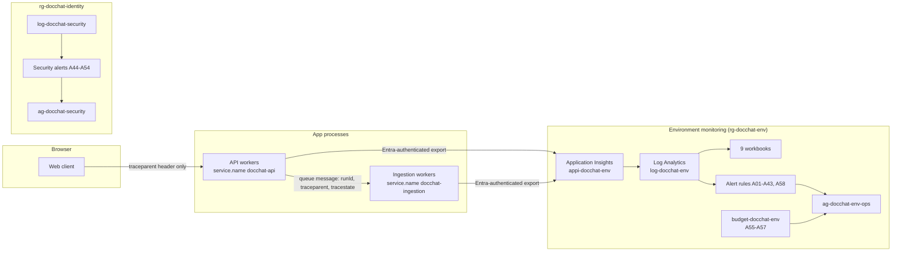
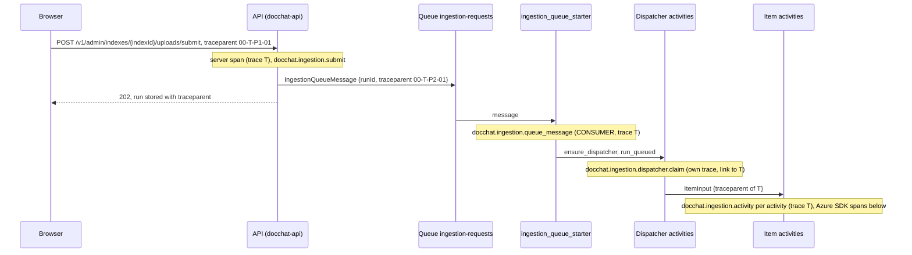

# 85 — Observability

This file specifies how DocChat observes itself: the telemetry architecture of the two Python apps (the Azure Monitor OpenTelemetry distro, Entra-authenticated export, resource attributes and sampling into one workspace-based Application Insights resource per environment); how one trace follows a user action from the browser through the API, the queue message, the dispatcher and every ingestion activity; the log policy that keeps every record metadata only, with the registered attribute keys and the scrubbing processors; the complete catalogue of spans, metrics, custom events and log records, with their attributes, units and emitters; the nine workbooks with the KQL of every tile; every alert with its ID, condition, threshold, window, frequency, severity, action group and runbook; and the budgets and cost signals. The files that emit telemetry (`11-api.md` section 1.16, `12-chat-pipeline.md` section 19, `13-conversations-and-memory.md` section 11.4, `14-ingestion.md` section 18.4) name their signals; this file defines them. `83-infrastructure.md` deploys the workspace, the component, the diagnostic settings, the action groups, the budget and the security alerts; this file specifies what the alert and workbook modules contain. Runbooks are named by their titles in `86-operations.md` section 3, which assigns their IDs.

## 1. Telemetry architecture

### 1.1 Components

| Component | Part in telemetry |
|---|---|
| API (`docchat-api`), every Gunicorn worker | emits spans, metrics, log records and custom events through the distro; continues the browser's trace |
| Ingestion app (`docchat-ingestion`), every Functions worker process | the same; continues the trace carried by the queue message and the item input |
| Web client | sends only the `traceparent` request header on API calls (section 2.1); no Application Insights JavaScript SDK, third-party script, beacon, CSP report endpoint or error-reporting service, so it emits no spans, metrics, events or logs (ADR 0088, `10-web-client.md` section 12.8) |
| Application Insights `appi-docchat-<env>` | one per environment, workspace-based, `disableLocalAuth: true` (Entra-only ingestion), no ingestion sampling (`83-infrastructure.md` section 2.18) |
| Log Analytics workspace `log-docchat-<env>` | holds the application tables `AppRequests`, `AppDependencies`, `AppTraces`, `AppEvents`, `AppMetrics` and the platform tables of the diagnostic settings (`83-infrastructure.md` section 2.19); every workbook tile and every application alert queries it |
| Workbooks | nine per environment (section 5) |
| Application alert rules A01 to A43 and A58 | one set per environment, action group `ag-docchat-<env>-ops` (section 6) |
| Security workspace `log-docchat-security` and security alerts A44 to A54 | bootstrap-owned, action group `ag-docchat-security` (section 6.6) |
| Budget `budget-docchat-<env>` | notifications A55 to A57 to `ag-docchat-<env>-ops` (sections 6.7 and 7) |
| Operator and test tooling | `docchat-ops trace show`, the runbooks, the load-test verdicts and the deployed query check read the workspace through the Logs query API v1 (section 2.11) |



### 1.2 `configure_telemetry`

`docchat_core.telemetry.configure_telemetry(service: Literal["docchat-api", "docchat-ingestion"], settings: TelemetrySettings, exporters: TestExporters | None = None) -> None` is the only place telemetry is configured (ADR 0137). The API calls it once per Gunicorn worker at the start of the FastAPI lifespan, after the fork and before any client is created; the ingestion app calls it once per Functions worker process when the root `function_app.py` shim imports `docchat_ingestion.function_app`, before the start-up checks of `14-ingestion.md` section 4.11 run, so a failed check's `job_failed` record is exported. In order, it:

1. sets `OTEL_TRACES_SAMPLER=microsoft.fixed_percentage`, `OTEL_TRACES_SAMPLER_ARG=<DOCCHAT_TELEMETRY_SAMPLING_RATIO>` and `OTEL_PROPAGATORS=tracecontext` in its own process environment (none of the three is an app setting, `81-config.md` section 2.10);
2. calls

   ```python
   configure_azure_monitor(
       connection_string=settings.applicationinsights_connection_string,
       logger_name="docchat",
       resource=build_resource(service, settings),          # section 1.4
       span_processors=[ScrubbingSpanProcessor()],          # section 3.6
       log_record_processors=[ScrubbingLogRecordProcessor()],
       views=[MILLISECOND_HISTOGRAM_VIEW],                  # section 3.3
       instrumentation_options={
           "azure_sdk": {"enabled": True},
           "httpx": {"enabled": True},
           "fastapi": {"enabled": service == "docchat-api"},
           "django": {"enabled": False},
           "flask": {"enabled": False},
           "psycopg2": {"enabled": False},
           "requests": {"enabled": False},
           "urllib": {"enabled": False},
           "urllib3": {"enabled": False},
       },
       enable_live_metrics=False,
       enable_performance_counters=True,
   )
   ```

3. configures the loggers of section 1.6;
4. returns. It emits no event itself. `docchat_ingestion.function_app` emits the custom event `ingestion_worker_started` (no properties) through `emit_event` once per process, after the last start-up check passes (`14-ingestion.md` section 4.11), so the record carries `AppRoleName` `docchat-ingestion` and `AppVersion` = `DOCCHAT_BUILD_COMMIT` and arrives only from a worker that can serve; the deploy's `postdeploy` hook waits for it (`83-infrastructure.md` section 9.3). The API emits no such event.

The module `docchat_core.telemetry` holds `configure_telemetry`, `log_event`, `emit_event`, `record_failure`, `safe_traceback`, the span helper `start_span(name, **attributes)` (a thin wrapper over `tracer.start_as_current_span` that validates every attribute against the attribute registry), the instruments of section 4 (created once at import in `docchat_core.telemetry.instruments` and in each area's own `telemetry.py` module, never per request), the attribute registry `docchat_core.telemetry.attributes` (section 3.4) and the scrubbing module `docchat_core.telemetry.scrubbing` (section 3.6).

The test-only `exporters` argument replaces the Azure exporters with in-memory span, log and metric exporters. Without a connection string (local runs) nothing is exported, and the stderr handler still writes scrubbed `WARNING` records.

Failure behaviour: `TelemetrySettings` is validated at start-up, and an invalid value stops the process before it serves (`81-config.md` section 6). An exception raised by `configure_azure_monitor` propagates: the API worker's lifespan fails and Gunicorn restarts the worker, and the ingestion worker's import fails, so no `ingestion_worker_started` event arrives and the `postdeploy` hook fails the deploy with `ingestion_start_failed`. After start-up nothing in the telemetry path raises into application code (section 1.7).

### 1.3 Export and authentication

| Item | Value |
|---|---|
| Export target | `APPLICATIONINSIGHTS_CONNECTION_STRING`, the environment component's connection string (an ingestion endpoint and an instrumentation key, an identifier only, because local authentication is off on the component) |
| Credential | none passed in code: exporter 1.0.0b58 builds its Entra credential from `APPLICATIONINSIGHTS_AUTHENTICATION_STRING` = `Authorization=AAD;ClientId=<the app's workload identity client ID>`, so no synchronous identity class enters first-party code |
| Permission | each app identity holds Monitoring Metrics Publisher (`3913510d-42f4-4e42-8a64-420c390055eb`) on the component (`83-infrastructure.md` section 6) |
| Span and log export | batch processors with a 5-second schedule delay |
| Metric export | periodic exporting reader, 60-second interval |
| Network | public ingestion endpoint of the component (`publicNetworkAccessForIngestion: 'Enabled'`, `83-infrastructure.md` section 2.18) |

Failure behaviour: export runs on the SDK's background threads and never blocks request handling or the event loop; the exporter retries transient failures and stores nothing on disk outside its temporary buffer; when the component stays unreachable, records past the buffer are dropped, and the alert `telemetry-silent` (A23) reports an app that has sent no metric for 30 minutes.

### 1.4 Resource attributes

| Attribute | Value | Becomes |
|---|---|---|
| `service.name` | `docchat-api` or `docchat-ingestion` (constants in code, never settings) | `AppRoleName` |
| `service.version` | `DOCCHAT_BUILD_COMMIT`, the 40-hex commit baked into the image | `AppVersion` |
| `deployment.environment.name` | `DOCCHAT_CORE_ENVIRONMENT`: `dev`, `prod` or `load` | a resource property on every record |
| `service.instance.id`, `cloud.provider`, `cloud.platform`, `cloud.region`, `cloud.resource_id`, `host.id` | added by the distro's Azure resource detectors | `AppRoleInstance` and resource properties |

`service.namespace` is never set, because the exporter would prefix the role name with it and every query filters on `AppRoleName == "docchat-api"` or `"docchat-ingestion"`.

### 1.5 Sampling

- Traces are sampled by the distro's percentage sampler `microsoft.fixed_percentage` at `DOCCHAT_TELEMETRY_SAMPLING_RATIO` (from the environment-file field `telemetrySamplingRatio`, number 0.1 to 1.0, default 1.0 in every environment; `83-infrastructure.md` section 8.3). It is the one sampling setting.
- The sampler decides from the trace ID alone, so a trace is kept or dropped whole across both apps, and it ignores the caller's sampled flag, so the browser's constant flag `01` neither forces nor suppresses sampling. A unit test proves both properties (section 3.7). If that test finds the distro's sampler honouring the parent flag, `configure_telemetry` wraps it in a sampler that ignores the parent and applies the same trace-ID rule, and ADR 0137 gains a note saying so.
- The Functions host's own sampling is off (`host.json`, section 1.6); the component applies no ingestion sampling.
- Metrics are never sampled. Every rate alert reads metrics or `sum(ItemCount)`-weighted request counts, so a ratio below 1.0 keeps alerts and dashboard counts true.

### 1.6 Logging configuration

| Logger or file | Setting |
|---|---|
| `docchat` (every first-party record) | level `DOCCHAT_TELEMETRY_LOG_LEVEL` (`INFO` by default; `WARNING`, `ERROR`; `DEBUG` only while `DOCCHAT_LOCAL_EMULATORS` is `true`), `propagate = False` so the Functions worker's forwarding handler never duplicates a record; the distro's OpenTelemetry handler; a stderr handler at `WARNING` carrying `ScrubbingLogFilter` |
| `azure`, `azure.core.pipeline.policies.http_logging_policy`, `httpx`, `httpcore`, `httpx2`, `openai`, `opentelemetry`, `uvicorn.error` | `WARNING` |
| `uvicorn.access` | disabled |
| `apps/api/gunicorn.conf.py` | `accesslog = None`, `errorlog = "-"`, `loglevel = "warning"`, `capture_output = False`; the worker class `DocChatUvicornWorker` sets `access_log=False` and `server_header=False` |
| `apps/ingestion/host.json` | the block below |
| `PYTHON_APPLICATIONINSIGHTS_ENABLE_TELEMETRY` | unset in every image and on every site: the worker's own auto-configuration would bypass the scrubbing processors |
| Functions host `telemetryMode: OpenTelemetry` | not used (preview) |

```json
{
  "logging": {
    "logLevel": {
      "default": "Warning",
      "Host.Results": "Information",
      "Host.Aggregator": "Information",
      "Function": "Warning",
      "DurableTask.AzureStorage": "Warning",
      "DurableTask.Core": "Warning"
    },
    "applicationInsights": {
      "samplingSettings": { "isEnabled": false },
      "enableDependencyTracking": false
    }
  },
  "extensions": {
    "durableTask": {
      "tracing": {
        "distributedTracingEnabled": false,
        "traceInputsAndOutputs": false,
        "traceReplayEvents": false
      }
    }
  }
}
```

These keys merge into the full `host.json` of `14-ingestion.md` section 15.9.

### 1.7 The record pipeline

1. **Logs.** `log_event` checks the attribute registry, then calls the standard `Logger.log(level, event, extra=...)`; `ScrubbingLogFilter` runs on both handlers; the distro's OpenTelemetry handler converts the record; `ScrubbingLogRecordProcessor` runs; the batch processor exports it to `AppTraces`, or to `AppEvents` when the record carries `microsoft.custom_event.name` (a custom event, section 3.2).
2. **Spans.** Instrumentation or `start_span` with registered attributes; `ScrubbingSpanProcessor.on_end`; the batch processor; `AppRequests` for server spans, `AppDependencies` for client and internal spans.
3. **Metrics.** Instruments with bounded dimension sets; the periodic reader; `AppMetrics`, one row per instrument and dimension set per export interval with `Sum`, `Min`, `Max` and `ItemCount` (the number of measurements), the dimensions in `Properties`.
4. **Failure behaviour.** Export never blocks the event loop. An exception inside a scrubbing processor replaces the affected value with `[redacted:error]` and increments `docchat.telemetry.scrub_errors`, so a record is never exported unscrubbed. An unregistered attribute key or undeclared event property is dropped in production and counted in `docchat.telemetry.dropped_attributes` (section 3.2).

Where each signal lands and the columns the queries of sections 5 and 6 read:

| Signal | Table | Columns read |
|---|---|---|
| Server span (`GET /healthz`, `POST /v1/chat/turns` and every other route) | `AppRequests` | `Name` (method and route template), `ResultCode`, `DurationMs`, `ItemCount`, `UserAuthenticatedId` (from `enduser.id`), `AppRoleName`, `AppRoleInstance`, `AppVersion`, `OperationId` (the trace ID) |
| Internal and client spans (`docchat.*`, Azure SDK, `httpx`) | `AppDependencies` | `Name`, `DurationMs`, `ItemCount`, `Success`, `Properties["<attribute key>"]`, `OperationId` |
| Log record | `AppTraces` | `Message` (the static event name), `SeverityLevel`, `Properties` |
| Custom event | `AppEvents` | `Name`, `Properties["<lowerCamelCase property>"]`, `AppRoleName`, `AppVersion` |
| Metric | `AppMetrics` | `Name`, `Sum`, `Min`, `Max`, `ItemCount`, `Properties["<dimension>"]`, `AppRoleName`, `AppRoleInstance` |

Azure Monitor keeps a histogram as sum, count, minimum and maximum only, so every percentile on a workbook or alert comes from span durations or span attributes (`docchat.ttft_ms`, `docchat.first_chunk_ms`, `docchat.history.unsummarised_tokens`, `docchat.cosmos.request_charge`), never from a histogram. A gauge's last value per interval is stored in `Sum`, so gauge queries read `max(Sum)`.

### 1.8 Platform telemetry the queries read

| Table or metric | Source (`83-infrastructure.md` section 2.19) | Read by |
|---|---|---|
| `AzureMetrics` `HealthCheckStatus`, `Requests`, `Http5xx` | API web app `AllMetrics` | `availability` workbook; metric alerts A01 and A02 read the platform metric directly |
| `AzureMetrics` `CpuPercentage` | API plan `AllMetrics` | `capacity` workbook; A34 |
| `AzureMetrics` `ObservedCapacity`, `ScaleActionsInitiated` | autoscale setting `AllMetrics` | `capacity` workbook |
| `CDBDataPlaneRequests` | Cosmos DB `DataPlaneRequests` | `conversations` workbook; A29 |
| `AzureActivity`, `AuditLogs` | subscription Activity Log and Entra diagnostic settings to `log-docchat-security` (`83-infrastructure.md` section 12.4) | A44 to A54 |
| `_LogOperation` | the workspace itself | the load verdicts' daily-cap check (section 7.4) |

**Never collected** (ADR 0107, ADR 0014): `AppServiceHTTPLogs` (it records the signed-in user name, client IP and query string), `AppServiceConsoleLogs`, `AppServiceAuthenticationLogs` and the Functions host account's `StorageRead`; Live Metrics is off; Application Insights keeps its default client-IP masking; Cosmos DB full-text query logging stays at its default (off); no instrumentation records SQL statement text, because `pyodbc` is uninstrumented and the scrubber removes `db.statement`.

### 1.9 Settings

Defined in `81-config.md` (sections 2.3, 2.9 and 4.2); listed here by name:

| Name | Layer | Use in this file |
|---|---|---|
| `APPLICATIONINSIGHTS_CONNECTION_STRING` | app setting (Bicep output) | export target |
| `APPLICATIONINSIGHTS_AUTHENTICATION_STRING` | app setting (Bicep constant) | Entra credential of the exporter |
| `DOCCHAT_TELEMETRY_SAMPLING_RATIO` | app setting from `telemetrySamplingRatio` | trace sampling ratio |
| `DOCCHAT_TELEMETRY_LOG_LEVEL` | app setting | `docchat` logger level |
| `DOCCHAT_TELEMETRY_LOOP_LAG_INTERVAL_MS` | app setting | event-loop lag probe interval (section 4.7, `docchat.runtime.event_loop_lag`) |
| `DOCCHAT_BUILD_COMMIT` | image environment | `service.version` |
| `DOCCHAT_CORE_ENVIRONMENT` | app setting | `deployment.environment.name` |
| `telemetrySamplingRatio` | `infra/env/<env>.json` | source of the sampling ratio |
| `alerts.enabled` | `infra/env/<env>.json` | `true` (`dev`, `prod`), `false` (`load`): alert rules A01 to A43 and A58 deployed or not |
| `alerts.ttftP95Ms` | `infra/env/<env>.json` | A06 threshold, default 20,000 ms, range 2,000 to 120,000 |
| `alerts.openAiFirstChunkP95Ms` | `infra/env/<env>.json` | A41 threshold, default 10,000 ms, range 1,000 to 120,000 |
| `alerts.openAiCallMeanMs` | `infra/env/<env>.json` | A42 threshold, default 8,000 ms, range 1,000 to 120,000 |
| `monitoring.retentionDays`, `monitoring.dailyCapGb` | `infra/env/<env>.json` | workspace retention and daily cap (section 7.4) |
| `budget.enabled`, `budget.amount` | `infra/env/<env>.json` | the budget (section 7.1) |
| `storage.malwareScanning` | `infra/env/<env>.json` | A15 is deployed only when `true` |
| `api.maxInstances` | `infra/env/<env>.json` | A34's instance threshold |
| `opsAlertEmails` (from `DOCCHAT_OPS_ALERT_EMAILS`) | `infra/main.bicepparam` | receivers of `ag-docchat-<env>-ops` |
| `pricing.currency`, `pricing.model_rates` | ops config | estimated model cost (section 7.2) |

### 1.10 Versions

| Component | Version | Confirmed |
|---|---|---|
| `azure-monitor-opentelemetry` (the distro, Production/Stable) | 1.8.11 | 2026-10-14 |
| `azure-monitor-opentelemetry-exporter` (pre-release, pinned exactly in `uv.lock`, ADR 0009) | 1.0.0b58 | 2026-10-14 |
| `opentelemetry-sdk` | 1.45.1 | 2026-10-14 |
| Application Insights component | `Microsoft.Insights/components@2020-02-02` through AVM `avm/res/insights/component` 0.8.0 | 2026-10-14 |
| Log Analytics workspace | AVM `avm/res/operational-insights/workspace` 0.16.1 | 2026-10-14 |
| Workbooks | `Microsoft.Insights/workbooks@2023-06-01` (GA) | 2026-10-15 |
| Log search alerts | `Microsoft.Insights/scheduledQueryRules@2026-03-01` (GA) | 2026-10-21 |
| Metric alerts | `Microsoft.Insights/metricAlerts@2026-01-01` (GA) | 2026-10-15 |
| Activity Log alerts | `Microsoft.Insights/activityLogAlerts@2026-01-01` (GA) | 2026-10-14 |
| Action groups | `Microsoft.Insights/actionGroups@2023-01-01` through AVM `avm/res/insights/action-group` 0.8.0 | 2026-10-14 |
| Budgets | `Microsoft.Consumption/budgets@2026-06-01` | 2026-10-14 |
| Logs query API | v1, `POST https://api.loganalytics.io/v1/workspaces/{workspace customer ID}/query`, token scope `https://api.loganalytics.io/.default` (GA) | 2026-10-14 |

## 2. Trace propagation end to end

Every user action is one trace, from the browser call to the last activity of the last document of the run it starts (ADR 0137, ADR 0037).

### 2.1 Browser

Every HTTP request to the API, including each automatic retry and repeat, the chat stream, each upload attempt and each file download, carries `traceparent: 00-<trace-id>-<parent-id>-01` (`10-web-client.md` section 5.4): the 16-byte trace ID and the 8-byte parent ID come from `crypto.getRandomValues`, written in lower-case hexadecimal and drawn once more when all zero. Every request gets a new trace ID, which the client keeps with the request, so a failure without a problem body still has a reference ID. The sampled flag is always `01`; the API's sampler decides from the trace ID (section 1.5). Requests never carry `tracestate`, `baggage`, `Request-Id` or `X-Requested-With`; the `config.json` fetch and every Entra ID request carry no `traceparent`.

### 2.2 API

1. `OTEL_PROPAGATORS=tracecontext` only: no baggage propagator, so client-supplied baggage never reaches telemetry.
2. The FastAPI instrumentation continues the incoming trace; the server span's trace ID is the request's `correlationId` in problem bodies and in the stream's `meta` and `error` events (`11-api.md` section 1.5), so the ID a user reports is the client's own trace ID.
3. A request without a valid `traceparent` (a non-browser caller) starts a new trace, and its `correlationId` is that trace's ID.
4. The API's authentication dependency (`11-api.md` section 1.2) sets `enduser.id` (the caller's `oid`) once, on the server span; child spans never repeat it.
5. First-party spans (section 4) are children of the server span, and Azure SDK and `httpx` client spans nest beneath them. Model calls go through the `openai` package's own `httpx2` transport, which isn't instrumented, so the model-call spans of section 4.4 are the only spans of those calls.

### 2.3 Work after the response

The chat pipeline's follow-ups call and the conversation store's summary rebuild and memory extraction run in tasks created inside the request's context (`12-chat-pipeline.md` section 12.7, `13-conversations-and-memory.md` sections 6 and 7), so their spans (`docchat.chat.followups`, `docchat.maintenance.post_turn`, `docchat.summary.rebuild`, `docchat.memory.extract`) join the request's trace after the response ends.

### 2.4 Queue message

Every API operation that creates an ingestion run (`adminSubmitUploads`, `adminReingestDocument`, `adminDeleteDocument`, `adminCreateIndex`, `adminStartReingest`, `adminDeleteIndex`) injects the current context with `TraceContextTextMapPropagator().inject`, so the message's parent is a span of the request's trace. It writes the same values to the new run's `ingestion_runs.traceparent` (`VARCHAR(55)`) and `ingestion_runs.tracestate` (`VARCHAR(512)`) in the run-creating transaction, and after commit sends `IngestionQueueMessage {runId, traceparent, tracestate}` (`14-ingestion.md` sections 3.2 and 3.3, `80-data-model.md` section 5). A `tracestate` longer than 512 characters is cut by the W3C rule before it is stored: whole list-members are removed, every member longer than 128 characters first, then members from the end. `tracestate` is never put on a span or log record. A failed send emits `ingestion_queue_send_failed` (`runId`) and the operation still answers `202`; the dispatcher's next wake finds the queued items.

### 2.5 Starter

`ingestion_queue_starter` extracts the message's context with `TraceContextTextMapPropagator().extract(...)` and runs inside the span `docchat.ingestion.queue_message` (kind `CONSUMER`), a child of the extracted context, so the starter sits in the request's trace. An invalid message emits `ingestion_message_invalid` (`messageId`) and returns normally.

### 2.6 Dispatcher

Orchestrator functions create no spans and write no log records, because they replay. The dispatcher's activities `sweep_ingestion_state` and `claim_ingestion_items` open root spans `docchat.ingestion.dispatcher.sweep` and `docchat.ingestion.dispatcher.claim` (their own traces), each with one span link per run they touch, built from the run's stored `traceparent`; one sweep or claim serves many runs, and a span has one parent. The claim reads each claimed run's `traceparent` and `tracestate`, and the dispatcher copies them into the sub-orchestration's `ItemInput`.

### 2.7 Activities

Every activity of an item runs inside `docchat.ingestion.activity` (kind `INTERNAL`, attribute `docchat.activity_name`) whose parent is the remote context extracted from the item envelope's `traceparent` and `tracestate` (`14-ingestion.md` section 4.9). The upload request, the message, the starter and every activity of every document of the run therefore share one trace, with Azure SDK and `httpx` spans and the child-process span `docchat.ingestion.parse` nested below. Index-lifecycle runs (`create_search_index`, `delete_search_index`, `purge_index_blobs`) follow the same rule.

### 2.8 Runs without a request

Runs created without a request (the sweep's `maintenance` runs and runs created by `docchat-ops`) store null trace context; each of their items starts a new trace. The timer functions `ingestion_keepalive` and `ingestion_maintenance` start a new trace per invocation.

### 2.9 Operator CLI

`docchat-ops` creates one trace ID per command run and writes it as `audit_events.correlation_id`; its spans aren't exported, and its error messages name that correlation ID (`86-operations.md` section 2).

### 2.10 One upload's trace



Numbered narrative: (1) the browser sends a fresh trace ID T; (2) the API's server span continues T and `docchat.ingestion.submit` records the run; (3) the message and the run row carry a context whose parent is a span of T; (4) the starter's `CONSUMER` span joins T; (5) the claim runs in its own trace and links to T; (6) every activity of every item of the run is a child of T's context.

### 2.11 From a reference ID to a trace

The reference ID a user reports is the trace ID (`10-web-client.md` section 5.5). The runbook "Find the trace behind a user's reference ID" and `docchat-ops trace show <trace ID>` run, through the Logs query API v1 with a token for `https://api.loganalytics.io/.default` (timeout 30 s, `docchat_testing.logquery.query_logs` in tests and load verdicts, `httpx.AsyncClient` in `docchat-ops`):

```kusto
union AppRequests, AppDependencies, AppTraces, AppEvents
| where TimeGenerated > ago(30d) and OperationId == "<trace ID>"
| project TimeGenerated, Type, Name, Message, DurationMs, ResultCode, Success, AppRoleName, Properties
| order by TimeGenerated asc
```

The dispatcher's work for a run is found through its links, which the exporter stores in the `_MS.links` property:

```kusto
AppDependencies
| where TimeGenerated > ago(30d)
    and Name in ("docchat.ingestion.dispatcher.sweep", "docchat.ingestion.dispatcher.claim")
    and tostring(Properties["_MS.links"]) has "<trace ID>"
| project TimeGenerated, Name, DurationMs, Properties
```

A sign-in failure's reference ID is Entra ID's correlation ID, looked up in the Entra ID sign-in logs, not in this workspace. KQL outside workbooks and alerts never goes through an Azure CLI extension: every workflow runs `az config set extension.use_dynamic_install=no` after signing in (ADR 0138).

## 3. The log policy

### 3.1 What telemetry may carry

Telemetry is read by more people, and kept longer, than the stores it describes, so every span, log record, custom event and metric carries metadata only (ADR 0014).

- **Allowed:** the operation; `enduser.id` (the caller's Entra object ID); project, session, turn, document, version, run, run item, logical index, physical index and chunk-set IDs; outcomes; error codes; latencies and durations; token counts; byte sizes; counts; request charges; deployment and model names; enum members of the attribute registry (section 3.4).
- **Never recorded:** prompts, questions, answers, retrieved text, document content, file names, titles, heading paths, summaries, memory facts, feedback comments, email addresses, display names, project names, search text, tokens, keys, connection strings, ops-config values, override reasons, URL query strings, request or response bodies, exception messages and arguments, and headers other than `content-type`, `content-length` and `traceparent`.
- **Investigating a turn** means following its session and turn IDs into the conversation store under just-in-time access (`13-conversations-and-memory.md` section 10), never reading telemetry.
- **The web client** writes nothing to the console in production builds: ESLint `no-console` is an error, and `devLog` (`src/platform/devLog.ts`) writes only `{ code, referenceId }` and MSAL errors, and only when `import.meta.env.DEV` is true (`10-web-client.md` sections 1.6, 4.1 and 12.8).

### 3.2 Emitting records

1. **Log records.** Application code emits a log record only through `docchat_core.telemetry.log_event(logger, event, level, **attributes)`. `event` is a static snake_case name and is the record's whole message; every attribute key must be registered (section 3.4), and every value must have the key's type. In test mode (`TelemetrySettings.strict`, `true` whenever the test plugin is loaded) an unregistered key, an unregistered event name or a value of the wrong type raises `ValueError`; in production the offending attribute is dropped, the rest of the record is kept, and `docchat.telemetry.dropped_attributes` increments. Ruff's `G` rules forbid f-strings, `%` formatting and `str.format` in logging calls, and the `docchat` logger is the only first-party logger.
2. **Custom events.** `docchat_core.telemetry.emit_event(name, **properties)` writes a log record carrying the attribute `microsoft.custom_event.name` = `name`, which the exporter stores in `AppEvents`. `docchat_core.telemetry.attributes.EVENTS` declares every event of section 4.12 with its exact lowerCamelCase property set and each property's type. In test mode an undeclared event, an undeclared property or a snake_case property raises `ValueError`; in production an undeclared event is dropped whole, an undeclared property is dropped from an otherwise kept event, and each drop increments `docchat.telemetry.dropped_attributes`.
3. **Spans.** First-party spans are opened with `docchat_core.telemetry.start_span(name, kind=SpanKind.INTERNAL, links=(), **attributes)`, which validates the name against the registered span names and each attribute as in item 1; attributes set later go through `set_attributes(span, **attributes)`, which validates the same way.
4. **The user.** `enduser.id` is set once, on the server span, by the API's authentication dependency (`11-api.md` section 1.2); the exporter maps it to `UserAuthenticatedId`. Child spans never repeat it.
5. **Failures.** A failure is logged once, at the boundary that handles it: `request_failed` (an unmapped API exception, `11-api.md` section 1.3), `activity_failed` (an ingestion activity) or `job_failed` (an ingestion trigger or a start-up check, `14-ingestion.md` section 4.5), each at error level with `error.type` (the qualified type name `module.QualName` of the exception's class) and `docchat.error_code`, never `str(exc)`. Spans record a failure through `record_failure(span, exc, code)`, which adds one `exception` event with `exception.type` (the qualified type name), `exception.message` = the code's catalogue message from `docchat_core.errors.CODES` (never the exception text), `docchat.error_code` = the code and `exception.stacktrace` = `safe_traceback(exc)` (section 3.6), and sets the span status to error with the code as its description.
6. **No per-request log record.** Server spans cover requests; nothing logs a request line. Expected outcomes (a `404`, a `409`, a refused quota) are span attributes and metric dimensions, never warnings.

### 3.3 Naming

| Item | Rule |
|---|---|
| Span names | first-party `docchat.<area>.<operation>`; instrumentation spans keep semantic-convention names (`POST /v1/chat/turns`, `GET /healthz`) |
| Metric names | `docchat.<area>.<name>`, no `_total` suffix |
| Metric units | UCUM: `ms`, `s`, `By`, `MBy`, `{token}`, `{page}`, `{message}`, `{connection}`, `{RU}`, `{micro_unit}`; a counter or gauge whose unit section 4 doesn't state uses `1` |
| Millisecond histograms | one view, `MILLISECOND_HISTOGRAM_VIEW = View(instrument_type=Histogram, instrument_unit="ms", aggregation=ExplicitBucketHistogramAggregation(boundaries=[5, 10, 25, 50, 100, 200, 400, 800, 1600, 3200, 6400, 12800, 25600, 51200, 102400]))`, passed to the distro (section 1.2) |
| Custom events | snake_case names; lowerCamelCase properties (`runId`, `projectId`, `outcomeCode`, `oid`); the dotted key forms below never apply to event properties |
| Span and log attribute keys | an OpenTelemetry semantic-convention key where one exists (`enduser.id`, `http.route`, `http.request.method`, `http.response.status_code`, `error.type`, `db.system.name`, `exception.*`); otherwise `docchat.<snake_case_name>` for cross-cutting identifiers, outcomes and the chat pipeline's fields, or `docchat.<area>.<snake_case_name>` for area fields; lower case, at most three segments after `docchat` |
| Metric dimension keys | bare snake_case names from the closed set of section 3.5 |
| Identifiers | user, project, session, turn, document, version, run, item and index IDs appear on spans, log records and events only, never as metric dimensions |

### 3.4 The attribute registry

`docchat_core.telemetry.attributes` declares, as frozen module-level mappings: `KEYS` (every span and log attribute key with its type and allowed values), `SPANS` (every first-party span name of section 4 with its kind), `LOG_EVENTS` (every log record name of section 4.13 with its level), `EVENTS` (every custom event of section 4.12 with its properties and their types) and `DIMENSIONS` (the closed metric-dimension set of section 3.5). Types: UUID string (lower-case hyphenated), enum (a closed set of strings), integer (with a range), float, boolean, string (only `docchat.model`, `error.type`, `exception.*` and the semantic-convention HTTP keys). Each area registers its own keys exactly as this file lists them, and a change that adds a key, span, record or event adds its row here in the same pull request.

**Cross-cutting keys** (owned by the shared package):

| Key | Type | Values |
|---|---|---|
| `enduser.id` | UUID string | the caller's `oid` (server span only) |
| `docchat.project_id`, `docchat.session_id`, `docchat.turn_id`, `docchat.index_id`, `docchat.physical_index_id`, `docchat.document_id`, `docchat.version_id`, `docchat.chunk_set_id`, `docchat.run_id`, `docchat.item_id` | UUID string | lower-case hyphenated |
| `docchat.outcome` | enum | the owning span's closed set (section 4) |
| `docchat.error_code` | enum | a code of `docchat_core.errors.CODES` (`11-api.md` section 2) or of the ingestion item outcomes (`14-ingestion.md` section 17) |
| `docchat.deployment` | enum | the configured Azure OpenAI deployment names |
| `docchat.model` | string | the configured model name of the call |
| `docchat.activity_name` | enum | the ingestion activity names of `14-ingestion.md` section 4.2 |
| `docchat.attempts` | integer | 1 to 100 |
| `docchat.sql.attempts` | integer | 1 to 10 |
| `docchat.sql.error_number` | integer | the native SQL Server error number, 0 when none was parsed |
| `error.type` | string | the qualified type name (`module.QualName`) of the exception's class |
| `http.route`, `http.request.method`, `http.response.status_code` | semantic conventions | |
| `db.system.name` | enum | `microsoft.sql_server`, `azure.cosmosdb` |
| `exception.type`, `exception.message`, `exception.stacktrace` | string | `exception.type` = the qualified type name; `exception.message` = the catalogue message of the error code, otherwise the qualified type name; `exception.stacktrace` = frames and type names only (section 3.6) |

**Area keys:**

| Key | Type | Values | Owner |
|---|---|---|---|
| `docchat.auth.outcome` | enum | `ok`, `invalid`, `no_role`, `unavailable` on `docchat.auth.validate_token`; `ok`, `error` on `docchat.auth.fetch_signing_keys` | identity and access |
| `docchat.auth.reason` | enum | `missing_header`, `bad_scheme`, `duplicate_header`, `token_too_long`, `malformed`, `bad_alg`, `missing_kid`, `unknown_kid`, `keys_unavailable`, `bad_signature`, `expired`, `not_yet_valid`, `bad_iat`, `bad_issuer`, `bad_audience`, `missing_claim`, `bad_version`, `bad_tenant`, `bad_client`, `missing_scope`, `bad_oid`, `bad_roles`, `no_role` (`11-api.md` section 1.2); absent on success | identity and access |
| `docchat.auth.client` | enum | `web`, `test`, `unknown` | identity and access |
| `docchat.auth.trigger` | enum | `startup`, `scheduled`, `unknown_kid` | identity and access |
| `docchat.auth.key_count` | integer | ≥ 0 | identity and access |
| `docchat.users.outcome` | enum | `skipped`, `touched`, `provisioned`, `failed` | identity and access |
| `docchat.users.default_project_count` | integer | ≥ 0, set when provisioned | identity and access |
| `docchat.access.outcome` | enum | `allowed`, `not_found` on `docchat.access.authorize_project`; `ok`, `unavailable` on `docchat.access.resolve_index` | identity and access |
| `docchat.access.via` | enum | `admin`, `member` | identity and access |
| `docchat.access.index_source` | enum | `user_override`, `project_default` | identity and access |
| `docchat.access.index_cache` | enum | `hit`, `miss` | identity and access |
| `docchat.access.project_count` | integer | ≥ 0 | identity and access |
| `docchat.opsconfig.outcome` | enum | `ok`, `partial`, `unreachable` | identity and access |
| `docchat.opsconfig.invalid_areas` | integer | ≥ 0 | identity and access |
| `docchat.opsconfig.area`, `docchat.opsconfig.key` | enum | the registered ops-config areas and their keys (`81-config.md` section 3) | identity and access |
| `docchat.ratelimit.outcome` | enum | `allowed`, `limited`, `unavailable` | identity and access |
| `docchat.ratelimit.attempts` | integer | 1 to 5 | identity and access |
| `docchat.audit.action` | enum | the audit-action catalogue (`80-data-model.md` section 2) | identity and access |
| `docchat.ingestion.upload_bytes` | integer | ≥ 0 | ingestion |
| `docchat.ingestion.run_kind` | enum | `upload`, `document_reingest`, `document_delete`, `index_create`, `index_reingest`, `index_rebuild`, `index_delete`, `maintenance` | ingestion |
| `docchat.ingestion.item_count` | integer | ≥ 0 | ingestion |
| `docchat.ingestion.dequeue_count` | integer | ≥ 1 | ingestion |
| `docchat.ingestion.dispatcher_started` | boolean | | ingestion |
| `docchat.ingestion.claim` | integer | ≥ 1, the item's claim number | ingestion |
| `docchat.ingestion.parse_command` | enum | `inspect`, `convert`, `partition`, `render`, `assemble`, `verify-render` (`14-ingestion.md` section 15.6) | ingestion |
| `docchat.ingestion.parse_uid` | integer | 10002 to 10017, a UID of the parse-user pool (`14-ingestion.md` section 15.6 item 11) | ingestion |
| `docchat.ingestion.content_type` | enum | the three accepted content types (`14-ingestion.md` section 2.2) | ingestion |
| `docchat.ingestion.pages` | integer | ≥ 0 | ingestion |
| `docchat.ingestion.parse_peak_rss_mb` | integer | ≥ 0, megabytes | ingestion |
| `docchat.ingestion.parse_exit` | enum | `ok`, `timeout`, `memory`, `error` | ingestion |
| `docchat.ingestion.generation` | integer | ≥ 1, the dispatcher generation | ingestion |
| `docchat.ingestion.items_requeued`, `docchat.ingestion.items_claimed`, `docchat.ingestion.runs_finalised` | integer | ≥ 0 | ingestion |
| `docchat.ingestion.duty` | enum | `heartbeat`, `expired_leases`, `scan_results`, `stale_uploads`, `orphaned_versions`, `leftover_cleanup`, `repoint`, `due_deletions`, `finalisation`, `counts`, `poison_gauge`, `scanner_canaries`, `stale_renditions` (`14-ingestion.md` section 5.3) | ingestion |
| `docchat.ingestion.step` | enum | `durable_history`, `runs`, `scanner_canary`, `canary_retention`: the four steps of `14-ingestion.md` section 4.10, in order | ingestion |
| `docchat.broadened`, `docchat.rerank_partial` | boolean | | chat |
| `docchat.sources_sent`, `docchat.sources_flagged` | integer | 0 to 16 | chat |
| `docchat.prompt_tokens`, `docchat.completion_tokens`, `docchat.reasoning_tokens` | integer | ≥ 0 | chat |
| `docchat.finish_reason` | enum | `stop`, `length`, `content_filter`, `cancelled`, `error`; absent when generation wasn't reached | chat |
| `docchat.ttft_ms`, `docchat.first_chunk_ms` | integer | ≥ 0, milliseconds | chat |
| `docchat.reasoning_effort` | enum | `none`, `low`, `medium`, `high` | chat |
| `docchat.dimensions` | integer | 256, 1,024 or 3,072 | chat |
| `docchat.pass` | enum | `first`, `broadened` | chat |
| `docchat.results`, `docchat.candidates`, `docchat.served` | integer | ≥ 0 | chat |
| `docchat.calls`, `docchat.segments`, `docchat.characters`, `docchat.flagged` | integer | ≥ 0 | chat |
| `docchat.dropped_turns`, `docchat.dropped_sources` | integer | ≥ 0 | chat |
| `docchat.operation` | enum | `getCitation`, `getCitationContent`, `getCitationDocument` | chat |
| `docchat.open_as` | enum | `pdf_page`, `document_pdf` | chat |
| `docchat.citation.number` | integer | 1 to 16 | chat |
| `docchat.citation.bytes_sent` | integer | ≥ 0 | chat |
| `docchat.citation.abort_reason` | enum | `slow_client`, `duration`, `drain` | chat |
| `docchat.chat.turn_tasks`, `docchat.chat.background_tasks`, `docchat.chat.downloads` | integer | ≥ 0 | chat |
| `docchat.chat.duration_ms` | integer | ≥ 0, receipt to the end of the turn task | chat |
| `docchat.chat.estimated_cost_micros` | integer | ≥ 0, micro-units of `pricing.currency`; absent when any call of the turn had no rate | chat |
| `docchat.chat.usage_estimated` | boolean | the turn's `usage.totals.estimated` | chat |
| `docchat.turn_seq` | integer | ≥ 1 | conversations |
| `docchat.session_new` | boolean | | conversations |
| `docchat.cosmos.request_charge` | float | ≥ 0, request units summed over the operation's calls | conversations |
| `docchat.history.turns_loaded`, `docchat.history.tokens_loaded`, `docchat.history.unsummarised_tokens`, `docchat.history.unsummarised_turns` | integer | ≥ 0 | conversations |
| `docchat.history.stopped_at_budget` | boolean | true when the stop rule ended the read before the oldest unsummarised turn | conversations |
| `docchat.memory.active` | boolean | | conversations |
| `docchat.memory.facts_rendered`, `docchat.memory.facts_count`, `docchat.memory.proposed`, `docchat.memory.accepted`, `docchat.memory.shield_calls` | integer | ≥ 0 | conversations |
| `docchat.memory.rejected.<reason>` | integer | ≥ 0; one key per reason `sensitivity`, `invalid_target`, `empty`, `too_long`, `contains_link`, `contains_code`, `contains_instruction`, `contains_secret`, `duplicate_fact`, `cap_reached`, `over_limit` (11 keys) | conversations |
| `docchat.summary.due`, `docchat.summary.truncated` | boolean | | conversations |
| `docchat.summary.folded_turns`, `docchat.summary.input_tokens`, `docchat.summary.output_tokens` | integer | ≥ 0 | conversations |
| `docchat.maintenance.scheduled`, `docchat.maintenance.summary_ran` | boolean | | conversations |
| `docchat.maintenance.extractions` | integer | ≥ 0 | conversations |
| `docchat.maintenance.step` | enum | `memory_extraction`, `summary_rebuild` | conversations |
| `docchat.turn.status` | enum | `completed`, `failed`, `cancelled` | conversations |
| `docchat.turn.error_code` | enum | a stream or stored turn code (`11-api.md` sections 2.3 and 2.4) | conversations |
| `docchat.trace.bytes` | integer | ≥ 0 | conversations |
| `docchat.followups.count` | integer | 0 to 3 | conversations |
| `docchat.page.limit`, `docchat.page.returned`, `docchat.projects.reachable` | integer | ≥ 0 | conversations |
| `docchat.filter.project` | boolean | true when the request named a project | conversations |
| `docchat.feedback.rating` | enum | `up`, `down` | conversations |
| `docchat.feedback.category` | enum | `incorrect`, `incomplete`, `not_relevant`, `other`, `none` | conversations |
| `docchat.feedback.is_change` | boolean | | conversations |

### 3.5 Metric dimensions

The closed set of dimension keys: `outcome`, `reason`, `deployment`, `call`, `kind`, `state`, `stage`, `operation`, `status`, `error_code`, `phase`, `client`, `trigger`, `area`, `key`, `service`, `content_type`, `method_key`, `priority`, `result`, `action`, `rating`, `category`, `pass`, `broadened`, `model`, `error_number`, `outcome_code`, `code`, `source`, `parse_command`. Each instrument declares its dimension set when it is created; a unit test inspects every instrument and fails on a key outside the set or on an identifier. `service` is `api` or `ingestion` where section 4 lists it as a dimension of a shared-package instrument, and `openai`, `docintel` or `search` on `docchat.ingestion.throttled`. Every dimension value is an enum member, a code, an operationId, a deployment name or a model name, so the number of series stays bounded as projects, users and documents grow.

### 3.6 Scrubbing

`docchat_core.telemetry.scrubbing` provides `scrub(text: str) -> str` and three attach points:

| Attach point | Where | What it changes |
|---|---|---|
| `ScrubbingLogFilter` | standard-library filter on the `docchat` logger and on the stderr handler | `msg`, `args` and every string `extra` value; for a record with `exc_info`, sets `record.exc_text` to `safe_traceback(exc)` |
| `ScrubbingLogRecordProcessor` | OpenTelemetry log record processor (section 1.2) | the body and every string attribute; the exception attributes (exception rules below) |
| `ScrubbingSpanProcessor` | OpenTelemetry span processor, `on_end` | every string attribute of the span and of each of its events, written back through the SDK span's attribute store; the `exception` events (exception rules below) |

Patterns, applied in this order (in the table, `\|` is the regular-expression alternation `|`, escaped for the table):

| # | Matches | Replacement |
|---|---|---|
| 1 | JWT: `eyJ[A-Za-z0-9_-]{8,}\.[A-Za-z0-9_-]{8,}\.[A-Za-z0-9_-]*` | `[redacted:jwt]` |
| 2 | Bearer or Basic credentials: `(?i)\b(bearer\|basic)\s+[A-Za-z0-9._~+/=-]{8,}` | `$1 [redacted]` |
| 3 | Connection-string secrets: `(?i)\b(AccountKey\|SharedAccessKey\|SharedAccessSignature\|Password\|Pwd\|ClientSecret)\s*=\s*[^;"'\s]+` | `$1=[redacted]` |
| 4 | Signed or secret query parameters: `(?i)([?&](sig\|skoid\|sktid\|code\|token\|access_token\|id_token\|refresh_token\|client_secret)=)[^&#\s"']+` | `$1[redacted]` |
| 5 | 512-bit base64 keys: `\b[A-Za-z0-9+/]{86}==` | `[redacted:key]` |
| 6 | Named secret assignments: `(?i)\b(api[-_]?key\|secret\|password\|passwd\|token\|client[-_]?secret\|private[-_]?key\|ocp-apim-subscription-key)(["']?\s*[:=]\s*["']?)[^"'\s,;&}]{4,}` | `$1$2[redacted]` |
| 7 | PEM private keys: `-----BEGIN [A-Z ]*PRIVATE KEY-----[\s\S]*?-----END [A-Z ]*PRIVATE KEY-----` | `[redacted:private-key]` |
| 8 | Email addresses: `\b[A-Za-z0-9._%+-]+@[A-Za-z0-9.-]+\.[A-Za-z]{2,}\b` | `[redacted:email]` |

**Attribute rules.** `url.full`, `http.url` and `http.target` lose everything from the first `?`; `url.query`, `db.query.text`, `db.statement` and every `http.request.header.*` and `http.response.header.*` attribute other than `content-type`, `content-length` and `traceparent` are removed, so an `Authorization` header value is never exported. The rules never change UUIDs, 32-hex trace IDs, 64-hex SHA-256 values, ISO 8601 timestamps or numbers.

**Exception rules.** Exception text can quote a question, a file name, a duplicate key value, a validation error's input or a service's error body, which no pattern recognises, so no exception message, argument or note is exported by any path:

1. `safe_traceback(exc) -> str` renders an exception from its frames alone: for the exception, each chained cause and context (in Python's order, honouring `__suppress_context__`) and each member of an exception group, the header `Traceback (most recent call last):`, the `traceback.format_tb()` lines (`File "…", line N, in <name>` with the source and position-marker lines under each) and the qualified type name on its own line; chained parts are joined by Python's two chaining sentences (`The above exception was the direct cause of the following exception:` and `During handling of the above exception, another exception occurred:`).
2. `ScrubbingSpanProcessor` (every span event named `exception`, whoever recorded it, instrumentation included) and `ScrubbingLogRecordProcessor` (every record carrying `exception.*` attributes) replace `exception.message` with the catalogue message of the event's, record's or span's `docchat.error_code` when one is set, otherwise with the qualified type name in `exception.type`; and reduce `exception.stacktrace` line by line, keeping only `Traceback (most recent call last):` headers, `File "…", line N, in <name>` lines with the source and position-marker lines under them, the two chaining sentences, exception-group box lines (`+-+---- n ----`, `+------------------------------------` and the `| ` prefix they add to nested lines) and, from the line that ends each traceback, the qualified type name before its first `:`. After that line every line is dropped until the next header or chaining sentence, so continuation lines of a multi-line message and notes never survive.
3. A stack-trace value with no `Traceback (most recent call last):` header is replaced whole by `[redacted:stacktrace]` and counts in `docchat.telemetry.scrub_errors`.

**Failure behaviour.** An exception inside any of the three attach points replaces the affected value with `[redacted:error]` and increments `docchat.telemetry.scrub_errors` (dimension `service`); the record is still exported, redacted. `ScrubbingSpanProcessor` writes through an SDK-internal attribute store; a unit test fails when that internal changes, and the exporter pin moves only through a reviewed Dependabot pull request.

### 3.7 Proof

These tests prove the rules of sections 1 to 3; `84-testing.md` assigns their IDs:

1. `configure_telemetry` sets the sampler, its ratio and `OTEL_PROPAGATORS=tracecontext`, and the resource carries `service.name`, `service.version` and `deployment.environment.name` and no `service.namespace`.
2. Without a connection string nothing is exported and the stderr handler still writes scrubbed `WARNING` records.
3. `log_event` raises on an unregistered key in test mode and in production drops it and increments `docchat.telemetry.dropped_attributes`; `emit_event` behaves the same for undeclared events and properties, and every event of section 4.12 is declared with exactly its listed properties.
4. `scrub` replaces one sample of each of the 8 patterns and leaves UUIDs, trace IDs, SHA-256 values, ISO timestamps and numbers unchanged; each attach point scrubs its fields; the attribute rules strip queries and remove `db.statement`, `url.query` and every header attribute except the three allowed; an exception inside a processor yields `[redacted:error]` and a `docchat.telemetry.scrub_errors` increment.
5. An exception whose message holds a canary string exports no canary when recorded by `record_failure`, by `span.record_exception` as instrumentation does, or logged with `exc_info`; the stack trace keeps the frame lines and qualified type names of the exception, its cause and an exception-group member, and drops every message line, continuation line and note.
6. Full pipeline: a log record and a span carrying a fake JWT, a fake connection string and an email address reach the in-memory exporters redacted; an exception whose message is `cnry-question-<8 hex>` raised in an unmapped API route (answered `500`), in a post-turn background task and in an ingestion activity leaves no exported span event, log record or stack trace containing `cnry-`.
7. **The session-wide canary audit.** During every integration session the test plugin installs the in-memory exporters through `configure_telemetry(exporters=…)`; every content value in tests comes from `builders.canary(kind)`, which embeds `cnry-<kind>-<8 hex>` (kinds `question`, `answer`, `chunk`, `filename`, `fact`, `email`, `displayname`, `instruction`, `comment`, `title`, `summary`); at session end the plugin serialises every exported span (name, attributes, event attributes, `exception.message` and `exception.stacktrace` included), log record and metric data-point attribute set, and fails the session when any string contains `cnry-`, an email-shaped value or a JWT-shaped value, naming the item.
8. Every instrument's declared dimensions belong to the closed set of section 3.5 and none is an identifier.
9. At ratio 0.5 a request whose `traceparent` carries flag `01` is exported only when its trace ID falls inside the ratio, and one carrying `00` is exported when its trace ID falls inside it; at 1.0 everything is exported.
10. An upload request's trace contains the starter span and every activity span of its run, the message carries `traceparent` and `tracestate`, and the dispatcher spans are roots linked to the run.
11. A problem body's `correlationId` equals the trace ID of the request's `traceparent`, in-process and deployed.
12. Importing `docchat_ingestion.function_app` with passing start-up checks emits exactly one `ingestion_worker_started` per process, with no properties, whose resource carries `service.name` `docchat-ingestion` and `service.version` = `DOCCHAT_BUILD_COMMIT`; a failing check emits none and one `job_failed`; `configure_telemetry` itself emits no event for either service.
13. The loop-lag monitor records about 0 ms on an idle loop, at least 150 ms after a 200 ms blocking call, and stops at shutdown.

## 4. Catalogue of signals

### 4.1 How to read the catalogue

Every span, metric, custom event and log record DocChat emits is listed here, with its exact name and attributes; `docchat_core.telemetry.attributes` registers exactly these (section 3.4), and the canary audit and the dimension test of section 3.7 hold the code to them. A span's attribute list is complete: an attribute not listed is never set on it. The emitting file names the moment each signal is recorded; this file names what it carries.

### 4.2 Instrumentation and shared spans

| Span | Kind | Attributes | Emitted by |
|---|---|---|---|
| `GET /healthz`, `GET`, `POST`, `PUT`, `PATCH` and `DELETE /v1/…` (method and route template) | SERVER | semantic conventions (`http.route`, `http.request.method`, `http.response.status_code`); `enduser.id`, set once in the authentication dependency; `docchat.auth.client`; `docchat.audit.action` on a request that writes an audit row; `docchat.error_code` on a problem response | FastAPI instrumentation (API only) |
| Azure SDK client spans (Cosmos DB, Blob and Queue Storage, AI Search, Document Intelligence) | CLIENT | semantic conventions, `db.system.name` `azure.cosmosdb` on Cosmos DB spans; query strings and headers removed (section 3.6) | distro instrumentation, both apps |
| `httpx` client spans (Prompt Shields, the Entra ID signing-key document, the Logs query API) | CLIENT | semantic conventions; query strings and headers removed | distro instrumentation, both apps |
| `docchat.sql.<statement-set name>` (for example `docchat.sql.ensure_user`, one name per unit of work) | CLIENT | `db.system.name` `microsoft.sql_server`, `docchat.sql.attempts`, `docchat.sql.error_number`, `docchat.outcome` (`ok`, `error`) | the async SQL data-access layer of `docchat_core`, one span per unit of work, its retries inside it, and `docchat.sql.warm_pool` once per start-up warm-up (`01-repository.md` section 6.2 item 11) |

The data-access layer records no statement text and no parameter value; `pyodbc` has no OpenTelemetry instrumentation, so no SQL span appears besides these.

### 4.3 Identity and access spans

Emitted by the API (`11-api.md` sections 1.2 to 1.4 and 3.2); `docchat.opsconfig.refresh` by both apps.

| Span | Kind | Attributes |
|---|---|---|
| `docchat.auth.validate_token` | INTERNAL | `docchat.auth.outcome` (`ok`, `invalid`, `no_role`, `unavailable`), `docchat.auth.reason` (absent on success), `docchat.auth.client` |
| `docchat.auth.fetch_signing_keys` | INTERNAL | `docchat.auth.trigger` (`startup`, `scheduled`, `unknown_kid`), `docchat.auth.outcome` (`ok`, `error`), `docchat.auth.key_count`, `http.response.status_code` |
| `docchat.users.ensure` | INTERNAL | `docchat.users.outcome` (`skipped`, `touched`, `provisioned`, `failed`), `docchat.users.default_project_count` (when provisioned) |
| `docchat.access.authorize_project` | INTERNAL | `docchat.project_id`, `docchat.access.outcome` (`allowed`, `not_found`), `docchat.access.via` (`admin`, `member`) |
| `docchat.access.resolve_index` | INTERNAL | `docchat.project_id`, `docchat.index_id`, `docchat.access.outcome` (`ok`, `unavailable`), `docchat.access.index_source` (`user_override`, `project_default`), `docchat.access.index_cache` (`hit`, `miss`) |
| `docchat.access.reachable_projects` | INTERNAL | `docchat.access.project_count` |
| `docchat.opsconfig.refresh` | INTERNAL | `docchat.opsconfig.outcome` (`ok`, `partial`, `unreachable`), `docchat.opsconfig.invalid_areas` |
| `docchat.ratelimit.write_check` | INTERNAL | `docchat.ratelimit.outcome` (`allowed`, `limited`, `unavailable`), `docchat.ratelimit.attempts` (1 to 5) |

### 4.4 Chat pipeline spans

Emitted by the API (`12-chat-pipeline.md` section 19.1), each a child of the request span. Model calls use the `openai` package's own `httpx2` transport, which isn't instrumented, so the model-call spans (`docchat.chat.rewrite`, `docchat.chat.search_passage`, `docchat.chat.followups`, `docchat.chat.generate`, `docchat.chat.embed`) are the only spans of those calls.

| Span | Kind | Attributes |
|---|---|---|
| `docchat.chat.prestream` | INTERNAL | `docchat.project_id`, `docchat.session_id`, `docchat.outcome` (`accepted` or the refusal code) |
| `docchat.chat.turn` | INTERNAL | `docchat.project_id`, `docchat.session_id`, `docchat.turn_id`, `docchat.outcome` (`completed`, `failed`, `cancelled`, `replayed`), `docchat.error_code`, `docchat.ttft_ms` (absent without a `delta`; read by A06), `docchat.broadened`, `docchat.rerank_partial`, `docchat.sources_sent`, `docchat.sources_flagged`, `docchat.prompt_tokens`, `docchat.finish_reason` |
| `docchat.chat.rewrite`, `docchat.chat.search_passage`, `docchat.chat.followups` | INTERNAL | `docchat.deployment`, `docchat.outcome` (the call's usage outcome: `ok`, `filtered`, `cancelled`, `timed_out`, `failed`), `docchat.prompt_tokens`, `docchat.completion_tokens` |
| `docchat.chat.embed` | INTERNAL | `docchat.deployment`, `docchat.dimensions`, `docchat.pass` (`first`, `broadened`) |
| `docchat.chat.search` | INTERNAL | `docchat.physical_index_id`, `docchat.pass`, `docchat.results`, `docchat.rerank_partial` |
| `docchat.chat.served_filter` | INTERNAL | `docchat.candidates`, `docchat.served` |
| `docchat.chat.screen` | INTERNAL | `docchat.calls`, `docchat.segments`, `docchat.characters`, `docchat.flagged`, `docchat.outcome` (`passed`, `flagged`, `unavailable`) |
| `docchat.chat.assemble` | INTERNAL | `docchat.prompt_tokens`, `docchat.dropped_turns`, `docchat.dropped_sources` |
| `docchat.chat.generate` | INTERNAL | `docchat.deployment`, `docchat.model`, `docchat.reasoning_effort`, `docchat.first_chunk_ms` (read by A41), `docchat.prompt_tokens`, `docchat.completion_tokens`, `docchat.reasoning_tokens`, `docchat.finish_reason` |
| `docchat.chat.persist` | INTERNAL | `docchat.outcome` (`saved`, `superseded`, `failed`: the finalisation result), `docchat.attempts` |
| `docchat.citation.open` | INTERNAL | `docchat.operation` (`getCitation`, `getCitationContent`, `getCitationDocument`), `docchat.outcome` (`ok`, `not_found`, `gone`, `unavailable`, `missing`, `limited`, `aborted`), `docchat.open_as` (`pdf_page`, `document_pdf`) |

`docchat.calls` on `docchat.chat.screen` gives the mean Prompt Shields calls per turn, which the load test reads to bound its turn rate (`84-testing.md` section 7).

### 4.5 Conversations and memory spans

Emitted by the API (`13-conversations-and-memory.md` sections 2 to 8): the store's spans inside the chat turn, the routes' spans inside their requests, and the after-response task's spans inside the request's trace (section 2.3).

| Span | Kind | Attributes |
|---|---|---|
| `docchat.conversations.begin_turn` | INTERNAL | `docchat.session_id`, `docchat.turn_id`, `docchat.turn_seq`, `docchat.session_new`, `docchat.outcome` (`started`, `replay`, `in_progress`, `already_ended`, `conflict`, `not_found`, `turn_limit`, `unavailable`), `docchat.attempts`, `docchat.cosmos.request_charge` |
| `docchat.conversations.read_recent_turns` | INTERNAL | `docchat.session_id`, `docchat.history.turns_loaded`, `docchat.history.tokens_loaded`, `docchat.history.stopped_at_budget`, `docchat.cosmos.request_charge` |
| `docchat.memory.prompt_read` | INTERNAL | `docchat.memory.active`, `docchat.memory.facts_rendered`, `docchat.outcome` (`ok`, `empty`, `unavailable`) |
| `docchat.conversations.ensure_post_turn_work` | INTERNAL | `docchat.session_id`, `docchat.summary.due`, `docchat.history.unsummarised_tokens`, `docchat.history.unsummarised_turns`, `docchat.maintenance.scheduled` |
| `docchat.conversations.finalize_turn` | INTERNAL | `docchat.outcome` (`saved`, `superseded`, `failed`), `docchat.turn.status` (`completed`, `failed`, `cancelled`), `docchat.turn.error_code`, `docchat.trace.bytes`, `docchat.attempts`, `docchat.cosmos.request_charge` |
| `docchat.conversations.attach_followups` | INTERNAL | `docchat.session_id`, `docchat.turn_id`, `docchat.followups.count`, `docchat.outcome` (`saved`, `not_saved`) |
| `docchat.sessions.list` | INTERNAL | `docchat.page.limit`, `docchat.page.returned`, `docchat.projects.reachable`, `docchat.filter.project`, `docchat.cosmos.request_charge` |
| `docchat.sessions.get`, `docchat.sessions.list_turns` | INTERNAL | `docchat.session_id`, `docchat.page.limit`, `docchat.page.returned`, `docchat.projects.reachable`, `docchat.outcome` (`ok`, `not_found`), `docchat.cosmos.request_charge` |
| `docchat.feedback.put` | INTERNAL | `docchat.session_id`, `docchat.turn_id`, `docchat.project_id`, `docchat.feedback.rating`, `docchat.feedback.category`, `docchat.feedback.is_change`, `docchat.outcome` (`ok` or the problem code) |
| `docchat.memory.get`, `docchat.memory.update_settings`, `docchat.memory.update_fact`, `docchat.memory.delete_fact`, `docchat.memory.clear` | INTERNAL | `docchat.outcome` (`ok`, `unchanged`, `precondition_failed`, `precondition_required`, `not_found`, `invalid`, `unavailable`), `docchat.memory.facts_count`, `docchat.cosmos.request_charge` |
| `docchat.maintenance.post_turn` | INTERNAL | `docchat.session_id`, `docchat.turn_id`, `docchat.maintenance.extractions`, `docchat.maintenance.summary_ran` |
| `docchat.summary.rebuild` | INTERNAL | `docchat.session_id`, `docchat.deployment`, `docchat.summary.folded_turns`, `docchat.summary.input_tokens`, `docchat.summary.output_tokens`, `docchat.summary.truncated`, `docchat.outcome` (`succeeded`, `nothing_to_fold`, `deferred_quota`, `lease_taken`, `failed`), `docchat.error_code` |
| `docchat.memory.extract` | INTERNAL | `docchat.session_id`, `docchat.turn_id`, `docchat.deployment`, `docchat.memory.proposed`, `docchat.memory.accepted`, `docchat.memory.rejected.<reason>` (one count per reason of section 3.4), `docchat.memory.shield_calls`, `docchat.outcome` (`done`, `skipped_paused`, `skipped_disabled`, `superseded`, `expired`, `deferred_quota`, `deferred_screening`, `failed`), `docchat.error_code` |

Model-call metrics of the summary and extraction calls are the chat pipeline's `docchat.openai.*` with `call` = `summary` or `memory` (section 4.9).

### 4.6 Ingestion spans

Emitted as `14-ingestion.md` section 18.4 lists; their place in the trace is section 2.

| Span | Kind | Where | Attributes |
|---|---|---|---|
| `docchat.ingestion.upload` | INTERNAL | API, `adminUploadContent` | `docchat.index_id`, `docchat.document_id`, `docchat.version_id`, `docchat.ingestion.upload_bytes`, `docchat.outcome` (`ok` for a committed upload or an idempotent retry, `failed` otherwise), `docchat.error_code` (the problem code when `failed`) |
| `docchat.ingestion.submit` | INTERNAL | API, every run-creating operation | `docchat.index_id`, `docchat.run_id`, `docchat.ingestion.run_kind`, `docchat.ingestion.item_count` |
| `docchat.ingestion.queue_message` | CONSUMER | `ingestion_queue_starter` | `docchat.run_id`, `docchat.ingestion.dequeue_count`, `docchat.ingestion.dispatcher_started` |
| `docchat.ingestion.activity` | INTERNAL | every item activity | `docchat.activity_name`, `docchat.run_id`, `docchat.item_id`, `docchat.ingestion.claim`, `docchat.document_id`, `docchat.version_id`, `docchat.chunk_set_id`, `docchat.physical_index_id`, `docchat.attempts`, `docchat.outcome` (`ok` when the activity result's `ok` is true, `failed` otherwise), `docchat.error_code` (the result's `errorCode`) |
| `docchat.ingestion.parse` | INTERNAL | the child-process runner | `docchat.ingestion.parse_command`, `docchat.ingestion.content_type`, `docchat.ingestion.pages`, `docchat.ingestion.parse_peak_rss_mb`, `docchat.ingestion.parse_exit` (`ok`, `timeout`, `memory`, `error`) |
| `docchat.ingestion.dispatcher.sweep` | INTERNAL, root | `sweep_ingestion_state`, one link per run touched | `docchat.ingestion.generation`, `docchat.ingestion.items_requeued`, `docchat.ingestion.runs_finalised` |
| `docchat.ingestion.dispatcher.claim` | INTERNAL, root | `claim_ingestion_items`, one link per run touched | `docchat.ingestion.generation`, `docchat.ingestion.items_claimed` |

### 4.7 Runtime, SQL and telemetry metrics

Emitted by the shared package in both apps; `service` is `api` or `ingestion`.

| Metric | Kind, unit | Dimensions | Emitted by | Read by |
|---|---|---|---|---|
| `docchat.runtime.event_loop_lag` | histogram, `ms` | `service` | the loop-lag monitor (below) | `capacity`; A30 |
| `docchat.sql.duration` | histogram, `ms` | `operation` (the unit of work's statement-set name, or `warm_pool`), `outcome` (`ok`, `error`) | the SQL data-access layer, once per unit of work and once per start-up warm-up | `capacity` |
| `docchat.sql.retries` | counter, `1` | `error_number` | the SQL data-access layer, once per retried attempt | `capacity` |
| `docchat.sql.failures` | counter, `1` | `error_number`, `reason` (`exhausted`, `not_retryable`, `pool_timeout`, `token`) | the SQL data-access layer, once per unit of work that raises and once per start-up warm-up that ends early | `capacity`; A31 |
| `docchat.sql.pool.wait` | histogram, `ms` | `service` | the SQL data-access layer, per connection checkout | `capacity` |
| `docchat.sql.pool.in_use` | observable gauge, `{connection}` | `service` | the SQL data-access layer | `capacity` |
| `docchat.sql.idle_releases` | counter, `1` | `service` | the idle release task: every 60 s, when no connection is checked out and the last checkout or check-in is older than `DOCCHAT_SQL_IDLE_RELEASE_MINUTES`, the pool is disposed and this counter increments, so the `dev` database can pause | `capacity`; the deployed idle-release check |
| `docchat.telemetry.scrub_errors` | counter, `1` | `service` | the scrubbing attach points (section 3.6) | A32 |
| `docchat.telemetry.dropped_attributes` | counter, `1` | `service` | `log_event`, `emit_event`, `start_span` and `set_attributes` in production (section 3.2) | A33 |

**The loop-lag monitor.** In each API worker (started in the lifespan) and each ingestion worker process (started at its first async invocation), one background task in a lifespan-owned `asyncio.TaskGroup` loops `t0 = loop.time(); await asyncio.sleep(i); lag = loop.time() − t0 − i`, with `i` = `DOCCHAT_TELEMETRY_LOOP_LAG_INTERVAL_MS` (default 500 ms, range 100 to 5,000), and records `lag` in milliseconds in `docchat.runtime.event_loop_lag`. It is cancelled at shutdown. A blocked loop shows as lag in production, beside the test suite's loop guard and the load test.

### 4.8 Identity and access metrics

Emitted by the API (`11-api.md` section 1.16); `docchat.config.invalid` and `docchat.opsconfig.refresh_failures` by every ops-config reader in both apps.

| Metric | Kind, unit | Dimensions | Read by |
|---|---|---|---|
| `docchat.auth.validations` | counter, `1` | `outcome` (`ok`, `invalid`, `no_role`, `unavailable`), `reason` (the `docchat.auth.reason` values; `none` on success), `client` (`web`, `test`, `unknown`) | `access`; A38 |
| `docchat.auth.signing_key_fetches` | counter, `1` | `trigger` (`startup`, `scheduled`, `unknown_kid`), `outcome` (`ok`, `error`) | `access` |
| `docchat.auth.signing_key_age` | observable gauge, `s` | none: the age of the worker's current key set | `access`; A36 |
| `docchat.access.denials` | counter, `1` | `kind` (`role_not_assigned`, `admin_required`, `not_found`), `operation` (the operationId) | `access`; A37 |
| `docchat.users.provisioned` | counter, `1` | none | `access` |
| `docchat.api.problems` | counter, `1` | `code`, `status`, `operation` | `availability` |
| `docchat.config.invalid` | counter, `1` | `area`, `key` | `access`; A39 |
| `docchat.opsconfig.refresh_failures` | counter, `1` | `reason` (`unreachable`) | `access` |
| `docchat.access.index_overrides_used` | counter, `1` | none | `access` |
| `docchat.ratelimit.rejections` | counter, `1` | `reason`: `rate`, `concurrency`, `quota_day`, `quota_month`, `download_rate`, `download_concurrency` (the chat pipeline), `api` (the burst limit), `write` (the write limit) | `quota`; A12, A13, A43 |
| `docchat.audit.write_failures` | counter, `1` | `action` | A24; incremented only by `docchat_core.audit.write_audit_event_after_commit` when every attempt failed (`80-data-model.md` section 2, `13-conversations-and-memory.md` section 7.16) |

### 4.9 Chat pipeline metrics

Emitted by the API (`12-chat-pipeline.md` section 19.2).

| Metric | Kind, unit | Dimensions | Read by |
|---|---|---|---|
| `docchat.chat.time_to_first_token` | histogram, `ms` | `broadened` (`true`, `false`), `deployment` | `ttft` |
| `docchat.chat.turn.duration` | histogram, `ms` | `outcome` (`completed`, `failed`, `cancelled`, `replayed`) | `ttft` |
| `docchat.chat.turns` | counter, `1` | `outcome` (as above), `error_code` (`none` without one) | `ttft`; A07, A09 |
| `docchat.chat.broadened_searches` | counter, `1` | `outcome` (`replaced`, `failed`) | `ttft` |
| `docchat.chat.screening.flagged_sources` | counter, `1` | none | `openai` |
| `docchat.chat.screening.failures` | counter, `1` | `reason` (`timeout`, `throttled`, `error`) | A09 |
| `docchat.chat.prompt.tokens` | histogram, `{token}` | none | `budget` |
| `docchat.chat.prompt.dropped` | counter, `1` | `kind` (`turn`, `source`) | `ttft` |
| `docchat.chat.disconnects` | counter, `1` | `phase` (`before_finalisation`, `after_finalisation`) | `availability` |
| `docchat.chat.heartbeats` | counter, `1` | none | `ttft` |
| `docchat.chat.drained_turns` | counter, `1` | none: turn tasks ended by the shutdown drain with `service_restarting` | `availability` |
| `docchat.openai.duration` | histogram, `ms` | `deployment`, `call` (`rewrite`, `search_passage`, `answer`, `followups`, `query_embedding`, `passage_embedding`, `summary`, `memory`), `outcome` (`ok`, `filtered`, `cancelled`, `timed_out`, `failed`) | `openai`; A08, A42 |
| `docchat.openai.first_chunk_latency` | histogram, `ms` | `deployment` | `openai` (A41 reads the span attribute `docchat.first_chunk_ms`) |
| `docchat.openai.throttled` | counter, `1` | `deployment`, `call` | `openai`; A08 |
| `docchat.openai.tokens` | counter, `{token}` | `deployment`, `call`, `kind` (`prompt`, `completion`, `reasoning`, `cached`, `cache_write`) | `budget`, `openai` |
| `docchat.openai.estimated_cost` | counter, `{micro_unit}` | `deployment`, `model` | `budget` |
| `docchat.search.duration` | histogram, `ms` | `pass` (`first`, `broadened`) | `ttft` |
| `docchat.search.rerank_partial` | counter, `1` | none | `ttft` |
| `docchat.citation.requests` | counter, `1` | `operation` (`getCitation`, `getCitationContent`, `getCitationDocument`), `outcome` (`ok`, `not_found`, `gone`, `unavailable`, `missing`, `limited`, `aborted`) | `availability` |
| `docchat.citation.download_aborts` | counter, `1` | `reason` (`slow_client`, `duration`, `drain`) | `availability` |
| `docchat.usage.record_failures` | counter, `1` | none | `quota`; A10 |
| `docchat.pricing.rate_missing` | counter, `1` | `model` | `budget`; A11 |

The chat pipeline also counts `docchat.ratelimit.rejections` (section 4.8) and, through `OpsConfigStore`, `docchat.config.invalid` for its areas. The recorder of `12-chat-pipeline.md` section 15.7 emits `docchat.openai.tokens`, `docchat.openai.duration` and, when the cost is known, `docchat.openai.estimated_cost` once per `ModelCallUsage` record, for the conversation store's `summary` and `memory` calls too.

### 4.10 Conversations and memory metrics

Emitted by the API (`13-conversations-and-memory.md` section 11.4).

| Metric | Kind, unit | Dimensions | Read by |
|---|---|---|---|
| `docchat.conversations.turns_finalized` | counter, `1` | `status` (`completed`, `failed`, `cancelled`), `error_code` (`none` without one) | `conversations`; A27 |
| `docchat.conversations.duplicates` | counter, `1` | `outcome` (`replay`, `in_progress`, `already_ended`, `conflict`) | `conversations`; A28 |
| `docchat.conversations.abandoned` | counter, `1` | `source` (`takeover`, `duplicate`) | `conversations`; A27 |
| `docchat.conversations.finalize_superseded` | counter, `1` | none | `conversations` |
| `docchat.conversations.trace_truncated` | counter, `1` | none | `conversations` |
| `docchat.conversations.followups_not_saved` | counter, `1` | none | `conversations` |
| `docchat.conversations.store_conflicts` | counter, `1` | `operation` (the store method) | `conversations` |
| `docchat.conversations.request_charge` | histogram, `{RU}` | `operation` (`begin_turn`, `read_recent_turns`, `finalize_turn`, `attach_followups`, `list_sessions`, `get_session`, `list_turns`, `feedback`, `memory_read`, `memory_write`, `summary`, `extraction`) | `conversations`, `capacity` |
| `docchat.summary.rebuilds` | counter, `1` | `outcome` (the `docchat.summary.rebuild` outcomes) | `conversations`; A25 |
| `docchat.summary.duration` | histogram, `ms` | `outcome` | `conversations` |
| `docchat.summary.truncated` | counter, `1` | none | `conversations` |
| `docchat.summary.unsummarised_tokens` | histogram, `{token}` | none | `conversations` (mean and maximum; the p95 tile reads the span attribute, section 5.9) |
| `docchat.memory.extractions` | counter, `1` | `outcome` (the `docchat.memory.extract` outcomes) | `conversations`; A26 |
| `docchat.memory.fact_rejections` | counter, `1` | `reason` (the 11 reasons of section 3.4) | `conversations` |
| `docchat.memory.facts_changed` | counter, `1` | `action` (`added`, `replaced`) | `conversations` |
| `docchat.memory.user_changes` | counter, `1` | `action` (`paused`, `resumed`, `fact_updated`, `fact_deleted`, `cleared`) | `conversations` |
| `docchat.memory.read_failures` | counter, `1` | none | `conversations` |
| `docchat.memory.fact_screenings` | counter, `1` | `source` (`user`, `extracted`), `outcome` (`passed`, `flagged`, `unavailable`) | `conversations` |
| `docchat.feedback.saved` | counter, `1` | `rating` (`up`, `down`), `category` (`incorrect`, `incomplete`, `not_relevant`, `other`, `none`) | `conversations` |

### 4.11 Ingestion metrics

Emitted as `14-ingestion.md` section 18.4 lists.

| Metric | Kind, unit | Dimensions | Emitted by | Read by |
|---|---|---|---|---|
| `docchat.ingestion.items.completed` | counter, `1` | `operation` (`ingest`, `cleanup_document`, `rerender`, `create_physical_index`, `delete_physical_index`, `purge_index_blobs`), `state` (`succeeded`, `skipped`, `failed`, `cancelled`), `outcome_code` | `record_item_outcome`, sweep duty 2 | `ingestion` |
| `docchat.ingestion.item.duration` | histogram, `s` | `operation`, `state` | `record_item_outcome` | `ingestion` |
| `docchat.ingestion.stage.duration` | histogram, `s` | `stage` (`validate`, `extract`, `enrich`, `chunk`, `embed`, `index`, `render`, `flip`, `clean_up`, `purge_document`, `create_index`, `delete_index`, `purge_blobs`), `method_key` (`pagewise`, `recursive`) | item activities | `ingestion`, `openai` |
| `docchat.ingestion.items.queued` | gauge, `1` | `priority` (`interactive`, `bulk`) | the keep-alive, from the dispatcher's custom status | `ingestion`; A18 |
| `docchat.ingestion.items.running` | gauge, `1` | none | the keep-alive | `ingestion` |
| `docchat.ingestion.queue.oldest_age` | gauge, `s` | none | the keep-alive, from `oldestQueuedAgeSeconds` | `ingestion`; A17 |
| `docchat.ingestion.dispatcher.heartbeat_age` | gauge, `s` | none | the keep-alive: now minus the custom status's `lastSweepAt` | `ingestion`; A18 |
| `docchat.ingestion.poison_queue.length` | gauge, `{message}` | none | sweep duty 10: messages returned by a 32-message peek; 32 means 32 or more | `ingestion`; A19 |
| `docchat.ingestion.tokens` | counter, `{token}` | `deployment`, `kind` (`embedding`, `summary_input`, `summary_output`) | Enrich, Embed | `budget`, `openai` |
| `docchat.ingestion.docintel.pages` | counter, `{page}` | none | Extract | `budget` |
| `docchat.ingestion.throttled` | counter, `1` | `service` (`openai`, `docintel`, `search`), `deployment` | item activities | `openai`; A21 |
| `docchat.ingestion.scan.results` | counter, `1` | `result` (`clean`, `malicious`, `failed`, `unavailable`) | sweep duty 3 | `ingestion` |
| `docchat.ingestion.parse.peak_rss` | histogram, `MBy` | `parse_command` (`inspect`, `convert`, `partition`, `render`, `assemble`) | the child-process runner | `capacity` |
| `docchat.ingestion.convert.duration` | histogram, `s` | `content_type` (`application/vnd.openxmlformats-officedocument.wordprocessingml.document`, `application/vnd.openxmlformats-officedocument.presentationml.presentation`), `outcome` (`converted`, `reused`, `timeout`, `memory`, `failed`) | Extract's conversion call (`14-ingestion.md` section 6.3 step 3); `reused` records the download of a stored converted PDF | `ingestion` |
| `docchat.ingestion.convert.pages` | histogram, `{page}` | `content_type` (the two Office content types) | Extract's conversion call, the page count of each converted or reused PDF | `ingestion` |
| `docchat.uploads.completed` | counter, `1` | `outcome` (`ok`, `failed`), `error_code` (`none` when `ok`) | API, `adminUploadContent` | `ingestion` |
| `docchat.uploads.size` | histogram, `By` | `content_type` (the three accepted content types) | API, `adminUploadContent` | `ingestion` |

The ingestion app also counts `docchat.config.invalid` (`area`, `key`) from `load_dispatch_settings`. The keep-alive is the only emitter of the four dispatcher gauges and never opens a SQL connection; it records them every 5 minutes.

### 4.12 Custom events

Stored in `AppEvents`; properties exactly as listed and declared in `EVENTS` (section 3.2).

| Event | Properties | Emitted by | Read by |
|---|---|---|---|
| `user_provisioned` | `oid`, `defaultProjectCount` | API, first-sign-in provisioning | `access` |
| `index_override_used` | `oid`, `projectId`, `indexId`, `expiresAt` | API, index resolution through an override | `access`; A40 |
| `admin_change` | `action`, `targetType`, `projectId` | API, every administrator write | `access` |
| `signing_keys_refresh_failed` | `trigger`, `statusCode`, `errorType` | API, a failed signing-key fetch | `access`; A35 |
| `ops_config_invalid` | `area`, `key` | `OpsConfigStore` in the API; `load_dispatch_settings` in ingestion | `access`; A39 |
| `audit_write_failed` | `action`, `actorType`, `targetType`, `targetId`, `sessionId`, `turnId` | `write_audit_event_after_commit`, when every attempt failed | A24 |
| `source_screening_flagged` | `documentId`, `chunkSetId`, `indexId`, `projectId`, `sessionId`, `turnId` | API, once per flagged source | `openai` |
| `content_filter_triggered` | `where` (`prompt`, `completion`), `call`, `deployment`, `projectId`, `sessionId`, `turnId` | API, once per filter hit on the answer, rewrite, search-passage or follow-ups call | `openai`; A14 |
| `content_filter_degraded` | `deployment`, `projectId`, `sessionId`, `turnId` | API, once per turn whose stream reported an unavailable filter | `openai` |
| `turn_feedback_saved` | `rating`, `category` (or `none`), `projectId`, `turnId`, `sessionId`, `isChange`, `hasComment` | API, after each saved feedback | `conversations` |
| `followups_not_saved` | `sessionId`, `turnId` | API, follow-ups that couldn't be stored | `conversations` |
| `ingestion_run_finished` | `runId`, `kind`, `state`, `itemsTotal`, `itemsSucceeded`, `itemsSkipped`, `itemsFailed`, `itemsCancelled`, `durationSeconds` | run finalisation, sweep duty 9 | `ingestion`; A22 |
| `ingestion_item_failed` | `itemId`, `runId`, `operation`, `stage`, `outcomeCode` | `record_item_outcome`, sweep duty 2 | `ingestion`; A16, A58 |
| `malware_detected` | `indexId`, `documentId`, `versionId` | sweep duty 3 | A20 |
| `index_repointed` | `indexId`, `oldPhysicalIndexId`, `newPhysicalIndexId`, `generation` | sweep duty 7 | `ingestion` |
| `physical_index_deleted` | `physicalIndexId` | `delete_search_index` | `ingestion` |
| `ingestion_dispatcher_restarted` | `oldGeneration`, `reason` (`heartbeat_stale`) | the keep-alive | `ingestion` |
| `ingestion_queue_send_failed` | `runId` | API, run-creating operations | `ingestion` |
| `ingestion_message_invalid` | `messageId` | `ingestion_queue_starter` | `ingestion` |
| `scanner_canary_result` | `result` (`clean`, `malicious`, `failed`, `unavailable`), `minutes` | sweep duty 11 | `ingestion`; A15 |
| `ingestion_worker_started` | none (`AppRoleName` `docchat-ingestion`, `AppVersion` = `DOCCHAT_BUILD_COMMIT`) | `docchat_ingestion.function_app`, once per worker process after the start-up checks (section 1.2) | the `postdeploy` hook (`ingestion_start_failed`) |

### 4.13 Log records

Stored in `AppTraces`, `Message` = the record name. Metadata only, never exception text; nothing at debug level in production.

| Record | Level | Keys | Emitted by |
|---|---|---|---|
| `request_failed` | error | `error.type`, `docchat.error_code` (`internal_error`) | API, one per unmapped exception (`11-api.md` section 1.3) |
| `signing_keys_fetch_failed` | warning | `http.response.status_code`, `error.type`, `docchat.auth.trigger` | API, a failed signing-key fetch that keeps the last key set |
| `ops_config_invalid` | error | `docchat.opsconfig.area`, `docchat.opsconfig.key` | `OpsConfigStore` and `load_dispatch_settings` |
| `ops_config_unreachable` | warning | none | `OpsConfigStore`, a refresh that can't reach SQL |
| `audit_write_failed` | error | `docchat.audit.action`, `docchat.session_id`, `docchat.turn_id` | `write_audit_event_after_commit`, beside the event of the same name |
| `chat_turn_finished` | information | `docchat.project_id`, `docchat.session_id`, `docchat.turn_id`, `docchat.outcome`, `docchat.error_code`, `docchat.finish_reason`, `docchat.sources_sent`, `docchat.sources_flagged`, `docchat.dropped_turns`, `docchat.dropped_sources`, `docchat.ttft_ms`, `docchat.chat.duration_ms`, `docchat.prompt_tokens`, `docchat.completion_tokens`, `docchat.reasoning_tokens`, `docchat.chat.estimated_cost_micros`, `docchat.chat.usage_estimated` | API, one per turn, in the shielded finaliser (`12-chat-pipeline.md` section 12.5) |
| `usage_record_failed` | error | `docchat.session_id`, `docchat.turn_id`, `docchat.deployment` | API, a usage record that couldn't be written after its attempts |
| `citation_blob_missing` | error | `docchat.session_id`, `docchat.turn_id`, `docchat.citation.number`, `docchat.document_id`, `docchat.version_id` | API, `getCitationContent` and `getCitationDocument` |
| `citation_stream_failed` | error | `docchat.session_id`, `docchat.turn_id`, `docchat.citation.number`, `docchat.citation.bytes_sent`, `error.type` | API, `getCitationContent`, `getCitationDocument` and `adminGetDocumentPdf` (session, turn and citation number absent for the last) |
| `citation_download_aborted` | warning | `docchat.session_id`, `docchat.turn_id`, `docchat.citation.number`, `docchat.citation.bytes_sent`, `docchat.citation.abort_reason` (`slow_client`, `duration`, `drain`) | API, `getCitationContent`, `getCitationDocument` and `adminGetDocumentPdf` (session, turn and citation number absent for the last) |
| `document_pdf_blob_missing` | error | `docchat.index_id`, `docchat.document_id`, `docchat.version_id` | API, `adminGetDocumentPdf`, a storage `404` for the whole-document rendition of a version whose `document_pdf_status` is `built` (`11-api.md` section 3.11.10) |
| `chat_drained` | warning | `docchat.chat.turn_tasks`, `docchat.chat.background_tasks`, `docchat.chat.downloads` | API, one per worker at the drain point |
| `memory_unavailable` | warning | `docchat.session_id`, `docchat.turn_id`, `error.type` | API, a failed prompt-memory read |
| `post_turn_step_failed` | warning | `docchat.maintenance.step`, `docchat.error_code`, `docchat.session_id`, `docchat.turn_id` | API, one per handled failure of an after-response step (`13-conversations-and-memory.md` section 6) |
| `activity_failed` | error | `error.type`, `docchat.error_code` (`internal_error`), with the activity span's IDs | ingestion, the failure boundary of an activity |
| `job_failed` | error | `error.type`, `docchat.error_code` | ingestion, the failure boundary of a trigger or a start-up check |
| `sweep_duty_failed` | warning | `docchat.ingestion.duty`, `error.type` | ingestion, `sweep_ingestion_state` |
| `maintenance_failed` | warning | `docchat.ingestion.step`, `error.type` | ingestion, `ingestion_maintenance` |
| `scan_time_unusable` | warning | `docchat.version_id` | ingestion, sweep duty 3 |
| `parse_uid_quarantined` | warning | `docchat.ingestion.parse_uid` | ingestion, a parse user with a process left after 10 clearing rounds (`14-ingestion.md` section 15.6 item 11.4) |
| `local_emulators_in_azure`, `insecure_endpoint` | error | none | both apps, a refused start-up (exit code 78, `81-config.md` section 6) |

`chat_turn_finished` carries `docchat.chat.estimated_cost_micros` only when every call of the turn had a rate, and `docchat.ttft_ms` only when a `delta` was written. A record above warning level from the conversation store appears only for `audit_write_failed`.

### 4.14 Where each signal lands

| Signal | Table | Columns |
|---|---|---|
| SERVER spans | `AppRequests` | section 1.7 |
| CLIENT, INTERNAL and CONSUMER spans | `AppDependencies` | section 1.7 |
| Log records | `AppTraces` | `Message`, `SeverityLevel`, `Properties` |
| Custom events | `AppEvents` | `Name`, `Properties` |
| Metrics | `AppMetrics` | `Name`, `Sum`, `Min`, `Max`, `ItemCount`, `Properties` |

## 5. Dashboards

### 5.1 How workbooks are deployed

`infra/modules/monitoring/workbooks.bicep` deploys nine Azure Workbooks per environment into `rg-docchat-<env>`, one per row below:

| Key | Display title | Concern |
|---|---|---|
| `availability` | API availability and 5xx rate | is the API up and answering |
| `ttft` | Time to first token | how fast answers start, and why |
| `openai` | Azure OpenAI 429s and latency | model capacity, latency, tokens, screening and filters |
| `ingestion` | Ingestion failures and queue age | runs, items, the queue, the dispatcher and scanning |
| `quota` | Quota and rate-limit rejections | refused requests and usage recording |
| `budget` | Monthly budget and estimated model cost | spend against the budget and its drivers |
| `capacity` | Instances, CPU, event loop, SQL and Cosmos DB | headroom and scaling |
| `conversations` | Conversations | feedback, summaries, memory, abandoned turns and human access |
| `access` | Access | token validation, denials, signing keys, provisioning, overrides and ops config |

Each is a `Microsoft.Insights/workbooks@2023-06-01` resource with `kind: 'shared'`, `category: 'workbook'`, `name: guid(resourceGroup().id, 'docchat-workbook', '<key>')`, `displayName: 'DocChat <env> - <title>'`, `sourceId` = the resource ID of `log-docchat-<env>`, and `serializedData` = `loadTextContent('workbooks/<key>.workbook.json')` with the placeholders `{workspaceId}`, `{apiSiteId}`, `{ingestionSiteId}`, `{apiPlanId}`, `{autoscaleId}`, `{budgetId}` and `{apiPrincipalId}` (the API identity's principal ID) replaced through `replace()`. The nine JSON files live in `infra/modules/monitoring/workbooks/`. Every workbook has one parameter, `TimeRange` (default the last 24 hours); every KQL query below starts with `| where TimeGenerated {TimeRange}`, written `{T}`. Request counts use `sum(ItemCount)` and metric counts `sum(Sum)`, so a sampling ratio below 1.0 still gives true counts. Workbooks are deployed in every environment, `load` included, because the load verdicts read the same data.

Failure behaviour: a tile whose query fails shows the query error in its own frame and the other tiles still render. A workbook JSON file that doesn't parse fails the Bicep build, so a broken workbook never reaches an environment. The query check of section 5.11 runs every tile's query against the deployed workspace.

### 5.2 `availability`

1. Availability % (line, 5-minute bins): `AppRequests | where TimeGenerated {T} and AppRoleName == "docchat-api" and Name != "GET /healthz" | summarize total = sum(ItemCount), failed = sumif(ItemCount, toint(ResultCode) >= 500) by bin(TimeGenerated, 5m) | extend availabilityPct = round(100.0 * (total - failed) / total, 3) | project TimeGenerated, availabilityPct`
2. 5xx by operation and code (table): `AppRequests | where TimeGenerated {T} and AppRoleName == "docchat-api" and toint(ResultCode) >= 500 | summarize failures = sum(ItemCount) by Name, ResultCode | order by failures desc`
3. Healthy-instance percentage (line): `AzureMetrics | where TimeGenerated {T} and ResourceId =~ "{apiSiteId}" and MetricName == "HealthCheckStatus" | summarize healthyPct = avg(Average) by bin(TimeGenerated, 5m)`
4. Platform requests and front-end 5xx (line): `AzureMetrics | where TimeGenerated {T} and ResourceId =~ "{apiSiteId}" and MetricName in ("Requests", "Http5xx") | summarize value = sum(Total) by MetricName, bin(TimeGenerated, 5m)`
5. Problems by code (table): `AppMetrics | where TimeGenerated {T} and Name == "docchat.api.problems" | summarize problems = sum(Sum) by code = tostring(Properties["code"]), status = tostring(Properties["status"]) | order by problems desc`
6. Latency by operation, streams excluded (table): `AppRequests | where TimeGenerated {T} and AppRoleName == "docchat-api" and Name !in ("POST /v1/chat/turns", "GET /healthz") | summarize p50 = percentile(DurationMs, 50), p95 = percentile(DurationMs, 95), requests = sum(ItemCount) by Name | order by requests desc`
7. Citation outcomes, download aborts, stream disconnects and drained turns (bar): `AppMetrics | where TimeGenerated {T} and Name in ("docchat.citation.requests", "docchat.citation.download_aborts", "docchat.chat.disconnects", "docchat.chat.drained_turns") | summarize n = sum(Sum) by Name, detail = coalesce(tostring(Properties["outcome"]), tostring(Properties["reason"]), tostring(Properties["phase"]))`

### 5.3 `ttft`

1. Time to first token p50, p95, p99 (line, 15-minute bins): `AppDependencies | where TimeGenerated {T} and AppRoleName == "docchat-api" and Name == "docchat.chat.turn" | extend ttft = todouble(Properties["docchat.ttft_ms"]) | where isnotnull(ttft) | summarize p50 = percentile(ttft, 50), p95 = percentile(ttft, 95), p99 = percentile(ttft, 99) by bin(TimeGenerated, 15m)`
2. p95 with and without a broadened search (bar): `AppDependencies | where TimeGenerated {T} and AppRoleName == "docchat-api" and Name == "docchat.chat.turn" | extend ttft = todouble(Properties["docchat.ttft_ms"]) | where isnotnull(ttft) | summarize p95 = percentile(ttft, 95), turns = count() by broadened = tostring(Properties["docchat.broadened"])`
3. Turns by outcome (stacked column): `AppMetrics | where TimeGenerated {T} and Name == "docchat.chat.turns" | summarize turns = sum(Sum) by outcome = tostring(Properties["outcome"]), bin(TimeGenerated, 15m)`
4. Broadened-search rate (line): `let b = AppMetrics | where TimeGenerated {T} and Name == "docchat.chat.broadened_searches" | summarize broadened = sum(Sum) by bin(TimeGenerated, 1h); AppMetrics | where TimeGenerated {T} and Name == "docchat.chat.turns" | summarize turns = sum(Sum) by bin(TimeGenerated, 1h) | join kind=leftouter b on TimeGenerated | extend ratePct = round(100.0 * coalesce(broadened, 0.0) / turns, 1) | project TimeGenerated, ratePct`
5. Pipeline step p95 (bar): `AppDependencies | where TimeGenerated {T} and AppRoleName == "docchat-api" and Name in ("docchat.chat.prestream", "docchat.chat.rewrite", "docchat.chat.embed", "docchat.chat.search", "docchat.chat.screen", "docchat.chat.assemble", "docchat.chat.generate", "docchat.chat.persist") | summarize p95 = percentile(DurationMs, 95) by Name`
6. Search latency mean and maximum (table): `AppMetrics | where TimeGenerated {T} and Name == "docchat.search.duration" | summarize meanMs = sum(Sum) / sum(ItemCount), maxMs = max(Max) by pass = tostring(Properties["pass"])`
7. Prompt drops, heartbeats and partial reranks (line): `AppMetrics | where TimeGenerated {T} and Name in ("docchat.chat.prompt.dropped", "docchat.chat.heartbeats", "docchat.search.rerank_partial") | summarize n = sum(Sum) by Name, kind = tostring(Properties["kind"]), bin(TimeGenerated, 1h)`

### 5.4 `openai`

1. 429s by deployment, chat path and ingestion (stacked column): `AppMetrics | where TimeGenerated {T} and Name in ("docchat.openai.throttled", "docchat.ingestion.throttled") | summarize throttled = sum(Sum) by deployment = tostring(Properties["deployment"]), bin(TimeGenerated, 5m)`
2. Throttled share of chat-path calls (table): `let calls = AppMetrics | where TimeGenerated {T} and Name == "docchat.openai.duration" | summarize calls = sum(ItemCount) by deployment = tostring(Properties["deployment"]); let thr = AppMetrics | where TimeGenerated {T} and Name == "docchat.openai.throttled" | summarize throttled = sum(Sum) by deployment = tostring(Properties["deployment"]); calls | join kind=leftouter thr on deployment | extend throttledPct = round(100.0 * coalesce(throttled, 0.0) / calls, 2) | project deployment, calls, throttledPct`
3. Model-call latency p50 and p95 by call (table): `AppDependencies | where TimeGenerated {T} and Name in ("docchat.chat.generate", "docchat.chat.rewrite", "docchat.chat.search_passage", "docchat.chat.followups", "docchat.chat.embed", "docchat.summary.rebuild", "docchat.memory.extract") | summarize p50 = percentile(DurationMs, 50), p95 = percentile(DurationMs, 95), calls = sum(ItemCount) by Name, deployment = tostring(Properties["docchat.deployment"])`
4. First-chunk latency p95 per deployment (line), the measure of A41: `AppDependencies | where TimeGenerated {T} and Name == "docchat.chat.generate" | extend firstChunk = todouble(Properties["docchat.first_chunk_ms"]) | where isnotnull(firstChunk) | summarize p95 = percentile(firstChunk, 95), calls = count() by deployment = tostring(Properties["docchat.deployment"]), bin(TimeGenerated, 15m)`
5. Mean duration of successful calls by deployment and call (table), the measure of A42: `AppMetrics | where TimeGenerated {T} and Name == "docchat.openai.duration" and tostring(Properties["outcome"]) == "ok" | summarize meanMs = sum(Sum) / sum(ItemCount), maxMs = max(Max), calls = sum(ItemCount) by deployment = tostring(Properties["deployment"]), call = tostring(Properties["call"])`
6. Tokens by deployment and kind (stacked column, hourly): `AppMetrics | where TimeGenerated {T} and Name in ("docchat.openai.tokens", "docchat.ingestion.tokens") | summarize tokens = sum(Sum) by deployment = tostring(Properties["deployment"]), kind = tostring(Properties["kind"]), bin(TimeGenerated, 1h)`
7. Screening and filters (table): `union (AppMetrics | where TimeGenerated {T} and Name in ("docchat.chat.screening.flagged_sources", "docchat.chat.screening.failures") | summarize n = sum(Sum) by item = Name), (AppEvents | where TimeGenerated {T} and Name in ("content_filter_triggered", "content_filter_degraded", "source_screening_flagged") | summarize n = todouble(count()) by item = Name)`
8. Ingestion enrich and embed stage time (table): `AppMetrics | where TimeGenerated {T} and Name == "docchat.ingestion.stage.duration" and tostring(Properties["stage"]) in ("enrich", "embed") | summarize meanS = sum(Sum) / sum(ItemCount), maxS = max(Max) by stage = tostring(Properties["stage"]), methodKey = tostring(Properties["method_key"])`

### 5.5 `ingestion`

1. Runs by final state per day (stacked column): `AppEvents | where TimeGenerated {T} and Name == "ingestion_run_finished" | summarize runs = count() by state = tostring(Properties["state"]), bin(TimeGenerated, 1d)`
2. Item outcomes by code (table): `AppMetrics | where TimeGenerated {T} and Name == "docchat.ingestion.items.completed" | summarize items = sum(Sum) by operation = tostring(Properties["operation"]), state = tostring(Properties["state"]), outcomeCode = tostring(Properties["outcome_code"]) | order by items desc`
3. Queue age, queued and running items (line): `AppMetrics | where TimeGenerated {T} and Name in ("docchat.ingestion.queue.oldest_age", "docchat.ingestion.items.queued", "docchat.ingestion.items.running") | summarize value = max(Sum) by Name, priority = tostring(Properties["priority"]), bin(TimeGenerated, 5m)`
4. Dispatcher heartbeat age and poison messages (line): `AppMetrics | where TimeGenerated {T} and Name in ("docchat.ingestion.dispatcher.heartbeat_age", "docchat.ingestion.poison_queue.length") | summarize value = max(Sum) by Name, bin(TimeGenerated, 5m)`
5. Stage and item duration (table): `AppMetrics | where TimeGenerated {T} and Name in ("docchat.ingestion.stage.duration", "docchat.ingestion.item.duration") | summarize meanS = sum(Sum) / sum(ItemCount), maxS = max(Max), n = sum(ItemCount) by Name, stage = coalesce(tostring(Properties["stage"]), tostring(Properties["operation"])), methodKey = tostring(Properties["method_key"])`
6. Latest failed items (table): `AppEvents | where TimeGenerated {T} and Name == "ingestion_item_failed" | project TimeGenerated, runId = tostring(Properties["runId"]), itemId = tostring(Properties["itemId"]), operation = tostring(Properties["operation"]), stage = tostring(Properties["stage"]), outcomeCode = tostring(Properties["outcomeCode"]) | top 50 by TimeGenerated desc`
7. Scan results and the scanner canary (table): `union (AppMetrics | where TimeGenerated {T} and Name == "docchat.ingestion.scan.results" | summarize n = sum(Sum) by item = strcat("scan:", tostring(Properties["result"]))), (AppEvents | where TimeGenerated {T} and Name == "scanner_canary_result" | summarize n = todouble(count()), lastAt = max(TimeGenerated) by item = strcat("canary:", tostring(Properties["result"])))`
8. Uploads by outcome (bar): `AppMetrics | where TimeGenerated {T} and Name == "docchat.uploads.completed" | summarize uploads = sum(Sum) by outcome = tostring(Properties["outcome"]), errorCode = tostring(Properties["error_code"])`
9. Dispatcher restarts, repoints, deleted physical indexes and message problems (table): `AppEvents | where TimeGenerated {T} and Name in ("ingestion_dispatcher_restarted", "index_repointed", "physical_index_deleted", "ingestion_queue_send_failed", "ingestion_message_invalid") | summarize n = count(), lastAt = max(TimeGenerated) by Name`
10. Office conversions (table): `AppMetrics | where TimeGenerated {T} and Name in ("docchat.ingestion.convert.duration", "docchat.ingestion.convert.pages") | summarize mean = sum(Sum) / sum(ItemCount), maxValue = max(Max), n = sum(ItemCount) by Name, contentType = tostring(Properties["content_type"]), outcome = tostring(Properties["outcome"])`

### 5.6 `quota`

1. Rejections by reason (stacked column, 15-minute bins): `AppMetrics | where TimeGenerated {T} and Name == "docchat.ratelimit.rejections" | summarize rejections = sum(Sum) by reason = tostring(Properties["reason"]), bin(TimeGenerated, 15m)`
2. Rejection share of chat requests (line): `let r = AppMetrics | where TimeGenerated {T} and Name == "docchat.ratelimit.rejections" and tostring(Properties["reason"]) in ("rate", "concurrency", "quota_day", "quota_month") | summarize rejected = sum(Sum) by bin(TimeGenerated, 1h); AppRequests | where TimeGenerated {T} and AppRoleName == "docchat-api" and Name == "POST /v1/chat/turns" | summarize requests = sum(ItemCount) by bin(TimeGenerated, 1h) | join kind=leftouter r on TimeGenerated | extend rejectedPct = round(100.0 * coalesce(rejected, 0.0) / requests, 2) | project TimeGenerated, rejectedPct`
3. Distinct users rejected per hour, by operation (line): `AppRequests | where TimeGenerated {T} and AppRoleName == "docchat-api" and ResultCode == "429" | summarize users = dcount(UserAuthenticatedId) by Name, bin(TimeGenerated, 1h)`
4. Every 429 by operation (table): `AppRequests | where TimeGenerated {T} and AppRoleName == "docchat-api" and ResultCode == "429" | summarize responses = sum(ItemCount) by Name`
5. Usage-recording failures (tile): `AppMetrics | where TimeGenerated {T} and Name == "docchat.usage.record_failures" | summarize failures = sum(Sum)`

### 5.7 `budget`

1. Budget status (an Azure Resource Manager query tile, the only tile that isn't KQL): `GET {budgetId}?api-version=2026-06-01`, columns from the JSONPath values `$.properties.amount`, `$.properties.currentSpend.amount`, `$.properties.currentSpend.unit` and `$.properties.forecastSpend.amount`, and the share `currentSpend.amount ÷ amount` shown against the 50%, 80% and 100% thresholds. Where no budget exists (`budget.enabled` false, section 7.1) `{budgetId}` is replaced by an empty string and the tile shows the text "No budget in this environment".
2. Estimated model cost per day by deployment (stacked column, in units of `pricing.currency`): `AppMetrics | where TimeGenerated {T} and Name == "docchat.openai.estimated_cost" | summarize cost = sum(Sum) / 1e6 by deployment = tostring(Properties["deployment"]), bin(TimeGenerated, 1d)`
3. Tokens per day by deployment, chat path and ingestion (stacked column): `AppMetrics | where TimeGenerated {T} and Name in ("docchat.openai.tokens", "docchat.ingestion.tokens") | summarize tokens = sum(Sum) by deployment = tostring(Properties["deployment"]), bin(TimeGenerated, 1d)`
4. Document Intelligence pages per day (column): `AppMetrics | where TimeGenerated {T} and Name == "docchat.ingestion.docintel.pages" | summarize pages = sum(Sum) by bin(TimeGenerated, 1d)`
5. Models without a price (table): `AppMetrics | where TimeGenerated {T} and Name == "docchat.pricing.rate_missing" | summarize calls = sum(Sum) by model = tostring(Properties["model"])`
6. Prompt tokens per turn (tile): `AppMetrics | where TimeGenerated {T} and Name == "docchat.chat.prompt.tokens" | summarize meanTokens = sum(Sum) / sum(ItemCount), maxTokens = max(Max)`
7. Workspace ingestion per day by table (column, GB): `Usage | where TimeGenerated {T} and IsBillable == true | summarize gb = sum(Quantity) / 1000.0 by DataType, bin(TimeGenerated, 1d)`

### 5.8 `capacity`

1. API plan CPU (line, 1-minute): `AzureMetrics | where TimeGenerated {T} and ResourceId =~ "{apiPlanId}" and MetricName == "CpuPercentage" | summarize cpu = avg(Average) by bin(TimeGenerated, 1m)`
2. Autoscale capacity and actions (line): `AzureMetrics | where TimeGenerated {T} and ResourceId =~ "{autoscaleId}" and MetricName in ("ObservedCapacity", "ScaleActionsInitiated") | summarize value = max(Maximum) by MetricName, bin(TimeGenerated, 5m)`; in `dev`, which has no autoscale setting, the tile is empty.
3. Instances per role (line): `union AppRequests, AppDependencies | where TimeGenerated {T} and AppRoleName in ("docchat-api", "docchat-ingestion") | summarize instances = dcount(AppRoleInstance) by AppRoleName, bin(TimeGenerated, 5m)`
4. Event-loop lag per instance (line): `AppMetrics | where TimeGenerated {T} and Name == "docchat.runtime.event_loop_lag" | summarize maxLagMs = max(Max) by AppRoleName, AppRoleInstance, bin(TimeGenerated, 5m)`
5. Peak concurrent chat streams (line, 5-minute bins): `let r = AppRequests | where TimeGenerated {T} and AppRoleName == "docchat-api" and Name == "POST /v1/chat/turns" | project st = TimeGenerated, en = TimeGenerated + DurationMs * 1ms; union (r | project t = st, d = 1), (r | project t = en, d = -1) | order by t asc | extend concurrent = row_cumsum(d) | summarize peak = max(concurrent) by bin(t, 5m)`
6. SQL units of work (table): `AppMetrics | where TimeGenerated {T} and Name == "docchat.sql.duration" | summarize meanMs = sum(Sum) / sum(ItemCount), maxMs = max(Max), calls = sum(ItemCount) by operation = tostring(Properties["operation"]), outcome = tostring(Properties["outcome"]) | order by calls desc`
7. SQL retries, failures and pool (line): `AppMetrics | where TimeGenerated {T} and Name in ("docchat.sql.retries", "docchat.sql.failures", "docchat.sql.pool.in_use", "docchat.sql.idle_releases") | summarize value = sum(Sum) by Name, AppRoleName, bin(TimeGenerated, 5m)`
8. SQL pool wait (line): `AppMetrics | where TimeGenerated {T} and Name == "docchat.sql.pool.wait" | summarize meanMs = sum(Sum) / sum(ItemCount), maxMs = max(Max) by AppRoleName, bin(TimeGenerated, 5m)`
9. Cosmos DB request charge per operation (table): `AppMetrics | where TimeGenerated {T} and Name == "docchat.conversations.request_charge" | summarize meanRu = sum(Sum) / sum(ItemCount), maxRu = max(Max), n = sum(ItemCount) by operation = tostring(Properties["operation"])`
10. Parse memory per command (table): `AppMetrics | where TimeGenerated {T} and Name == "docchat.ingestion.parse.peak_rss" | summarize meanMb = sum(Sum) / sum(ItemCount), maxMb = max(Max) by command = tostring(Properties["parse_command"])`

### 5.9 `conversations`

The tiles `13-conversations-and-memory.md` section 11.4 asks for; the two percentile tiles read span attributes, because a histogram keeps no percentiles (section 1.7).

1. Thumbs up and down per project per day, with the down rate (table): `AppEvents | where TimeGenerated {T} and Name == "turn_feedback_saved" | summarize up = countif(tostring(Properties["rating"]) == "up"), down = countif(tostring(Properties["rating"]) == "down") by projectId = tostring(Properties["projectId"]), day = bin(TimeGenerated, 1d) | extend downRatePct = round(100.0 * down / (up + down), 1)`
2. Negative feedback by category (bar): `AppEvents | where TimeGenerated {T} and Name == "turn_feedback_saved" and tostring(Properties["rating"]) == "down" | summarize n = count() by category = tostring(Properties["category"])`
3. Summary rebuilds by outcome (bar): `AppMetrics | where TimeGenerated {T} and Name in ("docchat.summary.rebuilds", "docchat.summary.truncated") | summarize n = sum(Sum) by Name, outcome = tostring(Properties["outcome"])`
4. Unsummarised tokens p50 and p95 (line, hourly): `AppDependencies | where TimeGenerated {T} and Name == "docchat.conversations.ensure_post_turn_work" | extend tokens = todouble(Properties["docchat.history.unsummarised_tokens"]) | where isnotnull(tokens) | summarize p50 = percentile(tokens, 50), p95 = percentile(tokens, 95), turns = count() by bin(TimeGenerated, 1h)`
5. Memory extractions by outcome and rejections by reason (bar): `AppMetrics | where TimeGenerated {T} and Name in ("docchat.memory.extractions", "docchat.memory.fact_rejections") | summarize n = sum(Sum) by Name, detail = coalesce(tostring(Properties["outcome"]), tostring(Properties["reason"]))`
6. Memory fact screenings by source and outcome (bar): `AppMetrics | where TimeGenerated {T} and Name == "docchat.memory.fact_screenings" | summarize n = sum(Sum) by source = tostring(Properties["source"]), outcome = tostring(Properties["outcome"])`
7. Request charge per operation, p50 and p95 (table): `AppDependencies | where TimeGenerated {T} and AppRoleName == "docchat-api" and isnotnull(Properties["docchat.cosmos.request_charge"]) | extend ru = todouble(Properties["docchat.cosmos.request_charge"]) | summarize p50 = percentile(ru, 50), p95 = percentile(ru, 95), calls = sum(ItemCount) by Name | order by calls desc`
8. Abandoned, superseded and duplicate turns (line): `AppMetrics | where TimeGenerated {T} and Name in ("docchat.conversations.abandoned", "docchat.conversations.finalize_superseded", "docchat.conversations.duplicates", "docchat.conversations.trace_truncated", "docchat.conversations.followups_not_saved") | summarize n = sum(Sum) by Name, bin(TimeGenerated, 1h)`
9. Human access to conversation data (table): `CDBDataPlaneRequests | where TimeGenerated {T} and DatabaseName == "docchat" and AadPrincipalId != "{apiPrincipalId}" | summarize requests = count(), firstSeen = min(TimeGenerated), lastSeen = max(TimeGenerated) by AadPrincipalId, CollectionName, OperationName`

### 5.10 `access`

1. Token validations by outcome and reason (stacked column): `AppMetrics | where TimeGenerated {T} and Name == "docchat.auth.validations" | summarize n = sum(Sum) by outcome = tostring(Properties["outcome"]), reason = tostring(Properties["reason"]), bin(TimeGenerated, 15m)`
2. Access denials by kind and operation (table): `AppMetrics | where TimeGenerated {T} and Name == "docchat.access.denials" | summarize n = sum(Sum) by kind = tostring(Properties["kind"]), operation = tostring(Properties["operation"]) | order by n desc`
3. Signing-key age and fetches (line): `AppMetrics | where TimeGenerated {T} and Name in ("docchat.auth.signing_key_age", "docchat.auth.signing_key_fetches") | summarize value = max(Sum) by Name, bin(TimeGenerated, 15m)`
4. Users provisioned per day (column): `AppEvents | where TimeGenerated {T} and Name == "user_provisioned" | summarize users = count() by bin(TimeGenerated, 1d)`
5. Index overrides in use (table): `AppEvents | where TimeGenerated {T} and Name == "index_override_used" | summarize uses = count(), lastUse = max(TimeGenerated) by oid = tostring(Properties["oid"]), projectId = tostring(Properties["projectId"]), indexId = tostring(Properties["indexId"]), expiresAt = tostring(Properties["expiresAt"])`
6. Admin changes by action (bar): `AppEvents | where TimeGenerated {T} and Name == "admin_change" | summarize changes = count() by action = tostring(Properties["action"])`
7. Ops-config health (table): `AppMetrics | where TimeGenerated {T} and Name in ("docchat.config.invalid", "docchat.opsconfig.refresh_failures") | summarize n = sum(Sum) by Name, area = tostring(Properties["area"]), key = tostring(Properties["key"])`

### 5.11 The query check

`scripts/ci/check_workbook_queries.py` loads every `*.workbook.json`, substitutes the placeholders with the deployed environment's values, replaces `{TimeRange}` with `> ago(1h)`, and runs each KQL query through the Logs query API v1 against `log-docchat-<env>`, 30 s timeout per query; any query error fails the check and names the workbook and the tile. It runs in the deployed acceptance stage of every `dev` deployment and in the load verdicts (`84-testing.md` section 7). A query that returns no rows passes, because a quiet hour is valid. The same script runs the KQL of every log search alert of section 6.4 (with the rule's window as the time filter), so a rule whose query fails to parse is found before it silently never fires.

## 6. Alerts

### 6.1 Rule mechanics

`infra/modules/monitoring/alerts.bicep` deploys the application alerts A01 to A43 and A58 into `rg-docchat-<env>`, each named `docchat-<env>-<slug>` (for example `docchat-prod-api-5xx-high`):

| Property | Log search alerts (A03 to A43, A58) | Metric alerts (A01, A02) |
|---|---|---|
| Resource | `Microsoft.Insights/scheduledQueryRules@2026-03-01`, `kind: 'LogAlert'` | `Microsoft.Insights/metricAlerts@2026-01-01` |
| Scope | the environment's workspace `log-docchat-<env>` | the API web app |
| Condition | the query of section 6.4 returns at least one row: `timeAggregation: 'Count'`, `operator: 'GreaterThan'`, `threshold: 0`, `failingPeriods: {numberOfEvaluationPeriods: 1, minFailingPeriodsToAlert: 1}` | `criteria.odata.type: 'Microsoft.Azure.Monitor.SingleResourceMultipleMetricCriteria'`, metric namespace `Microsoft.Web/sites`, metric `HealthCheckStatus`, `timeAggregation: 'Average'`, `operator: 'LessThan'`, the threshold of section 6.3 |
| Time range | `windowSize`; a query applies no time filter of its own unless section 6.4 shows one (A15, A29) | `windowSize`, one of PT1M, PT5M, PT15M, PT30M, PT1H, PT6H, PT12H, P1D |
| Frequency | `evaluationFrequency` | `evaluationFrequency`, one of PT1M, PT5M, PT15M, PT30M, PT1H |
| `enabled` | `alerts.enabled` (`true` in `dev` and `prod`, `false` in `load`, where the tests cause alert conditions on purpose) | the same |
| Resolution | state alerts `autoMitigate: true`; event alerts (those with a mute in section 6.3) `autoMitigate: false` and `muteActionsDuration` as listed | `autoMitigate: true` |
| Action | `actions.actionGroups: [<ID of ag-docchat-<env>-ops>]`, the only action | the same |
| `description` | starts with the alert ID and the runbook title, for example `A16 · Ingestion failures and stuck runs` | the same |

Only three thresholds are environment fields, because time to first token and model latency depend on the models chosen: `alerts.ttftP95Ms` (A06), `alerts.openAiFirstChunkP95Ms` (A41) and `alerts.openAiCallMeanMs` (A42), from `infra/env/<env>.json` (`83-infrastructure.md` section 8.3). Every other threshold is a constant in the module. Placeholders in angle brackets in section 6.4 are Bicep values substituted at deployment. Conditional deployment: A11 and A40 exist only in `prod`; A15 only where `storage.malwareScanning` is `true`; no rule exists where `alerts.enabled` is `false`.

Failure behaviour: a log search rule whose query fails at evaluation raises Azure Monitor's own rule-health signal and sends nothing; the query check of section 5.11 runs every alert query after each `dev` deployment, so a broken rule is found before it misses an incident. When the workspace itself stops receiving data, A23 (`telemetry-silent`) fires.

### 6.2 Severities and response

| Severity | Meaning | Expected response |
|---|---|---|
| 1 (Error) | users can't use a core function (sign-in, chat, citations, uploads), or a security control failed open | acknowledge within 30 minutes during the organisation's cover hours and follow the runbook "Incident response" |
| 2 (Warning) | a degradation or a failing component while users are still served | act within the same business day |
| 3 (Informational) | a trend, a hygiene item or a daily summary | act within the next business day |

Severities 0 and 4 are never used. Action groups: **ops** is `ag-docchat-<env>-ops` (short name `dc<env>ops`, one email receiver per `DOCCHAT_OPS_ALERT_EMAILS` address, common alert schema); **security** is the bootstrap's `ag-docchat-security` (short name `docchat-sec`, one email receiver per `securityAlertEmails` address), the one group every security alert of every environment uses (`83-infrastructure.md` section 12.8). Activity Log alerts and budget notifications carry no severity property; the severity column gives the response class they're handled with.

### 6.3 Application alert catalogue

Action group **ops** for every row.

| ID | Slug | Signal and threshold | Window / frequency | Mute | Sev | Runbook |
|---|---|---|---|---|---|---|
| A01 | `api-down` | metric `HealthCheckStatus` average < 1 (no healthy API instance) | PT5M / PT1M | none | 1 | Incident response |
| A02 | `api-instance-unhealthy` | metric `HealthCheckStatus` average < 100 (at least one unhealthy instance) | PT15M / PT5M | none | 2 | Incident response |
| A03 | `api-5xx-high` | 5xx responses > 10% of API requests, with ≥ 20 requests | PT5M / PT1M | none | 1 | Incident response |
| A04 | `api-5xx-elevated` | 5xx responses > 1% of API requests, with ≥ 50 requests | PT15M / PT5M | none | 2 | Incident response |
| A05 | `user-provisioning-failures` | failed `docchat.users.ensure` > 1% of API requests, with ≥ 50 requests | PT5M / PT5M | none | 2 | Incident response |
| A06 | `ttft-p95` | p95 of `docchat.ttft_ms` on `docchat.chat.turn` > `alerts.ttftP95Ms` (20,000 ms), with ≥ 10 turns | PT15M / PT5M | none | 2 | Model version upgrade |
| A07 | `chat-failed-turns` | `docchat.chat.turns` with `outcome` `failed` > 5% of turns, with ≥ 20 turns | PT15M / PT5M | none | 2 | Incident response |
| A08 | `chat-openai-throttling` | `docchat.openai.throttled` > 5% of the calls counted by `docchat.openai.duration`, with ≥ 20 calls | PT10M / PT5M | none | 2 | Model version upgrade |
| A09 | `screening-failures` | `docchat.chat.screening.failures` > 2% of turns, with ≥ 20 turns | PT10M / PT5M | none | 2 | Incident response |
| A10 | `usage-recording-failures` | any `docchat.usage.record_failures` | PT15M / PT5M | none | 2 | Incident response |
| A11 | `prices-missing` (`prod` only) | any `docchat.pricing.rate_missing`, per model | PT1H / PT1H | P1D | 3 | Model version upgrade |
| A12 | `quota-rejections` | > 20 `docchat.ratelimit.rejections` with `reason` `quota_day` or `quota_month` (a sign of a misconfigured quota) | PT1H / PT15M | none | 3 | Change an ops-config value |
| A13 | `rate-rejections-share` | `docchat.ratelimit.rejections` with `reason` `rate` or `concurrency` > 10% of `POST /v1/chat/turns` requests, with ≥ 50 requests | PT30M / PT15M | none | 3 | Change an ops-config value |
| A14 | `content-filter-volume` | > 20 `content_filter_triggered` events | PT1H / PT1H | PT1H | 3 | Incident response |
| A15 | `uploads-scan-gate-closed` (where scanning is enabled) | no `scanner_canary_result` with `result` `clean` in the last 48 hours | P2D / PT1H | none | 2 | Defender acceptance check |
| A16 | `ingestion-item-failures` | > 5 `ingestion_item_failed` events | PT15M / PT5M | PT15M | 2 | Ingestion failures and stuck runs |
| A17 | `ingestion-queue-age` | `docchat.ingestion.queue.oldest_age` > 1,800 s | PT15M / PT5M | none | 2 | Ingestion failures and stuck runs |
| A18 | `ingestion-dispatcher-stale` | `docchat.ingestion.dispatcher.heartbeat_age` > 900 s while `docchat.ingestion.items.queued` > 0 | PT15M / PT5M | none | 2 | Ingestion failures and stuck runs |
| A19 | `ingestion-poison-messages` | `docchat.ingestion.poison_queue.length` > 0 | PT2H / PT1H | none | 2 | Ingestion failures and stuck runs |
| A20 | `malware-detected` | any `malware_detected` event | PT5M / PT5M | PT5M | 2 | Ingestion failures and stuck runs, then Incident response |
| A21 | `ingestion-throttling` | > 50 `docchat.ingestion.throttled` | PT5M / PT5M | none | 3 | Ingestion failures and stuck runs |
| A22 | `ingestion-run-failed` | any `ingestion_run_finished` with `state` `failed` | PT15M / PT15M | PT15M | 2 | Ingestion failures and stuck runs |
| A23 | `telemetry-silent` | no metric from `docchat-api` or from `docchat-ingestion` | PT30M / PT15M | none | 2 | Incident response |
| A24 | `audit-write-failures` | any `docchat.audit.write_failures` | PT15M / PT5M | none | 2 | Incident response |
| A25 | `summary-failures` | `docchat.summary.rebuilds` with `outcome` `failed` > 20% of rebuilds, with ≥ 20 rebuilds | PT1H / PT15M | none | 3 | Read a user's conversation; access review |
| A26 | `extraction-failures` | `docchat.memory.extractions` with `outcome` `failed` > 20% of extractions, with ≥ 20 | PT1H / PT15M | none | 3 | Read a user's conversation; access review |
| A27 | `abandoned-turns` | `docchat.conversations.abandoned` > 5% of `docchat.conversations.turns_finalized`, with ≥ 20 finalised turns | PT1H / PT15M | none | 2 | Read a user's conversation; access review |
| A28 | `client-id-conflicts` | > 10 `docchat.conversations.duplicates` with `outcome` `conflict` | PT1H / PT15M | none | 3 | Read a user's conversation; access review |
| A29 | `human-conversation-access` | any `CDBDataPlaneRequests` row on database `docchat` from a principal other than the API identity | PT15M / PT15M | PT15M | 3 | Read a user's conversation; access review |
| A30 | `event-loop-lag` | event-loop lag > 500 ms in ≥ 5 one-minute bins on one instance | PT15M / PT5M | none | 3 | Incident response |
| A31 | `sql-failures` | > 5 `docchat.sql.failures` per role | PT5M / PT5M | none | 2 | Incident response |
| A32 | `telemetry-scrub-errors` | any `docchat.telemetry.scrub_errors` | PT15M / PT15M | none | 2 | Incident response |
| A33 | `telemetry-dropped-attributes` | any `docchat.telemetry.dropped_attributes`, per role | PT1H / PT1H | none | 3 | Incident response |
| A34 | `api-capacity-exhausted` | API plan CPU average > 85% while the API runs `api.maxInstances` instances (1 `dev`, 6 `prod`) | PT15M / PT5M | none | 2 | Incident response |
| A35 | `signing-key-fetch-failures` | ≥ 3 `signing_keys_refresh_failed` events | PT1H / PT15M | none | 2 | Incident response |
| A36 | `signing-key-age` | `docchat.auth.signing_key_age` > 14,400 s (4 hours) on any instance | PT15M / PT15M | none | 2 | Incident response |
| A37 | `role-not-assigned` | > 30 `docchat.access.denials` with `kind` `role_not_assigned` | PT15M / PT5M | none | 3 | First admins and test identities |
| A38 | `invalid-token-share` | `docchat.auth.validations` with `outcome` `invalid` > 5% of validations, with ≥ 100 validations | PT15M / PT5M | none | 3 | Incident response |
| A39 | `ops-config-invalid` | any `docchat.config.invalid`, per area and key | PT15M / PT15M | none | 2 | Change an ops-config value |
| A40 | `index-override-used` (`prod` only) | daily summary: any `index_override_used` event, per project and index | P1D / P1D | P1D | 3 | Per-user index override |
| A41 | `openai-first-chunk-latency` | p95 of `docchat.first_chunk_ms` on `docchat.chat.generate`, per deployment, > `alerts.openAiFirstChunkP95Ms` (10,000 ms), with ≥ 20 calls | PT15M / PT5M | none | 2 | Model version upgrade |
| A42 | `openai-call-latency` | mean `docchat.openai.duration` of calls with `outcome` `ok` other than `answer`, per deployment and call, > `alerts.openAiCallMeanMs` (8,000 ms), with ≥ 20 calls | PT15M / PT5M | none | 2 | Model version upgrade |
| A43 | `request-limit-rejections` | > 200 `docchat.ratelimit.rejections` with `reason` `api` or `write` (a flooding account or a misbehaving client) | PT15M / PT5M | none | 3 | Incident response |
| A58 | `rerender-failed` | any `ingestion_item_failed` with `operation` `rerender` and `outcomeCode` `render_failed` or `render_too_large` (a served version keeps renditions built under an earlier `RENDITION_RULES_VERSION`, and sweep duty 12 doesn't queue it again) | PT1H / PT1H | PT1H | 3 | Ingestion failures and stuck runs |

### 6.4 Queries

Each query returns rows only when its condition holds; the rule fires on any row.

- **A03** `AppRequests | where AppRoleName == "docchat-api" | summarize total = sum(ItemCount), failed = sumif(ItemCount, toint(ResultCode) >= 500) | where total >= 20 and failed * 10 > total`
- **A04** `AppRequests | where AppRoleName == "docchat-api" | summarize total = sum(ItemCount), failed = sumif(ItemCount, toint(ResultCode) >= 500) | where total >= 50 and failed * 100 > total`
- **A05** `let total = toscalar(AppRequests | where AppRoleName == "docchat-api" and Name != "GET /healthz" | summarize sum(ItemCount)); AppDependencies | where AppRoleName == "docchat-api" and Name == "docchat.users.ensure" and tostring(Properties["docchat.users.outcome"]) == "failed" | summarize failed = sum(ItemCount) | where total >= 50 and failed * 100 > total`
- **A06** `AppDependencies | where AppRoleName == "docchat-api" and Name == "docchat.chat.turn" | extend ttft = todouble(Properties["docchat.ttft_ms"]) | where isnotnull(ttft) | summarize turns = count(), p95 = percentile(ttft, 95) | where turns >= 10 and p95 > <alerts.ttftP95Ms>`
- **A07** `AppMetrics | where Name == "docchat.chat.turns" | summarize total = sum(Sum), failed = sumif(Sum, tostring(Properties["outcome"]) == "failed") | where total >= 20 and failed * 20 > total`
- **A08** `let calls = toscalar(AppMetrics | where Name == "docchat.openai.duration" | summarize sum(ItemCount)); AppMetrics | where Name == "docchat.openai.throttled" | summarize throttled = sum(Sum) | where calls >= 20 and throttled * 20 > calls`
- **A09** `let turns = toscalar(AppMetrics | where Name == "docchat.chat.turns" | summarize sum(Sum)); AppMetrics | where Name == "docchat.chat.screening.failures" | summarize failures = sum(Sum) | where turns >= 20 and failures * 50 > turns`
- **A10** `AppMetrics | where Name == "docchat.usage.record_failures" | summarize n = sum(Sum) | where n > 0`
- **A11** `AppMetrics | where Name == "docchat.pricing.rate_missing" | summarize n = sum(Sum) by model = tostring(Properties["model"]) | where n > 0`
- **A12** `AppMetrics | where Name == "docchat.ratelimit.rejections" and tostring(Properties["reason"]) in ("quota_day", "quota_month") | summarize n = sum(Sum) | where n > 20`
- **A13** `let chats = toscalar(AppRequests | where AppRoleName == "docchat-api" and Name == "POST /v1/chat/turns" | summarize sum(ItemCount)); AppMetrics | where Name == "docchat.ratelimit.rejections" and tostring(Properties["reason"]) in ("rate", "concurrency") | summarize n = sum(Sum) | where chats >= 50 and n * 10 > chats`
- **A14** `AppEvents | where Name == "content_filter_triggered" | summarize n = count() | where n > 20`
- **A15** `AppEvents | where TimeGenerated > ago(2d) and Name == "scanner_canary_result" and tostring(Properties["result"]) == "clean" | summarize lastClean = max(TimeGenerated) | where isnull(lastClean) or lastClean < ago(48h)`
- **A16** `AppEvents | where Name == "ingestion_item_failed" | summarize n = count() | where n > 5`
- **A17** `AppMetrics | where Name == "docchat.ingestion.queue.oldest_age" | summarize maxAge = max(Sum) | where maxAge > 1800`
- **A18** `let queued = toscalar(AppMetrics | where Name == "docchat.ingestion.items.queued" | summarize max(Sum)); AppMetrics | where Name == "docchat.ingestion.dispatcher.heartbeat_age" | summarize age = max(Sum) | where queued > 0 and age > 900`
- **A19** `AppMetrics | where Name == "docchat.ingestion.poison_queue.length" | summarize n = max(Sum) | where n > 0`
- **A20** `AppEvents | where Name == "malware_detected" | project TimeGenerated, indexId = tostring(Properties["indexId"]), documentId = tostring(Properties["documentId"]), versionId = tostring(Properties["versionId"])`
- **A21** `AppMetrics | where Name == "docchat.ingestion.throttled" | summarize n = sum(Sum) | where n > 50`
- **A22** `AppEvents | where Name == "ingestion_run_finished" and tostring(Properties["state"]) == "failed" | project TimeGenerated, runId = tostring(Properties["runId"]), kind = tostring(Properties["kind"])`
- **A23** `datatable(role: string) ["docchat-api", "docchat-ingestion"] | join kind=leftouter (AppMetrics | summarize n = count() by role = AppRoleName) on role | where isnull(n) or n == 0`
- **A24** `AppMetrics | where Name == "docchat.audit.write_failures" | summarize n = sum(Sum) | where n > 0`
- **A25** `AppMetrics | where Name == "docchat.summary.rebuilds" | summarize total = sum(Sum), failed = sumif(Sum, tostring(Properties["outcome"]) == "failed") | where total >= 20 and failed * 5 > total`
- **A26** `AppMetrics | where Name == "docchat.memory.extractions" | summarize total = sum(Sum), failed = sumif(Sum, tostring(Properties["outcome"]) == "failed") | where total >= 20 and failed * 5 > total`
- **A27** `let finalized = toscalar(AppMetrics | where Name == "docchat.conversations.turns_finalized" | summarize sum(Sum)); AppMetrics | where Name == "docchat.conversations.abandoned" | summarize abandoned = sum(Sum) | where finalized >= 20 and abandoned * 20 > finalized`
- **A28** `AppMetrics | where Name == "docchat.conversations.duplicates" and tostring(Properties["outcome"]) == "conflict" | summarize n = sum(Sum) | where n > 10`
- **A29** (the query of `13-conversations-and-memory.md` section 10.3, `<API identity principal ID>` from the azd output `DOCCHAT_API_IDENTITY_PRINCIPAL_ID`) `CDBDataPlaneRequests | where TimeGenerated > ago(15m) | where DatabaseName == "docchat" | where AadPrincipalId != "<API identity principal ID>" | summarize requests = count(), firstSeen = min(TimeGenerated), lastSeen = max(TimeGenerated) by AadPrincipalId, CollectionName, OperationName`
- **A30** `AppMetrics | where Name == "docchat.runtime.event_loop_lag" | summarize maxLag = max(Max) by AppRoleName, AppRoleInstance, bin(TimeGenerated, 1m) | where maxLag > 500 | summarize blockedMinutes = count() by AppRoleName, AppRoleInstance | where blockedMinutes >= 5`
- **A31** `AppMetrics | where Name == "docchat.sql.failures" | summarize n = sum(Sum) by AppRoleName | where n > 5`
- **A32** `AppMetrics | where Name == "docchat.telemetry.scrub_errors" | summarize n = sum(Sum) | where n > 0`
- **A33** `AppMetrics | where Name == "docchat.telemetry.dropped_attributes" | summarize n = sum(Sum) by AppRoleName | where n > 0`
- **A34** `let instances = toscalar(AppRequests | where AppRoleName == "docchat-api" | summarize dcount(AppRoleInstance)); AzureMetrics | where ResourceId =~ "<API plan ID>" and MetricName == "CpuPercentage" | summarize cpu = avg(Average) | where cpu > 85 and instances >= <api.maxInstances>`
- **A35** `AppEvents | where Name == "signing_keys_refresh_failed" | summarize n = count() | where n >= 3`
- **A36** `AppMetrics | where Name == "docchat.auth.signing_key_age" | summarize age = max(Sum) by AppRoleInstance | where age > 14400`
- **A37** `AppMetrics | where Name == "docchat.access.denials" and tostring(Properties["kind"]) == "role_not_assigned" | summarize n = sum(Sum) | where n > 30`
- **A38** `AppMetrics | where Name == "docchat.auth.validations" | summarize total = sum(Sum), invalid = sumif(Sum, tostring(Properties["outcome"]) == "invalid") | where total >= 100 and invalid * 20 > total`
- **A39** `AppMetrics | where Name == "docchat.config.invalid" | summarize n = sum(Sum) by area = tostring(Properties["area"]), key = tostring(Properties["key"]) | where n > 0`
- **A40** `AppEvents | where Name == "index_override_used" | summarize uses = count(), users = dcount(tostring(Properties["oid"])) by projectId = tostring(Properties["projectId"]), indexId = tostring(Properties["indexId"])`
- **A41** `AppDependencies | where AppRoleName == "docchat-api" and Name == "docchat.chat.generate" | extend firstChunk = todouble(Properties["docchat.first_chunk_ms"]) | where isnotnull(firstChunk) | summarize calls = count(), p95 = percentile(firstChunk, 95) by deployment = tostring(Properties["docchat.deployment"]) | where calls >= 20 and p95 > <alerts.openAiFirstChunkP95Ms>`: the answer call's own wait for its first chunk, which A06's end-to-end time to first token can't separate from search, screening and assembly
- **A42** `AppMetrics | where Name == "docchat.openai.duration" and tostring(Properties["outcome"]) == "ok" and tostring(Properties["call"]) != "answer" | summarize calls = sum(ItemCount), meanMs = sum(Sum) / sum(ItemCount) by deployment = tostring(Properties["deployment"]), call = tostring(Properties["call"]) | where calls >= 20 and meanMs > <alerts.openAiCallMeanMs>`: every model call other than the streamed answer (rewrite, search passage, follow-ups, embeddings, summary and memory)
- **A43** `AppMetrics | where Name == "docchat.ratelimit.rejections" and tostring(Properties["reason"]) in ("api", "write") | summarize n = sum(Sum) | where n > 200`
- **A58** `AppEvents | where Name == "ingestion_item_failed" and tostring(Properties["operation"]) == "rerender" and tostring(Properties["outcomeCode"]) in ("render_failed", "render_too_large") | project TimeGenerated, runId = tostring(Properties["runId"]), itemId = tostring(Properties["itemId"]), outcomeCode = tostring(Properties["outcomeCode"])`

A01 and A02 are metric rules with no query. Rate rules divide only after their minimum-volume guard, so a quiet window never fires on one failure. A06 and A41 read span attributes and therefore see sampled traces only; at a ratio below 1.0 their volume guards count sampled turns.

### 6.5 Proving the alerts

- **Unit test of the module.** A Bicep build of `alerts.bicep` for each environment file yields exactly the rules of section 6.3 that apply (44 in `prod`; 41 in `dev`, without A11, A40 and A15, and one more, A15, while `dev` has `storage.malwareScanning` set to `true`; none in `load`), each with its name, window, frequency, severity, mute, `autoMitigate`, action group and description prefix, and every metric rule's window and frequency inside the allowed sets of section 6.1.
- **The query check** of section 5.11 runs every query of section 6.4 against `log-docchat-dev`.
- **The alert probe** of the load run (`docchat-load probe-alerts`, `84-testing.md` section 7) sends 25 chat turns whose stubbed model delays the first chunk by 12 s and each structured call by 9 s, then runs the A41 and A42 queries over the recorded window with the thresholds 10,000 ms and 8,000 ms: A41 must return a row for the chat deployment and A42 a row with `call` `memory`. Alerts are off in `load`, so the probe proves the queries without paging anyone.

### 6.6 Security alerts

Defined and deployed by the bootstrap's `infra/bootstrap/security.bicep` in `rg-docchat-identity` (`83-infrastructure.md` sections 12.5 and 12.6); listed here with their IDs so the catalogue is complete. Action group **security** (`ag-docchat-security`) for every row; there is no per-environment security action group. The Activity Log alerts (`Microsoft.Insights/activityLogAlerts@2026-01-01`, subscription scope, conditions `category = Administrative` and `status = Succeeded`) notify once per matching operation. The log search alerts (`Microsoft.Insights/scheduledQueryRules@2026-03-01`) run over `log-docchat-security`, every 15 minutes over a 30-minute window, actions muted for 30 minutes after firing, over `AzureActivity` unless the row says `AuditLogs`. Rules A47 to A49 ignore operations whose caller is `id-docchat-deploy-load` in `rg-docchat-load`, and its AcrPull writes and deletes on the shared container registry.

| ID | Name | Type | Fires on | Window / frequency | Mute | Sev | Runbook |
|---|---|---|---|---|---|---|---|
| A44 | `docchat-alert-federated-credentials` | Activity Log | a federated identity credential write or delete | per operation | none | 1 (response class) | Alert response index and runbook maps; unexplained: Suspected pipeline compromise |
| A45 | `docchat-alert-key-access` | Activity Log | a list-keys, regenerate-key, list-connection-strings, list-admin-keys, list-query-keys or list-credentials action on storage, Cosmos DB, Cognitive Services, Search or the container registry; under content-share fallback 1 every provision's `listKeys()` raises it | per operation | none | 2 (response class) | Alert response index and runbook maps: explained by a pipeline run, Incident response; unexplained, Suspected pipeline compromise |
| A46 | `docchat-alert-governance` | Activity Log | a policy assignment or exemption write, or a policy assignment or lock delete | per operation | none | 2 (response class) | Alert response index and runbook maps; unexplained: Suspected pipeline compromise |
| A47 | `docchat-alert-role-assignments` | log search | every role-assignment delete in the DocChat groups or at subscription scope, and every role-assignment write there whose principal isn't in `allowedRoleAssigneePrincipalIds` | PT30M / PT15M | PT30M | 2 | Alert response index and runbook maps; unexplained: Suspected pipeline compromise |
| A48 | `docchat-alert-cosmos-data-access` | log search | every Cosmos DB data-plane role-assignment write or delete, except a write whose lower-cased `_ResourceId` is in `templateCosmosAssignmentIds`; every fallback grant alerts | PT30M / PT15M | PT30M | 1 | Alert response index and runbook maps; unexplained: Suspected pipeline compromise |
| A49 | `docchat-alert-diagnostic-settings` | log search | every diagnostic-setting delete, and every write outside a deploy identity's deployment | PT30M / PT15M | PT30M | 2 | Alert response index and runbook maps; unexplained: Suspected pipeline compromise |
| A50 | `docchat-alert-app-registrations` | log search, `AuditLogs` | a new credential, or a changed redirect URI or key description, on a registration whose display name starts with `DocChat` | PT30M / PT15M | PT30M | 1 | Alert response index and runbook maps; unexplained: Suspected pipeline compromise |
| A51 | `docchat-alert-registry-writes` | log search | any successful container-registry write | PT30M / PT15M | PT30M | 2 | Alert response index and runbook maps; unexplained: Suspected pipeline compromise |
| A52 | `docchat-alert-jit-grant` | log search, `AuditLogs` | each `Add member to group` for a just-in-time group | PT30M / PT15M | PT30M | 3 | Read a user's conversation; access review |
| A53 | `docchat-alert-jit-self-grant` | log search, `AuditLogs` | an `Add member to group` for a just-in-time group whose initiator is the added member | PT30M / PT15M | PT30M | 1 | Read a user's conversation; access review, then Suspected pipeline compromise |
| A54 | `docchat-alert-jit-overdue` | log search, `AuditLogs` | an `Add member to group` for a just-in-time group with no matching `Remove member from group` within 4 hours 15 minutes | PT30M / PT15M | PT30M | 2 | Read a user's conversation; access review |

The exact operation names and the KQL of A44 to A54 are those of `83-infrastructure.md` sections 12.5 and 12.6.

### 6.7 Budget notifications

The budget `budget-docchat-<env>` (section 7.1) notifies **ops** (`contactGroups: [<ID of ag-docchat-<env>-ops>]`, `contactEmails: []`) when actual spend in the month passes each threshold; each notification fires once per budget period.

| ID | Notification | Condition | Evaluation | Sev | Runbook |
|---|---|---|---|---|---|
| A55 | `actual-50` | actual spend > 50% of `budget.amount` | by Cost Management on its cost data, which can trail usage by up to 24 hours; at most once per month | 3 (response class) | none: compare spend with the day of the month on the `budget` workbook |
| A56 | `actual-80` | actual spend > 80% of `budget.amount` | the same | 2 (response class) | Budget alert at 80% or 100% |
| A57 | `actual-100` | actual spend > 100% of `budget.amount` | the same | 2 (response class) | Budget alert at 80% or 100% |

### 6.8 Where to look first

| Alerts | First workbook |
|---|---|
| A01 to A05, A23, A30 to A34 | `availability`, then `capacity` |
| A06 to A09, A11, A14, A41, A42 | `ttft` and `openai` |
| A10, A12, A13, A43 | `quota` |
| A15 to A22, A58 | `ingestion` |
| A24 to A29 | `conversations` |
| A35 to A40 | `access` |
| A55 to A57 | `budget` |

Each runbook named in sections 6.3, 6.6 and 6.7 is in `86-operations.md` section 3; the runbook "Alert response index and runbook maps" lists every alert by name with its first actions.

## 7. Budgets and cost signals

Two kinds of signal watch spend: the budget measures what Azure bills, and the telemetry explains what drives it. Neither one replaces the other: the budget trails usage by Cost Management's data delay, and the estimated cost covers model calls only.

### 7.1 The budget

`infra/modules/monitoring/budget.bicep` (`83-infrastructure.md` section 12.7) deploys `budget-docchat-<env>` on `Microsoft.Consumption/budgets@2026-06-01` at the scope of `rg-docchat-<env>`:

| Property | Value |
|---|---|
| `category` | `Cost` |
| `amount` | `budget.amount`: 650 (`dev`), 2,200 (`prod`), 400 (`load`), in the billing currency; about 1.5 times each environment's idle cost (`83-infrastructure.md` section 14) |
| `timeGrain` | `Monthly` |
| `timePeriod.startDate` | `budgetStartDate`, set once when the budget is created and never moved; the `preprovision` hook reads the existing date (`83-infrastructure.md` section 9.2) |
| Notifications | A55 `actual-50`, A56 `actual-80`, A57 `actual-100` (section 6.7): `enabled: true`, `operator: 'GreaterThan'`, `thresholdType: 'Actual'`, `contactGroups: [<ID of ag-docchat-<env>-ops>]`, `contactEmails: []`, `locale: 'en-us'` |
| Present when | `budget.enabled` is `true` (the default in every environment); `false` omits the resource |

So 50% marks normal mid-month spend, 80% unusual spend, and `load`'s amount raises A56 within days when a load environment is left running. The `budget` workbook's first tile (section 5.7) shows the same budget's amount, current spend and forecast. Failure behaviour: the `preprovision` hook uses the first day of the current UTC month only when the budget read answers `404`; any other budget error stops the provision with `budget_read_failed` (exit 2) before anything is provisioned (`83-infrastructure.md` section 9.2), so a start date is never recomputed by accident.

### 7.2 Estimated model cost

Every Azure OpenAI call the API makes yields one `ModelCallUsage` record (`12-chat-pipeline.md` section 15.1) with `estimatedCostMicros`, computed by the formula of `12-chat-pipeline.md` section 15.4 from the ops-config rows `pricing.currency` and `pricing.model_rates` in micro-units (10⁻⁶ of `pricing.currency`), rounded half-up to an integer.

| Signal | Carries | Read by |
|---|---|---|
| `docchat.openai.estimated_cost` (`{micro_unit}`; `deployment`, `model`) | the sum of `estimatedCostMicros` over priced calls | `budget` workbook tile 2, divided by 10⁶ |
| `docchat.openai.tokens` (`{token}`; `deployment`, `call`, `kind`) | prompt, completion, reasoning, cached and cache-write tokens per call | `budget` tile 3, `openai` tile 6 |
| `docchat.pricing.rate_missing` (`model`) | calls whose model has no rate, so their cost is unknown | `budget` tile 5; A11 (`prod`) |
| `chat_turn_finished` (`docchat.chat.estimated_cost_micros`, token totals) | one turn's cost and tokens, for tracing a costly turn | the trace search of section 2.11 |
| the turn's stored `usage` (`calls`, `totals`, `billable`) | per-call records and the billable counts `semanticQueries`, `shieldCalls`, `shieldCharacters` | the conversation store, read under just-in-time access only |

`prod` opens to users only when every deployed model (chat, chat small and the embedding models) has a rate, which the deployed acceptance check proves by `docchat.pricing.rate_missing` staying 0 for one hour of traffic (`12-chat-pipeline.md` section 15.4). A model with no rate makes the turn's `totals.estimatedCostMicros` `null`, so a missing price never reads as zero cost.

### 7.3 Ingestion and platform cost drivers

Ingestion cost isn't priced: its drivers are counted with the deployment name, so a later cost model can price them without a data migration.

| Driver | Signal | Also stored in |
|---|---|---|
| Embedding tokens | `docchat.ingestion.tokens` with `kind` `embedding` | `app.ingestion_run_items.embedding_tokens` |
| Table-summary tokens | `docchat.ingestion.tokens` with `kind` `summary_input` and `summary_output` | `summary_input_tokens`, `summary_output_tokens` |
| Document Intelligence pages | `docchat.ingestion.docintel.pages` (`{page}`) | `docintel_pages` |
| Defender malware scanning | the scan cap `storage.malwareScanCapGbPerMonth` (1,000 GB per month) bounds it; `docchat.ingestion.scan.results` counts results | Defender for Storage settings |
| Telemetry volume | the `budget` workbook tile 7 (`Usage` by table) | the workspace |

### 7.4 Telemetry volume and the daily cap

| Environment | Retention (`monitoring.retentionDays`) | Daily cap (`monitoring.dailyCapGb`) | Why |
|---|---|---|---|
| `dev` | 30 days | 2 GB | bounds a runaway test or log loop |
| `prod` | 90 days; `CDBDataPlaneRequests`, `SQLSecurityAuditEvents`, `AZKVAuditLogs`, `StorageBlobLogs` and `AppServiceAuditLogs` 90 days interactive and 365 days in total | none (-1) | audit records are never dropped |
| `load` | 30 days | none (-1) | a full load run sends about 6.5 GB |

Failure behaviour: when `dev` reaches its cap, the workspace drops every record until the cap resets the next day, the workbooks show a gap and A23 (`telemetry-silent`) fires within 45 minutes (its 30-minute window plus one 15-minute evaluation); the drop is visible as `OverQuota` in `_LogOperation`. Every load verdict counts `_LogOperation | where Category =~ "Ingestion" | where Detail contains "OverQuota"` from the run's start and fails its criterion when the count isn't 0, so no load verdict is based on dropped telemetry (`84-testing.md` section 7). Sampling (section 1.5) is the lever for volume in `prod`: lowering `telemetrySamplingRatio` reduces span volume while metrics, and therefore every rate alert, stay exact.

## Acceptance criteria

1. Both apps configure telemetry only through `configure_telemetry`, with the sampler `microsoft.fixed_percentage` at `DOCCHAT_TELEMETRY_SAMPLING_RATIO`, `OTEL_PROPAGATORS=tracecontext`, the instrumentation options of section 1.2, Live Metrics off, and a resource carrying `service.name`, `service.version` and `deployment.environment.name` and no `service.namespace`. Proof: the `configure_telemetry` unit tests.
2. Export authenticates with Entra ID: with `disableLocalAuth: true` on the component, records from both apps arrive in `appi-docchat-dev` under `AppRoleName` `docchat-api` and `docchat-ingestion` with `AppVersion` equal to the deployed commit. Proof: the deployed telemetry check in `dev`.
3. At a ratio of 0.5, a request is exported when its trace ID falls inside the ratio, whatever its sampled flag; at 1.0 every request is exported; metrics are exported at every ratio. Proof: the sampling unit test.
4. An upload request, its queue message, the starter span and every activity span of its run share one trace ID; the message carries `traceparent` and `tracestate`; the dispatcher's sweep and claim spans are roots with a link to the run's trace. Proof: the ingestion trace integration test.
5. A problem body's `correlationId`, and the `meta` and `error` events' `correlationId`, equal the trace ID of the request's `traceparent`, in-process and deployed; `docchat-ops trace show` with that ID lists the request's spans. Proof: the correlation-ID integration test and the deployed trace lookup check.
6. An unregistered attribute key, event name, event property or value of the wrong type raises in test mode, and in production is dropped and counted in `docchat.telemetry.dropped_attributes`; every event of section 4.12 is declared with exactly its listed properties; every instrument's dimensions belong to the closed set of section 3.5. Proof: the attribute-registry unit tests and the dimension unit test.
7. The scrubber replaces one sample of each of the 8 patterns, leaves UUIDs, trace IDs, SHA-256 values, ISO timestamps and numbers unchanged, strips URL query strings, removes `db.statement`, `url.query` and every header attribute except `content-type`, `content-length` and `traceparent`, and turns an internal error into `[redacted:error]` with a `docchat.telemetry.scrub_errors` increment. Proof: the scrubbing unit tests.
8. An exception whose message holds a canary, raised in an unmapped API route, a post-turn background task and an ingestion activity, leaves no exported span event, log record or stack trace containing it, and the exported stack trace keeps frame lines and qualified type names only. Proof: the exception-text canary test.
9. No integration session exports a span, log record, event or metric data point containing `cnry-`, an email-shaped value or a JWT-shaped value. Proof: the session-wide canary audit.
10. Every span, metric, event and log record named in `11-api.md` section 1.16, `12-chat-pipeline.md` section 19, `13-conversations-and-memory.md` section 11.4 and `14-ingestion.md` section 18.4 is registered in `docchat_core.telemetry.attributes` with the name, attributes, unit and dimensions of section 4, and the attribute registry holds no name that section 4 doesn't list. Proof: the catalogue unit test, which compares the attribute registry with a machine-readable copy of section 4's tables.
11. `ingestion_worker_started` is emitted exactly once per ingestion worker process, after the start-up checks pass, and never by the API; a failing start-up check emits `job_failed` and no `ingestion_worker_started`. Proof: the ingestion start-up unit test and the `postdeploy` hook's wait in every deployment.
12. The loop-lag monitor records about 0 ms on an idle loop, at least 150 ms after a 200 ms blocking call, and stops at shutdown. Proof: the loop-lag unit test.
13. The diagnostic settings of every environment exclude `AppServiceHTTPLogs`, `AppServiceConsoleLogs`, `AppServiceAuthenticationLogs` and the host account's `StorageRead`, and no first-party image or site sets `PYTHON_APPLICATIONINSIGHTS_ENABLE_TELEMETRY`. Proof: the compiled-template check of diagnostic categories and the app-settings check.
14. Each environment has the nine workbooks of section 5.1 with the names, display names and source of section 5.1, and every tile query of sections 5.2 to 5.10 and every alert query of section 6.4 runs without error against `log-docchat-dev`. Proof: the Bicep build test of `workbooks.bicep` and the query check of section 5.11.
15. `alerts.bicep` built for `dev`, `prod` and `load` yields exactly the rules of section 6.3 that apply (41 in `dev`, 44 in `prod`, none in `load`), each with its name `docchat-<env>-<slug>`, window, frequency, severity, mute, `autoMitigate`, the action group `ag-docchat-<env>-ops` and a description starting with its ID and runbook title; the metric rules use only allowed windows and frequencies. Proof: the alert module unit test.
16. A06, A41 and A42 take their thresholds from `alerts.ttftP95Ms`, `alerts.openAiFirstChunkP95Ms` and `alerts.openAiCallMeanMs`, and an environment file outside their ranges fails validation. Proof: the alert module unit test and the environment-file schema test.
17. In the load run, A41's query returns a row for the chat deployment and A42's a row with `call` `memory` over the alert probe's window, with thresholds 10,000 ms and 8,000 ms. Proof: the load alert probe.
18. A27 fires only with at least 20 finalised turns in its window: 1 abandoned of 19 finalised returns no row, 2 abandoned of 20 returns a row. A58 returns a row for each `ingestion_item_failed` event of a `rerender` item with `render_failed` or `render_too_large`, and none for an `ingest` item with `render_failed` or a `rerender` item with `storage_unavailable`. Proof: the alert query unit tests, which run each rate rule's KQL over constant `datatable` inputs at and around its guard and threshold, and A58's over constant events.
19. A human read of conversation data in `dev` raises `human-conversation-access` within its 15-minute window. Proof: the rehearsal of the runbook "Read a user's conversation; access review".
20. The eleven security alerts A44 to A54 exist in `rg-docchat-identity` with the names, types, windows, mutes and severities of section 6.6, and each routes to `ag-docchat-security`; no environment template declares a security alert or a second security action group. Proof: the bootstrap template check and the compiled-template check of each environment.
21. The budget `budget-docchat-<env>` exists in every environment with `budget.enabled` `true`, its amount from `budget.amount`, notifications `actual-50`, `actual-80` and `actual-100` to `ag-docchat-<env>-ops`, and a start date unchanged by a second provision. Proof: `az consumption budget show` before and after a second provision, and the pull-request what-if.
22. `docchat.openai.estimated_cost` equals the sum of the turn's priced `estimatedCostMicros`, and a call to a model with no rate increments `docchat.pricing.rate_missing` and leaves the turn's total cost `null`; in `prod`, `docchat.pricing.rate_missing` stays 0 for one hour of traffic before users are admitted. Proof: the usage recorder unit tests and the deployed pricing check.
23. No load verdict passes while `_LogOperation` records `OverQuota` for the run. Proof: the load verdict unit test of the daily-cap criterion.
24. The web client's production bundle contains no Application Insights SDK, beacon or console call, and every API request it makes carries a well-formed `traceparent` with a fresh trace ID. Proof: the web client's bundle check and the `traceparent` unit tests (`10-web-client.md` section 13).
