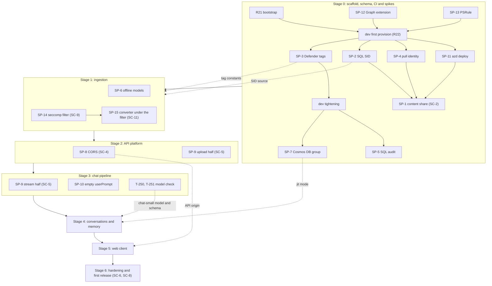

# 90 — Build order

This file orders the build of DocChat into seven stages, stage 0 to stage 6. For each stage it states the files and components delivered, the infrastructure added to `dev`, the acceptance criteria and the tests that prove them. It defines the stage identifiers (`stage 0` to `stage 6`), the acceptance-criterion identifiers (`A<stage>-<n>`), the spike identifiers (`SP-1` to `SP-15`) and the stop identifiers (`SC-2` to `SC-9`, and `SC-11`; a stop identifier is never reused, and `SC-1` and `SC-10` are withdrawn). Tests are named by their identifiers in `84-testing.md` section 5, alerts by those in `85-observability.md` section 6, and runbooks by those in `86-operations.md` section 3.2. Section 1 says how a stage works and what accepting it means, section 2 holds the spike register, section 3 holds the stages, and section 4 draws the dependencies between them. The ADR behind this file is ADR 0141.

## 1. How stages work

### 1.1 The stages

| Stage | Name | Names other files use | Ends with |
|---|---|---|---|
| stage 0 | Scaffold, shared package, SQL schema, local environment, CI and spikes | stage 0; the stage that provisions `dev` | the repository, CI, the bootstrap and the first `dev` provision in place, and every stage-0 spike recorded in its ADR |
| stage 1 | Ingestion | the ingestion stage; the build stage that delivers ingestion | the ingestion app running its real image in `dev`, with the whole ingestion design proven in the orchestration harness |
| stage 2 | API platform: authentication, access, administration and uploads | the API-platform stage | the API serving every account, admin, upload and run operation in `dev`, and the fixture documents uploaded and ingested through it |
| stage 3 | Chat pipeline | the chat-pipeline build stage; the chat-pipeline stage | chat turns streaming with citations in `dev` against the real model deployments |
| stage 4 | Conversations and memory | the conversations-and-memory stage | session lists, rolling summaries, memory, feedback and the user-data commands in `dev` |
| stage 5 | Web client | the web-client stage | the web client served from Static Web Apps in `dev` |
| stage 6 | Hardening and first release | the hardening stage; the load-test stage; the release stage; the final stage | every load verdict passed, every runbook rehearsed, every scan clean, and `prod` provisioned and serving its first administrators |

### 1.2 Definition of done

Every stage follows these rules.

1. **Order.** A stage starts when the previous stage is accepted (section 1.3): no pull request that belongs to stage n + 1 merges to `main` before the line that accepts stage n is merged into ADR 0141. Within a stage, pull requests merge in any order the stage's dependencies allow.
2. **Complete slices.** Each pull request delivers its code together with its rows of `84-testing.md` section 5, its telemetry (`85-observability.md` section 4), its settings and ops-config keys (`81-config.md`), its operator commands (`86-operations.md` section 2), the runbook text that uses those commands (`86-operations.md` section 3), its alert rules and workbook tiles, and every ADR outcome line its tests produce. Nothing is stubbed for a later stage: where a later stage extends a module, the earlier stage uses the real store and the real code path, and deployed code holds no placeholder route, feature flag or fake service.
3. **Tests arrive with their subject.** A test row exists from the stage that delivers its subject. A test that covers several subjects (the authorisation matrix T-001, the isolation suite T-002, the template checks, the catalogue checks, the deployed infrastructure suite) gains each subject's cases in the stage that delivers that subject, keeps passing on every pull request from then on, and is complete at the stage whose list in section 3 names it. The deployed suites follow the same rule: `smoke` holds T-029 from stage 0, gains T-022, T-024 to T-027, T-059 and T-064 at stage 2 and T-271 and T-281 at stage 3, and gains T-597 at stage 6 for `load`.
4. **Infrastructure through the pipeline.** Each stage adds its resources to `infra/main.bicep`, `infra/shared.bicep` or the bootstrap template and deploys them to `dev` with `deploy.yaml` (`83-infrastructure.md` section 10). No resource is created or changed in the portal or by hand, except the post-provision steps of `83-infrastructure.md` section 11.5, which their runbooks perform. `prod` is first provisioned in stage 6, and `load` is first created by `load-test.yaml` in stage 6.
5. **Settings per stage.** Each stage that adds a model deployment sets that model's `pricing.model_rates` entry in `dev` with R03 before the deployment serves traffic (stage 1 for the two ingestion deployments, stage 3 for the three chat-path deployments).
6. **Telemetry clean.** After each stage's last deploy, the stage's records arrive in `appi-docchat-dev` under their role names, and the canary audit (T-489) passes on every integration session of the stage.
7. **Runbooks.** A runbook file is written in the stage that delivers the commands, workflows or scripts it uses (section 3 lists them per stage). Every runbook is rehearsed in stage 6 (`86-operations.md` section 4.2); a rehearsal that an earlier stage's criterion names counts for stage 6 when no command it uses changes after it.

### 1.3 Stage acceptance

A stage is accepted when every criterion `A<stage>-<n>` of its section passes, every test its acceptance record names is green (`84-testing.md` section 10.5), every spike of that stage has its outcome line in its ADR, and no stop condition of section 1.4 is open.

#### 1.3.1 The acceptance run

The stage's performer, a maintainer named at the stage's start, runs these steps once the stage's last pull request is merged and deployed to `dev`:

1. **The release commit.** The commit on `main` that `deploy.yaml` last deployed to `dev`, with `ci.yaml` and `codeql.yaml` green on it and its `test-dev` job passed.
2. **The deployed suites.** `gh workflow run deployed-tests.yaml -f environment=dev -f suite=full -f stage_acceptance=true`, so that the functions of `tests/deployed/` whose level reads `deployed (stage acceptance)` or `deployed (stage 0)` run with `--stage-acceptance` in the jobs `84-testing.md` section 6.3 names for them, all but the person-run rows of step 4; then the same with `-f suite=infra` (`84-testing.md` section 8.2).
3. **The live tests.** From a machine in the `dev` operator allowlist, `uv run pytest -m live --live` (`84-testing.md` section 1.6), and the query check T-499 against `log-docchat-dev`.
4. **The person-run tests.** The rows that need a person, as their rows and `84-testing.md` sections 6.3 and 6.5 state: the alert tests T-471, the Cosmos DB group-principal test T-032, the operator-read audit test T-033, the post-provision idempotency test T-030 (run by a tenant administrator), the config-operator test T-031 (run by an operator at level `config`), the reading of the SID test T-440, the chat telemetry check T-282 (run by the performer as a member of `sg-docchat-operators` after step 2), the operator checks T-250, T-251 and T-332 at stage 3 and T-331 at stage 4 (each read from one run of `docchat-ops --env dev chat model-check` by a member of `sg-docchat-dev-config-operators`, `86-operations.md` section 2.8.7), and each rehearsal, manual or stage-acceptance row the stage's section names.
5. **The criteria.** Each criterion of the stage's section, with its evidence.
6. **The record and the outcome line.** The record of section 1.3.2 is completed, and a pull request appends to the end of ADR 0141's Consequences the line `Outcome (YYYY-MM-DD): stage <n> accepted at commit <40-hex SHA>; record <ticket link>` (ADR 0001 item 5). Its merge accepts the stage.

#### 1.3.2 The acceptance record

The acceptance record of stage n is a ticket in the organisation's ticket system titled `DocChat build stage <n> acceptance`, kept under the ticket rules of `86-operations.md` section 4.3 (never content, a password or a token).

| Field | Content |
|---|---|
| Release commit | the 40-hex SHA of step 1 and the `deploy.yaml` run ID that deployed it to `dev` |
| CI | the `ci.yaml` and `codeql.yaml` run IDs on the release commit |
| Deployed runs | the `deployed-tests.yaml` run IDs of step 2, each with its pass and skip counts; a skipped row names its reason |
| Live runs | the date, operator handle and pass count of step 3, and the T-499 output |
| Person-run results | per test of step 4: the performer's handle, the UTC time, the result and the correlation IDs, run IDs or alert times its row asks for |
| Spikes | per spike of the stage: the outcome and a link to its ADR outcome line |
| Criteria | per criterion of the stage: `passed` and its evidence |
| Tests | the T-IDs the stage's section names under "Tests completed at this stage", each `green` with the run or record that shows it |
| Follow-ups | the cost review T-478 for an environment the stage provisioned, appended when Cost Management closes the environment's first full idle month; it gates no stage |

#### 1.3.3 How each test level counts

| Level of the row (`84-testing.md` section 5.1 item 4) | How it counts for a stage |
|---|---|
| `unit`, `component`, `integration`, `contract`, `meta`, `browser`, `CI check`, `infrastructure` | green in the `ci.yaml` run on the release commit |
| `deployed smoke`, `deployed full`, `deployed (… suite)`, `deployed` in a named suite | green in the `deployed-tests.yaml` runs of step 2 |
| `deployed (stage acceptance)`, `deployed (stage 0)` | green in step 2 or, for the person-run rows T-030, T-031, T-032, T-033, T-282, T-440 and T-471 (`84-testing.md` sections 6.3 and 6.5), recorded by their performer |
| `operator check (dev)` | recorded in the record by the performer: the operator checks T-250, T-251, T-331 and T-332, with the exit code of the `chat model-check` run and its `model_deployments.checked` audit row |
| `deploy check`, `deployed (after each deploy)`, `deployed (after each provision)` and the other deploy-workflow rows | green in the `deploy.yaml` run that deployed the release commit (for `load`, in the deploy of the `load-test.yaml` run); the grants test T-081 (`grants-check`, `dev` only) and the app-settings comparison T-114 (`app-settings-check`, every environment) are post-deploy steps of the deploy job in `deploy-environment.yaml`, run as the environment's deploy identity |
| `live` | green in step 3 |
| `nightly` | green in the latest `nightly.yaml` run before the record is completed |
| `stage acceptance`, `stage 0` | recorded in the record by the performer |
| `rehearsal` | a `passed` row in `docs/runbooks/rehearsals.md` (`86-operations.md` section 4.3) |
| `load`, `integration (release commit)` | the verdict files of the `load-test.yaml` run on the release commit (`84-testing.md` section 7) |
| `manual (release)` | the release checklist of the release ticket (`86-operations.md` section 3.3.1) |
| `manual (cost review)` | the record's follow-up field |
| `withdrawn` | not run; the row is named under "Tests withdrawn at this stage" of the stage that withdrew it, so it still sits in exactly one stage, and the record lists it with the ADR its row names |

A stage-acceptance or stage-0 row runs once in its stage and once more whenever its subject changes (`84-testing.md` section 5.1 item 4): the pull request that changes the subject names the T-ID in its description, and after the change reaches `dev` the performer runs the row and appends its result to the record of the stage that first ran it.

### 1.4 Stop conditions

The build stops and returns a question to the product owner only at the conditions below; every other result is decided by a rule of this file or of the ADR the rule names. A stop is raised as a new ADR with status `Proposed`, numbered from 0153 on (ADR 0001 item 6), holding the measurements and the options the table names. Work on the stopped stage halts at the failing criterion: pull requests of that stage that don't touch the question's subject still merge, and no later stage starts. The build resumes when the product owner's choice makes that ADR `Accepted` and the criterion runs once more under it.

| Stop | Stage | Condition | The product owner chooses |
|---|---|---|---|
| SC-2 | 0 | SP-1 criterion 4 still fails with content-share fallback 1 deployed (section 2.3) | whether to adopt fallback 2, Functions on Container Apps with the MSSQL Durable storage provider, which changes the hosting, the Durable storage provider and the ingestion scaling model (ADR 0103) |
| SC-3 | 0 | A stage-0 check of `83-infrastructure.md` section 11.8 ends with no passing outcome: SP-2 with neither the client ID nor the object ID signing in, SP-4 with neither identity form pulling, SP-11 with the `postdeploy` fallback also failing, SP-12 with `infra/identity.bicep` also failing, or SP-13 with a built-in rule that neither a template change nor a suppression resolves | the change the failing check's ADR needs |
| SC-4 | 2 | SP-8 case 1 or case 2 fails (section 2.10) | anonymous pass-through in platform authentication, or one Azure Front Door Standard profile per environment (ADR 0004 item 7) |
| SC-5 | 2, 3 | SP-9 fails: the upload through platform authentication doesn't complete, or a chat stream's `meta` line arrives after 3 s (section 2.11) | a hosting change for the request or stream path, with the measurements |
| SC-6 | 6 | Load scenario S3 ends `inconclusive` with cause `dependency_bound` at an answer length of 4,000 tokens (`84-testing.md` section 7; ADR 0134; ADR 0151; R11 step 12) | a higher dependency limit or a smaller per-turn demand |
| SC-7 | any | A high or critical scanner finding that nothing in the repository removes: no base-image digest, package removal or dependency replacement clears it (R17 step 10; ADR 0136) | the action, because no waiver exists at high or critical |
| SC-8 | 6 | R35's rehearsal reaches step 6: after a correct deploy the platform answers the preflight without the origin | the hosting answer to a platform CORS fault, as for SC-4 |
| SC-9 | 1 | SP-14 fails: in `dev` a parsing child can't install the system-call filter, or a check of the isolation probe doesn't hold (section 2.16; `14-ingestion.md` section 15.6 item 13) | (a) accept the residual risk, which ADR 0049 then records: a compromised child reaches the network and every loopback listener of SP-14's census (section 2.16), which the owner sees in full with what an unauthenticated local caller can do with each, the Functions host's gRPC endpoint for the language worker included; through the Durable extension's listener it can list instances and read their status, which holds instance IDs and activity outputs with document titles, start, restart, rewind, terminate, suspend, resume and purge orchestration instances, raise events, signal, read and list entities, and make the app its task hub's primary; it holds only its own document; and the managed identity's token is protected only by `IDENTITY_HEADER` not being readable by a parse user. The owner accepts this with the parse-user pool, the clearing of users, the verify children and `failOnNetwork` kept; or (b) parsing on compute that isolates the network, designed in an ADR before stage 1 continues |
| SC-11 | 1 | SP-15 ends in outcome 4 of `14-ingestion.md` section 15.11 item 7: LibreOffice converts the fixtures only with a system call the filter refuses beyond `socket` and `socketpair` for `AF_UNIX`, or the census of section 2.17 finds a Unix-domain listener a parse user can reach; or the converter's peak resident memory on the largest fixtures exceeds 2,048 MB (`14-ingestion.md` section 15.10) | one question, with SP-15's record of refused calls, census rows and peak memory: (a) allow the named calls for the `convert` child alone, which ADR 0141 and ADR 0152 then record with what a compromised converter reaches through each; (b) convert on compute that isolates the network and the host's listeners, with its cost and the stage it adds; or (c) accept only PDF uploads until (a) or (b) is in place, the DOCX and PPTX upload refusal recorded in ADR 0152. For the memory peak: raise the `convert` child's limit with the plan sizing of `14-ingestion.md` section 15.10 that fits it, or cap Office uploads at the size the spike's measurements support |

SC-1, the former GitHub-plan stop, is withdrawn: the test jobs run on standard GitHub-hosted runners and reach the test-credential vault through its transient runner rule by default, so no GitHub plan is required, and an organization that chose the private-networking option on a plan without larger runners returns to the default (`ci_private_networking_unavailable`, `83-infrastructure.md` sections 11.1 and 11.3; ADR 0122). Its identifier, like SC-10's, is never reused.

Two owner questions arise during rehearsal without stopping the build, because the designed default stays in force while the owner decides: R10's zone-redundancy reading, which keeps `api.zoneRedundant` at `false` and goes to the owner through a new ADR (ADR 0102), and R06 part C step 6, which applies only to items changed inside a live Cosmos DB container and never arises in the rehearsal's SQL restore.

## 2. Spike register

### 2.1 How spikes run

1. A spike is a short build of one platform behaviour that vendor documentation doesn't settle, with a set method, a pass rule and a decision for each outcome. Each spike runs in the stage this register names, before any later work depends on its result.
2. Each wait a method states is that spike's time box: a criterion not met within its wait counts as failed, and the outcome for a failure applies.
3. The spike's outcome is written into its ADR as one line `Outcome (YYYY-MM-DD): <measured result>; <the branch of this register's rule that applies>` (ADR 0001 item 5), by the pull request that applies the decision, and is copied into the stage's acceptance record. A stage-0 outcome is in its ADR before stage 1 starts (`83-infrastructure.md` section 11.8; T-477).
4. An outcome that this register sends to the product owner is a stop condition of section 1.4. Every other outcome applies at once, through the pull request the outcome names.
5. The stage-0 spikes SP-1, SP-3 and SP-4 run on the `dev` ingestion app, deployed with the stage-0 spike build of the ingestion image: `apps/ingestion/src/docchat_ingestion/spike.py` (`01-repository.md` section 1.3.1), which `function_app.py` registers alone. The spike build holds the queue-triggered starter, a Durable orchestration that fans out 200 activities of 30 s each with `maxConcurrentActivityFunctions` 1, `configure_telemetry` with its start-up event, one query through the SQL data-access layer, and two probes that run as the ingestion identity inside the network: the trigger, which sends one message to `ingestion-requests` when a worker starts and the task hub holds no orchestration instance `spike-<image digest>`, and the scan probe of SP-3. For the trigger, stage 0's `main.bicep` gives the ingestion identity Storage Queue Data Message Sender (`c6a89b2d-59bc-44d0-9896-0f6e12d7b80a`) on queue `ingestion-requests`; the stage-1 pull request that adds `starters.py` deletes `spike.py` and that assignment from the template, and the bootstrap operator deletes the assignment in `dev` with `az role assignment delete --ids <assignment ID>` before stage 1's deployed infrastructure suite runs.

### 2.2 Register

| Spike | Stage | Question | Decision recorded in | Proof |
|---|---|---|---|---|
| SP-1 | 0 | Does the Elastic Premium Linux container app run and scale with no Azure Files content share? | ADR 0103 | the seven criteria of section 2.3; T-477 |
| SP-2 | 0 | Is a managed identity's SQL contained-user SID its client ID or its object ID? | ADR 0125 | T-440 |
| SP-3 | 0 | Which scanner role, network rule, tag keys and time format does Defender for Storage use? | ADR 0117 | T-202 |
| SP-4 | 0 | Does `acrUserManagedIdentityID` take the identity's client ID or its resource ID? | ADR 0103 | SP-1 criterion 7; T-477 |
| SP-5 | 0 | Do bound parameter values of the workload identities reach the SQL audit log? | ADR 0108 | T-451, T-450 |
| SP-6 | 1 | Does the ingestion image parse with every model baked in and no network? | ADR 0010, ADR 0047 | T-194, T-523 |
| SP-7 | 0 | Does a Cosmos DB data-plane role assignment honour an Entra group object ID? | ADR 0024 | T-032 |
| SP-8 | 2 | Does a CORS preflight pass through platform authentication? | ADR 0004 | T-024 |
| SP-9 | 2, 3 | Does platform authentication pass large request bodies and streamed responses without buffering? | ADR 0042, ADR 0004 | T-064, T-281 |
| SP-10 | 3 | Does Prompt Shields accept an empty `userPrompt` and flag an indirect-attack document? | ADR 0062 | T-240 and the empty-`userPrompt` probe of `docchat-ops --env dev chat model-check` |
| SP-11 | 0 | Does `azd deploy` place a container on a function app with public access off? | ADR 0123 | T-477 |
| SP-12 | 0 | Do what-if and PSRule expand `main.bicep` with the Microsoft Graph Bicep extension? | ADR 0016 | T-431, T-423 |
| SP-13 | 0 | Does PSRule pass for all three environments with only the listed suppressions? | ADR 0106 | T-423 |
| SP-14 | 1 | Does an unprivileged child process in the Elastic Premium Linux custom container install a seccomp filter? | ADR 0049 | T-207 |
| SP-15 | 1 | Does LibreOffice convert DOCX and PPTX to PDF under the system-call filter, within the `convert` child's limits? | ADR 0141, ADR 0152 | T-618 |

### 2.3 SP-1 — Content share

- **Question.** Does the `dev` ingestion app, an EP1 Linux custom-container function app with identity-based host storage and public network access off, provision, start, run Durable orchestrations and scale out and back in with no Azure Files content share?
- **Method.** `83-infrastructure.md` section 2.7: the `dev` ingestion app deployed exactly as `83-infrastructure.md` section 2.6 specifies, with no content share, running the spike build of section 2.1 item 5, deployed with `azd deploy ingestion --from-package <digest>` (SP-11), its SQL contained user created from the client ID (SP-2). The trigger's message starts the fan-out.
- **Pass.** All of criteria 1 to 6 of `83-infrastructure.md` section 2.7: (1) provisioning succeeds with no content-share validation error; (2) the spike worker's start-up event reaches Application Insights within 10 minutes of the deploy; (3) the message on `ingestion-requests` starts the orchestration within 2 minutes; (4) the app runs on 2 instances (two distinct `cloud_RoleInstance` values) within 10 minutes of the fan-out's start and returns to 1 within 70 minutes of the last activity; (5) the orchestration completes; (6) 24 hours pass with no host error that mentions Azure Files, the content share or `AzureWebJobsStorage`. Criterion 7 is SP-4.
- **Outcomes.** Criteria 1 to 6 pass: no share exists, and ADR 0103 records it. Any of criteria 1 to 6 fails, scale-out included: content-share fallback 1 applies at once through R27 (`83-infrastructure.md` section 2.7), and criteria 1 to 6 run once more against it; R25 and R27 then join the stage-6 rehearsals. Criterion 4 still fails with fallback 1 deployed: stop SC-2.
- **Duration.** At least 26 hours: the fan-out, the 70-minute scale-in window and the 24-hour watch of criterion 6.

### 2.4 SP-2 — SQL contained-user SID

- **Question.** Is the SID of a user-assigned managed identity's contained user (`TYPE = E`) its client ID or its object ID?
- **Method.** `83-infrastructure.md` section 6.12: `sql_principals.py` creates `[id-docchat-ingest-dev]` with the SID from the client ID; the spike app, running as the ingestion identity, runs `SELECT USER_NAME()` over ODBC Driver 18 with an access token. On login error 18456 the script re-creates the user from the object ID and the query runs once more.
- **Pass.** `SELECT USER_NAME()` returns `id-docchat-ingest-dev`.
- **Outcomes.** The client ID works: `--sid-source` keeps its default `client-id`. The object ID works after error 18456: the default becomes `object-id`. Neither form signs in: stop SC-3, and stage 1 doesn't start.

### 2.5 SP-3 — Defender enablement and scan tags

- **Question.** Which role assignment and resource-instance rule does Defender for Storage create when the `dev` deploy identity turns malware scanning on, and which index-tag keys and time format does a scan write?
- **Method.** ADR 0117 item 6 and `83-infrastructure.md` section 2.11, before `dev`'s first tightening: a pull request sets `storage.malwareScanning` to `true` in `infra/env/dev.json`; its deploy creates `defenderForStorageSettings/current` under the `dev` deploy identity; the performer lists the scanner's role assignment (`az role assignment list --assignee <scanner principal ID> --all`) and the account's `networkRuleSet.resourceAccessRules`; the spike build's scan probe, under the ingestion identity, uploads `documents/_scanner-canary/spike-<uuid4>.pdf` (a 1-page PDF) and the same bytes as `documents/_scanner-canary/spike-<uuid4>/converted.pdf`, and reads both blobs' index tags every 60 s for at most 24 hours, writing the tag keys and values into one log record's message text; a second pull request returns `storage.malwareScanning` to `false`.
- **Pass.** The first blob carries `Malware scanning scan result` and `Malware scanning scan time`, and the second carries no index tag 60 minutes after the first carries its result (the filter `excludeBlobsWithSuffix: ['/converted.pdf']` of `83-infrastructure.md` section 2.11); the rule, the role and the keys are read.
- **Outcomes.** Every result is a decision: a role other than Defender for Storage Data Scanner (`1e7ca9b1-60d1-4db8-a914-f2ca1ff27c40`) replaces it in the deploy identity's condition and the tightened pair (`83-infrastructure.md` section 6.11); a rule whose `resourceId` differs from the Bicep constant (compared case-insensitively) replaces the constant; the tag key casing and the time format become the scan-result mapper's constants (`14-ingestion.md` section 5.4). The second blob tagged: the suffix filter is removed from the settings, each converted PDF is scanned within `capGBPerMonth` at the per-GB scan price, and its tags stay unread, because no code reads a scan tag on a converted PDF; `83-infrastructure.md` section 2.11 records the change. No tag on the first blob within 24 hours: R12 step 7 applies and the spike runs once more after the support case answers.

### 2.6 SP-4 — Registry pull identity format

- **Question.** Does the site property `acrUserManagedIdentityID` take the identity's client ID or its resource ID?
- **Method.** SP-1 criterion 7: the spike app's first deploy sets `acrUserManagedIdentityID` to the ingestion identity's client ID.
- **Pass.** The image pull succeeds within 10 minutes of the deploy.
- **Outcomes.** The pull succeeds: the client-ID form stays. The pull fails with an identity error or hasn't succeeded within 10 minutes: both apps and the model stub set `acrUserManagedIdentityID` to the identity's resource ID, and ADR 0103 records it. The resource-ID form also fails: stop SC-3.

### 2.7 SP-5 — SQL audit of bound parameters

- **Question.** Does a bound parameter value of a statement reach `SQLSecurityAuditEvents`, and does `database_principal_name` carry the contained users' names?
- **Method.** `83-infrastructure.md` section 2.9 and ADR 0108 items 4 and 5: with both audit specifications on, under the deploy identity, `SELECT COUNT(*) FROM app.users WHERE display_name = ?` runs with the bound value `docchat-audit-sentinel-<uuid4>`; 20 minutes later `SQLSecurityAuditEvents | where Statement has '<sentinel>' or AdditionalInformation has '<sentinel>'` runs against the `dev` workspace; the same run reads the ingestion identity's authentication from SP-2 in the workload audit only and the deploy identity's sentinel statement in the privileged audit only.
- **Pass.** Either row count is a decision, and the principal names match the predicates.
- **Outcomes.** Zero rows: the workload audit's `auditActionsAndGroups` is `BATCH_COMPLETED_GROUP`, `SUCCESSFUL_DATABASE_AUTHENTICATION_GROUP` and `FAILED_DATABASE_AUTHENTICATION_GROUP`. One or more rows: it is the six change groups and the two authentication groups of `83-infrastructure.md` section 2.9. The privileged audit keeps `BATCH_COMPLETED_GROUP` in both outcomes. A different `database_principal_name` for a workload identity: both predicates use the value the records show, and the spike runs once more.

### 2.8 SP-6 — Offline parsing models

- **Question.** Does the ingestion image parse a document with every parsing model and encoding baked in and no network?
- **Method.** `docker run --network none <ingestion image>` running the image's offline self-check (`14-ingestion.md` section 15.5): it partitions `tables.pdf` with the page-wise method, asserts that the table element carries `text_as_html`, loads both `tiktoken` encodings, checks the ODBC driver, runs the isolation probe and confirms UID 0 (ADR 0049 item 10). The model revisions and SHA-256 values in `apps/ingestion/models.lock.json` are captured once when stage 1 starts and committed (ADR 0010).
- **Pass.** The self-check exits 0 with no network attempt.
- **Outcomes.** Pass: the image's last build step keeps the same check (T-194). A network attempt or a failure: stage 1 stays open until every model is in the image and the check passes.

### 2.9 SP-7 — Cosmos DB data-plane role on an Entra group

- **Question.** Does a Cosmos DB data-plane role assignment accept an Entra group object ID as `principalId`, so that group membership grants data access?
- **Method.** T-032 and `13-conversations-and-memory.md` section 10.2. A just-in-time approver adds a test operator to `sg-docchat-dev-user-data-operators` with `docchat-ops jit grant`; from an allowlisted machine the operator, with a fresh token, writes one item `{"id": "sp7-<uuid4>", "userId": "sp7", "sessionId": "sp7", "type": "spike"}` into `conversations`, retrying every 60 s for up to 15 minutes; the approver revokes that membership and adds the operator to `sg-docchat-dev-conversation-readers`; the operator, with a fresh token, retries a point read of the item every 60 s for up to 15 minutes; the approver revokes the membership. When the read passes, the operator deletes the item as a member of the user-data group under a new grant.
- **Pass.** The read answers `200`.
- **Outcomes.** `200`: `cosmosGroupDataAccess` stays `true` in every environment file. `403` on the write or the read after 15 minutes: `cosmosGroupDataAccess` becomes `false` in every environment file through one pull request; the next provision deletes the two group assignments, `docchat-ops jit` creates and deletes per-principal assignments (`13-conversations-and-memory.md` section 10.2 item 3), and post-provision step 7 (`83-infrastructure.md` section 11.5) assigns DocChat Cosmos Data Access Granter to each approver.

### 2.10 SP-8 — CORS preflight through platform authentication

- **Question.** Does a browser preflight without a token reach platform CORS through platform authentication?
- **Method.** The five cases of T-024 (ADR 0004 item 7; `11-api.md` section 1.9), right after the first `dev` deployment of the API site and in every `smoke` run after it.
- **Pass.** All five cases.
- **Outcomes.** All pass: continue. Case 1 or case 2 fails: stop SC-4, and T-024 runs once more under the chosen design. Case 3, 4 or 5 fails: a configuration defect, corrected by pull request within the stage.

### 2.11 SP-9 — Stream and upload buffering through platform authentication

- **Question.** Does platform authentication forward a large request body and a streamed response without holding either until it ends?
- **Method.** Upload half, stage 2: T-064's generated 50 MB PDF, which is above the 49 MB the spike requires (ADR 0042), uploaded through platform authentication in `dev`. Stream half, stage 3: T-281's chat turn through platform authentication.
- **Pass.** The upload completes, and the stream's `meta` line arrives within 3 s of the request.
- **Outcomes.** Both pass: continue. Either fails: stop SC-5, with the upload's duration or the `meta` delay and the API's memory reading. T-064's memory and run-time limits are stage-2 criteria of their own; missing them is a defect corrected within the stage, not a spike outcome.

### 2.12 SP-10 — Prompt Shields with an empty `userPrompt`

- **Question.** Does the deployed Content Safety account accept `userPrompt` `""` and flag a fixture indirect-attack document?
- **Method.** The empty-`userPrompt` probe of `docchat-ops --env dev chat model-check` (`12-chat-pipeline.md` section 10.7; `86-operations.md` section 2.8.7), run at this stage's acceptance by a member of `sg-docchat-dev-config-operators` from an address in `dev`'s operator allowlist: `{"userPrompt": "", "documents": [<the command's indirect-attack probe document>]}` sent to the `dev` Content Safety account, its status code and `documentsAnalysis[0].attackDetected` printed and written to the run's `model_deployments.checked` row; and the deployed screening test T-240 (ADR 0062).
- **Pass.** `200`, with the document's `attackDetected` `true`.
- **Outcomes.** Pass: the API sends `""`. `400` for the empty string: the API sends a single space as `userPrompt`, T-240 runs once more, and ADR 0062 records it. The document isn't flagged: the screening path is a defect corrected within stage 3.

### 2.13 SP-11 — `azd deploy` of the ingestion container

- **Question.** Does `azd deploy` place a prebuilt image on the function app through `config/web` with public access disabled?
- **Method.** `azd deploy ingestion --from-package <digest>` against the `dev` ingestion app with public access off (ADR 0123 item 5; `83-infrastructure.md` section 9.1).
- **Pass.** The site's `linuxFxVersion` names the digest and the app starts the image (the start-up event of SP-1 criterion 2).
- **Outcomes.** Pass: the `ingestion` service stays in `azure.yaml`. Fail: the `ingestion` service leaves `azure.yaml`, and the `postdeploy` hook sets the image with `az resource update --ids <function app ID>/config/web --set properties.linuxFxVersion="DOCKER|<reference>"`. The fallback also fails: stop SC-3.

### 2.14 SP-12 — Microsoft Graph Bicep extension in what-if and PSRule

- **Question.** Do what-if and PSRule expand `main.bicep` with the registrations declared in `infra/modules/identity/entra-apps.bicep` through the `graphV1` extension?
- **Method.** `83-infrastructure.md` section 7.1 and ADR 0016 item 13: the pull-request what-if T-431 (`az deployment group what-if --validation-level ProviderNoRbac` under `id-docchat-pr`) and the PSRule runs T-423 on a pull request that holds the module.
- **Pass.** Both complete with the extension present.
- **Outcomes.** Pass: the registrations stay in `main.bicep`. Either fails on the extension: the registrations move to `infra/identity.bicep`, deployed by azd's `preprovision` hook, whose outputs are written to the azd environment and passed to `main.bicep` as parameters, every value unchanged. The contingency also fails: stop SC-3.

### 2.15 SP-13 — PSRule against all three environments

- **Question.** Which built-in rules of baseline `Azure.GA_2025_12` fail for the `dev`, `prod` and `load` expansions beyond the suppressions of `83-infrastructure.md` section 13.4?
- **Method.** PSRule with the configuration of `83-infrastructure.md` section 13.2 against `main.bicepparam` for each of `dev`, `prod` and `load` (T-423).
- **Pass.** No unsuppressed failure.
- **Outcomes.** Each failing built-in rule is resolved in the same pull request (ADR 0106 item 6): by the template change when the required setting adds no identity, network path, role, preview API or monthly cost and contradicts no ADR; otherwise by a suppression group naming the rule, the resources and the ADR it conflicts with, with `expiresOn` `2027-10-31T00:00:00Z`. A rule that neither resolves, because `83-infrastructure.md` section 13.1 requires its setting and the setting contradicts an ADR: stop SC-3.

### 2.16 SP-14 — Seccomp filter in the ingestion container

- **Question.** Does an unprivileged child process in the App Service Elastic Premium Linux custom container install a seccomp filter?
- **Method.** `14-ingestion.md` section 15.6 item 13: deploy the stage-1 ingestion image to `dev` and run its runtime self-check there: the start-up checks of `14-ingestion.md` section 4.11, whose check 7 runs the isolation probe. Then take the census of loopback listeners:
  1. The stage-1 image holds no `ss`, so the performer deploys to `dev` a spike build of that image that adds the Debian 12 package `iproute2` and, 120 seconds after the Functions host starts, writes to the container log the output of `ss -ltnp`, the listening rows (state `0A`) of `/proc/net/tcp` and `/proc/net/tcp6`, and the output of `ss -lxp` for Unix-domain listeners, whose abstract names no file mode protects, each run as root.
  2. For each listening socket bound to a loopback address (any `127.x.x.x` address, or `::1`) or to the unspecified address of IPv4 or IPv6, which listens on every interface, and each Unix-domain listener, the performer records in the stage 1 acceptance record its address, port, owning process and what an unauthenticated local caller can do with it, read from that component's own documentation: the Functions host's gRPC endpoint for the language worker, the Durable extension's listener on `127.0.0.1:17071` (the operations of the Durable Functions HTTP API) and every other listener found.
  3. A listener whose effect the documentation doesn't state is recorded as "unknown" and counts as able to do everything the process that owns it can do. The spike build is replaced by the stage-1 image when the spike ends, and no other environment runs it.

  The census is recorded whether SP-14 passes or fails, and on a fail it goes to the product owner with SC-9.
- **Pass.** The filter installs and every check of the isolation probe holds (`14-ingestion.md` section 15.5): `socket` for `AF_INET` and `AF_UNIX`, `socketpair`, `io_uring_setup`, `ptrace(PTRACE_TRACEME)` and a self `process_vm_readv` refused with `EPERM`, `clone3` refused with `ENOSYS`, and a thread started after the load filtered; and `ingestion_worker_started` is emitted; and the census holds a row for every listening socket of the logged output. The performer records the result as the stage-acceptance test T-207.
- **Outcomes.** Pass: the filter stays. Fail: stop condition SC-9 (section 1.4); stage 1 waits for the product owner's choice between accepting the residual risk, which ADR 0049 then records with the filter step and the probe's filter checks removed and the isolation probe checking only that `ptrace(PTRACE_ATTACH)` on the parent fails, and parsing on compute that isolates the network. Under either choice the parse-user pool, the clearing of users, the verify children and `failOnNetwork` stay in force.

### 2.17 SP-15 — Converter under the system-call filter

- **Question.** Does LibreOffice 7.4.7 convert DOCX and PPTX to PDF in a `convert` child under the system-call filter, in the deployed Elastic Premium Linux custom container, within 900 s, 2,048 MB, 64 processes and threads and 256 open files?
- **Method.** `14-ingestion.md` section 15.11 item 7, after SP-14 passes: deploy to `dev` a spike build of the stage-1 ingestion image whose `convert` child logs every refused system call (the filter's `SCMP_ACT_ERRNO` actions replaced by `SCMP_ACT_LOG` for the run, each refusal read from the kernel audit log) and records the peak resident memory of its UID, the peak count of processes and threads and of open files, and for each export option of `14-ingestion.md` section 15.11 item 8, read from the profile with no filter options on the command, whether it takes effect. Run the converter over `headings.docx`, `slides.pptx`, the six Office-saved controls of `84-testing.md` section 1.5, the converter fixtures of the converter linked-content test and the largest fixture of `14-ingestion.md` section 15.5, once through `soffice` and, when that fails, once through `soffice.bin` with the same arguments. When a run needs `socket` or `socketpair` for `AF_UNIX`, take the census of Unix-domain listeners of SP-14 step 1 (`ss -lxp`, abstract names included) under the spike build and record each listener's owner and what a local caller can do with it. The spike build is replaced by the stage-1 image when the spike ends, and no other environment runs it.
- **Pass.** Every fixture converts to a PDF that passes `inspect` with the page count recorded in the acceptance record, and the record holds the refused calls (none for outcome 1), the peaks, each export option's effect and, for outcome 3, the census. An export option that doesn't take effect is recorded and changes no outcome, because render's schema leaves out every structure the options govern (`14-ingestion.md` section 15.11 item 8). The performer records the result as the stage-acceptance test T-618.
- **Outcomes.** Decided in advance by `14-ingestion.md` section 15.11 item 7: outcome 1, the design stands; outcome 2, the `convert` child starts `soffice.bin`; outcome 3, the `convert` child's filter allows `socket` and `socketpair` for `AF_UNIX` alone and the isolation probe asserts the other families still fail in `convert` mode, once the census finds no Unix-domain listener a parse user can reach; outcome 4, or a peak resident memory above 2,048 MB: stop condition SC-11 (section 1.4). The outcome line goes into ADR 0141 and ADR 0152.

### 2.18 Other deciding checks

These checks run inside a stage and their results change a setting, a constant or a list by rule; none is a stop condition.

| Check | Stage | Rule | Recorded in |
|---|---|---|---|
| The deployed model check T-250 and the tokenizer check T-251, run as `docchat-ops --env dev chat model-check` by a member of `sg-docchat-dev-config-operators` (the group holds Cognitive Services User on `rg-docchat-dev` from the bootstrap, which covers the Azure OpenAI and Content Safety calls of the command) | 3 | `12-chat-pipeline.md` section 10.7: a refused value leaves the capability table; a refused `none` makes `DOCCHAT_OPENAI_SMALL_REASONING_EFFORT` `low`, raises `chat.small_call_max_completion_tokens` to 6,000 and reruns the capacity check; a `400` on the memory-extraction schema removes strict structured outputs from the chat-small row and changes the chat-small default model to a version that passes (`13-conversations-and-memory.md` section 7); a token count off by more than 1% sets the encoding the model's documentation names | ADR 0068, ADR 0075 |
| The Prompt Shields request check T-332 (`documents: []`), an operator check in the same `docchat-ops --env dev chat model-check` run as T-250 | 3 | `200`: the body keeps `documents: []`; `400`: the body omits `documents` | ADR 0062 |
| The `import-untyped` run of `uv run mypy` | 0 | the `[[tool.mypy.overrides]]` module list becomes exactly the set the run reports (ADR 0128) | ADR 0128 |
| The Document Intelligence region list | 0 | `infra/config/regions.json` `documentIntelligenceLayoutRegions` is copied from the Microsoft Learn region table with the page's `ms.date` (ADR 0101) | ADR 0101 |

## 3. Stages

Each stage section lists its scope, the infrastructure it adds, the alerts, workbooks and runbooks it brings, its acceptance criteria with the tests that prove them, the tests it completes (section 1.2 item 3) and the acceptance criteria of other files that close with it. A criterion of another file closes at the stage that completes the last test its proof names; `00-overview.md` criteria are placed by the same rule.

### 3.1 Stage 0 — Scaffold, shared package, SQL schema, local environment, CI and spikes

**Scope.**

1. The repository tree of `01-repository.md` section 1 with every root configuration file, the community files, `CONTEXT.md`, the ADR set in `docs/adr/` (ADR 0001), the design documents `00-overview.md` to `90-build-order.md` (`01-repository.md` section 1.11), and `docs/runbooks/` with `rehearsals.md`.
2. `docchat_core`: the settings framework with the local-emulator guard (`81-config.md` section 2), `ClientRegistry`, the SQL data-access layer and its thread pool (`80-data-model.md` section 2; ADR 0026), the telemetry package with scrubbing, the attribute registry and the loop-lag monitor (`85-observability.md` sections 2 to 4), the errors module, the ops-config store with every area model (`81-config.md` section 3), the SQL metadata of `docchat_core.sql.tables` for every table of the first version, and the Cosmos DB container definitions and document models (`80-data-model.md` section 3).
3. The migration `0001_initial_schema` (`80-data-model.md` section 2.24): every table of the first version, the five database roles, the grants of `80-data-model.md` section 2.22 and the seed rows, the 73 `ops_config` rows included.
4. `compose.yaml` and the local environment (`84-testing.md` section 1): SQL Server, Azurite, the Cosmos DB emulator and the complete model stub (`tests/model-stub`).
5. `docchat_testing`: the plugin with `--live`, `--deployed` and `--stage-acceptance`, the fixtures, token minting, builders, fakes, the clock, the loop guard, the canary audit, the Durable orchestration harness and telemetry capture.
6. `docchat-ops` (`86-operations.md` section 2) with the groups `local`, `config`, `testusers`, `trace` and `jit`.
7. `docchat_ingestion` with `function_app.py` and the spike module of section 2.1 item 5, and the ingestion image built from it.
8. The workflows `ci.yaml` (with `check_forbidden_files.py` and `check_outbound_clients.py`), `codeql.yaml`, `nightly.yaml` (the test-credential expiry check, the gitleaks history scan and the CodeQL dismissal audit; the model watch joins at stage 1), `deploy.yaml`, `deploy-environment.yaml` and `deployed-tests.yaml` with its `endpoints`, `pytest` and `infra-checks` jobs; `dependabot.yml`, `CODEOWNERS`, the main-branch ruleset, `.github/security/approvers.yaml` and `waivers.yaml`; the `.ps-rule/` configuration.
9. The scripts of the bootstrap (`scripts/bootstrap/`), the post-provision steps (`identity_post_provision.py`, `tighten_conditions.py`), `sql_principals.py`, `firewall.py`, `preflight.py`, the azd hooks and the `scripts/ci/` checks whose subjects exist.

**Infrastructure.**

1. The bootstrap, run once by the bootstrap operator (R21; `83-infrastructure.md` section 11): resource groups, pipeline identities and their federated credentials, custom roles, deny policies, the operator, user, administrator and just-in-time groups of every environment, `id-docchat-citest` with its rights, the GitHub environments `dev`, `prod`, `load`, `load-access`, `dev-tests` and `load-tests`, `log-docchat-security` with the security alerts A44 to A54, the repository variable `DOCCHAT_CI_PRIVATE_NETWORKING` from `ciPrivateNetworking` (default `false`), and the `ci-runner` step, which reports `skipped` by default and creates `docchat-ci-private` only under the private-networking option.
2. `infra/shared.bicep`: the shared registry, the test-credential vault and, under the private-networking option only, `vnet-docchat-ci` with the vault's private endpoint.
3. `infra/main.bicep` for `dev`: the virtual network, subnets, network security groups and private DNS zones (`83-infrastructure.md` section 4); Log Analytics `log-docchat-dev` and Application Insights `appi-docchat-dev` with local authentication disabled; the environment Key Vault; the SQL server and database `docchat` with both audit specifications; the data storage account with its containers, queues, lifecycle rule and the Defender setting as a parameter (off in `dev`); the Functions host storage account; the API and ingestion identities with every role of `83-infrastructure.md` sections 6.5 and 6.6 whose target this stage provisions, and the spike trigger's role of section 2.1 item 5; the Elastic Premium plan and the ingestion function app running the spike build; the Cosmos DB account (serverless in `dev`) with database `docchat`, the containers `conversations` (hierarchical key `/userId,/sessionId`), `memories` and `usage`, and the two group data-plane assignments of `13-conversations-and-memory.md` section 10.2; the Static Web App (Free, no content until stage 5), whose default host name the registrations and CORS need; the three registrations (web client, API, test client) through the Graph Bicep extension (`83-infrastructure.md` section 7); the monitoring module with the action groups, the budget `budget-docchat-dev` and its notifications A55 to A57, the `capacity` and `budget` workbooks and the alerts A30 to A33; a private endpoint for each private service.
4. The first provision of `dev` (R22): R13 parts A to C, with part B's step 4 left for stage 2 (A2-7); the first test-user passwords (R08 `--set all`); `tighten_conditions.py` after SP-3; PIM for Groups where the tenant is licensed.

**Runbooks written.** R01, R02, R03, R07, R08, R13, R16, R17, R20 (with the rows of this stage's alerts), R21, R22, R23, R24, R25, R26, R27, R28, R29, R31, R34.

**Spikes.** SP-1, SP-2, SP-3, SP-4, SP-5, SP-7, SP-11, SP-12 and SP-13 (section 2), and the stage-0 deciding checks of section 2.18. Their order: SP-12 and SP-13 on the pull requests that add the templates; SP-1, SP-2, SP-4 and SP-11 on the first `dev` deploy; SP-3 before `dev`'s first tightening; SP-5 and SP-7 after it.

**Acceptance criteria.**

| ID | Criterion | Proof |
|---|---|---|
| A0-1 | On a clean checkout `uv sync --locked --all-packages --all-groups`, `npm ci` and `pre-commit run --all-files` succeed. | T-511, T-512 |
| A0-2 | After `docker compose up -d --wait`, `uv run pytest` passes with the canary audit active, including the emulator tests (SQL filtered unique index and `rowversion`, Azurite blob tags, the Cosmos DB hierarchical key), the stub conformance with `openai` 3.31.0 `AsyncOpenAI` (streaming, structured output, embeddings with `dimensions`, `retry-after-ms`), the loop-guard meta-tests, the scrubbing tests and the SQL-layer tests. | T-520, T-571, T-573 to T-577, T-561 to T-563, T-486 to T-490, T-521, T-522 |
| A0-3 | `alembic upgrade head` creates every table of the first version on the SQL Server container and, through the pipeline, on `dev`'s database; `alembic check` reports no difference; `app.ops_config` holds the 73 seeded rows; the `grants-check` post-deploy step of the deploy job in `deploy-environment.yaml`, run as the `dev` deploy identity, finds the grants equal to the matrix; an insert that sets a version's scan columns to anything but their initial values fails with error 51010. | T-532, T-071, T-075, T-080, T-086, T-078, T-081, T-128; the `deploy.yaml` run's migration step |
| A0-4 | Every `ci.yaml` job and the CodeQL run are green on the release commit, a pull request with a failing test can't merge under the ruleset, and R16's verification passes. | T-512, T-513, T-515 to T-517, T-519, T-525 to T-529, T-534 |
| A0-5 | `deploy.yaml` provisions `dev` through OIDC; PSRule passes with only the listed suppressions; what-if runs on a pull request; a deployment as `id-docchat-pr` is refused; the runner rule is created and deleted within the deploy job. | T-423, T-431, T-432, T-445, T-454, T-424, T-427 to T-430 |
| A0-6 | The spike app's span and custom event reach `appi-docchat-dev` through Entra-authenticated export, and a log record carrying a fake JWT arrives as `[redacted:jwt]`. | T-481, T-482, T-488; the `AppTraces` query in the record |
| A0-7 | The spike app reaches `dev`'s SQL database through the data-access layer with its managed identity, and `docchat.sql.duration` reaches `appi-docchat-dev`. | SP-2's run; T-490 |
| A0-8 | SP-1, SP-2, SP-3, SP-4, SP-5, SP-7, SP-11, SP-12 and SP-13 have run, and each outcome line is in its ADR. | T-477, T-440, T-451, T-202, T-032 |
| A0-9 | On the configured CI path. Default (`ciPrivateNetworking: false`): the bootstrap's `ci-runner` step reports `skipped`, and a `dev-tests` job on a standard `ubuntu-24.04` runner reads one `test-user-<alias>` secret as `id-docchat-citest` only between `firewall.py open --target vault` and `close`, is refused before and after, and leaves no address outside the shared allowlist on the vault. Private-networking option: the `ci-runner` step reads back without `ci_runner_mismatch`, and a `dev-tests` job on `docchat-ci-private` reads one secret through the vault's private endpoint, while the same read from a standard `ubuntu-24.04` runner fails with `test_vault_unreachable`. | T-459, T-460, T-429, T-476 |
| A0-10 | R21 and R22 for `dev` are logged in `docs/runbooks/rehearsals.md`; after tightening, a grant outside the table is refused; password logins, key access and policy-denied writes are refused; operator statements appear in the privileged SQL audit. | T-438, T-439, T-442, T-443, T-450, T-457, T-458 |
| A0-11 | The bootstrap template declares A44 to A54, and the alert tests pass in `dev`. | T-502, T-471 |
| A0-12 | The three `dev` registrations match `83-infrastructure.md` sections 7.2 to 7.4; a second post-provision run changes nothing; a config operator runs `config show` and `config set` and a non-member is refused; the nightly test-credential expiry check passes. | T-029, T-030, T-031, T-544, T-545 |
| A0-13 | `dev`'s storage and Cosmos DB settings match their designs. | T-099, T-091 |

**Tests completed at this stage.** T-029 to T-032, T-071 to T-084, T-086, T-087, T-091, T-099, T-119 to T-122, T-125, T-128, T-202, T-424, T-427 to T-432, T-438 to T-440, T-442, T-443, T-445, T-450, T-451, T-454, T-457 to T-460, T-471, T-475 to T-477, T-481 to T-484, T-486 to T-491, T-496, T-502, T-511 to T-517, T-519 to T-522, T-524 to T-529, T-532, T-534, T-544, T-545, T-561 to T-563, T-567 to T-571, T-573 to T-577.

**Criteria of other files closed at this stage.**

| File | Criteria |
|---|---|
| `01-repository.md` | 1 to 8, 11, 14 to 19 |
| `12-chat-pipeline.md` | 16 |
| `13-conversations-and-memory.md` | 2, 42, 52 |
| `14-ingestion.md` | 44 |
| `80-data-model.md` | 1 to 15, 17, 18, 20, 22, 43 |
| `81-config.md` | 6 to 9, 11 |
| `82-security.md` | 25, 27, 28, 33, 35, 43, SEC-06, SEC-64 to SEC-66, SEC-71, SEC-73, SEC-76, SEC-80, SEC-81, SEC-98, SEC-99, SEC-101, SEC-103, SEC-104, SEC-106, SEC-108, SEC-110, SEC-113, SEC-115, SEC-116, SEC-121 |
| `83-infrastructure.md` | 5, 9, 10, 12, 23 to 25, 33, 36 |
| `84-testing.md` | 1, 2, 4 to 6, 11, 16, 21, 22 |
| `85-observability.md` | 1, 3, 6 to 9, 12, 20, 3.7.1 to 3.7.9, 3.7.13 |
| `86-operations.md` | 13 |

### 3.2 Stage 1 — Ingestion

**Scope.**

1. The ingestion design of `14-ingestion.md` apart from the four upload operations (stage 2) and citations (stage 3): the queue, keep-alive and maintenance starters; the dispatcher with its bounded history, idle wake cadence, custom status and continue-as-new; the document sub-orchestration and its activities; the conversion of DOCX and PPTX to PDF in the `convert` child, the stored converted PDF and its reuse; both methods and the table-summary call; embedding and index upload; the index lifecycle (create, settings change, re-ingest, rebuild, repoint, retire and delete); the sweep duties and clean-up; the scan gate and the scan-result mapping with SP-3's constants; the scanner canaries; parsing isolation, the rendition object schema and Render's bounds, the whole-document rendition, re-renders under a raised rendition rules version; the failure boundary; the ingestion settings and telemetry; the fixture documents.
2. `docchat_core.ingestion` and `docchat_core.search`, including the run-creation functions that the API's upload operations call in stage 2.
3. `docchat-ops` groups `reindex`, `ingestion` and `document` (`14-ingestion.md` section 19).
4. The ingestion image with every parsing model, LibreOffice and its fonts at their pinned versions; the model revisions and file hashes are captured once when this stage starts and committed to `apps/ingestion/models.lock.json` (ADR 0010).
5. The pull request that adds `starters.py` deletes `spike.py`, its tests, its registration and the spike trigger's role (section 2.1 item 5).
6. The nightly model watch for the ingestion deployments.

Stage-1 tests create documents exactly as the stage-2 upload operations will (source blob, ledger rows, queue message), in the orchestration harness and against the emulators.

**Infrastructure.** AI Search (Basic) with DocChat Search Index Manager; the Azure OpenAI account with the `ingest-summary` and `embed-ingest-<key>` deployments, each type a field of the environment file defaulting to `GlobalStandard`, each model and version pinned, the embedding deployments with `versionUpgradeOption: NoAutoUpgrade`; the content-filter policy; Document Intelligence; their private endpoints and DNS records; the ingestion identity's roles on them; the ingestion app's remaining settings; the `ingestion` workbook; the alerts A15 (declared; deployed where malware scanning is on, so not in `dev`), A16 to A22 and A58. `pricing.model_rates` gets the two ingestion models' rates in `dev` (section 1.2 item 5).

**Runbooks written.** R18, R33, R37.

**Spikes.** SP-6, SP-14 and SP-15.

**Acceptance criteria.**

| ID | Criterion | Proof |
|---|---|---|
| A1-1 | Both methods turn the four fixture documents into the expected chunks. | T-180 to T-183 |
| A1-2 | In the orchestration harness the nine idempotency tests pass, the dispatcher keeps its history bounded, the keep-alive's watchdog restarts a `Running` dispatcher whose `lastSweepAt` is stale, the scan-result mapping holds, and a run with one failed document ends `completed_with_errors`. | T-166 to T-174, T-151 to T-153, T-156, T-157, T-161, T-189 |
| A1-3 | Harness traces show the starter and every activity span under the run's trace ID, and the canary audit is clean. | T-492, T-197, T-489 |
| A1-4 | The ingestion image builds, SP-6 passes, the parsing child is isolated inside the built image (no socket, no new namespace, no access to a sibling child, a pool of parse users cleared between children, the start-up isolation checks), the parent refuses every child output file that isn't a regular file of the child's own or doesn't match its schema, every rendition page passes `verify-render` before upload and the uploaded page is the verifier's rewritten file, and Trivy reports no finding at or above its threshold. | T-194, T-190, T-203 to T-206, T-210, T-598, T-600, T-525 |
| A1-5 | In `dev` the ingestion app runs the stage's image, its workers emit `ingestion_worker_started` with `AppVersion` equal to the release commit, and SP-14's outcome is in ADR 0049. | the `AppEvents` query in the record; T-207 |
| A1-6 | With no work for 2 hours in `dev`, the dispatcher wakes at most once an hour, the keep-alive opens no SQL connection, `docchat.sql.idle_releases` increments in the ingestion app, and `az sql db show --resource-group rg-docchat-dev --server <server> --name docchat --query status -o tsv` returns `Paused` (ADR 0036). | T-153, T-155; the record's two readings |
| A1-7 | The model watch and the preflight pass for the ingestion deployments. | T-435, T-434 |
| A1-8 | The ingestion workbook's tiles and the alerts A16 to A22 and A58 run without a KQL error in `dev`. | T-499 |
| A1-9 | DOCX and PPTX files meet the archive checks and the Office type check before any conversion, each refusal with its code, and the passing controls saved by Office in the Transitional and the Strict form pass; inside the built image the `convert` child converts under the parse-user pool, the system-call filter, the parent-written profile and its limits of 900 s, 2,048 MB, 209,715,200 bytes and 2,000 pages, each limit failing with its code; fields, linked sections and images, OLE links, an external entity and macros that run on open leave none of their content in the converted PDF and run nothing; `CONVERTER_VERSION` follows the profile bytes, which hold the export options, and the image pins LibreOffice and its fonts. | T-189, T-610, T-611, T-612, T-613 |
| A1-10 | A converted PDF is processed exactly as a PDF: chunk page numbers lie within its page count, Render writes its page renditions and a whole-document rendition with no annotation, destination or action, whose forgery by a stub `assemble` child fails the item, records `too_large` above 104,857,600 bytes, and no Extract call after the conversion and no Render call downloads the source; the converted PDF is stored in the Cool tier and reused under the same converter version. | T-614, T-615, T-616 |
| A1-11 | SP-15's outcome is in ADR 0141 and ADR 0152; `docchat-ops document fetch-source` writes a version's source with mode 0600 and its `document.source_fetched` row only at level `user_data`; the readable-files check passes the image and fails a planted secret. | T-618, T-617, T-619 |
| A1-12 | Every rendition is built from the rendition object schema and keeps the text of its source page; a construct outside the schema, or past its depth and container limits, fails the item in `render` or in `verify-render`; a change to the schema raises `RENDITION_RULES_VERSION`, and sweep duty 12 re-renders every served chunk set recorded under a lower value while its citations keep answering. | T-620 to T-623 |

**Tests completed at this stage.** T-088 to T-090, T-096, T-098, T-101 to T-113, T-127, T-131, T-140 to T-143, T-145 to T-157, T-159, T-161 to T-174, T-176, T-178 to T-200, T-203 to T-207, T-209, T-210, T-467, T-492, T-495, T-598, T-600, T-610 to T-623.

**Tests withdrawn at this stage.** T-208, T-599, T-601 to T-608 (ADR 0152).

**Criteria of other files closed at this stage.**

| File | Criteria |
|---|---|
| `00-overview.md` | 9 |
| `14-ingestion.md` | 1, 6, 7, 9 to 17, 20 to 22, 25 to 35, 37, 39, 41, 42, 46 to 66 |
| `80-data-model.md` | 19, 21, 27, 29, 32 to 42 |
| `81-config.md` | 14 |
| `82-security.md` | 17, 18, 41, 44, 45, SEC-27, SEC-49 to SEC-52, SEC-118 |
| `85-observability.md` | 4, 3.7.10, 3.7.12 |

### 3.3 Stage 2 — API platform: authentication, access, administration and uploads

**Scope.**

1. The FastAPI app (`11-api.md`): the factory, the lifespan and Gunicorn; token validation and the signing-key provider; the authorisation module and its OpenAPI extensions; problem details; the security headers; `GET /healthz`; `getCurrentUser` and `listMyProjects` with first-sign-in provisioning; the burst and write limiters; the audit helper; every administration operation of `11-api.md` section 3 for projects, members, users, indexes, documents and runs.
2. The four upload operations of `14-ingestion.md` section 2 (preflight, reserve, content, submit) with the scanner-canary gate, calling the stage-1 run-creation functions.
3. The OpenAPI contract and its CI job; the authorisation matrix generator and the matrix; the isolation entries for the administration, document, upload and run paths.
4. The deployed session fixture's seed data (`84-testing.md` section 6.6) and the deployed client with its `429` rule (`84-testing.md` section 6.4 item 7); the crash-resume jobs `resume-start` and `resume-restart`.
5. `docchat-ops` group `override`.

**Infrastructure.** The API plan (B1 in `dev`) and site: custom container, platform authentication with the API registration, platform CORS for the Static Web App's origin, the health check, VNet integration and the SCM site closed; the API identity's settings; the `availability` and `access` workbooks; the alerts A01 to A05, A23, A24, A34 to A39 and A43, and A40 declared for `prod` only.

**Runbooks written.** R04, R05, R12, R15.

**Spikes.** SP-8, and the upload half of SP-9.

**The malware-scanning window.** After SP-8 passes, the stage's performer opens one pull request that sets `storage.malwareScanning` to `true` in `infra/env/dev.json`, runs R12 until the first `clean` canary, runs `deployed-tests.yaml` with `suite: scan_prepare` before and `suite: scan` after the switch (T-158), and opens a second pull request that sets it back to `false` as soon as `scan` ends, pass or fail (`84-testing.md` section 6.5; `81-config.md` section 4.2). The deploy that turns scanning on answers its `smoke` upload line with `503 malware_scanning_not_ready` until the first clean canary; the performer then runs `smoke` once more, and it passes.

**Acceptance criteria.**

| ID | Criterion | Proof |
|---|---|---|
| A2-1 | The authorisation matrix passes for every route of this stage, and the set of routes that answer without a token is exactly `GET /healthz`. | T-001 (this stage's routes), T-009, T-010, T-565 |
| A2-2 | SP-8 passes, or the product owner's choice of stop SC-4 is in force and T-024 passes under it. | T-024 |
| A2-3 | The upload half of SP-9 passes. | T-064 |
| A2-4 | The deployed `smoke` suite passes in `dev` with this stage's rows, including the `correlationId` echo through platform authentication. | T-022, T-024 to T-027, T-029, T-059, T-064 |
| A2-5 | The four fixture documents uploaded through the API are ingested in `dev`, each source and each converted PDF written in the Cool tier and each rendition in the account's default Hot tier, and the `full` suite passes, including the crash-resume, idempotency, index-delete and runtime-scale tests. | T-175, T-177, T-448, T-587, T-129 |
| A2-6 | The loop guard and the canary audit are clean, and records of both apps arrive in `appi-docchat-dev` with `AppVersion` equal to the release commit. | T-561, T-489, T-497, T-196 |
| A2-7 | R13 part B step 4 runs in `dev`: a first administrator signs in and `getCurrentUser` returns `isAdmin: true`; the R22 record holds it. | T-026 |
| A2-8 | The malware-scanning window ends with T-158 passed, R12 logged in `docs/runbooks/rehearsals.md`, and `infra/env/dev.json` back to `storage.malwareScanning: false` and deployed. | T-158, T-160, T-473 (the `dev` run) |
| A2-9 | With no work for 2 hours in `dev`, `docchat.sql.idle_releases` increments in both apps and the database's status reads `Paused` (ADR 0026; ADR 0036). | the record's readings |
| A2-10 | The ingestion app refuses requests from the internet and from the API's network, the API's publishing surfaces refuse every request, and the API's TLS floor holds. | T-144, T-447, T-474 |
| A2-11 | Every upload, rate-limit and administration rule of this stage holds against the emulators. | T-012, T-016 to T-021, T-049, T-054, T-056, T-062, T-063, T-132 to T-139 |
| A2-12 | This stage's workbook tiles and alert queries run without a KQL error in `dev`. | T-499 |

**Tests completed at this stage.** T-004 to T-022, T-024 to T-027, T-044 to T-060, T-062 to T-065, T-097, T-117, T-129, T-132 to T-139, T-144, T-158, T-160, T-175, T-177, T-447, T-448, T-453, T-474, T-493, T-494, T-497, T-523, T-565, T-582, T-585, T-587.

**Criteria of other files closed at this stage.**

| File | Criteria |
|---|---|
| `00-overview.md` | 8, 15 |
| `01-repository.md` | 9, 10 |
| `11-api.md` | 3 to 12, 14, 20 to 22, 25 |
| `12-chat-pipeline.md` | 7 |
| `13-conversations-and-memory.md` | 36, 40 |
| `14-ingestion.md` | 2 to 5, 8, 18, 19, 23, 24, 36, 45 |
| `80-data-model.md` | 28, 30 |
| `81-config.md` | 4 |
| `82-security.md` | 5, 6, 16, 24, 29, 30, SEC-05, SEC-24, SEC-29, SEC-31, SEC-46, SEC-47, SEC-59, SEC-62, SEC-72, SEC-83, SEC-84, SEC-88, SEC-89, SEC-95, SEC-112 |
| `83-infrastructure.md` | 18, 19, 37 |
| `84-testing.md` | 3, 12, 14 |
| `85-observability.md` | 2, 5, 3.7.11 |

### 3.4 Stage 3 — Chat pipeline

**Scope.**

1. The chat pipeline of `12-chat-pipeline.md`: every pipeline step, the NDJSON stream and its heartbeats, citations and citation downloads (the cited page and the whole-document rendition, and the administrator's `adminGetDocumentPdf`, which shares their limits), the rate limits and quotas, Prompt Shields screening, the standalone query and broadened search, follow-ups, usage and cost, the model capability table, and the capacity check (`docchat-ops chat capacity-check`) with the deploy's run of it from this stage on (`12-chat-pipeline.md` section 3; ADR 0147).
2. The conversation store's turn path (`13-conversations-and-memory.md`): `begin_turn`, `finalize_turn`, `read_recent_turns`, the session title and memory read over the real, still-empty `memories` container (`get_prompt_memory`).
3. The chat isolation entries, the Cosmos DB data-access audit and the request-path SQL plan audit entries for the chat path.
4. `docchat-ops` group `chat` with `capacity-check` and `model-check`.
5. The nightly model watch for the chat-path deployments.

**Infrastructure.** The chat, chat-small and query-embedding deployments, each type a field of the environment file defaulting to `GlobalStandard`; Content Safety; their private endpoints; the API identity's roles on Search, Azure OpenAI and Content Safety; the API's remaining settings; the `ttft`, `openai` and `quota` workbooks; the alerts A06 to A10, A12 to A14, A27, A28, A41 and A42, and A11 declared for `prod` only. `pricing.model_rates` gets the three chat-path models' rates in `dev` (section 1.2 item 5).

**Runbooks written.** R09.

**Spikes and checks.** The stream half of SP-9; SP-10; the deciding checks T-250, T-251 and T-332 (section 2.18).

**Acceptance criteria.**

| ID | Criterion | Proof |
|---|---|---|
| A3-1 | The streaming tests pass: no event is split across lines, exactly one terminal event, heartbeats, the turn timeout, and a client disconnect closes the model call. | T-263 to T-270, T-272, T-273 |
| A3-2 | Quota and rate-limit refusals answer `429` with `retryAfterSeconds`, and the usage counters hold under concurrency. | T-216 to T-222, T-224, T-225 |
| A3-3 | The chat isolation entries, the Cosmos DB single-partition audit and the SQL plan audit pass for the chat path. | T-002 (chat entries), T-301 (chat path), T-067 (chat path), T-566 |
| A3-4 | The deployed chat smoke passes against the real models, with `meta` within 3 s through platform authentication (SP-9) and no `Content-Encoding` on the stream. | T-281, T-271 |
| A3-5 | SP-10's outcome and T-332's outcome are in ADR 0062, and the deployed screening and content-filter tests pass. | T-240, T-248, T-332 |
| A3-6 | `docchat.ttft_ms`, token and cost telemetry appear in `dev`, and the canary audit is clean. | T-282, T-489 |
| A3-7 | The model watch and the preflight pass for the chat-path deployments, and the operator checks T-250 and T-251 pass in `dev`. Stage 4 starts only after this criterion passes (`13-conversations-and-memory.md` section 7). | T-435, T-434, T-250, T-251 |
| A3-8 | The `dev` deploy runs `docchat-ops chat capacity-check` after its migrations and grants, and the job summary prints both capacity shares. | T-124 (the `dev` run), T-461, T-123 |
| A3-9 | The deployed infrastructure suite passes with every chat-path resource (key rejection, network refusal, DNS records, diagnostic settings, role assignments), and the `app-settings-check` post-deploy step of the deploy job in `deploy-environment.yaml`, run as the `dev` deploy identity, finds both apps with exactly their settings. | T-441, T-444, T-446, T-449, T-100, T-114 (the `dev` run) |
| A3-10 | Citations open and download as designed for PDF, DOCX and PPTX, an administrator downloads a document's whole-document rendition, no operation reads under `documents/`, and a deleted document's citation answers `410`. | T-276 to T-279, T-201, T-068 |
| A3-11 | This stage's workbook tiles and alert queries run without a KQL error in `dev`. | T-499 |
| A3-12 | A citation of a chunk set whose PDF isn't the one the version's renditions come from, a converted PDF produced anew under another converter version included, answers `410 document_changed` on the three citation operations with no blob read until the Flip serves the new chunk set; a version whose whole-document rendition is `too_large` answers `409 document_pdf_unavailable` on `getCitationDocument` and `adminGetDocumentPdf` while its cited pages open. | T-283, T-276, T-068 |

**Tests completed at this stage.** T-028, T-061, T-066, T-068, T-094, T-100, T-115, T-116, T-118, T-123, T-126, T-201, T-211 to T-274, T-276 to T-279, T-281 to T-283, T-291 to T-300, T-307, T-325, T-332, T-425, T-426, T-433 to T-435, T-441, T-444, T-446, T-449, T-461, T-530, T-531, T-542, T-566, T-572.

**Tests withdrawn at this stage.** T-609 (ADR 0152).

**Criteria of other files closed at this stage.**

| File | Criteria |
|---|---|
| `00-overview.md` | 4 to 7, 10 |
| `01-repository.md` | 12, 13 |
| `11-api.md` | 13, 15, 18, 19, 24, 27 |
| `12-chat-pipeline.md` | 1 to 6, 8 to 14, 17 to 52, 54 to 56, 58 to 63, 70, 71 |
| `13-conversations-and-memory.md` | 1, 3 to 11, 21, 39, 46 |
| `80-data-model.md` | 25, 31 |
| `81-config.md` | 2, 3, 5, 12, 13 |
| `82-security.md` | 7, 9 to 11, 14, 15, 20, 23, SEC-21, SEC-28, SEC-30, SEC-32 to SEC-34, SEC-36, SEC-38, SEC-44, SEC-54, SEC-60, SEC-82, SEC-90 to SEC-94, SEC-102, SEC-122 |
| `83-infrastructure.md` | 6, 8, 11, 13, 14, 16, 27, 39 |
| `84-testing.md` | 10, 20 |
| `85-observability.md` | 11, 13 |

### 3.5 Stage 4 — Conversations and memory

**Scope.**

1. The conversation store of `13-conversations-and-memory.md`: the session list and read, feedback, the rolling summary and its after-response work, memory extraction, editing, clearing and pausing, the memory audit events, and retention by time-to-live.
2. `docchat-ops` group `user`: `export`, `delete`, `verify`, `redact-document`, `deletion-register`, `audit-events` and `read-conversation`.
3. The isolation entries for sessions, memory and feedback, which complete the isolation suite and the authorisation matrix.

**Infrastructure.** The `conversations` workbook and the alerts A25, A26 and A29, after which `dev` holds the 41 rules of `85-observability.md` section 6 and `alerts.bicep` builds 41, 44 and 0 rules for `dev`, `prod` and `load`. The Cosmos DB group data-plane assignments exist from stage 0.

**Runbooks written.** R06, R19, R32, R36.

**Acceptance criteria.**

| ID | Criterion | Proof |
|---|---|---|
| A4-1 | The isolation entries for sessions, memory and feedback pass, including revoke and restore, and the authorisation matrix and the isolation suite are complete for every route. | T-001, T-002, T-003 |
| A4-2 | Memory extraction reads only the user's own question, never a source, and a poisoned source changes no memory. | T-316, T-317, T-318 |
| A4-3 | An R06 rehearsal in `dev` on the test user `docchat-test-member` ends with `docchat-ops user verify` exiting 0, logged in `docs/runbooks/rehearsals.md`. | T-329; the rehearsal row |
| A4-4 | The canary audit finds no fact text in any span, metric, event or log record. | T-489, T-562 |
| A4-5 | An operator's just-in-time read of a user's conversation appears in `CDBDataPlaneRequests` within 30 minutes and raises `human-conversation-access`. | T-033 |
| A4-6 | Memory edits and feedback round-trip through the deployed API, and in this stage's `docchat-ops --env dev chat model-check` run the chat-small calls of the summary and memory work stay within their timeouts. | T-586, T-331 |
| A4-7 | The session list, summary, memory and feedback rules hold against the emulators. | T-302, T-303, T-306, T-309, T-311, T-321 to T-323, T-326, T-328, T-330 |
| A4-8 | The alert module builds 41, 44 and 0 rules, the nine workbooks build, every alert has its row in R20's table, and the telemetry catalogue equals `85-observability.md` section 4. | T-500, T-498, T-503, T-501, T-485 |

**Tests completed at this stage.** T-001 to T-003, T-033, T-041 to T-043, T-067, T-085, T-092, T-093, T-095, T-301 to T-306, T-308 to T-324, T-326 to T-331, T-485, T-498, T-500, T-501, T-503, T-518, T-541, T-543, T-546, T-564, T-586.

**Criteria of other files closed at this stage.**

| File | Criteria |
|---|---|
| `00-overview.md` | 1, 2, 12 |
| `11-api.md` | 1, 2, 16, 23, 26 |
| `12-chat-pipeline.md` | 64 to 66 |
| `13-conversations-and-memory.md` | 12 to 14, 16 to 20, 22 to 35, 37, 38, 41, 43 to 45, 47, 48 |
| `14-ingestion.md` | 38, 40 |
| `80-data-model.md` | 16, 23, 24, 26 |
| `82-security.md` | 1 to 4, 8, 31, 32, 38, 39, SEC-01, SEC-03, SEC-04, SEC-10 to SEC-20, SEC-22, SEC-23, SEC-25, SEC-26, SEC-35, SEC-42, SEC-45, SEC-86, SEC-87, SEC-100, SEC-119, SEC-120 |
| `84-testing.md` | 7 to 9 |
| `85-observability.md` | 10, 15, 16, 18, 19 |
| `86-operations.md` | 1 to 9, 11, 12, 14, 17, 25, 26 |

### 3.6 Stage 5 — Web client

**Scope.**

1. The web client of `10-web-client.md`: every screen, MSAL sign-in with renewal that never uses a hidden iframe, the NDJSON reader and the turn state machine, the generated API client and its drift check, rendering and the link policy, citations, feedback, memory and the admin screens, `config.json` and `staticwebapp.config.json` generation, and the content security policy and hosting headers.
2. The Vitest suite with its coverage thresholds and module floors; the Playwright suites with axe on the four browser projects, `exfiltration.spec.ts` and the renewal cases; the `web-deployed` suite and its job in `deployed-tests.yaml`.
3. `deploy_web.py` and `web_predeploy.py`, the web step of `deploy.yaml`, and the post-upload `config.json` check.

**Infrastructure.** The web client's content on the Static Web App provisioned in stage 0, uploaded by `deploy_web.py` with the deployment token (R14).

**Runbooks written.** R14, R35.

**Acceptance criteria.**

| ID | Criterion | Proof |
|---|---|---|
| A5-1 | The web unit and component tests pass with the coverage thresholds of `84-testing.md` section 10.4 and the module floors of `10-web-client.md`. | T-519, T-415, T-416 |
| A5-2 | Playwright passes in CI on the four browser projects and against the `dev` site, with zero CSP violations, console errors or Permissions-Policy warnings. | T-408, T-347, T-348 (the `dev` runs) |
| A5-3 | axe reports zero violations, of any impact, for `wcag2a`, `wcag2aa`, `wcag21a`, `wcag21aa` and `wcag22aa` in every screen state reached, in both themes; keyboard operation and reflow pass. | T-408, T-409, T-410, T-411 |
| A5-4 | The split-line reader tests pass on the shared stream fixtures. | T-366, T-367 |
| A5-5 | The release sign-in check of `10-web-client.md` section 13.4 runs in `dev` with a real account and is logged in `docs/runbooks/rehearsals.md`. | T-414 (the `dev` half) |
| A5-6 | Every web upload passes the `config.json` check, and the Static Web App keeps no linked backend, no managed functions and no custom authentication provider. | T-463, T-475, T-462 |
| A5-7 | The identity, renewal, sign-out and exfiltration browser tests pass. | T-349 to T-356, T-380 |

**Tests completed at this stage.** T-280, T-333, T-341 to T-347, T-349 to T-412, T-415 to T-420, T-462, T-463.

**Criteria of other files closed at this stage.**

| File | Criteria |
|---|---|
| `00-overview.md` | 3, 11, 18 |
| `10-web-client.md` | 1 to 6, 8 to 60, 62 to 67 |
| `12-chat-pipeline.md` | 69 |
| `13-conversations-and-memory.md` | 51 |
| `81-config.md` | 15 |
| `82-security.md` | 13, 21, 22, 42, 46, 47, SEC-39 to SEC-41, SEC-43, SEC-48, SEC-55, SEC-56, SEC-58, SEC-61 |
| `83-infrastructure.md` | 28 |
| `85-observability.md` | 24 |

### 3.7 Stage 6 — Hardening and first release

**Scope.**

1. The load test (`84-testing.md` section 7): `load-test.yaml`, the `docchat-load` commands, the k6 scripts and their lock, the scenarios S1 to S5 and the alert probe, with the `load` environment's lifecycle.
2. The runbooks R10, R11 and R30, which complete the 37 files of `86-operations.md` section 3.2, and the rehearsal of every runbook (`86-operations.md` section 4.2): each in `dev` once its commands are final, R11 in `load`; R32 on a test document cited by a test user's turns; R33 with no ingestion run open; R06 part C with a SQL restore of `dev` to a point 1 hour back; R21, R30, R31 and R34 as walk-throughs; R25 and R27 only when SP-1 adopted fallback 1. The rehearsals T-455, T-464, T-465 and T-466 run with them.
3. The final security pass: every scanner of `84-testing.md` section 9 clean on the release commit, PSRule clean, every waiver of `.github/security/waivers.yaml` reviewed (none expired, none older than 90 days), the exceptions of `.github/security/exceptions.yaml` reviewed (no `review_by` passed; ADR 0153 and ADR 0154), and the CodeQL dismissals audited.
4. Alert validation in `dev` and in the load run.
5. The first release to `prod`, in this order: R22 for `prod` (first provision through `deploy.yaml` with the release approvers, R13 part B, `tighten_conditions.py`, `lock_prod.py`, `docchat-prod-audit`, R12, PIM where licensed); R03 for `pricing.model_rates` and `pricing.currency`; one hour of `prices-missing` silent; the release checklist of `86-operations.md` section 3.3.1; `prod_smoke`. Users are assigned after this stage is accepted (R13 part D).

**Infrastructure.** The `load` environment's extras in `infra/env/load.json` (`84-testing.md` section 7.7): the model stub host with both apps' model endpoint on the stub, `cosmos.maxThroughput` of 30,000 RU/s per container and `monitoring.dailyCapGb` with no daily cap (ADR 0151); `prod` from `infra/env/prod.json`, with every resource of stages 0 to 5 at its `prod` parameters, malware scanning on, the alerts A11, A15 and A40 deployed, the six `docchat-protect` locks and the deletion-deny assignment.

**Runbooks written.** R10, R11, R30.

**Acceptance criteria.**

| ID | Criterion | Proof |
|---|---|---|
| A6-1 | Every load verdict is `passed` on the release commit, with its artifacts attached to the record, the load environment is created and torn down as designed, and the `app-settings-check` post-deploy step of the `load` deploy job, run as the `load` deploy identity, finds the API site, the ingestion app and the model stub with exactly their settings. | T-591 to T-596, T-468, T-114 (the `load` run) |
| A6-2 | `docs/runbooks/` holds the 37 runbook files with their headings, every runbook title another file names is a row of `86-operations.md` section 3.2, and every rehearsal of the scope above has a `passed` row in `docs/runbooks/rehearsals.md`. | T-547, T-548, T-549 to T-554, T-455, T-464 to T-466 |
| A6-3 | Zero high or critical scanner findings outside ADR 0153's and ADR 0154's exceptions, zero unwaived lower findings and zero PSRule failures on the release commit, and the waiver and exception review is in the record. | T-525 to T-529, T-423, T-456 |
| A6-4 | Every alert whose condition is safe to cause in `dev` fires to the `dev` ops action group: A16 with a corrupt PDF, A12 with a temporarily lowered quota, A37 with 40 calls by `norole`; A41 and A42 return rows in the load run's alert probe (P-A41 and P-A42 passed); every alert query and workbook tile runs without a KQL error against `log-docchat-dev` and against the load run's workspace. | T-596, T-499; the record's alert times |
| A6-5 | `prod` is provisioned for the first time with no test client and no test user: the `prod` deploy's post-deploy checks pass, its `app-settings-check` step, run as the `prod` deploy identity, finds both apps with exactly their settings, `lock_prod.py` exits 0, the resource names match, the Azure OpenAI deployments carry their types, a second provision keeps the budget, `prod_smoke` passes, and the `prod` scanner canary reports `clean` before uploads open. | T-452, T-114 (the `prod` run), T-023, T-469, T-437, T-436, T-472, T-588, T-473 |
| A6-6 | The first administrators of `prod` are assigned with R13 part B, and a first administrator's `getCurrentUser` returns `isAdmin: true`. | the R22 record for `prod` |
| A6-7 | `docchat.pricing.rate_missing` stays 0 for one hour in `prod` with every deployed model priced, before users are assigned. | T-275 |
| A6-8 | `docchat-ops chat capacity-check` passes in `prod`: the first `prod` deploy's migration step runs it, and it exits 0 with both shares at or below 25%. | T-124 |
| A6-9 | The release checklist of the first `prod` release is complete in its release ticket, with the release accessibility check and the release sign-in check in `dev` and `prod`. | T-555, T-413, T-414, T-348 (the `prod` run) |
| A6-10 | CI passes on the release commit with every gate of `84-testing.md` section 10.5, and every row of `84-testing.md` section 5 is green in its stage's record or, for a row of a pull-request level, in the release commit's `ci.yaml` run. | T-512, T-513, T-515, T-519, T-520, T-523, T-525, T-526, T-529, T-042, T-532, T-569 |

**Tests completed at this stage.** T-023, T-114, T-124, T-275, T-348, T-413, T-414, T-421 to T-423, T-436, T-437, T-452, T-455, T-456, T-464 to T-466, T-468 to T-470, T-472, T-473, T-478 (as a follow-up, section 1.3.2), T-499, T-533, T-547 to T-556, T-578 to T-581, T-583, T-584, T-588, T-591 to T-597.

**Criteria of other files closed at this stage.**

| File | Criteria |
|---|---|
| `00-overview.md` | 13, 14, 16, 17, 19 to 21 |
| `10-web-client.md` | 7, 61 |
| `11-api.md` | 17 |
| `12-chat-pipeline.md` | 15, 53, 57, 67, 68 |
| `13-conversations-and-memory.md` | 15, 49, 50 |
| `14-ingestion.md` | 43 |
| `81-config.md` | 1, 10, 16 |
| `82-security.md` | 12, 19, 26, 34, 36, 37, 40, SEC-02, SEC-07 to SEC-09, SEC-37, SEC-53, SEC-57, SEC-63, SEC-67 to SEC-70, SEC-74, SEC-75, SEC-77 to SEC-79, SEC-85, SEC-96, SEC-97, SEC-105, SEC-107, SEC-109, SEC-111, SEC-114, SEC-117 |
| `83-infrastructure.md` | 1 to 4, 7, 15, 17, 20 to 22, 26, 29 to 32, 34, 35, 38 |
| `84-testing.md` | 13, 15, 17 to 19 |
| `85-observability.md` | 14, 17, 21 to 23 |
| `86-operations.md` | 10, 15, 16, 18 to 24, 27 |

## 4. Dependency graph

The solid arrows are the stage order of section 1.2 item 1. The dotted arrows are the results a later stage builds on:

| Stage | Builds on |
|---|---|
| stage 1 | SP-3's tag keys and time format in the scan-result mapper; SP-2's SID source for every SQL principal; SP-1 and SP-11 for the ingestion app's hosting and deployment; SP-5's audit action groups; the data storage account, SQL schema and ops-config seed of stage 0 |
| stage 2 | stage 1's run-creation functions, scanner canaries and ledger, which the upload operations call; the registrations and the Static Web App origin of stage 0, which platform authentication and CORS use |
| stage 3 | stage 2's authentication, authorisation, problem details and seed data; stage 1's search indexes and chunk sets; the Cosmos DB containers of stage 0 |
| stage 4 | stage 3's turn store and memory read; the model check T-250 with the memory-extraction schema; SP-7's data-access mode for `docchat-ops jit` and `user` |
| stage 5 | the API of stages 2 to 4 through its OpenAPI contract; SP-8's outcome for the API origin the browser calls |
| stage 6 | every earlier stage; the load run uses the release commit of stage 5's last deploy or later |

## Acceptance criteria

1. The seven stages are accepted in the order of section 1.1, each by an outcome line in ADR 0141 that names its release commit and its acceptance record, and each record holds every field of section 1.3.2. Proof: ADR 0141's outcome lines and the seven records.
2. Every spike SP-1 to SP-15 has an outcome line in the ADR section 2.2 names, each stage-0 outcome dated before stage 1's first merge, and the branch it records is one this register states. Proof: the ADRs of section 2.2; the stage-0 acceptance record (T-477).
3. No stop condition of section 1.4 is open: each one raised has an `Accepted` ADR numbered from 0153 on, and the criterion it stopped passed under it. Proof: `docs/adr/README.md` and the stage records.
4. The scaling targets hold: the event-loop, statelessness, scale-out and ingestion scenarios report every verdict `passed` in `load`, and the chat-path Cosmos DB audit and the request-path SQL plan audit pass on the release commit (`00-overview.md` criterion 13). Proof: T-591 to T-595 in the stage-6 record (A6-1).
5. CI passes on the release commit with every gate and every security scan at zero findings at or above its threshold (`00-overview.md` criterion 19). Proof: the release commit's `ci.yaml` and `codeql.yaml` runs (A6-3, A6-10).
6. Every alert rule of `85-observability.md` section 6 is deployed with its query, threshold, severity and action group (41 in `dev`, 44 in `prod`, the eleven security alerts in `rg-docchat-identity`, the three budget notifications per environment), every alert query runs without error against `log-docchat-dev`, and every runbook this file names for stage 6 has its rehearsal record (`00-overview.md` criterion 20). Proof: T-500, T-501, T-502, T-499, T-596, T-549 (A4-8, A6-2, A6-4).
7. `prod` is provisioned for the first time with no test client and no test user, `prod_smoke` passes, the Defender acceptance check passes, the first administrators are assigned, `docchat.pricing.rate_missing` stays at zero for one hour, and `docchat-ops chat capacity-check` passes against `prod` (`00-overview.md` criterion 21). Proof: T-452, T-469, T-588, T-473, the R22 record, T-275, T-124 (A6-5 to A6-8).
8. Every numbered acceptance criterion of every other file of this specification closes at exactly one stage of section 3, and every test that stage's list names is green in its record. Proof: the "criteria closed" tables of section 3 against each file's acceptance criteria; the catalogue check T-569; the seven records.
9. After stage 1, `spike.py`, its tests, its registration and the spike trigger's role assignment are gone. Proof: T-511; T-100 in the stage-3 record.
10. `prod` is first provisioned in stage 6: no GitHub deployment to environment `prod` exists before the stage-6 record names the first-provision run of R22. Proof: `gh api /repos/{owner}/{repo}/deployments?environment=prod` listing no deployment older than ADR 0141's stage-5 outcome line.
